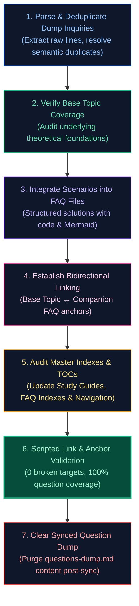

# Question Sync Skill

An expert agent workflow for analyzing `questions-dump.md` files across technical curriculum repositories, deduplicating inquiries against existing materials, systematically expanding base topic files and companion FAQ guides, and enforcing project-wide link and index integrity.

---

## 1. Role & Architectural Mental Model

When integrating raw question dumps into the interview curriculum:
- **Preserve Established Architectural Separation:**
  - **Base Topic Guides (`0X_topic_name.md`):** Authoritative, deep theoretical formulations, internal mechanics, memory/runtime internals, mathematical foundations, and end-to-end reference blueprints.
  - **Companion FAQ Guides (`frequently_asked_questions/0X_topic_name_faq.md`):** Concrete interview puzzle scenarios, edge-case debugging runbooks, code snippets, and operational triage playbooks.
- **Deduplication over Duplication:** Never create duplicate or parallel content. If a concept is already addressed, enhance existing sections only if a genuine edge-case gap is exposed.
- **Bidirectional Discoverability:** Every base topic must contextually link to its companion FAQ questions, and every FAQ scenario must link back to its base curriculum reference.

---

## 2. Standard 7-Phase Execution Workflow



### Phase 1: Parse & Deduplicate Dump Inquiries
1. Read the target `questions-dump.md` file completely (never sample subsets).
2. For each question, perform semantic search across the codebase (using `grep` or file inspection) to verify if the underlying concept or question is already covered.
3. Categorize each inquiry into one of three buckets:
   - **Bucket A (Fully Covered):** Existing materials already provide thorough theoretical and interview-level depth $\to$ Record mapping, do not duplicate.
   - **Bucket B (Concept Exists, Edge Case Missing):** Underlying topic exists, but the dump exposes a specific puzzle, trap, or scenario (e.g. proxy bypass on `private` methods, MCP server timeout double-charge trap) $\to$ Expand existing topic/FAQ.
   - **Bucket C (Completely Uncovered):** Concept is missing $\to$ Requires new section in base topic and dedicated scenario in FAQ guide.

### Phase 2: Base Topic Coverage Verification & Expansion
If a concept is missing or insufficiently covered in the base topic guide:
1. Locate the appropriate numbered base guide (`0X_topic.md`).
2. Add comprehensive coverage adhering to the project's high content standards:
   - Theoretical definition & architectural mechanics.
   - Low-level internal execution details (memory layout, OS/runtime behavior).
   - High-contrast dark-mode Mermaid diagrams (`style fill:#0f172a,stroke:#3b82f6...`).
   - Production-grade code examples with strict typing and docstrings.
   - Failure modes, common engineering traps, and performance characteristics.
3. Update the base file's internal Table of Contents.

### Phase 3: FAQ Integration & Formatting Standards
- **FAQ File Numbering Conventions:**
  - Number companion FAQ files sequentially with two-digit numeric prefixes (`01_`, `02_`, ..., `13_`, `14_`, `15_`, `16_`).
  - Do NOT use alphabetic sub-numbering suffixes like `a, b` (e.g. avoid `16a_`, `16b_`). Use clean consecutive numeric integers (`14_`, `15_`, `16_`).
- **Heading Format:** Use consistent numbering and sanitized markdown anchors:
  ```markdown
  ### QXX. Descriptive Title of Scenario
  **Topic Covered:** Sub-domains, Key APIs, Algorithms  
  **Question:** The exact, clear interview question prompt.
  ```
- **Standard Solution Structure:**
  1. **Definition & Core Concepts:** Ground truth explanation.
  2. **Visual Flow:** Mermaid sequence diagram or flowchart visualizing dataflow/state transitions.
  3. **Production Implementation / Code Solution:** Executable, robust Python/Java/SQL code with comments.
  4. **Complexity Analysis:** Explicit Big-$O$ Time and Space complexity ($O(1)$, $O(N)$).
  5. **Engineering Implications & Production Pitfalls:** Real-world failure modes (memory leaks, race conditions, timeouts).
  6. **Core Curriculum Cross-Reference:** Markdown link back to the base topic section.
- **Synchronize FAQ Table of Contents:** Always update the FAQ file's `## Table of Contents` at the top with matching links.

### Phase 4: Establish Bidirectional Linking
1. In the base topic file (`0X_topic.md`), add or update the contextual tip callout block linking to the new FAQ scenarios:
   ```markdown
   > [!TIP]
   > **Deep-Dive Interview Scenarios & Production Runbooks:**
   > - [QXX. Scenario Title](frequently_asked_questions/0X_topic_faq.md#qxx-scenario-title)
   ```
2. In the FAQ file, ensure the cross-reference at the bottom of the question points back to the exact base topic anchor:
   ```markdown
   *Deep-dive theoretical reference: See [Module Title](../0X_topic.md#anchor)*
   ```

### Phase 5: Audit Master Indexes & TOCs
Audit and update all repository-level indexes to prevent orphaned materials:
1. **Master Study Guide (`00_*_study_guide_and_index.md`):** Ensure the module table accurately reflects the companion FAQ files, question counts, and key topics.
2. **Master FAQ Index (`frequently_asked_questions/00_*_faq_index.md`):** Ensure all numbered companion FAQ files are registered with their proper domain scope and key scenarios.

### Phase 6: Automated Validation Checklist
Before concluding the integration, execute an automated verification script that:
1. **Validates All Internal Links:** Parses every `[label](target)` in all modified files. Verifies that local file targets exist and every anchor `#anchor` matches an actual heading slug.
2. **Verifies Question Dump Coverage:** Verifies that every single non-empty bullet point from `questions-dump.md` maps directly to an existing or newly integrated curriculum section.
3. **Ensures Zero Git Residuals:** Cleans up temporary debug scripts or scratch artifacts.

### Phase 7: Clear Synced Question Dump Files
Once the integration is validated and passes Phase 6 with 100% question coverage and zero broken links/anchors:
1. **Clear Dump Contents:** Clear / truncate the contents of the synced `questions-dump.md` file in the affected module (or leave a clean, empty placeholder ready for the next incoming dump).
2. **Prevent Duplicate Processing:** This ensures questions that have already been integrated into topic guides and FAQ companion files are not re-evaluated or re-processed in subsequent synchronization runs.

---

## 3. GitHub Markdown Slugification Standard
When generating anchors for headings:
1. Strip inline Markdown formatting (`*`, `` ` ``, `_`, `[link](url)`).
2. Convert all characters to lowercase.
3. Remove all non-alphanumeric characters except spaces and hyphens (`[^\w\s-]`).
4. Replace whitespace and multiple consecutive hyphens with a single hyphen (`-`).
5. Ensure anchors are exact:
   - Example: `### Q14. Spring @Transactional Architecture` $\to$ `#q14-spring-transactional-architecture`
   - Example: `### Scenario 5: What is RAG?` $\to$ `#scenario-5-what-is-rag`

