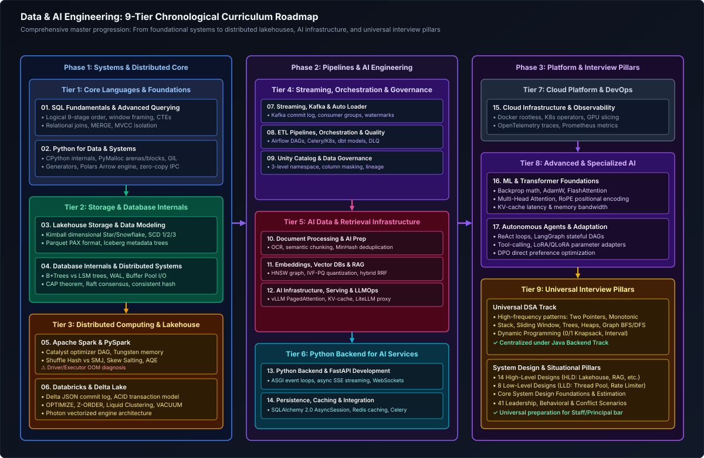

# Data and AI Engineering Master Curriculum & Comprehensive Study Guide

This master guide provides the definitive, production-grade learning roadmap, conceptual index, and chronological study order for modern Data and AI Engineering. The curriculum maintains **Data Engineering as its primary foundation**, extending into the critical skills required to build, operate, scale, and govern the data infrastructure powering artificial intelligence applications: high-throughput Lakehouses (Spark, Databricks, Delta Lake), streaming backplanes (Kafka, Auto Loader), relational SQL mastery, database storage engines (B+ Trees, LSM Trees, WAL), unstructured document processing pipelines, high-dimensional vector embeddings, vector databases (HNSW, IVF-PQ), hybrid retrieval (BM25 + Dense + RRF), production AI serving infrastructure (vLLM, continuous batching), high-concurrency Python backend services (FastAPI, AsyncIO, SQLAlchemy 2.0), cloud orchestration (Kubernetes, Docker, Terraform), and complete interview preparation (DSA in Python, System Design HLD/LLD, Situational Scenarios, and Technical FAQs).

Every guide includes formal architectural definitions, Mermaid topological diagrams, hardware/memory mechanics, production-grade code implementations with detailed line-by-line commentary, defensive edge-case mitigation, and production troubleshooting playbooks.

---

## Recommended Chronological Study Order

*D2 Source: [`01_data_and_ai_curriculum_tiers.d2`](assets/00_data_and_ai_study_guide_and_index/01_data_and_ai_curriculum_tiers.d2)*

---

## Master Curriculum Modules Overview

Comprehensive 17-chapter progressive engineering curriculum covering core data foundations, distributed lakehouses, streaming pipelines, vector search, and production AI serving infrastructure:

### Phase 1: Systems & Distributed Core
- [`01. SQL Fundamentals & Advanced Querying`](01_sql_and_advanced_querying.md) ([Companion FAQ](frequently_asked_questions/01_sql_and_advanced_querying_faq.md)) — *Relational & Analytical SQL*: Logical query processing order, window functions, recursive CTEs, distributed joins (BHJ, SMJ), skew salting, MERGE/UPSERT, MVCC, DoorDash delivery streaks, cross-shopping diversity, and production revenue discrepancy triage.
- [`02. Python for Data & Systems`](02_python_for_data_and_systems.md) ([Companion FAQ](frequently_asked_questions/02_python_for_data_and_systems_faq.md)) — *Python Systems & Memory Engineering*: Python memory manager and GIL internals, generator streaming for 10GB+ files, Pydantic data validation, Polars vs Pandas benchmarks, DuckDB OLAP, streaming dictionary aggregation without Pandas, Sweep-Line interval tracking, and Roman numeral parsing.
- [`03. Data Modeling & Lakehouse Storage`](03_data_modeling_and_lakehouse_storage.md) ([Companion FAQ](frequently_asked_questions/03_data_modeling_and_lakehouse_storage_faq.md)) — *Dimensional Modeling & Storage Formats*: Kimball dimensional design (Star vs Snowflake), Fact/Dim taxonomies, SCD Types 0–6, Data Vault 2.0, Medallion Lakehouse, Parquet/ORC/Avro internals, compaction, and DoorDash/Uber three-sided marketplace dimensional architecture with H3 indexing.
- [`04. Database Internals & Distributed Systems`](04_database_internals_and_distributed_systems.md) ([Companion FAQ](frequently_asked_questions/04_database_internals_and_distributed_systems_faq.md)) — *Storage Engines & Distributed Systems*: B+ Trees vs LSM Trees, WAL, Buffer Pool cache eviction, MVCC, CAP/PACELC theorems, consensus (Raft, 2PC), consistent hashing, distributed locks, rate limiting, and API resilience.
- [`05. Apache Spark & PySpark`](05_apache_spark_and_pyspark.md) ([Companion FAQ](frequently_asked_questions/05_apache_spark_and_pyspark_faq.md)) — *Distributed Computing & PySpark*: Spark Driver/Executor architecture, Catalyst optimizer phases, Project Tungsten, join strategies, skew salting with virtual partitions & two-track broadcast, AQE dynamic optimizations, and Spark JVM memory spilling vs G1GC stop-the-world triage.
- [`06. Databricks & Delta Lake`](06_databricks_and_delta_lake.md) ([Companion FAQ](frequently_asked_questions/06_databricks_and_delta_lake_faq.md)) — *Databricks & Delta Lake ACID*: Delta transaction log (`_delta_log`), ACID transactions, OPTIMIZE with Z-ORDER, Liquid Clustering, manual Parquet file deletion recovery, Delta OCC file-level collisions vs Deletion Vectors, VACUUM retention divergence, and schema validation.

### Phase 2: Pipelines, Streaming & AI Engineering
- [`07. Streaming, Kafka & Auto Loader`](07_streaming_kafka_and_event_driven_data.md) ([Companion FAQ](frequently_asked_questions/07_streaming_kafka_and_event_driven_data_faq.md)) — *Real-Time Streaming & Auto Loader*: Kafka commit log, consumer groups, KRaft consensus, Databricks Auto Loader, 15-minute out-of-order dynamic watermarks & RocksDB state store eviction, exactly-once delivery, and real-time H3 dynamic surge pricing engines.
- [`08. ETL Pipelines & Data Quality`](08_etl_pipelines_orchestration_and_data_quality.md) ([Companion FAQ](frequently_asked_questions/08_etl_pipelines_orchestration_and_data_quality_faq.md)) — *Pipelines, Airflow, ADF, dbt & Quality*: Batch vs streaming ingestion, pipeline idempotency, checkpoint stores, DLQs, Airflow DAGs, dynamic task mapping, dbt incremental models, ADF Integration Runtime latency triage, 12,000 ADLS subfolders Auto Loader, multi-trigger concurrency, and zero-downtime blue/green view swapping.
- [`09. Unity Catalog & Governance`](09_unity_catalog_and_data_governance.md) ([Companion FAQ](frequently_asked_questions/09_unity_catalog_and_data_governance_faq.md)) — *Governance, Zero-Trust & Observability*: Unity Catalog 3-level namespace, RBAC vs ABAC, Row-Level Security (RLS), Column-Level Security (CLS), dynamic data masking, GDPR compliance, OpenLineage, and data observability.
- [`10. Document Processing & AI Data Prep`](10_document_processing_and_data_preparation_for_ai.md) ([Companion FAQ](frequently_asked_questions/10_document_processing_and_data_preparation_for_ai_faq.md)) — *AI Document Processing & Chunking*: Unstructured document parsing (PDF, tables, OCR), recursive & semantic chunking strategies, token budget management (BPE, tiktoken), and MinHash LSH semantic deduplication.
- [`11. Embeddings, Vector DBs & RAG`](11_embeddings_vector_databases_and_rag_pipelines.md) ([Companion FAQ](frequently_asked_questions/11_embeddings_vector_databases_and_rag_pipelines_faq.md)) — *Vector Databases & Retrieval RAG*: Dense vs sparse embeddings (ColBERT/SPLADE), HNSW graph indexing, IVF-PQ quantization, hybrid search with Reciprocal Rank Fusion (RRF), cross-encoder rerankers, and production RAG failure isolation (Context Recall vs Faithfulness).
- [`12. AI Infrastructure, Serving & LLMOps`](12_ai_infrastructure_serving_and_llmops.md) ([Companion FAQ](frequently_asked_questions/12_ai_infrastructure_serving_and_llmops_faq.md)) — *High-Throughput Serving & LLMOps*: GPU memory allocation, vLLM continuous batching sizing (compute prefill vs bandwidth decode), PagedAttention, TensorRT-LLM, model gateways (LiteLLM), semantic caching (GPTCache), token rate-limiting, and evaluation telemetry.
- [`13. Python Backend & FastAPI`](13_python_backend_and_api_development.md) ([Companion FAQ](frequently_asked_questions/13_python_backend_and_api_development_faq.md)) — *AsyncIO & FastAPI Web Services*: CPython event loops (`epoll`), `asyncio` task groups, FastAPI ASGI architecture, Pydantic v2 validation, Server-Sent Events (SSE) token streaming for LLMs, and WebSockets.
- [`14. Persistence, Caching & Integration`](14_persistence_caching_and_service_architecture.md) ([Companion FAQ](frequently_asked_questions/14_persistence_caching_and_service_architecture_faq.md)) — *Persistence, Caching & Integration*: SQLAlchemy 2.0 AsyncSession, connection pool sizing, Redis distributed caching, Redlock distributed locking, Celery asynchronous background tasks, and pytest integration testing.

### Phase 3: Platform, ML & Specialized AI
- [`15. Cloud Infrastructure & Observability`](15_cloud_infrastructure_containers_and_observability.md) ([Companion FAQ](frequently_asked_questions/15_cloud_infrastructure_containers_and_observability_faq.md)) — *Cloud Containers & Data Observability*: Docker containerization for data/AI workloads, Kubernetes (Spark on K8s, Ray Operator, vLLM Deployments), Terraform IaC, OpenTelemetry distributed tracing, and Prometheus metrics.
- [`16. ML & Transformer Foundations`](16_machine_learning_and_transformer_foundations.md) ([Companion FAQ](frequently_asked_questions/16_machine_learning_and_transformer_foundations_faq.md)) — *ML, Deep Learning & Transformers*: Loss surfaces, backpropagation computational graphs, numerical stability, AdamW decoupled weight decay mechanics, Precision vs Recall cost matrix calibration, multi-head attention, KV cache memory footprint, and MoE.
- [`17. Autonomous Agents & Adaptation`](17_autonomous_agents_and_model_adaptation.md) ([Companion FAQ](frequently_asked_questions/17_autonomous_agents_and_model_adaptation_faq.md)) — *Agents, PEFT & Enterprise AI Design*: ReAct cognitive loops, LangGraph state machine harnesses, multi-agent debate and consensus protocols, Parameter-Efficient Fine-Tuning (LoRA, QLoRA), DPO, and enterprise AI architecture.

---

## Dedicated Universal Interview Preparation Pillars

### 1. [Universal Data Structures & Algorithms Track](../Java%20Backend%20Engineering/data_structures_and_algorithms/00_dsa_study_guide_and_index.md)
To eliminate duplicate materials and ensure complete algorithmic depth, all core Data Structures & Algorithms (DSA) patterns, complexity proofs, and canonical implementations are centralized under the **[Java Backend Engineering: DSA Track](../Java%20Backend%20Engineering/data_structures_and_algorithms/00_dsa_study_guide_and_index.md)**.
- Spans 8 comprehensive modules: Linear Structures, Monotonic Deques, Binary Trees/BSTs/Tries, Binary Search on Answer, Heaps & Sweep-Line Intervals, Graphs & Shortest Paths, Dynamic Programming, and Backtracking / Bit Manipulation.

### 2. [System Design & Situational Track (HLD, LLD & Leadership)](system_design_and_situational/00_system_design_and_situational_index.md)
Comprehensive, consolidated curriculum covering distributed data foundations, 14 high-level architectures, 8 low-level machine coding components, and 41 engineering leadership situational scenarios:
- [`01. System Design Foundations`](system_design_and_situational/01_system_design_foundations.md) — Storage vs compute disaggregation, Parquet/ORC columnar formats, Delta Lake & Iceberg ACID transaction logs, Catalyst query execution & shuffle disk spills, stateful streaming watermarks, RocksDB state stores, vector search distance metrics, HNSW graph navigation, IVF-PQ product quantization, and Unity Catalog governance.
- [`02. High-Level System Design (HLD)`](system_design_and_situational/02_high_level_system_design.md) — 14 distributed data & AI architectures: Multi-Hop Medallion Lakehouse, Petabyte-scale Debezium CDC, Sub-second ClickHouse/Pinot OLAP serving, 100M GPS pings telemetry ingestion, Hybrid multi-cloud platforms, Cross-region active-active DR, **Trade Surveillance CEP detecting market manipulation across venues**, **Regulatory reporting pipeline with 100% completeness & exact 6-month reproduction**, **Real-time payment event streaming & deduplication (millions of events/sec)**, **Enterprise payments data warehouse with SCD Type 2**, End-to-end Enterprise RAG with hybrid search (BM25+HNSW), Enterprise Feature Store (Redis + Delta Lake), **Continuous ML model drift detection & retraining**, and **Multi-tenant LLM assistant with customer data isolation & prompt guardrails**.
- [`03. Low-Level Design (LLD) & Component Internals`](system_design_and_situational/03_low_level_system_design.md) — 8 machine coding components: High-throughput streaming Ring Buffer with backpressure, Stateful stream deduplication engine with sliding time window, Custom shuffle partitioner & disk spill manager, Columnar storage row-group reader with dictionary/RLE encoding, Schema evolution validator, Rate-limited database batch sink with DLQ, In-memory vector index with cosine similarity & vector search, and **AI Agent Safe Tool Execution Gatekeeper with permissions, spending limits & human-in-the-loop approval**.
- [`04. Situational Scenarios & Engineering Leadership`](system_design_and_situational/04_situational_scenarios.md) — 41 production scenarios tailored for Senior, Staff & Principal Engineers: Incident command during Sev-1 pipeline failures, 11 PM critical board reporting discrepancy resolution, Data skew OOM and executor crash triage, Spark ETL performance optimization (6.7h to 48m), Infrastructure-level vs data-level defect isolation, Explaining technical complexities to non-technical stakeholders, Disagreeing with management on lakehouse storage, Balancing speed vs accuracy in financial data pipelines, End-to-end enterprise hybrid architecture on Azure, Cross-team dependency & SLA governance, **Triaging LLM hallucinations from stale retrieval chunks**, **Managing multi-million dollar GPU cluster costs vs latency SLAs**, **Making high-stakes technical decisions with incomplete information (Two-Way Doors)**, and **Navigating unclear or rapidly shifting business requirements via decoupled data contracts**.

### 3. [Interview FAQs & Question Bank](frequently_asked_questions/00_data_and_ai_faq_index.md)
17 dedicated scenario guides covering real-world SQL puzzles, Spark performance tuning, Delta Lake internals, streaming watermarks, vector index memory sizing, and FastAPI async runtime triage.

---

## Production Problem-Solution Cross-Reference Index

The table below maps **54 canonical Data and AI engineering production problems** to their architectural solutions and corresponding curriculum chapters.

| Problem | Canonical Solution | Module Reference |
| :--- | :--- | :--- |
| **Duplicate Records** | Deduplication via Window Ranking & Delta MERGE | [`01_sql_and_advanced_querying.md`](01_sql_and_advanced_querying.md) [`08_etl_pipelines_orchestration_and_data_quality.md`](08_etl_pipelines_orchestration_and_data_quality.md) |
| **Late Arriving Data** | Event-Time Watermarking with Allowed Lateness | [`07_streaming_kafka_and_event_driven_data.md`](07_streaming_kafka_and_event_driven_data.md) |
| **CDC Processing** | Change Data Feed (CDF) & Log-Based CDC (Debezium) | [`06_databricks_and_delta_lake.md`](06_databricks_and_delta_lake.md) [`08_etl_pipelines_orchestration_and_data_quality.md`](08_etl_pipelines_orchestration_and_data_quality.md) |
| **Data Skew** | Key Salting & AQE Skew Join Handling | [`01_sql_and_advanced_querying.md`](01_sql_and_advanced_querying.md) [`05_apache_spark_and_pyspark.md`](05_apache_spark_and_pyspark.md) |
| **Small Files Problem** | File Compaction & Delta OPTIMIZE / Z-ORDER / Bin-Packing | [`03_data_modeling_and_lakehouse_storage.md`](03_data_modeling_and_lakehouse_storage.md) [`06_databricks_and_delta_lake.md`](06_databricks_and_delta_lake.md) |
| **Schema Drift** | Automated Schema Evolution (`mergeSchema`) & Schema Contracts | [`06_databricks_and_delta_lake.md`](06_databricks_and_delta_lake.md) [`08_etl_pipelines_orchestration_and_data_quality.md`](08_etl_pipelines_orchestration_and_data_quality.md) |
| **Pipeline Failures** | Dead Letter Queue (DLQ) & Quarantine Routing | [`08_etl_pipelines_orchestration_and_data_quality.md`](08_etl_pipelines_orchestration_and_data_quality.md) |
| **Data Quality Anomalies** | Automated Data Quality Frameworks (Great Expectations / DLT Expectations) | [`06_databricks_and_delta_lake.md`](06_databricks_and_delta_lake.md) [`08_etl_pipelines_orchestration_and_data_quality.md`](08_etl_pipelines_orchestration_and_data_quality.md) |
| **Missing Data / Nulls** | Statistical Imputation & Domain Default Value Coalescing | [`01_sql_and_advanced_querying.md`](01_sql_and_advanced_querying.md) [`05_apache_spark_and_pyspark.md`](05_apache_spark_and_pyspark.md) |
| **Large Data Volume** | Physical Partitioning, Z-ORDER Clustering & Columnar Pruning | [`03_data_modeling_and_lakehouse_storage.md`](03_data_modeling_and_lakehouse_storage.md) [`04_database_internals_and_distributed_systems.md`](04_database_internals_and_distributed_systems.md) |
| **Spark Driver OOM** | Avoiding `collect()`, Increasing Driver Memory, Limiting Broadcast | [`05_apache_spark_and_pyspark.md`](05_apache_spark_and_pyspark.md) |
| **Spark Executor OOM** | Repartitioning, Spill-to-Disk Tuning & Memory Fraction Tuning | [`05_apache_spark_and_pyspark.md`](05_apache_spark_and_pyspark.md) |
| **Kafka Consumer Lag** | Partition Count Alignment & Parallel Async Consumer Groups | [`07_streaming_kafka_and_event_driven_data.md`](07_streaming_kafka_and_event_driven_data.md) |
| **Airflow DAG Deadlocks** | Pool Sizing, Dynamic Task Mapping & Celery/K8s Executors | [`08_etl_pipelines_orchestration_and_data_quality.md`](08_etl_pipelines_orchestration_and_data_quality.md) |
| **Silent Data Corruption** | WORM Immutable Storage & Cryptographic Lineage Validation | [`09_unity_catalog_and_data_governance.md`](09_unity_catalog_and_data_governance.md) |
| **PII Data Exposure** | Dynamic Data Masking & Attribute-Based Access Control (ABAC) | [`09_unity_catalog_and_data_governance.md`](09_unity_catalog_and_data_governance.md) |
| **Multi-Column PDF Mangling** | Layout-Aware Optical Bounding-Box Detection (LayoutLM) | [`10_document_processing_and_data_preparation_for_ai.md`](10_document_processing_and_data_preparation_for_ai.md) |
| **Embedded Table Flattening** | HTML / Markdown Table Serialization with Repeating Headers | [`10_document_processing_and_data_preparation_for_ai.md`](10_document_processing_and_data_preparation_for_ai.md) |
| **Chunk Context Disconnect** | Breadcrumb Structural Header Prefix Injection | [`10_document_processing_and_data_preparation_for_ai.md`](10_document_processing_and_data_preparation_for_ai.md) |
| **Redundant Vector Storage** | MinHash Locality-Sensitive Hashing (LSH) Deduplication | [`10_document_processing_and_data_preparation_for_ai.md`](10_document_processing_and_data_preparation_for_ai.md) |
| **Token Truncation in Chunks**| BPE Tokenizer Budget Enforcement (`tiktoken` / HuggingFace) | [`10_document_processing_and_data_preparation_for_ai.md`](10_document_processing_and_data_preparation_for_ai.md) |
| **Vector DB Memory Exhaustion**| 8-Bit Scalar Quantization (SQ8) & Inverted File Product Quantization (IVF-PQ) | [`11_embeddings_vector_databases_and_rag_pipelines.md`](11_embeddings_vector_databases_and_rag_pipelines.md) |
| **Keyword/Acronym Retrieval Miss**| Hybrid Search with Reciprocal Rank Fusion (BM25 + Dense Vectors) | [`11_embeddings_vector_databases_and_rag_pipelines.md`](11_embeddings_vector_databases_and_rag_pipelines.md) |
| **Semantic Drift in Search** | Two-Stage Retrieval with Cross-Encoder Reranking (`bge-reranker-large`) | [`11_embeddings_vector_databases_and_rag_pipelines.md`](11_embeddings_vector_databases_and_rag_pipelines.md) |
| **High Embedding Cost** | Hierarchical Small-to-Large Chunking with Cache Keys | [`11_embeddings_vector_databases_and_rag_pipelines.md`](11_embeddings_vector_databases_and_rag_pipelines.md) |
| **GPU KV Cache Saturation** | PagedAttention (vLLM) & FP8 KV Cache Compression | [`12_ai_infrastructure_serving_and_llmops.md`](12_ai_infrastructure_serving_and_llmops.md) |
| **GPU Low Core Utilization** | Continuous Batching & Chunked Prefill Scheduling | [`12_ai_infrastructure_serving_and_llmops.md`](12_ai_infrastructure_serving_and_llmops.md) |
| **Surging Inference Costs** | Semantic Caching (GPTCache / Redis) & Tiered Small-Model Routing | [`12_ai_infrastructure_serving_and_llmops.md`](12_ai_infrastructure_serving_and_llmops.md) |
| **Model Serving Thundering Herd**| Token Bucket Rate Limiting & Upstream Gateway Admission Control | [`12_ai_infrastructure_serving_and_llmops.md`](12_ai_infrastructure_serving_and_llmops.md) |
| **Prompt Injection Attacks** | Input Guardrails, Dual-LLM Verifiers & Delimiter Enforcement | [`12_ai_infrastructure_serving_and_llmops.md`](12_ai_infrastructure_serving_and_llmops.md) |
| **FastAPI Event Loop Freeze** | Offloading Sync CPU Tasks to `run_in_executor` Thread Pools | [`13_python_backend_and_api_development.md`](13_python_backend_and_api_development.md) |
| **LLM Response TTFT Latency**| Server-Sent Events (SSE) Streaming Generator Responses | [`13_python_backend_and_api_development.md`](13_python_backend_and_api_development.md) |
| **Pydantic Validation Slowness**| Pydantic v2 Compiled Rust Core Migration | [`13_python_backend_and_api_development.md`](13_python_backend_and_api_development.md) |
| **Async DB Session Leaks** | Scoped `AsyncSession` Context Managers in FastAPI Dependencies | [`14_persistence_caching_and_service_architecture.md`](14_persistence_caching_and_service_architecture.md) |
| **Redis Connection Pool Stalls**| Non-blocking `redis.asyncio` Drivers & Max Connections Cap | [`14_persistence_caching_and_service_architecture.md`](14_persistence_caching_and_service_architecture.md) |
| **Distributed Race Conditions** | Redlock Distributed Lock Algorithm via Redis Mutexes | [`14_persistence_caching_and_service_architecture.md`](14_persistence_caching_and_service_architecture.md) |
| **Long-Running Job Blocking**| Celery Background Task Workers with RabbitMQ/Redis Broker | [`14_persistence_caching_and_service_architecture.md`](14_persistence_caching_and_service_architecture.md) |
| **AI Workload K8s Scheduling**| NVIDIA GPU Device Plugin & Custom Resource Quotas | [`15_cloud_infrastructure_containers_and_observability.md`](15_cloud_infrastructure_containers_and_observability.md) |
| **Untraceable LLM Failures**| OpenTelemetry W3C TraceContext & Generative AI Semantic Conventions | [`15_cloud_infrastructure_containers_and_observability.md`](15_cloud_infrastructure_containers_and_observability.md) |
| **Training Gradient Vanishing**| RMSNorm Layer Normalization & Residual Connections | [`16_machine_learning_and_transformer_foundations.md`](16_machine_learning_and_transformer_foundations.md) |
| **Full Fine-Tuning VRAM OOM** | Parameter-Efficient Fine-Tuning (LoRA / QLoRA 4-bit NormalFloat) | [`17_autonomous_agents_and_model_adaptation.md`](17_autonomous_agents_and_model_adaptation.md) |
| **Agent Infinite Tool Loops** | Max Recursion Limits, Graph State Machine Cycles (LangGraph) | [`17_autonomous_agents_and_model_adaptation.md`](17_autonomous_agents_and_model_adaptation.md) |
| **Model Alignment Degradation**| Direct Preference Optimization (DPO) on Paired Domain Datasets | [`17_autonomous_agents_and_model_adaptation.md`](17_autonomous_agents_and_model_adaptation.md) |
| **Vector DB Stale Chunks** | Automated Invalidation DAGs & Lifecycle TTL Filters | [`system_design_and_situational/04_situational_scenarios.md`](system_design_and_situational/04_situational_scenarios.md#q38-triaging-hallucinations-caused-by-stale--misaligned-retrieval-chunks) |
| **Cross-Service Data Discrepancy**| Bronze Time Travel Verification & Idempotent Backfill Replay | [`system_design_and_situational/04_situational_scenarios.md`](system_design_and_situational/04_situational_scenarios.md#q6--q7-11-pm-critical-data-quality-outage-before-9-am-executive-report) |
| **Sub-Second OLAP Bottlenecks**| Pre-aggregated MergeTree Engines (ClickHouse / Pinot) | [`system_design_and_situational/02_high_level_system_design.md`](system_design_and_situational/02_high_level_system_design.md) |
| **Extreme Data Skew in Joins**| Salting Join Keys with Pseudo-Random Suffixes ($0..K$) | [`01_sql_and_advanced_querying.md`](01_sql_and_advanced_querying.md) [`05_apache_spark_and_pyspark.md`](05_apache_spark_and_pyspark.md) |
| **Ring Buffer Producer Backpressure**| Lock-free CAS Sequence Barriers (LMAX Disruptor Pattern) | [`system_design_and_situational/03_low_level_system_design.md`](system_design_and_situational/03_low_level_system_design.md) |
| **Columnar Storage Overhead** | Run-Length Encoding (RLE) & Dictionary Compression Encoding | [`system_design_and_situational/03_low_level_system_design.md`](system_design_and_situational/03_low_level_system_design.md) |
| **Online Feature Retrieval Lag**| Low-Latency KV Stores (Redis / Feast) with Point-in-Time Joins | [`system_design_and_situational/02_high_level_system_design.md`](system_design_and_situational/02_high_level_system_design.md) |
| **High-Stakes Decisions under Ambiguity**| Two-Way Door Classification & 5-Day Empirical Canary Spikes | [`system_design_and_situational/04_situational_scenarios.md`](system_design_and_situational/04_situational_scenarios.md#q40-making-high-stakes-technical-decisions-with-incomplete-information) |
| **Rapidly Shifting Business KPIs**| Decoupled dbt Metric Layer & Immutable Raw Invariant State | [`system_design_and_situational/04_situational_scenarios.md`](system_design_and_situational/04_situational_scenarios.md#q41-navigating-unclear-or-rapidly-shifting-business-requirements-in-enterprise-initiatives) |
| **Delta Transaction Log Divergence**| Physical Parquet Audit & `_delta_log` Forward State Repair | [`frequently_asked_questions/06_databricks_and_delta_lake_faq.md`](frequently_asked_questions/06_databricks_and_delta_lake_faq.md#q32-medium-manual-file-deletion--delta-transaction-log-divergence-filenotfoundexception--fsck-repair) |
| **ADF Integration Runtime Queueing**| Auto Loader Event Grid Notifications & Scale-Out IR Nodes | [`frequently_asked_questions/08_etl_pipelines_orchestration_and_data_quality_faq.md`](frequently_asked_questions/08_etl_pipelines_orchestration_and_data_quality_faq.md#q43-hard-azure-data-factory-adf-latency-triage-runbook-20-min-to-2-hours) |

---

## References & Further Reading
- Kleppmann, Martin. *Designing Data-Intensive Applications*. O'Reilly Media.
- Armbrust, Michael, et al. *Delta Lake: High-Performance ACID Table Storage over Cloud Object Stores*. VLDB.
- Zaharia, Matei, et al. *Apache Spark: A Unified Engine for Big Data Processing*. Communications of the ACM.
- Lewis, Patrick, et al. *Retrieval-Augmented Generation for Knowledge-Intensive NLP Tasks*. NeurIPS.
- Kwon, Woosuk, et al. *Efficient Memory Management for Large Language Model Serving with PagedAttention (vLLM)*. SOSP.
- Tiangolo, Sebastián. *FastAPI Documentation & Production Guidelines*.
