# 01. SQL Fundamentals & Advanced Analytical Engineering: Master Production Guide

A comprehensive, production-grade guide to relational query architecture, ANSI data types, three-valued logic, filtering, aggregations, relational & distributed joins (BHJ, SMJ, Skew Salting), recursive CTEs, window functions, MERGE/transactions, and physical query optimization.

---

## Architectural Overview: Relational Query Execution & Processing Architecture

SQL (Structured Query Language) is not simply a syntax for querying data; it is a mathematical implementation of **Relational Algebra** and **Tuple Relational Calculus**, executed over physical storage engines.

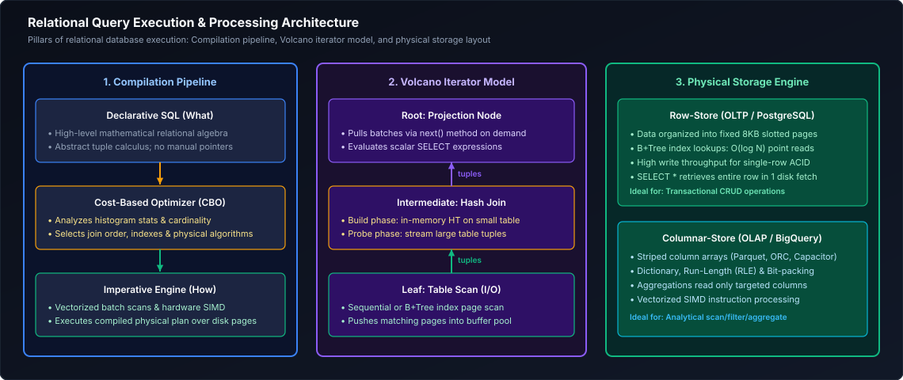

*D2 Source: [`01_query_architecture.d2`](assets/01_sql_and_advanced_querying/01_query_architecture.d2)*

---

## Table of Contents
1. [SQL Query Architecture & Logical Processing Order](#1-sql-query-architecture--logical-processing-order)
   - [1.1 Declarative vs Imperative: The Restaurant Patron & Master Chef Analogy](#11-declarative-vs-imperative-the-restaurant-patron--master-chef-analogy)
   - [1.2 The 9-Stage Logical Execution Pipeline](#12-the-9-stage-logical-execution-pipeline)
   - [1.3 Tracing a Query Step-by-Step with Sample Data](#13-tracing-a-query-step-by-step-with-sample-data)
   - [1.4 Logical Order vs Physical Execution Plan (Engine Optimization Secrets)](#14-logical-order-vs-physical-execution-plan-engine-optimization-secrets)
2. [Data Types, Casting & Defensive Conversions](#2-data-types-casting--defensive-conversions)
   - [2.1 Relational Data Type Taxonomy](#21-relational-data-type-taxonomy)
   - [2.2 Exact Numerics vs Approximate Floating Point (The Financial Audit Hazard)](#22-exact-numerics-vs-approximate-floating-point-the-financial-audit-hazard)
   - [2.3 Character Types: CHAR vs VARCHAR vs TEXT](#23-character-types-char-vs-varchar-vs-text)
   - [2.4 Temporal Types & Timezone Arithmetic](#24-temporal-types--timezone-arithmetic)
   - [2.5 Type Casting: Explicit, Implicit & Defensive (CAST vs TRY_CAST / SAFE_CAST)](#25-type-casting-explicit-implicit--defensive-cast-vs-try_cast--safe_cast)
   - [2.6 SARGability Hazards in Type Conversions](#26-sargability-hazards-in-type-conversions)
3. [Three-Valued Logic & NULL Handling](#3-three-valued-logic--null-handling)
   - [3.1 The Philosophy of NULL: Missing vs Unknown vs Not Applicable](#31-the-philosophy-of-null-missing-vs-unknown-vs-not-applicable)
   - [3.2 Three-Valued Logic (3VL) Truth Semantics (AND, OR, NOT)](#32-three-valued-logic-3vl-truth-semantics-and-or-not)
   - [3.3 The Lethal `NOT IN (subquery containing NULL)` Production Trap](#33-the-lethal-not-in-subquery-containing-null-production-trap)
   - [3.4 Defensive NULL Handling: COALESCE, NULLIF, and NVL](#34-defensive-null-handling-coalesce-nullif-and-nvl)
   - [3.5 Safe Null-Aware Equality (`IS NOT DISTINCT FROM`)](#35-safe-null-aware-equality-is-not-distinct-from)
4. [Filtering, Pattern Matching & Conditional Expressions](#4-filtering-pattern-matching--conditional-expressions)
   - [4.1 Predicate Operators & Boundary Traps (`BETWEEN` with Timestamps)](#41-predicate-operators--boundary-traps-between-with-timestamps)
   - [4.2 Pattern Matching: LIKE, ILIKE, Wildcards, and Escaping](#42-pattern-matching-like-ilike-wildcards-and-escaping)
   - [4.3 SARGable vs Non-SARGable WHERE Predicates](#43-sargable-vs-non-sargable-where-predicates)
   - [4.4 CASE WHEN: Searched CASE vs Simple CASE](#44-case-when-searched-case-vs-simple-case)
   - [4.5 Conditional Aggregations (Pivoting Data Horizontally)](#45-conditional-aggregations-pivoting-data-horizontally)
   - [4.6 Row-Level Scalar Comparisons: GREATEST & LEAST vs Vertical Aggregates](#46-row-level-scalar-comparisons-greatest--least-vs-vertical-aggregates)
5. [Scalar Functions: String & Temporal Manipulation](#5-scalar-functions-string--temporal-manipulation)
   - [5.1 Essential String Functions & Regex Extractions](#51-essential-string-functions--regex-extractions)
   - [5.2 Production Date, Time & Interval Manipulation](#52-production-date-time--interval-manipulation)
6. [Aggregations & Grouping](#6-aggregations--grouping)
   - [6.1 How GROUP BY Works Internally: Hash Aggregation vs Sort/Stream Aggregation](#61-how-group-by-works-internally-hash-aggregation-vs-sortstream-aggregation)
   - [6.2 The Nuances of COUNT: COUNT(*), COUNT(1), COUNT(col), COUNT(DISTINCT col)](#62-the-nuances-of-count-count-count1-countcol-countdistinct-col)
   - [6.3 Standard & Statistical Aggregates (SUM, AVG, MIN, MAX, STDDEV, VARIANCE)](#63-standard--statistical-aggregates-sum-avg-min-max-stddev-variance)
   - [6.4 Set & Array Aggregations (STRING_AGG, ARRAY_AGG)](#64-set--array-aggregations-string_agg-array_agg)
   - [6.5 Advanced Multi-Dimensional Grouping: GROUPING SETS, ROLLUP & CUBE](#65-advanced-multi-dimensional-grouping-grouping-sets-rollup--cube)
7. [Relational Joins & Multi-Table Querying](#7-relational-joins--multi-table-querying)
   - [7.1 Relational Join Foundations: Cartesian Products & Theta Joins](#71-relational-join-foundations-cartesian-products--theta-joins)
   - [7.2 INNER JOIN: Mathematical Intersection & Step-by-Step Walkthrough](#72-inner-join-mathematical-intersection--step-by-step-walkthrough)
   - [7.3 LEFT (OUTER) JOIN: Master Record Preservation & Step-by-Step Walkthrough](#73-left-outer-join-master-record-preservation--step-by-step-walkthrough)
   - [7.4 The Right-Table WHERE Filter Disaster (Accidental Inner Join)](#74-the-right-table-where-filter-disaster-accidental-inner-join)
   - [7.5 RIGHT (OUTER) JOIN & Why Production Standards Avoid It](#75-right-outer-join--why-production-standards-avoid-it)
   - [7.6 FULL OUTER JOIN: Bidirectional Reconciliation](#76-full-outer-join-bidirectional-reconciliation)
   - [7.7 CROSS JOIN: Cartesian Products, Calendar Spines, and Explosion Risks](#77-cross-join-cartesian-products-calendar-spines-and-explosion-risks)
   - [7.8 SELF JOIN: Hierarchies and Graphs](#78-self-join-hierarchies-and-graphs)
   - [7.9 Equi-Joins vs Non-Equi Joins (Range & Band Joins)](#79-equi-joins-vs-non-equi-joins-range--band-joins)
   - [7.10 Multi-Table Joins & Star Schema Dimensional Querying](#710-multi-table-joins--star-schema-dimensional-querying)
8. [Set Operators](#8-set-operators)
   - [8.1 Joins vs Set Operators: Horizontal vs Vertical Combination](#81-joins-vs-set-operators-horizontal-vs-vertical-combination)
   - [8.2 UNION vs UNION ALL: Sorting, Hashing, and Memory Spilling](#82-union-vs-union-all-sorting-hashing-and-memory-spilling)
   - [8.3 INTERSECT: Set Intersection Mechanics](#83-intersect-set-intersection-mechanics)
   - [8.4 EXCEPT / MINUS: Set Difference & Churn Detection](#84-except--minus-set-difference--churn-detection)
   - [8.5 Set Operators & The Surprising Treatment of NULLs](#85-set-operators--the-surprising-treatment-of-nulls)
9. [Subqueries & Derived Tables](#9-subqueries--derived-tables)
   - [9.1 Scalar Subqueries: Definition, Single-Value Guarantees, and Hazards](#91-scalar-subqueries-definition-single-value-guarantees-and-hazards)
   - [9.2 Multi-Row Subqueries: IN, ANY, ALL, and EXISTS](#92-multi-row-subqueries-in-any-all-and-exists)
   - [9.3 Correlated Subqueries: Nested Loops vs Optimizer Decorrelation](#93-correlated-subqueries-nested-loops-vs-optimizer-decorrelation)
   - [9.4 Derived Tables vs Common Table Expressions (CTEs)](#94-derived-tables-vs-common-table-expressions-ctes)
10. [Foundational Data Modification (DML) & Database Objects](#10-foundational-data-modification-dml--database-objects)
   - [10.1 INSERT Mechanics: Direct Literals, Multi-Row, CTAS, and Idempotency](#101-insert-mechanics-direct-literals-multi-row-ctas-and-idempotency)
   - [10.2 UPDATE Operations: Filtered Updates & Multi-Table Joins](#102-update-operations-filtered-updates--multi-table-joins)
   - [10.3 DELETE vs TRUNCATE vs DROP: Physical Disk, WAL, MVCC Bloat, and Locks](#103-delete-vs-truncate-vs-drop-physical-disk-wal-mvcc-bloat-and-locks)
   - [10.4 Standard Views vs Materialized Views](#104-standard-views-vs-materialized-views)
   - [10.5 Session Temporary Tables vs Table Variables vs CTEs](#105-session-temporary-tables-vs-table-variables-vs-ctes)
11. [Advanced Joins & Distributed Execution Mechanics](#11-advanced-joins--distributed-execution-mechanics)
   - [11.1 SEMI JOIN & ANTI JOIN: Mechanics, Null Immunity & Memory Footprint](#111-semi-join--anti-join-mechanics-null-immunity--memory-footprint)
   - [11.2 SELF JOIN & Asymmetric Pairing Patterns](#112-self-join--asymmetric-pairing-patterns)
   - [11.3 Distributed Join Strategies: Broadcast Hash Join (BHJ)](#113-distributed-join-strategies-broadcast-hash-join-bhj)
   - [11.4 Distributed Join Strategies: Shuffle Hash Join (SHJ)](#114-distributed-join-strategies-shuffle-hash-join-shj)
   - [11.5 Distributed Join Strategies: Sort-Merge Join (SMJ)](#115-distributed-join-strategies-sort-merge-join-smj)
   - [11.6 Distributed Join Comparison & Selection Decision Tree](#116-distributed-join-comparison--selection-decision-tree)
   - [11.7 Join Order & Cost-Based Optimizer (CBO) Execution Trees](#117-join-order--cost-based-optimizer-cbo-execution-trees)
   - [11.8 Join Cardinality, Metric Fan-Out & Pre-Aggregation Patterns](#118-join-cardinality-metric-fan-out--pre-aggregation-patterns)
   - [11.9 The Salting Technique for Extreme Data Skew](#119-the-salting-technique-for-extreme-data-skew)
   - [11.10 Non-Equi Joins & Temporal / SCD2 Range Matching](#1110-non-equi-joins--temporal--scd2-range-matching)
12. [Advanced Subqueries, CTEs & Hierarchical Recursion](#12-advanced-subqueries-ctes--hierarchical-recursion)
   - [12.1 Correlated Subqueries & Query Decorrelation Mechanics](#121-correlated-subqueries--query-decorrelation-mechanics)
   - [12.2 `LATERAL` Joins & `CROSS APPLY`: The SQL For-Each Loop](#122-lateral-joins--cross-apply-the-sql-for-each-loop)
   - [12.3 Common Table Expressions (CTEs): Inlining vs. Optimization Fences](#123-common-table-expressions-ctes-inlining-vs-optimization-fences)
   - [12.4 Recursive CTEs: Fixed-Point Relational Iteration](#124-recursive-ctes-fixed-point-relational-iteration)
   - [12.5 Hierarchical Tree Traversal with Cycle Detection & Path Building](#125-hierarchical-tree-traversal-with-cycle-detection--path-building)
   - [12.6 Bill of Materials (BOM) Multi-Level Parts Explosion](#126-bill-of-materials-bom-multi-level-parts-explosion)
   - [12.7 `EXISTS` vs. `NOT EXISTS` vs. `IN` / `NOT IN` Deep-Dive](#127-exists-vs-not-exists-vs-in--not-in-deep-dive)
13. [Window Functions & Analytical SQL](#13-window-functions--analytical-sql)
   - [13.1 Window Function Architecture & The 9-Stage SQL Lifecycle](#131-window-function-architecture--the-9-stage-sql-lifecycle)
   - [13.2 Window Framing Deep-Dive: `ROWS` vs. `RANGE` vs. `GROUPS`](#132-window-framing-deep-dive-rows-vs-range-vs-groups)
   - [13.3 The Lethal Implicit `RANGE` Default Trap](#133-the-lethal-implicit-range-default-trap)
   - [13.4 Ranking Functions: `ROW_NUMBER`, `RANK`, `DENSE_RANK`, `NTILE`](#134-ranking-functions-row_number-rank-dense_rank-ntile)
   - [13.5 Value Navigation Functions: `LEAD`, `LAG`, `FIRST_VALUE`, `LAST_VALUE`, `NTH_VALUE`](#135-value-navigation-functions-lead-lag-first_value-last_value-nth_value)
   - [13.6 The `LAST_VALUE()` Unbounded Following Framing Gotcha](#136-the-last_value-unbounded-following-framing-gotcha)
   - [13.7 Cumulative Patterns: Running Totals, Moving Averages & Physical vs. Calendar Windows](#137-cumulative-patterns-running-totals-moving-averages--physical-vs-calendar-windows)
   - [13.8 Advanced Analytical Pattern 1: Deduplication via Window Ranking](#138-advanced-analytical-pattern-1-deduplication-via-window-ranking)
   - [13.9 Advanced Analytical Pattern 2: The Gaps and Islands Problem (Difference-of-Ranks)](#139-advanced-analytical-pattern-2-the-gaps-and-islands-problem-difference-of-ranks)
   - [13.10 Advanced Analytical Pattern 3: Sessionization via Inactivity Thresholds](#1310-advanced-analytical-pattern-3-sessionization-via-inactivity-thresholds)
   - [13.11 Advanced Analytical Pattern 4: Top-N per Group with Tie-Breaker Handling](#1311-advanced-analytical-pattern-4-top-n-per-group-with-tie-breaker-handling)
   - [13.12 The Modern `QUALIFY` Clause](#1312-the-modern-qualify-clause)
14. [Advanced Grouping, Aggregation & Pivoting](#14-advanced-grouping-aggregation--pivoting)
   - [14.1 Multi-Dimensional Grouping: `GROUPING SETS`, `ROLLUP`, `CUBE`](#141-multi-dimensional-grouping-grouping-sets-rollup-cube)
   - [14.2 The `GROUPING()` and `GROUPING_ID()` Bitmask Functions](#142-the-grouping-and-grouping_id-bitmask-functions)
   - [14.3 Cross-Tabulation & Pivoting: `PIVOT` and `UNPIVOT`](#143-cross-tabulation--pivoting-pivot-and-unpivot)
15. [Advanced Data Modification, Concurrency & Transactions](#15-advanced-data-modification-concurrency--transactions)
   - [15.1 `MERGE` / `UPSERT` Mechanics & Change Data Capture (CDC)](#151-merge--upsert-mechanics--change-data-capture-cdc)
   - [15.2 The Fatal `MERGE` Target Row Collision Trap & Remediation](#152-the-fatal-merge-target-row-collision-trap--remediation)
   - [15.3 Transaction Control: Two-Phase Locking (2PL), Savepoints & WAL](#153-transaction-control-two-phase-locking-2pl-savepoints--wal)
   - [15.4 ANSI SQL Isolation Levels & Concurrency Anomalies](#154-ansi-sql-isolation-levels--concurrency-anomalies)
   - [15.5 Multi-Version Concurrency Control (MVCC) Internals](#155-multi-version-concurrency-control-mvcc-internals)
16. [Advanced Database Programmability & Objects](#16-advanced-database-programmability--objects)
   - [16.1 Materialized Views, Query Rewrite Engines & Incremental Refresh](#161-materialized-views-query-rewrite-engines--incremental-refresh)
   - [16.2 Stored Procedures & Transactional Orchestration](#162-stored-procedures--transactional-orchestration)
   - [16.3 User-Defined Functions (UDFs): Scalar, Table-Valued & Vectorized PyArrow](#163-user-defined-functions-udfs-scalar-table-valued--vectorized-pyarrow)
   - [16.4 Temporary Views, Session Scopes & Global Virtual Catalogs](#164-temporary-views-session-scopes--global-virtual-catalogs)
17. [Summary Comparison & Production Engineering Reference Matrix](#17-summary-comparison--production-engineering-reference-matrix)
18. [References & Further Reading](#18-references--further-reading)

> [!TIP]
> **Deep-Dive Interview Scenario:**
> - [Q2. View vs Materialized View](frequently_asked_questions/01_sql_and_advanced_querying_faq.md#q2-easy-view-vs-materialized-view)

---

# 1. SQL Query Architecture & Logical Processing Order

### 1.1 Declarative vs Imperative: The Restaurant Patron & Master Chef Analogy

To write high-performance SQL queries and debug strange bugs, one must first recognize that SQL is a **declarative language**, fundamentally different from imperative programming languages like Python, C++, or Java.

#### The Intuitive Mental Model
- **Imperative Programming (Python/Java):** You act like a cook following a recipe step-by-step:
  > *"Open the refrigerator, take out 3 eggs, heat a skillet to 350°F, melt 10g of butter, crack the eggs into the skillet, stir continuously for 3 minutes, remove from heat."*
  You explicitly control *every step* of execution, state mutations, and resource allocation.
- **Declarative Programming (SQL):** You act like a diner at a fine restaurant ordering from the menu:
  > *"I would like a medium-rare ribeye steak with roasted asparagus and a glass of Pinot Noir."*
  You state **WHAT** you want. You do not tell the kitchen which pan to use, what order to chop the vegetables, or what temperature the oven should be. The **Master Chef (the Database Query Engine & Cost-Based Optimizer)** evaluates the kitchen's inventory, available stove burners (CPU cores), and preparation time to determine the most efficient physical workflow to prepare your meal.

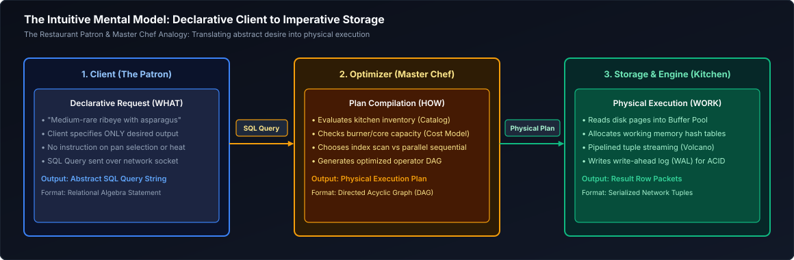

*D2 Source: [`02_engine_mental_model.d2`](assets/01_sql_and_advanced_querying/02_engine_mental_model.d2)*

Because SQL is declarative, the order in which you write the query in your text editor (**Lexical / Syntactic Order**) is completely different from the order in which the database conceptually evaluates it (**Logical Execution Order**).

---

### 1.2 The 9-Stage Logical Execution Pipeline

When an engineer writes a query, syntax dictates starting with `SELECT`. However, the relational engine must first establish where the data lives before it can filter, aggregate, or format it.

Here is the exact logical execution order:

| Logical Step | Clause | Engine Responsibility | Why It Occurs Here |
| :---: | :--- | :--- | :--- |
| **1** | `FROM` & `JOIN` | Identify base tables, load virtual relations, evaluate Cartesian products and `ON` join predicates. | The engine cannot filter or project data without first identifying the target universe of rows. |
| **2** | `WHERE` | Evaluate boolean predicates against individual tuples; prune non-qualifying rows. | Pruning rows before grouping eliminates memory waste during hash aggregation. |
| **3** | `GROUP BY` | Partition the remaining rows into buckets based on distinct grouping keys. | Prepares individual rows to be folded into summary statistics. |
| **4** | `HAVING` | Evaluate boolean conditions against the aggregate metrics of each bucket. | Filters group-level statistics; cannot run before groups are computed. |
| **5** | `SELECT` | Project desired columns, calculate scalar expressions, apply column aliases, and run window functions. | Evaluates expressions only on rows that survived all prior filtering stages. |
| **6** | `DISTINCT` | Deduplicate identical rows across all projected columns using hash sets or sorting. | Operates only on the final set of projected output columns. |
| **7** | Set Operators | Combine results of separate queries (`UNION [ALL]`, `INTERSECT`, `EXCEPT`). | Works on complete result sets of individual SELECT blocks. |
| **8** | `ORDER BY` | Sort the materialized rows by specified columns or expressions. | Sorting is computationally expensive ($O(N \log N)$); deferred until the smallest row volume remains. |
| **9** | `LIMIT` / `OFFSET` | Discard rows outside the requested pagination boundary. | Final gatekeeper before serializing packets over the network to the client. |

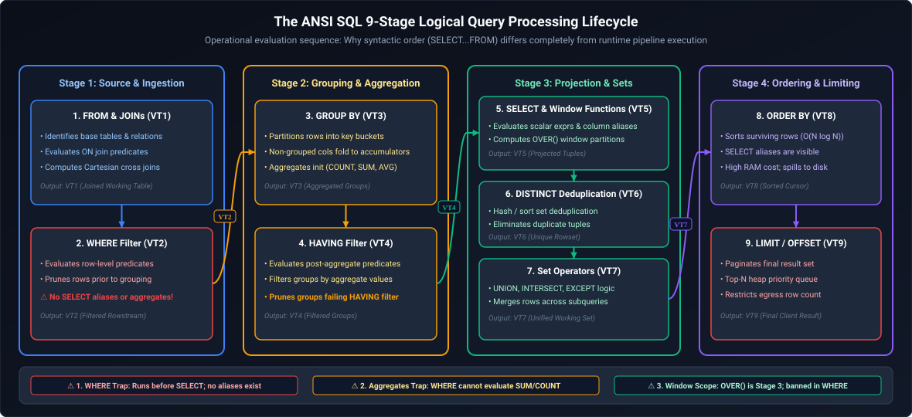

*D2 Source: [`03_logical_execution_pipeline.d2`](assets/01_sql_and_advanced_querying/03_logical_execution_pipeline.d2)*

#### Why This Order Matters: The Three Classic Gotchas
1. **The WHERE Alias Trap:** Why does `SELECT price * quantity AS total_amount FROM sales WHERE total_amount > 100` fail with `column "total_amount" does not exist`?
   - *Reason:* `WHERE` is evaluated at **Step 2**. The alias `total_amount` is created during projection at **Step 5**. At Step 2, the engine has no idea `total_amount` exists!
2. **The HAVING vs. WHERE Confusion:** Why can't you put `WHERE AVG(salary) > 80000`?
   - *Reason:* `WHERE` executes before rows are grouped. The aggregate `AVG(salary)` does not yet exist! You must filter aggregate calculations in `HAVING` (Step 4).
3. **The ORDER BY Alias Freedom:** Why *can* you write `SELECT first_name AS fname FROM employees ORDER BY fname`?
   - *Reason:* `ORDER BY` runs at **Step 8**, *after* `SELECT` has assigned aliases at Step 5.

---

### 1.3 Tracing a Query Step-by-Step with Sample Data

Let us trace an end-to-end query using a concrete dataset to observe how data transforms through each logical phase.

#### Input Dataset: `raw_orders`
| order_id | customer_id | department | amount | status |
| :---: | :---: | :--- | :---: | :--- |
| 101 | C1 | Electronics | 400.00 | COMPLETED |
| 102 | C2 | Home | 50.00 | COMPLETED |
| 103 | C1 | Electronics | 800.00 | COMPLETED |
| 104 | C3 | Books | 30.00 | CANCELLED |
| 105 | C2 | Home | 120.00 | COMPLETED |
| 106 | C4 | Electronics | 1500.00 | COMPLETED |
| 107 | C1 | Electronics | 50.00 | REFUNDED |

#### The Query
```sql
SELECT 
    department,
    COUNT(order_id)         AS order_count,
    SUM(amount)             AS total_revenue,
    ROUND(AVG(amount), 2)   AS avg_ticket_size
FROM raw_orders
WHERE status = 'COMPLETED'
GROUP BY department
HAVING SUM(amount) > 200.00
ORDER BY total_revenue DESC
LIMIT 1;
```

#### Execution Trace

##### Step 1: `FROM raw_orders`
The engine loads the 7 rows from the physical table into memory.

##### Step 2: `WHERE status = 'COMPLETED'`
Each row is tested against `status = 'COMPLETED'`.
- Rows 104 (CANCELLED) and 107 (REFUNDED) are discarded.
- Surviving rows (5 total): 101, 102, 103, 105, 106.

##### Step 3: `GROUP BY department`
The surviving 5 rows are partitioned into hash buckets keyed by `department`:
- **Bucket "Electronics":**
  - Row 101 ($400.00)
  - Row 103 ($800.00)
  - Row 106 ($1500.00)
- **Bucket "Home":**
  - Row 102 ($50.00)
  - Row 105 ($120.00)

##### Step 4: `HAVING SUM(amount) > 200.00`
Aggregate metrics are computed per bucket:
- **Electronics:** $\text{SUM} = 400 + 800 + 1500 = \$2700.00$. Condition ($2700 > 200$) is **TRUE**. Retained.
- **Home:** $\text{SUM} = 50 + 120 = \$170.00$. Condition ($170 > 200$) is **FALSE**. Discarded!

##### Step 5: `SELECT department, COUNT(...), SUM(...), ROUND(AVG(...))`
The engine computes final projections for the surviving bucket(s):
- `department`: "Electronics"
- `order_count`: 3
- `total_revenue`: 2700.00
- `avg_ticket_size`: $2700.00 / 3 = 900.00$

##### Step 6: `ORDER BY total_revenue DESC`
The materialized groups are sorted in descending order of `total_revenue`.

##### Step 7: `LIMIT 1`
The engine takes the first row of the sorted output.

#### Final Output
| department | order_count | total_revenue | avg_ticket_size |
| :--- | :---: | :---: | :---: |
| Electronics | 3 | 2700.00 | 900.00 |

---

### 1.4 Logical Order vs Physical Execution Plan (Engine Optimization Secrets)

> [!IMPORTANT]
> **Logical order describes semantics, NOT physical execution!**
> The database engine is free to reorder physical steps as long as the mathematical result is guaranteed to be identical.

Modern Cost-Based Optimizers (CBOs) perform physical transformations that deviate from logical order:
1. **Predicate Pushdown:** Even though `JOIN` comes logically before `WHERE`, the CBO pushes `WHERE` filters *down* into the table scan operator. This ensures that unneeded rows are filtered out at the disk or storage layer before being transferred across the network or joined in memory.
2. **Projection Pruning:** The engine scans only the columns referenced in the query, discarding unused columns at the storage reader (especially in columnar formats like Parquet or Snowflake Micro-partitions).
3. **Join Reordering:** If you join Table A to Table B to Table C, the optimizer uses data statistics (histograms, cardinality estimates) to reorder joins so that the smallest intermediate relations are materialized first.

> [!TIP]
> **Deep-Dive Interview Scenarios:**
> - [Q1. Logical SQL Query Execution Order](frequently_asked_questions/01_sql_and_advanced_querying_faq.md#q1-medium-logical-sql-query-execution-order)
> - [Q3. Troubleshooting a Slow-Running Query (30m to 2m)](frequently_asked_questions/01_sql_and_advanced_querying_faq.md#q3-hard-troubleshooting-a-slow-running-query-30m-to-2m)
> - [Q4. Identifying Bottlenecks Across 5 Joined Large Tables](frequently_asked_questions/01_sql_and_advanced_querying_faq.md#q4-hard-identifying-bottlenecks-across-5-joined-large-tables)
> - [Q5. Query Optimization: Indexes vs Query Rewrites vs Data Model Changes](frequently_asked_questions/01_sql_and_advanced_querying_faq.md#q5-hard-query-optimization-indexes-vs-query-rewrites-vs-data-model-changes)
> - [Q32. Total Revenue per Customer from Orders and Order Items](frequently_asked_questions/01_sql_and_advanced_querying_faq.md#q32-medium-total-revenue-per-customer-from-orders-and-order-items)

---

# 2. Data Types, Casting & Defensive Conversions

### 2.1 Relational Data Type Taxonomy

Choosing the correct data type is critical. An improper type choice causes silent numeric precision loss, bloated storage footprints, memory thrashing during joins, and CPU cache misses.

| Category | Canonical SQL Types | Typical Storage | Memory Layout & Semantics | Best Practice Engineering Use Case |
| :--- | :--- | :--- | :--- | :--- |
| **Exact Integers** | `SMALLINT`<br/>`INT` / `INTEGER`<br/>`BIGINT` | 2 Bytes<br/>4 Bytes<br/>8 Bytes | Two's complement binary integer representation. Range: $\pm 3.2\times 10^4$, $\pm 2.1\times 10^9$, $\pm 9.2\times 10^{18}$. | Primary keys, foreign keys, physical counters, dimensional surrogate keys. |
| **Fixed-Point Decimals** | `DECIMAL(p, s)`<br/>`NUMERIC(p, s)` | Variable (approx. 4–16 Bytes) | Stored as base-10 packed decimals. Precision $p$ = total digits; Scale $s$ = fractional digits. | Financial ledgers, currency transactions, tax calculations, audit balances. |
| **Approximate Floating Point** | `REAL` / `FLOAT4`<br/>`DOUBLE PRECISION` / `FLOAT8` | 4 Bytes<br/>8 Bytes | IEEE 754 binary floating-point representation. Mantissa and exponent format. | Scientific telemetry, GPS coordinates, machine learning feature vectors. |
| **Fixed Characters** | `CHAR(n)` | $n$ Bytes (padded) | Fixed length. Always blank-pads short strings with trailing spaces up to length $n$. | Fixed-length domain codes (e.g., ISO 2-letter country codes `'US'`, currency codes `'USD'`). |
| **Variable Characters** | `VARCHAR(n)`<br/>`TEXT` / `STRING` | 1–4 Bytes header + actual byte length | Dynamically sized. Stores variable-length UTF-8 strings without padding. | Names, descriptions, URLs, arbitrary text blobs. |
| **Temporal Dates & Times** | `DATE`<br/>`TIME`<br/>`TIMESTAMP`<br/>`TIMESTAMPTZ` | 4 Bytes<br/>8 Bytes<br/>8 Bytes<br/>8 Bytes | `DATE`: Days since Unix epoch (1970-01-01).<br/>`TIMESTAMP`: Microseconds since Unix epoch.<br/>`TIMESTAMPTZ`: UTC storage with client-timezone display. | Event logging, time-series data, transaction timestamps, audit trails. |
| **Boolean** | `BOOLEAN` | 1 Byte | Tri-state logic: `TRUE`, `FALSE`, or `NULL`. | Status flags, active/deleted markers, binary decision variables. |
| **Semi-Structured** | `JSON`<br/>`JSONB` | Variable (text vs binary) | `JSON`: Raw text string.<br/>`JSONB`: Deconstructed binary decomposition enabling GIN indexing and fast path traversal. | Ingesting raw webhook payloads, unvalidated IoT events, flexible metadata schemas. |

---

### 2.2 Exact Numerics vs Approximate Floating Point (The Financial Audit Hazard)

One of the most dangerous rookie mistakes in data engineering is using `FLOAT` or `DOUBLE` for monetary or accounting calculations.

#### The Binary Representation Problem
Computers represent numbers in base-2 (binary). Just as $\frac{1}{3}$ cannot be written cleanly in base-10 decimal ($0.33333\dots$), numbers like $0.1$ or $0.2$ cannot be represented cleanly in base-2 binary floating point.

```
Base-10 Representation:     0.1 = 1 / 10
Base-2 Binary Float:        0.0001100110011001100110011... (infinite repeating fractional)
```

In IEEE 754 `DOUBLE PRECISION`:
$$\text{In binary float math: } 0.1 + 0.2 = 0.300000000000000044408920985...$$

#### Code Example: The Silent Financial Drift
```sql
-- Create a demonstration sandbox table
CREATE TEMPORARY TABLE currency_experiment (
    float_balance  DOUBLE PRECISION,
    exact_balance  NUMERIC(12, 2)
);

INSERT INTO currency_experiment VALUES (0.0, 0.00);

-- Simulate adding $0.10 cents ten times
-- Floating point arithmetic accumulates rounding noise:
SELECT 
    CAST(0.1 AS DOUBLE PRECISION) * 10 AS float_result,
    0.1::DOUBLE PRECISION + 0.2::DOUBLE PRECISION AS float_sum,
    CAST(0.1 AS NUMERIC(10,2)) * 10 AS exact_result;

-- float_sum yields:    0.30000000000000004
-- exact_result yields: 1.00
```

> [!CAUTION]
> **Production Rule:** Never use `FLOAT` or `DOUBLE` for financial data, billing pipelines, cryptocurrency balances, or regulatory reports. Always use `DECIMAL(precision, scale)` or `NUMERIC(precision, scale)`.
> For example, `DECIMAL(18, 4)` stores up to 18 total digits, with 4 digits after the decimal point, guaranteeing exact arithmetic.

---

### 2.3 Character Types: CHAR vs VARCHAR vs TEXT

Understanding the storage and comparison differences between string types prevents subtle bugs:

1. **`CHAR(n)`:**
   - Fixed length. If you insert `'NYC'` into a `CHAR(10)` column, the database appends 7 trailing spaces: `'NYC       '`.
   - In comparisons, some databases (ANSI standard) ignore trailing spaces, while others or string functions (like `LENGTH()`) count them:
     ```sql
     SELECT LENGTH('NYC'::CHAR(10)); -- Returns 10 in PostgreSQL!
     ```
   - *Use Case:* Only use `CHAR` when every single entry is strictly the same length (e.g., `CHAR(2)` for US states `'CA'`, `'NY'`; `CHAR(32)` for MD5 hashes).
2. **`VARCHAR(n)`:**
   - Variable length with a maximum character limit $n$. Stores only the inserted characters plus a 1- or 4-byte length prefix.
   - *Use Case:* When you want database-level validation to prevent excessively long strings (e.g., `VARCHAR(100)` for an email address).
3. **`TEXT` / `STRING`:**
   - Variable length with no artificial limit (up to 1GB in PostgreSQL).
   - In modern analytical engines (Snowflake, BigQuery, Databricks), `VARCHAR` and `STRING` have virtually identical performance because storage is columnar and compressed with dictionary encoding.

---

### 2.4 Temporal Types & Timezone Arithmetic

Handling dates, timestamps, and timezones is a frequent source of pipeline bugs.

#### The Three Core Temporal Concepts
1. **`DATE`:** Stores a calendar date (`2026-10-16`). No concept of time, hours, or timezones.
2. **`TIMESTAMP` (without timezone):** Stores a wall-clock date and time (`2026-10-16 14:30:00`). It represents whatever time was showing on the clock on the wall, but does not specify *where* on Earth that wall was!
3. **`TIMESTAMPTZ` (with timezone):** Stores a precise, universal point in time (an absolute epoch instant).
   - Internally, PostgreSQL, Snowflake, and BigQuery convert `TIMESTAMPTZ` values to **UTC** before storing them on disk.
   - When queried, the engine converts the UTC timestamp to the client session's local timezone.

```sql
-- Demonstration of timezone conversion
-- Scenario: Ingest a raw UTC timestamp and convert it to New York local time for reporting
SELECT 
    event_id,
    utc_timestamp,
    -- Convert UTC instant to US Eastern time (handles daylight saving automatically)
    utc_timestamp AT TIME ZONE 'UTC' AT TIME ZONE 'America/New_York' AS eastern_timestamp,
    
    -- Extract the business hour in New York
    EXTRACT(HOUR FROM utc_timestamp AT TIME ZONE 'America/New_York') AS local_business_hour
FROM telemetry.api_logs;
```

---

### 2.5 Type Casting: Explicit, Implicit & Defensive (CAST vs TRY_CAST / SAFE_CAST)

Converting data between types occurs in three ways:

1. **Explicit ANSI Casting:**
   ```sql
   SELECT CAST('2026-01-15' AS DATE);
   ```
2. **PostgreSQL / DuckDB Shorthand (`::`):**
   ```sql
   SELECT '2026-01-15'::DATE, 45::BIGINT;
   ```
3. **Defensive Casting (`TRY_CAST` / `SAFE_CAST`):**
   In real-world data engineering, raw files (CSV, JSON) frequently contain dirty data (e.g., an age column containing `'twenty-five'`, `'N/A'`, or `''`).
   - If you use `CAST('twenty-five' AS INT)`, the query crashes with a fatal error: `invalid input syntax for integer`. A 10-hour batch pipeline halts because of a single dirty row!
   - `TRY_CAST` (Snowflake, DuckDB, Trino) or `SAFE_CAST` (BigQuery) returns `NULL` instead of throwing an error:

```sql
-- Defensive ingestion pipeline pattern
SELECT 
    raw_user_id,
    -- Normal CAST: crashes if raw_score is 'N/A'
    -- Defensive CAST: yields NULL for invalid strings, allowing pipeline to complete
    TRY_CAST(raw_score AS NUMERIC(10, 2)) AS clean_score,
    
    -- Combine with COALESCE to provide a safe default value
    COALESCE(TRY_CAST(raw_retry_count AS INT), 0) AS safe_retry_count
FROM staging.unvalidated_web_events;
```

---

### 2.6 SARGability Hazards in Type Conversions

> [!WARNING]
> **SARGable** stands for **S**earch **Arg**ument **Able**. A query predicate is SARGable if the database engine can use an existing B-Tree index to perform a direct index seek rather than scanning the entire table.

Wrapping an indexed column inside a type conversion function blinds the index!

```sql
-- NON-SARGABLE (Terrible Performance):
-- The engine must call CAST() on every single row in the 100M-row table!
SELECT order_id, total_amount
FROM sales.orders
WHERE CAST(created_at AS DATE) = '2026-10-15';

-- SARGABLE (Lightning Fast):
-- The column created_at is naked (unwrapped). The engine does a direct B-Tree index seek:
SELECT order_id, total_amount
FROM sales.orders
WHERE created_at >= '2026-10-15 00:00:00' 
  AND created_at <  '2026-10-16 00:00:00';
```

---

# 3. Three-Valued Logic & NULL Handling

### 3.1 The Philosophy of NULL: Missing vs Unknown vs Not Applicable

In relational database theory (invented by E.F. Codd), `NULL` is **not a value**. It does not represent zero, an empty string `""`, or a blank space.

`NULL` represents the **absence of a value** or an **unknown state**.
- *Zero ($0$):* You have 0 dollars in your bank account (a known quantity).
- *Empty String (`""`):* You have a middle name, and it is empty (a known string of length 0).
- *NULL:* We asked for your middle name, but you did not answer. We do not know if you have one or what it is!

Because `NULL` means "I don't know," standard mathematical and equality comparisons fail:
- Does "Unknown" equal "Unknown"? **We don't know!**
  Therefore, in SQL:
  ```sql
  NULL = NULL       --> Evaluates to UNKNOWN (NOT True!)
  NULL != NULL      --> Evaluates to UNKNOWN (NOT False!)
  10 > NULL         --> Evaluates to UNKNOWN
  ```

To test whether a value is missing, you must use the special relational operators `IS NULL` or `IS NOT NULL`.

---

### 3.2 Three-Valued Logic (3VL) Truth Semantics (AND, OR, NOT)

Because SQL conditions can evaluate to `TRUE`, `FALSE`, or `UNKNOWN`, the boolean logic system is called **Three-Valued Logic (3VL)**.

#### Truth Tables

##### AND Logic
| Expression | Result | Intuitive Explanation |
| :--- | :---: | :--- |
| `TRUE AND UNKNOWN` | `UNKNOWN` | If the unknown part turns out to be FALSE, the whole thing is FALSE; if TRUE, it is TRUE. We don't know yet! |
| `FALSE AND UNKNOWN` | `FALSE` | In AND logic, a single FALSE guarantees the entire condition is FALSE, regardless of the unknown! |
| `UNKNOWN AND UNKNOWN` | `UNKNOWN` | Completely unknown. |

##### OR Logic
| Expression | Result | Intuitive Explanation |
| :--- | :---: | :--- |
| `TRUE OR UNKNOWN` | `TRUE` | In OR logic, a single TRUE guarantees the whole condition is TRUE, regardless of what the unknown value is! |
| `FALSE OR UNKNOWN` | `UNKNOWN` | If the unknown value is TRUE, the result is TRUE; if FALSE, it is FALSE. We don't know! |
| `UNKNOWN OR UNKNOWN` | `UNKNOWN` | Completely unknown. |

##### NOT Logic
| Expression | Result |
| :--- | :---: |
| `NOT TRUE` | `FALSE` |
| `NOT FALSE` | `TRUE` |
| `NOT UNKNOWN` | `UNKNOWN` |

> [!IMPORTANT]
> **The WHERE Filter Rule:**
> In a SQL `WHERE` clause, a row is returned **ONLY if the predicate evaluates strictly to `TRUE`**.
> If the predicate evaluates to `FALSE` or `UNKNOWN`, the row is **silently discarded**.

```sql
-- Sample employee data:
-- Alice:   salary = 100,000, commission = 20,000
-- Bob:     salary = 80,000,  commission = 0
-- Charlie: salary = 90,000,  commission = NULL

-- Query:
SELECT name FROM employees WHERE commission > 10000;
-- Alice:   20000   > 10000 -> TRUE     -> Retained
-- Bob:     0       > 10000 -> FALSE    -> Discarded
-- Charlie: NULL    > 10000 -> UNKNOWN  -> Discarded!

-- Now, look at the inverse query:
SELECT name FROM employees WHERE commission <= 10000;
-- Alice:   20000   <= 10000 -> FALSE   -> Discarded
-- Bob:     0       <= 10000 -> TRUE    -> Retained
-- Charlie: NULL    <= 10000 -> UNKNOWN -> Discarded!

-- Notice that Charlie was returned by NEITHER query!
-- If you add the results of both queries, Charlie has disappeared entirely from your business reports!
```

---

### 3.3 The Lethal `NOT IN (subquery containing NULL)` Production Trap

This is one of the most infamous interview questions and real-world production incident triggers in data engineering.

#### The Scenario
Suppose you want to find all customers who have **never placed an order**.
- Table `customers`: IDs `[1, 2, 3]`
- Table `orders`: Placed by customers `[1, 2, NULL]` (one order has a NULL customer_id due to an anonymous guest checkout).

You write this seemingly innocent query:
```sql
SELECT customer_id, customer_name
FROM customers
WHERE customer_id NOT IN (SELECT customer_id FROM orders);
```

#### What You Expect
Customer `3` should be returned because customer `3` has never placed an order.

#### What Actually Happens
**The query returns ZERO rows! The entire result set is completely empty!**

#### The Mathematical Explanation
Under the hood, SQL expands the `NOT IN` predicate into a chain of equality checks connected by `AND`:

$$\text{customer\_id NOT IN (1, 2, NULL)} \iff \text{NOT (customer\_id = 1 OR customer\_id = 2 OR customer\_id = NULL)}$$

Now evaluate this condition for Customer `3`:
1. `customer_id = 1` $\to$ `3 = 1` $\to$ `FALSE`
2. `customer_id = 2` $\to$ `3 = 2` $\to$ `FALSE`
3. `customer_id = NULL` $\to$ `3 = NULL` $\to$ `UNKNOWN`

Substitute these into the OR expression:
$$\text{FALSE OR FALSE OR UNKNOWN} \implies \text{UNKNOWN}$$

Now apply the outer `NOT`:
$$\text{NOT (UNKNOWN)} \implies \text{UNKNOWN}$$

Because the final predicate evaluates to `UNKNOWN`, the `WHERE` clause discards the row! The same happens for every customer in the table. **The entire query silently drops all data.**

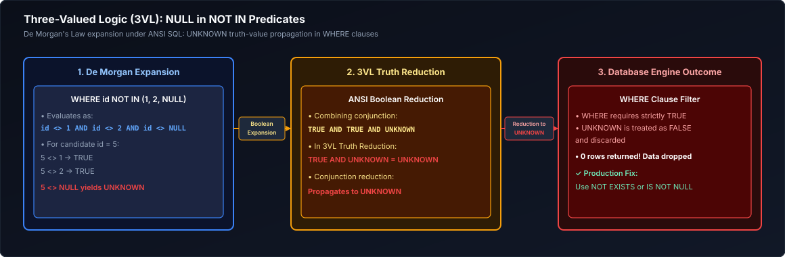

*D2 Source: [`04_three_valued_logic.d2`](assets/01_sql_and_advanced_querying/04_three_valued_logic.d2)*

#### Production-Safe Remedies

##### Solution 1: Use `NOT EXISTS` (Recommended Best Practice)
`NOT EXISTS` evaluates correlation. If a NULL exists in the inner subquery, `NOT EXISTS` handles it without collapsing:
```sql
SELECT c.customer_id, c.customer_name
FROM customers AS c
WHERE NOT EXISTS (
    SELECT 1 
    FROM orders AS o 
    WHERE o.customer_id = c.customer_id
);
```

##### Solution 2: Explicitly Filter NULLs in the Subquery
```sql
SELECT customer_id, customer_name
FROM customers
WHERE customer_id NOT IN (
    SELECT customer_id 
    FROM orders 
    WHERE customer_id IS NOT NULL
);
```

##### Solution 3: Left Anti-Join
```sql
SELECT c.customer_id, c.customer_name
FROM customers AS c
LEFT JOIN orders AS o ON c.customer_id = o.customer_id
WHERE o.customer_id IS NULL;
```

---

### 3.4 Defensive NULL Handling: COALESCE, NULLIF, and NVL

SQL provides scalar functions to manage NULLs cleanly:

#### 1. `COALESCE(val1, val2, ..., valN)`
Evaluates arguments from left to right and returns the **first non-NULL value**. If all values are NULL, it returns NULL.
```sql
-- Fallback ladder for contact information
SELECT 
    customer_id,
    COALESCE(cell_phone, home_phone, work_phone, 'NO_PHONE_PROVIDED') AS primary_contact
FROM crm.customers;
```

#### 2. `NULLIF(val1, val2)`
Compares two arguments. If `val1 = val2`, it returns `NULL`; otherwise, it returns `val1`.
- **Primary Use Case:** Preventing division-by-zero crashes.
```sql
-- Safe division pattern:
-- If total_orders is 0, NULLIF turns 0 into NULL.
-- Any number divided by NULL safely evaluates to NULL, preventing query termination!
SELECT 
    merchant_id,
    total_revenue / NULLIF(total_orders, 0) AS average_order_value
FROM billing.daily_metrics;
```

#### 3. Combining `NULLIF` and `COALESCE` to Clean Dirty Strings
In CSV data pipelines, missing strings often arrive as empty strings `""` rather than `NULL`.
```sql
-- Normalize empty strings into NULL, then provide a fallback literal:
SELECT 
    user_id,
    COALESCE(NULLIF(TRIM(referral_code), ''), 'DIRECT_TRAFFIC') AS attribution_source
FROM analytics.signups;
```

---

### 3.5 Safe Null-Aware Equality (`IS NOT DISTINCT FROM`)

In SQL-99 and modern databases (PostgreSQL, Snowflake, DuckDB), the standard comparison operator `=` returns `UNKNOWN` when comparing NULLs.
If you want a comparison where `NULL = NULL` evaluates to `TRUE`, use `IS NOT DISTINCT FROM`:

```sql
-- In standard SQL:
NULL = NULL                --> UNKNOWN
NULL != NULL               --> UNKNOWN

-- In null-safe SQL:
NULL IS NOT DISTINCT FROM NULL     --> TRUE
10   IS NOT DISTINCT FROM NULL     --> FALSE
10   IS NOT DISTINCT FROM 10       --> TRUE
```

In MySQL, this is written using the spaceship operator `<=>`:
```sql
SELECT * FROM products WHERE old_price <=> new_price;
```

> [!TIP]
> **Deep-Dive Interview Scenarios:**
> - [Q9. Second-Highest Salary in Each Department](frequently_asked_questions/01_sql_and_advanced_querying_faq.md#q9-medium-second-highest-salary-in-each-department)
> - [Q10. Third-Highest Salary Without TOP or LIMIT](frequently_asked_questions/01_sql_and_advanced_querying_faq.md#q10-medium-third-highest-salary-without-top-or-limit)
> - [Q11. Top 3 Products by Revenue in Each Category](frequently_asked_questions/01_sql_and_advanced_querying_faq.md#q11-medium-top-3-products-by-revenue-in-each-category)
> - [Q15. Defensive Handling of NULLs in Critical Columns](frequently_asked_questions/01_sql_and_advanced_querying_faq.md#q15-easy-defensive-handling-of-nulls-in-critical-columns)
> - [Q36. Numbers Appearing at Least Three Times Consecutively](frequently_asked_questions/01_sql_and_advanced_querying_faq.md#q36-medium-numbers-appearing-at-least-three-times-consecutively)

---

# 4. Filtering, Pattern Matching & Conditional Expressions

### 4.1 Predicate Operators & Boundary Traps (`BETWEEN` with Timestamps)

#### Relational Operators
- Standard comparisons: `=`, `!=` (or `<>`), `<`, `<=`, `>`, `>=`.
- Set membership: `IN (val1, val2, ...)` or `NOT IN (...)`.
- Range checking: `BETWEEN low AND high` (equivalent to `col >= low AND col <= high`).

#### The Timestamp `BETWEEN` Trap
Consider querying all transactions that occurred in January 2026:
```sql
-- DANGEROUS CODE:
SELECT * FROM transactions 
WHERE transaction_time BETWEEN '2026-01-01' AND '2026-01-31';
```
Why is this broken?
When you write the string `'2026-01-31'`, the database implicitly casts it to a timestamp at midnight: `'2026-01-31 00:00:00.000000'`.
Any transaction that occurred on January 31 at 10:30 AM (`2026-01-31 10:30:00`) is **silently missed**!

#### The Half-Open Interval Solution (Industry Best Practice)
Always use `>= start` and `< end`:
```sql
-- PRODUCTION STANDARD:
SELECT * FROM transactions 
WHERE transaction_time >= '2026-01-01' 
  AND transaction_time <  '2026-02-01';
```
This cleanly captures every microsecond of January up to the stroke of midnight on February 1st.

---

### 4.2 Pattern Matching: LIKE, ILIKE, Wildcards, and Escaping

SQL provides pattern matching against strings:
- `%`: Matches zero or more characters.
- `_`: Matches exactly one character.
- `LIKE`: Case-sensitive pattern matching.
- `ILIKE`: Case-insensitive pattern matching (PostgreSQL, Snowflake, DuckDB).

```sql
SELECT order_id, sku, customer_notes
FROM warehouse.shipments
WHERE sku LIKE 'ELEC-%'                  -- Starts with 'ELEC-'
  AND sku LIKE '____-____'               -- Exactly 4 characters, dash, 4 characters
  AND customer_notes ILIKE '%urgent%'    -- Contains 'urgent', 'URGENT', 'Urgent' anywhere
  AND discount_code LIKE '%\%%' ESCAPE '\'; -- Matches a literal percent sign '%' using escape
```

---

### 4.3 SARGable vs Non-SARGable WHERE Predicates

Writing performant SQL requires writing **SARGable** predicates that allow the engine to use indexes.

| Non-SARGable Pattern (Slow Full Table Scan) | SARGable Rewrite (Fast Index Seek) | Explanation |
| :--- | :--- | :--- |
| `WHERE UPPER(email) = 'USER@CORP.COM'` | `WHERE email = 'user@corp.com'` (if stored lower) or functional index | Wrapping the column in `UPPER()` forces the engine to evaluate the function for every row. |
| `WHERE amount + 10 > 100` | `WHERE amount > 90` | Move arithmetic to the constant side of the comparison. |
| `WHERE SUBSTRING(phone, 1, 3) = '415'` | `WHERE phone LIKE '415%'` | Range pattern matches B-Tree prefix. |
| `WHERE DATE_TRUNC('month', created_at) = '2026-01-01'` | `WHERE created_at >= '2026-01-01' AND created_at < '2026-02-01'` | Explicit range boundary preserves index seeks. |

---

### 4.4 CASE WHEN: Searched CASE vs Simple CASE

`CASE WHEN` is SQL’s conditional branching structure (`if-then-else`). It is an expression that returns a scalar value.

#### 1. Searched CASE (Most Flexible)
Evaluates arbitrary boolean conditions sequentially from top to bottom. It terminates at the first `TRUE` branch:
```sql
SELECT 
    account_id,
    balance,
    CASE 
        WHEN balance >= 1000000.00 THEN 'Platinum Tier'
        WHEN balance >= 250000.00  THEN 'Gold Tier'
        WHEN balance >= 50000.00   THEN 'Silver Tier'
        WHEN balance >= 0.00       THEN 'Standard Tier'
        ELSE 'Overdrawn / Negative'
    END AS account_tier
FROM banking.customer_accounts;
```

#### 2. Simple CASE
Compares a single expression against discrete target values:
```sql
SELECT 
    order_id,
    status_code,
    CASE status_code
        WHEN 'P' THEN 'Pending'
        WHEN 'S' THEN 'Shipped'
        WHEN 'D' THEN 'Delivered'
        WHEN 'C' THEN 'Cancelled'
        ELSE 'Unknown Code'
    END AS status_description
FROM logistics.orders;
```

> [!NOTE]
> If no `WHEN` condition is met and no `ELSE` clause is provided, SQL returns `NULL` by default. Always include an explicit `ELSE` clause in production queries to prevent accidental NULL propagation.

---

### 4.5 Conditional Aggregations (Pivoting Data Horizontally)

A key engineering pattern is combining `SUM()` or `COUNT()` with `CASE WHEN` to pivot row-level records into analytical summary columns in a single table scan:

```sql
-- Pivoting financial transactions by type and quarter
SELECT 
    merchant_id,
    COUNT(transaction_id)                                                       AS total_transactions,
    SUM(amount)                                                                 AS gross_volume,
    
    -- Conditional Aggregations:
    SUM(CASE WHEN transaction_type = 'PURCHASE' THEN amount ELSE 0.00 END)      AS purchase_volume,
    SUM(CASE WHEN transaction_type = 'REFUND'   THEN amount ELSE 0.00 END)      AS refund_volume,
    SUM(CASE WHEN transaction_type = 'CHARGEBACK' THEN amount ELSE 0.00 END)    AS chargeback_volume,
    
    -- Count only weekend transactions:
    COUNT(CASE WHEN EXTRACT(DOW FROM created_at) IN (0, 6) THEN 1 END)          AS weekend_transaction_count
FROM payments.ledger_entries
GROUP BY merchant_id;
```

---

### 4.6 Row-Level Scalar Comparisons: GREATEST & LEAST vs Vertical Aggregates

Do not confuse column-level aggregates with row-level scalar comparisons:
- **`MAX(col)` and `MIN(col)`:** Aggregate values **vertically across multiple rows** within a column.
- **`GREATEST(col1, col2, ...)` and `LEAST(...)`:** Compare values **horizontally across multiple columns within the same row**.

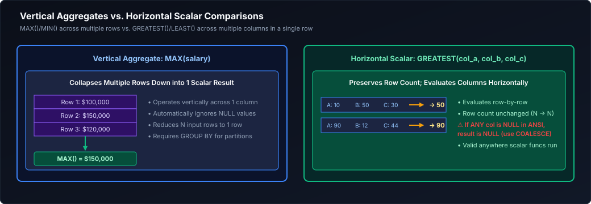

*D2 Source: [`05_greatest_least_scalar.d2`](assets/01_sql_and_advanced_querying/05_greatest_least_scalar.d2)*

> [!CAUTION]
> **NULL Behavior in GREATEST / LEAST:**
> In standard SQL and PostgreSQL, if **any** argument to `GREATEST()` or `LEAST()` is `NULL`, the entire function returns `NULL`! Always wrap arguments in `COALESCE`:
> `GREATEST(COALESCE(col1, 0), COALESCE(col2, 0))`

> [!TIP]
> **Deep-Dive Interview Scenario:**
> - [Q26. Dynamic PIVOT When Column Values Are Unknown Ahead of Time](frequently_asked_questions/01_sql_and_advanced_querying_faq.md#q26-medium-dynamic-pivot-when-column-values-are-unknown-ahead-of-time)

---

# 5. Scalar Functions: String & Temporal Manipulation

### 5.1 Essential String Functions & Regex Extractions

Data pipelines spend significant CPU cycles standardizing and cleaning raw text:

| Function | Signature / Syntax | Description & Example |
| :--- | :--- | :--- |
| `CONCAT(s1, s2, ...)` | `CONCAT('Data', ' ', 'Eng')` | Combines multiple strings into one (`'Data Eng'`). In PostgreSQL/Snowflake, ignores NULLs. |
| `CONCAT_WS(sep, s1, ...)` | `CONCAT_WS('-', '2026', '10', '16')` | Concatenates "With Separator" (`'2026-10-16'`). Skips NULL arguments cleanly. |
| `SUBSTRING(s, pos, len)` | `SUBSTRING('Apache Spark', 8, 5)` | Extracts substring. Note: SQL uses **1-based indexing** (`'Spark'`). |
| `TRIM([BOTH/LEADING/TRAILING] s)` | `TRIM('  test  ')` | Removes leading and trailing whitespace (`'test'`). |
| `UPPER(s)` / `LOWER(s)` | `LOWER('SnowFlake')` | Normalizes casing (`'snowflake'`). Essential for case-insensitive joins. |
| `REPLACE(s, from, to)` | `REPLACE('v1_raw_data', 'v1', 'v2')` | Replaces occurrences of a target substring (`'v2_raw_data'`). |
| `POSITION(sub IN s)` | `POSITION('@' IN 'user@corp.com')` | Returns 1-based character position of substring (returns `5`). |
| `LENGTH(s)` / `CHAR_LENGTH` | `LENGTH('SQL')` | Returns number of characters (returns `3`). |
| `SPLIT_PART(s, sep, idx)` | `SPLIT_PART('us-east-1a', '-', 2)` | Splits string by delimiter and returns the $n$-th token (`'east'`). |

#### Production Code Example: Parsing Unstructured Web Traffic
```sql
SELECT 
    raw_log_id,
    -- Extract domain from URL string
    LOWER(
        SPLIT_PART(
            SPLIT_PART(referrer_url, '//', 2), 
            '/', 
            1
        )
    ) AS clean_referrer_domain,
    
    -- Clean and standardize phone format: '+1 (555) 123-4567' -> '5551234567'
    REGEXP_REPLACE(raw_phone_number, '[^0-9]', '', 'g') AS normalized_phone_digits,
    
    -- Pad integer ID with leading zeros: 42 -> '000042'
    LPAD(CAST(customer_id AS VARCHAR), 6, '0') AS padded_customer_id
FROM raw_logs.inbound_telemetry;
```

---

### 5.2 Production Date, Time & Interval Manipulation

Temporal transformations allow data engineers to calculate latencies, construct cohort boundaries, and partition continuous data into time buckets.

```sql
SELECT 
    event_id,
    event_timestamp,
    
    -- 1. DATE_TRUNC: Buckets a continuous timestamp to a specified granularity
    DATE_TRUNC('month', event_timestamp)                       AS cohort_month,       -- e.g. '2026-10-01 00:00:00'
    DATE_TRUNC('day', event_timestamp)                         AS event_date_bucket,  -- e.g. '2026-10-16 00:00:00'
    DATE_TRUNC('hour', event_timestamp)                        AS event_hour_bucket,  -- e.g. '2026-10-16 14:00:00'
    
    -- 2. EXTRACT / DATE_PART: Pulls out a specific numerical component
    EXTRACT(YEAR FROM event_timestamp)                         AS event_year,         -- 2026
    EXTRACT(DOW  FROM event_timestamp)                         AS day_of_week_index,  -- 0 = Sunday, 6 = Saturday
    EXTRACT(EPOCH FROM event_timestamp)                        AS unix_epoch_seconds, -- Microseconds since 1970
    
    -- 3. Interval Arithmetic: Add or subtract explicit physical time intervals
    event_timestamp + INTERVAL '30 days'                       AS trial_expiration_time,
    event_timestamp - INTERVAL '15 minutes'                    AS lookback_window_start,
    
    -- 4. Date Differences (PostgreSQL subtraction vs Snowflake/BigQuery DATEDIFF)
    -- Computes elapsed latency in minutes between event creation and ingestion
    DATE_PART('day', ingestion_timestamp - event_timestamp) * 1440 +
    DATE_PART('hour', ingestion_timestamp - event_timestamp) * 60 +
    DATE_PART('minute', ingestion_timestamp - event_timestamp) AS ingestion_lag_minutes
FROM streaming.iot_events
WHERE event_timestamp >= CURRENT_DATE - INTERVAL '7 days';
```

> [!TIP]
> **Deep-Dive Interview Scenarios:**
> - [Q20. Month-over-Month Spending Growth & LAG vs LEAD Functions](frequently_asked_questions/01_sql_and_advanced_querying_faq.md#q20-easy-month-over-month-spending-growth--lag-vs-lead-functions)
> - [Q37. Restaurant Rating Drop Analysis Across Consecutive 30-Day Windows](frequently_asked_questions/01_sql_and_advanced_querying_faq.md#q37-medium-restaurant-rating-drop-analysis-across-consecutive-30-day-windows)
> - [Q38. Event Proximity Detection: Users Booking Multiple Rides Within 10 Minutes](frequently_asked_questions/01_sql_and_advanced_querying_faq.md#q38-medium-event-proximity-detection-users-booking-multiple-rides-within-10-minutes)
> - [Q59. Consecutive Month Order Detection & Customer Streak Analysis](frequently_asked_questions/01_sql_and_advanced_querying_faq.md#q59-medium-consecutive-month-order-detection--customer-streak-analysis)

---

# 6. Aggregations & Grouping

### 6.1 How GROUP BY Works Internally: Hash Aggregation vs Sort/Stream Aggregation

When the database engine processes a `GROUP BY` clause, it typically chooses between two physical execution strategies:

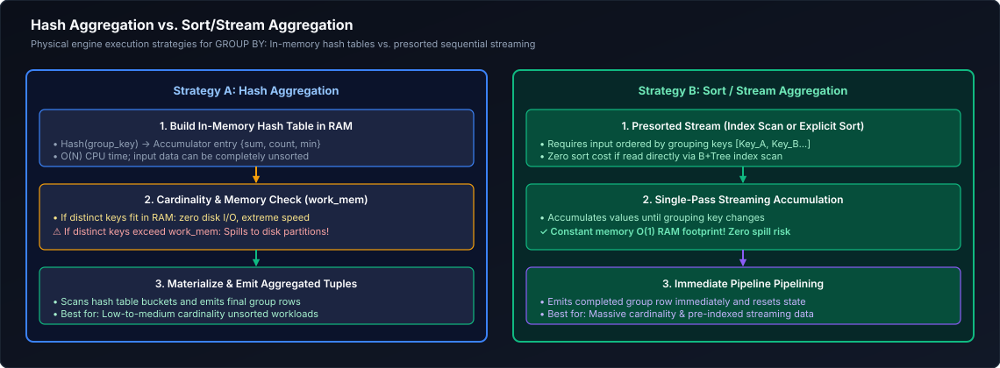

*D2 Source: [`06_hash_vs_sort_aggregation.d2`](assets/01_sql_and_advanced_querying/06_hash_vs_sort_aggregation.d2)*

1. **Hash Aggregation:**
   - The engine builds an in-memory hash table where the keys are the grouping attributes (e.g., `department_id`) and the values are the running aggregate accumulators (e.g., `count = 5`, `sum = 45000`).
   - *Advantage:* Fast $O(N)$ scanning; does not require the input to be sorted.
   - *Risk:* If the grouping keys have massive cardinality (e.g., grouping by `user_id` or `session_uuid` with 100M distinct keys), the hash table exceeds `work_mem` and **spills to disk**, degrading performance.
2. **Sort / Stream Aggregation:**
   - If the input is already sorted (e.g., via an existing B-Tree index on the grouping columns), the engine reads rows sequentially. As long as the key is the same, it increments the accumulator. The moment the key changes, it emits the aggregated row and resets the accumulator.
   - *Advantage:* Extremely low memory overhead ($O(1)$ memory).

---

### 6.2 The Nuances of COUNT: COUNT(*), COUNT(1), COUNT(col), COUNT(DISTINCT col)

One of the most common points of confusion in SQL is how `COUNT` treats `NULL` values:

| Syntax | What It Actually Counts | Treats NULL as... | Performance Characteristics |
| :--- | :--- | :--- | :--- |
| **`COUNT(*)`** | Counts every **row / tuple** in the relation. | **Included** (counts the row even if all columns are NULL). | Fastest. The optimizer selects the smallest index or metadata row count. |
| **`COUNT(1)`** | Evaluates expression `1` for each row, then counts non-null expressions. | **Included** (the literal `1` is never NULL). | Identical to `COUNT(*)`. Modern optimizers parse it as `COUNT(*)`. |
| **`COUNT(col)`** | Counts only rows where `col` is **NOT NULL**. | **Excluded** (skips rows where `col` is NULL). | Slower. Requires reading the column data and checking for NULL bits. |
| **`COUNT(DISTINCT col)`**| Counts the number of **unique, non-NULL** values in `col`. | **Excluded** (skips NULLs entirely). | Very expensive. Requires building a distributed hash set or sorting the data. |

#### Concrete Example
Suppose we have a table `employees`:
| id | name | commission |
| :---: | :--- | :---: |
| 1 | Alice | 500 |
| 2 | Bob | 500 |
| 3 | Charlie | NULL |

```sql
SELECT 
    COUNT(*)                AS count_star,          -- Returns 3 (all 3 rows exist)
    COUNT(1)                AS count_one,           -- Returns 3 (identical to COUNT(*))
    COUNT(commission)       AS count_commission,    -- Returns 2 (Charlie's NULL is skipped!)
    COUNT(DISTINCT commission) AS count_dist_comm   -- Returns 1 (Only distinct non-null value is 500)
FROM employees;
```

---

### 6.3 Standard & Statistical Aggregates (SUM, AVG, MIN, MAX, STDDEV, VARIANCE)

All mathematical aggregates (except `COUNT(*)`) **silently ignore NULLs**.

$$\text{AVG}(X) = \frac{\sum_{\text{non-null}} X}{\text{COUNT}_{\text{non-null}}(X)}$$

```sql
SELECT 
    department_id,
    COUNT(*)                                      AS total_headcount,
    COUNT(salary)                                 AS salaried_headcount,
    SUM(salary)                                   AS total_payroll,
    ROUND(AVG(salary), 2)                         AS mean_salary,
    MIN(salary)                                   AS min_salary,
    MAX(salary)                                   AS max_salary,
    
    -- Statistical Dispersion:
    ROUND(STDDEV_SAMP(salary), 2)                 AS sample_std_dev,
    ROUND(VAR_SAMP(salary), 2)                    AS sample_variance
FROM corporate.employees
GROUP BY department_id;
```

> [!WARNING]
> **The Empty Table Aggregation Trap:**
> - If a table is completely empty, `COUNT(*)` returns `0`.
> - However, `SUM(col)`, `AVG(col)`, `MIN(col)`, and `MAX(col)` return **`NULL`**!
> If your application expects a number, always write: `COALESCE(SUM(amount), 0.00)`.

---

### 6.4 Set & Array Aggregations (STRING_AGG, ARRAY_AGG)

Analytical SQL allows folding multiple scalar rows into arrays or delimited strings:

```sql
SELECT 
    customer_id,
    COUNT(order_id)                                            AS total_orders,
    
    -- Concatenate product names into a readable single string
    -- Syntax varies: STRING_AGG (Postgres/BigQuery), LISTAGG (Snowflake/Oracle), GROUP_CONCAT (MySQL)
    STRING_AGG(product_name, ', ' ORDER BY order_date DESC)    AS order_history_list,
    
    -- Collect IDs into a typed JSON / native array for downstream microservice consumption
    ARRAY_AGG(order_id ORDER BY order_date DESC)               AS order_id_array
FROM sales.customer_orders
GROUP BY customer_id;
```

---

### 6.5 Advanced Multi-Dimensional Grouping: GROUPING SETS, ROLLUP & CUBE

In business intelligence reporting, analysts frequently require subtotals and grand totals across multiple dimensional hierarchies. Rather than running multiple separate queries connected by `UNION ALL` (which scans the table multiple times), SQL provides advanced grouping clauses that compute all dimensions in a **single table pass**.

#### 1. `GROUPING SETS`
Explicitly specifies the exact combinations of dimensions to compute:
```sql
SELECT 
    region,
    product_category,
    SUM(revenue) AS total_revenue
FROM sales.reporting_mart
GROUP BY GROUPING SETS (
    (region, product_category),  -- Level 1: Subtotals by region and category
    (region),                    -- Level 2: Subtotals by region across all categories
    ()                           -- Level 3: Grand total across all regions and categories
);
```

#### 2. `ROLLUP(a, b, c)`
Computes hierarchical, progressive subtotals from right to left (useful for dates: Year $\to$ Quarter $\to$ Month):
`ROLLUP(year, quarter, month)` produces:
- `(year, quarter, month)`
- `(year, quarter)`
- `(year)`
- `()` (Grand Total)

#### 3. `CUBE(a, b)`
Computes all possible mathematical permutations of the grouping columns ($2^N$ combinations):
`CUBE(region, category)` produces:
- `(region, category)`
- `(region)`
- `(category)`
- `()`

```sql
-- Differentiating between native NULLs and Subtotal NULLs using the GROUPING() function
SELECT 
    CASE WHEN GROUPING(region) = 1 THEN '== All Regions (Grand Total) ==' ELSE region END AS report_region,
    CASE WHEN GROUPING(category) = 1 THEN '== All Categories ==' ELSE category END AS report_category,
    SUM(sales_amount) AS total_sales
FROM sales.orders
GROUP BY CUBE (region, category);
```

> [!TIP]
> **Deep-Dive Interview Scenarios:**
> - [Q33. Highest Spending Customers in the Last Month](frequently_asked_questions/01_sql_and_advanced_querying_faq.md#q33-medium-highest-spending-customers-in-the-last-month)
> - [Q34. Users Placing >20 Critical Orders Every Week for >= 1 Month](frequently_asked_questions/01_sql_and_advanced_querying_faq.md#q34-medium-users-placing-20-critical-orders-every-week-for--1-month)

---

# 7. Relational Joins & Multi-Table Querying

### 7.1 Relational Join Foundations: Cartesian Products & Theta Joins

The relational join is the core operation of relational database management systems. Formally defined in relational algebra by Edgar F. Codd:
- **Cartesian Product ($R \times S$):** Pairs every tuple in relation $R$ with every tuple in relation $S$. If $R$ has $N$ rows and $S$ has $M$ rows, the Cartesian product produces $N \times M$ rows.
- **Theta Join ($R \bowtie_\theta S$):** A Cartesian product followed by a selection condition $\theta$:
  $$R \bowtie_\theta S = \sigma_\theta (R \times S)$$
- **Equi-Join:** A theta join where the condition $\theta$ consists solely of equality operators (`R.id = S.id`).

#### The Visual Join Spectrum

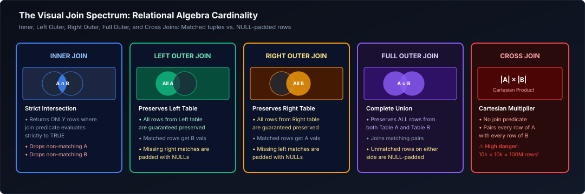

*D2 Source: [`07_visual_join_spectrum.d2`](assets/01_sql_and_advanced_querying/07_visual_join_spectrum.d2)*

To explain every join type with complete clarity, we will use two sample tables:

#### Table `employees` (Left Table)
| emp_id | emp_name | dept_id |
| :---: | :--- | :---: |
| 1 | Alice | 10 |
| 2 | Bob | 20 |
| 3 | Charlie | 30 |
| 4 | David | NULL |

#### Table `departments` (Right Table)
| dept_id | dept_name |
| :---: | :--- |
| 10 | Engineering |
| 20 | Marketing |
| 40 | Finance |

Notice the intentional discrepancies:
- Charlie belongs to `dept_id = 30`, which does **not** exist in `departments`.
- David has `dept_id = NULL`.
- `departments` has `dept_id = 40` (Finance), which has **no employees**.

---

### 7.2 INNER JOIN: Mathematical Intersection & Step-by-Step Walkthrough

The `INNER JOIN` returns rows **only when the join predicate evaluates to `TRUE` in both tables**.

#### Code Example
```sql
SELECT 
    e.emp_id,
    e.emp_name,
    e.dept_id,
    d.dept_name
FROM employees AS e
INNER JOIN departments AS d 
    ON e.dept_id = d.dept_id;
```

#### Step-by-Step Resolution
1. **Alice (`dept_id = 10`):** Matches `departments` row 10 (Engineering). **Retained!**
2. **Bob (`dept_id = 20`):** Matches `departments` row 20 (Marketing). **Retained!**
3. **Charlie (`dept_id = 30`):** No match in `departments`. **Discarded!**
4. **David (`dept_id = NULL`):** `NULL = d.dept_id` evaluates to `UNKNOWN`. **Discarded!**
5. **Finance (`dept_id = 40`):** No employees in department 40. **Discarded!**

#### Result Set
| emp_id | emp_name | dept_id | dept_name |
| :---: | :--- | :---: | :--- |
| 1 | Alice | 10 | Engineering |
| 2 | Bob | 20 | Marketing |

---

### 7.3 LEFT (OUTER) JOIN: Master Record Preservation & Step-by-Step Walkthrough

The `LEFT JOIN` guarantees that **every single row from the left table is preserved**.
- If a match is found in the right table, columns are populated.
- If **no match** is found, right-table columns are populated with **`NULL`**.

#### Code Example
```sql
SELECT 
    e.emp_id,
    e.emp_name,
    e.dept_id,
    d.dept_name
FROM employees AS e
LEFT JOIN departments AS d 
    ON e.dept_id = d.dept_id;
```

#### Step-by-Step Resolution
1. **Alice (10):** Matches 10. $\to$ `(1, 'Alice', 10, 'Engineering')`
2. **Bob (20):** Matches 20. $\to$ `(2, 'Bob', 20, 'Marketing')`
3. **Charlie (30):** No match. Preserved! $\to$ `(3, 'Charlie', 30, NULL)`
4. **David (NULL):** No match. Preserved! $\to$ `(4, 'David', NULL, NULL)`

#### Result Set
| emp_id | emp_name | dept_id | dept_name |
| :---: | :--- | :---: | :--- |
| 1 | Alice | 10 | Engineering |
| 2 | Bob | 20 | Marketing |
| 3 | Charlie | 30 | **NULL** |
| 4 | David | NULL | **NULL** |

---

### 7.4 The Right-Table WHERE Filter Disaster (Accidental Inner Join)

> [!CAUTION]
> **The Most Common Bug in Analytical SQL:**
> Putting a filter on the right table inside the `WHERE` clause silently converts a `LEFT JOIN` into an `INNER JOIN`!

#### The Buggy Query
Suppose you want all employees, including their department name if they belong to 'Engineering':
```sql
-- BROKEN QUERY (Accidental INNER JOIN):
SELECT e.emp_name, d.dept_name
FROM employees AS e
LEFT JOIN departments AS d 
    ON e.dept_id = d.dept_id
WHERE d.dept_name = 'Engineering';
```

#### Why It Fails
1. The `LEFT JOIN` executes first and produces Charlie and David with `d.dept_name = NULL`.
2. Next, the `WHERE` clause evaluates `d.dept_name = 'Engineering'`.
3. For Charlie and David, `NULL = 'Engineering'` evaluates to **`UNKNOWN`**!
4. The `WHERE` clause discards all rows that evaluate to `UNKNOWN`.
5. Charlie and David are eliminated. **Your LEFT JOIN has just behaved exactly like an INNER JOIN!**

#### The Fix: Move the Filter into the `ON` Clause
```sql
-- CORRECT QUERY:
SELECT e.emp_name, d.dept_name
FROM employees AS e
LEFT JOIN departments AS d 
    ON e.dept_id = d.dept_id 
   AND d.dept_name = 'Engineering';
```
In an outer join:
- Predicates in the **`ON` clause** determine *which rows match during the join*. Unmatched left rows are still preserved!
- Predicates in the **`WHERE` clause** determine *which rows survive after the join has completed*.

---

### 7.5 RIGHT (OUTER) JOIN & Why Production Standards Avoid It

The `RIGHT JOIN` preserves all rows from the **right table**, padding unmatched left-table columns with `NULL`.

```sql
SELECT 
    e.emp_name,
    d.dept_id,
    d.dept_name
FROM employees AS e
RIGHT JOIN departments AS d 
    ON e.dept_id = d.dept_id;
```

#### Result Set
| emp_name | dept_id | dept_name |
| :--- | :---: | :--- |
| Alice | 10 | Engineering |
| Bob | 20 | Marketing |
| **NULL** | 40 | Finance |

#### Why Production Standards Disallow `RIGHT JOIN`
In professional data modeling and style guides (such as the dbt Labs SQL Style Guide), **`RIGHT JOIN` is discouraged or banned**:
1. **Reading Flow:** Humans read code top-to-bottom and left-to-right. Switching mental models from "Left is master" to "Right is master" makes multi-table queries difficult to maintain.
2. **Standardization:** Any `RIGHT JOIN` can be mechanically converted into an identical `LEFT JOIN` by simply swapping table positions:
   ```sql
   -- Standardized Left Join Equivalent:
   SELECT e.emp_name, d.dept_id, d.dept_name
   FROM departments AS d
   LEFT JOIN employees AS e ON d.dept_id = e.dept_id;
   ```

---

### 7.6 FULL OUTER JOIN: Bidirectional Reconciliation

The `FULL OUTER JOIN` preserves **all rows from both tables**. If rows match, they are joined; if an unmatched row exists on either side, the opposing columns are padded with `NULL`.

#### Primary Data Engineering Use Case: Ledger Reconciliation
Financial pipelines use `FULL OUTER JOIN` to reconcile transactions between two independent data sources (e.g., Internal Orders vs Stripe Bank Statements):

```sql
SELECT 
    COALESCE(i.order_id, s.charge_id)   AS reconciled_id,
    i.amount                             AS internal_recorded_amount,
    s.amount                             AS stripe_cleared_amount,
    CASE 
        WHEN s.charge_id IS NULL THEN 'Missing in Stripe (Possible Fraud / Uncaptured)'
        WHEN i.order_id  IS NULL THEN 'Missing in Internal DB (Orphan Charge)'
        WHEN i.amount != s.amount THEN 'Currency / Amount Discrepancy'
        ELSE 'Balanced & Reconciled'
    END AS audit_status
FROM internal.orders AS i
FULL OUTER JOIN stripe.charges AS s 
    ON i.order_id = s.metadata_order_id;
```

---

### 7.7 CROSS JOIN: Cartesian Products, Calendar Spines, and Explosion Risks

A `CROSS JOIN` pairs every row from the left table with every row from the right table ($N \times M$).

```sql
SELECT 
    e.emp_name,
    d.dept_name
FROM employees AS e
CROSS JOIN departments AS d;
-- 4 employees x 3 departments = 12 total rows
```

> [!CAUTION]
> **Cartesian Explosion Risk:**
> If you accidentally omit an `ON` clause in legacy comma-join syntax (`FROM tableA, tableB`), or write `ON 1=1`, a table of 1,000,000 rows joined to a table of 1,000,000 rows generates **$1,000,000,000,000$ (1 Trillion) rows**, bringing down the data warehouse cluster with an Out-of-Memory (OOM) crash!

#### Legitimate Engineering Use Case: Building a Calendar Date Spine
In analytics engineering, you often need to report metrics for every store for every day of the year, even when a store had zero sales. A `CROSS JOIN` creates the master scaffold:

```sql
-- Step 1: Generate all stores CROSS JOINED with all calendar dates
WITH calendar AS (
    SELECT generate_series('2026-01-01'::DATE, '2026-01-31'::DATE, INTERVAL '1 day')::DATE AS calendar_date
),
scaffold AS (
    SELECT s.store_id, c.calendar_date
    FROM enterprise.stores AS s
    CROSS JOIN calendar AS c
)
-- Step 2: Left join actual sales onto the scaffold to fill missing days with 0
SELECT 
    sc.store_id,
    sc.calendar_date,
    COALESCE(SUM(o.revenue), 0.00) AS daily_revenue
FROM scaffold AS sc
LEFT JOIN sales.orders AS o 
    ON sc.store_id = o.store_id 
   AND sc.calendar_date = o.order_date
GROUP BY sc.store_id, sc.calendar_date;
```

---

### 7.8 SELF JOIN: Hierarchies and Graphs

A `SELF JOIN` joins a table **to itself**. It is used to query hierarchical, recursive, or graph-like relationships stored within a single table (e.g., an employee-to-manager organization chart).

#### Sample Table `staff`
| employee_id | employee_name | manager_id |
| :---: | :--- | :---: |
| 101 | Director Sarah | NULL |
| 102 | Lead Mark | 101 |
| 103 | Engineer Julia | 102 |

```sql
-- Self Join resolving employee and their immediate manager
SELECT 
    emp.employee_name    AS employee,
    mgr.employee_name    AS reports_to_manager
FROM staff AS emp
LEFT JOIN staff AS mgr 
    ON emp.manager_id = mgr.employee_id;
```

#### Result Set
| employee | reports_to_manager |
| :--- | :--- |
| Director Sarah | **NULL** (Top of hierarchy) |
| Lead Mark | Director Sarah |
| Engineer Julia | Lead Mark |

---

### 7.9 Equi-Joins vs Non-Equi Joins (Range & Band Joins)

While most joins use `=` (Equi-Joins), **Non-Equi Joins** use range or comparison operators (`<`, `>`, `<=`, `>=`, `BETWEEN`).

#### Real-World Use Case: Mapping Historical Exchange Rates
In financial analytics, currency conversion rates change daily or hourly. An order must be converted using the exchange rate that was **valid at the exact moment the order was placed**:

```sql
SELECT 
    o.order_id,
    o.order_time,
    o.amount_eur,
    r.eur_to_usd_rate,
    o.amount_eur * r.eur_to_usd_rate AS amount_usd
FROM sales.orders AS o
INNER JOIN finance.fx_rates AS r
    ON o.currency = r.currency
   AND o.order_time >= r.valid_from 
   AND o.order_time <  r.valid_to; -- Non-equi interval join
```

> [!NOTE]
> Non-equi joins cannot use standard Hash Join algorithms because hash tables rely on exact equality hashing. Databases execute non-equi joins using **Nested Loop Joins** or **Range Merge Joins**, which can be slower. Always filter as many rows as possible before performing non-equi joins.

---

### 7.10 Multi-Table Joins & Star Schema Dimensional Querying

In enterprise data warehouses (Kimball Star Schema), a central **Fact Table** contains numeric metrics (revenue, quantity) and connects radially to multiple **Dimension Tables** containing business context (customers, products, dates).

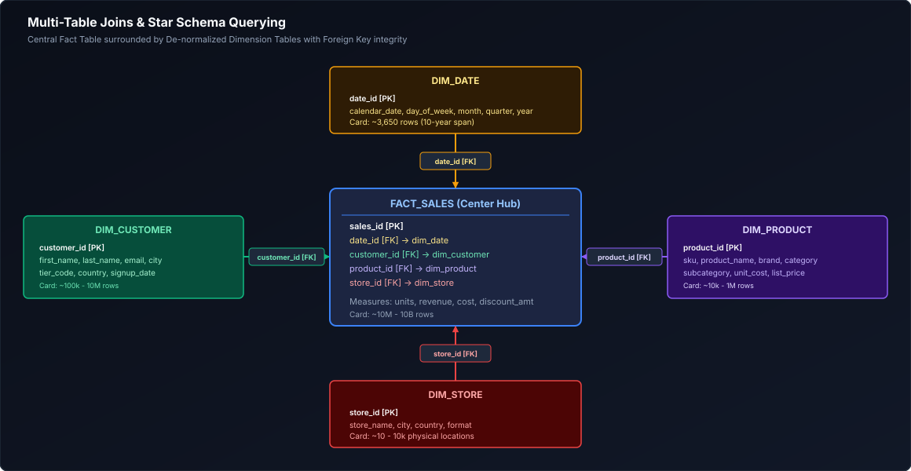

*D2 Source: [`08_star_schema_joins.d2`](assets/01_sql_and_advanced_querying/08_star_schema_joins.d2)*

```sql
-- Star Schema multi-table join for dimensional business intelligence
SELECT 
    d.calendar_year,
    d.calendar_quarter,
    p.category_name,
    c.country,
    SUM(f.quantity)       AS total_units_sold,
    SUM(f.gross_revenue)  AS total_revenue
FROM warehouse.fact_sales AS f
INNER JOIN warehouse.dim_date     AS d ON f.date_key     = d.date_key
INNER JOIN warehouse.dim_product  AS p ON f.product_key  = p.product_key
INNER JOIN warehouse.dim_customer AS c ON f.customer_key = c.customer_key
WHERE d.calendar_year = 2026
GROUP BY d.calendar_year, d.calendar_quarter, p.category_name, c.country;
```

> [!TIP]
> **Deep-Dive Interview Scenarios:**
> - [Q16. Table Comparison: Identifying Inserted, Deleted, and Modified Records](frequently_asked_questions/01_sql_and_advanced_querying_faq.md#q16-medium-table-comparison-identifying-inserted-deleted-and-modified-records)
> - [Q17. Identifying Employee Records Changed Between Two Dates](frequently_asked_questions/01_sql_and_advanced_querying_faq.md#q17-medium-identifying-employee-records-changed-between-two-dates)
> - [Q18. Customers Purchasing in Every Month of a Year (Relational Division)](frequently_asked_questions/01_sql_and_advanced_querying_faq.md#q18-medium-customers-purchasing-in-every-month-of-a-year-relational-division)
> - [Q19. Customers with 2025 Spending Higher Than 2024 Spending](frequently_asked_questions/01_sql_and_advanced_querying_faq.md#q19-medium-customers-with-2025-spending-higher-than-2024-spending)
> - [Q28. FULL OUTER JOIN vs Union of Left and Right Anti-Joins](frequently_asked_questions/01_sql_and_advanced_querying_faq.md#q28-easy-full-outer-join-vs-union-of-left-and-right-anti-joins)
> - [Q41. Most Frequently Traveled Route in 30 Days (Bidirectional Normalization)](frequently_asked_questions/01_sql_and_advanced_querying_faq.md#q41-medium-most-frequently-traveled-route-in-30-days-bidirectional-normalization)
> - [Q42. High-Interest Unconverted Products: Viewed >100 Times Without Purchase](frequently_asked_questions/01_sql_and_advanced_querying_faq.md#q42-medium-high-interest-unconverted-products-viewed-100-times-without-purchase)
> - [Q43. Relational Division at Massive Scale (Purchased in Every Category Across 500M Records)](frequently_asked_questions/01_sql_and_advanced_querying_faq.md#q43-medium-relational-division-at-massive-scale-purchased-in-every-category-across-500m-records)
> - [Q52. Email Deduplication in Person Table & Relational Deletions](frequently_asked_questions/01_sql_and_advanced_querying_faq.md#q52-medium-email-deduplication-in-person-table--relational-deletions)
> - [Q53. Second Highest Salary from Employee Table with Strict NULL Fallback](frequently_asked_questions/01_sql_and_advanced_querying_faq.md#q53-easy-second-highest-salary-from-employee-table-with-strict-null-fallback)
> - [Q62. Highest-Grossing Movie of the Current Month & Booking System Analytics](frequently_asked_questions/01_sql_and_advanced_querying_faq.md#q62-medium-highest-grossing-movie-of-the-current-month--booking-system-analytics)
> - [Q63. Periodic Sales Rollup by Product, Vendor, and Location](frequently_asked_questions/01_sql_and_advanced_querying_faq.md#q63-medium-periodic-sales-rollup-by-product-vendor-and-location)
> - [Q64. Cartesian Product Mechanics & Empty Table Zero-Multiplication](frequently_asked_questions/01_sql_and_advanced_querying_faq.md#q64-medium-cartesian-product-mechanics--empty-table-zero-multiplication)
> - [Q65. Rolling Seven-Day Average with Missing Dates (Calendar Spine & Frame Semantics)](frequently_asked_questions/01_sql_and_advanced_querying_faq.md#q65-medium-rolling-seven-day-average-with-missing-dates-calendar-spine--frame-semantics)
> - [Q67. Cross-Tenant Data Leakage Triage in Analytical Reports (No Cache Involved)](frequently_asked_questions/01_sql_and_advanced_querying_faq.md#q67-hard-cross-tenant-data-leakage-triage-in-analytical-reports-no-cache-involved)
> - [Q74. Optimizing High-Scale Fact-to-Dimension Joins in Star Schema Workloads](frequently_asked_questions/01_sql_and_advanced_querying_faq.md#q74-medium-optimizing-high-scale-fact-to-dimension-joins-in-star-schema-workloads)

---

# 8. Set Operators

### 8.1 Joins vs Set Operators: Horizontal vs Vertical Combination

It is essential to understand the difference in geometry:
- **`JOIN`:** Combines data **horizontally** (attaches new columns from another table side-by-side).
- **`SET OPERATOR`:** Combines data **vertically** (stacks rows from one query on top of another).

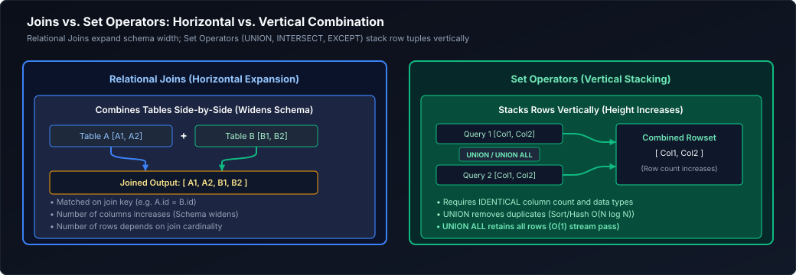

*D2 Source: [`09_joins_vs_set_operators.d2`](assets/01_sql_and_advanced_querying/09_joins_vs_set_operators.d2)*

#### Syntax Rules for All Set Operators
1. Every participating `SELECT` statement must project the **exact same number of columns**.
2. Corresponding columns in each query must have **compatible data types** in the same ordinal order.
3. The column names of the final result are determined by the aliases defined in the **first** query.
4. `ORDER BY` can appear only **once**, at the very end of the final query statement.

---

### 8.2 UNION vs UNION ALL: Sorting, Hashing, and Memory Spilling

- **`UNION ALL`:** Concatenates result sets directly without checking for duplicates. It simply streams rows from Query 1, then streams rows from Query 2.
  - *Time Complexity:* $O(N)$
  - *Memory Footprint:* Minimal ($O(1)$ streaming).
- **`UNION`:** Concatenates result sets and performs an **expensive deduplication pass** across every single column in the projected row.
  - *Time Complexity:* $O(N \log N)$ (Sort-based) or $O(N)$ with heavy hash memory allocations.
  - *Risk:* Forces the engine to build a massive hash set across all columns, often leading to disk spilling.

```sql
-- PRODUCTION RULE: Always default to UNION ALL unless duplicate elimination is strictly required.

-- Archival Data Stitching Pattern:
SELECT event_id, user_id, event_type, created_at, 'HOT_STORAGE' AS tier 
FROM logs.live_events
WHERE created_at >= CURRENT_DATE - INTERVAL '30 days'

UNION ALL -- Fast streaming concatenation

SELECT event_id, user_id, event_type, created_at, 'COLD_STORAGE' AS tier 
FROM logs.archived_events
WHERE created_at < CURRENT_DATE - INTERVAL '30 days';
```

---

### 8.3 INTERSECT: Set Intersection Mechanics

`INTERSECT` returns only distinct records that exist in **both** participating queries ($A \cap B$).

```sql
-- Real-World Analytics Scenario: Find customer IDs who made a purchase in both 2025 AND 2026
SELECT customer_id FROM sales.orders WHERE order_date >= '2025-01-01' AND order_date < '2026-01-01'
INTERSECT
SELECT customer_id FROM sales.orders WHERE order_date >= '2026-01-01' AND order_date < '2027-01-01';
```

---

### 8.4 EXCEPT / MINUS: Set Difference & Churn Detection

`EXCEPT` (called `MINUS` in Oracle) returns distinct records that exist in the first query **but do not appear in the second query** ($A - B$).

```sql
-- Churn Analysis: Find active subscribers from Q1 who completely ceased subscribing in Q2
SELECT user_id FROM subscriptions.q1_active_users
EXCEPT
SELECT user_id FROM subscriptions.q2_active_users;
```

---

### 8.5 Set Operators & The Surprising Treatment of NULLs

> [!IMPORTANT]
> **Set Operators Treat Two NULLs as Identical Duplicates!**
> This is a major exception to standard SQL Three-Valued Logic:
> - In `WHERE colA = colB`, if both are `NULL`, the result is `UNKNOWN`.
> - In `UNION`, `INTERSECT`, and `EXCEPT`, two `NULL` entries are treated as **identical matching values**.
>
> If Query 1 returns `(NULL)` and Query 2 returns `(NULL)`:
> - `UNION` returns a single `(NULL)` (deduplicated).
> - `INTERSECT` returns `(NULL)` (found in both).
> - `EXCEPT` returns nothing (the NULL in A is matched and subtracted by the NULL in B).

---

# 9. Subqueries & Derived Tables

A subquery is a `SELECT` statement nested inside an enclosing SQL statement.

### 9.1 Scalar Subqueries: Definition, Single-Value Guarantees, and Hazards

A **Scalar Subquery** returns **exactly one row and one column** (a single scalar value). It can be used anywhere an atomic literal expression is valid (in `SELECT`, `WHERE`, or `HAVING`).

```sql
-- Compute individual salaries alongside the company-wide average
SELECT 
    employee_id,
    first_name,
    salary,
    -- Scalar subquery projected as a column
    (SELECT ROUND(AVG(salary), 2) FROM hr.employees) AS company_mean_salary,
    salary - (SELECT ROUND(AVG(salary), 2) FROM hr.employees) AS deviation_from_mean
FROM hr.employees;
```

> [!WARNING]
> **The Runtime Cardinality Crash:**
> If a scalar subquery returns more than 1 row at runtime, the query terminates immediately with a fatal error: `more than one row returned by a subquery used as an expression`.
> Always defend scalar subqueries using aggregate functions (`AVG()`, `MAX()`) or explicit `LIMIT 1`.

---

### 9.2 Multi-Row Subqueries: IN, ANY, ALL, and EXISTS

When a subquery returns multiple rows, it cannot be evaluated with scalar comparison operators (`=`). It requires set evaluation operators:

1. **`IN (subquery)`:** Evaluates whether an expression matches any value in the subquery set.
2. **`ANY` / `SOME (subquery)`:** Returns `TRUE` if the comparison is true for at least one row in the subquery:
   ```sql
   -- Find employees earning more than ANY manager in department 10
   SELECT emp_name, salary 
   FROM employees 
   WHERE salary > ANY (SELECT salary FROM employees WHERE is_manager = TRUE AND dept_id = 10);
   ```
3. **`ALL (subquery)`:** Returns `TRUE` only if the comparison is true for *all* rows in the subquery:
   ```sql
   -- Find employees earning more than ALL managers in department 10
   SELECT emp_name, salary 
   FROM employees 
   WHERE salary > ALL (SELECT salary FROM employees WHERE is_manager = TRUE AND dept_id = 10);
   ```

---

### 9.3 Correlated Subqueries: Nested Loops vs Optimizer Decorrelation

- **Uncorrelated Subquery:** Completely independent of the outer query. The database engine executes it **once**, caches the result, and uses it throughout the outer query.
- **Correlated Subquery:** References columns from the outer query. Conceptually, the subquery must be **re-evaluated for every single row processed by the outer query** ($O(N \times M)$ nested loop).

```sql
-- Correlated subquery: Find employees earning more than the average of THEIR OWN department
SELECT e.emp_id, e.emp_name, e.dept_id, e.salary
FROM employees AS e
WHERE e.salary > (
    -- Subquery references 'e.dept_id' from the outer query!
    SELECT AVG(inner_emp.salary)
    FROM employees AS inner_emp
    WHERE inner_emp.dept_id = e.dept_id
);
```

#### Query Optimizer Decorrelation
Modern query optimizers rewrite correlated subqueries into **Semi-Joins** or **Window Functions** under the hood:
```sql
-- How to manually rewrite the correlated query for optimal performance:
WITH dept_averages AS (
    SELECT dept_id, AVG(salary) AS avg_dept_salary
    FROM employees
    GROUP BY dept_id
)
SELECT e.emp_id, e.emp_name, e.dept_id, e.salary
FROM employees AS e
INNER JOIN dept_averages AS da 
    ON e.dept_id = da.dept_id
WHERE e.salary > da.avg_dept_salary;
```

---

### 9.4 Derived Tables vs Common Table Expressions (CTEs)

A subquery located inside the `FROM` clause is called a **Derived Table** (or inline view). It must always be assigned a table alias:

```sql
-- Derived Table Pattern
SELECT 
    dept_id,
    avg_salary
FROM (
    SELECT dept_id, ROUND(AVG(salary), 2) AS avg_salary
    FROM hr.employees
    GROUP BY dept_id
) AS dept_summary
WHERE avg_salary > 75000.00;
```

#### Why CTEs (Common Table Expressions) Are Superior
Derived tables become deeply nested, making queries difficult to read ("inside-out" code). A CTE (`WITH` clause) flattens the logic top-to-bottom:

```sql
-- Modern CTE Pattern
WITH dept_summary AS (
    SELECT dept_id, ROUND(AVG(salary), 2) AS avg_salary
    FROM hr.employees
    GROUP BY dept_id
)
SELECT dept_id, avg_salary
FROM dept_summary
WHERE avg_salary > 75000.00;
```

---

# 10. Foundational Data Modification (DML) & Database Objects

### 10.1 INSERT Mechanics: Direct Literals, Multi-Row, CTAS, and Idempotency

The `INSERT` statement appends new records to a table.

```sql
-- 1. Multi-Row Literal Insert (Batching reduces transaction commit overhead)
INSERT INTO inventory.warehouses (warehouse_id, warehouse_name, country_code, capacity_sqft)
VALUES 
    (101, 'Seattle Logistics Center',   'USA', 250000),
    (102, 'Frankfurt Hub',              'DEU', 180000),
    (103, 'Tokyo Gateway',              'JPN', 310000);

-- 2. Bulk Programmatic Ingestion via INSERT INTO ... SELECT
INSERT INTO analytics.daily_active_users (user_id, metric_date, total_actions)
SELECT 
    user_id,
    CAST(event_time AS DATE) AS metric_date,
    COUNT(event_id)          AS total_actions
FROM telemetry.raw_events
WHERE event_time >= CURRENT_DATE - INTERVAL '1 day'
  AND event_time <  CURRENT_DATE
GROUP BY user_id, CAST(event_time AS DATE);

-- 3. CREATE TABLE AS SELECT (CTAS)
-- High-speed physical materialization bypassing row-by-row transaction logging
CREATE TABLE analytics.user_lifetime_value AS
SELECT 
    customer_id,
    COUNT(order_id)       AS lifetime_orders,
    SUM(gross_amount)     AS lifetime_spend,
    MIN(order_date)       AS first_purchase_date,
    MAX(order_date)       AS latest_purchase_date
FROM sales.orders
GROUP BY customer_id;
```

#### Idempotent Ingestion Patterns (`ON CONFLICT` / `MERGE`)
In production data pipelines, if a job fails and retries, duplicate inserts must not corrupt the dataset:

```sql
-- PostgreSQL Upsert Pattern
INSERT INTO crm.customer_state (customer_id, last_login_time, status)
VALUES (992, CURRENT_TIMESTAMP, 'ACTIVE')
ON CONFLICT (customer_id) 
DO UPDATE SET 
    last_login_time = EXCLUDED.last_login_time,
    status          = EXCLUDED.status;
```

---

### 10.2 UPDATE Operations: Filtered Updates & Multi-Table Joins

Modifies column values for existing rows satisfying a condition:

```sql
-- 1. Standard Filtered Update
UPDATE sales.orders
SET 
    order_status = 'PROCESSED',
    updated_at   = CURRENT_TIMESTAMP
WHERE order_status = 'PENDING'
  AND order_date < CURRENT_DATE;

-- 2. Multi-Table Update (Updating target table from an enriched staging table)
-- PostgreSQL / Snowflake syntax:
UPDATE crm.customers AS c
SET 
    account_tier   = s.computed_tier,
    risk_score     = s.new_risk_score,
    last_review_at = CURRENT_TIMESTAMP
FROM staging.risk_evaluations AS s
WHERE c.customer_id = s.customer_id;
```

> [!CAUTION]
> If you omit the `WHERE` clause from an `UPDATE` statement, **every single row in the table is overwritten**!
> In production environments, always execute a `SELECT COUNT(*) ... WHERE [condition]` first to verify the number of rows before running an update.

---

### 10.3 DELETE vs TRUNCATE vs DROP: Physical Disk, WAL, MVCC Bloat, and Locks

Data engineers frequently need to clear staging tables. Understanding the deep physical differences between `DELETE`, `TRUNCATE`, and `DROP` is mandatory for data reliability and performance.

| Architectural Dimension | `DELETE` | `TRUNCATE` | `DROP TABLE` |
| :--- | :--- | :--- | :--- |
| **SQL Category** | **DML** (Data Manipulation Language) | **DDL** (Data Definition Language) | **DDL** (Data Definition Language) |
| **Row Filtering** | Granular (`WHERE` clause supported). | None. Removes **all rows unconditionally**. | None. Destroys entire table. |
| **Physical Mechanism** | Scans rows one-by-one; marks tuples as dead; writes undo/redo log for every row ($O(N)$). | Deallocates physical data pages / storage extents directly in metadata ($O(1)$). | Removes data pages and drops table metadata definition from system catalog. |
| **Write-Ahead Log (WAL)**| Massive WAL generation. Multi-gigabyte logs for large tables. | Minimal WAL logging (records only extent deallocation). | Minimal WAL logging. |
| **MVCC Bloat** | Generates dead tuples in MVCC (Postgres); disk space is **not returned to the OS** until `VACUUM`. | Instantly frees physical extents back to the tablespace/OS. | Instantly frees all storage. |
| **Identity / Auto-Increment** | Preserves current sequence / identity counter. | **Resets identity sequence** back to seed value. | Sequence is dropped or orphaned. |
| **Lock Level Acquired** | Row-exclusive locks. Concurrent reads often continue. | **Exclusive Table Lock (`ACCESS EXCLUSIVE`)**. Blocks all reads and writes. | Exclusive Table Lock. |
| **Speed Profile** | Minutes to hours on 100M+ rows. | Sub-second execution even on multi-terabyte tables. | Sub-second execution. |

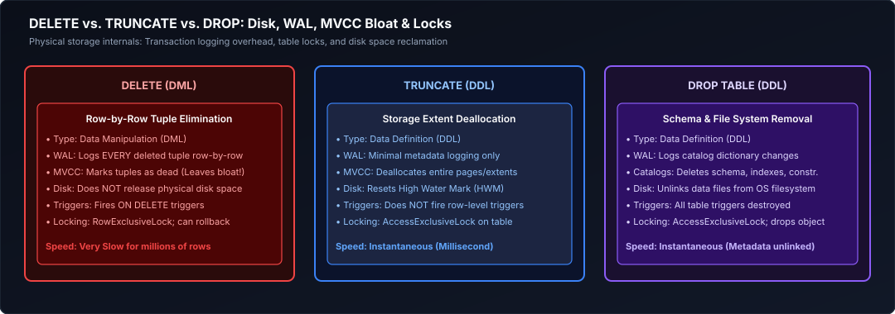

*D2 Source: [`10_delete_truncate_drop.d2`](assets/01_sql_and_advanced_querying/10_delete_truncate_drop.d2)*

---

### 10.4 Standard Views vs Materialized Views

- **Standard View:** A saved, named SQL query. It does **not store physical data**.
  - When queried, the query engine expands the view definition into the user's query and optimizes it as a single compound query plan.
  - *Benefits:* Encapsulates business logic, secures column access (masks sensitive fields), always shows up-to-the-second real-time data.
  - *Drawbacks:* Re-executes the underlying join/aggregation every single time it is queried.
- **Materialized View:** Stores the **physical query results on disk**, exactly like a real table.
  - *Benefits:* Complex joins and multi-million-row aggregations execute in milliseconds because the result is already computed and indexed.
  - *Drawbacks:* Data becomes stale over time. Must be periodically refreshed (`REFRESH MATERIALIZED VIEW`), which incurs compute cost.

```sql
-- 1. Standard View: Dynamic abstraction
CREATE OR REPLACE VIEW reporting.vw_clean_active_customers AS
SELECT 
    customer_id,
    company_name,
    LOWER(contact_email) AS clean_email,
    created_at
FROM crm.customers
WHERE is_active = TRUE 
  AND is_deleted = FALSE;

-- 2. Materialized View: Physical pre-computed storage
CREATE MATERIALIZED VIEW reporting.mv_monthly_executive_summary AS
SELECT 
    DATE_TRUNC('month', order_date) AS sales_month,
    category_id,
    COUNT(order_id)                AS total_orders,
    SUM(order_amount)              AS gross_revenue
FROM sales.orders
GROUP BY DATE_TRUNC('month', order_date), category_id;

-- Create an index directly on the materialized view
CREATE INDEX idx_mv_sales_month ON reporting.mv_monthly_executive_summary (sales_month);

-- Refresh the materialized view on an hourly batch schedule
REFRESH MATERIALIZED VIEW CONCURRENTLY reporting.mv_monthly_executive_summary;
```

---

### 10.5 Session Temporary Tables vs Table Variables vs CTEs

When building complex multi-step ETL transformations in SQL, engineers must choose the right scratchpad storage:

| Storage Construct | Scope & Lifetime | Physical Storage | Indexable? | Best Practice Data Engineering Use Case |
| :--- | :--- | :--- | :---: | :--- |
| **CTE (`WITH ... AS`)** | Single SQL Statement | In-memory (inlined or materialized in memory/spill). | No | Code readability, breaking down complex expressions, recursive queries. |
| **Temporary Table (`CREATE TEMP TABLE`)** | Database Session / Connection | `tempdb` or local disk tablespace. | **Yes** (Supports B-Tree & Hash indexes, statistics, clustering). | Staging multi-step intermediate datasets (> 100,000 rows) that are joined multiple times. |
| **Permanent Staging Table** | Global across all sessions until dropped | Primary Database Storage | **Yes** | Enterprise orchestration pipelines (Airflow, dbt) where pipeline steps run in separate worker processes. |

```sql
-- Comprehensive Production Intermediate Staging Pattern:
-- 1. Create a session-scoped temporary table
CREATE TEMPORARY TABLE temp_high_value_customers (
    customer_id   BIGINT PRIMARY KEY,
    total_spend   NUMERIC(14, 2) NOT NULL,
    order_count   INT NOT NULL
) ON COMMIT PRESERVE ROWS;

-- 2. Insert summarized intermediate data
INSERT INTO temp_high_value_customers (customer_id, total_spend, order_count)
SELECT 
    customer_id,
    SUM(order_amount) AS total_spend,
    COUNT(order_id)   AS order_count
FROM sales.orders
WHERE order_date >= '2026-01-01'
GROUP BY customer_id
HAVING SUM(order_amount) >= 10000.00;

-- 3. Build a dedicated index on the temporary table to accelerate downstream joins
CREATE INDEX idx_tmp_cust_spend ON temp_high_value_customers (total_spend DESC);

-- 4. Execute final join against dimension tables with sub-second execution
SELECT 
    thv.customer_id,
    c.customer_name,
    c.account_manager,
    thv.total_spend,
    thv.order_count
FROM temp_high_value_customers AS thv
INNER JOIN crm.customers AS c ON thv.customer_id = c.customer_id
ORDER BY thv.total_spend DESC;
```

> [!TIP]
> **Deep-Dive Interview Scenarios:**
> - [Q45. Top 10 Users by Video Watch Hours in the Last Month](frequently_asked_questions/01_sql_and_advanced_querying_faq.md#q45-medium-top-10-users-by-video-watch-hours-in-the-last-month)
> - [Q51. Filtered Projections & Conditional In-Place DML Updates](frequently_asked_questions/01_sql_and_advanced_querying_faq.md#q51-medium-filtered-projections--conditional-in-place-dml-updates)
> - [Q54. Employees Who Earn More Than Their Direct Managers](frequently_asked_questions/01_sql_and_advanced_querying_faq.md#q54-medium-employees-who-earn-more-than-their-direct-managers)
> - [Q55. Aggregated Driver Ratings with Minimum Trip Thresholds (>100 Trips)](frequently_asked_questions/01_sql_and_advanced_querying_faq.md#q55-medium-aggregated-driver-ratings-with-minimum-trip-thresholds-100-trips)
> - [Q56. Customer Deduplication by Timestamp / UpdatedDate (Deterministic Winner Selection)](frequently_asked_questions/01_sql_and_advanced_querying_faq.md#q56-medium-customer-deduplication-by-timestamp--updateddate-deterministic-winner-selection)
> - [Q58. 90-Day Dormant Customer Inactivity Detection (Anti-Join vs NOT EXISTS)](frequently_asked_questions/01_sql_and_advanced_querying_faq.md#q58-easy-90-day-dormant-customer-inactivity-detection-anti-join-vs-not-exists)

---

# 11. Advanced Joins & Distributed Execution Mechanics

Foundational join mechanics (covered in [01. SQL Fundamentals](01_sql_and_advanced_querying.md#7-relational-joins--multi-table-querying)) establish set intersections. In enterprise data engineering, query engines must process petabytes of data across distributed clusters where network shuffles, memory spilling, and join cardinality determine system performance.

---

### 11.1 SEMI JOIN & ANTI JOIN: Mechanics, Null Immunity & Memory Footprint

#### The Intuitive Mental Model
- **SEMI JOIN is like a Nightclub Bouncer with a VIP Guest List:** The bouncer inspects each patron waiting in the general admission line (the Left Table). He checks whether their name appears anywhere on the VIP guest list (the Right Table). The very microsecond he spots their name on the list, he stamps their hand and lets them through the door. **He does not care if their name appears 5 times on the VIP list**; they are admitted **exactly once**, and no VIP list attributes (like table reservation numbers) are attached to them.
- **ANTI JOIN is like a Bouncer with a Blacklist:** The bouncer checks each patron against a list of banned troublemakers. If the person's name is **not** on the blacklist, they enter. If their name appears on the blacklist, they are turned away immediately.

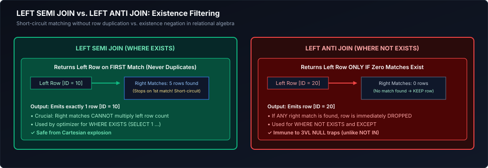

*D2 Source: [`11_semi_vs_anti_join.d2`](assets/01_sql_and_advanced_querying/11_semi_vs_anti_join.d2)*

#### Concrete Step-by-Step Dataset Walkthrough

Consider the following customer and order datasets:

**Left Table: `crm.customers`**
| `customer_id` | `customer_name` | `tier` | `signup_date` |
| :--- | :--- | :--- | :--- |
| `101` | Sarah Connor | Enterprise | `2024-01-15` |
| `102` | John Connor | Standard | `2024-02-01` |
| `103` | Kyle Reese | Standard | `2024-02-10` |
| `104` | Miles Dyson | Enterprise | `2024-03-05` |

**Right Table: `sales.orders`**
| `order_id` | `customer_id` | `order_amount` | `order_date` |
| :--- | :--- | :--- | :--- |
| `ORD-901` | `101` | \$450.00 | `2024-04-01` |
| `ORD-902` | `101` | \$1,200.00 | `2024-04-10` |
| `ORD-903` | `101` | \$85.00 | `2024-04-12` |
| `ORD-904` | `104` | \$3,500.00 | `2024-04-15` |
| `ORD-905` | `NULL` | \$15.00 | `2024-04-16` |

##### 1. The `INNER JOIN` Duplication Trap
If a query attempts to find all customers who placed an order using a standard `INNER JOIN`:
```sql
SELECT c.customer_id, c.customer_name, c.tier
FROM crm.customers AS c
INNER JOIN sales.orders AS o ON c.customer_id = o.customer_id;
```
Sarah Connor (`customer_id = 101`) appears **3 separate times** because she placed 3 orders! If downstream engineers feed this result into a machine learning feature pipeline or customer count metric, Sarah is counted 3 times unless an expensive `DISTINCT` operator is added.

##### 2. The `LEFT SEMI JOIN` Execution
A `SEMI JOIN` matches keys, verifies existence, short-circuits, and projects **only the columns of the left table**:
```sql
-- Databricks / Spark SQL / Hive native syntax
SELECT c.customer_id, c.customer_name, c.tier
FROM crm.customers AS c
LEFT SEMI JOIN sales.orders AS o ON c.customer_id = o.customer_id;
```
**Result Table:**
| `customer_id` | `customer_name` | `tier` |
| :--- | :--- | :--- |
| `101` | Sarah Connor | Enterprise |
| `104` | Miles Dyson | Enterprise |
*Guarantees:* Sarah Connor appears exactly once. Zero row multiplication. Zero right-table memory footprint.

##### 3. The `LEFT ANTI JOIN` Execution & The Lethal `NOT IN (NULL)` Trap
To find all customers who registered but **never placed an order**:
```sql
-- DANGEROUS ANTI-PATTERN: If sales.orders contains a single NULL customer_id, this returns ZERO rows!
SELECT * FROM crm.customers
WHERE customer_id NOT IN (SELECT customer_id FROM sales.orders);
```
**Why `NOT IN` fails completely:** In our sample data, row `ORD-905` has `customer_id = NULL`.
The condition evaluates as:
`102 NOT IN (101, 104, NULL)` $\implies$ `102 != 101 AND 102 != 104 AND 102 != NULL`
$\implies$ `TRUE AND TRUE AND UNKNOWN` $\implies$ `UNKNOWN`.
In SQL filtering, `UNKNOWN` evaluates to false! **The query returns 0 rows, silently corrupting your pipeline.**

**The Production Solution: `LEFT ANTI JOIN` or `NOT EXISTS`**
```sql
-- Production Safe Pattern 1: Databricks / Spark SQL LEFT ANTI JOIN
SELECT c.customer_id, c.customer_name, c.tier
FROM crm.customers AS c
LEFT ANTI JOIN sales.orders AS o ON c.customer_id = o.customer_id;

-- Production Safe Pattern 2: ANSI SQL NOT EXISTS (PostgreSQL, Snowflake, BigQuery)
SELECT c.customer_id, c.customer_name, c.tier
FROM crm.customers AS c
WHERE NOT EXISTS (
    SELECT 1 FROM sales.orders AS o WHERE o.customer_id = c.customer_id
);
```
**Result Table:**
| `customer_id` | `customer_name` | `tier` |
| :--- | :--- | :--- |
| `102` | John Connor | Standard |
| `103` | Kyle Reese | Standard |
*Guarantees:* Completely immune to `NULL` values in the right table. High performance index seek.

---

### 11.2 SELF JOIN & Asymmetric Pairing Patterns

A `SELF JOIN` joins a table to itself using distinct aliases. While common for resolving parent-child employee-manager hierarchies, senior data engineers employ **Asymmetric Self Joins** to detect collisions, fraud rings, and cohort overlaps without generating duplicate symmetric pairs.

#### The Symmetric Collision Problem: Avoiding Mirrored Duplicates
Suppose you must identify all pairs of user accounts logging in from the same IP address within 15 minutes of each other.
If you join with an inequality condition `u1.user_id != u2.user_id`, the engine generates two mirrored rows for every pair: `(User1, User2)` and `(User2, User1)`. Furthermore, comparing $N$ rows against $N$ rows requires evaluating $N^2 - N$ combinations!

By enforcing the **strict asymmetric inequality** `u1.user_id < u2.user_id`:
1. Self-pairing `(User1, User1)` is mathematically impossible ($1 < 1$ is False).
2. Mirrored pairs `(User2, User1)` are eliminated because $2 < 1$ is False.
3. The comparison space is reduced by over 50% ($\frac{N(N-1)}{2}$ combinations).

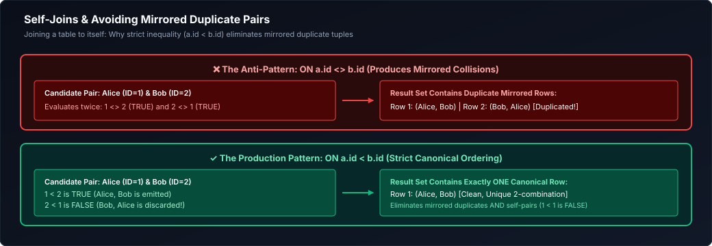

*D2 Source: [`12_self_join_symmetric_collision.d2`](assets/01_sql_and_advanced_querying/12_self_join_symmetric_collision.d2)*

#### Production Fraud Ring Detection Query
```sql
-- Detect multiple distinct user accounts logging in from the same IP within a 15-minute window
SELECT 
    u1.user_id                                                         AS primary_user_id,
    u2.user_id                                                         AS colluding_user_id,
    u1.ip_address                                                      AS shared_ip,
    u1.login_timestamp                                                 AS login_time_user_1,
    u2.login_timestamp                                                 AS login_time_user_2,
    ABS(EXTRACT(EPOCH FROM (u1.login_timestamp - u2.login_timestamp))) AS seconds_between_logins
FROM security.user_logins AS u1
INNER JOIN security.user_logins AS u2
    ON u1.ip_address = u2.ip_address                                   -- Identical IP address
   AND u1.user_id < u2.user_id                                         -- Asymmetric filter: eliminates self-match & mirrors
   AND u1.login_timestamp BETWEEN u2.login_timestamp - INTERVAL '15 minutes'
                              AND u2.login_timestamp + INTERVAL '15 minutes';
```

---

### 11.3 Distributed Join Strategies: Broadcast Hash Join (BHJ)

#### Physical Execution Mechanics
In a distributed compute cluster (Spark, Databricks, Trino), physical worker nodes are separated by network top-of-rack switches. When joining a 10 TB Fact Table against a 15 MB Dimension Table:
1. **Driver Collection:** The driver node pulls the complete 15 MB dimension table from storage into its local memory.
2. **Torrent Broadcast:** The driver uses a peer-to-peer BitTorrent-like protocol to replicate the 15 MB dataset directly into the local memory heap of **every single worker executor node** across the cluster.
3. **Local Hash Table Build:** Each worker task builds an in-memory hash table of the broadcasted dimension table.
4. **Zero-Shuffle Stream Probe:** Each executor reads its assigned partition of the 10 TB fact table from local storage or cloud disk. As fact rows stream through CPU cache, the executor performs instant $O(1)$ memory lookups against the broadcasted hash table.
5. **Network Savings:** **Zero rows of the 10 TB fact table traverse the physical network switches!**

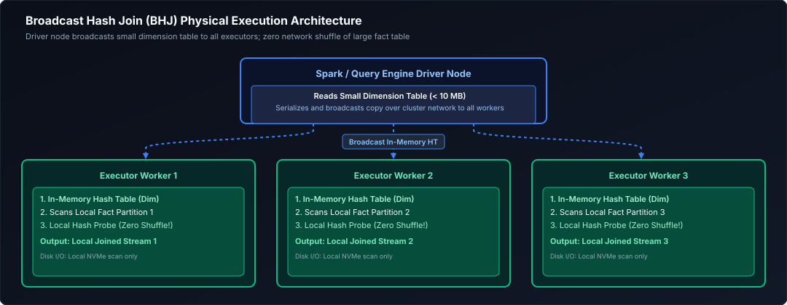

*D2 Source: [`13_broadcast_hash_join.d2`](assets/01_sql_and_advanced_querying/13_broadcast_hash_join.d2)*

#### Production Thresholds & Failure Traps
- **Default Threshold:** Spark's `spark.sql.autoBroadcastJoinThreshold` defaults to 10 MB (`10485760` bytes). In modern clouds, you can safely tune this threshold to **64 MB or 128 MB**:
  ```python
  spark.conf.set("spark.sql.autoBroadcastJoinThreshold", 67108864) # 64 MB
  ```
- **The Fatal Driver OOM Trap:** If a developer applies a broadcast hint `/*+ BROADCAST(t) */` on a table that turns out to have 10 GB of data due to missing filters, the driver attempts to collect 10 GB into heap RAM, instantly crashing the master node with:
  `java.lang.OutOfMemoryError: Java heap space`.

---

### 11.4 Distributed Join Strategies: Shuffle Hash Join (SHJ)

#### Physical Execution Mechanics
When both tables are too large to broadcast, but one table is significantly smaller than the other and can fit into the memory allocated to a single executor task partition:
1. **Network Hash Redistribution:** Both tables are scanned. For each row, the engine computes `hash(join_key) % num_partitions` (default 200 partitions).
2. Rows from both tables sharing identical hash buckets are transmitted across network switches to the same physical worker node.
3. **Task-Level Hash Table:** For each partition slice, the executor builds an in-memory hash table of the smaller table's partition.
4. **Stream Probe:** The executor streams the larger table's matching partition, performing hash lookups.

#### When to Use vs. Failure Mode
- **Advantage:** Faster than Sort-Merge Join because it does not incur the CPU overhead of sorting both sides.
- **Vulnerability:** If data skew causes one key to have 5 million rows, that single partition's hash table exceeds executor heap memory, crashing the task with an OOM error. Spark therefore disables Shuffle Hash Join by default in favor of Sort-Merge Join (`spark.sql.join.preferSortMergeJoin = true`).

---

### 11.5 Distributed Join Strategies: Sort-Merge Join (SMJ)

#### Physical Execution Mechanics
Sort-Merge Join is the **battle-hardened workhorse** of distributed big data processing. It operates in three sequential phases:

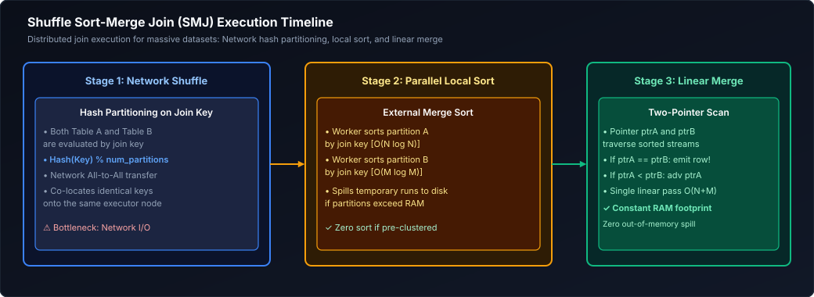

*D2 Source: [`14_shuffle_sort_merge_join.d2`](assets/01_sql_and_advanced_querying/14_shuffle_sort_merge_join.d2)*

#### Why Sort-Merge Join Never Dies (Disk Spilling Resilience)
In Sort-Merge Join, neither table needs to fit entirely in RAM!
If a partition has 50 GB of data and the executor only has 4 GB of working memory:
1. The executor loads chunks into memory buffers, sorts them via Quicksort, and **spills sorted runs to local NVMe SSD disk**.
2. It performs an external multi-way merge over the sorted runs on disk.
3. Once both sides are sorted, the joiner maintains **two sliding pointers**:
   - If `Key_A < Key_B`: Advance pointer A.
   - If `Key_A > Key_B`: Advance pointer B.
   - If `Key_A == Key_B`: Emit joined row!
4. **Complexity:** Scanning sorted streams is strictly $O(N + M)$ linear time.

---

### 11.6 Distributed Join Comparison & Selection Decision Tree

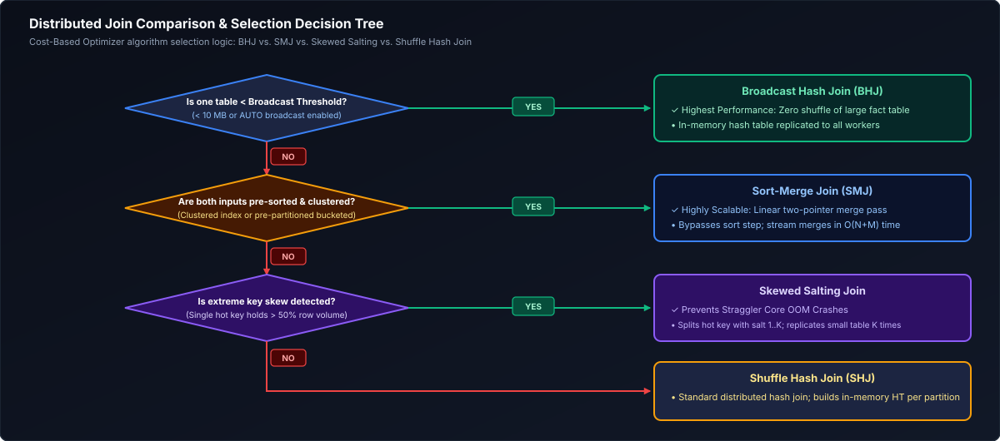

*D2 Source: [`15_distributed_join_decision_tree.d2`](assets/01_sql_and_advanced_querying/15_distributed_join_decision_tree.d2)*

| Distributed Join Operator | Pre-conditions | Network I/O Cost | Memory Overhead | Disk Spilling Capability | Skew Tolerance |
| :--- | :--- | :--- | :--- | :--- | :--- |
| **Broadcast Hash Join (BHJ)** | One table $\le$ broadcast threshold | **Lowest:** Dimension broadcasted once; fact table zero shuffle | Must fit entirely in Driver & Executor JVM memory | None (Fails with OOM if table too large) | Excellent (Zero fact shuffle) |
| **Shuffle Hash Join (SHJ)** | Equi-join; smaller side partition fits in RAM | **High:** $O(N + M)$ network exchange of all records | High: Builds in-memory hash table per partition | Poor (Crashes executor if partition spills) | Very Poor (Skewed key blows out memory) |
| **Sort-Merge Join (SMJ)** | Equi-join; default for large datasets | **High:** $O(N + M)$ network exchange of all records | Low: Streams sorted records sequentially via pointers | **Full Spilling:** Spills sorted runs to NVMe SSD seamlessly | **High:** Skew slows down task but does not crash |

---

### 11.7 Join Order & Cost-Based Optimizer (CBO) Execution Trees

#### How the Cost-Based Optimizer Evaluates Plans
In relational databases, join order is not dictated by query text. Joining 4 tables ($A, B, C, D$) presents **24 possible join orders** ($4!$). Joining 10 tables presents **3,628,800 possible join permutations**!

The **Cost-Based Optimizer (CBO)** estimates execution cost ($C$) using quantitative formulas:

$$C_{\text{total}} = C_{\text{I/O}} \times \text{PagesRead} + C_{\text{CPU}} \times \text{TuplesProcessed} + C_{\text{Network}} \times \text{BytesShuffled}$$

#### Left-Deep vs. Bushy Execution Trees
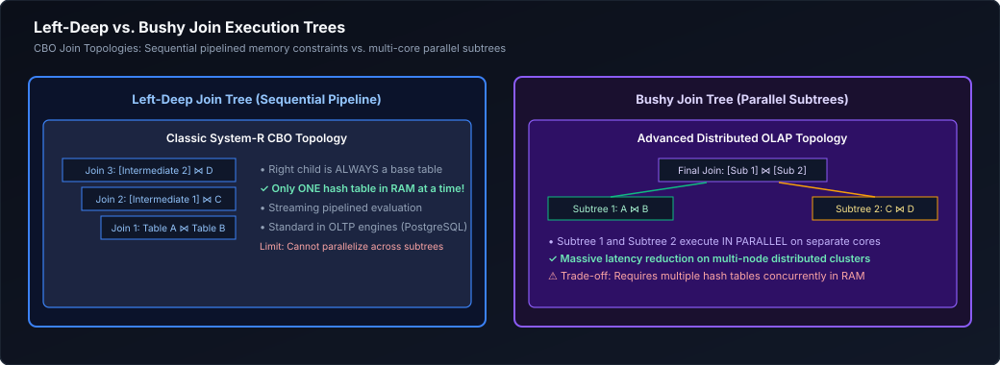

*D2 Source: [`16_left_deep_vs_bushy_trees.d2`](assets/01_sql_and_advanced_querying/16_left_deep_vs_bushy_trees.d2)*

- **Left-Deep Trees:** Pipelined; output of join 1 immediately feeds join 2. Keeps working memory strictly minimal because intermediate tables are consumed immediately without disk materialization.
- **Bushy Trees:** Sub-joins ($A \bowtie B$ and $C \bowtie D$) execute concurrently across separate worker nodes and merge at the root. Essential when joining multiple large fact-to-fact or snowflake dimension models.

#### The Stale Statistics Hazard
If table statistics (`ANALYZE TABLE`) are out of date, the optimizer may believe a table has 500 rows when an upstream pipeline recently loaded 500 million rows. The CBO chooses a Broadcast Hash Join, and the driver immediately crashes with an OOM.
*Remediation:* Enforce automated statistics collection in pipeline schedules:
```sql
ANALYZE TABLE sales.fact_orders COMPUTE STATISTICS FOR ALL COLUMNS;
```

---

### 11.8 Join Cardinality, Metric Fan-Out & Pre-Aggregation Patterns

#### The Mathematical Fan-Out Trap
When joining a parent table (`orders`) to a child table (`order_items`), each parent row replicates for every matching child record:

$$\text{Recorded Amount} = \$100.00 \quad \xrightarrow{1:3 \text{ Join}} \quad 3 \times \$100.00 = \$300.00 \text{ in } \text{SUM}(\text{order\_amount})!$$

#### The Solution: The Pre-Aggregation CTE Pattern
Never join raw parent to raw child before calculating aggregates. Pre-aggregate child records to the parent primary key grain first:

```sql
-- Step 1: Pre-aggregate order line items to order_id grain
WITH aggregated_line_items AS (
    SELECT 
        order_id,
        COUNT(item_id)             AS total_items_count,
        SUM(unit_price * quantity) AS total_items_value
    FROM sales.order_items
    GROUP BY order_id  -- Guarantees uniqueness of order_id in CTE output
)
-- Step 2: 1-to-1 join with zero risk of row duplication or fan-out
SELECT 
    o.order_id,
    o.customer_id,
    o.order_amount                 AS original_clean_order_amount,
    COALESCE(i.total_items_count, 0) AS total_items_count,
    COALESCE(i.total_items_value, 0.00) AS calculated_items_value
FROM sales.orders AS o
LEFT JOIN aggregated_line_items AS i 
    ON o.order_id = i.order_id;
```

---

### 11.9 The Salting Technique for Extreme Data Skew

#### The Problem: Straggler Tasks
In distributed shuffles, rows are partitioned by `hash(key) % num_partitions`. If 90% of rows contain `customer_id = 0` or `'GUEST'`, 90% of all data lands on **one single worker executor**. While 99 workers finish in 5 seconds, worker 100 thrashes disk for 2 hours (or dies with an OOM error).

#### The Salting Algorithm
1. On the skewed fact table, append a random integer salt from $0 \dots (S-1)$ (e.g. $S=4$):
   `salted_key = CONCAT(customer_id, '_', FLOOR(RAND() * 4))`
2. On the dimension lookup table, replicate every record $S$ times, pairing it with every salt value ($0, 1, 2, 3$).
3. Join on the composite salted key: `fact.customer_id = dim.customer_id AND fact.salt = dim.salt`.
4. **Result:** The skewed key is shattered evenly across 4 independent cluster nodes!

```sql
-- Production PySpark / Databricks SQL Salting Pattern
WITH salted_fact AS (
    SELECT 
        transaction_id,
        customer_id,
        amount,
        -- Scatter skewed key 'GUEST' across 4 distinct worker buckets
        FLOOR(RAND() * 4) AS salt
    FROM telemetry.clickstream_events
),
replicated_dim AS (
    SELECT 
        c.customer_id,
        c.customer_name,
        s.salt
    FROM crm.customers AS c
    -- Cross join small array [0, 1, 2, 3] to duplicate dimension 4 times
    CROSS JOIN (SELECT EXPLODE(ARRAY(0, 1, 2, 3)) AS salt) AS s
)
SELECT 
    f.transaction_id,
    f.amount,
    d.customer_name
FROM salted_fact AS f
INNER JOIN replicated_dim AS d 
    ON f.customer_id = d.customer_id 
   AND f.salt = d.salt;  -- Perfectly balanced shuffle partitions!
```

---

### 11.10 Non-Equi Joins & Temporal / SCD2 Range Matching

Non-equi joins join on inequality ranges (`<`, `>`, `BETWEEN`). Because keys are not equal, hash tables cannot be used, forcing engines into costly **Broadcast Nested Loop Joins (BNLJ)** ($O(N \times M)$) unless optimized.

#### Point-in-Time Temporal Matching (SCD Type 2)
In enterprise data warehouses, dimension records have validity windows (`valid_from` to `valid_to`). Fact records must join to the dimension version valid at that exact microsecond:

```sql
SELECT 
    t.transaction_id,
    t.transaction_timestamp,
    t.amount,
    c.customer_surrogate_key,
    c.customer_id,
    c.risk_tier                                 AS historical_risk_tier
FROM warehouse.fact_financial_transactions AS t
INNER JOIN warehouse.dim_customers_scd2 AS c
    ON t.customer_id = c.customer_id            -- Equi-join on natural key
   AND t.transaction_timestamp >= c.valid_from  -- Non-equi lower boundary
   AND t.transaction_timestamp <  c.valid_to;   -- Non-equi upper boundary
```

> [!TIP]
> **Deep-Dive Interview Scenarios:**
> - [Q6. Identifying and Purging Duplicate Records While Keeping One Copy](frequently_asked_questions/01_sql_and_advanced_querying_faq.md#q6-medium-identifying-and-purging-duplicate-records-while-keeping-one-copy)
> - [Q7. Retrieving Only the Latest Transaction per Customer](frequently_asked_questions/01_sql_and_advanced_querying_faq.md#q7-medium-retrieving-only-the-latest-transaction-per-customer)
> - [Q8. Retrieving Only the Most Recently Updated Address per Customer](frequently_asked_questions/01_sql_and_advanced_querying_faq.md#q8-medium-retrieving-only-the-most-recently-updated-address-per-customer)
> - [Q23. Identifying Customers with No Purchases in 6 to 12 Months](frequently_asked_questions/01_sql_and_advanced_querying_faq.md#q23-medium-identifying-customers-with-no-purchases-in-6-to-12-months)
> - [Q24. CTE vs Temp Table Execution Plan Reuse & Recompiles](frequently_asked_questions/01_sql_and_advanced_querying_faq.md#q24-easy-cte-vs-temp-table-execution-plan-reuse--recompiles)
> - [Q27. Partition Switching Mechanics & Near-Instant Metadata Swaps](frequently_asked_questions/01_sql_and_advanced_querying_faq.md#q27-medium-partition-switching-mechanics--near-instant-metadata-swaps)
> - [Q29. INNER JOIN vs LEFT JOIN vs CROSS JOIN Mechanics](frequently_asked_questions/01_sql_and_advanced_querying_faq.md#q29-easy-inner-join-vs-left-join-vs-cross-join-mechanics)
> - [Q39. Cohort Repeat Order Rates: Top 3 Cuisines Ordered by Same User Within 7 Days](frequently_asked_questions/01_sql_and_advanced_querying_faq.md#q39-medium-cohort-repeat-order-rates-top-3-cuisines-ordered-by-same-user-within-7-days)
> - [Q40. Driver Trip Count Variance Between Consecutive Weeks](frequently_asked_questions/01_sql_and_advanced_querying_faq.md#q40-medium-driver-trip-count-variance-between-consecutive-weeks)
> - [Q48. Deep Pagination Performance: OFFSET 100,000 vs Keyset / Seek Pagination](frequently_asked_questions/01_sql_and_advanced_querying_faq.md#q48-easy-deep-pagination-performance-offset-100000-vs-keyset--seek-pagination)
> - [Q49. Why Adding an Index Can Degrade Query Performance](frequently_asked_questions/01_sql_and_advanced_querying_faq.md#q49-medium-why-adding-an-index-can-degrade-query-performance)
> - [Q50. Window Ranking Mechanics: ROW_NUMBER() vs RANK() vs DENSE_RANK()](frequently_asked_questions/01_sql_and_advanced_querying_faq.md#q50-easy-window-ranking-mechanics-row_number-vs-rank-vs-dense_rank)
> - [Q61. Anti-Join Mechanics: Extracting Non-Matching Rows Across Datasets](frequently_asked_questions/01_sql_and_advanced_querying_faq.md#q61-medium-anti-join-mechanics-extracting-non-matching-rows-across-datasets)

---

# 12. Advanced Subqueries, CTEs & Hierarchical Recursion

---

### 12.1 Correlated Subqueries & Query Decorrelation Mechanics

A **Correlated Subquery** references columns from the outer enclosing query.
- *Naive Execution:* Evaluates the subquery row-by-row in a nested loop: $O(N \times M)$ scans.
- *Optimizer Decorrelation:* Modern optimizers (PostgreSQL, Snowflake, Spark) rewrite correlated scalar subqueries into `LEFT OUTER JOIN` or `LEFT SEMI JOIN` automatically during plan compilation.

---

### 12.2 `LATERAL` Joins & `CROSS APPLY`: The SQL For-Each Loop

A `LATERAL` join (PostgreSQL, Snowflake) or `CROSS APPLY` (SQL Server) allows an inline subquery in the `FROM` clause to access columns from tables defined earlier in the query.

#### Use Case: Top-K Records Per Group
```sql
-- Retrieve the top 2 highest-value orders for EACH customer
SELECT 
    c.customer_id,
    c.customer_name,
    top_orders.order_id,
    top_orders.order_amount
FROM crm.customers AS c
CROSS JOIN LATERAL (
    SELECT o.order_id, o.order_amount
    FROM sales.orders AS o
    WHERE o.customer_id = c.customer_id  -- Correlated link to outer table
    ORDER BY o.order_amount DESC
    LIMIT 2                              -- Picks top 2 per customer via index seek
) AS top_orders;
```

---

### 12.3 Common Table Expressions (CTEs): Inlining vs. Optimization Fences

- **Inlined CTE (Default in Snowflake, Databricks, PostgreSQL 12+):** The optimizer treats the CTE like a macro, merging its SQL directly into the outer query to enable **Predicate Pushdown** through the CTE boundary.
- **Materialized CTE (`AS MATERIALIZED`):** Acts as an **Optimization Fence**. It forces the engine to compute the CTE once, store the result in a temporary memory/disk buffer, and reuse it across multiple references.

```sql
WITH heavy_aggregation AS MATERIALIZED (
    SELECT 
        department_id,
        AVG(salary) AS avg_dept_salary,
        MAX(salary) AS max_dept_salary
    FROM hr.employees
    GROUP BY department_id
)
SELECT e.employee_id, e.salary, h.avg_dept_salary
FROM hr.employees AS e
INNER JOIN heavy_aggregation AS h ON e.department_id = h.department_id
WHERE e.salary > h.avg_dept_salary;
```

---

### 12.4 Recursive CTEs: Fixed-Point Relational Iteration

A **Recursive CTE** executes fixed-point relational iteration until zero new rows are generated:
1. **Anchor Query:** Base case query executing at Step 0.
2. **Working Table:** Holds rows produced by Step $N-1$.
3. **Recursive Query:** Joins against the working table, producing Step $N$.
4. **Intermediate Queue:** Rows from Step $N$ are appended to the cumulative result (`UNION ALL`) and become the new working table for Step $N+1$.
5. **Termination:** When Step $N$ returns 0 rows, recursion terminates cleanly.

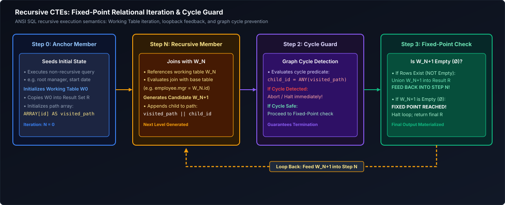

*D2 Source: [`17_recursive_cte_iteration.d2`](assets/01_sql_and_advanced_querying/17_recursive_cte_iteration.d2)*

---

### 12.5 Hierarchical Tree Traversal with Cycle Detection & Path Building

```sql
WITH RECURSIVE org_chart AS (
    -- 1. Anchor Member: Top executives (nodes with no managers)
    SELECT 
        employee_id,
        manager_id,
        full_name,
        1 AS depth,
        CAST(full_name AS VARCHAR(1000)) AS reporting_chain,
        ARRAY[employee_id] AS visited_ids
    FROM hr.employees
    WHERE manager_id IS NULL
    
    UNION ALL
    
    -- 2. Recursive Member: Iteratively join child employees
    SELECT 
        e.employee_id,
        e.manager_id,
        e.full_name,
        oc.depth + 1 AS depth,
        CAST(oc.reporting_chain || ' -> ' || e.full_name AS VARCHAR(1000)),
        oc.visited_ids || e.employee_id
    FROM hr.employees AS e
    INNER JOIN org_chart AS oc 
        ON e.manager_id = oc.employee_id
    WHERE NOT (e.employee_id = ANY(oc.visited_ids))  -- Prevents infinite cycle loops!
      AND oc.depth < 20                             -- Safety depth ceiling
)
SELECT employee_id, full_name, depth, reporting_chain
FROM org_chart
ORDER BY depth ASC, employee_id ASC;
```

---

### 12.6 Bill of Materials (BOM) Multi-Level Parts Explosion

In manufacturing and supply chain pipelines, complex assemblies (e.g., an Electric Vehicle) are composed of sub-assemblies (Battery Pack), which contain sub-components (Lithium Cells), which contain raw materials.
A **Bill of Materials (BOM) Explosion** uses a Recursive CTE to calculate the total cumulative quantity and cost of all sub-parts required to manufacture the top-level product:

```sql
WITH RECURSIVE bom_explosion AS (
    -- Anchor: Top-level finished product (e.g., Model 3 EV, Assembly ID = 1000)
    SELECT 
        parent_part_id,
        component_part_id,
        quantity_required,
        1 AS assembly_level,
        quantity_required AS cumulative_quantity
    FROM manufacturing.bill_of_materials
    WHERE parent_part_id = 1000
    
    UNION ALL
    
    -- Recursive step: Explode sub-components down to raw materials
    SELECT 
        child.parent_part_id,
        child.component_part_id,
        child.quantity_required,
        parent.assembly_level + 1,
        parent.cumulative_quantity * child.quantity_required AS cumulative_quantity
    FROM manufacturing.bill_of_materials AS child
    INNER JOIN bom_explosion AS parent 
        ON child.parent_part_id = parent.component_part_id
)
SELECT 
    b.component_part_id,
    p.part_name,
    p.unit_cost,
    SUM(b.cumulative_quantity) AS total_parts_needed,
    SUM(b.cumulative_quantity * p.unit_cost) AS total_cost_contribution
FROM bom_explosion AS b
INNER JOIN manufacturing.parts_catalog AS p 
    ON b.component_part_id = p.part_id
GROUP BY b.component_part_id, p.part_name, p.unit_cost
ORDER BY total_cost_contribution DESC;
```

---

### 12.7 `EXISTS` vs. `NOT EXISTS` vs. `IN` / `NOT IN` Deep-Dive

#### 1. Overview: Existence vs. Value Membership
In relational query design, filtering a dataset based on related records in another table is one of the most frequent operations. SQL provides two distinct paradigms to achieve this:
- **Set Membership (`IN`, `NOT IN`):** Tests whether an outer column's scalar value matches any value within a projected list or subquery result set.
- **Correlated Existence (`EXISTS`, `NOT EXISTS`):** Tests whether a correlated subquery produces at least one row matching the correlation predicate, ignoring the actual values returned by the inner projection.

While conceptually similar for simple datasets, these constructs diverge dramatically in execution strategy, index utilization, and their handling of `NULL` values under ANSI Three-Valued Logic ($3\text{VL}$).

#### 2. Detailed Mechanism & Working Principles

##### `IN` and the Hash Set Strategy
When executing `WHERE column IN (SELECT id FROM table)`, the database engine projects the inner column, materializes the unique results into an in-memory hash table (or worktable), and probes the hash table for each outer row.
- **Syntax:** `expression IN (subquery | value_list)`
- **Behavior:** Returns `TRUE` if `expression` equals at least one element in the set.
- **Memory Footprint:** If the subquery yields millions of distinct keys, materializing the set causes memory pressure or spills to temporary disk storage.

##### The Lethal `NOT IN` Three-Valued Logic ($3\text{VL}$) Trap
In ANSI SQL, comparing any value to `NULL` via equality or inequality yields `UNKNOWN`, not `TRUE` or `FALSE`. The construct `x NOT IN (y1, y2, y3)` is mathematically equivalent to:
$$x \ne y_1 \text{ AND } x \ne y_2 \text{ AND } x \ne y_3$$
If any element $y_i$ in the set is `NULL`, then:
$$x \ne \text{NULL} \implies \text{UNKNOWN}$$
Consequently, the chained conjunction becomes:
$$\text{TRUE} \text{ AND } \text{TRUE} \text{ AND } \text{UNKNOWN} \implies \text{UNKNOWN}$$
Because a `WHERE` clause filters out any row whose predicate does not evaluate strictly to `TRUE`, **a single `NULL` in the subquery result collapses the entire outer query result set to zero rows**, silently omitting valid records.

##### `EXISTS` and Short-Circuit Semi-Join Mechanics
The `EXISTS` construct evaluates a correlated subquery and asks: *Does this subquery return at least one tuple?*
- **Syntax:** `WHERE EXISTS (SELECT 1 FROM related_table WHERE related_table.fk = outer_table.pk)`
- **Short-Circuiting:** The storage engine initiates an index seek on the inner table. The instant the query processor encounters the first matching tuple, it immediately ceases scanning and returns `TRUE` (a Left Semi-Join).
- **Projection Independence:** Because `EXISTS` tests only row existence (cardinality $> 0$), the columns projected in the subquery's `SELECT` list are irrelevant. Writing `SELECT 1`, `SELECT *`, or `SELECT NULL` executes identically.

##### `NOT EXISTS` and Anti-Join Safety
`NOT EXISTS` asserts that zero tuples satisfy the correlation condition.
- **Short-Circuiting:** As soon as a single matching record is found, the subquery aborts and returns `FALSE`. Only if the subquery produces an empty set does it return `TRUE`.
- **`NULL` Immunity:** Because `NOT EXISTS` checks whether an inner row exists rather than evaluating scalar inequality on column values, it is completely immune to the $3\text{VL}$ trap. If an inner record contains `NULL` in non-keyed attributes, `NOT EXISTS` still evaluates correctly.

#### 3. Practical Step-by-Step Example: The Ghost Order Hazard

Consider an e-commerce platform auditing inactive accounts.

##### Sample Input Dataset: `customers` Table
| customer_id | customer_name |
| :---: | :--- |
| 1 | Alice |
| 2 | Bob |
| 3 | Charlie |

##### Sample Input Dataset: `orders` Table
| order_id | customer_id | order_amount |
| :---: | :---: | :---: |
| 101 | 1 | \$150.00 |
| 102 | 2 | \$300.00 |
| 103 | `NULL` | \$50.00 |

*(Note: Order 103 represents an anonymous guest checkout where `customer_id` is `NULL`.)*

##### Objective: Find all customers who have NEVER placed an order.

##### Step 1: The Flawed `NOT IN` Implementation
```sql
-- INCORRECT: Returns 0 rows due to Three-Valued Logic!
SELECT customer_id, customer_name
FROM customers
WHERE customer_id NOT IN (
    SELECT customer_id FROM orders
);
```

##### Step-by-Step Resolution Trace for Alice (`customer_id = 1`):
1. Inner subquery produces set: `(1, 2, NULL)`.
2. Evaluate predicate: `(1 != 1) AND (1 != 2) AND (1 != NULL)`.
3. Simplify: `FALSE AND TRUE AND UNKNOWN` $\implies$ `FALSE`. Alice is **discarded**.

##### Step-by-Step Resolution Trace for Charlie (`customer_id = 3`):
1. Inner subquery produces set: `(1, 2, NULL)`.
2. Evaluate predicate: `(3 != 1) AND (3 != 2) AND (3 != NULL)`.
3. Simplify: `TRUE AND TRUE AND UNKNOWN` $\implies$ **`UNKNOWN`**. Charlie is **discarded**!
4. **Final Result:** 0 rows returned. A catastrophic silent failure!

##### Step 2: The Production-Grade `NOT EXISTS` Implementation
```sql
-- CORRECT & PRODUCTION-GRADE: Short-circuits safely, ignores NULLs
SELECT c.customer_id, c.customer_name
FROM customers AS c
WHERE NOT EXISTS (
    SELECT 1
    FROM orders AS o
    WHERE o.customer_id = c.customer_id
);
```

##### Step-by-Step Resolution Trace with `NOT EXISTS`:
1. **Alice (`c.customer_id = 1`):** Subquery checks `WHERE o.customer_id = 1`. Row 101 matches immediately. Subquery short-circuits to `TRUE`. Outer `NOT EXISTS` negates to `FALSE`. Alice is **discarded**.
2. **Bob (`c.customer_id = 2`):** Subquery checks `WHERE o.customer_id = 2`. Row 102 matches immediately. Subquery short-circuits to `TRUE`. Outer `NOT EXISTS` negates to `FALSE`. Bob is **discarded**.
3. **Charlie (`c.customer_id = 3`):** Subquery checks `WHERE o.customer_id = 3`. No orders match. Order 103 has `customer_id = NULL`, and `NULL = 3` evaluates to `UNKNOWN` (fails match condition). Subquery yields an empty set. Outer `NOT EXISTS` evaluates to **`TRUE`**. Charlie is **retained**!

##### Final Output:
| customer_id | customer_name |
| :---: | :--- |
| 3 | Charlie |

#### 4. Comparisons & Architectural Reference Matrix

| Construct | Execution Strategy | Null Handling Behavior | Memory & Spill Overhead | Best Production Fit |
| :--- | :--- | :--- | :--- | :--- |
| **`EXISTS`** | Semi-Join index seek; short-circuits on first match. | Completely safe; ignores NULLs in projection. | Negligible; no full result set materialization. | Correlated subqueries filtering on presence. |
| **`NOT EXISTS`** | Anti-Join index seek; short-circuits on first match. | **Completely safe; immune to 3VL NULL collapse.** | Negligible; streams directly via index seek. | **Standard enterprise pattern for exclusions.** |
| **`IN`** | Builds an in-memory hash set of inner records. | Safe for positive matching; returns TRUE if match exists. | High if inner set is large (spills to disk tempdb). | Small static list of values (`IN ('ACTIVE', 'PENDING')`). |
| **`NOT IN`** | Compares every element via 3VL logic conjunction. | **Lethal trap: Collapses to 0 rows if even 1 NULL exists.** | High memory footprint; risks catastrophic plan regression. | **Strictly prohibited with nullable subqueries.** |

#### 5. Advanced Production Insights & Engineering Rules
1. **The Anti-Join Alternative:** Modern query optimizers (e.g., PostgreSQL, Snowflake, SQL Server) convert `NOT EXISTS` into a `LEFT ANTI JOIN` physical operator. Writing `LEFT JOIN ... WHERE right.key IS NULL` produces the same physical plan as `NOT EXISTS` in most cost-based optimizers, but `NOT EXISTS` communicates intent more clearly.
2. **Defensive Coding Rule:** If forced to use `NOT IN` due to legacy codebase conventions, you must defensively filter `NULL`s in the subquery:
   ```sql
   WHERE customer_id NOT IN (SELECT customer_id FROM orders WHERE customer_id IS NOT NULL)
   ```
   However, enterprise data quality standards recommend standardizing on `NOT EXISTS` exclusively.

> [!TIP]
> **Deep-Dive Interview Scenarios:**
> - [Q13. Employees Earning More Than Department Average](frequently_asked_questions/01_sql_and_advanced_querying_faq.md#q13-medium-employees-earning-more-than-department-average)
> - [Q14. Employees Earning More Than Their Direct Manager](frequently_asked_questions/01_sql_and_advanced_querying_faq.md#q14-medium-employees-earning-more-than-their-direct-manager)
> - [Q25. Recursive CTEs, MAXRECURSION & Preventing Runaway Recursion](frequently_asked_questions/01_sql_and_advanced_querying_faq.md#q25-medium-recursive-ctes-maxrecursion--preventing-runaway-recursion)
> - [Q47. Recursive Multi-Level Organizational Hierarchy Analysis](frequently_asked_questions/01_sql_and_advanced_querying_faq.md#q47-medium-recursive-multi-level-organizational-hierarchy-analysis)
> - [Q73. Common Table Expressions (CTE) vs. Subqueries: Architectural Trade-Offs & Execution Plans](frequently_asked_questions/01_sql_and_advanced_querying_faq.md#q73-easy-common-table-expressions-cte-vs-subqueries-architectural-trade-offs--execution-plans)

---

# 13. Window Functions & Analytical SQL

---

### 13.1 Window Function Architecture & The 9-Stage SQL Lifecycle

#### 1. Overview: The Windowing Paradigm vs. Grouped Aggregation
In standard relational aggregation (`GROUP BY`), the database engine groups rows sharing common key attributes and collapses each group into a **single summary row**. While powerful, this row collapse irreversibly destroys the individual identity and granular attributes of the member records:

$$\text{GROUP BY: } N \text{ input rows} \longrightarrow M \text{ summary rows } (M \le N)$$

By contrast, a **Window Function** performs calculation across a defined set of table rows (the "window frame") that are related to the current row, while **strictly preserving every single row's individual identity and non-aggregated attributes**:

$$\text{Window Function: } N \text{ input rows} \longrightarrow N \text{ enriched output rows}$$

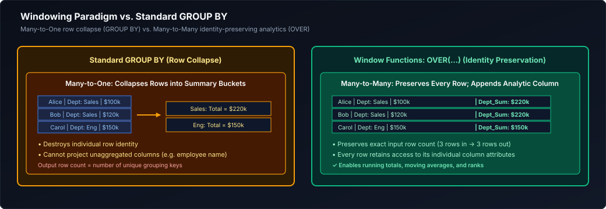

*D2 Source: [`18_window_vs_group_by.d2`](assets/01_sql_and_advanced_querying/18_window_vs_group_by.d2)*

#### 2. Detailed Syntax Anatomy of the `OVER` Clause
Every window function requires an `OVER` clause, which instructs the query planner to evaluate expressions over window partitions rather than collapsing result sets:

```sql
FUNCTION([expression]) OVER (
    [PARTITION BY partition_column_1, partition_column_2, ...]
    [ORDER BY sort_column_1 [ASC | DESC] [NULLS FIRST | NULLS LAST], ...]
    [ROWS | RANGE | GROUPS frame_start AND frame_end]
)
```

The clause contains three distinct operational components:
1. **`PARTITION BY` (Data Slicer):** Divides the working set into independent, non-overlapping partitions (analogous to mini-tables). The analytical computation resets completely at each partition boundary. If omitted, the entire result set is treated as a single unified partition.
2. **`ORDER BY` (Partition Sorter):** Establishes the monotonic sorting sequence for rows within each partition. Ordering is mandatory for ranking functions (`ROW_NUMBER`, `RANK`, `DENSE_RANK`) and navigational offsets (`LAG`, `LEAD`), and dictates the evaluation direction for cumulative window frames.
3. **Frame Clause (`ROWS | RANGE | GROUPS`):** Binds the specific physical or logical subset of rows relative to the current row evaluated by aggregate and value functions.

#### 3. The 3 Primary Functional Families
1. **Ranking Functions:** Assign ordinal positions or buckets to rows based on `ORDER BY` (`ROW_NUMBER()`, `RANK()`, `DENSE_RANK()`, `NTILE(k)`).
2. **Value Navigation Functions:** Fetch values from adjacent, preceding, or trailing records without self-joins (`LAG()`, `LEAD()`, `FIRST_VALUE()`, `LAST_VALUE()`, `NTH_VALUE()`).
3. **Windowed Aggregates:** Compute running totals, moving averages, and cumulative statistics over sliding windows (`SUM() OVER(...)`, `AVG() OVER(...)`, `COUNT() OVER(...)`, `MIN() / MAX() OVER(...)`).

#### 4. The 9-Stage SQL Logical Lifecycle & Why `WHERE` Filtering Fails
In the ANSI SQL logical query processing model, window functions execute at **Stage 8**, immediately alongside `SELECT` projection, which is *after* `FROM`, `ON`, `JOIN`, `WHERE`, `GROUP BY`, and `HAVING` have fully resolved:

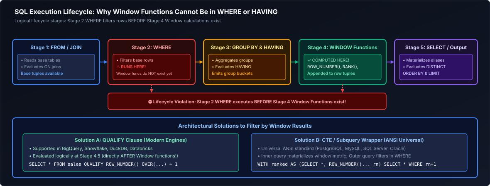

*D2 Source: [`19_sql_lifecycle_window_execution.d2`](assets/01_sql_and_advanced_querying/19_sql_lifecycle_window_execution.d2)*

> [!CAUTION]
> **The Stage 8 Evaluation Invariant:**
> You **cannot** filter on a window function in the `WHERE` clause (e.g. `WHERE ROW_NUMBER() OVER (...) = 1` raises a syntax error). The `WHERE` clause evaluates at Stage 4, long before the window function exists! To filter by window results, you must wrap the query in a Common Table Expression (CTE), a derived table subquery, or use the modern `QUALIFY` clause (Stage 8.5).

---

### 13.2 Window Framing Deep-Dive: `ROWS` vs. `RANGE` vs. `GROUPS`

The frame clause specifies the sliding window of rows evaluated relative to the current row:

```sql
{ROWS | RANGE | GROUPS} BETWEEN frame_start AND frame_end
```

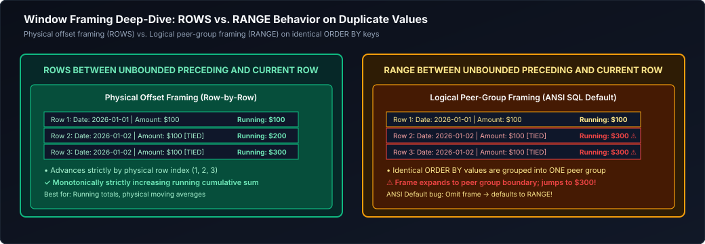

*D2 Source: [`20_rows_vs_range_framing.d2`](assets/01_sql_and_advanced_querying/20_rows_vs_range_framing.d2)*

#### Concrete Framing Comparison Table

| Row Number | Date | Amount | `ROWS BETWEEN UNBOUNDED PRECEDING AND CURRENT ROW` | `RANGE BETWEEN UNBOUNDED PRECEDING AND CURRENT ROW` |
| :---: | :---: | :---: | :---: | :---: |
| 1 | `2026-03-01` | \$100.00 | **\$100.00** | **\$100.00** |
| 2 | `2026-03-02` | \$200.00 | **\$300.00** | **\$500.00** (Tied! Includes Row 3) |
| 3 | `2026-03-02` | \$200.00 | **\$500.00** | **\$500.00** (Tied! Includes Row 2) |
| 4 | `2026-03-03` | \$150.00 | **\$650.00** | **\$650.00** |

---

### 13.3 The Lethal Implicit `RANGE` Default Trap

If you write `SUM(amount) OVER (ORDER BY transaction_date)` without specifying a frame, the ANSI standard defaults to:
`RANGE BETWEEN UNBOUNDED PRECEDING AND CURRENT ROW`
If multiple rows have the same `transaction_date`, `RANGE` evaluates all tied rows together, resulting in **duplicate running balances** instead of a continuous chronological balance!
**Golden Production Rule:** Always explicitly write `ROWS BETWEEN UNBOUNDED PRECEDING AND CURRENT ROW`.

---

### 13.4 Ranking Functions: `ROW_NUMBER`, `RANK`, `DENSE_RANK`, `NTILE`

#### 1. Overview: Purpose & Mechanics of Ranking Functions
In analytical data engineering, ordering and assigning relative positional values to records within specific categories is a core requirement. Whether determining the top-performing sales representatives per region, selecting the most recent sensor reading per device, or segmenting customers into revenue tiers, ranking window functions eliminate the need for procedural looping or multi-pass self-joins.

Unlike aggregate functions, ranking functions **mandate** an `ORDER BY` subclause inside `OVER(...)`. Because rank is inherently relative to a sorted sequence, omitting `ORDER BY` causes SQL compilers to reject the query with a semantic error.

#### 2. Detailed Breakdown of Ranking Functions

##### 1. `ROW_NUMBER()`: Strict Sequential Numbering
- **Mechanism:** Assigns a strictly unique, contiguous integer sequence ($1, 2, 3, \dots, N$) to every row within a partition.
- **Tie Resolution:** If multiple rows have identical values in the `ORDER BY` columns, `ROW_NUMBER()` breaks ties **non-deterministically** unless secondary unique sort columns are specified. The database engine assigns sequential integers based on internal physical retrieval order or parallel thread execution.
- **Primary Use Case:** Clean deduplication (`WHERE rn = 1`), exact physical slicing, and deterministic pagination.

##### 2. `RANK()`: Standard Competition Ranking (With Gaps)
- **Mechanism:** Evaluates standard Olympic or competition ranking ($1, 2, 2, 4$). Tied rows share the identical rank number. When the tie terminates, the subsequent rank **skips** by the number of tied records.
- **Mathematical Invariant:**
  $$\text{RANK}(R) = 1 + \text{Count of preceding rows with strictly superior ordering keys}$$
- **Primary Use Case:** Official competitions, academic honor rolls, or leaderboards where tied entities must penalize downstream participants by consuming available rank positions.

##### 3. `DENSE_RANK()`: Consecutive Tier Ranking (Without Gaps)
- **Mechanism:** Assigns identical rank numbers to tied rows, but subsequent rank values **increment by strictly 1 without skipping** ($1, 2, 2, 3$).
- **Mathematical Invariant:**
  $$\text{DENSE\_RANK}(R) = 1 + \text{Count of distinct superior ordering values}$$
- **Primary Use Case:** "N-th highest distinct value" calculations (e.g., finding employees earning the 2nd highest salary, or identifying the top 3 distinct pricing tiers). If two executives tie for the highest salary (\$200k), both receive rank 1. In `DENSE_RANK()`, the employee earning \$180k receives rank 2, whereas in `RANK()`, they are demoted to rank 3!

##### 4. `NTILE(k)`: Equi-Height Bucket Distribution
- **Mechanism:** Distributes sorted rows into $k$ approximately equal buckets numbered from $1$ to $k$.
- **Remainder Sizing Algorithm:** If the partition row count $N$ is not cleanly divisible by $k$, the remainder $R = N \pmod k$ extra rows are allocated by adding exactly 1 additional row to the first $R$ buckets. For example, partitioning $N = 10$ rows into $k = 4$ buckets produces bucket sizes of $3, 3, 2, 2$.
- **Primary Use Case:** Customer deciles ($k = 10$), quartile performance analysis ($k = 4$), or distributed load bucketing.

#### 3. Practical Step-by-Step Example: Academic Cohort Performance

Consider a university department auditing semester exam scores where ties are prevalent.

##### Sample Input Dataset: `student_scores` Table
| student_id | student_name | department | score |
| :---: | :--- | :--- | :---: |
| 101 | Alice | Computer Science | 100 |
| 102 | Bob | Computer Science | 95 |
| 103 | Charlie | Computer Science | 95 |
| 104 | David | Computer Science | 90 |
| 105 | Emma | Computer Science | 85 |
| 106 | Frank | Computer Science | 85 |

##### Analytical Ranking Query:
```sql
SELECT
    student_id,
    student_name,
    score,
    -- 1. Unique row sequence (breaks ties via student_id tiebreaker)
    ROW_NUMBER() OVER (
        PARTITION BY department 
        ORDER BY score DESC, student_id ASC
    ) AS row_num,
    
    -- 2. Competition rank with gaps (1, 2, 2, 4, 5, 5)
    RANK() OVER (
        PARTITION BY department 
        ORDER BY score DESC
    ) AS standard_rank,
    
    -- 3. Dense rank without gaps (1, 2, 2, 3, 4, 4)
    DENSE_RANK() OVER (
        PARTITION BY department 
        ORDER BY score DESC
    ) AS dense_rank,
    
    -- 4. Segment cohort into 2 performance halves (Top half = 1, Bottom half = 2)
    NTILE(2) OVER (
        PARTITION BY department 
        ORDER BY score DESC, student_id ASC
    ) AS performance_half
FROM student_scores;
```

##### Exact Query Execution Output:

| student_id | student_name | score | `row_num` | `standard_rank` | `dense_rank` | `performance_half` (`NTILE(2)`) |
| :---: | :--- | :---: | :---: | :---: | :---: | :---: |
| 101 | Alice | 100 | **1** | **1** | **1** | 1 |
| 102 | Bob | 95 | **2** | **2** | **2** | 1 |
| 103 | Charlie | 95 | **3** | **2** (Tie) | **2** (Tie) | 1 |
| 104 | David | 90 | **4** | **4** (Skipped 3) | **3** (No Skip) | 2 |
| 105 | Emma | 85 | **5** | **5** (Tie) | **4** (Tie) | 2 |
| 106 | Frank | 85 | **6** | **5** (Tie) | **4** (Tie) | 2 |

##### Step-by-Step Resolution Trace:
1. **Alice (`score = 100`):** Highest score. All functions assign rank 1. `NTILE(2)` places her in bucket 1.
2. **Bob (`score = 95`):** Second highest score. `ROW_NUMBER` evaluates to 2. Both `RANK` and `DENSE_RANK` evaluate to 2.
3. **Charlie (`score = 95`):** Tied with Bob.
   - `ROW_NUMBER`: Resolves tie deterministically using `student_id ASC` (103 > 102) $\implies$ assigned **3**.
   - `RANK`: Same score as Bob $\implies$ tied at **2**.
   - `DENSE_RANK`: Same score as Bob $\implies$ tied at **2**.
   - `NTILE(2)`: Total rows $N = 6$. Bucket size = $6 / 2 = 3$. Charlie takes the final slot in bucket 1.
4. **David (`score = 90`):**
   - `ROW_NUMBER`: Increments to **4**.
   - `RANK`: Exactly 3 students scored higher than David (Alice, Bob, Charlie). Formula: $1 + 3 = \mathbf{4}$. Rank 3 is **skipped**!
   - `DENSE_RANK`: Exactly 2 distinct scores exist above 90 (100 and 95). Formula: $1 + 2 = \mathbf{3}$. Zero gap created!
   - `NTILE(2)`: Moves into bucket 2.
5. **Emma & Frank (`score = 85`):**
   - `ROW_NUMBER`: Assigned **5** and **6** respectively.
   - `RANK`: 4 students scored strictly higher $\implies 1 + 4 = \mathbf{5}$. Both receive **5**.
   - `DENSE_RANK`: 3 distinct scores exist above 85 (100, 95, 90) $\implies 1 + 3 = \mathbf{4}$. Both receive **4**.

#### 4. Comparisons & Engineering Trade-Off Matrix

| Ranking Function | Tie Handling Behavior | Generates Gaps on Ties? | Determinism Guarantee | Remainder Sizing | Primary Enterprise Pattern |
| :--- | :--- | :---: | :---: | :---: | :--- |
| **`ROW_NUMBER()`** | Breaks ties sequentially ($1, 2, 3$). Non-deterministic without secondary tiebreaker. | **No** | Requires unique secondary key | N/A | **Deduplication (`WHERE rn = 1`), API pagination.** |
| **`RANK()`** | Tied rows share identical rank; subsequent rank skips ($1, 2, 2, 4$). | **Yes** (Gap = tie count) | Fully deterministic on values | N/A | **Competitions, leaderboards, academic percentiles.** |
| **`DENSE_RANK()`** | Tied rows share identical rank; subsequent rank increments consecutively ($1, 2, 2, 3$). | **No** (Zero gaps) | Fully deterministic on values | N/A | **Nth highest salary, Top-N distinct pricing tiers.** |
| **`NTILE(k)`** | Assigns bucket index ($1 \dots k$); does not preserve tie boundaries across bucket edges. | **No** | Requires unique secondary key | First $R$ buckets get $+1$ row | **Quartile revenue analysis, decile scoring, batching.** |

#### 5. Advanced Production Insights & Failure Modes
1. **The N-th Highest Salary Interview Trap:**
   - Naive query using `WHERE rnk = 2` with `RANK()` will return **zero rows** if there is a tie for 1st place (ranks are 1, 1, 3).
   - **Production Rule:** Always use `DENSE_RANK()` when querying the $N$-th distinct ranking level (`WHERE dense_rnk = N`).
2. **The Non-Deterministic Pagination Drift:**
   - Writing `ROW_NUMBER() OVER (ORDER BY created_at DESC)` without appending `id` causes unstable row numbering when transactions share the same millisecond timestamp.
   - Under database parallel scans, page 1 and page 2 may return duplicate records or drop records entirely.
   - **Production Rule:** Always enforce determinism with a secondary unique column: `ORDER BY created_at DESC, id ASC`.
3. **Partition Skew & Memory Spills:**
   - In distributed engines (Databricks, Spark, BigQuery), `PARTITION BY` shuffles all records of a partition key to a single executor core.
   - If a single customer has 50 million records while others have 10, the executor evaluating `ROW_NUMBER()` suffers an Out-Of-Memory (OOM) error or severe spill to disk. Mitigate using two-stage salting or pre-filtering.

---

### 13.5 Value Navigation Functions: `LEAD`, `LAG`, `FIRST_VALUE`, `LAST_VALUE`, `NTH_VALUE`

#### 1. Overview: Inter-Row Navigation Without Self-Joins
In time-series and event telemetry processing, computing deltas between successive rows—such as Day-over-Day (DoD) revenue growth, sensor temperature changes, or duration between user clicks—is a universal requirement.

In legacy SQL, comparing row $i$ with row $i - 1$ required an expensive self-join (`table AS a JOIN table AS b ON a.id = b.id + 1`), which incurs $O(N^2)$ comparison overhead or massive hash joins. **Value navigation functions** retrieve column values from preceding, trailing, or boundary records directly within a single sorted stream in $O(N \log N)$ sorting and $O(N)$ streaming time.

#### 2. Detailed Breakdown of Navigational Functions

##### 1. `LAG(expression [, offset [, default_value]])`
- **Mechanism:** Retrieves the value of `expression` from $N$ rows prior to the current row within the partition.
- **Parameters:**
  - `expression`: The column or formula to evaluate.
  - `offset`: The physical number of rows backward (defaults to `1` if omitted).
  - `default_value`: The fallback value returned if the requested offset falls before the partition start (defaults to `NULL`).
- **Primary Use Case:** Prior period comparison (Day-over-Day, Month-over-Month growth), detecting state transitions.

##### 2. `LEAD(expression [, offset [, default_value]])`
- **Mechanism:** Retrieves the value of `expression` from $N$ rows forward relative to the current row.
- **Primary Use Case:** Calculating duration until the subsequent event, session expiration lookaheads.

##### 3. `FIRST_VALUE(expression)`
- **Mechanism:** Returns the value of `expression` evaluated at the very first row of the window frame.
- **Primary Use Case:** Measuring drift from baseline (e.g., comparing stock price changes relative to market opening price).

##### 4. `LAST_VALUE(expression)`
- **Mechanism:** Returns the value of `expression` evaluated at the final row of the window frame.
- **Critical Caveat:** Default frame semantics (`RANGE BETWEEN UNBOUNDED PRECEDING AND CURRENT ROW`) cause `LAST_VALUE()` to stop at the current row! (See Section 13.6 for resolution).

##### 5. `NTH_VALUE(expression, n)`
- **Mechanism:** Returns the value of `expression` evaluated at the $n$-th physical row within the window frame. Returns `NULL` if the frame contains fewer than $n$ rows.

#### 3. Practical Step-by-Step Example: Financial Time-Series Analysis

Consider analyzing daily closing prices for stock tickers.

##### Sample Input Dataset: `market.stock_daily` Table
| ticker | trade_date | close_price |
| :--- | :---: | :---: |
| AAPL | `2026-03-01` | \$180.00 |
| AAPL | `2026-03-02` | \$185.00 |
| AAPL | `2026-03-03` | \$185.00 |
| AAPL | `2026-03-04` | \$190.00 |

##### Financial Analytical Query:
```sql
SELECT 
    ticker,
    trade_date,
    close_price,
    
    -- 1. Previous trading day price (default offset 1, default fallback 180.00)
    LAG(close_price, 1, close_price) OVER (
        PARTITION BY ticker 
        ORDER BY trade_date ASC
    ) AS prev_close,
    
    -- 2. Day-over-Day dollar delta
    close_price - LAG(close_price, 1, close_price) OVER (
        PARTITION BY ticker 
        ORDER BY trade_date ASC
    ) AS dod_dollar_change,
    
    -- 3. Next trading day price (lookahead)
    LEAD(close_price, 1) OVER (
        PARTITION BY ticker 
        ORDER BY trade_date ASC
    ) AS next_close,
    
    -- 4. Initial opening price of the observation period
    FIRST_VALUE(close_price) OVER (
        PARTITION BY ticker 
        ORDER BY trade_date ASC
        ROWS BETWEEN UNBOUNDED PRECEDING AND CURRENT ROW
    ) AS period_opening_price,
    
    -- 5. Final closing price of the observation period (requires UNBOUNDED FOLLOWING!)
    LAST_VALUE(close_price) OVER (
        PARTITION BY ticker 
        ORDER BY trade_date ASC
        ROWS BETWEEN CURRENT ROW AND UNBOUNDED FOLLOWING
    ) AS period_final_price
FROM market.stock_daily;
```

##### Exact Query Execution Output:

| ticker | trade_date | close_price | `prev_close` (`LAG`) | `dod_dollar_change` | `next_close` (`LEAD`) | `period_opening_price` | `period_final_price` |
| :--- | :---: | :---: | :---: | :---: | :---: | :---: | :---: |
| AAPL | `2026-03-01` | \$180.00 | \$180.00 *(fallback)* | \$0.00 | \$185.00 | \$180.00 | \$190.00 |
| AAPL | `2026-03-02` | \$185.00 | \$180.00 | +\$5.00 | \$185.00 | \$180.00 | \$190.00 |
| AAPL | `2026-03-03` | \$185.00 | \$185.00 | \$0.00 | \$190.00 | \$180.00 | \$190.00 |
| AAPL | `2026-03-04` | \$190.00 | \$185.00 | +\$5.00 | `NULL` *(end)* | \$180.00 | \$190.00 |

##### Step-by-Step Resolution Trace:
1. **Trade Date `2026-03-01`:**
   - `LAG`: Offset 1 points before start of partition. Fallback parameter `close_price` returns **\$180.00**.
   - `dod_dollar_change`: $\$180.00 - \$180.00 = \mathbf{\$0.00}$.
   - `LEAD`: Looks 1 row forward to `2026-03-02` $\implies$ returns **\$185.00**.
   - `period_opening_price`: Evaluates first row in frame $\implies$ **\$180.00**.
   - `period_final_price`: Evaluates frame to `UNBOUNDED FOLLOWING` $\implies$ **\$190.00**.
2. **Trade Date `2026-03-02`:**
   - `LAG`: Fetches preceding row (`2026-03-01`) $\implies$ **\$180.00**.
   - `dod_dollar_change`: $\$185.00 - \$180.00 = \mathbf{+\$5.00}$.
   - `LEAD`: Looks 1 row forward to `2026-03-03` $\implies$ **\$185.00**.
3. **Trade Date `2026-03-04`:**
   - `LEAD`: Offset 1 points beyond partition end. No fallback provided $\implies$ returns **`NULL`**.

#### 4. Comparisons & Production Engineering Takeaways

| Navigational Function | Direction | Boundary Fallback | Performance Profile | Common Production Application |
| :--- | :---: | :---: | :---: | :--- |
| **`LAG(col, offset, default)`** | Backward | User-defined or `NULL` | Streaming sequential scan | Period-over-Period growth, streak analysis, state change flags. |
| **`LEAD(col, offset, default)`** | Forward | User-defined or `NULL` | Streaming sequential scan | Event duration calculation, session inactivity detection. |
| **`FIRST_VALUE(col)`** | Frame Start | `NULL` if partition empty | Bounded index lookup | Normalizing metrics against baseline or initial value. |
| **`LAST_VALUE(col)`** | Frame End | `NULL` if partition empty | Requires `UNBOUNDED FOLLOWING` | Fetching latest status across an entire time window. |
| **`NTH_VALUE(col, n)`** | Positional | `NULL` if $n > \text{frame}$ | Bounded index lookup | Median approximation, second-place bid calculations. |

#### 5. Advanced Insights: `IGNORE NULLS` and Sparse Telemetry
In high-throughput IoT and real-time streaming, sensors frequently transmit heartbeats where payload fields are sparse (`NULL`). Standard `LAG()` returns the immediate prior record even if its value is `NULL`.
In Databricks, Snowflake, BigQuery, and modern PostgreSQL, you can specify `IGNORE NULLS`:
```sql
-- Skips intervening NULLs to find the last valid reading
LAG(temperature, 1) IGNORE NULLS OVER (
    PARTITION BY sensor_id ORDER BY reading_time ASC
) AS last_valid_temperature
```

---

### 13.6 The `LAST_VALUE()` Unbounded Following Framing Gotcha

Junior engineers frequently write:
```sql
-- INCORRECT: Returns current row value because default frame ends at CURRENT ROW!
LAST_VALUE(close_price) OVER (PARTITION BY ticker ORDER BY trade_date ASC)
```
Because the default frame ends at `CURRENT ROW`, `LAST_VALUE()` only evaluates rows up to the current row, returning the current row's own value!
**Fix:** Explicitly declare `ROWS BETWEEN CURRENT ROW AND UNBOUNDED FOLLOWING`.

---

### 13.7 Cumulative Patterns: Running Totals, Moving Averages & Physical vs. Calendar Windows

- **Physical Window (`ROWS`):** Operates on row count (`ROWS BETWEEN 6 PRECEDING AND CURRENT ROW` = 7 physical rows).
- **Calendar Range Window (`RANGE`):** Operates on time intervals (`RANGE BETWEEN INTERVAL '6 days' PRECEDING AND CURRENT ROW`). Correctly handles missing dates (e.g., weekends/holidays).

---

### 13.8 Advanced Analytical Pattern 1: Deduplication via Window Ranking

#### 1. Overview: The At-Least-Once Delivery Challenge
In enterprise data lakehouses and streaming architectures, message queues (Apache Kafka, AWS Kinesis, Azure Event Hubs) operate under **at-least-once delivery guarantees**. Producer retries, network partitions, and consumer rebalances inevitably deliver duplicate events into raw ingestion zones (the Bronze layer).

#### 2. Why `DISTINCT` Fails in Production
A naive `SELECT DISTINCT *` fails in real-world ingestion pipelines because:
1. **Metadata Divergence:** Two duplicate events representing the exact same business transaction frequently contain differing ingestion metadata (e.g., different `ingestion_timestamp`, `kafka_offset`, or `message_uuid`). `DISTINCT` evaluates all columns and therefore treats them as distinct records!
2. **State Updates:** In Change Data Capture (CDC) streams, an entity is mutated multiple times (e.g., Order `STATUS = PENDING` followed by `STATUS = SHIPPED`). `DISTINCT` preserves all historical state transitions, whereas downstream consumers only require the latest valid snapshot.

#### 3. The Production Deduplication Algorithm
To extract the single most authoritative version of each record:
1. **Partition** by the natural business entity identifier (`PARTITION BY order_id`).
2. **Order** by the business event timestamp descending, with an ingestion watermark as a secondary tie-breaker (`ORDER BY updated_at DESC, ingestion_timestamp DESC`).
3. **Filter** strictly for the top-ranked record (`WHERE rank_val = 1`).

```sql
WITH ranked_records AS (
    SELECT 
        order_id,
        customer_id,
        order_amount,
        updated_at,
        -- Number records within each order_id group; rank 1 is guaranteed to be the freshest
        ROW_NUMBER() OVER (
            PARTITION BY order_id 
            ORDER BY updated_at DESC, ingestion_timestamp DESC
        ) AS rank_val
    FROM bronze.raw_orders
)
SELECT order_id, customer_id, order_amount, updated_at
FROM ranked_records
WHERE rank_val = 1;
```

#### 4. Cost-Based Optimizer Pushdown & Deduplication Physical Plans
Modern execution engines (including Apache Spark 3.2+, Databricks Photon, and Snowflake) recognize this exact syntactic pattern. Rather than performing an expensive global shuffle sort across all columns, the optimizer replaces the sort and filter operators with an optimized internal streaming operator (`StreamingDeduplicate` or `DedupExec`). This reduces memory complexity from $O(N)$ row buffering to an $O(1)$ hash set check per partition key.

---

### 13.9 Advanced Analytical Pattern 2: The Gaps and Islands Problem (Difference-of-Ranks)

**The Mathematical Proof:** If you subtract a monotonically increasing integer sequence (`ROW_NUMBER()`) from a contiguous sequence of dates, **the resulting difference date remains strictly constant across all contiguous dates in that island**:

$$\text{Island Identifier} = \text{Date} - \text{ROW\_NUMBER}() \times \text{INTERVAL '1 day'} = \text{Constant}$$

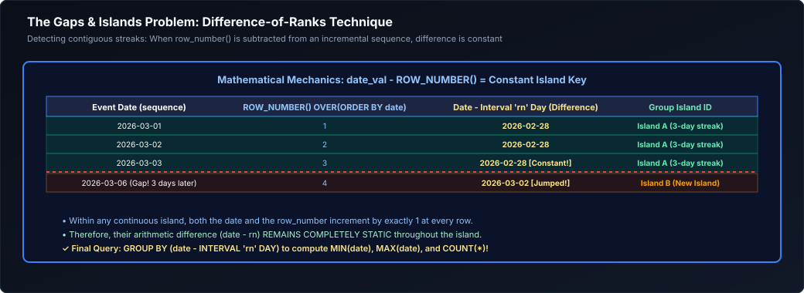

*D2 Source: [`21_gaps_and_islands.d2`](assets/01_sql_and_advanced_querying/21_gaps_and_islands.d2)*

#### Production Gaps and Islands SQL Implementation
```sql
WITH distinct_logins AS (
    SELECT DISTINCT user_id, CAST(login_time AS DATE) AS login_date
    FROM telemetry.user_logins
),
islands AS (
    SELECT 
        user_id,
        login_date,
        login_date - (ROW_NUMBER() OVER (PARTITION BY user_id ORDER BY login_date ASC) * INTERVAL '1 day') AS island_id
    FROM distinct_logins
)
SELECT 
    user_id,
    MIN(login_date) AS streak_start,
    MAX(login_date) AS streak_end,
    COUNT(*)        AS streak_length_days
FROM islands
GROUP BY user_id, island_id
HAVING COUNT(*) >= 3;
```

---

### 13.10 Advanced Analytical Pattern 3: Sessionization via Inactivity Thresholds

Group continuous event clickstreams into discrete user browsing sessions when inactivity exceeds 30 minutes:

```sql
WITH lagged_events AS (
    SELECT 
        user_id,
        event_timestamp,
        EXTRACT(EPOCH FROM (event_timestamp - LAG(event_timestamp) OVER (
            PARTITION BY user_id ORDER BY event_timestamp ASC
        ))) AS seconds_since_last_event
    FROM web.clickstream
),
session_starts AS (
    SELECT 
        user_id,
        event_timestamp,
        CASE 
            WHEN seconds_since_last_event > 1800 OR seconds_since_last_event IS NULL THEN 1 
            ELSE 0 
        END AS is_new_session
    FROM lagged_events
),
sessionized AS (
    SELECT 
        user_id,
        event_timestamp,
        SUM(is_new_session) OVER (
            PARTITION BY user_id ORDER BY event_timestamp ASC
            ROWS BETWEEN UNBOUNDED PRECEDING AND CURRENT ROW
        ) AS session_id
    FROM session_starts
)
SELECT user_id, session_id, MIN(event_timestamp) AS session_start, MAX(event_timestamp) AS session_end
FROM sessionized
GROUP BY user_id, session_id;
```

---

### 13.11 Advanced Analytical Pattern 4: Top-N per Group with Tie-Breaker Handling

#### 1. Overview: The Top-N Analytical Requirement
Selecting the "Top-N" entities within each category (e.g., top 3 highest-grossing products per catalog category, top 5 salespeople per region, or top 2 most active devices per account) is among the most frequent analytical requirements in reporting and data warehousing.

In legacy SQL architectures, this required complex self-joins, correlated scalar subqueries, or cross-applies that degraded to $O(N^2)$ algorithmic complexity. Modern analytical SQL implements Top-N via partitioned window ranking executed in a single $O(N \log N)$ distributed sort.

#### 2. Function Selection: Exact Count vs. Value Tiers
Before authoring a Top-N query, the business requirements must explicitly differentiate between **row quotas** and **value thresholds**:
- **Strict Row Quota (Exactly $N$ records):** Use `ROW_NUMBER()`. If there are ties at the boundary, you must supply deterministic tie-breakers (e.g. `product_id ASC`) to prevent nondeterministic result sets.
- **Top $N$ Distinct Value Tiers (May return $> N$ records):** Use `DENSE_RANK()`. If multiple products tie for 2nd place, all tied products are included without skipping 3rd place.
- **Top $N$ Competition Placements:** Use `RANK()`. If two products tie for 1st place, rank 2 is skipped, and only one 3rd-place product can qualify for a top-3 filter (`WHERE rank <= 3`).

#### 3. Production Query Implementation: Top 3 Distinct Product Tiers per Category
```sql
WITH ranked_products AS (
    SELECT 
        category_id,
        product_id,
        product_name,
        revenue,
        -- DENSE_RANK guarantees all products in the top 3 distinct revenue tiers qualify
        DENSE_RANK() OVER (
            PARTITION BY category_id 
            ORDER BY revenue DESC
        ) AS revenue_tier
    FROM catalog.product_sales
)
SELECT 
    category_id,
    revenue_tier,
    product_id,
    product_name,
    revenue
FROM ranked_products 
WHERE revenue_tier <= 3
ORDER BY category_id ASC, revenue_tier ASC, revenue DESC;
```

#### 4. Execution Plan Optimization & Pushdown
Because the window ranking evaluates at Stage 8, filtering via `WHERE revenue_tier <= 3` requires a Common Table Expression (CTE) or subquery wrapper. Modern cost-based optimizers (e.g. Spark Catalyst, PostgreSQL 13+, Trino) detect the `WHERE rank <= N` filter outer clause and push down a physical **TopK / Bounded-Window** operator. Instead of buffering and sorting all 10 million rows in memory, the engine maintains an in-memory priority queue (min-heap) of size $N$ per partition, slashing memory footprint from $O(N)$ to $O(K)$.

---

### 13.12 The Modern `QUALIFY` Clause

Supported natively by Snowflake, BigQuery, and Databricks SQL, `QUALIFY` filters window function results directly without requiring CTE wrappers:

```sql
-- Retrieve the single highest earner per department directly
SELECT employee_id, department_id, salary
FROM hr.employees
QUALIFY ROW_NUMBER() OVER (PARTITION BY department_id ORDER BY salary DESC) = 1;
```

> [!TIP]
> **Deep-Dive Interview Scenarios:**
> - [Q12. Second Most Recent Login per User Using Window Functions](frequently_asked_questions/01_sql_and_advanced_querying_faq.md#q12-medium-second-most-recent-login-per-user-using-window-functions)
> - [Q21. Gaps in a Sequence of IDs and Consecutive Islands](frequently_asked_questions/01_sql_and_advanced_querying_faq.md#q21-medium-gaps-in-a-sequence-of-ids-and-consecutive-islands)
> - [Q22. Calculating Total Number of Overlapping Days Across Date Ranges](frequently_asked_questions/01_sql_and_advanced_querying_faq.md#q22-medium-calculating-total-number-of-overlapping-days-across-date-ranges)
> - [Q30. GROUP BY vs Window Aggregation and Row Cardinality](frequently_asked_questions/01_sql_and_advanced_querying_faq.md#q30-easy-group-by-vs-window-aggregation-and-row-cardinality)
> - [Q31. WHERE vs HAVING Semantics and Filter Scoping](frequently_asked_questions/01_sql_and_advanced_querying_faq.md#q31-easy-where-vs-having-semantics-and-filter-scoping)
> - [Q44. Per-Session Duration by Device Type from Clickstream Play/Pause/Stop Events](frequently_asked_questions/01_sql_and_advanced_querying_faq.md#q44-medium-per-session-duration-by-device-type-from-clickstream-playpausestop-events)
> - [Q46. Running Account Balance Calculation with Explicit Frame Semantics](frequently_asked_questions/01_sql_and_advanced_querying_faq.md#q46-medium-running-account-balance-calculation-with-explicit-frame-semantics)
> - [Q57. Window Functions: Customer Transaction Ranking & Partitioned Over Clauses](frequently_asked_questions/01_sql_and_advanced_querying_faq.md#q57-medium-window-functions-customer-transaction-ranking--partitioned-over-clauses)
> - [Q60. Average Number of Sessions per User Over a Specified Window](frequently_asked_questions/01_sql_and_advanced_querying_faq.md#q60-medium-average-number-of-sessions-per-user-over-a-specified-window)
> - [Q66. Most Recent Designation per Employee Using Window Functions](frequently_asked_questions/01_sql_and_advanced_querying_faq.md#q66-medium-most-recent-designation-per-employee-using-window-functions)
> - [Q72. Top 3 Highest Salaries per Department Handling Duplicate Values via DENSE_RANK()](frequently_asked_questions/01_sql_and_advanced_querying_faq.md#q72-medium-top-3-highest-salaries-per-department-handling-duplicate-values-via-dense_rank)
> - [Q75. Consecutive Delivery Streaks Above Rating Threshold (DoorDash Dasher Scenario)](frequently_asked_questions/01_sql_and_advanced_querying_faq.md#q75-medium-consecutive-delivery-streaks-above-rating-threshold-doordash-dasher-scenario)
> - [Q76. Top Customers by Revenue with Multi-Category Cross-Shopping Diversity](frequently_asked_questions/01_sql_and_advanced_querying_faq.md#q76-medium-top-customers-by-revenue-with-multi-category-cross-shopping-diversity)
> - [Q77. Production Metric Mismatch Triage: Diagnostic SQL Runbook for Revenue Discrepancies](frequently_asked_questions/01_sql_and_advanced_querying_faq.md#q77-hard-production-metric-mismatch-triage-diagnostic-sql-runbook-for-revenue-discrepancies)

---

# 14. Advanced Grouping, Aggregation & Pivoting

---

### 14.1 Multi-Dimensional Grouping: `GROUPING SETS`, `ROLLUP`, `CUBE`

- **`ROLLUP(Year, Region, Product)`:** Generates hierarchical rollups ($N + 1$ levels): Full detail $\rightarrow$ `(Year, Region)` $\rightarrow$ `(Year)` $\rightarrow$ Grand Total `()`.
- **`CUBE(Region, Channel)`:** Generates all $2^N$ combinatorial permutations.
- **`GROUPING SETS`:** Explicitly declares exact target sub-aggregations.

```sql
SELECT 
    calendar_year,
    region,
    SUM(revenue) AS total_revenue,
    GROUPING(calendar_year) AS is_year_subtotal,
    GROUPING(region)        AS is_region_subtotal
FROM analytics.fact_sales
GROUP BY ROLLUP (calendar_year, region);
```

---

### 14.2 The `GROUPING()` and `GROUPING_ID()` Bitmask Functions

When generating multi-dimensional summaries, NULL values appear in subtotal rows. How do you distinguish between a row that has a **real NULL in the data** vs. a **NULL created by aggregation**?
- `GROUPING(column)` returns `1` if the column is aggregated in this subtotal row, and `0` if it represents actual data!

---

### 14.3 Cross-Tabulation & Pivoting: `PIVOT` and `UNPIVOT`

#### 1. Overview: Dimensional Rotation in Analytical Systems
In transactional and data warehouse schemas, data is stored in **tall/narrow relational format** (first normal form), where each metric observation occupies a separate row. However, executive reports, business intelligence spreadsheets, and machine learning feature matrices often require data in **wide format**, where distinct category values become column headers:

$$\text{PIVOT: Rows } \longrightarrow \text{ Columns (Cross-Tabulation)}$$
$$\text{UNPIVOT: Columns } \longrightarrow \text{ Rows (Normalization)}$$

#### 2. Detailed Mechanics & Syntax

##### 1. `PIVOT`: Converting Rows into Columns
The `PIVOT` operator aggregates an existing column while rotating unique values from another column into new attribute columns:
```sql
SELECT <non-pivoted columns>, [first_pivoted_val], [second_pivoted_val], ...
FROM (SELECT <source query>) AS source_table
PIVOT (
    AGGREGATE_FUNCTION(value_column)
    FOR pivot_column IN ([first_pivoted_val], [second_pivoted_val], ...)
) AS pivot_alias;
```

##### 2. The Universal Portable Pattern: ANSI Conditional Aggregation (`CASE WHEN`)
Because native `PIVOT` syntax is proprietary and varies across dialect implementations (e.g. Snowflake, SQL Server, and Databricks support `PIVOT`, while vanilla PostgreSQL and MySQL rely on extensions like `tablefunc`), enterprise data engineers standardize on **ANSI Conditional Aggregation**:
```sql
SELECT 
    store_id,
    SUM(CASE WHEN quarter = 'Q1' THEN revenue ELSE 0 END) AS q1_revenue,
    SUM(CASE WHEN quarter = 'Q2' THEN revenue ELSE 0 END) AS q2_revenue,
    SUM(CASE WHEN quarter = 'Q3' THEN revenue ELSE 0 END) AS q3_revenue,
    SUM(CASE WHEN quarter = 'Q4' THEN revenue ELSE 0 END) AS q4_revenue
FROM sales.quarterly_summary
GROUP BY store_id;
```
This pattern runs identically across 100% of SQL-compliant databases with zero dialect dependencies.

#### 3. Practical Step-by-Step Example

##### Sample Input Dataset: `sales.quarterly_summary` (Tall Format)
| store_id | quarter | revenue |
| :---: | :---: | :---: |
| 10 | 'Q1' | \$120,000 |
| 10 | 'Q2' | \$140,000 |
| 10 | 'Q3' | \$110,000 |
| 10 | 'Q4' | \$180,000 |
| 20 | 'Q1' | \$90,000 |
| 20 | 'Q2' | \$95,000 |

##### Production Dialect Implementation (`PIVOT` & `UNPIVOT`):
```sql
-- 1. PIVOT: Rotate quarterly rows to columns
SELECT *
FROM (
    SELECT store_id, quarter, revenue 
    FROM sales.quarterly_summary
) AS src
PIVOT (
    SUM(revenue) 
    FOR quarter IN ('Q1', 'Q2', 'Q3', 'Q4')
) AS p (store_id, q1_rev, q2_rev, q3_rev, q4_rev);

-- 2. UNPIVOT: Normalize horizontal columns back to relational rows
SELECT store_id, quarter_name, revenue
FROM sales.pivoted_stores
UNPIVOT (
    revenue 
    FOR quarter_name IN (q1_rev, q2_rev, q3_rev, q4_rev)
);
```

##### Result Set After `PIVOT` (Wide Reporting Format):
| store_id | q1_rev | q2_rev | q3_rev | q4_rev |
| :---: | :---: | :---: | :---: | :---: |
| 10 | \$120,000 | \$140,000 | \$110,000 | \$180,000 |
| 20 | \$90,000 | \$95,000 | `NULL` | `NULL` |

#### 4. Engineering Comparison & Best Practices

| Technique | Dialect Portability | Dynamic Columns Support | Performance Profile | Production Recommendation |
| :--- | :--- | :---: | :---: | :--- |
| **Native `PIVOT`** | Snowflake, Databricks, SQL Server | Static column list required | Optimized engine pushdown | Excellent for interactive BI reporting in supported cloud warehouses. |
| **Conditional Aggregation (`CASE WHEN`)** | **Universal ANSI SQL (100% engines)** | Static column list required | $O(N)$ single-pass aggregation | **Gold standard for production data pipelines and dbt models.** |
| **Dynamic SQL Pivot** | Requires Stored Proc / Client Python | Generates columns dynamically | High complexity; injection risk | Avoid in pipelines; prefer pushing dynamic layouts to presentation layer (Tableau, PowerBI). |

---

# 15. Advanced Data Modification, Concurrency & Transactions

---

### 15.1 `MERGE` / `UPSERT` Mechanics & Change Data Capture (CDC)

The ANSI SQL `MERGE` statement synchronizes a target table with incoming CDC records atomically:

```sql
MERGE INTO warehouse.dim_customers AS target
USING staging.customer_cdc_stream AS source
    ON target.customer_id = source.customer_id
WHEN MATCHED AND source.op = 'D' THEN
    UPDATE SET target.is_active = FALSE, target.deleted_at = source.event_ts
WHEN MATCHED AND source.op = 'U' THEN
    UPDATE SET target.name = source.name, target.updated_at = source.event_ts
WHEN NOT MATCHED AND source.op IN ('I', 'U') THEN
    INSERT (customer_id, name, is_active, created_at, updated_at)
    VALUES (source.customer_id, source.name, TRUE, source.event_ts, source.event_ts);
```

---

### 15.2 The Fatal `MERGE` Target Row Collision Trap & Remediation

If the incoming source staging table contains duplicate rows for the same primary key (e.g., two updates for customer `101` in the same batch), the database aborts with an error:
`Target row was matched by multiple source rows`.
**Mandatory Production Fix:** Deduplicate the staging table using `ROW_NUMBER() OVER (PARTITION BY id ORDER BY lsn DESC)` prior to executing `MERGE`.

---

### 15.3 Transaction Control: Two-Phase Locking (2PL), Savepoints & WAL

A transaction is an atomic unit of work:
- **Savepoints:** Allows partial rollback of non-fatal sub-operations without aborting the entire transaction.
- **WAL (Write-Ahead Log):** Changes are flushed to disk sequentially *before* modifying memory pages, guaranteeing Durability ($D$).

---

### 15.4 ANSI SQL Isolation Levels & Concurrency Anomalies

#### The 4 Concurrency Anomalies
1. **Dirty Read:** Transaction A reads data modified by Transaction B *before* Transaction B commits. If B rolls back, A read data that never existed.
2. **Non-Repeatable Read (Fuzzy Read):** Transaction A reads a row. Transaction B updates that row and commits. Transaction A re-reads the row and finds altered values.
3. **Phantom Read:** Transaction A executes a range query (`WHERE amount > 100`). Transaction B inserts a new row matching that range and commits. Transaction A re-runs the range query and discovers a "phantom" new row.
4. **Write Skew:** Two transactions read overlapping data, satisfy business constraints independently, and execute updates that together violate global constraints (e.g., both on-call doctors check out simultaneously, leaving 0 doctors on call).

#### ANSI Isolation Level Support Matrix
| Isolation Level | Dirty Read | Non-Repeatable Read | Phantom Read | Write Skew | Concurrency Performance |
| :--- | :---: | :---: | :---: | :---: | :---: |
| **Read Uncommitted** | Possible | Possible | Possible | Possible | Maximum |
| **Read Committed** (PostgreSQL Default) | **Prevented** | Possible | Possible | Possible | High |
| **Repeatable Read** (MySQL InnoDB Default)| **Prevented** | **Prevented** | Possible (Prevented in PG MVCC) | Possible | Medium |
| **Serializable** | **Prevented** | **Prevented** | **Prevented** | **Prevented** | Lowest (Pessimistic / Aborts) |

#### Step-by-Step Multi-Transaction Concurrency Timeline
| Step | Transaction A (Alice)<br/>`ISOLATION: READ COMMITTED` | Transaction B (Bob)<br/>`ISOLATION: READ COMMITTED` | State & Anomaly Analysis |
| :---: | :--- | :--- | :--- |
| **T1** | `BEGIN;` | `BEGIN;` | Both transactions start concurrently under Read Committed. |
| **T2** | `SELECT balance FROM accounts WHERE id = 1;`<br/>*(Returns `$1,000`)* | — | Alice reads the initial committed state (`$1,000`). |
| **T3** | — | `UPDATE accounts SET balance = 500 WHERE id = 1;` | Bob updates row `id = 1` in his private transaction buffer. |
| **T4** | — | `COMMIT;` | Bob commits. The global committed state is now `$500`. |
| **T5** | `SELECT balance FROM accounts WHERE id = 1;`<br/>*(Returns `$500`)* | — | **NON-REPEATABLE READ ANOMALY:** Alice re-reads the exact same row inside her still-open transaction, but receives `$500` instead of `$1,000`! |
| **T6** | `COMMIT;` | — | Alice transaction completes with internal inconsistency. |

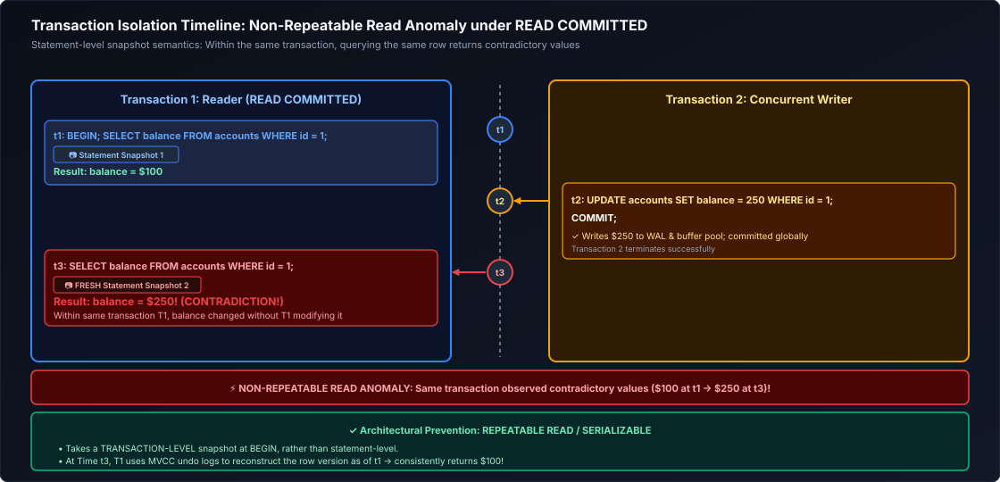

*D2 Source: [`22_isolation_read_committed_timeline.d2`](assets/01_sql_and_advanced_querying/22_isolation_read_committed_timeline.d2)*

---

### 15.5 Multi-Version Concurrency Control (MVCC) Internals

Modern databases (PostgreSQL, MySQL InnoDB, Snowflake, Databricks) do not block readers with locks. They use **Multi-Version Concurrency Control (MVCC)**:
- In PostgreSQL, every row (tuple) contains two internal transaction header columns: `xmin` (creating transaction ID) and `xmax` (deleting/updating transaction ID).
- When an `UPDATE` executes, the engine does not overwrite the row in place; it appends a brand new row version with a new `xmin` and sets `xmax` on the old row.
- Readers inspect their transaction snapshot ID to see only rows valid at the time their transaction began.
- The `VACUUM` process reclaims physical disk space occupied by dead tuples once all active transactions that could read them have committed.

> [!TIP]
> **Deep-Dive Interview Scenario:**
> - [Q35. MERGE Statement Semantics vs ANSI UPSERT](frequently_asked_questions/01_sql_and_advanced_querying_faq.md#q35-easy-merge-statement-semantics-vs-ansi-upsert)

---

# 16. Advanced Database Programmability & Objects

---

### 16.1 Materialized Views, Query Rewrite Engines & Incremental Refresh

Unlike standard views which re-run queries dynamically, a **Materialized View** precomputes the result set and writes it to disk. Modern database optimizers feature **Query Rewrite Engines**: if a user queries the raw fact table, the optimizer intercepts the query and reads the materialized view automatically!

```sql
-- PostgreSQL Materialized View with Concurrent Refresh
CREATE MATERIALIZED VIEW reporting.mv_daily_store_revenue AS
SELECT store_id, order_date, SUM(amount) AS gross_sales
FROM sales.orders
GROUP BY store_id, order_date;

CREATE UNIQUE INDEX idx_mv_store ON reporting.mv_daily_store_revenue (store_id, order_date);
REFRESH MATERIALIZED VIEW CONCURRENTLY reporting.mv_daily_store_revenue;
```

---

### 16.2 Stored Procedures & Transactional Orchestration

Stored procedures support procedural control flow (loops, exception blocks) and **explicit multi-statement transaction control** (`COMMIT` / `ROLLBACK`).

```sql
-- PL/pgSQL Stored Procedure managing partition archiving and automated maintenance
CREATE OR REPLACE PROCEDURE maintenance.sp_archive_monthly_partitions(
    IN retention_months INT,
    OUT partitions_archived INT
)
LANGUAGE plpgsql
AS $$
DECLARE
    partition_record RECORD;
    cutoff_date DATE;
BEGIN
    partitions_archived := 0;
    cutoff_date := CURRENT_DATE - (retention_months || ' months')::INTERVAL;

    -- Iterate dynamically over old partition tables
    FOR partition_record IN 
        SELECT table_name 
        FROM information_schema.tables 
        WHERE table_schema = 'audit_partitions'
          AND table_name < 'audit_' || TO_CHAR(cutoff_date, 'YYYY_MM')
    LOOP
        -- Dynamic SQL execution
        EXECUTE 'ALTER TABLE audit_partitions.' || quote_ident(partition_record.table_name) || ' SET TABLESPACE cold_archive_storage;';
        partitions_archived := partitions_archived + 1;
        RAISE NOTICE 'Relocated partition % to cold storage.', partition_record.table_name;
    END LOOP;

    -- Commit transaction explicitly within procedure
    COMMIT;
END;
$$;
```

---

### 16.3 User-Defined Functions (UDFs): Scalar, Table-Valued & Vectorized PyArrow

- **Scalar UDF Volatility:**
  - `IMMUTABLE`: Pure function; deterministic; optimizer can inline or precompute.
  - `STABLE`: Result constant within single table scan (e.g., depends on `CURRENT_DATE`).
  - `VOLATILE`: Recomputed on every single row (e.g., `RANDOM()`).

> [!WARNING]
> **Scalar UDF Row-by-Row Bottleneck (RBAR):**
> Calling a scalar UDF across 100 million rows disables SIMD vectorization and executes row-by-row in an interpreter, causing a 50x slowdown. Where possible, write inline SQL expressions or utilize Vectorized PyArrow UDFs.

---

### 16.4 Temporary Views, Session Scopes & Global Virtual Catalogs

Temporary views provide isolated virtual tables within a compute session (Spark / Databricks) without polluting global metastores:
```sql
-- Session-scoped temporary view in Databricks / Spark SQL
CREATE OR REPLACE TEMPORARY VIEW tv_current_session_clicks AS
SELECT user_id, event_type, event_timestamp
FROM bronze.clickstream_raw
WHERE event_timestamp >= CURRENT_DATE;
```

---

# 17. Summary Comparison & Production Engineering Reference Matrix

- **Logical Query Execution Order:** SQL queries execute declaratively across 9 distinct phases (`FROM` $\rightarrow$ `ON` $\rightarrow$ `JOIN` $\rightarrow$ `WHERE` $\rightarrow$ `GROUP BY` $\rightarrow$ `HAVING` $\rightarrow$ `SELECT` $\rightarrow$ `DISTINCT` $\rightarrow$ `ORDER BY` $\rightarrow$ `LIMIT/OFFSET`). Because projection occurs late in the lifecycle, column aliases declared in `SELECT` cannot be referenced in `WHERE` or `HAVING` filters, but become valid during final presentation in `ORDER BY`.
- **Exact Numeric Representation for Financial Correctness:** Approximate floating-point types (`FLOAT`/`DOUBLE`) introduce binary precision errors due to IEEE-754 representation (such as $0.1 + 0.2 \neq 0.3$). Financial ledgers, monetary balances, and billing pipelines must strictly enforce exact numeric types (`NUMERIC`/`DECIMAL`).
- **Three-Valued Logic & Defensive NULL Handling:** Any direct comparison against `NULL` evaluates to `UNKNOWN`. Inverted predicates like `NOT IN (subquery)` evaluate to empty recordsets if a single `NULL` is returned by the subquery due to De Morgan's laws ($NOT (x = NULL) \rightarrow UNKNOWN$). Production pipelines should prefer `NOT EXISTS` or `LEFT ANTI JOIN` and normalize empty strings defensively using `COALESCE(NULLIF(TRIM(col), ''), default)`.
- **Outer Join Predicate Discipline:** When executing `LEFT (OUTER) JOIN`, placing filter conditions for the right-hand table in the `WHERE` clause inadvertently converts the operation into an `INNER JOIN` by dropping outer rows where the right attributes are null. Filters intended to preserve outer rows must reside inside the `ON` join clause.
- **DML Physical Mechanics & Storage Lifecycle:** `TRUNCATE` deallocates table extents with minimal logging and resets high-water marks, whereas `DELETE` writes individual transaction log records for each row, generating MVCC dead-tuple bloat that demands periodic database vacuuming. Standard views provide dynamic query virtualization, while materialized views trade storage and refresh overhead for sub-millisecond analytical reads.

---

- **Distributed Join Strategies & Skew Mitigation:** Broadcast Hash Joins eliminate network shuffle overhead but must strictly target tables under memory safety limits ($\le 100\text{ MB}$) to prevent executor OOM. For large-table joins where high-cardinality keys suffer extreme skew, apply salting techniques or adaptive query execution (AQE) skew handling, and pre-aggregate child records to parent grains to prevent metric duplication.
- **Subquery Optimization & CTE Execution:** Negative membership checks must use `LEFT ANTI JOIN` or `NOT EXISTS` rather than `NOT IN` to prevent 3VL null-collapse failures. Recursive CTEs require cycle detection and recursion depth boundaries. When CTEs are referenced multiple times within a query, evaluate explicit `MATERIALIZED` hints to avoid redundant subquery re-evaluations.
- **Window Analytic Integrity & Frame Scoping:** Running totals and cumulative aggregates must explicitly declare sliding frames (`ROWS BETWEEN UNBOUNDED PRECEDING AND CURRENT ROW`) to prevent default range frame sorting penalties. Deterministic deduplication pipelines should favor `ROW_NUMBER()` over grouping hacks, leveraging modern `QUALIFY` clauses in engines like Snowflake, BigQuery, and Databricks to eliminate boilerplate subqueries.
- **Transactional Safety & Concurrency Control:** `MERGE` / upsert operations require guaranteed uniqueness on target join keys to prevent non-deterministic updates and cardinal runtime errors. High-throughput mutation pipelines must enforce appropriate isolation levels to prevent phantom reads and serialization anomalies, while materialized views must feature unique indices to support concurrent, non-blocking refreshes.

---

# 18. References & Further Reading

- [PostgreSQL Documentation: The SQL Language](https://www.postgresql.org/docs/current/sql.html) — Comprehensive syntax, data types, and logical processing reference.
- [ISO/IEC 9075: Information Technology — Database Languages — SQL](https://www.iso.org/standard/63555.html) — The formal ANSI/ISO SQL standard specification.
- [Designing Data-Intensive Applications (Martin Kleppmann)](https://dataintensive.net/) — Storage engines, relational vs document models, and query execution fundamentals.
- [Database Systems: The Complete Book (Hector Garcia-Molina, Jeffrey D. Ullman, Jennifer Widom)](http://infolab.stanford.edu/~ullman/dscb.html) — Foundational relational algebra, query optimization, and concurrency.
- [Use The Index, Luke! A Guide to Database Performance (Markus Winand)](https://use-the-index-luke.com/) — Index mechanics, sargability, and relational performance tuning.
- [Companion Module: Advanced SQL & Analytical Query Optimization](01_sql_and_advanced_querying.md) — Window functions, recursive CTEs, and distributed execution mechanics.

- [PostgreSQL Official Documentation: Advanced SQL Queries](https://www.postgresql.org/docs/current/tutorial-advanced.html)
- [Databricks Documentation: SQL Language Reference](https://docs.databricks.com/en/sql/language-manual/index.html)
- [Snowflake Documentation: Window Functions](https://docs.snowflake.com/en/sql-reference/functions-analytic)
- [Designing Data-Intensive Applications (Martin Kleppmann)](https://dataintensive.net/)
- [Database Internals (Alex Petrov)](https://www.databass.dev/)
