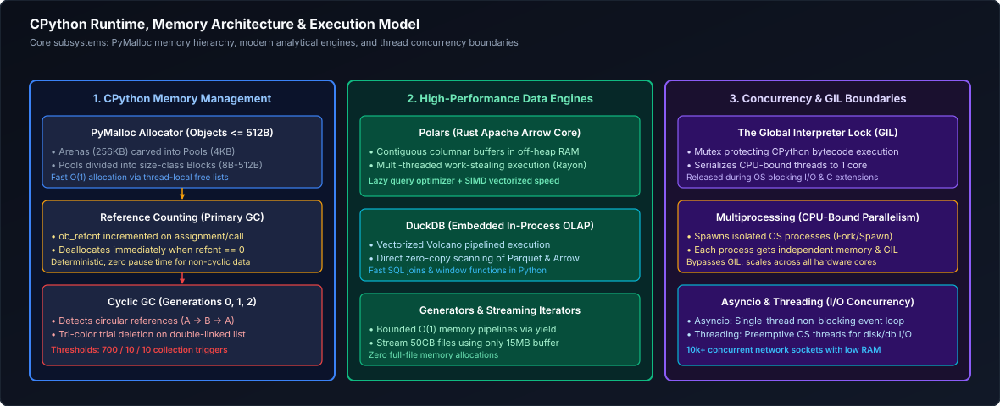
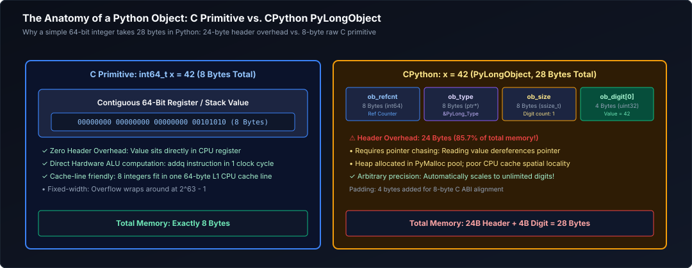
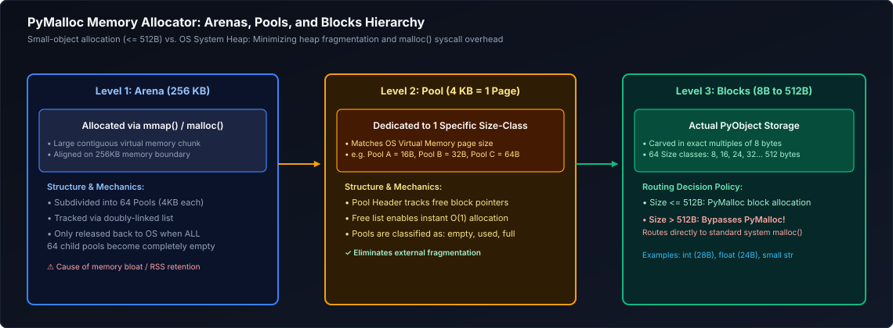
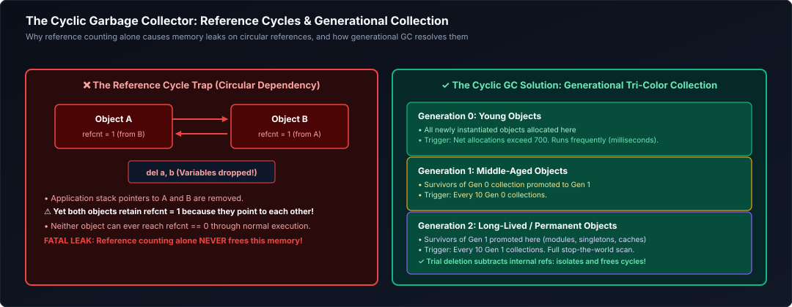
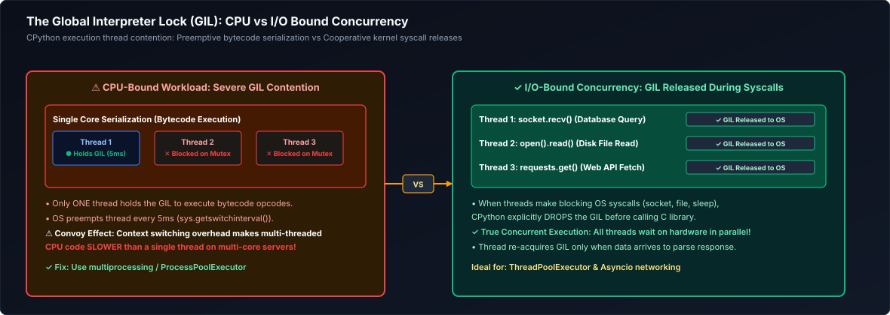
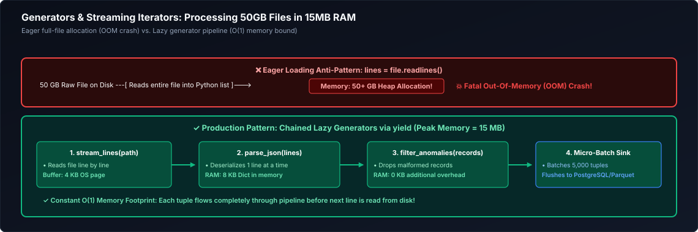
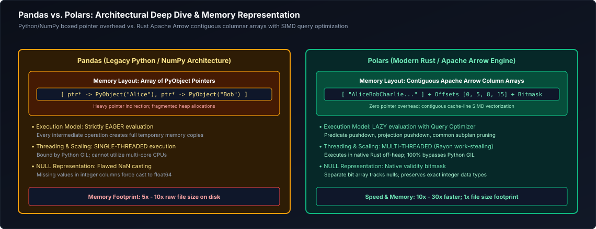
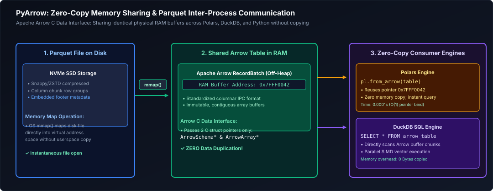
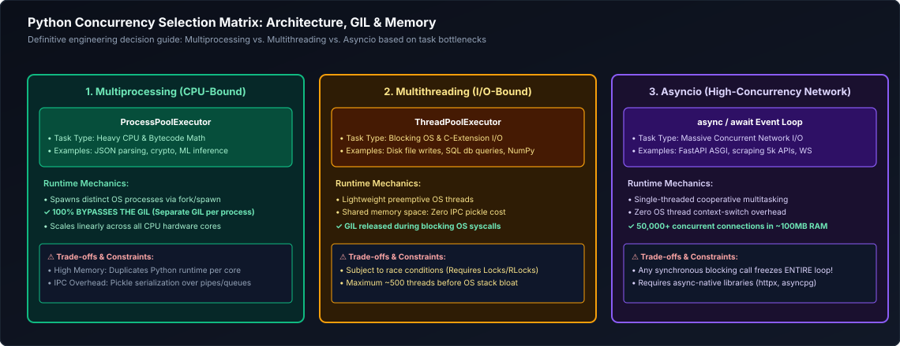

# 02. Python for Data Engineering: Master Engineering & Learning Guide

A comprehensive, production-grade guide to Python for high-performance data engineering, systems programming, and modern analytical pipelines. Covers CPython memory internals, advanced language constructs (Generators, Decorators, Context Managers, Pydantic v2 data validation), modern analytical engines (Polars, DuckDB in-process OLAP, PyArrow), and production systems engineering (Structured Logging, AsyncIO, Multiprocessing, and Threading).

---

## Architectural Overview: CPython Runtime, Memory Architecture & Data Processing Pipelines

Python is the lingua franca of data engineering. However, writing production-grade Python that processes hundreds of gigabytes of data requires understanding how the Python runtime manages memory, threads, and I/O under the hood.



*D2 Source: [`01_cpython_runtime_memory_architecture.d2`](assets/02_python_for_data_and_systems/01_cpython_runtime_memory_architecture.d2)*

---

## Table of Contents
1. [CPython Internals & The Memory Hierarchy](#1-cpython-internals--the-memory-hierarchy)
   - [1.1 The Anatomy of a Python Object: PyObject & PyVarObject](#11-the-anatomy-of-a-python-object-pyobject--pyvarobject)
   - [1.2 Memory Allocation: Arenas, Pools, and Blocks (PyMalloc)](#12-memory-allocation-arenas-pools-and-blocks-pymalloc)
   - [1.3 Garbage Collection: Reference Counting & The Tri-Color Cyclic GC](#13-garbage-collection-reference-counting--the-tri-color-cyclic-gc)
   - [1.4 The Global Interpreter Lock (GIL) & PEP 703 Free-Threading](#14-the-global-interpreter-lock-gil--pep-703-free-threading)
2. [Advanced Python Fundamentals for Data Pipelines](#2-advanced-python-fundamentals-for-data-pipelines)
   - [2.1 Built-in Data Structures: Time & Memory Complexities](#21-built-in-data-structures-time--memory-complexities)
   - [2.2 Comprehensions vs. Generator Expressions (RAM Footprint Proof)](#22-comprehensions-vs-generator-expressions-ram-footprint-proof)
   - [2.3 Generators & Iterators: Streaming 50GB Files in 15MB RAM](#23-generators--iterators-streaming-50gb-files-in-15mb-ram)
   - [2.4 Custom Decorators: Production Retries, Exponential Backoff, and Metrics](#24-custom-decorators-production-retries-exponential-backoff-and-metrics)
   - [2.5 Context Managers: Deterministic Resource Management & Rollbacks](#25-context-managers-deterministic-resource-management--rollbacks)
   - [2.6 Robust Exception Handling & Custom Domain Hierarchy](#26-robust-exception-handling--custom-domain-hierarchy)
   - [2.7 Pydantic v2: Fast Rust-Powered Data Validation Contracts](#27-pydantic-v2-fast-rust-powered-data-validation-contracts)
3. [Modern Analytical Data Processing Engines](#3-modern-analytical-data-processing-engines)
   - [3.1 Pandas vs. Polars: Architectural Deep Dive & Memory Models](#31-pandas-vs-polars-architectural-deep-dive--memory-models)
   - [3.2 Polars Masterclass: LazyFrames, Expressions, and Multi-Core Streaming](#32-polars-masterclass-lazyframes-expressions-and-multi-core-streaming)
   - [3.3 DuckDB: Embedded Vectorized In-Process Columnar OLAP](#33-duckdb-embedded-vectorized-in-process-columnar-olap)
   - [3.4 PyArrow: Zero-Copy Memory Sharing & Parquet File IPC](#34-pyarrow-zero-copy-memory-sharing--parquet-file-ipc)
   - [3.5 Deeply Nested JSON Parsing & Recursive Normalization](#35-deeply-nested-json-parsing--recursive-normalization)
   - [3.6 Timezones, Timestamps & Daylight Saving Traps (`zoneinfo`)](#36-timezones-timestamps--daylight-saving-traps-zoneinfo)
   - [3.7 Cryptographic Checksums & File Integrity Auditing (`hashlib`)](#37-cryptographic-checksums--file-integrity-auditing-hashlib)
4. [Production Python Systems Engineering](#4-production-python-systems-engineering)
   - [4.1 Virtual Environments & Dependency Locking (`uv`, `poetry`, `venv`)](#41-virtual-environments--dependency-locking-uv-poetry-venv)
   - [4.2 Structured Logging with `structlog` & Cloud Log Ingestion](#42-structured-logging-with-structlog--cloud-log-ingestion)
   - [4.3 Configuration Governance with `pydantic-settings`](#43-configuration-governance-with-pydantic-settings)
   - [4.4 Concurrency Deep Dive: Multiprocessing vs. Multithreading vs. AsyncIO](#44-concurrency-deep-dive-multiprocessing-vs-multithreading-vs-asyncio)
   - [4.5 Code Quality, Static Typing, and Linters (`ruff`, `mypy`)](#45-code-quality-static-typing-and-linters-ruff-mypy)
5. [Summary Comparison & Production Engineering Reference Matrix](#5-summary-comparison--production-engineering-reference-matrix)
6. [References & Further Reading](#6-references--further-reading)

> [!TIP]
> **Deep-Dive Interview Scenarios:**
> - [Q5. High-Performance Deduplication in Pandas](frequently_asked_questions/02_python_for_data_and_systems_faq.md#q5-medium-high-performance-deduplication-in-pandas)
> - [Q6. Python Decorators in Production Data Pipelines](frequently_asked_questions/02_python_for_data_and_systems_faq.md#q6-medium-python-decorators-in-production-data-pipelines)
---

# 1. CPython Internals & The Memory Hierarchy

> [!NOTE]
> **Domain Framing: CPython for Data Engineering vs. Python Backend Engineering:**
> In general software and backend engineering, understanding CPython focuses on request-response lifecycles, AST compiler pipelines, bytecode execution loops (`_PyEval_EvalFrameDefault`), and native C/Rust extensions (see [Python Backend Engineering: 03. CPython Runtime, Memory & Performance](#1-cpython-internals--the-memory-hierarchy)).
>
> **For a Data Engineer, CPython is viewed through the lens of memory efficiency, garbage collection throughput, and I/O parallelism:**
> - **The Pointer Overhead Tax:** Standard CPython collections (`list[dict]`) store pointers to heavy heap-allocated `PyObject` structs. When parsing a 10-million-row dataset, this causes a **10x to 50x memory bloat** relative to the raw byte payload and induces massive L1/L2 cache misses through pointer-chasing.
> - **Why Vectorized Engines Exist:** Modern high-performance tools (**Polars, DuckDB, PyArrow, and PySpark Tungsten**) bypass the CPython heap entirely. They allocate contiguous off-heap Arrow columnar memory buffers in C++/Rust, achieving hardware SIMD vectorization and zero-copy memory transfers.
> - **The GIL Bottleneck in ETL:** The Global Interpreter Lock (GIL) serializes execution across Python threads. Understanding the GIL dictates whether you scale CPU-bound batch parsing using `multiprocessing` across OS cores, or offload transformations to vectorized PyArrow `@pandas_udf` in Spark to release the GIL entirely.

### 1.1 The Anatomy of a Python Object: PyObject & PyVarObject

In Python, **everything is an object allocated on the heap**. Unlike C or Rust where an integer is a raw 4-byte or 8-byte primitive stored in a CPU register, in CPython an integer is a heavy C struct called `PyLongObject`:



*D2 Source: [`02_pyobject_anatomy.d2`](assets/02_python_for_data_and_systems/02_pyobject_anatomy.d2)*

```python
import sys

# Demonstrating CPython Memory Overhead
x = 1
print(f"Size of integer 1 in Python: {sys.getsizeof(x)} bytes")
# Output: 28 bytes! (In C/Rust, an int is 4 or 8 bytes)

empty_list = []
print(f"Size of empty list: {sys.getsizeof(empty_list)} bytes")
# Output: 56 bytes!
```

> [!IMPORTANT]
> **The Data Engineering Implication:**
> Storing 100,000,000 raw integers in a standard Python list consumes $\approx 100\text{M} \times (28\text{ bytes per int} + 8\text{ bytes per pointer}) \approx \mathbf{3.6 \text{ GB of RAM}}$!
> In contrast, storing 100,000,000 64-bit integers in a **PyArrow array or NumPy buffer** stores raw continuous memory bytes, consuming exactly **800 MB of RAM** ($4.5\times$ memory reduction).

---

### 1.2 Memory Allocation: Arenas, Pools, and Blocks (PyMalloc)

CPython uses an optimized hierarchical memory allocator called **PyMalloc** to bypass OS kernel `malloc()` calls for small objects ($\le 512$ bytes):



*D2 Source: [`03_pymalloc_arenas_pools_blocks.d2`](assets/02_python_for_data_and_systems/03_pymalloc_arenas_pools_blocks.d2)*

1. **Arenas (256 KB):** Contiguous chunks of memory mapped from the OS.
2. **Pools (4 KB):** Equal to one system virtual memory page. A pool only holds blocks of a single size class.
3. **Blocks (8 to 512 Bytes):** When Python instantiates a 28-byte integer, PyMalloc assigns it to a 32-byte block pool.
4. **Large Objects (> 512 Bytes):** Bypasses PyMalloc completely and falls back to standard C library `malloc()`.

---

### 1.3 Garbage Collection: Reference Counting & The Tri-Color Cyclic GC

In long-running data ingestion daemons and batch transformation scripts, unmanaged memory leaks inevitably degrade pipeline throughput or cause Linux Out-Of-Memory (`OOM-killer`) job terminations. CPython implements an autonomous, two-tier memory reclamation engine: deterministic **Reference Counting** supplemented by a **Generational Tri-Color Cyclic Collector**.

#### 1. Reference Counting: Immediate & Deterministic Reclamation
Every Python object (`PyObject`) maintains an internal counter field, `ob_refcnt` (an unsigned 64-bit integer on 64-bit architectures).
- **Increment Triggers:**
  - Variable assignment: `a = [1, 2, 3]` (counter becomes 1).
  - Aliasing or parameter passing: `b = a` or `func(a)` (counter increments to 2).
  - Insertion into collections: `data_list.append(a)` (counter increments to 3).
- **Decrement Triggers:**
  - Explicit deletion: `del a` (counter decrements).
  - Out of scope: A function call terminates and local stack frames are popped.
  - Collection mutation: An element is removed from a container (`data_list.pop()`).
- **Immediate Deallocation:** When `ob_refcnt` drops strictly to zero, the object is immediately and deterministically destroyed. Its destructor (`tp_dealloc`) is executed without delay, and the memory block is returned directly to the PyMalloc pool.
- **Limitation:** Reference counting is fast and deterministic, but it is fundamentally incapable of detecting **cyclic references**.

#### 2. The Cyclic Garbage Collector: Generational Tri-Color Mark-and-Sweep
When two or more container objects reference each other, their reference counts can never reach zero through normal reference decrements, even after all application pointers to them have been dropped:



*D2 Source: [`04_cyclic_gc_generations.d2`](assets/02_python_for_data_and_systems/04_cyclic_gc_generations.d2)*

To reclaim orphaned reference cycles, CPython runs a specialized cyclic garbage collector (`gc` module) that tracks all container objects (lists, dictionaries, custom class instances, tuples holding mutable objects) using doubly-linked list nodes.

##### Generational Hypothesis & Threshold Mechanics
The collector operates on the empirical **Generational Hypothesis**: most objects in data pipelines have very short lifespans (e.g., temporary strings parsed during a loop iteration). Objects that survive multiple collection passes are likely to persist for the remainder of the process.

CPython partitions tracked objects into **three generations**:
- **Generation 0:** Newly allocated container objects enter here. It is evaluated frequently.
- **Generation 1:** Objects that survive a Gen 0 garbage collection run are promoted to Gen 1.
- **Generation 2:** Long-lived objects (e.g., loaded metadata, lookup dictionaries, configuration singletons). Scanned very infrequently.

##### The Tri-Color Graph Traversal Algorithm
During a collection cycle, CPython executes a trial decrement traversal:
1. **White Set (Candidates for Collection):** Initially, all objects in the target generation are colored White (potentially unreachable).
2. **Gray Set (Reachable but Uninspected):** Objects that have incoming external references from outside the cycle are moved to the Gray set.
3. **Black Set (Confirmed Reachable):** When an object in the Gray set is inspected, all objects it references are examined and promoted to Gray, and the original object is colored Black.
4. **Reclamation:** Once all reachable paths are traced, any object remaining White is proven to be completely unreachable from root references. The cyclic links are broken, destructors run, and the memory is reclaimed.

```python
import gc
import sys

# Inspecting GC thresholds (Gen 0, Gen 1, Gen 2)
# Default is typically (700, 10, 10):
# Gen 0 runs every 700 net container allocations.
# Gen 1 runs after Gen 0 has executed 10 times.
# Gen 2 runs after Gen 1 has executed 10 times.
print("Default GC Thresholds:", gc.get_threshold())

# In massive batch transformations (e.g., parsing 10 million JSON rows),
# triggering Gen 2 scans repeatedly causes high CPU pause times.
# Production optimization: Disable GC during tight ingestion loops or increase thresholds:
gc.set_threshold(50000, 20, 20)
```

---

### 1.4 The Global Interpreter Lock (GIL) & PEP 703 Free-Threading

#### 1. Why the GIL Exists: CPython Thread Safety
The **Global Interpreter Lock (GIL)** is a mutual-exclusion lock protecting CPython internal memory structures (specifically reference counts in `PyObject` and non-thread-safe PyMalloc memory pools) against race conditions from concurrent native threads.
- **Single-Thread Execution:** In standard CPython, **only ONE native OS thread can execute Python bytecode at any given millisecond**, even on a 64-core machine.
- **CPU-Bound Concurrency Penalty:** Running CPU-intensive data parsing (e.g., regex matching or string manipulation) across multiple Python threads does **not** speed up execution—it often slows execution down due to OS thread context-switching overhead and lock contention.



*D2 Source: [`05_gil_thread_contention.d2`](assets/02_python_for_data_and_systems/05_gil_thread_contention.d2)*

#### 2. Bytecode Evaluation & Thread Switching Mechanics
CPython threads switch execution through cooperative preemption governed by a time-based interval (`sys.getswitchinterval()`):
```python
import sys

# Default thread switch interval is 0.005 seconds (5 milliseconds)
print(f"Current switch interval: {sys.getswitchinterval()}s")
```
Every 5 milliseconds, the currently running thread releases the GIL, signaling waiting threads via OS condition variables (`pthread_cond_signal`). If a thread is in a tight CPU loop, it must periodically yield the lock, allowing other threads to make progress.

#### 3. When Multithreading DOES Work in Python
Threads explicitly release the GIL during **blocking I/O operations and C-extension routines**:
- **Blocking I/O (OS Syscalls):** Reading/writing to disk (`open()`), network socket I/O (`requests`, `urllib`, `socket`), or database queries (`psycopg2`, `snowflake-connector`). While the thread waits on OS network buffers, it releases the GIL, allowing other threads to run bytecode in parallel.
- **Compiled Extensions:** Vectorized libraries (NumPy, Polars, DuckDB, PyArrow) explicitly drop the GIL around their C++/Rust computational loops (`Py_BEGIN_ALLOW_THREADS` / `Py_END_ALLOW_THREADS`), achieving 100% multi-core CPU utilization.

#### 4. PEP 703: The Free-Threaded Python 3.13+ Future
Python 3.13 introduces experimental **free-threaded builds (`python3.13t` with `--disable-gil`)**:
- **Biased Reference Counting:** Objects accessed primarily by a single thread use fast unsynchronized increments, while shared objects fall back to atomic CAS operations.
- **Mimalloc Allocator:** Replaces PyMalloc with Microsoft's thread-safe `mimalloc` allocator, allowing threads to allocate and free heap blocks concurrently across cores without lock contention.


> [!TIP]
> **Deep-Dive Interview Scenarios:**
> - [Q1. Chunked CSV Reading & Filtering Output Stream](frequently_asked_questions/02_python_for_data_and_systems_faq.md#q1-medium-chunked-csv-reading--filtering-output-stream)
> - [Q2. Memory Optimization Strategies for 10GB CSV Processing](frequently_asked_questions/02_python_for_data_and_systems_faq.md#q2-hard-memory-optimization-strategies-for-10gb-csv-processing)
> - [Q23. Pairing Common Keys Between Disjoint Lists & Dictionary Intersection](frequently_asked_questions/02_python_for_data_and_systems_faq.md#q23-medium-pairing-common-keys-between-disjoint-lists--dictionary-intersection)
> - [Q24. Character Frequency & Duplicate Detection in High-Volume Strings](frequently_asked_questions/02_python_for_data_and_systems_faq.md#q24-medium-character-frequency--duplicate-detection-in-high-volume-strings)
> - [Q26. Email Username Extraction with Resilient Regex & RFC Validation](frequently_asked_questions/02_python_for_data_and_systems_faq.md#q26-medium-email-username-extraction-with-resilient-regex--rfc-validation)
> - [Q37. Separating Even and Odd Numbers from a List: In-Place Parity Partitioning vs Generator Streams](frequently_asked_questions/02_python_for_data_and_systems_faq.md#q37-easy-separating-even-and-odd-numbers-from-a-list-in-place-parity-partitioning-vs-generator-streams)
> - [Q38. Prime Number Verification & Sieve of Eratosthenes Generator](frequently_asked_questions/02_python_for_data_and_systems_faq.md#q38-medium-prime-number-verification--sieve-of-eratosthenes-generator)

---

# 2. Advanced Python Fundamentals for Data Pipelines

> [!NOTE]
> **Domain Framing: Advanced Constructs in Data Pipelines:**
> While backend engineering utilizes Python constructs for object-oriented domain hierarchies, service layers, and web middleware (see [Python Backend Engineering: 01. Core Python & OOP](#2-advanced-python-fundamentals-for-data-pipelines) and [02. Advanced Python Programming Constructs](#2-advanced-python-fundamentals-for-data-pipelines)), data engineers harness these constructs to solve pipeline-critical challenges:
> - **Generators & Iterators:** Serve as the core pattern for memory-bounded streaming ingestion, enabling pipelines to extract and transform 50GB+ files from S3/Blob storage in fixed 15MB RAM without Out-Of-Memory (OOM) crashes.
> - **Decorators:** Provide reusable, declarative pipeline telemetry, execution timer instrumentation, and exponential backoff retry policies across unreliable external REST APIs.
> - **Context Managers:** Guarantee deterministic resource cleanup, closing database cursors, releasing file descriptors, and rolling back database transactions upon ETL worker failures.
> - **Pydantic v2:** Acts as an ultra-fast Rust-powered data contract layer, enforcing strict schema validation on incoming raw Bronze events before promotion to Silver tables.

### 2.1 Built-in Data Structures: Time & Memory Complexities

#### 1. Overview: The Memory Overhead of CPython Primitives
In data engineering pipelines, processing millions of incoming records using native Python primitives requires understanding **CPython object overhead**. Unlike low-level systems languages (C++, Rust) where arrays are contiguous blocks of raw primitive bytes, every Python object is a `PyObject` structure containing a reference count (`ob_refcnt`, 8 bytes) and a type pointer (`ob_type`, 8 bytes). A single 64-bit integer that requires 8 bytes in C consumes **28 bytes** in Python!

Selecting the correct data structure determines whether an in-memory batch extraction pipeline runs in 500 MB or triggers an Out-Of-Memory (OOM) killer event on an ETL worker node.

#### 2. Detailed Breakdown of Core Structures & CPython Internals

##### 1. `list`: Contiguous Pointer Array
- **Internal Representation:** A `list` is a contiguous dynamic array of pointers (`PyObject*`). The list itself does not store data values inline; it stores 8-byte memory addresses referencing heap-allocated objects elsewhere in RAM.
- **Over-Allocation Strategy:** To achieve $O(1)$ amortized append performance, CPython over-allocates the underlying array buffer by approximately $12.5\%$ whenever capacity is exhausted.
- **Performance Trade-Off:** Appending to the end (`append()`) is $O(1)$ amortized. However, inserting or deleting at the front (`insert(0, val)` or `pop(0)`) is $O(N)$ because every subsequent pointer address must be physically shifted in memory.

##### 2. `dict`: Compact Hash Table
- **Internal Representation:** Since Python 3.6, dictionaries use a **compact hash table architecture** consisting of two arrays:
  1. A sparse `indices` array storing small integers (1, 2, or 4 bytes).
  2. A dense `entries` array storing `[hash, key_ptr, value_ptr]` structs sequentially in insertion order.
- **Hash Resolution:** Uses open addressing with pseudo-random perturbation (`j = (5*j + 1 + perturb) >> 5`) to resolve hash collisions without clustering.
- **Performance Profile:** Key lookup, insertion, and deletion are $O(1)$ on average. In the worst case (pathological hash collisions), lookup degrades to $O(N)$.

##### 3. `set`: Hash Table with Dummy Values
- **Internal Representation:** Implemented as a hash table with key-only storage, omitting value pointers.
- **Data Engineering Role:** The primary data structure for high-speed deduplication, primary key membership verification, and relational difference operations ($A - B$) implemented at C-speed in the runtime.

##### 4. `collections.deque`: Doubly-Linked Block List
- **Internal Representation:** A doubly-linked list of fixed-size 64-element contiguous memory blocks.
- **Performance Profile:** Provides guaranteed $O(1)$ push and pop operations on **both ends** (`append`, `appendleft`, `pop`, `popleft`) without ever needing to shift existing elements or reallocate a single monolithic memory chunk.
- **Data Engineering Role:** The industry-standard primitive for sliding-window stream processing (e.g. keeping the last 1,000 metrics in memory) and bounded FIFO buffers.

#### 3. Comparisons & Time/Memory Complexity Matrix

| Data Structure | Lookup Cost | Append / Insert Cost | CPython Memory Layout | Primary Data Pipeline Use Case |
| :--- | :---: | :---: | :--- | :--- |
| **`list`** | $O(1)$ by index<br/>$O(N)$ by value | $O(1)$ amortized append<br/>$O(N)$ insert at start | Dynamic contiguous pointer array; over-allocates buffer by $\approx 12.5\%$. | Ordered sequential staging rows before bulk DB writes. |
| **`dict`** | $O(1)$ average | $O(1)$ average | Compact hash table (sparse indices + dense entries array). | High-speed lookup tables, dimension key mapping, JSON payloads. |
| **`set`** | $O(1)$ average | $O(1)$ average | Key-only hash table with dummy values. | In-memory entity deduplication, set difference churn checks. |
| **`deque`** | $O(1)$ ends<br/>$O(N)$ middle | **$O(1)$ append / pop on both ends** | Doubly-linked list of 64-element contiguous blocks. | High-speed sliding-window aggregations, bounded FIFO queues. |

---

### 2.2 Comprehensions vs. Generator Expressions (RAM Footprint Proof)

A **List Comprehension** computes all values eagerly, allocating memory for the entire collection upfront. A **Generator Expression** produces values lazily on-demand using constant $O(1)$ memory:

```python
import sys

# List Comprehension (Eager Allocation in RAM)
numbers_list = [x ** 2 for x in range(10_000_000)]
print(f"List Comprehension Memory: {sys.getsizeof(numbers_list) / (1024 * 1024):.2f} MB")
# Output: ~79.24 MB of RAM!

# Generator Expression (Lazy O(1) Evaluation)
numbers_gen = (x ** 2 for x in range(10_000_000))
print(f"Generator Expression Memory: {sys.getsizeof(numbers_gen)} Bytes")
# Output: Exactly 200 Bytes, regardless of whether range is 10 or 10 Billion!
```

---

### 2.3 Generators & Iterators: Streaming 50GB Files in 15MB RAM

In big data ingestion, attempting to load a 50 GB log file using `file.readlines()` or `json.load()` causes an immediate **Out-Of-Memory (OOM) Kernel Panic**. 
Using **Chained Generators**, Python streams data record-by-record through transformation pipelines using constant in-memory buffers:



*D2 Source: [`06_generator_streaming_pipeline.d2`](assets/02_python_for_data_and_systems/06_generator_streaming_pipeline.d2)*

```python
import json
from typing import Generator, Dict, Any, List

def stream_log_lines(file_path: str) -> Generator[str, None, None]:
    """Reads large files line-by-line without loading into memory."""
    with open(file_path, "r", encoding="utf-8") as fh:
        for line in fh:
            yield line.strip()

def parse_events(lines: Generator[str, None, None]) -> Generator[Dict[str, Any], None, None]:
    """Parses raw text lines into JSON objects, skipping malformed records."""
    for line in lines:
        try:
            yield json.loads(line)
        except json.JSONDecodeError:
            continue  # Defensive skip for corrupted logs

def filter_cleared_orders(events: Generator[Dict[str, Any], None, None]) -> Generator[Dict[str, Any], None, None]:
    """Filters events matching business condition."""
    for ev in events:
        if ev.get("status") == "COMPLETED" and ev.get("amount", 0) > 100.0:
            yield ev

def batch_stream(stream: Generator[Dict[str, Any], None, None], batch_size: int = 5000) -> Generator[List[Dict[str, Any]], None, None]:
    """Batches items into chunks for bulk database insertion."""
    batch = []
    for item in stream:
        batch.append(item)
        if len(batch) >= batch_size:
            yield batch
            batch = []
    if batch:
        yield batch

# Execution pipeline: Pinned memory footprint (< 15 MB) for 50 GB of data!
# raw_lines = stream_log_lines("/data/access_logs_50gb.log")
# parsed = parse_events(raw_lines)
# filtered = filter_cleared_orders(parsed)
# for chunk in batch_stream(filtered, batch_size=5000):
#     db_bulk_insert(chunk)
```

---

### 2.4 Custom Decorators: Production Retries, Exponential Backoff, and Metrics

Decorators wrap pipeline functions to inject enterprise observability, rate-limiting, and error-recovery behaviors:

```python
import time
import functools
import random
import logging
from typing import Callable, Any

logging.basicConfig(level=logging.INFO)
logger = logging.getLogger("PipelineLogger")

def retry_with_exponential_backoff(
    max_retries: int = 3,
    initial_delay_sec: float = 1.0,
    backoff_factor: float = 2.0,
    retryable_exceptions: tuple = (Exception,)
) -> Callable:
    """
    Production retry decorator with exponential backoff and randomized full jitter.
    Prevents Thundering Herd problems against downstream REST APIs and databases.
    """
    def decorator(func: Callable) -> Callable:
        @functools.wraps(func)
        def wrapper(*args, **kwargs) -> Any:
            attempt = 1
            delay = initial_delay_sec
            while True:
                try:
                    return func(*args, **kwargs)
                except retryable_exceptions as err:
                    if attempt > max_retries:
                        logger.error(f"Function {func.__name__} failed after {max_retries} retries. Raising.")
                        raise err
                    
                    # Full Jitter Formula: Sleep random uniform between 0 and delay
                    sleep_time = random.uniform(0, delay)
                    logger.warning(
                        f"Attempt {attempt} for {func.__name__} failed: {err}. "
                        f"Retrying in {sleep_time:.2f}s..."
                    )
                    time.sleep(sleep_time)
                    attempt += 1
                    delay *= backoff_factor
        return wrapper
    return decorator

# Usage on external API extraction
@retry_with_exponential_backoff(max_retries=4, initial_delay_sec=1.5, retryable_exceptions=(ConnectionError, TimeoutError))
def fetch_external_partner_data(endpoint_url: str):
    # Simulated flaky API call
    if random.random() < 0.7:
        raise ConnectionError("503 Service Unavailable")
    return {"status": "SUCCESS", "payload": [1, 2, 3]}
```

---

### 2.5 Context Managers: Deterministic Resource Management & Rollbacks

In Python, unclosed database connections or file handles leak OS file descriptors. Custom **Context Managers** guarantee cleanup even if exceptions occur mid-flight:

```python
import psycopg2
from contextlib import contextmanager
from typing import Generator

@contextmanager
def database_transaction(db_pool) -> Generator[psycopg2.extensions.cursor, None, None]:
    """
    Context manager providing atomic transaction boundaries.
    Automatically commits on success; executes ROLLBACK on any failure.
    """
    conn = db_pool.getconn()
    cursor = conn.cursor()
    try:
        yield cursor
        conn.commit()  # Atomically commit transaction
    except Exception as exc:
        conn.rollback()  # Safely abort transaction on failure
        raise exc
    finally:
        cursor.close()
        db_pool.putconn(conn)  # Release connection back to pool
```

---

### 2.6 Robust Exception Handling & Custom Domain Hierarchy

Never catch a generic `except Exception:` without re-raising or logging context. Design explicit domain exceptions:

```python
class DataPipelineError(Exception):
    """Base exception for all data pipeline failures."""
    pass

class SchemaValidationError(DataPipelineError):
    """Raised when inbound records fail data contract validation."""
    pass

class DeadLetterQueueError(DataPipelineError):
    """Raised when messages cannot be routed to dead-letter sinks."""
    pass
```

---

### 2.7 Pydantic v2: Fast Rust-Powered Data Validation Contracts

In modern data architectures, **Pydantic v2** enforces data contracts for incoming payloads. Pydantic v2’s core validation engine is compiled in **Rust**, executing $20\times$ faster than legacy Pydantic v1:

```python
from pydantic import BaseModel, Field, field_validator, model_validator
from datetime import datetime
from typing import List, Optional

class OrderItemContract(BaseModel):
    sku: str = Field(min_length=3, max_length=20, description="Stock Keeping Unit code")
    quantity: int = Field(gt=0, description="Quantity must be strictly positive")
    unit_price: float = Field(gt=0.0, description="Price must be greater than zero")

class CustomerOrderContract(BaseModel):
    order_id: str = Field(pattern=r"^ORD-[0-9]{6}$", description="Format: ORD-123456")
    customer_id: int = Field(gt=0)
    customer_email: str
    items: List[OrderItemContract] = Field(min_length=1, description="Order must contain at least 1 item")
    order_date: datetime
    discount_pct: Optional[float] = Field(default=0.0, ge=0.0, le=1.0)

    # Field-level validator
    @field_validator("customer_email")
    @classmethod
    def validate_corporate_email(cls, v: str) -> str:
        clean_email = v.strip().lower()
        if "@" not in clean_email or "." not in clean_email.split("@")[1]:
            raise ValueError(f"Invalid email structure: {v}")
        return clean_email

    # Model-level validator (cross-field validation)
    @model_validator(mode="after")
    def verify_order_not_in_future(self) -> "CustomerOrderContract":
        if self.order_date > datetime.now():
            raise ValueError("Order date cannot be in the future!")
        return self

# Parsing and validating enforces strict typing and canonicalization
raw_inbound_payload = {
    "order_id": "ORD-984210",
    "customer_id": 4012,
    "customer_email": "Alice.Smith@Corp.COM ",
    "order_date": "2026-10-15T14:30:00",
    "items": [
        {"sku": "LAPTOP-01", "quantity": 1, "unit_price": 1299.99},
        {"sku": "MOUSE-BT", "quantity": 2, "unit_price": 29.50}
    ]
}

validated_order = CustomerOrderContract.model_validate(raw_inbound_payload)
print(f"Validated Order ID: {validated_order.order_id}")
print(f"Cleaned Email: {validated_order.customer_email}")
```

> [!TIP]
> **Deep-Dive Interview Scenarios:**
> - [Q4. Order-Preserving List Deduplication](frequently_asked_questions/02_python_for_data_and_systems_faq.md#q4-medium-order-preserving-list-deduplication)
> - [Q8. Enterprise Exception Handling & Dead-Letter Queue Patterns](frequently_asked_questions/02_python_for_data_and_systems_faq.md#q8-medium-enterprise-exception-handling--dead-letter-queue-patterns)
> - [Q22. Advanced Data Manipulation on Strings, Lists, and Dictionaries](frequently_asked_questions/02_python_for_data_and_systems_faq.md#q22-medium-advanced-data-manipulation-on-strings-lists-and-dictionaries)
> - [Q25. Python List Appending Mechanics: append() vs extend() vs + vs In-Place Slicing](frequently_asked_questions/02_python_for_data_and_systems_faq.md#q25-easy-python-list-appending-mechanics-append-vs-extend-vs--vs-in-place-slicing)
> - [Q27. The Stock Span Problem via Monotonic Stack](frequently_asked_questions/02_python_for_data_and_systems_faq.md#q27-medium-the-stock-span-problem-via-monotonic-stack)
> - [Q28. Large-Scale Log File Analysis & Most Frequently Accessed Database Tables](frequently_asked_questions/02_python_for_data_and_systems_faq.md#q28-medium-large-scale-log-file-analysis--most-frequently-accessed-database-tables)
> - [Q35. Python Dictionary Unique Value Extraction Mechanics](frequently_asked_questions/02_python_for_data_and_systems_faq.md#q35-medium-python-dictionary-unique-value-extraction-mechanics)

---

# 3. Modern Analytical Data Processing Engines

### 3.1 Pandas vs. Polars: Architectural Deep Dive & Memory Models

For over a decade, **Pandas** was the default Python data tool. However, Pandas was architected in 2008 for single-core financial modeling and struggles on modern big data:



*D2 Source: [`07_pandas_vs_polars_architecture.d2`](assets/02_python_for_data_and_systems/07_pandas_vs_polars_architecture.d2)*

#### First-Principles Architectural Analysis: Why Pandas Hits Memory Walls

1. **Pandas Memory & Execution Bottlenecks:**
   - **The NumPy BlockManager Architecture:** Internally, a Pandas DataFrame groups columns of identical data types into 2D NumPy arrays managed by the `BlockManager`. When columns are added, filtered, or cast, the `BlockManager` frequently duplicates entire contiguous memory blocks, leading to a memory footprint often $5\times - 10\times$ larger than the raw on-disk CSV or Parquet file size.
   - **Object Dtype & String Bloat:** Historically, Pandas stored strings as arrays of pointers to individual Python `str` heap objects (`dtype: object`). Each string element incurred full `PyObject` header overhead (49–80 bytes per string), destroying CPU cache locality and causing severe memory bloat.
   - **Eager Evaluation:** Every intermediate operation (`df['a'] = df['b'] * 2; df = df[df['a'] > 10]`) allocates and materializes a new intermediate DataFrame in RAM immediately, completely precluding cross-operation optimizations.

2. **Polars: Ground-Up Next-Generation Engine:**
   - **Apache Arrow Memory Foundation:** Built natively on Apache Arrow columnar format. Data is organized into contiguous, immutable array buffers with separate bitmasks for NULL values. Strings utilize contiguous UTF-8 byte buffers with 32-bit/64-bit offset arrays, achieving dense memory compression and zero Python heap object overhead.
   - **100% Rust & Lock-Free Multi-Threading:** Written entirely in Rust, Polars bypasses the Python Global Interpreter Lock (GIL) during execution. It utilizes the **Rayon** work-stealing thread pool to parallelize filter, projection, hash-aggregation, and join operations across every available CPU core automatically.
   - **Lazy Evaluation & Catalyst-Style Optimization:** Like Apache Spark, Polars separates query declaration (`LazyFrame`) from computation (`.collect()`). Its query optimizer applies **Predicate Pushdown** (evaluating `filter()` conditions directly inside Parquet row group statistics), **Projection Pushdown** (reading only queried columns from disk), and **Common Subplan Elimination**.

| Dimension | Pandas | Polars |
| :--- | :--- | :--- |
| **Engine Core** | Python & C (NumPy) | **100% Compiled Rust** |
| **Multi-Core Parallelism**| Single-threaded (Uses 1 CPU core) | **Native Multi-Threading (Uses all CPU cores automatically)** |
| **In-Memory Format** | NumPy 1D C-arrays (Heavy memory copies) | **Apache Arrow (Columnar binary format)** |
| **Execution Paradigm** | Eager execution only | **Lazy Execution with Query Optimizer + Eager Mode** |
| **String Handling** | Stored as Python `object` pointers (massive RAM) | Arrow Utf8 view buffers (compact, cache-efficient) |
| **Performance Benchmark**| Baseline (Slow) | **$10\times$ to $50\times$ faster than Pandas** |

---

### 3.2 Polars Masterclass: LazyFrames, Expressions, and Multi-Core Streaming

In Polars, best practice is to construct a **LazyFrame** using `scan_parquet()` or `scan_csv()`.
- It does **not** load data into RAM immediately.
- It builds a **Logical Plan**, optimizes it (Pushing down filters into Parquet row groups and pruning unused columns), and executes multithreaded across all CPU cores when `.collect()` is called.

> [!TIP]
> **Deep-Dive Interview Scenarios:**
> - [Q29. Merge Overlapping Intervals & Complexity Analysis](frequently_asked_questions/02_python_for_data_and_systems_faq.md#q29-medium-merge-overlapping-intervals--complexity-analysis)
> - [Q30. Longest Substring Without Repeating Characters (Sliding Window)](frequently_asked_questions/02_python_for_data_and_systems_faq.md#q30-medium-longest-substring-without-repeating-characters-sliding-window)
> - [Q31. First Non-Repeating Element in a Data Stream & Static Strings](frequently_asked_questions/02_python_for_data_and_systems_faq.md#q31-medium-first-non-repeating-element-in-a-data-stream--static-strings)
> - [Q32. Linked List Cycle Detection (Floyd's Tortoise and Hare Algorithm)](frequently_asked_questions/02_python_for_data_and_systems_faq.md#q32-hard-linked-list-cycle-detection-floyds-tortoise-and-hare-algorithm)
> - [Q33. Number of Islands (Boolean Matrix Connected Components via BFS/DFS)](frequently_asked_questions/02_python_for_data_and_systems_faq.md#q33-medium-number-of-islands-boolean-matrix-connected-components-via-bfsdfs)
> - [Q34. Top K Frequent Elements in an Array (Min-Heap vs QuickSelect)](frequently_asked_questions/02_python_for_data_and_systems_faq.md#q34-easy-top-k-frequent-elements-in-an-array-min-heap-vs-quickselect)
> - [Q39. Building a Production-Grade Streaming ETL Script in Python (Read, Clean, Validate & Load)](frequently_asked_questions/02_python_for_data_and_systems_faq.md#q39-medium-building-a-production-grade-streaming-etl-script-in-python-read-clean-validate--load)
> - [Q40. Pure Python Streaming Aggregation Without External Libraries (Pandas-Free Order Processing)](frequently_asked_questions/02_python_for_data_and_systems_faq.md#q40-medium-pure-python-streaming-aggregation-without-external-libraries-pandas-free-order-processing)
> - [Q41. Peak Overlapping Active Deliveries via Chronological Sweep-Line Interval Event Tracking](frequently_asked_questions/02_python_for_data_and_systems_faq.md#q41-medium-peak-overlapping-active-deliveries-via-chronological-sweep-line-interval-event-tracking)
> - [Q42. Roman Numeral to Integer Parser with Subtractive Lookup](frequently_asked_questions/02_python_for_data_and_systems_faq.md#q42-medium-roman-numeral-to-integer-parser-with-subtractive-lookup)

```python
import polars as pl

# Declare Lazy Computation Graph

lazy_query = (
    # scan_parquet reads only metadata footers, NOT the full data
    pl.scan_parquet("data/lakehouse_orders/*.parquet")
    # Predicate Pushdown: Engine pushes date filter directly to Parquet file statistics!
    .filter(pl.col("order_date") >= pl.date(2026, 1, 1))
    .filter(pl.col("order_status") == "COMPLETED")
    # Parallel Hash Aggregation
    .group_by("customer_id")
    .agg([
        pl.col("order_amount").sum().alias("total_revenue"),
        pl.col("order_amount").mean().alias("avg_order_value"),
        pl.col("order_id").count().alias("transaction_count")
    ])
    .filter(pl.col("total_revenue") > 1000.00)
    .sort("total_revenue", descending=True)
    .limit(100)
)

# 5. Inspect the optimized query plan

print(lazy_query.explain())

# 6. Execute using Polars' streaming engine (processes datasets larger than available RAM!)

result_df = lazy_query.collect(streaming=True)
print(result_df)
```

---

### 3.3 DuckDB: Embedded Vectorized In-Process Columnar OLAP

DuckDB is the **"SQLite for Analytics"**. It is an embedded, in-process analytical engine with zero external dependencies.

#### Why Data Engineers Love DuckDB
1. **Zero Infrastructure:** No servers, no background daemons, no Docker containers. Install via `pip install duckdb`.
2. **Direct File Querying:** Queries local or remote S3 Parquet, CSV, and JSON files directly without loading them into database tables first.
3. **Out-of-Core Processing:** Can query 100 GB Parquet datasets on a laptop with only 16 GB of RAM by streaming disk blocks.

```python
import duckdb

# Connect to in-memory DuckDB instance
con = duckdb.connect()

# Query S3 Parquet files directly using vectorized analytical SQL
query_result = con.execute("""
    SELECT 
        region,
        product_category,
        COUNT(order_id)                AS total_orders,
        ROUND(SUM(amount), 2)          AS gross_revenue,
        ROUND(AVG(amount), 2)          AS avg_ticket_size
    FROM read_parquet('s3://my-lake/orders/*.parquet')
    WHERE order_date >= '2026-01-01'
    GROUP BY region, product_category
    HAVING SUM(amount) > 50000.00
    ORDER BY gross_revenue DESC;
""").df()  # Exports zero-copy directly to a Pandas/Arrow DataFrame

print(query_result)
```

---

### 3.4 PyArrow: Zero-Copy Memory Sharing & Parquet File IPC

Apache Arrow is the universal in-memory columnar standard. **PyArrow** enables zero-copy memory transfers between systems:



*D2 Source: [`08_pyarrow_zero_copy_ipc.d2`](assets/02_python_for_data_and_systems/08_pyarrow_zero_copy_ipc.d2)*

```python
import pyarrow.parquet as pq
import pyarrow.compute as pc

# Read Parquet file with column pruning and predicate pushdown directly into Arrow
arrow_table = pq.read_table(
    "data/transactions.parquet",
    columns=["transaction_id", "user_id", "amount", "status"],
    filters=[("amount", ">", 500.0), ("status", "==", "CLEARED")]
)

# Vectorized C++ aggregation without crossing Python GIL
total_cleared = pc.sum(arrow_table["amount"]).as_py()
print(f"Total Cleared Volume: ${total_cleared:,.2f}")
```

---

### 3.5 Deeply Nested JSON Parsing & Recursive Normalization

When ingesting payloads from third-party APIs (Stripe, Salesforce), records arrive as deeply nested JSON trees. Production pipelines must flatten them into clean tabular structures:

```python
from typing import Dict, Any

def flatten_json_record(record: Dict[str, Any], prefix: str = "", separator: str = "_") -> Dict[str, Any]:
    """
    Recursively flattens nested JSON structures into a flat 1D dictionary.
    Handles nested dicts and converts arrays into stringified tokens.
    """
    flattened = {}
    for key, value in record.items():
        composite_key = f"{prefix}{separator}{key}" if prefix else key
        if isinstance(value, dict):
            flattened.update(flatten_json_record(value, prefix=composite_key, separator=separator))
        elif isinstance(value, list):
            flattened[composite_key] = [str(x) for x in value]
        else:
            flattened[composite_key] = value
    return flattened

# Example:
raw_event = {
    "event_id": "evt_9912",
    "customer": {
        "id": 402,
        "address": {"city": "New York", "zip": "10001"}
    },
    "metrics": {"duration_ms": 412}
}

flat = flatten_json_record(raw_event)
print(flat)
```

---

### 3.6 Timezones, Timestamps & Daylight Saving Traps (`zoneinfo`)

> [!CAUTION]
> **Production Rule:** Never use `datetime.now()` without a timezone! Naive datetimes assume local server time and corrupt timestamp comparisons when servers migrate across cloud regions.

```python
from datetime import datetime, timezone
from zoneinfo import ZoneInfo

# Always generate timezone-aware UTC timestamps

current_utc = datetime.now(timezone.utc)

# 8. Converting to local operational timezones using Python standard zoneinfo

eastern_tz = ZoneInfo("America/New_York")
localized_time = current_utc.astimezone(eastern_tz)

print(f"UTC Timestamp:     {current_utc.isoformat()}")
print(f"Eastern Timestamp: {localized_time.isoformat()}")
```

---

### 3.7 Cryptographic Checksums & File Integrity Auditing (`hashlib`)

```python
import hashlib

def calculate_sha256_checksum(file_path: str, chunk_size_bytes: int = 65536) -> str:
    """
    Computes SHA-256 digest of a large landing file using constant O(1) buffer streaming.
    """
    hasher = hashlib.sha256()
    with open(file_path, "rb") as fh:
        while chunk := fh.read(chunk_size_bytes):
            hasher.update(chunk)
    return hasher.hexdigest()
```

---

# 4. Production Python Systems Engineering

> [!NOTE]
> **Domain Framing: Concurrency & Systems Engineering:**
> In backend web engineering, concurrency focuses on ASGI event loops (FastAPI, Starlette) and task-local request storage (see [Python Backend Engineering: 04. Python Concurrency & Async Programming](13_python_backend_and_api_development.md) and [05. Python Development Ecosystem & Tooling](#1-cpython-internals--the-memory-hierarchy)).
> In data engineering, concurrency choices depend strictly on the workload bottleneck:
> - **`asyncio`:** For high-throughput network I/O when batch-ingesting data from thousands of external REST API endpoints concurrently.
> - **`multiprocessing`:** For CPU-bound data parsing, cryptographic hashing, and compression, spawning worker processes that bypass the GIL across multi-core server nodes.
> - **`concurrent.futures.ThreadPoolExecutor`:** For multi-threaded parallel file uploads/downloads to cloud object stores (ADLS Gen2, AWS S3) where network I/O releases the GIL.

### 4.1 Virtual Environments & Dependency Locking (`uv`, `poetry`, `venv`)

- **`venv`:** Standard library environment creator (`python3 -m venv .venv`).
- **`poetry`:** Dependency resolver that produces a cryptographic `poetry.lock` file, preventing breaking library updates from crashing CI/CD builds.
- **`uv`:** Ultra-fast Rust-based package installer (10x-100x faster than `pip`).

---

### 4.2 Structured Logging with `structlog` & Cloud Log Ingestion

Unstructured logs (`print("Loading file")`) make automated querying in Elasticsearch or Datadog impossible. **Structured Logging** outputs single-line JSON records:

```python
import structlog

structlog.configure(
    processors=[
        structlog.processors.TimeStamper(fmt="iso"),
        structlog.processors.add_log_level,
        structlog.processors.JSONRenderer()
    ]
)

logger = structlog.get_logger()

# Emits: {"event": "Batch sync completed", "table": "orders", "rows": 54200, "duration_sec": 1.45, "level": "info", "timestamp": "2026-10-16T17:40:00Z"}
logger.info(
    "Batch sync completed",
    table="orders",
    rows=54200,
    duration_sec=1.45
)
```

---

### 4.3 Configuration Governance with `pydantic-settings`

```python
from pydantic_settings import BaseSettings
from pydantic import Field

class DataPipelineConfig(BaseSettings):
    """Loads and validates pipeline environment variables at application startup."""
    kafka_bootstrap_servers: str = Field(..., description="Comma-separated broker list")
    database_url: str = Field(..., description="PostgreSQL connection URI")
    max_batch_size: int = Field(default=5000, gt=0, le=50000)
    enable_dry_run: bool = Field(default=False)

    class Config:
        env_file = ".env"
        case_sensitive = False
```

---

### 4.4 Concurrency Deep Dive: Multiprocessing vs. Multithreading vs. AsyncIO



*D2 Source: [`09_concurrency_selection_matrix.d2`](assets/02_python_for_data_and_systems/09_concurrency_selection_matrix.d2)*

#### 1. High-Concurrency REST Extraction (AsyncIO)
```python
import asyncio
import aiohttp
from typing import List, Dict, Any

async def fetch_api_page(session: aiohttp.ClientSession, page_num: int, semaphore: asyncio.Semaphore) -> Dict[str, Any]:
    url = f"https://api.crm.corp/v1/customers?page={page_num}"
    async with semaphore:  # Limit concurrent open HTTP sockets to prevent 429 rate limiting
        async with session.get(url) as response:
            return await response.json()

async def extract_all_pages(total_pages: int = 100, max_concurrent: int = 10) -> List[Dict[str, Any]]:
    semaphore = asyncio.Semaphore(max_concurrent)
    async with aiohttp.ClientSession() as session:
        tasks = [fetch_api_page(session, p, semaphore) for p in range(1, total_pages + 1)]
        results = await asyncio.gather(*tasks)
        return results
```

#### 2. CPU-Bound Data Processing (Multiprocessing)
```python
from concurrent.futures import ProcessPoolExecutor
from typing import List
import hashlib

def cpu_heavy_hash_transform(records_chunk: List[str]) -> List[str]:
    """CPU-intensive transformation task executing in a dedicated OS process."""
    return [hashlib.sha256(r.encode()).hexdigest() for r in records_chunk]

def run_parallel_hashing(work_chunks: List[List[str]], num_processes: int = 8) -> List[str]:
    all_hashes = []
    # Spawns 8 independent processes, completely bypassing the GIL
    with ProcessPoolExecutor(max_workers=num_processes) as executor:
        for chunk_result in executor.map(cpu_heavy_hash_transform, work_chunks):
            all_hashes.extend(chunk_result)
    return all_hashes
```

---

### 4.5 Code Quality, Static Typing, and Linters (`ruff`, `mypy`)

- **`ruff`:** Next-generation Python linter and formatter written in Rust. Replaces Flake8, Black, and isort, running **100x faster**.
- **`mypy`:** Static type checker enforcing strict PEP 484 type annotations, catching bugs before deployment.

> [!TIP]
> **Deep-Dive Interview Scenario:**
> - [Q7. Variable-Length Arguments (*args & **kwargs) in Pipeline Design](frequently_asked_questions/02_python_for_data_and_systems_faq.md#q7-medium-variable-length-arguments-args--kwargs-in-pipeline-design)

---

# 5. Summary Comparison & Production Engineering Reference Matrix

| Tool / Paradigm | Primary Responsibility | Memory Model | Concurrency Mechanism | Optimal Use Case | Anti-Patterns |
| :--- | :--- | :--- | :--- | :--- | :--- |
| **Python Generator** | Lazy streaming | $O(1)$ constant RAM | Synchronous iterator | Streaming 10GB+ CSV/JSON files | Calling `list(generator)` which loads all data into RAM! |
| **Pydantic v2** | Data contract enforcement | Rust compiled structs | Single-threaded | Validating webhook and REST API payloads | Using on 100M-row batch DataFrames (use Polars schema instead). |
| **Polars** | High-speed vectorized tabular processing | Apache Arrow columnar | Multithreaded Rust SIMD | Local data transformations, replacing Pandas | Iterating with `.iter_rows()` which destroys vectorized speed! |
| **DuckDB** | In-process analytical SQL | Columnar vectorized | Multithreaded C++ | Analytical SQL queries over local/remote Parquet | Using as an OLTP high-concurrency transactional database. |
| **AsyncIO** | Network I/O concurrency | Event loop queues | Single-threaded cooperative | Ingesting from thousands of REST APIs concurrently | Running CPU-heavy math inside an `async def` function (blocks event loop). |
| **Multiprocessing** | CPU-bound computation | Isolated OS process heaps | Multi-process OS forks | Heavy parsing, compression, cryptography | Excessive IPC data serialization between processes. |

---

- **Constant-Memory Streaming Pipelines:** Production extractors and file parsers must operate with bounded $O(1)$ memory by utilizing Python generators, chunked iterators, or Polars `LazyFrame` query plans rather than eagerly materializing entire datasets into in-memory lists or vanilla Pandas DataFrames.
- **Strict Static Typing & Contract Validation:** Data processing functions require comprehensive PEP 484 type annotations validated through `mypy --strict`. Schema boundaries at API and message ingress points should enforce declarative contracts using Pydantic v2 to catch corrupt payloads before downstream transformations run.
- **Timezone Awareness & Temporal Normalization:** All `datetime` operations must explicitly enforce UTC timezone awareness using standard `zoneinfo.ZoneInfo("UTC")`. Naive datetimes risk silent temporal distortion across daylight saving shifts and cross-region infrastructure boundaries.
- **Deterministic Resource Management:** Database connections, HTTP client sessions, socket handles, and file descriptors must be wrapped in `with` context managers to guarantee deterministic cleanup and eliminate connection pool leaks under exception flows.
- **Structured JSON Observability:** Production services must replace arbitrary `print()` statements with structured JSON logging (`structlog` or Python `logging` with JSON formatters). Emitting standard metadata (`run_id`, `pipeline`, `table`, `records_processed`, `latency_ms`) enables automated parsing in centralized log aggregation platforms (Datadog, Splunk, Elastic).
- **Runtime Configuration Governance:** Application secrets, connection URIs, and tuning thresholds must be injected via environment variables and validated at boot using `pydantic-settings`, preventing unverified defaults or plaintext secrets in version control.
- **Targeted Concurrency Models:** Align execution models with hardware constraints: use `multiprocessing` to bypass the GIL for CPU-bound serialization/cryptography, `concurrent.futures.ThreadPoolExecutor` for blocking file and network I/O, and `asyncio` for high-throughput non-blocking HTTP and webhook ingestion.
- **Modern Packaging & Tooling:** Manage dependencies with deterministic lockfiles via modern high-performance tooling (`uv` or `poetry`), and automate linting, formatting, and import sorting with `ruff`.

---

# 6. References & Further Reading

1. **CPython Runtime & Internals:**
   - [CPython Internal Design Guide](https://devguide.python.org/internals/)
   - [PEP 703: Making the Global Interpreter Lock Optional in CPython](https://peps.python.org/pep-0703/)
   - [Companion Module: Python Backend Engineering - CPython Runtime, Memory & Performance](#1-cpython-internals--the-memory-hierarchy)
2. **Advanced Language Constructs & OOP:**
   - [Companion Module: Python Backend Engineering - Core Python & OOP](#2-advanced-python-fundamentals-for-data-pipelines)
   - [Companion Module: Python Backend Engineering - Advanced Programming Constructs](#2-advanced-python-fundamentals-for-data-pipelines)
   - [Pydantic v2 Architecture & Rust Core (pydantic-core)](https://docs.pydantic.dev/latest/)
3. **Modern Vectorized Analytical Engines:**
   - [Apache Arrow In-Memory Format & PyArrow Documentation](https://arrow.apache.org/docs/python/)
   - [Polars User Guide: LazyFrames & Streaming Engine](https://docs.pola.rs/)
   - [DuckDB: An Embeddable Analytical Database](https://duckdb.org/docs/)
4. **Python Concurrency & Production Systems:**
   - [Companion Module: Python Backend Engineering - Concurrency & Async Programming](13_python_backend_and_api_development.md)
   - [Companion Module: Python Backend Engineering - Development Ecosystem & Tooling](#1-cpython-internals--the-memory-hierarchy)
   - [structlog: Fast, Structured Logging for Python](https://www.structlog.org/)
   - [Astral uv: Extremely Fast Python Package Installer and Resolver](https://docs.astral.sh/uv/)
