# 04. Database Internals & Distributed Systems Architecture: Master Production Guide

A comprehensive, production-grade guide to database storage engines (B+ Trees, LSM Trees, WAL, Buffer Pools), physical access paths, MVCC, and distributed systems principles (CAP, PACELC, consensus, consistent hashing, distributed locks, rate limiting, and API resilience).

---

## Architectural Overview: Database Storage Engine & Memory Hierarchy Architecture

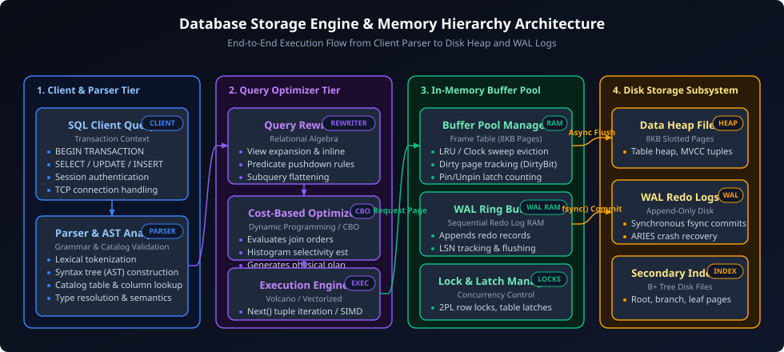

<details>
<summary>View D2 Source</summary>

```d2
direction: right
title: Database Storage Engine & Memory Hierarchy Architecture

client: 1. Client & Parser Tier {
  sql: SQL Client Query Execution
  parser: Parser & AST Analyzer
  sql -> parser: "SQL String"
}

optimizer: 2. Query Optimizer Tier {
  rewriter: Query Rewriter (Predicate Pushdown)
  cbo: Cost-Based Optimizer (CBO)
  executor: Execution Engine (Volcano / SIMD)
  rewriter -> cbo -> executor
}

buffer_pool: 3. In-Memory Buffer Pool {
  bpm: Buffer Pool Manager (8KB Pages, Clock Sweep)
  wal_buffer: WAL Ring Buffer (LSN Tracking)
  lock_mgr: Lock & Latch Manager (2PL Concurrency)
}

disk: 4. Disk Storage Subsystem {
  heap: Table Heap Files (Slotted Pages)
  wal: WAL Redo Logs (Append-Only fsync)
  indexes: Secondary Indexes (B+ Tree)
}

client.parser -> optimizer.rewriter: "AST"
optimizer.executor -> buffer_pool.bpm: "Request Page"
buffer_pool.bpm -> disk.heap: "Checkpointer Flush"
buffer_pool.wal_buffer -> disk.wal: "Synchronous fsync"
```
</details>

---

## Table of Contents
1. [Physical Storage Engines & Architecture](#1-physical-storage-engines--architecture)
   - [1.1 OLTP vs. OLAP Architecture](#11-oltp-vs-olap-architecture)
   - [1.2 Row-Oriented vs. Column-Oriented Physical Storage](#12-row-oriented-vs-column-oriented-physical-storage)
   - [1.3 Relational vs. NoSQL Database Paradigms](#13-relational-vs-nosql-database-paradigms)
   - [1.4 Database Normalization (1NF, 2NF, 3NF, BCNF)](#14-database-normalization-1nf-2nf-3nf-bcnf)
   - [1.5 Denormalization & Analytical Modeling Trade-offs](#15-denormalization--analytical-modeling-trade-offs)
   - [1.6 Primary Keys, Surrogate Keys, Natural Keys & High-Throughput Key Generation](#16-primary-keys-surrogate-keys-natural-keys--high-throughput-key-generation)
   - [1.7 Foreign Keys & Referential Integrity Constraints](#17-foreign-keys--referential-integrity-constraints)
   - [1.8 Unique Constraints, Check Constraints & Composite Rules](#18-unique-constraints-check-constraints--composite-rules)
   - [1.9 Slotted Page Physical Storage Architecture](#19-slotted-page-physical-storage-architecture)
   - [1.10 Storage Engine Showdown: B+ Trees vs. LSM-Trees](#110-storage-engine-showdown-b-trees-vs-lsm-trees)
   - [1.11 The LSM-Tree Deep-Dive: MemTable, SSTables, Bloom Filters & Compaction](#111-the-lsm-tree-deep-dive-memtable-sstables-bloom-filters--compaction)
   - [1.12 Buffer Pool Management & Page Eviction Algorithms](#112-buffer-pool-management--page-eviction-algorithms)
   - [1.13 Write-Ahead Logging (WAL) & The ARIES Crash Recovery Protocol](#113-write-ahead-logging-wal--the-aries-crash-recovery-protocol)
2. [Indexing Mechanisms & Physical Access Paths](#2-indexing-mechanisms--physical-access-paths)
   - [2.1 Indexing Fundamentals & B+ Tree Mechanics](#21-indexing-fundamentals--b-tree-mechanics)
   - [2.2 B+ Tree Fan-Out Mathematics & Page-Level Sizing](#22-b-tree-fan-out-mathematics--page-level-sizing)
   - [2.3 Specialized Index Topologies: Hash, GiST, GIN, and BRIN](#23-specialized-index-topologies-hash-gist-gin-and-brin)
   - [2.4 Composite Indexes & The Leading-Edge Leftmost Rule](#24-composite-indexes--the-leading-edge-leftmost-rule)
   - [2.5 Covering Indexes & Index-Only Scans (The INCLUDE Clause)](#25-covering-indexes--index-only-scans-the-include-clause)
   - [2.6 Clustered Indexes vs. Heap-Organized Tables with Secondary Indexes](#26-clustered-indexes-vs-heap-organized-tables-with-secondary-indexes)
   - [2.7 Index Selectivity & Cardinality Thresholds](#27-index-selectivity--cardinality-thresholds)
   - [2.8 Physical Access Path Taxonomy: Seq Scan, Index Scan, Index-Only Scan, Bitmap Scan](#28-physical-access-path-taxonomy-seq-scan-index-scan-index-only-scan-bitmap-scan)
   - [2.9 When Indexes Degrade Performance & Production Anti-Patterns](#29-when-indexes-degrade-performance--production-anti-patterns)
3. [Query Performance & Cost-Based Optimization](#3-query-performance--cost-based-optimization)
   - [3.1 The Query Execution Pipeline (Parser, Rewriter, CBO, Executor)](#31-the-query-execution-pipeline-parser-rewriter-cbo-executor)
   - [3.2 Cost-Based Optimization (CBO) Architecture (Dynamic Programming vs. Cascades)](#32-cost-based-optimization-cbo-architecture-dynamic-programming-vs-cascades)
   - [3.3 Database Statistics, Histograms & Cardinality Estimation Errors](#33-database-statistics-histograms--cardinality-estimation-errors)
   - [3.4 Optimization Primitives: Predicate Pushdown, Projection Pushdown & Partition Pruning](#34-optimization-primitives-predicate-pushdown-projection-pushdown--partition-pruning)
   - [3.5 Physical Join Algorithms: Nested Loop, Hash Join, Merge Sort Join](#35-physical-join-algorithms-nested-loop-hash-join-merge-sort-join)
   - [3.6 Execution Engine Models: Volcano Iterator vs. Vectorized SIMD vs. Whole-Stage JIT](#36-execution-engine-models-volcano-iterator-vs-vectorized-simd-vs-whole-stage-jit)
   - [3.7 Forensic EXPLAIN & EXPLAIN ANALYZE Mastery](#37-forensic-explain--explain-analyze-mastery)
4. [Transactions, Concurrency Control & MVCC](#4-transactions-concurrency-control--mvcc)
   - [4.1 ACID Guarantees & Hardware Failure Boundaries](#41-acid-guarantees--hardware-failure-boundaries)
   - [4.2 ANSI SQL Isolation Levels & Concurrency Anomalies Matrix](#42-ansi-sql-isolation-levels--concurrency-anomalies-matrix)
   - [4.3 Multi-Version Concurrency Control (MVCC) Internals (PostgreSQL vs. MySQL InnoDB)](#43-multi-version-concurrency-control-mvcc-internals-postgresql-vs-mysql-innodb)
   - [4.4 Tuple Visibility, Dead Tuples & The AUTOVACUUM Engine](#44-tuple-visibility-dead-tuples--the-autovacuum-engine)
   - [4.5 Deadlocks, Two-Phase Locking (2PL) & Lock vs. Latch Hierarchies](#45-deadlocks-two-phase-locking-2pl--lock-vs-latch-hierarchies)
5. [Distributed Computing Principles](#5-distributed-computing-principles)
   - [5.1 MapReduce Paradigm: Foundations & Mechanics](#51-mapreduce-paradigm-foundations--mechanics)
   - [5.2 CAP Theorem: Formal Proof & Reality](#52-cap-theorem-formal-proof--reality)
   - [5.3 PACELC Theorem: Trade-Offs in Normal Operations](#53-pacelc-theorem-trade-offs-in-normal-operations)
   - [5.4 Consensus Algorithms: Raft & Paxos Internals](#54-consensus-algorithms-raft--paxos-internals)
   - [5.5 Distributed Locks & Fencing Tokens](#55-distributed-locks--fencing-tokens)
   - [5.6 Leader Election & Split-Brain Mitigation](#56-leader-election--split-brain-mitigation)
   - [5.7 Heartbeats, Failure Detection & Gossip Protocols](#57-heartbeats-failure-detection--gossip-protocols)
6. [Distributed Data Architecture](#6-distributed-data-architecture)
   - [6.1 Horizontal vs. Vertical Scaling: Hardware Limits & Amdahl's Law](#61-horizontal-vs-vertical-scaling-hardware-limits--amdahls-law)
   - [6.2 Sharding vs. Partitioning: Topologies & Key Selection](#62-sharding-vs-partitioning-topologies--key-selection)
   - [6.3 Consistent Hashing & Virtual Nodes (V-Nodes)](#63-consistent-hashing--virtual-nodes-v-nodes)
   - [6.4 Database Replication Topologies: Single-Leader, Multi-Leader & Leaderless](#64-database-replication-topologies-single-leader-multi-leader--leaderless)
   - [6.5 Replication Lag & Consistency Guarantees](#65-replication-lag--consistency-guarantees)
   - [6.6 Quorum Mathematics: Overlaps & Tunable Consistency ($W + R > N$)](#66-quorum-mathematics-overlaps--tunable-consistency-w--r--n)
   - [6.7 Consistency Spectrum: Linearizability to Eventual Consistency](#67-consistency-spectrum-linearizability-to-eventual-consistency)
7. [API Protocols & Communication Architectures](#7-api-protocols--communication-architectures)
   - [7.1 REST vs. GraphQL vs. gRPC: Wire Protocols & Benchmarks](#71-rest-vs-graphql-vs-grpc-wire-protocols--benchmarks)
   - [7.2 HTTP Methods, Idempotency & Resilient Status Code Handling](#72-http-methods-idempotency--resilient-status-code-handling)
8. [API Authentication & Security](#8-api-authentication--security)
   - [8.1 API Keys & Bearer Tokens (Cryptographic JWT Anatomy)](#81-api-keys--bearer-tokens-cryptographic-jwt-anatomy)
   - [8.2 OAuth 2.0 Client Credentials Grant for M2M Pipelines](#82-oauth-20-client-credentials-grant-for-m2m-pipelines)
   - [8.3 Mutual TLS (mTLS) for Zero Trust Pipeline Ingress](#83-mutual-tls-mtls-for-zero-trust-pipeline-ingress)
9. [Rate Limiting, Throttling & Pipeline Resilience](#9-rate-limiting-throttling--pipeline-resilience)
   - [9.1 Rate Limiting Algorithms: Token Bucket vs. Leaky Bucket vs. Sliding Window](#91-rate-limiting-algorithms-token-bucket-vs-leaky-bucket-vs-sliding-window)
   - [9.2 Exponential Backoff with Full Jitter: Mathematical Proof](#92-exponential-backoff-with-full-jitter-mathematical-proof)
   - [9.3 Circuit Breaker Design Pattern for Upstream Fault Isolation](#93-circuit-breaker-design-pattern-for-upstream-fault-isolation)
10. [Modern Integration Paradigms](#10-modern-integration-paradigms)
   - [10.1 Webhooks vs. Long Polling vs. Server-Sent Events (SSE)](#101-webhooks-vs-long-polling-vs-server-sent-events-sse)
   - [10.2 Cryptographic Webhook Signature Verification & Idempotency Keys](#102-cryptographic-webhook-signature-verification--idempotency-keys)
   - [10.3 Reverse ETL: Architecture, Diff Computation & Sync Mechanics](#103-reverse-etl-architecture-diff-computation--sync-mechanics)
   - [10.4 Managed Data Integration Platforms: Fivetran vs. Airbyte vs. Custom](#104-managed-data-integration-platforms-fivetran-vs-airbyte-vs-custom)
11. [Summary Comparison & Production Engineering Reference Matrix](#11-summary-comparison--production-engineering-reference-matrix)
12. [References & Further Reading](#12-references--further-reading)

> [!TIP]
> **Deep-Dive Interview Scenarios:**
> - [Q3. Hadoop Ecosystem Core Components & MapReduce vs Spark Architecture](frequently_asked_questions/04_database_internals_and_distributed_systems_faq.md#q3-easy-hadoop-ecosystem-core-components--mapreduce-vs-spark-architecture)
> - [Q4. RecordReader and Combiner Internal Mechanics](frequently_asked_questions/04_database_internals_and_distributed_systems_faq.md#q4-medium-recordreader-and-combiner-internal-mechanics)
> - [Q5. Hive Metastore Architecture: Managed vs External Tables](frequently_asked_questions/04_database_internals_and_distributed_systems_faq.md#q5-easy-hive-metastore-architecture-managed-vs-external-tables)
> - [Q15. Distributed Streaming Decision Matrix: Kafka vs Kinesis vs Pub/Sub](frequently_asked_questions/04_database_internals_and_distributed_systems_faq.md#q15-easy-distributed-streaming-decision-matrix-kafka-vs-kinesis-vs-pubsub)
---

# 1. Physical Storage Engines & Architecture

The storage engine is the software subsystem responsible for persisting, indexing, reading, and locking structured data on non-volatile block devices (NVMe SSDs, magnetic hard drives, or distributed object storage).

---

### 1.1 OLTP vs. OLAP Architecture

#### 1. Mental Model & Real-World Analogy
- **OLTP (Online Transaction Processing):** Imagine an express grocery checkout scanner. A customer swipes items one by one: scan, update inventory, deduct bank balance, print receipt. It handles millions of tiny, sub-millisecond atomic transactions simultaneously.
- **OLAP (Online Analytical Processing):** Imagine a retail supply-chain analyst reviewing sales across 2,000 stores over the last 5 years to predict holiday inventory demand. The analyst does not care about one shopper's receipt; they need to scan 500 million rows, calculate aggregates (`SUM`, `AVG`), and group by region.

#### Detailed Architecture Comparison Matrix

| Evaluation Dimension | OLTP (Operational) | OLAP (Analytical) |
| :--- | :--- | :--- |
| **Primary Workload** | High-concurrency, short, atomic transactions. | Batch queries, complex aggregations, reporting. |
| **Data Access Pattern** | Point reads/writes by Primary Key (`WHERE id = ?`). | Scans of millions to billions of rows over few columns. |
| **Query Latency** | **Sub-millisecond to 10 ms.** | **Seconds to minutes.** |
| **Concurrency Target** | $10,000+$ concurrent users/connections. | $10 - 100$ concurrent analytical queries. |
| **Data Modeling** | Highly Normalized (3NF / BCNF). | Denormalized (Star Schema, Snowflake, OBT). |
| **Physical Storage** | Row-oriented slotted disk blocks (8 KB / 16 KB). | Columnar chunks (Parquet, ORC, Capacitor). |
| **Hardware Bottleneck**| Random I/O disk seeks, lock contention, memory latches. | Memory bandwidth, CPU SIMD throughput, network shuffle. |

---

### 1.2 Row-Oriented vs. Column-Oriented Physical Storage

#### 1. Mental Model & Physical Serialization
How data is serialized onto non-volatile storage blocks dictates query efficiency:
- **Row-Oriented:** Data is packed sequentially row by row: `[Row 1: ID, Name, Age, Zip] [Row 2: ID, Name, Age, Zip]`.
- **Column-Oriented:** Data is serialized column by column: `[Col ID: R1, R2...] [Col Name: R1, R2...] [Col Age: R1, R2...]`.

#### 2. Hardware Cache & Memory Bus Impact
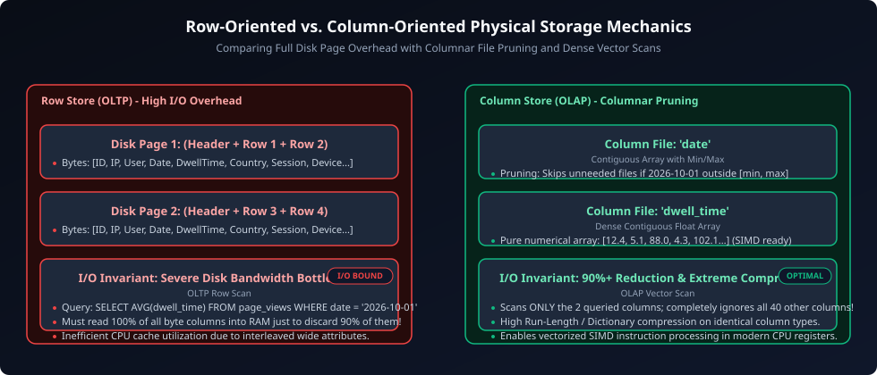

<details>
<summary>View D2 Source</summary>

```d2
direction: right
title: Row-Oriented vs. Column-Oriented Storage Mechanics

target_query: "Target Query: SELECT AVG(dwell_time) FROM page_views WHERE date = '2026-10-01'"

row_store: Row Store (OLTP) - High I/O Overhead {
  p1: "Page 1: [ID, IP, User, Date, DwellTime, Country, Session, Device...]"
  p2: "Page 2: [ID, IP, User, Date, DwellTime, Country, Session, Device...]"
  result: "Must scan 100% of bytes off disk -> Severe I/O Bottleneck"
  p1 -> result
  p2 -> result
}

col_store: Column Store (OLAP) - Columnar Pruning {
  c_date: "Column File 'date' (Min/Max Header Stats -> File Pruning)"
  c_dwell: "Column File 'dwell_time' (Dense Contiguous Float Array)"
  result: "Scans ONLY 2 target columns -> 90%+ I/O Reduction & High Compression"
  c_date -> result
  c_dwell -> result
}
```
</details>

---

### 1.3 Relational vs. NoSQL Database Paradigms

NoSQL systems prioritize horizontal scalability, schema flexibility, and partition tolerance by relaxing ACID guarantees.

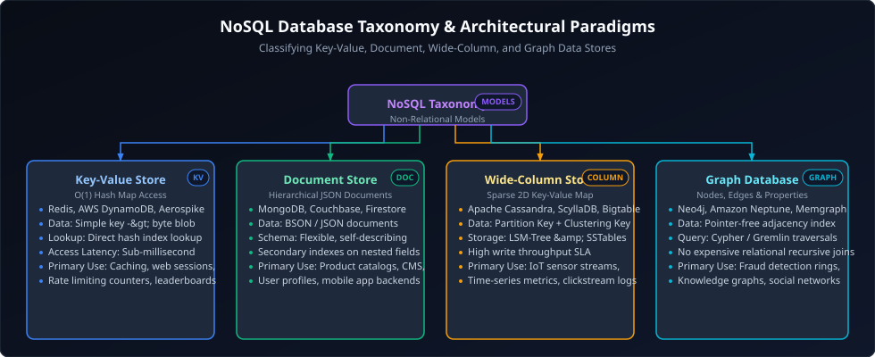

<details>
<summary>View D2 Source</summary>

```d2
direction: down
title: NoSQL Database Taxonomy & Architectural Paradigms

nosql: NoSQL Taxonomy {
  shape: rectangle
}

kv: Key-Value Store {
  examples: "Redis, AWS DynamoDB"
  use: "Caches, Sessions, Rate Limiters"
}

doc: Document Store {
  examples: "MongoDB, Couchbase"
  use: "JSON Catalogs, Content Management"
}

col: Wide-Column Store {
  examples: "Apache Cassandra, ScyllaDB, Bigtable"
  use: "IoT Telemetry, High-Throughput Time-Series"
}

graph: Graph Database {
  examples: "Neo4j, Amazon Neptune"
  use: "Fraud Rings, Knowledge Graphs, Social Graphs"
}

nosql -> kv
nosql -> doc
nosql -> col
nosql -> graph
```
</details>

#### Comparison Matrix: Relational vs. NoSQL

| Dimension | Relational (RDBMS) | NoSQL (Distributed) |
| :--- | :--- | :--- |
| **Data Model** | Strict tabular schemas, foreign keys, 3NF. | Key-value, nested JSON documents, wide-column, graph. |
| **Schema Paradigm** | Schema-on-Write (`ALTER TABLE`). | Schema-on-Read / Dynamic Schema. |
| **Scaling Mechanism**| Vertical (Scale-Up), read replicas. | Horizontal (Scale-Out via partitioning / sharding). |
| **Consistency** | Immediate ACID consistency. | BASE (Basically Available, Soft-state, Eventual consistency). |
| **Query Engine** | Standard declarative SQL, cost-based optimizer. | Key-based lookups, proprietary APIs (CQL, MQL, Cypher). |

---

### 1.4 Database Normalization (1NF, 2NF, 3NF, BCNF)

Normalization systematically removes redundancy and eliminates insertion, update, and deletion anomalies.

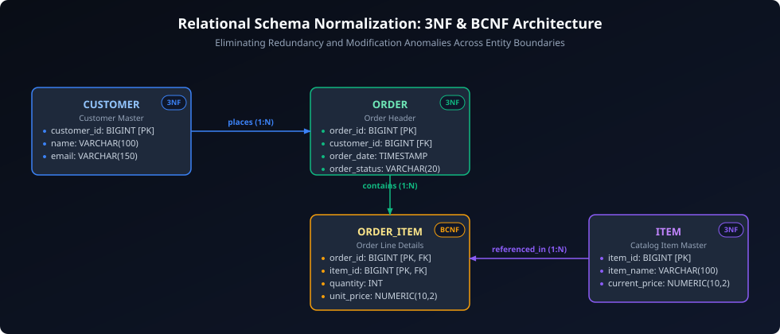

<details>
<summary>View D2 Source</summary>

```d2
direction: right
title: Relational Schema Normalization: 3NF & BCNF Architecture

customer: CUSTOMER {
  shape: sql_table
  customer_id: bigint [pk]
  name: varchar
  email: varchar
}

order: ORDER {
  shape: sql_table
  order_id: bigint [pk]
  customer_id: bigint [fk]
  order_date: timestamp
}

order_item: ORDER_ITEM {
  shape: sql_table
  order_id: bigint [pk, fk]
  item_id: bigint [pk, fk]
  quantity: int
  unit_price: numeric
}

item: ITEM {
  shape: sql_table
  item_id: bigint [pk]
  item_name: varchar
  current_price: numeric
}

customer -> order: "places (1:N)"
order -> order_item: "contains (1:N)"
item -> order_item: "referenced_in (1:N)"
```
</details>

#### Normalization Hierarchy & Mathematical Rules:
1. **First Normal Form (1NF):**
   - Each column contains atomic (indivisible) values.
   - No arrays, lists, or multi-valued attributes in a single cell.
   - A primary key uniquely identifies each row.
2. **Second Normal Form (2NF):**
   - Meets 1NF.
   - Eliminates **Partial Dependencies**: All non-key attributes must depend on the *entire* primary key, not a proper subset of a composite key.
3. **Third Normal Form (3NF):**
   - Meets 2NF.
   - Eliminates **Transitive Dependencies**: Non-key attributes must depend *only* on candidate keys ($X \rightarrow Y \rightarrow Z$ is prohibited).
4. **Boyce-Codd Normal Form (BCNF):**
   - Stricter form of 3NF.
   - For *every* non-trivial functional dependency $X \rightarrow Y$, $X$ must be a **Super Key**.

---

### 1.5 Denormalization & Analytical Modeling Trade-offs

While OLTP requires 3NF to avoid update anomalies, OLAP intentionally denormalizes schemas (Star Schemas, Snowflake Schemas, One Big Table) to eliminate distributed network joins.

| Metric | Normalized (3NF - OLTP) | Denormalized (Star / OBT - OLAP) |
| :--- | :--- | :--- |
| **Write Performance** | **Fastest:** Single-row in-place updates. | **Slow:** Updating one attribute requires rewriting many rows. |
| **Read Performance** | **Slower:** Requires joining 10–20 tables. | **Fastest:** Pre-joined; zero or few joins at query time. |
| **Redundancy** | Zero redundancy. | High redundancy (strings repeated across millions of rows). |
| **Disk Consumption** | Smallest uncompressed footprint. | Mitigated by columnar dictionary compression. |

---

### 1.6 Primary Keys, Surrogate Keys, Natural Keys & High-Throughput Key Generation

A Primary Key enforces entity uniqueness. However, the architectural choice of key generation has severe physical storage implications.

| Key Architecture Strategy | Bit / Byte Size | Generation Mechanics | B+ Tree Page Split Risk | Security & Business Leakage | Optimal Production Scenario |
| :--- | :---: | :--- | :--- | :--- | :--- |
| **Natural Key** | Variable (String / Num) | Derived from domain business attribute (SSN, VIN, Email). | High if natural strings are inserted out-of-order. | **Severe:** Exposes PII directly; mutable if user updates email. | Small reference tables with immutable, standardized codes (e.g., ISO currency codes). |
| **Auto-Increment (`BIGINT`)** | 8 bytes | Central database sequence / `IDENTITY` counter (`1, 2, 3...`). | **Zero:** Monotonically increasing; appends to the rightmost leaf page. | **High:** Sequential IDs leak order volume, customer counts, and rate to competitors. | Monolithic single-node OLTP databases where ID secrecy is irrelevant. |
| **Random UUID v4** | 16 bytes (128 bits) | Cryptographically pseudo-random bits with zero ordering. | **Catastrophic (50% splits):** Inserts hit random pages, forcing continuous B+ Tree splits and buffer pool thrashing. | Zero leakage; globally unique without coordination. | Distributed systems where keys are never used as clustered B+ Tree primary keys. |
| **Time-Ordered UUID v7 / ULID** | 16 bytes (128 bits) | 48-bit Unix epoch millisecond timestamp + 74-bit monotonic random bits. | **Zero:** Monotonically sorted by generation timestamp; appends cleanly to B+ Tree. | High security (random suffix prevents guessing); zero coordination needed. | **Modern Enterprise Standard:** High-throughput microservices, distributed sharding, and event streaming. |

#### Code Example: Time-Ordered UUIDv7 Implementation
```sql
-- Creating an account table using modern identity surrogate keys
CREATE TABLE crm.accounts (
    account_id BIGINT GENERATED ALWAYS AS IDENTITY,
    account_uuid UUID DEFAULT gen_random_uuid(), -- Or uuid_generate_v7()
    company_name VARCHAR(120) NOT NULL,
    created_at TIMESTAMPTZ DEFAULT CURRENT_TIMESTAMP,
    CONSTRAINT pk_accounts PRIMARY KEY (account_id)
);
```

---

### 1.7 Foreign Keys & Referential Integrity Constraints

Foreign keys establish parent-child relationships and enforce referential integrity across relational entities.

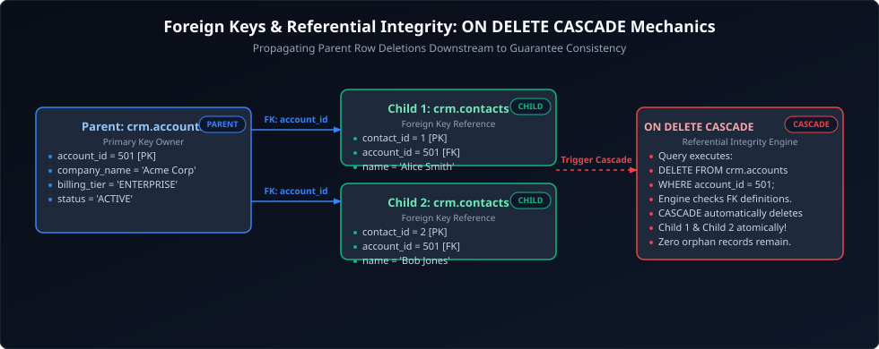

<details>
<summary>View D2 Source</summary>

```d2
direction: right
title: Foreign Keys & Referential Integrity: ON DELETE CASCADE

parent: Parent: crm.accounts {
  account_id: "501 [PK]"
  company: "Acme Corp"
}

child1: Child 1: crm.contacts {
  contact_id: "1 [PK]"
  account_id: "501 [FK]"
}

child2: Child 2: crm.contacts {
  contact_id: "2 [PK]"
  account_id: "501 [FK]"
}

delete_op: DELETE FROM crm.accounts WHERE account_id = 501 {
  style.stroke: "#ef4444"
}

cascade_action: ON DELETE CASCADE {
  action: "Deletes Child 1 & Child 2 Automatically"
  style.stroke: "#ef4444"
}

parent -> child1: "Referenced by FK"
parent -> child2: "Referenced by FK"
delete_op -> cascade_action: "Triggers cascade"
cascade_action -> child1: "Drops"
cascade_action -> child2: "Drops"
```
</details>

#### Production DDL with Cascade Policies:
```sql
CREATE TABLE crm.contacts (
    contact_id BIGINT PRIMARY KEY,
    account_id BIGINT NOT NULL,
    first_name VARCHAR(50) NOT NULL,
    email VARCHAR(100) NOT NULL,
    CONSTRAINT fk_contacts_account 
        FOREIGN KEY (account_id) 
        REFERENCES crm.accounts (account_id)
        ON DELETE CASCADE
        ON UPDATE RESTRICT
);

-- CRITICAL RULE: Always create an index on Foreign Key columns!
-- Relational engines do NOT automatically index foreign key columns.
CREATE INDEX idx_contacts_account_id ON crm.contacts (account_id);
```

---

### 1.8 Unique Constraints, Check Constraints & Composite Rules

```sql
CREATE TABLE billing.subscriptions (
    subscription_id BIGINT PRIMARY KEY,
    user_id BIGINT NOT NULL,
    plan_code VARCHAR(32) NOT NULL,
    monthly_rate NUMERIC(10, 2) NOT NULL,
    discount_percentage NUMERIC(5, 2) DEFAULT 0.00,
    start_date DATE NOT NULL,
    end_date DATE,
    -- Unique constraint preventing duplicate active subscriptions per user
    CONSTRAINT uq_user_plan UNIQUE (user_id, plan_code),
    -- Domain check constraints enforcing business bounds
    CONSTRAINT chk_positive_rate CHECK (monthly_rate >= 0),
    CONSTRAINT chk_valid_discount CHECK (discount_percentage >= 0 AND discount_percentage <= 100),
    CONSTRAINT chk_valid_date_range CHECK (end_date IS NULL OR end_date >= start_date)
);
```

---

### 1.9 Slotted Page Physical Storage Architecture

In traditional relational engines (PostgreSQL, MySQL InnoDB, SQLite), disk I/O occurs in fixed-size blocks called **Pages** (8 KB in PostgreSQL, 16 KB in InnoDB).

Because tuples vary in length, engines implement the **Slotted Page Architecture**:

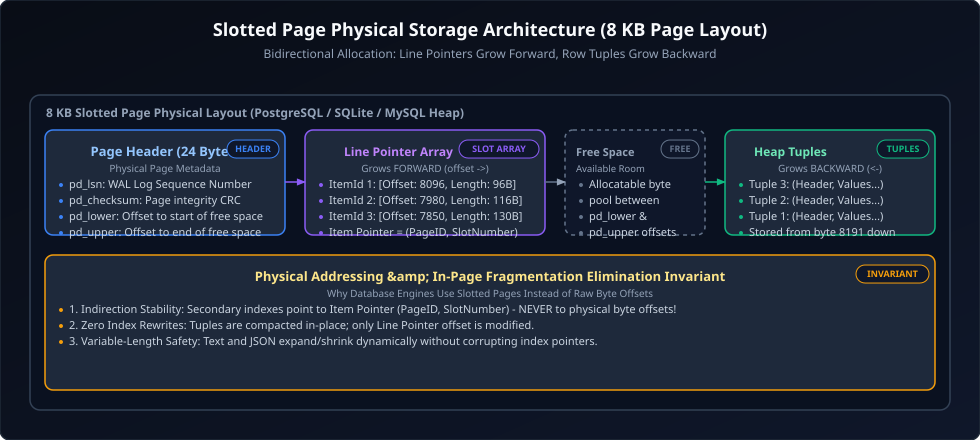

<details>
<summary>View D2 Source</summary>

```d2
direction: right
title: 8 KB Slotted Page Physical Storage Architecture

page: 8 KB Slotted Page Layout {
  header: Page Header (24 Bytes) {
    lsn: "pd_lsn: WAL Log Sequence Number"
    pointers: "pd_lower (start free), pd_upper (end free)"
  }
  slots: Line Pointers / Slot Array {
    direction: "Grows FORWARD from byte 24 ->"
    slot1: "Slot 1: Offset 8096, Length 96B"
    slot2: "Slot 2: Offset 7980, Length 116B"
  }
  free_space: Free Space Hole {
    status: "Allocatable unfragmented bytes"
    style.stroke-dash: 4
  }
  tuples: Heap Tuples / Records {
    direction: "Grows BACKWARD from byte 8191 <-"
    t1: "Tuple 1 (Byte 8096..8191)"
    t2: "Tuple 2 (Byte 7980..8095)"
  }
  header -> slots: "Grows forward"
  slots -> free_space
  free_space -> tuples: "Grows backward"
}
```
</details>

#### Why the Slotted Page Design is Brilliant:
1. **Stable Physical Row Identifier (Tuple ID / ItemPointer):** A row's physical address is designated as a `(PageNumber, SlotNumber)` pair (e.g., in PostgreSQL, `ctid = (42, 3)`).
2. **Defragmentation Without Rewriting Secondary Indexes:** If Tuple 2 expands in size, the engine shifts Tuple 3 downward into the free space gap. The engine only updates `Slot 2's` internal byte offset inside the page header. Outside secondary indexes still point to `(Page 42, Slot 2)`. Secondary indexes do not need to be rewritten!

---

### 1.10 Storage Engine Showdown: B+ Trees vs. LSM-Trees

Storage engines form the physical core of database architectures, translating logical relational tuples or key-value pairs into bytes stored across memory hierarchies and non-volatile storage (NVMe SSDs, persistent disks, cloud object stores). Modern systems overwhelmingly converge on two primary storage engine paradigms: **B+ Trees** (in-place updates) and **Log-Structured Merge-Trees (LSM-Trees)** (append-only writes).

#### The RUM Conjecture: Fundamental Storage Trade-Offs
Formulated by Athanassoulis et al. (Harvard DASlab), the **RUM Conjecture** dictates that no storage engine can simultaneously optimize for all three fundamental data access properties:
1. **R (Read Latency & Overhead):** Time and I/O operations required to locate and return point lookups ($O(1)$ to $O(\log N)$) and scan range intervals.
2. **U (Update Cost & Write Amplification):** CPU, bus bandwidth, and non-volatile storage writes generated per logical mutation.
3. **M (Memory & Storage Space Amplification):** Physical capacity consumed on disk and DRAM footprint relative to the raw payload size, including fragmentation, fill-factor slack, and stale versions.

Optimizing any two parameters inevitably compromises the third. B+ Trees prioritize **Read Latency** and **Space Efficiency** at the expense of **Update Cost** (high write amplification). Conversely, LSM-Trees prioritize **Update Throughput** and **Write Amplification** at the expense of **Read Latency** and temporary **Space Amplification**.

#### Architectural Mechanics: In-Place vs. Append-Only
- **B+ Tree Mechanics (In-Place Page Mutation):**
  - **Organization:** Balanced multi-way search trees structured into fixed-size physical pages (typically 8KB in PostgreSQL, 16KB in MySQL InnoDB).
  - **Write Behavior:** Updating a single 20-byte attribute requires locating the containing leaf page in the Buffer Pool, modifying the bytes in RAM, and subsequently flushing the entire 8KB/16KB page to disk during dirty page checkpointing.
  - **Write Amplification ($WA$):** $WA = \frac{\text{Bytes Written to Storage}}{\text{Bytes Written by Application}}$. In B+ Trees, modifying 20 bytes results in writing a 16KB dirty page (plus WAL writes), yielding a write amplification factor easily exceeding $20\times - 80\times$.
  - **Read Efficiency:** Reads are deterministic. Navigating from the in-memory root down internal branch nodes to the target leaf page requires exactly $H$ page lookups ($H \approx 3 - 4$ for tens of millions of rows), resulting in minimal CPU cache misses and deterministic sub-millisecond point lookups.

- **LSM-Tree Mechanics (Out-of-Place Append-Only):**
  - **Organization:** Tiered architecture separating an in-memory mutable buffer (`MemTable`) from layered on-disk immutable sorted files (`SSTables`).
  - **Write Behavior:** All inserts, updates, and deletes (`tombstones`) append sequentially to an append-only Write-Ahead Log (WAL) on disk and insert into the `MemTable` (Concurrent SkipList). Disk writes remain strictly sequential, bypassing random-access seek latencies.
  - **Compaction & Read Trade-Offs:** As `MemTables` fill, they flush sequentially as level-0 ($L_0$) SSTables. Because a given key can exist across multiple SSTables across different levels, read operations must probe multiple files in reverse chronological order (mitigated by in-memory **Bloom filters** and sparse indexes). Background **Compaction** threads continuously merge-sort overlapping SSTables, purging tombstones and deduplicating superseded versions.

#### Detailed Architecture Comparison Matrix

| Evaluation Dimension | B+ Tree (Read-Heavy / OLTP) | LSM-Tree (Log-Structured Merge / Write-Heavy) |
| :--- | :--- | :--- |
| **Write Mechanism** | **In-Place Updates:** Directly overwrites bytes inside 8KB/16KB slotted pages on disk. | **Append-Only:** Writes to an in-memory buffer (`MemTable`) and an append-only WAL. |
| **Write Amplification (WA)**| **High (10x–50x):** Modifying a 20-byte record forces writing the entire 8KB/16KB page to disk. | **Low to Moderate:** Batched sequential writes during SSTable flushing and background compaction. |
| **Read Latency (Point)** | **Lowest ($O(\log N)$):** Single tree traversal directly down to the target leaf page. | **Higher ($O(K \cdot \log N)$):** Must probe MemTable, plus $K$ levels of SSTables (mitigated by Bloom filters). |
| **Range Query Latency** | **Optimal:** Leaf pages form a contiguous doubly-linked list on disk. | **Moderate:** Requires an external $K$-way merge iterator across multiple SSTables. |
| **Space Amplification (SA)**| **Moderate:** Internal page fragmentation from fill-factor gaps (often 25–40% empty space). | **Variable:** Dead versions and deleted tombstones remain on disk until background compaction runs. |
| **Storage Substrate** | Excels on fast random-access NVMe SSDs with battery-backed DRAM. | Ideal for write-heavy logging, time-series, cloud object storage, and write-constrained flash. |

---

### 1.11 The LSM-Tree Deep-Dive: MemTable, SSTables, Bloom Filters & Compaction

#### 1. The Write Path
1. **Write-Ahead Log (WAL):** When a write (`PUT key, value` or `DELETE key`) arrives, it is appended to an on-disk sequential log file for crash durability.
2. **MemTable:** The write is immediately inserted into an in-memory concurrent sorted data structure (typically a **SkipList** or Red-Black Tree). The client receives an immediate success response ($O(1)$ latency).
3. **Flushing to L0 SSTable:** When the `MemTable` reaches a threshold (e.g., 64 MB), it transitions to an immutable state, and a background thread flushes its sorted contents sequentially to disk as a **Sorted String Table (SSTable)** in Level 0 ($L_0$).

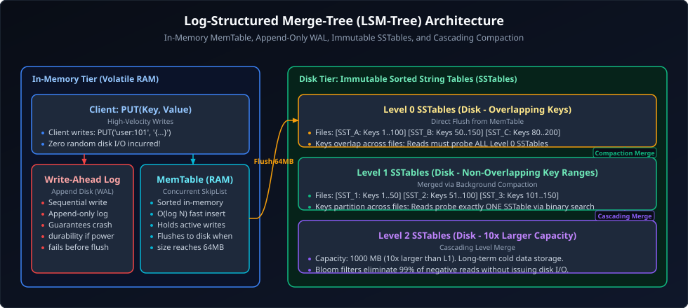

<details>
<summary>View D2 Source</summary>

```d2
direction: right
title: Log-Structured Merge-Tree (LSM-Tree) Architecture

memory: In-Memory Tier {
  client: Client PUT(k, v)
  wal: 1. Append to WAL (Disk) {
    style.stroke: "#ef4444"
  }
  memtable: 2. Insert into MemTable (Concurrent SkipList in RAM) {
    style.stroke: "#06b6d4"
  }
  client -> wal: "Durability fsync"
  client -> memtable: "O(log N) insert"
}

disk: Flush & Compaction Engine {
  l0: Level 0 SSTables (Disk) {
    keys: "Keys overlap across files [1-100] [50-150]"
  }
  l1: Level 1 SSTables (Disk) {
    keys: "Non-overlapping key ranges [1-50] [51-100] [101-150]"
  }
  l2: Level 2 SSTables (Disk - 10x Capacity)
  l0 -> l1: "Compaction Merge"
  l1 -> l2: "Cascading Compaction"
}

memory.memtable -> disk.l0: "When MemTable reaches 64MB"
```
</details>

#### 2. Compaction Strategies: Size-Tiered vs. Leveled Compaction

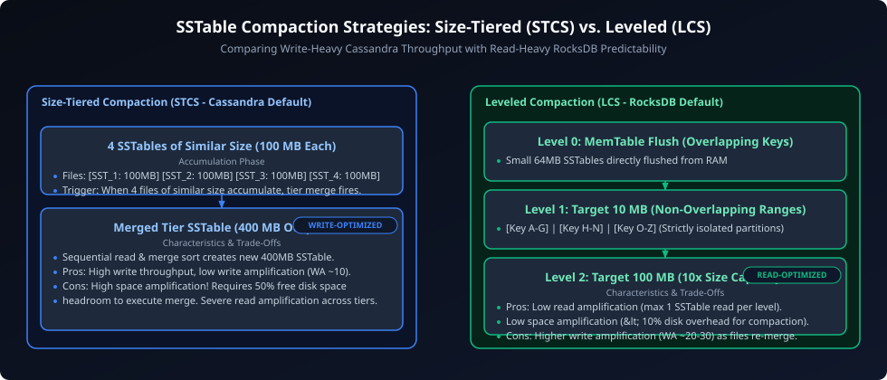

<details>
<summary>View D2 Source</summary>

```d2
direction: right
title: Compaction Strategies: Size-Tiered vs. Leveled

stcs: Size-Tiered Compaction Strategy (STCS - Cassandra Default) {
  files: "Accumulate 4 SSTables of Similar Size (100MB each)"
  merge: "Sequential Read & Merge Sort"
  output: "New Tier SSTable (400MB)"
  tradeoff: "High write throughput, high space amplification (50% headroom needed)"
  files -> merge -> output -> tradeoff
}

lcs: Leveled Compaction Strategy (LCS - RocksDB Default) {
  l0: "Level 0 (MemTable Flush): Overlapping Keys"
  l1: "Level 1 (Target: 10MB): [A-G] | [H-N] | [O-Z] (Non-Overlapping)"
  l2: "Level 2 (Target: 100MB): 10x Capacity, Non-Overlapping"
  tradeoff: "Predictable reads (1 SSTable/level), low space overhead (<10%)"
  l0 -> l1: "Merge"
  l1 -> l2: "Cascading Merge"
  l2 -> tradeoff
}
```
</details>

| Evaluation Dimension | Size-Tiered Compaction (STCS) | Leveled Compaction (LCS) |
| :--- | :--- | :--- |
| **Write Amplification** | **Low to Moderate ($O(\log N)$):** SSTables are only merged when $N$ similarly sized files accumulate. | **High ($O(10 	imes 	ext{Levels})$):** Moving a file from $L_i$ to $L_{i+1}$ requires re-reading and rewriting up to 10 overlapping files. |
| **Space Amplification** | **High ($100\%$ overhead):** In the worst case, compacting the largest tier requires $50\%$ free disk headroom to create the merged SSTable before deleting old ones. | **Low ($10\% - 15\%$ overhead):** Only compacts one small file at a time; disk utilization stays close to $90\%$. |
| **Read Amplification (P99 Latency)** | **Variable / High:** A single point read may need to check multiple SSTables across every tier (mitigated by Bloom filters). | **Low & Predictable:** At most **one** SSTable per level needs to be read because key ranges within $L_1, L_2...$ never overlap. |
| **Optimal Production Workload** | Heavy write-dominated workloads (time-series metrics, append-only sensor logs, bulk ingest). | Read-heavy or mixed workloads requiring tight SLAs on point lookups (OLTP, user profiles, key-value caches). |

---

### 1.12 Buffer Pool Management & Page Eviction Algorithms

Database engines never read or write directly to disk files during query execution. All reads and modifications happen inside an in-memory memory region called the **Buffer Pool** (Shared Buffers in PostgreSQL, Buffer Pool in MySQL InnoDB).

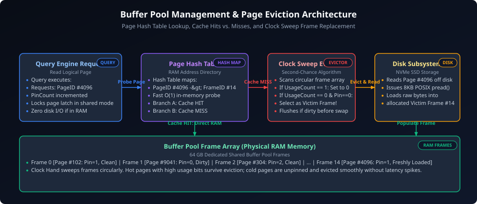

<details>
<summary>View D2 Source</summary>

```d2
direction: right
title: Buffer Pool Management & Page Eviction Algorithms

query: Query Engine Requests Page #4096
hash_table: Page Hash Table (Maps PageID -> FrameID in RAM)
frames: Buffer Pool Frames in RAM (Array of 8KB Page Buffers)
evictor: Clock Sweep / LRU Eviction Engine
disk: Disk Subsystem (NVMe SSD)

query -> hash_table: "Look up PageID"
hash_table -> frames: "Cache Hit: Read Frame in RAM"
hash_table -> evictor: "Cache Miss: Select victim frame"
evictor -> frames: "Evict unpinned frame"
disk -> frames: "Load Page #4096 into victim frame"
```
</details>

#### Eviction Algorithms: LRU vs. Clock Sweep (Second Chance) vs. LRU-K
- **Pure LRU Flaw (Sequential Scan Flooding):** If an analyst runs `SELECT * FROM massive_table`, a pure LRU (Least Recently Used) cache will evict the entire working set of active OLTP indexes and hot rows, replacing them with pages that will only ever be read once.
- **The Clock Sweep (Second-Chance) Algorithm (PostgreSQL):**
  - Frames are arranged in a circular logical buffer with a moving hand.
  - Each frame holds a `usage_count` (0 to 5).
  - When the clock hand inspects a frame:
    - If `pin_count > 0`: Skip (page is active).
    - If `usage_count > 0`: Decrement `usage_count` by 1 and advance hand.
    - If `usage_count == 0`: If the page is clean, evict immediately! If dirty, queue for asynchronous disk flush.

---

### 1.13 Write-Ahead Logging (WAL) & The ARIES Crash Recovery Protocol

#### 1. Why WAL is Mandatory
Writing random 8 KB pages directly to disk on every transaction `COMMIT` would destroy throughput: magnetic heads would thrash, and SSD flash controllers would suffer heavy write amplification. 

Databases operate under the **Steal/No-Force Policy**:
- **NO-FORCE:** The engine does *not* force dirty data pages to disk before committing. A transaction can commit as soon as its small sequential delta is written to the Write-Ahead Log.
- **STEAL:** The buffer pool manager is permitted to "steal" a dirty page from an uncommitted transaction and flush it to disk if memory is completely full.

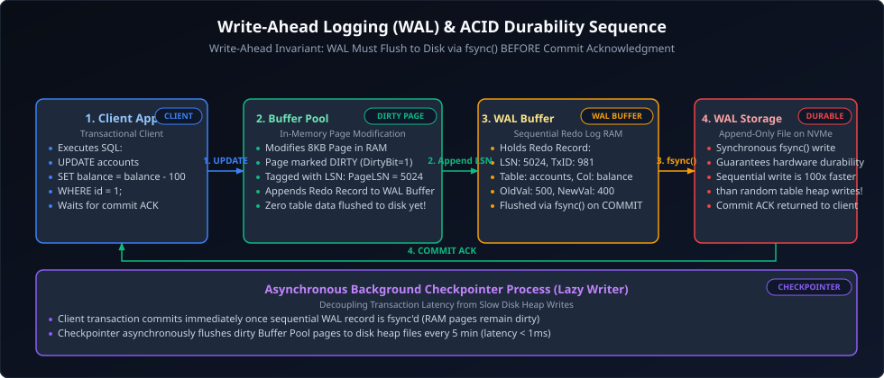

<details>
<summary>View D2 Source</summary>

```d2
direction: right
title: Write-Ahead Logging (WAL) & ACID Durability Sequence

client: Client Application
bp: Buffer Pool (RAM) {
  dirty: "Page modified in RAM (PageLSN = 5024)"
}
wal_buf: WAL Ring Buffer (RAM) {
  record: "Redo record appended with LSN 5024"
}
wal_disk: WAL Disk Files (NVMe) {
  durable: "Synchronous fsync() guarantees durability"
}
table_disk: Data Files (Table Heap Disk)

client -> bp: "1. UPDATE accounts SET balance = balance - 100"
bp -> wal_buf: "2. Write Redo Record (LSN: 5024)"
client -> bp: "3. COMMIT Transaction"
bp -> wal_buf: "Flush WAL Buffer"
wal_buf -> wal_disk: "4. fsync() to Disk"
wal_disk -> client: "5. COMMIT Acknowledged (Durability Guaranteed)"
bp -> table_disk: "Async Lazy Checkpointer Flush" {
  style.stroke-dash: 4
}
```
</details>

#### 2. The ARIES Recovery Algorithm
When a server crashes (power failure, kernel panic), the data files on disk contain an inconsistent mix of uncommitted stolen pages and missing unforced updates. Upon reboot, the database executes the **ARIES (Algorithms for Recovery and Isolation Exploiting Semantics)** protocol:

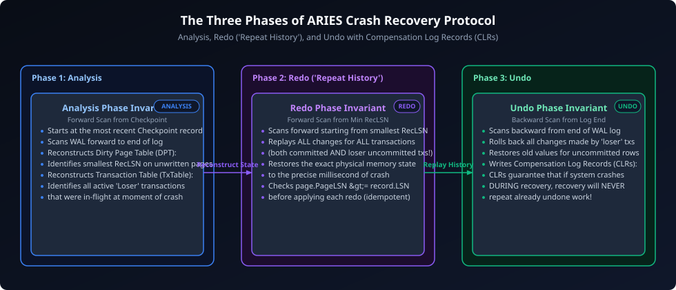

<details>
<summary>View D2 Source</summary>

```d2
direction: right
title: The Three Phases of ARIES Crash Recovery

p1: Phase 1: Analysis {
  action: "Scan WAL forward from latest checkpoint"
  reconstruct: "Reconstruct Dirty Page Table (DPT) & Transaction Table"
  identify: "Identify all active 'loser' transactions"
}

p2: Phase 2: Redo ('Repeat History') {
  action: "Scan forward from smallest RecLSN in DPT"
  replay: "Replay all changes (committed & uncommitted)"
  state: "Restores exact millisecond state of crash"
}

p3: Phase 3: Undo {
  action: "Scan WAL backward from end of log"
  rollback: "Roll back changes made by loser transactions"
  clrs: "Write Compensation Log Records (CLRs) for idempotency"
}

p1 -> p2: "State reconstructed"
p2 -> p3: "History repeated"
```
</details>

> [!TIP]
> **Deep-Dive Interview Scenarios:**
> - [Q7. Ingesting & Transforming 100GB of CSV Files Daily in Synapse](frequently_asked_questions/04_database_internals_and_distributed_systems_faq.md#q7-medium-ingesting--transforming-100gb-of-csv-files-daily-in-synapse)
> - [Q16. Lakehouse Medallion Architecture for Daily Sales Ingestion](frequently_asked_questions/04_database_internals_and_distributed_systems_faq.md#q16-medium-lakehouse-medallion-architecture-for-daily-sales-ingestion)
> - [Q18. Data Lake Storage vs Raw Blob Storage Architectural Evaluation](frequently_asked_questions/04_database_internals_and_distributed_systems_faq.md#q18-easy-data-lake-storage-vs-raw-blob-storage-architectural-evaluation)
> - [Q20. Intermittent "Connection Reset" (`ECONNRESET`) on Idle API Connections](frequently_asked_questions/04_database_internals_and_distributed_systems_faq.md#q20-medium-intermittent-connection-reset-econnreset-on-idle-api-connections)

---

# 2. Indexing Mechanisms & Physical Access Paths

Indexes are auxiliary physical data structures engineered to accelerate data retrieval at the cost of additional storage and write latency.

---

### 2.1 Indexing Fundamentals & B+ Tree Mechanics

#### Definition
Without an index, the database engine must execute a **Full Table Scan (Sequential Scan)**, inspecting every page on disk from start to finish ($O(N)$ time complexity). An index provides a sorted lookup directory that allows the engine to locate matching rows in logarithmic $O(\log N)$ or constant $O(1)$ time.

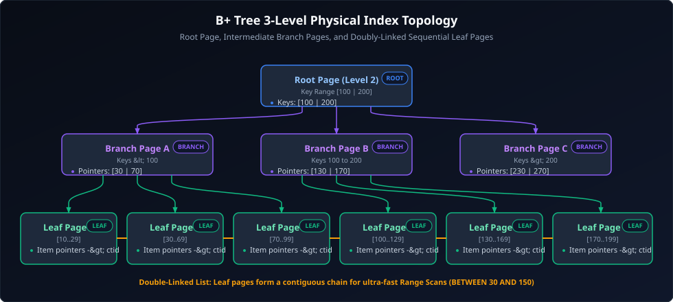

<details>
<summary>View D2 Source</summary>

```d2
direction: down
title: B+ Tree 3-Level Physical Index Topology

root: Root Page (Level 2) {
  keys: "[100 | 200]"
}

branches: Intermediate Branch Pages (Level 1) {
  b1: Branch Page A [30 | 70]
  b2: Branch Page B [130 | 170]
  b3: Branch Page C [230 | 270]
}

leaves: Doubly-Linked Leaf Pages (Level 0) {
  l1: Leaf 1 [10..29]
  l2: Leaf 2 [30..69]
  l3: Leaf 3 [70..99]
  l4: Leaf 4 [100..129]
  l5: Leaf 5 [130..169]
  l6: Leaf 6 [170..199]

  l1 <-> l2: "Double link"
  l2 <-> l3
  l3 <-> l4
  l4 <-> l5
  l5 <-> l6
}

root -> branches.b1
root -> branches.b2
root -> branches.b3

branches.b1 -> leaves.l1
branches.b1 -> leaves.l2
branches.b1 -> leaves.l3
branches.b2 -> leaves.l4
branches.b2 -> leaves.l5
branches.b2 -> leaves.l6
```
</details>

---

### 2.2 B+ Tree Fan-Out Mathematics & Page-Level Sizing

Why can a B+ Tree locate a single record among 100,000,000 rows in just 3 or 4 disk I/O operations?
- Let Page Size = 8 KB ($8,192$ bytes).
- Let Page Header = 24 bytes $\rightarrow$ Usable space $\approx 8,100$ bytes.
- Let Index Key = `BIGINT` (8 bytes) + Child Page Pointer (6 bytes) = 14 bytes per entry.
- **Fan-out ($F$):**
  $$F = \left\lfloor \frac{8,100}{14} \right\rfloor \approx 578 \text{ children per page}$$
- Assuming an average page fill factor of 70% (due to random splits and updates):
  $$\text{Effective Fan-out } (F_{\text{eff}}) = 578 \times 0.70 \approx 404$$

##### Capacity by Tree Height:
- **Height 1 (Root only):** $404$ rows.
- **Height 2 (Root + Leaves):** $404^2 = 163,216$ rows.
- **Height 3 (Root + Branches + Leaves):** $404^3 = \mathbf{65,939,264} \text{ rows!}$
- **Height 4:** $404^4 = \mathbf{26.6 \text{ Billion rows!}}$

Because the Root and Branch pages are constantly referenced, they remain **pinned permanently in the in-memory Buffer Pool RAM**. Thus, finding any row in a table of 65 million rows requires **at most 1 single physical disk read** (to fetch the leaf page)!

---

### 2.3 Specialized Index Topologies: Hash, GiST, GIN, and BRIN

While standard B+ Trees represent the general-purpose workhorse for relational indexing, modern high-scale workloads demand specialized index structures optimized for specific data types, search operators, and hardware storage footprints. Understanding their internal topologies prevents catastrophic full-table scans and excessive index bloat.

#### First-Principles Overview of Specialized Topologies
1. **Hash Index:**
   - **Internal Topology:** Maps column values through an internal 32-bit hash function into discrete disk-backed bucket pages. Collision resolution chains overflow pages when buckets exceed capacity.
   - **Access Pattern:** Guarantees theoretical $O(1)$ point lookups for strict equality (`=`). 
   - **Limitation:** Completely unable to satisfy range queries (`<`, `>`, `BETWEEN`) or sorting (`ORDER BY`) because hash functions intentionally destroy key ordering.

2. **GIN (Generalized Inverted Index):**
   - **Internal Topology:** An inverted index designed for multi-valued and composite data structures (PostgreSQL `JSONB`, `ARRAY`, text tokens). It separates composite values into discrete elemental keys (e.g., individual JSON keys, array elements, or lexemes).
   - **Storage Mechanics:** Maps each unique individual component key to a **posting list** or **posting tree** (a B-tree of `ItemPointer` / `ctid` references). When querying `WHERE tags @> ARRAY['spark', 'kafka']`, GIN performs an intersection scan across the posting lists for `'spark'` and `'kafka'`.
   - **Trade-off:** High write overhead during updates due to multi-entry splitting; mitigated by in-memory pending list buffers.

3. **GiST (Generalized Search Tree):**
   - **Internal Topology:** A height-balanced, extensible tree structure where each internal node holds a user-defined **predicate** (bounding box, convex hull, or range envelope) that evaluates to `true` for all child items in the subtree.
   - **Access Pattern:** Enables spatial indexing (R-Tree semantics in PostGIS), $k$-Nearest Neighbors ($k$-NN) distance calculations (`<->`), and interval overlapping (`&&`). Subtrees whose bounding boxes do not intersect the query geometry are pruned immediately.

4. **BRIN (Block Range Index):**
   - **Internal Topology:** Designed for petabyte-scale, append-only time-series and audit logs where physical disk layout correlates strongly with column values (natural chronological insertion).
   - **Storage Mechanics:** Instead of storing an entry for every individual row (like B+ Trees or GIN), BRIN divides physical table storage into contiguous block ranges (e.g., 128 pages = 1 MB chunks) and stores only two values per range: `[min_value, max_value]`.
   - **Query Execution:** If a query executes `WHERE created_at = '2026-10-19'`, BRIN checks the block range metadata. If the search key falls outside `[min, max]`, the engine completely skips scanning that entire 128-page disk chunk.
   - **Trade-off:** Minimal index size (often less than 0.1% the size of a B-Tree), but yields false-positive block reads requiring post-read tuple filtering.

| Index Topology | Underlying Data Structure | Supported Query Operators | Ideal Use Case | Storage Footprint |
| :--- | :--- | :--- | :--- | :--- |
| **B+ Tree** | Balanced Multi-Way Tree | `=`, `<`, `<=`, `>`, `>=`, `BETWEEN`, `ORDER BY` | Default primary keys, timestamps, numeric ranges | Moderate |
| **Hash Index** | Static Hash Table / Bucket Chains | `=` (Equality only) | Exact match lookups on long UUIDs/strings | Compact |
| **GIN** (Generalized Inverted Index) | Inverted Index (Key $\rightarrow$ Array of Postings) | `@>` (Contains), `&&` (Overlap), Full-Text `to_tsvector` | Searching inside JSONB documents, arrays, full-text search | High |
| **GiST** (Generalized Search Tree) | Balanced Tree with custom predicate splitting | `&&` (Bounding box overlap), `<->` (KNN Distance) | PostGIS geospatial polygons, geometric shapes, range types | Moderate to High |
| **BRIN** (Block Range Index) | Min/Max summary per physical block range (128 pages) | `=`, `<`, `<=`, `>`, `>=` on physically sorted columns | Massive append-only time-series tables (billions of rows) | **Microscopic (0.1% of B-Tree)** |

```sql
-- Creating a lightweight BRIN index for append-only audit logs
CREATE INDEX idx_audit_logs_created_at_brin 
ON core.audit_logs 
USING BRIN (created_at) 
WITH (pages_per_range = 128);
```

---

### 2.4 Composite Indexes & The Leading-Edge Leftmost Rule

A composite index is an index constructed over multiple columns: `CREATE INDEX idx_user_loc ON users (country, state, city)`.

| Query `WHERE` Filter | B+ Tree Traversal Capability | Index Access Method | Execution Engine Behavior & Physical I/O |
| :--- | :--- | :--- | :--- |
| `WHERE a = 10 AND b = 20` | **Full Index Seek** | `Index Seek (idx_a_b_c)` | Traverses root-to-leaf using `(10, 20)`; isolates exact matching leaf range with minimal page reads. |
| `WHERE a = 10` | **Full Index Seek (Prefix)** | `Index Seek (idx_a_b_c)` | Traverses tree on leading column `a=10`; scans the contiguous range of matching rows on leaf level. |
| `WHERE a = 10 AND c = 30` | **Partial Index Seek** | `Index Seek + Filter` | Seeks on `a=10`; because `b` is omitted, the engine cannot seek on `c` and must filter `c=30` in memory across all `a=10` rows. |
| `WHERE b = 20 AND c = 30` | **Zero Index Seek** | `Seq Scan (Full Table Scan)` | The leading edge `a` is absent. Just as a physical phonebook sorted by `(LastName, FirstName)` cannot locate "Bob" without a last name, the index is skipped. |

#### Production Ordering Rules:
1. **Equality Columns First:** Place columns filtered with `=` at the beginning of the index.
2. **Range Columns Last:** Place columns filtered with range operators (`<`, `>`, `BETWEEN`) at the end. Once a range operator is encountered, the B+ Tree cannot use subsequent columns for tree traversal.

---

### 2.5 Covering Indexes & Index-Only Scans (The INCLUDE Clause)

When an index satisfies a query entirely on its own without requiring a secondary trip to the base table heap, it is called a **Covering Index**. The query executes an **Index-Only Scan**.

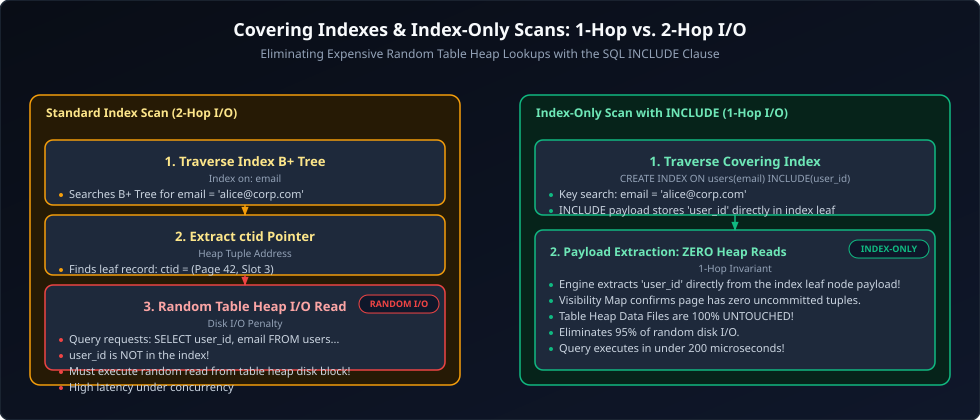

<details>
<summary>View D2 Source</summary>

```d2
direction: right
title: Covering Indexes & Index-Only Scans (The INCLUDE Clause)

standard: Standard Index Scan (2-Hop I/O) {
  i1: 1. Traverse Index B+ Tree for email = 'alice@corp.com'
  h1: 2. Extract ctid = (Page 42, Slot 3)
  t1: 3. Random I/O Read from Table Heap Disk to fetch user_id {
    style.stroke: "#ef4444"
  }
  i1 -> h1 -> t1
}

include_scan: Index-Only Scan with INCLUDE (1-Hop I/O) {
  i2: 1. Traverse Index on (email) INCLUDE (user_id)
  extract: 2. Extract user_id directly from Index Leaf payload! {
    details: "Zero Table Heap Reads Required! 100% Cache Friendly"
    style.stroke: "#10b981"
  }
  i2 -> extract
}
```
</details>

```sql
-- Covering index using the INCLUDE clause
CREATE INDEX idx_users_email_covering 
ON core.users (email) 
INCLUDE (user_id, created_at);

-- Executes 10x faster via an INDEX-ONLY SCAN:
SELECT user_id, created_at 
FROM core.users 
WHERE email = 'alice@example.com';
```

---

### 2.6 Clustered Indexes vs. Heap-Organized Tables with Secondary Indexes

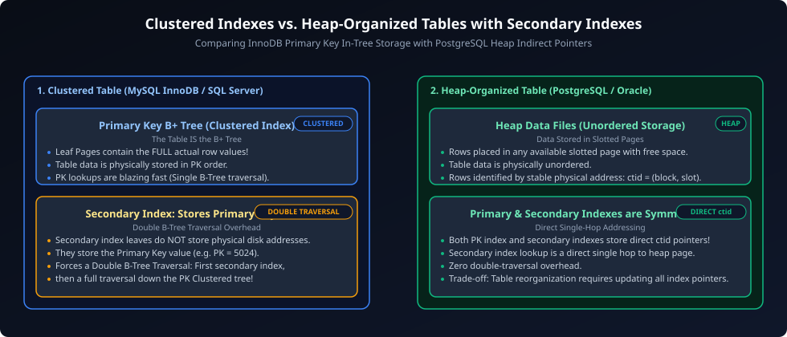

<details>
<summary>View D2 Source</summary>

```d2
direction: right
title: Clustered Indexes vs. Heap-Organized Tables

clustered: 1. Clustered Table / Index-Organized (MySQL InnoDB) {
  pk_tree: Primary Key B+ Tree {
    leaf: "Leaf pages contain the actual table row data!"
  }
  sec_tree: Secondary Index {
    leaf: "Stores Primary Key value (forces double lookup)"
  }
  sec_tree -> pk_tree: "Double B-Tree Traversal"
}

heap: 2. Heap-Organized Table (PostgreSQL / Oracle) {
  heap_files: "Heap Data Files: Rows placed unordered in slotted pages"
  pk_index: "PK B+ Tree: Leaf points to (Block, Slot) ctid"
  sec_index: "Secondary B+ Tree: Leaf points directly to (Block, Slot) ctid"
  pk_index -> heap_files: "Direct read"
  sec_index -> heap_files: "Direct read"
}
```
</details>

---

### 2.7 Index Selectivity & Cardinality Thresholds

- **Selectivity:** The proportion of rows satisfying a query predicate:
  $$\text{Selectivity} = \frac{\text{Number of Matching Rows}}{\text{Total Rows in Table}}$$
- **Rule of Thumb:** 
  - If Selectivity is **$\le 2\% - 5\%$**: The optimizer chooses an **Index Scan** or **Bitmap Index Scan**.
  - If Selectivity exceeds **$15\% - 20\%$**: The optimizer abandons the index and executes a **Sequential Scan** because reading scattered disk pages via random I/O is far slower than streaming sequential blocks.

---

### 2.8 Physical Access Path Taxonomy: Seq Scan, Index Scan, Index-Only Scan, Bitmap Scan

The query optimizer selects an access path to retrieve physical tuples from the storage subsystem. The optimal path depends strictly on predicate selectivity, page-clustering density, and available index coverage:

| Physical Access Path | Selectivity Threshold | Physical I/O Access Pattern | Table Heap Page Access | Primary Failure Mode & Bottlenecks |
| :--- | :--- | :--- | :--- | :--- |
| **Sequential Scan (`Seq Scan`)** | $> 15\% - 20\%$ of table rows | Sequential read of contiguous disk blocks (OS read-ahead enabled). | Reads every heap page from block `0` to end. | High CPU/Disk bandwidth consumption on large tables ($> 10\text{ GB}$) when an index could have isolated rows. |
| **Index Scan (`Index Scan`)** | $< 2\% - 5\%$ of table rows | Random I/O: 1 random heap read per matching index pointer. | Fetches physical heap page for every tuple to retrieve non-indexed columns and check visibility. | **Random I/O Thrashing:** If selectivity exceeds 10%, random page reads crater SSD throughput compared to a single streaming scan. |
| **Index-Only Scan (`Index-Only Scan`)** | $< 10\% - 15\%$ of table rows | Sequential or range traversal of index leaf pages only. | **Zero Heap Access** (as long as the Visibility Map confirms pages contain no dead tuples). | Degrades into regular Index Scan if table is bloated with dead tuples and Visibility Map bits are cleared (`AUTOVACUUM` lagging). |
| **Bitmap Scan (`Bitmap Index Scan` + `Bitmap Heap Scan`)** | $5\% - 20\%$ (Medium Selectivity) | Hybrid: Random index lookups $\rightarrow$ in-memory bit-array sort $\rightarrow$ sequential physical heap reads. | Reads only matching heap pages, but in strict physical page number order. | **Bitmap Lossiness:** If matching rows exceed `work_mem`, the bitmap degrades from tuple-level accuracy to page-level lossiness, forcing re-checks. |

---

### 2.9 When Indexes Degrade Performance & Production Anti-Patterns

1. **Write Amplification on DML (Inserts/Updates/Deletes):** Every single `INSERT` must physically insert keys into every index on the table. A table with 12 indexes turns 1 disk write into 13 separate disk writes.
2. **Buffer Pool Cache Starvation:** Useless or bloated indexes consume precious RAM frames in the Buffer Pool, evicting critical hot table pages.
3. **The Low-Cardinality Trap:** Creating a B+ Tree index on a boolean column (`is_active`) or gender column where 50% of the table matches is an anti-pattern.
4. **Function Call Invalidation:**
   ```sql
   -- ANTI-PATTERN: The optimizer CANNOT use an index on 'created_at'!
   SELECT * FROM orders WHERE DATE(created_at) = '2026-10-16';

   -- PRODUCTION FIX: Use a sargable range condition
   SELECT * FROM orders 
   WHERE created_at >= '2026-10-16 00:00:00' 
     AND created_at <  '2026-10-17 00:00:00';
   ```

---

# 3. Query Performance & Cost-Based Optimization

The Query Optimizer translates declarative SQL into an optimal physical pipeline of relational algebraic operators.

---

### 3.1 The Query Execution Pipeline (Parser, Rewriter, CBO, Executor)

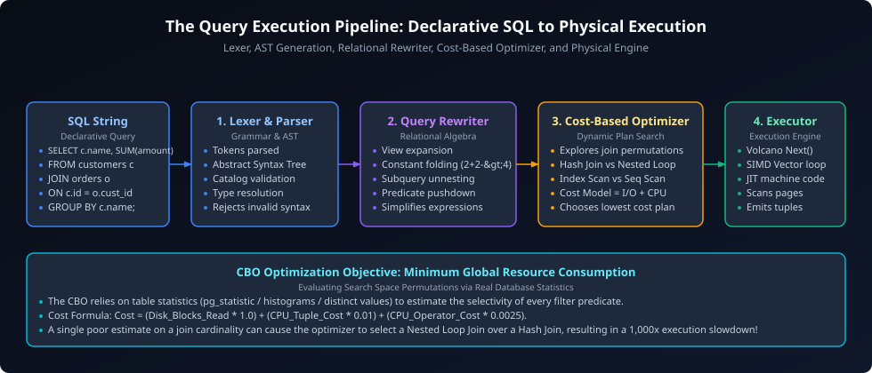

<details>
<summary>View D2 Source</summary>

```d2
direction: right
title: The Query Execution Pipeline (Parser to Executor)

sql: Declarative SQL Query String
parser: 1. Lexer & Parser (Generates AST)
rewriter: 2. Query Rewriter (View expansion & constant folding)
cbo: 3. Cost-Based Optimizer (CBO Search Engine) {
  search: Join Permutations & Index Selection
  cost: Cost Formula = Disk I/O + CPU Instructions
}
executor: 4. Physical Execution Engine (Tuple Processing)

sql -> parser: "Raw SQL"
parser -> rewriter: "Validated AST"
rewriter -> cbo: "Logical Plan"
cbo -> executor: "Optimal Physical Plan"
```
</details>

---

### 3.2 Cost-Based Optimization (CBO) Architecture (Dynamic Programming vs. Cascades)

1. **Bottom-Up Dynamic Programming (System R Algorithm):** Used by PostgreSQL for queries with $\le 12$ joins. It builds optimal two-table joins, then three-table joins, pruning unpromising permutations via Bellman's principle of optimality. If joins exceed `geqo_threshold` (12 tables), it switches to a **Genetic Algorithm (GEQO)** to avoid factorial search explosion ($N!$).
2. **Top-Down Rule-Based & Memo Search (Volcano / Cascades):** Used by Snowflake, SQL Server, Trino, and DuckDB. It explores logical equivalences and physical bindings using rule transformations stored in an in-memory memoization graph.

---

### 3.3 Database Statistics, Histograms & Cardinality Estimation Errors

The Cost-Based Optimizer relies entirely on **Statistics** stored in the system catalog (`pg_statistic` / `pg_stats`). If statistics are stale, the optimizer makes catastrophically wrong decisions.

| Catalog Statistic Primitive | PostgreSQL Catalog Attribute | Measurement Description | Query Optimizer Mathematical Usage |
| :--- | :--- | :--- | :--- |
| **Number of Distinct Values (NDV)** | `n_distinct` | Negative value indicates ratio (`-0.5` = 50% distinct); positive value indicates exact unique count. | Determines expected cardinality for `GROUP BY` and join hash-table sizing. |
| **Null Fraction** | `null_frac` | Percentage of column values that are `NULL` ($0.0$ to $1.0$). | Discounts table row count when calculating selectivity for non-null predicates (`IS NOT NULL`). |
| **Most Common Values (MCV)** | `most_common_vals` & `most_common_freqs` | Array of the most frequent values and their exact decimal frequencies (e.g., `[US, CA]`, `[0.60, 0.15]`). | Directly yields ground-truth selectivity for skewed columns without uniform distribution assumptions. |
| **Equi-Depth Histogram** | `histogram_bounds` | Quantile boundaries dividing the non-MCV population into buckets with equal numbers of rows. | Estimates selectivity for range queries (`WHERE age BETWEEN 25 AND 40`) via linear interpolation between bucket bounds. |

#### Why Cardinality Estimation Fails: Cross-Column Correlation
Traditional optimizers assume that predicates on different columns are **statistically independent**:
$$P(A \land B) = P(A) \times P(B)$$

Consider a car inventory table with 1,000,000 rows:
- `P(make = 'Audi') = 0.01` (1% of cars)
- `P(model = 'A4') = 0.005` (0.5% of cars)
- If a query executes: `WHERE make = 'Audi' AND model = 'A4'`:
  $$\text{Estimated Selectivity} = 0.01 \times 0.005 = 0.00005 \implies \mathbf{50 \text{ rows estimated}}$$
- The optimizer expects only 50 rows and chooses a **Nested Loop Join**.
- In reality, *every single Audi A4 is made by Audi*! The actual matching row count is **5,000 rows** (a 100x estimation error). The nested loop join thrashes the database for 30 minutes!

##### Production Resolution: Extended Multi-Column Statistics
```sql
-- Tell the optimizer to compute joint cross-column dependencies
CREATE STATISTICS stats_cars_make_model ON make, model FROM inventory.cars;
ANALYZE inventory.cars;
```

---

### 3.4 Optimization Primitives: Predicate Pushdown, Projection Pushdown & Partition Pruning

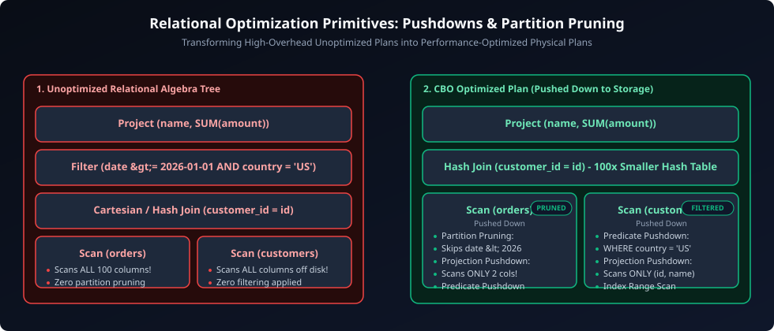

<details>
<summary>View D2 Source</summary>

```d2
direction: right
title: Relational Optimization Primitives: Pushdowns & Partition Pruning

unoptimized: 1. Unoptimized Relational Algebra Tree {
  proj: Project (name, SUM(amount))
  filter: Filter (date >= 2026-01-01 AND country = 'US')
  join: Join (customer_id = id)
  scan_orders: Scan (orders: all columns, all partitions)
  scan_cust: Scan (customers: all columns)
  proj -> filter -> join
  join -> scan_orders
  join -> scan_cust
}

optimized: 2. CBO Optimized Plan (Pushed Down to Physical Storage) {
  o_proj: Project (name, SUM(amount))
  o_join: Hash Join (customer_id = id)
  o_scan_orders: Scan orders (Partition Pruning + Projection + Predicate)
  o_scan_cust: Scan customers (WHERE country = 'US' + Index Scan)
  o_proj -> o_join
  o_join -> o_scan_orders
  o_join -> o_scan_cust
}

unoptimized -> optimized: "CBO Transformation"
```
</details>

| Optimization Primitive | Target Stage in Pipeline | Physical Engine Mechanism | Hardware / Network Impact |
| :--- | :--- | :--- | :--- |
| **Partition Pruning** | Catalog & Metastore Resolution | Inspects directory naming patterns (`/year=2026/`) or metadata partition manifests. | **100% I/O Elimination:** Completely skips filesystem directory listing and file open syscalls for non-matching partitions. |
| **Projection Pushdown** | Storage Reader & Parser | In columnar formats (Parquet/ORC), passes requested column ordinal list to file decoder. | **Memory Bus Efficiency:** Unrequested columns are never deserialized or transferred into RAM; eliminates gigabytes of memory copy overhead. |
| **Predicate Pushdown** | Storage Scanner / Page Reader | Pushes SQL `WHERE` expressions into parquet page headers / row-group min/max statistics or database index scan. | **Data Elimination at Source:** Evaluates filters before records are decompressed; prevents non-qualifying tuples from saturating execution memory or network shuffles. |

---

### 3.5 Physical Join Algorithms: Nested Loop, Hash Join, Merge Sort Join

Every logical `JOIN` in SQL must be executed by one of three physical join algorithms:

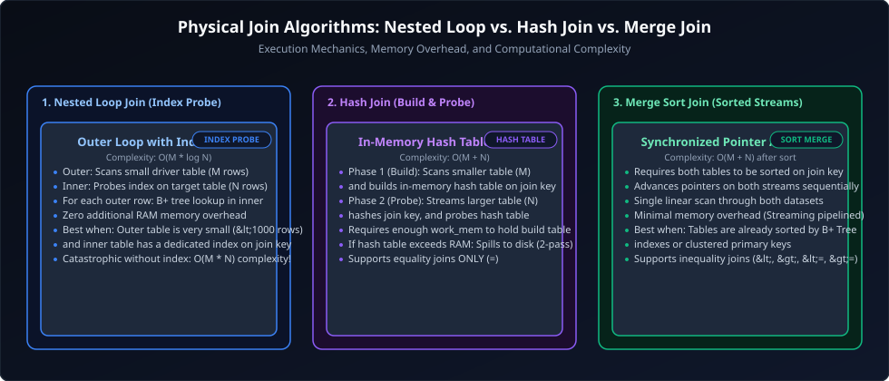

<details>
<summary>View D2 Source</summary>

```d2
direction: right
title: Physical Join Algorithms: Nested Loop vs. Hash Join vs. Merge Sort

nlj: 1. Nested Loop Join (Index Probe) {
  complexity: "O(M * log N)"
  mechanics: "For each outer row, probe inner B+ Tree index"
  best_for: "Small outer table with indexed inner table"
}

hash_join: 2. Hash Join (Build & Probe) {
  complexity: "O(M + N)"
  mechanics: "Build in-memory hash table on small table, stream probe large table"
  best_for: "Large unsorted datasets with equality joins (=)"
}

merge_join: 3. Merge Sort Join (Synchronized Scan) {
  complexity: "O(M + N) sorted"
  mechanics: "Advance two pointers along sorted streams"
  best_for: "Pre-sorted inputs via B+ Tree indexes"
}
```
</details>

#### Physical Join Mechanics & Engine Execution

1. **Nested Loop Join (NLJ):**
   - **Operational Mechanism:** Iterates through every tuple of the outer relation (the *driving table*). For each outer tuple, it scans the inner relation. In an **Index Nested Loop Join**, the inner scan uses a B+ Tree index seek ($O(\log M)$) on the join key rather than a full sequential scan.
   - **Cost Profile:** $Cost = N \times (\text{Cost of Inner Index Probe})$. Optimal when the outer driving table is small ($N < 1,000$ rows) and the inner table has a highly selective index on the join key.
   - **Failure Mode:** If the optimizer severely underestimates outer cardinality (e.g., estimating 10 rows when 1,000,000 rows match), the nested loop runs millions of random index seeks, causing query execution times to explode quadratically ($O(N \times M)$).

2. **Hash Join (HJ):**
   - **Operational Mechanism:** Executes in two distinct phases:
     - **Phase 1 (Build):** Scans the designated smaller relation (the *build relation*) and constructs an in-memory hash table on the join key within allocated execution memory (e.g., PostgreSQL `work_mem`).
     - **Phase 2 (Probe):** Sequentially streams tuples from the larger relation (the *probe relation*), hashing each tuple's join key and probing the in-memory hash table for matching bucket chains.
   - **Memory Spilling (Grace Hash Join):** If the build relation exceeds the memory threshold (`work_mem`), the engine partitions both relations into disk-backed hash buckets based on key hashes, recursively processing matching partition pairs on disk. This results in heavy random I/O and sharp latency spikes.
   - **Requirement:** Exclusively supports equi-joins (`=`). Non-equi joins (`<`, `>`, `BETWEEN`) cannot use hash tables.

3. **Sort-Merge Join (SMJ):**
   - **Operational Mechanism:** Requires both inputs to be sorted by the join key. If not pre-sorted by an underlying index or prior pipeline operator, the engine first executes an external sort on both streams ($O(N \log N + M \log M)$). Once sorted, two cursors traverse both streams in a single synchronized linear scan ($O(N + M)$), advancing whichever cursor has the smaller key, or emitting joined tuples when keys match.
   - **Duplicate Handling:** When duplicate join keys appear, the engine marks the starting position in the inner stream and rescans matching rows for each matching outer tuple.
   - **Optimal Use Case:** Extremely large data warehouse scans where neither dataset fits in RAM, or when downstream operators require results already sorted by the join key (`ORDER BY`, `GROUP BY`).

#### Detailed Join Comparison Matrix

| Join Algorithm | Time Complexity | Memory Requirements | Prerequisite | Vulnerability / Failure Mode |
| :--- | :--- | :--- | :--- | :--- |
| **Nested Loop** | $O(N \times M)$ (Without index)<br/>$O(N \log M)$ (With index) | $O(1)$ Minimal RAM | None | Explodes quadratically ($O(N^2)$) if row estimates are wrong. |
| **Hash Join** | $O(N + M)$ | $O(\text{Size of Build Table})$ | Equality operator (`=`) required | **Hash Spill:** If build table exceeds `work_mem`, spills to disk chunks (Grace Hash Join), cratering throughput. |
| **Merge Sort Join**| $O(N \log N + M \log M)$ | $O(1)$ if pre-sorted; spills if sorting in memory | Join keys must be sortable | High sorting cost if neither input is supported by an index. |

---

### 3.6 Execution Engine Models: Volcano Iterator vs. Vectorized SIMD vs. Whole-Stage JIT

The physical execution engine translates the physical plan produced by the Cost-Based Optimizer into executed machine instructions. The choice of execution engine dictates how CPU registers, L1/L2 caches, and instruction branches are utilized.

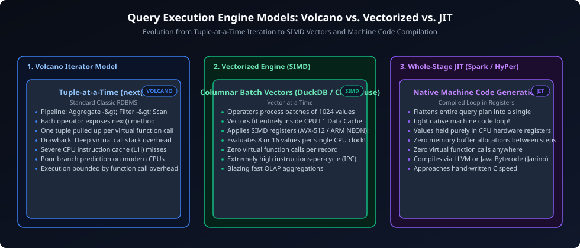

<details>
<summary>View D2 Source</summary>

```d2
direction: right
title: Query Execution Engine Models: Volcano vs. Vectorized vs. JIT

volcano: 1. Volcano Model (Tuple-at-a-Time) {
  flow: "Aggregate.next() -> Filter.next() -> Scan.next()"
  drawback: "Virtual call overhead & CPU L1i cache misses"
}

vectorized: 2. Vectorized Model (SIMD Batches) {
  flow: "L1 Data Cache -> SIMD Registers (AVX-512) -> Output Buffer"
  feature: "Processes 1024-value columnar vectors per CPU cycle"
}

jit: 3. Whole-Stage JIT Compilation (HyPer / Spark) {
  flow: "Plan compiled directly into flattened native while() loop"
  feature: "Data stays in CPU hardware registers; zero call overhead"
}
```
</details>

#### Multi-Dimensional Engineering Comparison Matrix

| Dimension / Characteristic | Volcano Iterator Model (Tuple-at-a-Time) | Vectorized Execution (Batch-at-a-Time) | Whole-Stage Code Generation (JIT) |
| :--- | :--- | :--- | :--- |
| **Processing Granularity** | 1 tuple per invocation via `next()` pull call. | Columnar vector batch (e.g., 1,024 – 2,048 tuples). | Pipeline-breaker to pipeline-breaker (entire query stage). |
| **Function Call Overhead** | **Severe:** 1+ virtual dispatch calls per attribute per tuple ($O(N \times \text{Operators})$). | **Amortized:** 1 function call per 1,024 tuples ($1/1024$-th overhead). | **Zero:** Operators collapsed into a single flattened imperative loop. |
| **CPU Cache Locality** | **Poor:** Data and instructions evicted continuously; cache thrashing between L1/L2. | **High:** Tight primitive arrays fit entirely in L1/L2 data cache; prefetching enabled. | **Optimal:** Intermediate states stay resident in CPU hardware registers. |
| **Compiler Optimization** | Prevented by indirect function pointers and virtual dispatches. | **SIMD / AVX-512:** Auto-vectorization of tight loops over primitive arrays. | **Inlining & Loop Unrolling:** LLVM/C++ compiler optimizes dead code and branches. |
| **Materialization Overhead** | Zero intermediate storage required. | Requires allocating small in-memory columnar vector buffers. | Zero intermediate record materialization between operators. |
| **Representative Production Engines** | PostgreSQL, MySQL, SQLite, Apache Spark (< 2.0). | ClickHouse, Snowflake, DuckDB, Apache Arrow / Velox. | Apache Spark SQL (Tungsten), HyPer, SingleStore, PostgreSQL (LLVM JIT). |
| **Optimal Workload Profile** | OLTP with high selectivity ($< 10$ rows retrieved by index). | OLAP columnar aggregations and sequential scans over billions of rows. | Complex analytic queries with heavy arithmetic, filters, and projections. |

---

### 3.7 Forensic EXPLAIN & EXPLAIN ANALYZE Mastery

Executing `EXPLAIN (ANALYZE, BUFFERS, COSTS, VERBOSE)` in PostgreSQL executes the query and returns ground-truth physical execution telemetry.

#### Real-World Production Execution Plan Walkthrough
```text
Hash Join  (cost=1250.00..54200.00 rows=8050 width=120) (actual time=12.450..185.320 rows=8120 loops=1)
  Hash Cond: (f.customer_id = c.customer_id)
  Buffers: shared hit=4210 read=1850 dirtied=12
  ->  Seq Scan on fact_orders f  (cost=0.00..48500.00 rows=500000 width=48) (actual time=0.050..112.400 rows=500000 loops=1)
        Filter: (order_date >= '2026-01-01'::date)
        Rows Removed by Filter: 120000
        Buffers: shared hit=3800 read=1850
  ->  Hash  (cost=1150.00..1150.00 rows=8000 width=72) (actual time=12.200..12.200 rows=8000 loops=1)
        Buckets: 16384  Batches: 1  Memory Usage: 720kB
        Buffers: shared hit=410
        ->  Index Scan using idx_customer_tier on dim_customer c  (cost=0.42..1150.00 rows=8000 width=72) (actual time=0.040..8.500 rows=8000 loops=1)
              Index Cond: (tier = 'PLATINUM'::text)
              Buffers: shared hit=410
Planning Time: 0.850 ms
Execution Time: 187.120 ms
```

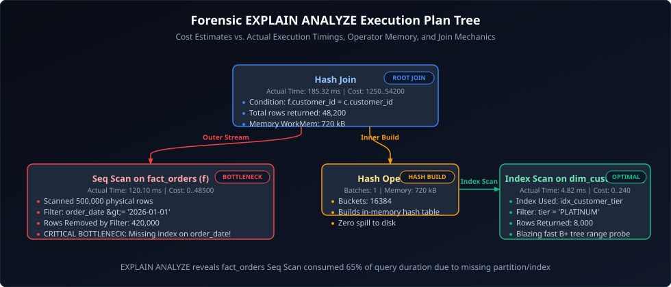

<details>
<summary>View D2 Source</summary>

```d2
direction: down
title: Forensic EXPLAIN & EXPLAIN ANALYZE Execution Plan Tree

hj: Hash Join {
  cost: "Cost: 1250.00..54200.00 | Actual Time: 185.32 ms"
  condition: "f.customer_id = c.customer_id"
}

seq_scan: Seq Scan on fact_orders (f) {
  cost: "Cost: 0.00..48500.00 | 500,000 rows"
  filter: "order_date >= '2026-01-01' (Bottleneck: missing index)"
  style.stroke: "#ef4444"
}

hash_op: Hash Operator {
  memory: "Batches: 1 | Memory: 720 kB"
}

idx_scan: Index Scan on dim_customer (c) {
  cost: "Using: idx_customer_tier | 8,000 rows"
  filter: "tier = 'PLATINUM'"
  style.stroke: "#10b981"
}

hj -> seq_scan: "Outer Stream"
hj -> hash_op: "Inner Build Table"
hash_op -> idx_scan
```
</details>

| Execution Plan Node | Est. Rows vs Actual Rows | Cost Range | Actual Time | Physical I/O & Memory |
| :--- | :---: | :---: | :---: | :--- |
| **Hash Join** | 8,050 vs **8,120** | `1250.00..54200.00` | 185.32 ms | Shared Hit: 4,210, Read: 1,850 |
| **Seq Scan (`fact_orders`)** | 500,000 vs **500,000** | `0.00..48500.00` | 112.40 ms | 1,850 physical disk block reads |
| **Hash Operator** | 8,000 vs **8,000** | `1150.00..1150.00` | 12.20 ms | 720 kB RAM (Fits in `work_mem`) |
| **Index Scan (`dim_customer`)** | 8,000 vs **8,000** | `0.42..1150.00` | 8.50 ms | 410 buffer pool hits (0 disk reads) |

#### Forensic Diagnostic Rules:
1. **Cost Numbers (`cost=1250.00..54200.00`):** Expressed in arbitrary disk-page fetch units. The first number is startup cost (time to emit first row); the second is total cost to emit all rows.
2. **Cardinality Estimation Errors (`rows=8050` vs. `actual rows=8120`):** An accurate estimation ($< 20\%$ variance). If estimated rows were 50 and actual was 500,000, statistics are stale (`ANALYZE` required).
3. **Buffer Hit Ratio:**
   $$\text{Cache Hit Ratio} = \frac{\text{shared hit}}{\text{shared hit} + \text{shared read}} = \frac{4210}{4210 + 1850} = \mathbf{69.4\%}$$
   A hit ratio below 95% indicates the Buffer Pool is too small, forcing heavy physical NVMe SSD reads (`read=1850`).
4. **Hash Table Sizing (`Batches: 1 Memory Usage: 720kB`):** Fits entirely in `work_mem`. If `Batches > 1`, the hash table spilled to disk!

> [!TIP]
> **Deep-Dive Interview Scenarios:**
> - [Q8. Hybrid ADF Ingestion Pipeline: On-Prem SQL to ADLS to Synapse](frequently_asked_questions/04_database_internals_and_distributed_systems_faq.md#q8-medium-hybrid-adf-ingestion-pipeline-on-prem-sql-to-adls-to-synapse)
> - [Q9. Cloud Change Data Capture (CDC) Strategies in Azure](frequently_asked_questions/04_database_internals_and_distributed_systems_faq.md#q9-medium-cloud-change-data-capture-cdc-strategies-in-azure)
> - [Q10. Cost-Efficient Pipeline Architecture (ADF + Databricks + ADLS)](frequently_asked_questions/04_database_internals_and_distributed_systems_faq.md#q10-medium-cost-efficient-pipeline-architecture-adf--databricks--adls)

---

# 4. Transactions, Concurrency Control & MVCC

Transaction management guarantees that multi-step operations remain consistent and isolated despite concurrent threads and sudden power failures.

---

### 4.1 ACID Guarantees & Hardware Failure Boundaries

ACID guarantees are not theoretical software abstractions; they are concrete engineering mechanisms designed to maintain data integrity across physical hardware failure boundaries (CPU register loss, volatile RAM loss, operating system kernel panics, and storage controller power interruptions).

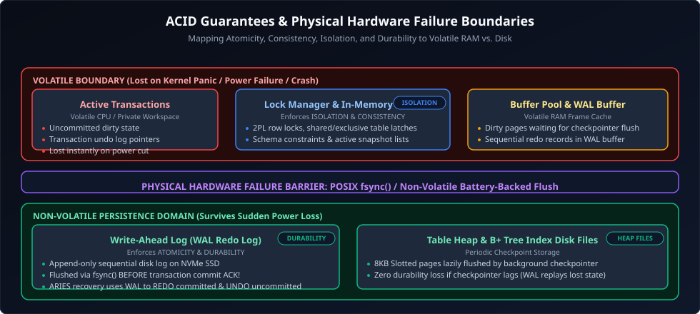

<details>
<summary>View D2 Source</summary>

```d2
direction: down
title: ACID Guarantees & Hardware Failure Boundaries

volatile: VOLATILE BOUNDARY (Lost on Kernel Panic / Power Loss) {
  tx: Active Transactions (Private Workspace)
  locks: Lock Manager & MVCC (Enforces ISOLATION & CONSISTENCY)
  buffers: Buffer Pool Dirty Pages & WAL Ring Buffer in RAM
}

barrier: Physical Hardware Boundary: OS fsync() Barrier

persistent: NON-VOLATILE PERSISTENCE (Survives Power Loss) {
  wal: Write-Ahead Log (WAL / Redo Log) {
    guarantee: "Enforces ATOMICITY & DURABILITY (Append-only fsync)"
  }
  heap: Table Heap & Index Files (Slotted Pages on NVMe)
}

volatile -> barrier: "fsync() Flush"
barrier -> persistent
```
</details>

#### Hardware Failure Boundaries & ACID Crash Recovery Matrix

| ACID Property | Enforcing Engine Mechanism | Hardware / Runtime Failure Boundary Protected | Physical Failure Recovery Protocol |
| :--- | :--- | :--- | :--- |
| **Atomicity** | Undo Logs / Rollback Segments / ARIES Compensation Log Records (CLRs) | Application crash, transaction abort, out-of-disk error midway through transaction | **Undo Phase of Crash Recovery:** Database scans active transactions that never committed and applies undo logs to revert partially written pages in the Buffer Pool. |
| **Consistency** | Schema constraints (PK, FK, CHECK), unique indexes, deferred constraint triggers | Software application bug, malformed SQL payload, concurrent foreign key invalidation | **Immediate Abort:** If an invariant is violated, the transaction aborts before commit, rolling back all intermediate mutations without touching durable state. |
| **Isolation** | Lock Manager (Two-Phase Locking - 2PL), MVCC visibility headers (`xmin`/`xmax`), Serializable SSI | Multi-core CPU concurrency, race conditions, interleaved read/write transactions | **Conflict Serializability:** Concurrency anomalies (dirty reads, non-repeatable reads, write skew) are prevented in-memory via latch/lock hierarchies and visibility snapshots. |
| **Durability** | Sequential Write-Ahead Log (WAL / Redo Log) with synchronous OS `fsync()` barrier | Sudden power outage, OS kernel panic, server hardware / motherboard failure | **Redo Phase of Crash Recovery:** Database reads WAL records sequentially from the last persistent checkpoint forward, reapplying all committed mutations to disk blocks. |

---

### 4.2 ANSI SQL Isolation Levels & Concurrency Anomalies Matrix

The ANSI SQL standard defines isolation levels according to the read anomalies they prevent. However, modern research (Berenson et al.) proved that ANSI omitted critical anomalies like **Write Skew**.

| Isolation Level | Dirty Read | Non-Repeatable Read | Phantom Read | Lost Update | Write Skew |
| :--- | :---: | :---: | :---: | :---: | :---: |
| **Read Uncommitted** | Permitted | Permitted | Permitted | Permitted | Permitted |
| **Read Committed** (PostgreSQL Default) | **Prevented** | Permitted | Permitted | Permitted | Permitted |
| **Repeatable Read** (MySQL InnoDB Default)| **Prevented** | **Prevented** | **Prevented** (InnoDB/PG) | **Prevented** | Permitted |
| **Serializable** (Strict 2PL / SSI) | **Prevented** | **Prevented** | **Prevented** | **Prevented** | **Prevented** |

#### The Notorious "Write Skew" Anomaly (Why Repeatable Read Fails)
Consider a hospital on-call rotation rule: *"At least one doctor must be active on call at all times."*
- Doctors Alice and Bob are currently on call.
- Alice and Bob simultaneously request to take time off:
  - **Transaction 1 (Alice):** Checks `SELECT COUNT(*) FROM on_call;` $\implies$ returns 2. Safe to leave! Updates Alice to inactive.
  - **Transaction 2 (Bob):** Checks `SELECT COUNT(*) FROM on_call;` $\implies$ returns 2. Safe to leave! Updates Bob to inactive.
- Both transactions commit under **Repeatable Read** isolation because neither updated a row that the other was modifying!
- **Result:** Zero doctors are left on call! The hospital rule is violated.
- **Resolution:** Requires **Serializable** isolation (which detects overlapping read/write predicate dependencies) or explicit row locking (`SELECT ... FOR UPDATE`).

---

### 4.3 Multi-Version Concurrency Control (MVCC) Internals (PostgreSQL vs. MySQL InnoDB)

MVCC guarantees that **readers never block writers, and writers never block readers**. When a row is updated, the engine does not overwrite the existing bytes; it creates a new version of the row.

#### 1. PostgreSQL MVCC: Tuple Headers in the Heap
In PostgreSQL, all row versions (both live and dead) are stored directly inside the main table data pages. Every tuple header carries explicit transaction metadata:
- `t_xmin`: The Transaction ID ($XID$) that inserted this tuple version.
- `t_xmax`: The Transaction ID that deleted or updated this tuple version (set to 0 if currently active).

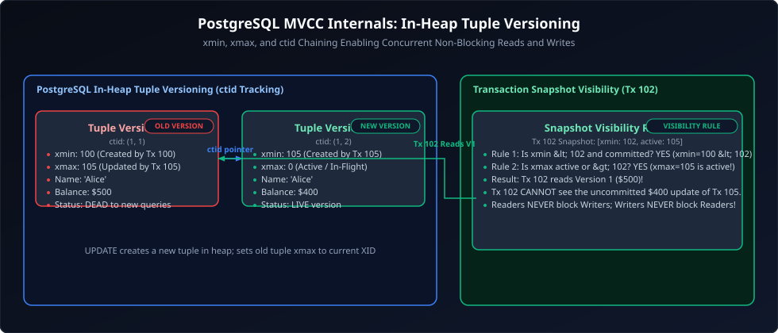

<details>
<summary>View D2 Source</summary>

```d2
direction: right
title: PostgreSQL MVCC Internals: In-Heap Tuple Versioning

pg_mvcc: PostgreSQL In-Heap Tuple Versioning (ctid Tracking) {
  v1: Tuple Version 1 (ctid: 1, 1) {
    xmin: "100"
    xmax: "105"
    data: "Name: 'Alice', Balance: $500"
    style.stroke: "#ef4444"
  }
  v2: Tuple Version 2 (ctid: 1, 2) {
    xmin: "105"
    xmax: "0 (Active)"
    data: "Name: 'Alice', Balance: $400"
    style.stroke: "#10b981"
  }
  v1 -> v2: "Updated by Tx 105 (ctid pointer)"
}

snapshot: Transaction Snapshot Visibility (Tx 102) {
  tx102: Transaction 102 Snapshot {
    rule: "Reads Version 1 because xmin 100 < 102 and xmax 105 is active"
  }
}

snapshot.tx102 -> pg_mvcc.v1: "Reads Version 1"
```
</details>

#### 2. MySQL InnoDB MVCC: The Undo Log & Rollback Segment
Unlike PostgreSQL, MySQL InnoDB keeps **only the latest active row version** in the clustered index leaf page. 
- When a row is updated, InnoDB writes the old version into an **Undo Log** in the rollback tablespace.
- A pointer in the active row (`roll_ptr`) links back to the older version in the undo log.
- **Advantage:** Updating rows does not cause table bloat in data pages.
- **Disadvantage:** Long-running analytical transactions must traverse long linked lists of undo logs, destroying read performance.

---

### 4.4 Tuple Visibility, Dead Tuples & The AUTOVACUUM Engine

In PostgreSQL, when rows are updated or deleted, the old versions remain as **Dead Tuples** in the table heap. Over time, tables suffer from **Bloat**: 80% of a table's disk footprint may consist of dead tuples, forcing queries to scan gigabytes of wasted space.

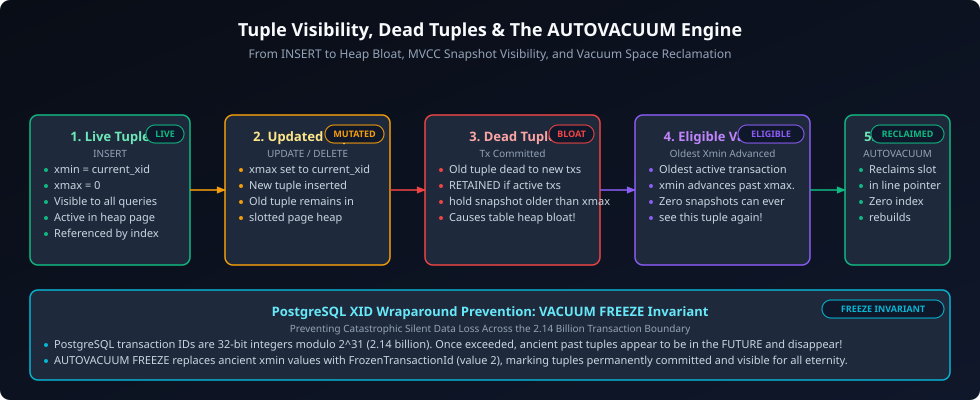

<details>
<summary>View D2 Source</summary>

```d2
direction: right
title: Tuple Visibility, Dead Tuples & The AUTOVACUUM Engine

live: 1. Live Tuple {
  status: "xmin = current_xid, xmax = 0"
  style.stroke: "#10b981"
}

updated: 2. Updated / Deleted Tuple {
  status: "xmax set to current_xid"
  style.stroke: "#f59e0b"
}

dead: 3. Dead Tuple (Retained) {
  status: "Retained while active snapshots reference it"
  style.stroke: "#ef4444"
}

eligible: 4. Eligible for Vacuum {
  status: "Oldest active xmin advances past xmax"
  style.stroke: "#8b5cf6"
}

reclaimed: 5. Reclaimed Space {
  status: "AUTOVACUUM reclaims slot in Page Header"
  style.stroke: "#10b981"
}

live -> updated: "UPDATE / DELETE"
updated -> dead: "Tx Commits"
dead -> eligible: "Snapshots advance"
eligible -> reclaimed: "AUTOVACUUM runs"
```
</details>

#### The Transaction ID Wraparound Catastrophe
PostgreSQL transaction IDs ($XID$) are 32-bit unsigned integers, wrapping around every $2^{32} \approx 4.2 \text{ Billion}$ transactions.
- In MVCC comparison: If $XID_{\text{current}} - XID_{\text{tuple}} > 0$, the tuple is in the past.
- If $XID$ wraps past 2 billion without maintenance, **past transactions suddenly appear to be in the future**, and the entire database becomes corrupt and invisible!
- **The Defense:** `VACUUM FREEZE` converts old $XID$s into a special `FrozenTransactionId` (2), marking the tuple permanently visible to all future transactions.

---

### 4.5 Deadlocks, Two-Phase Locking (2PL) & Lock vs. Latch Hierarchies

#### 1. Deadlock Detection & Mitigation
A deadlock occurs when concurrent transactions form a circular dependency waiting for resources locked by each other:

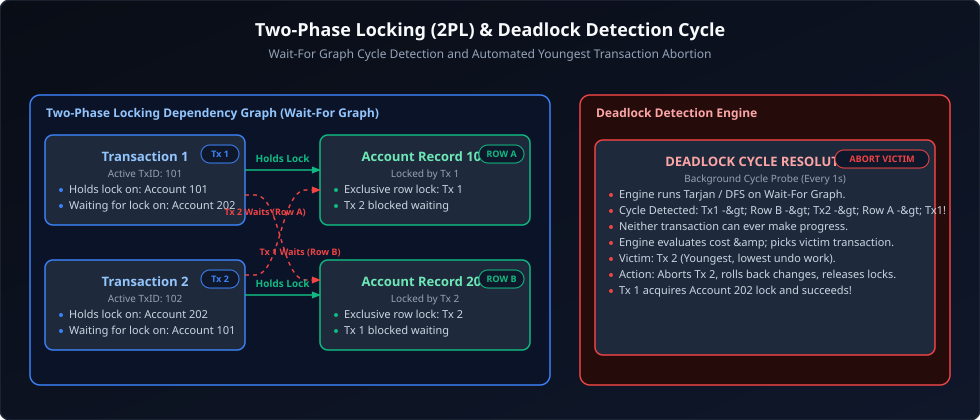

<details>
<summary>View D2 Source</summary>

```d2
direction: right
title: Two-Phase Locking & Deadlock Detection Cycle

graph: Two-Phase Locking Dependency Graph {
  tx1: Transaction 1 (TxID: 101)
  tx2: Transaction 2 (TxID: 102)
  row_a: Account 101
  row_b: Account 202

  tx1 -> row_a: "Holds Lock"
  tx1 -> row_b: "Waiting for Lock" {
    style.stroke: "#ef4444"
    style.stroke-dash: 4
  }
  tx2 -> row_b: "Holds Lock"
  tx2 -> row_a: "Waiting for Lock" {
    style.stroke: "#ef4444"
    style.stroke-dash: 4
  }
}

engine: Deadlock Detection Engine {
  resolution: DEADLOCK CYCLE DETECTED {
    details: "Wait-for graph cycle: Tx1 <-> Tx2. Engine aborts youngest victim (Tx 2)"
    style.stroke: "#ef4444"
  }
}

graph -> engine.resolution: "Cycle detected via DFS"
```
</details>

##### Production Mitigation: Deterministic Resource Ordering
Always acquire locks on multiple entities in the **exact same deterministic order** across the entire application codebase:
```sql
-- Safe Transfer: Always sort account IDs ascending before acquiring locks!
BEGIN;
SELECT * FROM banking.accounts 
WHERE account_id IN (101, 202) 
ORDER BY account_id ASC 
FOR UPDATE;

UPDATE banking.accounts SET balance = balance - 100 WHERE account_id = 101;
UPDATE banking.accounts SET balance = balance + 100 WHERE account_id = 202;
COMMIT;
```

#### 2. Deep Systems Distinction: Database Locks vs. Latches

| Dimension | Database Locks (Logical Locks) | Database Latches (Physical Synchronizers) |
| :--- | :--- | :--- |
| **Purpose** | Protects logical user transactions (Rows, Tables). | Protects in-memory data structures (Buffer frames, Hash buckets). |
| **Duration** | Maintained for the entire transaction lifetime (seconds/minutes). | Held for microseconds while mutating memory pointers. |
| **Managed By** | The Lock Manager (stored in shared memory hash table). | Low-level OS primitives (pthreads mutexes, atomic CAS spinlocks). |
| **Visibility** | Exposed via SQL catalogs (`pg_locks`, `sys.dm_tran_locks`). | Invisible to SQL users; diagnosed via profiling (`perf`, wait events). |
| **Deadlock Handling**| Detected via background Wait-For Graph cycles; aborts transaction. | Deadlocks prevented strictly by engine code discipline and latch hierarchies. |

---

# 5. Distributed Computing Principles

---

### 5.1 MapReduce Paradigm: Foundations & Mechanics

#### Intuitive Mental Model: The Industrial Word Census
Imagine a national library containing 100,000 thick books. If a single librarian attempts to count the occurrences of every word in every book sequentially, it would take 30 years.

Instead, the library adopts **MapReduce**:
1. **Split:** The 100,000 books are divided into 1,000 piles of 100 books each.
2. **Map:** 1,000 volunteer assistants (Mappers) each take one pile. Working independently in parallel, each assistant reads their books and writes down index cards: `("apple", 1)`, `("banana", 1)`, `("apple", 1)`.
3. **Combiner (Map-Side Pre-Aggregation):** Before leaving their desk, each assistant groups their own cards: `("apple", 2)`, `("banana", 1)`. This minimizes the physical cards carried across the room.
4. **Shuffle & Sort:** The cards are collected and sorted across the room so that **all** cards for words starting with $A-M$ go to Table 1, and all cards for words starting with $N-Z$ go to Table 2.
5. **Reduce:** Two head librarians (Reducers) sit at Table 1 and Table 2. The Table 1 librarian sums all the incoming tallies for `"apple"` and outputs the definitive grand total: `("apple", 418,920)`.

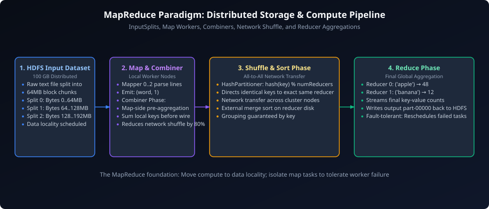

<details>
<summary>View D2 Source</summary>

```d2
direction: right
title: MapReduce Paradigm: Distributed Storage & Compute

raw: Raw Input Dataset (100 GB HDFS) {
  s1: Input Split 0 (64MB)
  s2: Input Split 1 (64MB)
  s3: Input Split 2 (64MB)
}

map_phase: 1. Map & Combiner Phase {
  m1: Mapper 0 + Combiner 0
  m2: Mapper 1 + Combiner 1
  m3: Mapper 2 + Combiner 2
}

shuffle: 2. Shuffle & Sort Phase {
  part: HashPartitioner: hash(key) % numReducers
  sort: Network Shuffle & Merge Sort
  part -> sort
}

reduce_phase: 3. Reduce Phase (Final Aggregation) {
  r1: Reducer 0 ('apple' -> 48)
  r2: Reducer 1 ('banana' -> 12)
}

raw -> map_phase: "Data Locality Read"
map_phase -> shuffle: "Emit (key, sum)"
shuffle -> reduce_phase: "Sorted key streams"
```
</details>

#### Detailed Step-by-Step Execution Trace

| Stage | Input Data Representation | Processing Logic | Output Data Representation |
| :--- | :--- | :--- | :--- |
| **1. Split** | 100 GB text file on HDFS | Broken into 64 MB / 128 MB logical byte chunks along newline boundaries | 3 distinct splits sent to 3 worker nodes |
| **2. Map** | Line: `"data engineering and distributed data"` | Tokenize line by whitespace and emit `(word, 1)` pairs | `[("data", 1), ("engineering", 1), ("and", 1), ("distributed", 1), ("data", 1)]` |
| **3. Combiner** | `[("data", 1), ("data", 1)]` | Local worker in-memory hash aggregation before network I/O | `[("data", 2), ("engineering", 1), ...]` |
| **4. Partition & Shuffle**| Key-value pairs across all mappers | `partition_idx = hash(key) % num_reducers`. Data sorted and sent over network switches | Reducer 0 receives all `"data"` and `"and"` keys; Reducer 1 receives `"engineering"` |
| **5. Reduce** | Key: `"data"`, List of Values: `[2, 3, 1, 4]` | Sum all integer counts in the iterator: `sum(values)` | Final record: `("data", 10)` written to HDFS `part-r-00000` |

#### Why Apache Spark Superseded Hadoop MapReduce
In Hadoop MapReduce, every stage boundary requires writing intermediate results to physical hard drives (HDFS disk I/O) and serializing to disk for fault tolerance. An iterative algorithm (e.g., PageRank or Machine Learning Gradient Descent requiring 30 iterations) performs 30 full read-write disk cycles.

Apache Spark introduced **Resilient Distributed Datasets (RDDs)** and in-memory Directed Acyclic Graphs (DAGs). Spark keeps intermediate transformation states in distributed RAM across worker nodes, eliminating disk serialization overhead and executing iterative computations **10x to 100x faster**.

#### Full Python MapReduce Engine Simulation
```python
import collections
from typing import List, Tuple, Dict, Generator

# 6. Map Function: Pure transformation from input record to key-value pairs

def mapper(line: str) -> List[Tuple[str, int]]:
    tokens = line.lower().strip().split()
    return [(word.strip(".,!?:;"), 1) for word in tokens if word]

# 7. Combiner Function: Local aggregation per mapper worker

def combiner(intermediate_kvs: List[Tuple[str, int]]) -> List[Tuple[str, int]]:
    local_counts: Dict[str, int] = collections.defaultdict(int)
    for word, count in intermediate_kvs:
        local_counts[word] += count
    return list(local_counts.items())

# 8. Partitioning & Shuffle Function: Hash modulo routing across network

def partition_and_shuffle(
    combined_outputs: List[List[Tuple[str, int]]], 
    num_reducers: int
) -> Dict[int, Dict[str, List[int]]]:
    # Reducer ID -> {Key -> List of Counts}
    reducer_bins: Dict[int, Dict[str, List[int]]] = {
        i: collections.defaultdict(list) for i in range(num_reducers)
    }
    for worker_output in combined_outputs:
        for word, count in worker_output:
            # Deterministic hash routing
            reducer_id = hash(word) % num_reducers
            reducer_bins[reducer_id][word].append(count)
    return reducer_bins

# 9. Reduce Function: Global aggregation per key

def reducer(word: str, counts: List[int]) -> Tuple[str, int]:
    return (word, sum(counts))

# End-to-End Execution Trace
document_splits = [
    "Distributed systems enable horizontal scaling across clusters.",
    "Horizontal scaling provides fault tolerance in distributed computing.",
    "Fault tolerance and distributed consensus ensure high availability."
]

# Run Map & Combiner phases in parallel across splits
mapper_results = [mapper(split) for split in document_splits]
combined_results = [combiner(kvs) for kvs in mapper_results]

# Run Network Shuffle to 2 Reducers
num_reducers = 2
shuffled_bins = partition_and_shuffle(combined_results, num_reducers)

# Run Reduce phase
final_word_counts: Dict[str, int] = {}
for r_id in range(num_reducers):
    for word, counts in shuffled_bins[r_id].items():
        k, v = reducer(word, counts)
        final_word_counts[k] = v

print("MapReduce Top Word Counts:", sorted(final_word_counts.items(), key=lambda x: x[1], reverse=True)[:5])
```

---

### 5.2 CAP Theorem: Formal Proof & Reality

#### Formal Mathematical Definition
Formulated by Eric Brewer in 2000 and mathematically proven by Seth Gilbert and Nancy Lynch in 2002, the **CAP Theorem** states that in any asynchronous network subject to communication delays and partitions, a distributed read-write data store can guarantee at most **two out of the three properties**:

1. **Consistency (C - Linearizability):** Every read operation receives the most recent write or an error. Formally, all operations appear to execute atomically at a single point in time on a single global copy of the state.
2. **Availability (A):** Every non-failing node must return a non-error response for every received request (no guarantees that it contains the freshest write).
3. **Partition Tolerance (P):** The system continues to function despite arbitrary network packet drops, delayed messages, or complete network bisisections between servers.

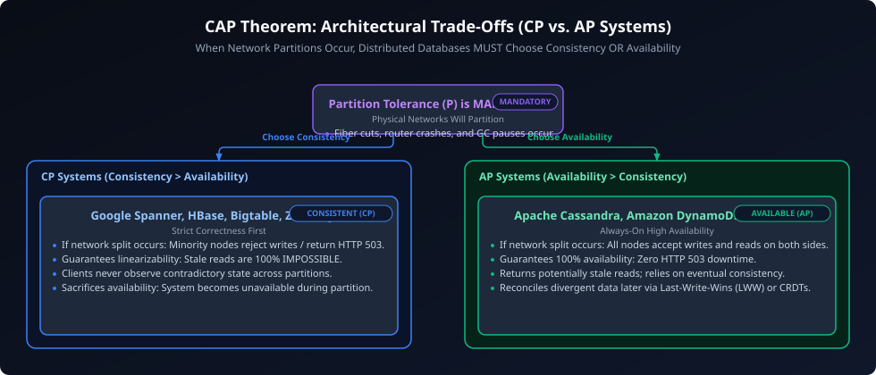

<details>
<summary>View D2 Source</summary>

```d2
direction: down
title: CAP Theorem: Architectural Trade-Offs (CP vs. AP)

p: Partition Tolerance (P) {
  note: "MANDATORY: Physical networks WILL experience latency and partitions"
  style.stroke: "#8b5cf6"
}

cp: CP Systems (Consistency > Availability) {
  examples: "Google Spanner, HBase, Bigtable, ZooKeeper, etcd"
  behavior: "Blocks writes or returns HTTP 503 on minority split; guarantees zero stale reads"
  style.stroke: "#3b82f6"
}

ap: AP Systems (Availability > Consistency) {
  examples: "Apache Cassandra, Amazon DynamoDB, CouchDB"
  behavior: "Accepts reads and writes on both sides; returns eventual data; reconciles conflicts later"
  style.stroke: "#10b981"
}

p -> cp: "Trade Availability for Correctness"
p -> ap: "Trade Consistency for 100% Uptime"
```
</details>

#### Why "CA Systems" Do Not Exist in Reality
Junior engineers frequently ask: *"Can I build a CA database by choosing Consistency and Availability?"*
**The answer is mathematically NO.** 

In the physical world, servers are connected via optical fibers, routers, switches, and cloud virtualization layers. A backhoe cutting an underground fiber cable, a misconfigured router BGP table, or a top-of-rack switch reboot causes a **Network Partition ($P$)**.

When a network partition occurs between Datacenter 1 and Datacenter 2:
- If a client writes to Datacenter 1:
  - If you allow the write and return `200 OK`, a client reading from Datacenter 2 will read stale data $\rightarrow$ **You sacrificed Consistency ($C$) to stay Available ($A$) $\implies$ AP System**.
  - If you refuse the write or block until the partition heals $\rightarrow$ **You sacrificed Availability ($A$) to preserve Consistency ($C$) $\implies$ CP System**.
- You cannot choose to "not have a partition." Therefore, distributed systems are strictly a choice between **CP** and **AP** during partition events.

#### Comprehensive CAP Comparison Matrix

| System Archetype | Trade-off Chosen | Behavior During Network Split | Best Enterprise Use Cases | Canonical Database Examples |
| :--- | :--- | :--- | :--- | :--- |
| **CP (Consistency)** | Discards Availability for Linearizability | Minority partition halts or rejects writes; clients receive timeouts/errors until partition heals. | Core banking ledgers, inventory reservation systems, identity auth. | Google Cloud Spanner, CockroachDB, Apache HBase, ZooKeeper, etcd |
| **AP (Availability)** | Discards Linearizability for Uptime | All nodes accept writes locally; read operations return stale data without error. | Social media feeds, e-commerce shopping carts, telemetry metrics. | Apache Cassandra, Amazon DynamoDB, Apache CouchDB, Riak |

---

### 5.3 PACELC Theorem: Trade-Offs in Normal Operations

#### First-Principles Breakdown: Extending CAP Beyond Partitions
The CAP Theorem is incomplete because network partitions are rare (occurring $<0.01\%$ of operating hours in modern datacenters). What trade-offs govern the system during the $99.99\%$ of the time when the network is operating normally?

In 2012, Professor Daniel Abadi formulated the **PACELC Theorem**:

$$\text{If } \mathbf{P} \text{ (Partition)} \implies \text{Choose } (\mathbf{A} \lor \mathbf{C}), \quad \mathbf{ELSE} \implies \text{Choose } (\mathbf{L} \lor \mathbf{C})$$

- **If there is a Partition ($P$):** How does the system trade off **Availability ($A$)** versus **Consistency ($C$)**?
- **Else ($E$ - Normal Operation):** How does the system trade off **Latency ($L$)** versus **Consistency ($C$)**?

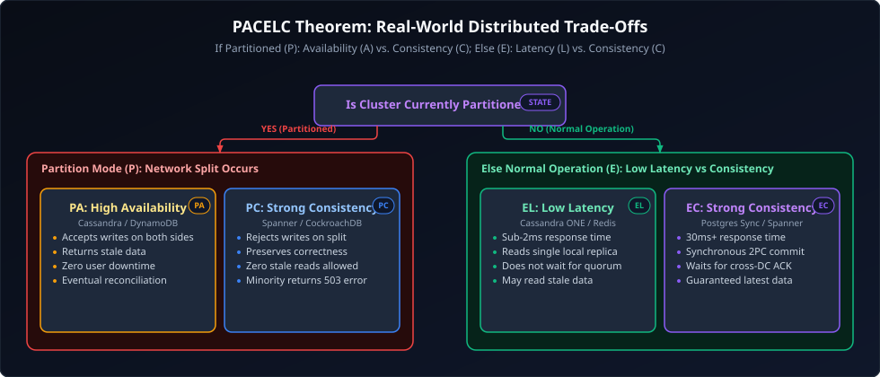

<details>
<summary>View D2 Source</summary>

```d2
direction: down
title: PACELC Theorem: Trade-Offs in Normal vs. Partition Operations

state: Is Cluster Currently Partitioned? {
  shape: diamond
}

partition_mode: Partition Mode (P): Network Split {
  pa: PA: High Availability (Cassandra, DynamoDB) {
    behavior: "Accepts writes, returns stale reads"
  }
  pc: PC: Strong Consistency (Spanner, CockroachDB) {
    behavior: "Rejects writes, preserves correctness"
  }
}

normal_mode: Normal Operation (E): Latency vs Consistency {
  el: EL: Low Latency (Cassandra ONE, DynamoDB Eventual) {
    behavior: "Sub-2ms local replica read; skips quorum"
  }
  ec: EC: Strong Consistency (Spanner TrueTime, Postgres Sync) {
    behavior: "Synchronous multi-replica commit (30ms+)"
  }
}

state -> partition_mode: "If Partitioned (P)"
state -> normal_mode: "Else Normal (E)"
```
</details>

#### The $2 \times 2$ PACELC Classification Matrix

| Classification | Meaning Under Partition ($P$) | Meaning in Normal Operation ($E$) | Latency Profile | Primary Database Implementations |
| :--- | :--- | :--- | :--- | :--- |
| **PC / EC** | Choose Consistency ($PC$) | Choose Consistency ($EC$) | High ($30\text{ms} - 100\text{ms}$): Requires synchronous multi-node quorum consensus on every write. | **Google Spanner, CockroachDB, Apache HBase, PostgreSQL Sync Replica** |
| **PC / EL** | Choose Consistency ($PC$) | Choose Latency ($EL$) | Medium ($5\text{ms} - 15\text{ms}$): Reads served from master cache without quorum check. | **MongoDB (with primary reads), Redis Sentinel** |
| **PA / EL** | Choose Availability ($PA$) | Choose Latency ($EL$) | Ultra-Low ($1\text{ms} - 5\text{ms}$): Asynchronous background replication; writes return instantly. | **Apache Cassandra, Amazon DynamoDB (Default), Couchbase** |
| **PA / EC** | Choose Availability ($PA$) | Choose Consistency ($EC$) | Theoretical anomaly: Rarely chosen because maintaining EC normally makes PA difficult. | Specialized academic research databases |

---

### 5.4 Consensus Algorithms: Raft & Paxos Internals

In distributed computing, **Consensus** is the foundational problem of getting multiple independent servers to agree on a sequence of values or state machine actions, even when servers crash or messages are delayed or reordered.

#### Paxos vs. Raft: Why Raft Won the Enterprise
- **Paxos (Leslie Lamport, 1998):** Historically the premier consensus protocol. Mathematically proven and elegant, but notoriously abstract and difficult to implement in real software. Multi-Paxos requires complex edge-case handling for leader election and log compaction.
- **Raft (Ongaro & Ousterhout, Stanford, 2014):** Explicitly designed to be understandable. It decomposes consensus into three discrete sub-problems: **Leader Election**, **Log Replication**, and **Safety**. Raft powers **Kubernetes (etcd)**, **Kafka 3.x+ (KRaft)**, and **HashiCorp Consul**.

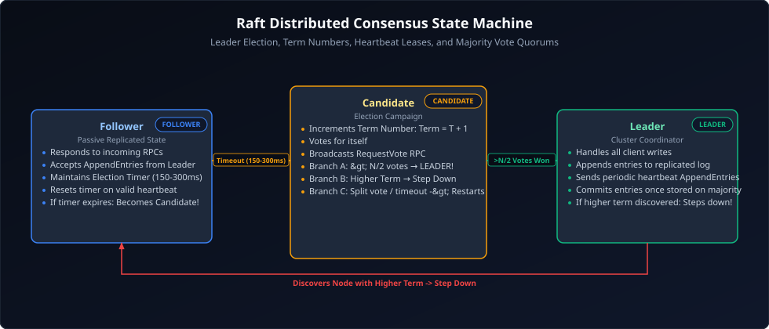

<details>
<summary>View D2 Source</summary>

```d2
direction: right
title: Raft Distributed Consensus State Machine

follower: Follower {
  status: "Passive node responding to RPCs"
  style.stroke: "#3b82f6"
}

candidate: Candidate {
  status: "Campaigning for election in Term T"
  style.stroke: "#f59e0b"
}

leader: Leader {
  status: "Active coordinator managing replicated log"
  style.stroke: "#10b981"
}

follower -> candidate: "Election timeout fires (150-300ms)"
candidate -> leader: "Receives majority votes (> N/2)"
candidate -> follower: "Discovers higher term or valid leader"
candidate -> candidate: "Split vote: Increment term & retry"
leader -> follower: "Discovers higher term -> Steps down"
```
</details>

#### Raft Execution Protocol: Step-by-Step
1. **Node Roles:** Every node is always in one of three states:
   - **Follower:** Completely passive; responds only to incoming RPCs from Leaders and Candidates.
   - **Candidate:** Transitions when election timer expires; requests votes from peers to become Leader.
   - **Leader:** Handles all client requests, dictates log replication order, and sends periodic keepalive heartbeats.
2. **Randomized Election Timeouts:** To prevent **Split Votes** (where two candidates solicit votes simultaneously and tie with 50% each), election timeouts are randomized per node (e.g., between 150ms and 300ms). The node with the shortest timer transitions to Candidate first and claims the leader role.
3. **Log Replication Sequence:**
   - Client sends write command: `SET x = 10`.
   - Leader appends entry to its local log.
   - Leader broadcasts `AppendEntries` RPC to all Follower nodes.
   - Once a **Majority Quorum** ($\lfloor N/2 \rfloor + 1$) of followers acknowledge writing the entry to their local disk logs, the Leader **commits** the entry.
   - Leader executes the entry in its state machine and returns `200 OK` to the client.
   - Followers commit the entry upon receiving the Leader's next heartbeat.

---

### 5.5 Distributed Locks & Fencing Tokens

#### Why Distributed Locking is Hard: The Stop-the-World GC Trap
A distributed lock guarantees that only one worker across an entire cluster executes a critical section (e.g., executing a non-reentrant financial settlement batch).
However, naive lease-based locks (e.g., standard Redis `SET lock:name value EX 30 NX`) suffer from the **Martin Kleppmann Pause Hazard**:

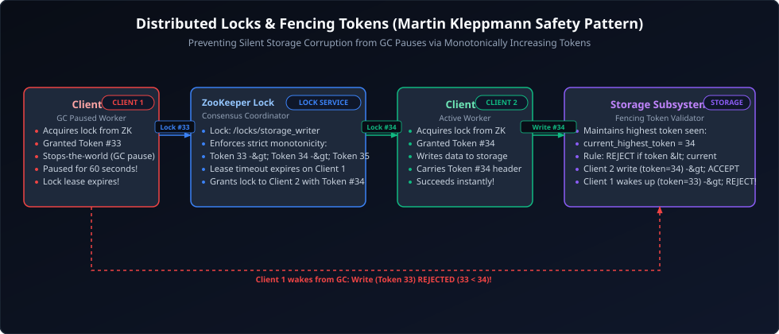

<details>
<summary>View D2 Source</summary>

```d2
direction: right
title: Distributed Locks & Fencing Tokens

c1: Client 1 {
  status: "Acquires lock with Token 33, then hits 60s GC pause"
  style.stroke: "#ef4444"
}

lock_service: Lock Service (ZooKeeper / etcd) {
  counter: "Monotonically increasing fencing tokens (33 -> 34)"
}

c2: Client 2 {
  status: "Acquires lock with Token 34 after lease expires"
  style.stroke: "#10b981"
}

storage: Storage Service {
  rule: "Rejects writes with token < current_token (33 < 34)"
}

c1 -> lock_service: "Acquire lock (Token 33)"
lock_service -> c2: "Lease expired: Grant Token 34"
c2 -> storage: "Write with Token 34 (ACCEPTED)"
c1 -> storage: "Late write with Token 33 (REJECTED!)" {
  style.stroke: "#ef4444"
  style.stroke-dash: 4
}
```
</details>

#### The Architectural Solution: Fencing Tokens
To prevent stale zombie workers from corrupting storage after a long GC pause or network partition, the lock service must issue a monotonically increasing **Fencing Token** (e.g., `Token 43`). Storage targets validate that incoming write tokens are strictly greater than the highest token previously committed:

```python
class FencingTokenStorageEngine:
    """
    Storage layer enforcing optimistic concurrency via monotonically increasing Fencing Tokens.
    Rejects zombie writes from partitioned or GC-paused workers.
    """
    def __init__(self):
        self.highest_token_seen: int = 0
        self.data_store: dict = {}

    def commit_write(self, key: str, value: str, fencing_token: int) -> bool:
        # Atomic check: Fencing token must be strictly greater than any token previously seen
        if fencing_token <= self.highest_token_seen:
            print(f"[REJECTED] Stale fencing token {fencing_token} <= highest seen {self.highest_token_seen}! Aborting zombie write.")
            return False
            
        # Update high-watermark token and commit state
        self.highest_token_seen = fencing_token
        self.data_store[key] = value
        print(f"[COMMITTED] Key '{key}' updated with valid fencing token {fencing_token}")
        return True

# Simulation
storage = FencingTokenStorageEngine()
# Worker 2 commits with token 42
storage.commit_write("balance", "200.00", fencing_token=42)
# Worker 1 wakes up from 40s GC pause and tries to commit with stale token 41
storage.commit_write("balance", "150.00", fencing_token=41)  # REJECTED!
```

---

### 5.6 Leader Election & Split-Brain Mitigation

#### The Split-Brain Problem
When a network partition bisects a 5-node cluster into two isolated sub-networks (e.g., 2 nodes on West coast, 3 nodes on East coast), if both sub-clusters believe the other side is dead, both will elect their own Leader. Clients connected to West write conflicting records to those connected to East, creating **irreparable split-brain data corruption**.

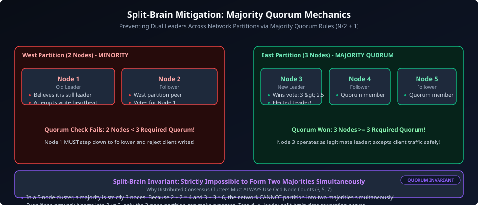

<details>
<summary>View D2 Source</summary>

```d2
direction: right
title: Split-Brain Mitigation: Majority Quorum Mechanics

partition: Network Partition Bisects 5-Node Cluster {
  west: West Partition (2 Nodes) - MINORITY {
    n1: Node 1 (Old Leader)
    n2: Node 2 (Follower)
    rule: "Quorum Fails: 2 < 3. Node 1 MUST step down to follower!"
    style.stroke: "#ef4444"
  }

  east: East Partition (3 Nodes) - MAJORITY QUORUM {
    n3: Node 3 (Elected New Leader)
    n4: Node 4 (Follower)
    n5: Node 5 (Follower)
    rule: "Quorum Won: 3 >= 3. Node 3 operates as legitimate leader"
    style.stroke: "#10b981"
  }
}
```
</details>

#### Quorum Arithmetic: Why Odd Node Counts are Mandatory
In distributed consensus clusters, the minimum number of nodes required to form a majority quorum ($Q$) is defined mathematically as:

$$Q = \left\lfloor \frac{N}{2} \right\rfloor + 1$$

- In a **3-node cluster**: $Q = \lfloor 3/2 \rfloor + 1 = 2$. It survives **1 failed node**.
- In a **4-node cluster**: $Q = \lfloor 4/2 \rfloor + 1 = 3$. It survives **1 failed node**.
- In a **5-node cluster**: $Q = \lfloor 5/2 \rfloor + 1 = 3$. It survives **2 failed nodes**.

*Notice:* A 4-node cluster provides **no extra fault tolerance** over a 3-node cluster (both survive only 1 failure), but requires 3 nodes for quorum instead of 2. Therefore, production consensus clusters (ZooKeeper, etcd, KRaft) **strictly operate with odd numbers of nodes (3, 5, or 7)**.

---

### 5.7 Heartbeats, Failure Detection & Gossip Protocols

#### 1. Phi Accrual Failure Detector (Apache Cassandra)
Traditional binary timeout detectors (`if elapsed > 5s: mark DEAD`) fail in fluctuating cloud environments where network congestion causes temporary latency spikes.
The **Phi Accrual Failure Detector** models heartbeat arrival intervals using a normal/Gaussian distribution and outputs a continuous scale of suspicion ($\Phi$):

$$\Phi = -\log_{10}(P_{\text{later}}(t - t_{\text{last}}))$$

If $\Phi \ge 8$, the probability of a false alarm is $10^{-8}$. Cassandra dynamically adjusts failover thresholds based on network traffic history rather than arbitrary static seconds.

#### 2. The Gossip Protocol (Epidemic State Dissemination)
In clusters of 10,000 nodes, having every node heartbeat to a central master creates an $O(N)$ networking bottleneck.
Cassandra and DynamoDB use **Gossip Protocols**:
- Every second, each node picks $k$ random peer nodes (usually $k=3$) and exchanges state summaries.
- Like a virus or rumor spreading through a population, state updates converge across the entire $N$-node cluster in $O(\log N)$ network rounds with zero centralized coordinator.

---

# 6. Distributed Data Architecture

---

### 6.1 Horizontal vs. Vertical Scaling: Hardware Limits & Amdahl's Law

#### Architectural Overview & Scalability Mechanics
When a data warehouse, transactional datastore, or distributed processing engine experiences throughput saturation or storage depletion, engineering teams face a fundamental architectural choice: expand the computing resources of the existing host (**Vertical Scaling / Scale-Up**) or partition the workload across a cluster of cooperating hosts (**Horizontal Scaling / Scale-Out**).

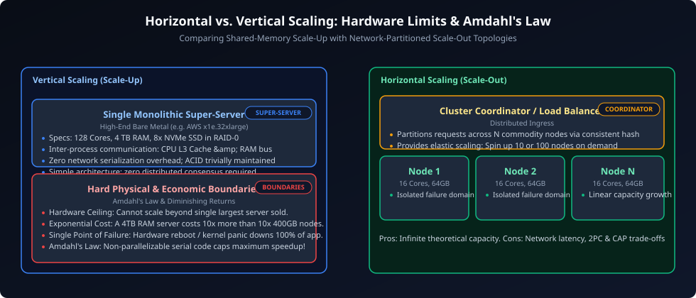

<details>
<summary>View D2 Source</summary>

```d2
direction: right
title: Horizontal vs. Vertical Scaling: Hardware Limits & Amdahl's Law

scale_up: Vertical Scaling (Scale-Up) {
  server: Single Large Host (128 Cores, 4TB RAM) {
    features: "Shared memory IPC, zero network overhead"
    limits: "Hardware ceiling, exponential cost, single point of failure"
  }
}

scale_out: Horizontal Scaling (Scale-Out) {
  lb: Load Balancer / Shard Router
  n1: Node 1 (16 Cores, 64GB)
  n2: Node 2 (16 Cores, 64GB)
  n_n: Node N (16 Cores, 64GB)
  lb -> n1
  lb -> n2
  lb -> n_n
  features: "Infinite elastic scaling, fault isolation, commodity pricing"
}
```
</details>

#### 1. Vertical Scaling (Scale-Up): Anatomy & Physics
Vertical scaling involves migrating the database instance to larger hardware—provisioning faster CPU clock speeds, higher core counts, denser RAM configurations, and higher IOPS NVMe arrays on a single motherboard.
- **Under-the-Hood Advantages:** All inter-thread communication operates within the host boundary via shared memory bus architectures and CPU caches (L1/L2/L3). Queries achieve strict transactional serializability without distributed two-phase commit ($2\text{PC}$) protocols or cross-network data serialization.
- **The Physical Hardware Wall:** Vertical scaling is bounded by motherboard physics. Multi-socket architectures encounter **Non-Uniform Memory Access (NUMA)** penalties where accessing remote memory over interconnects (e.g., AMD Infinity Fabric, Intel UPI) incurs significant latency penalties. Furthermore, single-motherboard chassis encounter cooling thresholds, memory controller channel saturation, and catastrophic single-point-of-failure (SPOF) risks where hardware faults take down the entire datastore.
- **Cost Exponentiality:** The price curve for specialized extreme-memory enterprise instances scales exponentially relative to commodity compute instances.

#### 2. Horizontal Scaling (Scale-Out): Anatomy & Physics
Horizontal scaling distributes partitions of data and query execution across an elastic fleet of independent commodity nodes interconnected via a high-speed local network (e.g., 25–100 Gbps Ethernet or InfiniBand).
- **Under-the-Hood Advantages:** Storage capacity and computational throughput scale linearly ($O(N)$) simply by commissioning additional commodity nodes. Nodes operate in distinct physical fault domains (separate racks, power supplies, availability zones), allowing automated failover orchestrators to absorb hardware crashes without service interruptions.
- **The Distributed Complexity Tax:** Inter-node communication must cross network boundaries via TCP/IP or RDMA. Distributed joins mandate network data shuffles, data serialization/deserialization (Protobuf, Arrow, Avro), distributed lock managers, consensus protocols (Raft, Paxos), and complex partial-failure recovery mechanics.

#### Comprehensive Architecture Comparison: Scale-Up vs. Scale-Out

| Dimension | Vertical Scaling (Scale-Up) | Horizontal Scaling (Scale-Out) |
| :--- | :--- | :--- |
| **Architectural Concept** | Upgrade single server to 128 Cores, 4TB RAM, 100Gbps NIC | Cluster 500 commodity nodes (16 Cores, 64GB RAM each) |
| **Physical Ceiling** | **Hardware Wall:** Maximum RAM sockets and PCI-e lanes per motherboard | **Virtually Infinite:** Scale to 10,000+ nodes (Google, Meta, AWS) |
| **Network & Shuffling Overhead** | **Zero:** Inter-thread communication occurs via local L3 CPU cache and RAM | High: Requires network shuffles, TCP socket pools, serialization |
| **Cost Scaling Curve** | Exponential (Specialized multi-socket supercomputers cost \$500k+) | Linear (Pay for commodity VMs by the hour) |
| **Fault Tolerance Model** | Single point of failure: Motherboard/Power supply failure halts everything | Resilient: Worker crashes trigger automated task reassignment |

#### Amdahl's Law
Amdahl's law proves that the theoretical speedup of a distributed task is limited by the serial (non-parallelizable) fraction of the program ($S$):

$$\text{Speedup}(N) = \frac{1}{S + \frac{1 - S}{N}}$$

If 5% of your data pipeline is strictly serial (e.g., initial metadata catalog lock or final single-thread file manifest commit), **adding 10,000 servers can never speed up the job by more than 20x**, regardless of cluster budget!

---

### 6.2 Sharding vs. Partitioning: Topologies & Key Selection

- **Partitioning:** Slicing a large table into distinct physical files residing **on the same single database server** (e.g., PostgreSQL table partitioning by month). Improves local disk I/O through partition pruning.
- **Sharding:** Distributing distinct slices of data across **completely separate physical database servers located on distinct network IP addresses** (e.g., MongoDB, Citus, Spanner).

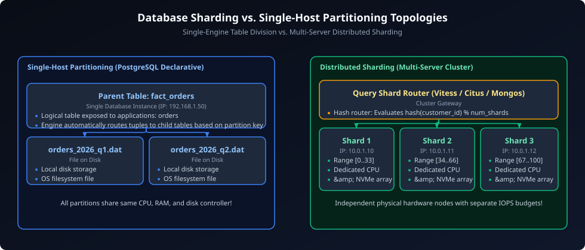

<details>
<summary>View D2 Source</summary>

```d2
direction: right
title: Database Sharding vs. Single-Host Partitioning Topologies

single_host: Single-Host Partitioning (PostgreSQL) {
  parent: Parent Table: fact_orders (Single Instance)
  f1: orders_2026_q1.dat
  f2: orders_2026_q2.dat
  parent -> f1
  parent -> f2
  note: "All partitions share single host CPU, RAM, and disk bus"
}

sharded: Distributed Sharding (Multiple Network Hosts) {
  router: Query Shard Router
  db1: Shard 1 (Server 1 - IP: 10.0.1.10)
  db2: Shard 2 (Server 2 - IP: 10.0.1.11)
  db3: Shard 3 (Server 3 - IP: 10.0.1.12)
  router -> db1: "hash in [0, 33]"
  router -> db2: "hash in [34, 66]"
  router -> db3: "hash in [67, 100]"
  note: "Dedicated compute, memory, and disk IOPS per shard"
}
```
</details>

#### The Hotspotting / Shard Skew Trap
If you shard a database table by a monotonically increasing sequential key (e.g., `created_at` timestamp or auto-incrementing `id`), **100% of all current write traffic slams into the single shard holding the latest range**, while all remaining 99 shards sit idle!
- **Mitigation:** Use Compound Sharding Keys (e.g., `(tenant_id, created_at)`) or Cryptographic Hash Sharding (`MD5(customer_id)`) to scatter write traffic uniformly across all cluster nodes.

---

### 6.3 Consistent Hashing & Virtual Nodes (V-Nodes)

#### The Problem with Modulo Hashing
In basic modular hashing (`node_id = hash(key) % N`), if you have 9 nodes ($N=9$) and add 1 node to handle traffic ($N=10$), **almost 100% of all keys rehash to completely different servers**. This triggers a catastrophic network re-shuffling storm that exhausts database IOPS.

#### Mechanics of the Consistent Hash Ring
Consistent Hashing maps both **Data Keys** and **Physical Nodes** onto an abstract circular integer ring ($0$ to $2^{32} - 1$):
1. Compute hash of each server's IP address: `pos = hash(IP)`.
2. Compute hash of incoming data key: `pos = hash(key)`.
3. To assign a key to a server, move **clockwise** around the ring until you encounter the first server.
4. When a new node joins, **only $K / N$ keys are reassigned** (where $K$ is total keys, $N$ is total servers).

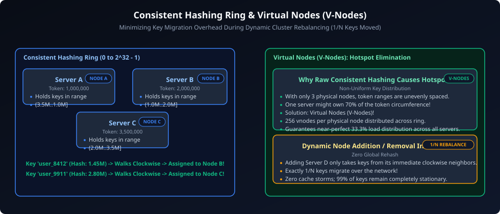

<details>
<summary>View D2 Source</summary>

```d2
direction: right
title: Consistent Hashing Ring & Virtual Nodes (V-Nodes)

ring: Consistent Hashing Ring (0 to 2^32 - 1) {
  node_a: Server A (Token: 1,000,000)
  node_b: Server B (Token: 2,000,000)
  node_c: Server C (Token: 3,500,000)
  k1: Key 'user_8412' (Hash: 1.45M)
  k2: Key 'user_9911' (Hash: 2.80M)

  k1 -> node_b: "Walk Clockwise"
  k2 -> node_c: "Walk Clockwise"
}

vnodes: Virtual Nodes (V-Nodes: 256 per node) {
  benefit1: "Eliminates token range hotspots"
  benefit2: "Adding/removing node migrates exactly 1/N keys"
}

ring -> vnodes: "V-Node Enhancement"
```
</details>

#### Why Virtual Nodes (V-Nodes) are Essential
In a simple ring with only 3 physical servers, nodes are rarely spaced uniformly. One server may end up responsible for 70% of the ring's arc, creating a massive hot-spot.
- **Solution (V-Nodes):** Each physical machine is mapped to **100 to 256 virtual points** on the ring (e.g., `ServerA#1`, `ServerA#2`, ...). This shreds data keys into tiny chunks and distributes keys uniformly across machines with less than 3% variance.

#### Production Python Consistent Hashing Ring with V-Nodes
```python
import hashlib
import bisect
from typing import Dict, List, Optional

class ConsistentHashRing:
    """
    Thread-safe Consistent Hash Ring implementation with Virtual Nodes (V-Nodes),
    ensuring uniform key distribution and minimal reassignment churn on cluster resize.
    """
    def __init__(self, replicas_per_node: int = 100):
        self.replicas_per_node = replicas_per_node
        self.ring: Dict[int, str] = {}         # Ring Token (Integer) -> Physical Node Hostname
        self.sorted_keys: List[int] = []       # Sorted array of tokens for binary search

    def _hash(self, key_str: str) -> int:
        """Computes deterministic 32-bit integer token from MD5 digest."""
        digest = hashlib.md5(key_str.encode("utf-8")).hexdigest()
        return int(digest[:8], 16)  # Extract first 8 hex chars (32-bit uint)

    def add_node(self, node: str) -> None:
        """Adds a physical server, placing replicas_per_node V-node tokens on the ring."""
        for i in range(self.replicas_per_node):
            vnode_key = f"{node}#vnode_{i}"
            token = self._hash(vnode_key)
            self.ring[token] = node
            bisect.insort(self.sorted_keys, token)
        print(f"[CLUSTER] Node {node} registered ({self.replicas_per_node} V-nodes created).")

    def remove_node(self, node: str) -> None:
        """Removes a physical server and evicts its V-nodes from the ring."""
        for i in range(self.replicas_per_node):
            vnode_key = f"{node}#vnode_{i}"
            token = self._hash(vnode_key)
            if token in self.ring:
                del self.ring[token]
                idx = bisect.bisect_left(self.sorted_keys, token)
                del self.sorted_keys[idx]
        print(f"[CLUSTER] Node {node} evicted from ring.")

    def get_node(self, key: str) -> Optional[str]:
        """Routes a data key to the nearest physical node moving clockwise around the ring."""
        if not self.ring:
            return None
        token = self._hash(key)
        # Binary search for the first V-node token >= key token
        idx = bisect.bisect_right(self.sorted_keys, token)
        # Wrap around to 0 if key exceeds highest token on ring
        if idx == len(self.sorted_keys):
            idx = 0
        return self.ring[self.sorted_keys[idx]]

# Verification
ring = ConsistentHashRing(replicas_per_node=150)
ring.add_node("node-1.db.internal")
ring.add_node("node-2.db.internal")
ring.add_node("node-3.db.internal")

keys = [f"customer_{i}" for i in range(1000)]
assignments = collections.Counter(ring.get_node(k) for k in keys)
print("Distribution across nodes (Uniformity Check):", dict(assignments))
```

---

### 6.4 Database Replication Topologies: Single-Leader, Multi-Leader & Leaderless

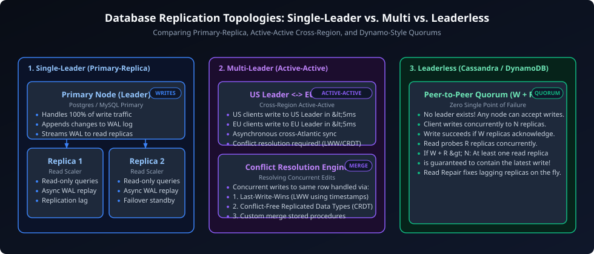

<details>
<summary>View D2 Source</summary>

```d2
direction: right
title: Database Replication Topologies

single_leader: 1. Single-Leader (Postgres / MySQL) {
  leader: Primary Node (Accepts Writes)
  rep1: Replica 1 (Read-Only)
  rep2: Replica 2 (Read-Only)
  leader -> rep1: "Replication Stream"
  leader -> rep2: "Replication Stream"
}

multi_leader: 2. Multi-Leader (Cross-Region Active-Active) {
  us_lead: US Region Leader
  eu_lead: EU Region Leader
  us_lead <-> eu_lead: "Async cross-region sync & conflict resolution"
}

leaderless: 3. Leaderless (Cassandra / DynamoDB) {
  client: Client Write / Read
  n_a: Storage Node A
  n_b: Storage Node B
  n_c: Storage Node C
  client -> n_a: "Quorum write"
  client -> n_b: "Quorum write"
  client -> n_c: "Quorum write"
  note: "Tunable Consistency: W + R > N guarantees strong consistency"
}
```
</details>

#### Detailed Architecture Comparison

| Trait | Single-Leader | Multi-Leader (Active-Active) | Leaderless (Dynamo-Style) |
| :--- | :--- | :--- | :--- |
| **Write Routing** | All writes must land on the 1 designated Leader node | Writes routed to nearest geographical regional Leader | Writes broadcast to any coordinator or multiple nodes |
| **Write Scalability** | **Bottlenecked:** Limited to the write throughput of 1 physical master | High: Parallel writes accepted across all regions | **Virtually Infinite:** Scales linearly as nodes are added |
| **Conflict Resolution** | None needed: Master defines single global serialized order | **Complex:** Requires Last-Write-Wins (LWW) or CRDTs | Resolved at read time via Quorum overlaps & Read Repair |
| **Failover Hazard** | Requires Leader Election (e.g. Patroni/MHA) taking 10-30s | Highly resilient: Local region survives remote outage | Zero failover latency: Survives node crashes seamlessly |

---

### 6.5 Replication Lag & Consistency Guarantees

When reading from asynchronous read-replicas, network delay induces **Replication Lag**. This manifests in three canonical user-facing bugs:

1. **Violation of Read-After-Write (Read-Your-Own-Writes) Consistency:**
   - *Symptom:* A user edits their profile name from `"Alice"` to `"Alicia"` and clicks save. The page refreshes, routes the read query to a lagging replica, and displays `"Alice"`. The user panics, thinking their update was lost.
   - *Fix:* Route reads for the user's *own* profile to the Leader for 60 seconds following any write, or track client Log Sequence Numbers (LSN) in session cookies.
2. **Violation of Monotonic Reads (Time Travel Illusion):**
   - *Symptom:* A user refreshes their feed and sees a comment posted 2 minutes ago. They refresh again; this second request hits a replica lagging 5 minutes behind, and the comment magically vanishes!
   - *Fix:* Ensure a given user's read requests are deterministically hashed to the same replica instance.
3. **Violation of Consistent Prefix Reads (Causal Inversion):**
   - *Symptom:* In a group chat, Bob asks: *"Do you know the answer?"* and Alice replies: *"Yes, it is 42."* An external observer sees Alice's answer appear *before* Bob's question because the two messages replicated over different partition paths.
   - *Fix:* Causally related records must share the same sharding partition key.

---

### 6.6 Quorum Mathematics: Overlaps & Tunable Consistency ($W + R > N$)

In leaderless distributed databases (Cassandra, DynamoDB, ScyllaDB), strong consistency is governed by the **Quorum Overlap Inequality**:

$$W + R > N$$

- $N$ = Replication factor (Total replica copies stored).
- $W$ = Write Quorum (Number of replicas that must acknowledge a write before returning success).
- $R$ = Read Quorum (Number of replicas that must respond to a read request).

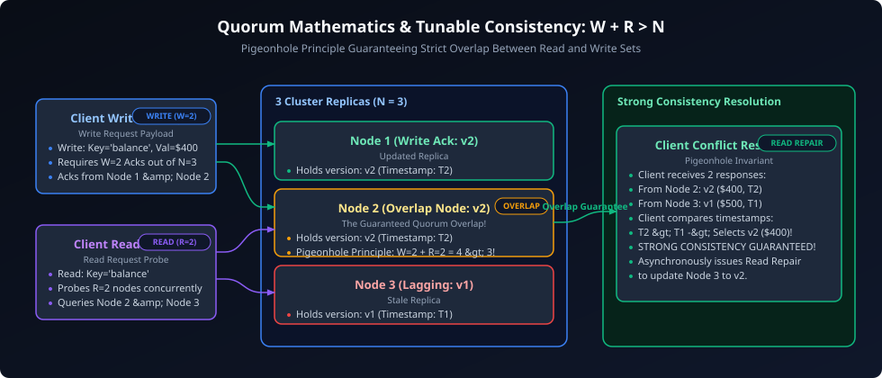

<details>
<summary>View D2 Source</summary>

```d2
direction: right
title: Quorum Mathematics & Tunable Consistency (W + R > N)

write_req: Client Write (W = 2)
read_req: Client Read (R = 2)

replicas: 3 Replicas (N = 3) {
  n1: Node 1 (Write Ack: v2) {
    style.stroke: "#10b981"
  }
  n2: Node 2 (Guaranteed Overlap Node: v2) {
    style.stroke: "#f59e0b"
  }
  n3: Node 3 (Lagging Stale: v1) {
    style.stroke: "#ef4444"
  }
}

client_resolution: Strong Consistency Resolution {
  result: Client inspects v2 and v1 -> Selects v2 (Latest Timestamp)
  repair: Read Repair updates Node 3 to v2
}

write_req -> replicas.n1: "Write Ack"
write_req -> replicas.n2: "Write Ack"
read_req -> replicas.n2: "Read Probe"
read_req -> replicas.n3: "Read Probe"
replicas.n2 -> client_resolution: "Guaranteed Overlap"
```
</details>

#### Why the Overlap Guarantees Correctness: The Pigeonhole Principle
If $N=3, W=2, R=2$:
$$W + R = 4 > 3$$
By Dirichlet's Pigeonhole Principle, the set of nodes written to and the set of nodes read from **must intersect on at least one physical server**. That intersecting server returns the newest version token (timestamp). The client discards the older version and achieves **Strong Consistency**.

#### Tunable Consistency Configuration Profiles

| Desired SLA Profile | $W$ Setting | $R$ Setting | Latency Profile | Consistency Level |
| :--- | :--- | :--- | :--- | :--- |
| **Fastest Writes (IoT Ingestion)** | `W = 1` | `R = ALL (3)` | Write: Sub-1ms | Read: Slow, Strong Consistency |
| **Fastest Reads (Cache Serving)** | `W = ALL (3)` | `R = 1` | Read: Sub-1ms | Write: Slow, Strong Consistency |
| **Balanced Enterprise Standard** | `W = QUORUM (2)` | `R = QUORUM (2)` | Balanced | **Strong Consistency ($W + R > N$)** |
| **Maximum Availability (AP)** | `W = 1` | `R = 1` | Ultra-fast ($<2\text{ms}$) | **Eventual Consistency ($W + R \le N$)** |

---

### 6.7 Consistency Spectrum: Linearizability to Eventual Consistency

Distributed systems do not operate in a binary "strong vs. eventual" world. They exist along a formal hierarchy of consistency models:

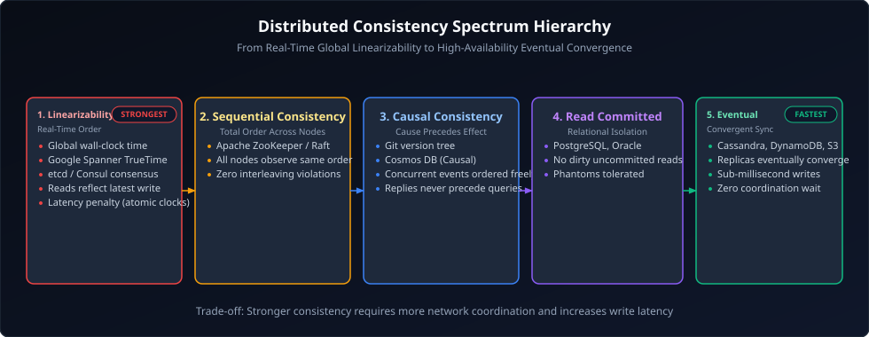

<details>
<summary>View D2 Source</summary>

```d2
direction: right
title: Distributed Consistency Spectrum Hierarchy

c1: 1. Strict Linearizability {
  examples: "Google Spanner TrueTime, etcd"
  desc: "Global real-time clock order; zero stale reads"
  style.stroke: "#ef4444"
}

c2: 2. Sequential Consistency {
  examples: "Apache ZooKeeper, Raft replicated log"
  desc: "Operations executed in identical sequence across nodes"
}

c3: 3. Causal Consistency {
  examples: "Git commit history, Cosmos DB Causal"
  desc: "Causally related writes preserved in order"
}

c4: 4. Read Committed {
  examples: "PostgreSQL, Oracle Database"
  desc: "Zero dirty reads; queries only read committed rows"
}

c5: 5. Eventual Consistency {
  examples: "Apache Cassandra, Amazon DynamoDB, AWS S3"
  desc: "Replicas converge over time; sub-millisecond writes"
  style.stroke: "#10b981"
}

c1 -> c2: "Relax real-time"
c2 -> c3: "Relax total order"
c3 -> c4: "Relax causal graph"
c4 -> c5: "Relax transactional view"
```
</details>

| Consistency Model | Network Overhead | Write Latency | Stale Reads Possible? | Typical Systems |
| :--- | :---: | :---: | :---: | :--- |
| **Linearizability** | Highest (2PC / TrueTime) | High (Multi-round consensus) | **Never** | Google Cloud Spanner, etcd |
| **Sequential** | High (Log replication) | Moderate | No | Apache ZooKeeper, KRaft Controller |
| **Causal** | Moderate (Vector clocks) | Low | No for causal chains | AWS DynamoDB, Azure Cosmos DB |
| **Read Committed** | Low (Row locks / MVCC) | Very Low | Yes across transactions | PostgreSQL, MySQL InnoDB |
| **Eventual** | Lowest (Async anti-entropy) | Lowest (Local writes) | Yes during network lag | Apache Cassandra, Amazon S3, ADLS Gen2 |

1. **Linearizability (Strong Consistency):** Global real-time clock ordering. Once a write completes anywhere, all subsequent reads across the planet see that write or a newer one.
2. **Sequential Consistency:** Operations do not need to match wall-clock time, but all nodes observe writes in the exact same sequence.
3. **Causal Consistency:** Causally dependent operations (cause $\rightarrow$ effect) are ordered identically everywhere; concurrent operations may be seen in differing orders.
4. **Eventual Consistency:** In the absence of new updates, all replicas eventually converge to the identical value. (Sub-second convergence via Read Repair and Anti-Entropy Merkle tree syncs).

> [!TIP]
> **Deep-Dive Interview Scenarios:**
> - [Q1. Distributed Data Organization: Partitioning vs Sharding vs Bucketing](frequently_asked_questions/04_database_internals_and_distributed_systems_faq.md#q1-easy-distributed-data-organization-partitioning-vs-sharding-vs-bucketing)
> - [Q2. Consistent Hashing & Distributed Ring Topology](frequently_asked_questions/04_database_internals_and_distributed_systems_faq.md#q2-medium-consistent-hashing--distributed-ring-topology)
> - [Q6. Azure Synapse Analytics: Dedicated vs Serverless SQL Pools](frequently_asked_questions/04_database_internals_and_distributed_systems_faq.md#q6-easy-azure-synapse-analytics-dedicated-vs-serverless-sql-pools)
> - [Q11. Multi-Cloud Architecture: AWS & Azure Secure Federation](frequently_asked_questions/04_database_internals_and_distributed_systems_faq.md#q11-medium-multi-cloud-architecture-aws--azure-secure-federation)
> - [Q12. End-to-End AWS Glue PySpark ETL Pipeline](frequently_asked_questions/04_database_internals_and_distributed_systems_faq.md#q12-medium-end-to-end-aws-glue-pyspark-etl-pipeline)
> - [Q13. Amazon Athena vs Amazon Redshift & Distribution Styles](frequently_asked_questions/04_database_internals_and_distributed_systems_faq.md#q13-easy-amazon-athena-vs-amazon-redshift--distribution-styles)
> - [Q14. Packaging Custom Dependencies in AWS Lambda Layers](frequently_asked_questions/04_database_internals_and_distributed_systems_faq.md#q14-medium-packaging-custom-dependencies-in-aws-lambda-layers)
> - [Q17. Change Data Capture (CDC) vs Change Data Tracking (CDT) Internals](frequently_asked_questions/04_database_internals_and_distributed_systems_faq.md#q17-hard-change-data-capture-cdc-vs-change-data-tracking-cdt-internals)
> - [Q19. Compound Upstream SLA Availability & Distributed System Reliability Analysis](frequently_asked_questions/04_database_internals_and_distributed_systems_faq.md#q19-medium-compound-upstream-sla-availability--distributed-system-reliability-analysis)

---

# 7. API Protocols & Communication Architectures

---

### 7.1 REST vs. GraphQL vs. gRPC: Wire Protocols & Benchmarks

Modern data pipelines integrate with external SaaS endpoints and internal microservices across three primary API protocols:

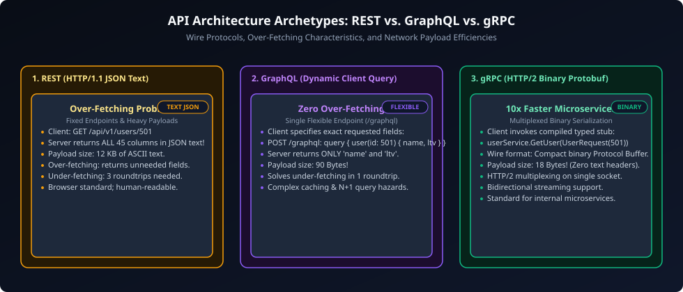

<details>
<summary>View D2 Source</summary>

```d2
direction: right
title: API Protocols: REST vs. GraphQL vs. gRPC

rest: 1. REST (HTTP/1.1 JSON Text) {
  client: Client App
  server: REST Server
  client -> server: "GET /api/v1/users/501"
  server -> client: "Returns all 45 columns in JSON text (Heavy Over-Fetching)"
}

graphql: 2. GraphQL (Dynamic Query) {
  gclient: Client App
  gserver: GraphQL Server
  gclient -> gserver: "POST /graphql: query { user { name ltv } }"
  gserver -> gclient: "Returns exact requested fields (Zero Over-Fetching)"
}

grpc: 3. gRPC (HTTP/2 Multiplexed Protobuf) {
  pclient: Worker Microservice
  pserver: gRPC Server
  pclient -> pserver: "UserRequest(id=501) via compiled RPC stub"
  pserver -> pclient: "Binary compressed Protobuf byte buffer (10x faster)"
}
```
</details>

#### Detailed Architecture Comparison Matrix

| Technical Trait | REST (Representational State Transfer) | GraphQL | gRPC (Google Remote Procedure Call) |
| :--- | :--- | :--- | :--- |
| **Transport Layer** | HTTP/1.1 (or HTTP/2) | HTTP/1.1 (or HTTP/2) | **HTTP/2 (Mandatory Multiplexing)** |
| **Payload Serialization** | JSON (Plaintext human-readable string) | JSON (Plaintext string) | **Protocol Buffers (Compact Binary Format)** |
| **Typing & Contract** | OpenAPI / Swagger (Optional external spec) | Strict GraphQL Schema Definition (`schema.graphql`) | **Strict `.proto` Interface Definition Language (IDL)** |
| **Network Efficiency** | Moderate: High header overhead, JSON serialization cost | High: Client requests exact fields needed | **Extreme: 70-80% smaller payloads, 10x lower CPU SerDe** |
| **Streaming Capabilities** | Server-Sent Events (SSE) / Polling | Subscriptions (WebSocket based) | **Bi-directional streaming native on single TCP socket** |
| **Best Pipeline Fit** | Public third-party SaaS integration (Stripe, HubSpot) | Dynamic front-end analytics dashboards | **High-throughput internal inter-microservice streaming** |

#### Protocol Buffers Schema Definition (`analytics.proto`)
```protobuf
syntax = "proto3";

package enterprise.analytics;

// Strongly-typed telemetry event definition
message TelemetryEvent {
  string event_uuid = 1;
  int64 user_id = 2;
  double transaction_amount = 3;
  int64 epoch_timestamp_ms = 4;
  enum DeviceType {
    UNKNOWN = 0;
    MOBILE = 1;
    DESKTOP = 2;
    IOT_SENSOR = 3;
  }
  DeviceType device = 5;
}

// Ingestion service definition
service IngestionService {
  rpc StreamTelemetry(stream TelemetryEvent) returns (IngestionResponse);
}

message IngestionResponse {
  bool success = 1;
  int64 records_committed = 2;
}
```

---

### 7.2 HTTP Methods, Idempotency & Resilient Status Code Handling

#### Method Semantics & Pipeline Idempotency
- `GET`: Safe & Idempotent. Must never mutate server state.
- `POST`: **Non-Idempotent**. Re-sending a `POST /api/orders` retries payment processing, risking duplicate credit card charges.
- `PUT`: **Idempotent**. Completely replaces the target resource at the URL. Re-running 5 times leaves identical state.
- `PATCH`: Partially mutates attributes. May or may not be idempotent depending on server implementation.
- `DELETE`: **Idempotent**. Removes the resource. Re-deleting returns `404 Not Found` or `204 No Content` without further state changes.

#### Production Pipeline HTTP Status Code Action Matrix

| Status Code | Meaning | Pipeline Retry Strategy | Action Taken by Worker |
| :--- | :--- | :--- | :--- |
| **`200 OK` / `201 Created`** | Request Succeeded | Do Not Retry | Parse response body, commit watermark to checkpoint table. |
| **`400 Bad Request`** | Schema Violation / Invalid JSON | **Fatal (Do Not Retry)** | Route payload to Dead Letter Queue (DLQ) quarantine; notify team. |
| **`401 Unauthorized`** | Expired Access Token | **Retry Once** | Invalidate cached OAuth2 token, fetch fresh JWT, and replay request. |
| **`403 Forbidden`** | Insufficient IAM Scope | **Fatal (Do Not Retry)** | Fail pipeline immediately; alert security administrator. |
| **`404 Not Found`** | Resource Missing | Do Not Retry | Treat as soft delete or log warning depending on contract. |
| **`429 Too Many Requests`** | Rate Limit Exceeded | **Retryable** | Extract `Retry-After` header; execute Exponential Backoff with Jitter. |
| **`500 Internal Error`** | Upstream Crash | **Retryable** | Wait with exponential backoff; retry up to 5 times. |
| **`502 Bad Gateway` / `503 Unavailable`** | Proxy or Node Restarting | **Retryable** | Immediate transient network retry with jitter. |

---

# 8. API Authentication & Security

---

### 8.1 API Keys & Bearer Tokens (Cryptographic JWT Anatomy)

A **JSON Web Token (JWT)** is a compact, URL-safe cryptographic token structured into three distinct dot-separated segments:

$$\text{JWT} = \text{Base64Url}(\text{Header}) \; . \; \text{Base64Url}(\text{Payload}) \; . \; \text{Cryptographic Signature}$$

```json
    // "header": 
    {
        "alg": "HS256",
        "typ": "JWT"
    }
    // "payload": 
    {
        "sub": "user_12345",
        "iat": 1700000000,
        "exp": 1700003600,
        "roles": ["admin", "data_ingest"]
    }
    // "signature": "a-string-secret-at-least-256-bits-long"

// Gets Encoded as: 
// eyJhbGciOiJIUzI1NiIsInR5cCI6IkpXVCJ9.        -> 1. HEADER (Algorithm & Type)
// eyJzdWIiOiJ1c2VyXzEyMzQ1IiwiaWF0IjoxNzAw...  -> 2. PAYLOAD (Claims & Subject)
// DWkrkUkOXitp6TASupJi-vV7l7C84yUiPWAZ4_cDO0k  -> 3. SIGNATURE (Cryptographic Proof)
```

| Segment | Encoded Sample | Decoded JSON Payload / Cryptographic Role |
| :--- | :--- | :--- |
| **1. Header** | `eyJhbGciOiJSUzI1NiIsInR5cCI6IkpXVCJ9` | `{"alg": "RS256", "typ": "JWT"}` — Declares RSA-SHA256 signature algorithm. |
| **2. Payload** | `eyJzdWIiOiJwaXBlbGluZSIsImV4cCI6MTgwMDAwMDAwMH0` | `{"sub": "pipeline", "scope": ["read:orders"], "exp": 1800000000}` — Claims & permissions. |
| **3. Signature** | `M3x_9kLz1Op...` | $S = \text{Sign}_{\text{PrivateKey}}(\text{Header} + "." + \text{Payload})$ — Guarantees non-repudiation. |

#### JWT Internal Fields & Verification Logic
- **Header:** Contains the signing algorithm (`"alg": "RS256"`) and token type (`"typ": "JWT"`).
- **Payload (Registered Claims):**
  - `sub` (Subject): The client service identity (e.g., `pipeline-worker-prod`).
  - `iss` (Issuer): The identity provider issuing the token (e.g., `https://auth.company.corp`).
  - `exp` (Expiration): Epoch timestamp when the token becomes invalid.
  - `scope`: Granted privileges (e.g., `["read:customers", "write:lakehouse"]`).
- **Signature:** Computed by hashing the header and payload with the identity provider’s **Private RSA Key**. The data pipeline verifies the signature locally using the provider's **Public RSA Key** ($O(1)$ verification without making network calls).

---

### 8.2 OAuth 2.0 Client Credentials Grant for M2M Pipelines

Automated data pipelines operate as headless background jobs without human interactive logins. They authenticate using the **OAuth 2.0 Client Credentials Grant**:

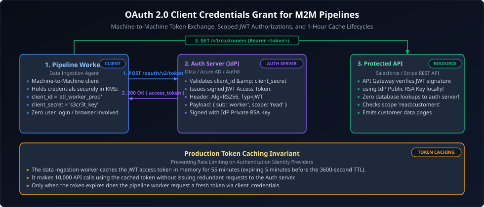

<details>
<summary>View D2 Source</summary>

```d2
direction: right
title: OAuth 2.0 Client Credentials Grant for M2M Pipelines

pipeline: Data Ingestion Worker {
  creds: "client_id, client_secret stored in KMS"
}

auth: OAuth 2.0 Auth Server (Okta / Azure AD) {
  token: "Generates signed JWT Access Token (expires in 3600s)"
}

saas: Protected SaaS API (Salesforce / Stripe) {
  validator: "Verifies JWT RSA signature locally via public key"
}

pipeline -> auth: "1. POST /oauth/v2/token (client_credentials)"
auth -> pipeline: "2. 200 OK {access_token: 'eyJ...', expires_in: 3600}"
pipeline -> saas: "3. Loop GET /v1/customers (Header: Bearer <token>)"
saas -> pipeline: "4. Return customer records"
```
</details>

#### Production Python OAuth2 Token Manager with Auto-Refresh
```python
import time
import requests
from typing import Dict

class OAuth2TokenManager:
    """
    Thread-safe OAuth 2.0 Client Credentials token manager.
    Caches bearer JWT in memory and automatically refreshes 5 minutes prior to expiry.
    """
    def __init__(self, token_url: str, client_id: str, client_secret: str, scope: str = ""):
        self.token_url = token_url
        self.client_id = client_id
        self.client_secret = client_secret
        self.scope = scope
        self._cached_token: str = ""
        self._expiry_timestamp: float = 0.0

    def get_valid_token(self) -> str:
        # Check if cached token is still valid (with 300-second safety buffer)
        if self._cached_token and time.time() < (self._expiry_timestamp - 300):
            return self._cached_token

        # Fetch fresh token via client_credentials grant
        payload = {
            "grant_type": "client_credentials",
            "client_id": self.client_id,
            "client_secret": self.client_secret,
        }
        if self.scope:
            payload["scope"] = self.scope

        response = requests.post(self.token_url, data=payload, timeout=15.0)
        response.raise_for_status()
        token_data = response.json()

        self._cached_token = token_data["access_token"]
        expires_in = token_data.get("expires_in", 3600)
        self._expiry_timestamp = time.time() + float(expires_in)
        print(f"[AUTH] Successfully refreshed OAuth2 token. Valid for {expires_in}s.")
        return self._cached_token
```

---

### 8.3 Mutual TLS (mTLS) for Zero Trust Pipeline Ingress

In standard TLS, only the server proves its identity via a certificate; the client remains anonymous until it sends an HTTP header.
In **Mutual TLS (mTLS)**, both client and server present X.509 certificates during the initial TCP handshake:

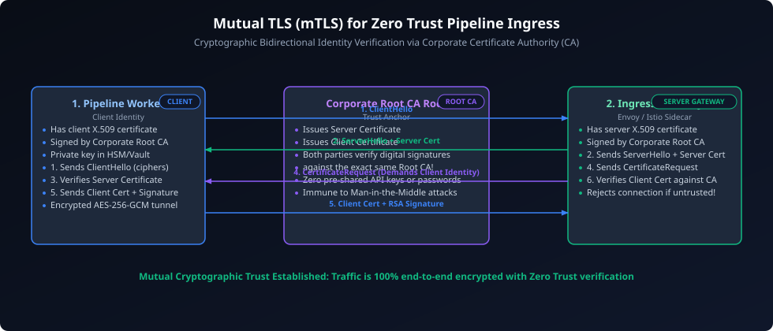

<details>
<summary>View D2 Source</summary>

```d2
direction: right
title: Mutual TLS (mTLS) for Zero Trust Pipeline Ingress

client: Data Pipeline Worker
ca: Corporate Root CA (Trust Anchor)
server: Enterprise Ingress Gateway (Envoy)

client -> server: "1. ClientHello (TLS 1.3 Ciphers)"
server -> client: "2. ServerHello + Server X.509 Certificate"
client -> ca: "3. Verify Server Certificate against CA"
server -> client: "4. CertificateRequest (Demands Client Identity)"
client -> server: "5. Client X.509 Certificate + Digital Signature"
server -> ca: "6. Verify Client Certificate against CA"
client <-> server: "Mutual Cryptographic Trust Established (AES-GCM Tunnel)"
```
</details>
*Enterprise Impact:* Even if an attacker steals an API token, they cannot connect without the physical private cryptographic key certificate installed on the worker node.

---

# 9. Rate Limiting, Throttling & Pipeline Resilience

---

### 9.1 Rate Limiting Algorithms: Token Bucket vs. Leaky Bucket vs. Sliding Window

External APIs protect their infrastructure against denial-of-service through four primary rate limiting algorithms:

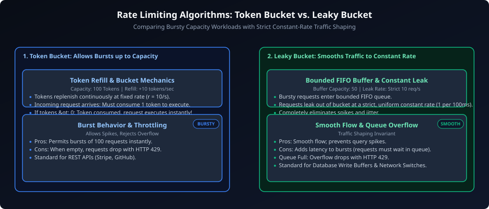

<details>
<summary>View D2 Source</summary>

```d2
direction: right
title: Rate Limiting Algorithms: Token Bucket vs. Leaky Bucket

token_bucket: 1. Token Bucket: Allows Bursts up to Capacity {
  refill: "Continuous Refill: +r tokens/sec"
  bucket: "Token Bucket (Cap: 100)"
  check: "Token Available?" {
    shape: diamond
  }
  exec: "Consume 1 Token -> Execute Request"
  drop: "HTTP 429: Throttled"
  refill -> bucket -> check
  check -> exec: "Yes"
  check -> drop: "No"
}

leaky_bucket: 2. Leaky Bucket: Smooths Traffic to Constant Rate {
  ingress: "Bursty Requests Ingress"
  fifo: "Bounded FIFO Buffer (Cap: 50)"
  overflow: "Buffer Full?" {
    shape: diamond
  }
  leak: "Leak at Strict Constant Rate (10 req/s)"
  drop_lb: "HTTP 429: Queue Full"
  ingress -> fifo -> overflow
  overflow -> leak: "No"
  overflow -> drop_lb: "Yes"
}
```
</details>

#### Algorithmic Comparison Matrix

| Algorithm | Burst Handling | Memory Complexity | Best Use Case | Primary Production Fit |
| :--- | :--- | :--- | :--- | :--- |
| **Token Bucket** | **Allows Bursts:** If tokens accumulated, processes burst up to capacity instantly. | $O(1)$ memory: Stores token count and last timestamp. | Ingress API gateways (Amazon API Gateway, Envoy, Stripe). | Public developer APIs |
| **Leaky Bucket** | **Eliminates Bursts:** Dispatches outbound calls at a smooth, constant rate. | $O(B)$ memory: Stores enqueued requests in FIFO buffer. | Outbound SaaS API clients; protecting legacy databases. | Outbound batch extractors |
| **Fixed Window** | Suffers from $2x$ traffic spikes across window boundaries. | $O(1)$ memory: Integer counter per minute/hour. | Simple, non-critical rate limiting. | Basic web tiers |
| **Sliding Window Log** | Perfectly smooth; zero boundary spikes. | **$O(N)$ memory:** Stores timestamp of every request in Redis. | High-security, financial anti-fraud rate limiting. | Security-critical endpoints |

---

### 9.2 Exponential Backoff with Full Jitter: Mathematical Proof

When an upstream service returns `HTTP 429 Too Many Requests`, naive backoff ($T = \text{base} \times 2^{\text{attempt}}$) causes **The Thundering Herd Problem**: hundreds of distributed worker threads sleep for the exact same duration ($2\text{s}, 4\text{s}, 8\text{s}$) and slam the API in synchronized lockstep.

In 2015, Marc Brooker (AWS Principal Engineer) proved mathematically that **Full Jitter** achieves the lowest queue latency and highest client throughput:

$$T_{\text{sleep}} = \text{random}(0, \; \min(T_{\text{max}}, \; T_{\text{base}} \times 2^{\text{attempt}}))$$

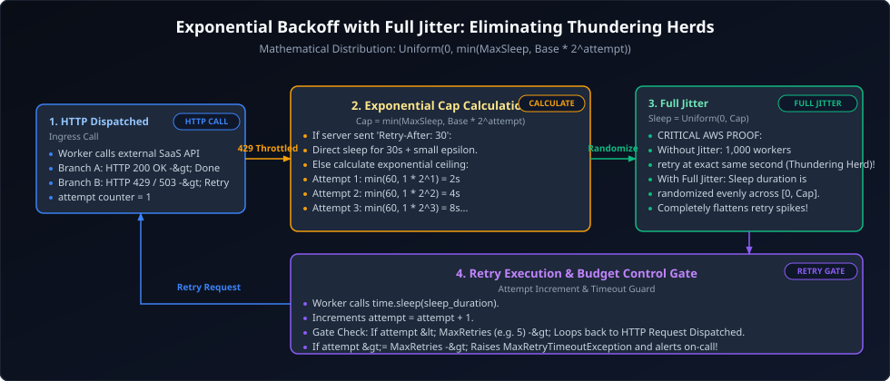

<details>
<summary>View D2 Source</summary>

```d2
direction: down
title: Exponential Backoff with Full Jitter: Retry Architecture

request: Initial HTTP Request Dispatched {
  status: "Evaluates Status Code (200 OK vs 429/503)"
}

backoff: Backoff & Jitter Evaluation {
  cap: "Exponential Cap: min(MaxSleep, Base * 2^attempt)"
  jitter: "Full Jitter: Sleep = Uniform(0, Cap)"
  cap -> jitter
}

gate: Retry Execution Gate {
  sleep: "Execute time.sleep()"
  check: "attempt < MaxRetries?" {
    shape: diamond
  }
  sleep -> check
}

request -> backoff: "HTTP 429 Throttled"
backoff.jitter -> gate.sleep
gate.check -> request: "Yes: Retry with Jitter"
gate.check -> timeout: "No: Raise TimeoutException"
```
</details>

---

### 9.3 Circuit Breaker Design Pattern for Upstream Fault Isolation

If an upstream database or REST API crashes completely, continuing to send 10,000 requests per second consumes worker threads, leaks TCP connections, and prevents the upstream service from recovering.
A **Circuit Breaker** acts as an automatic electrical fuse:

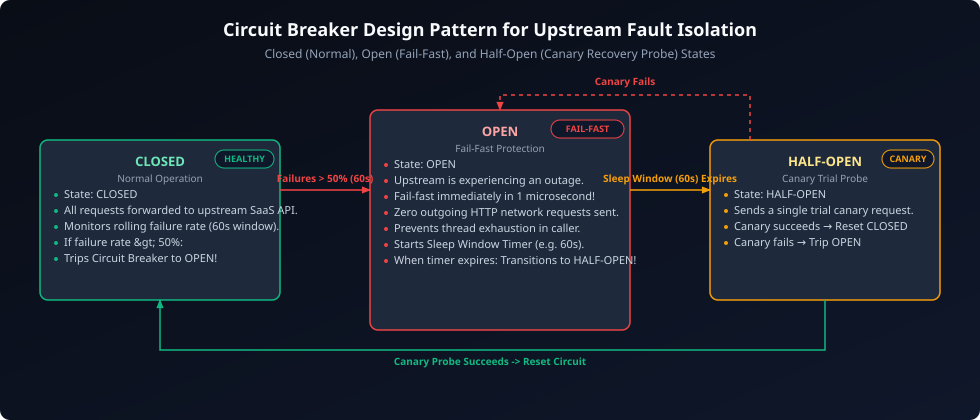

<details>
<summary>View D2 Source</summary>

```d2
direction: right
title: Circuit Breaker Design Pattern for Upstream Fault Isolation

closed: CLOSED {
  status: "Normal Operation: All requests forwarded directly"
  style.stroke: "#10b981"
}

open: OPEN {
  status: "Tripped: Fail-fast immediately without sending network requests"
  style.stroke: "#ef4444"
}

half_open: HALF-OPEN {
  status: "Testing Recovery: Sends a single trial canary request"
  style.stroke: "#f59e0b"
}

closed -> open: "Failure rate > 50% over 60s"
open -> half_open: "Sleep window (60s) expires"
half_open -> closed: "Canary probe succeeds cleanly"
half_open -> open: "Any trial request fails" {
  style.stroke: "#ef4444"
  style.stroke-dash: 4
}
```
</details>

#### Production Python Circuit Breaker Implementation
```python
import time
from typing import Callable, Any

class CircuitBreakerOpenException(Exception):
    pass

class CircuitBreaker:
    """
    State machine protecting external services by failing fast when error rates spike.
    States: CLOSED (Normal), OPEN (Failing Fast), HALF_OPEN (Canary Testing).
    """
    def __init__(self, failure_threshold: int = 5, recovery_timeout_sec: float = 30.0):
        self.failure_threshold = failure_threshold
        self.recovery_timeout_sec = recovery_timeout_sec
        self.state: str = "CLOSED"
        self.failure_count: int = 0
        self.last_state_change: float = time.time()

    def call(self, func: Callable, *args, **kwargs) -> Any:
        now = time.time()

# 14. State: OPEN -> Check if recovery timeout has elapsed

if self.state == "OPEN":
            if now - self.last_state_change > self.recovery_timeout_sec:
                print("[CIRCUIT BREAKER] Recovery timeout elapsed. Transitioning to HALF-OPEN (Testing canary).")
                self.state = "HALF_OPEN"
                self.last_state_change = now
            else:
                # Fail fast immediately without making network calls
                raise CircuitBreakerOpenException("Circuit is OPEN. Upstream service is offline. Fast failing request.")

# 15. Execute target function

try:
            result = func(*args, **kwargs)
            # If function succeeds in HALF-OPEN state, reset breaker cleanly
            if self.state == "HALF_OPEN":
                print("[CIRCUIT BREAKER] Canary succeeded! Resetting breaker to CLOSED.")
                self.state = "CLOSED"
                self.failure_count = 0
                self.last_state_change = now
            return result
        except Exception as e:
            self.failure_count += 1
            print(f"[CIRCUIT BREAKER] Request failed ({self.failure_count}/{self.failure_threshold}): {str(e)}")
            if self.failure_count >= self.failure_threshold or self.state == "HALF_OPEN":
                print("[CIRCUIT BREAKER] Failure threshold reached! Tripping breaker to OPEN.")
                self.state = "OPEN"
                self.last_state_change = now
            raise e
```

---

# 10. Modern Integration Paradigms

---

### 10.1 Webhooks vs. Long Polling vs. Server-Sent Events (SSE)

#### Architectural Overview & Real-Time Ingestion Mechanics
Modern data engineering pipelines increasingly ingest real-time events directly from external SaaS platforms, transactional microservices, and IoT gateways. In legacy architectures, consumers relied on naive **Periodic Polling** (e.g., executing an HTTP GET every 30 seconds), where over 95% of queries returned empty payloads, wasting network bandwidth, compute cycles, and exhausting API rate limits. Modern integration relies on push- or streaming-oriented communication models.

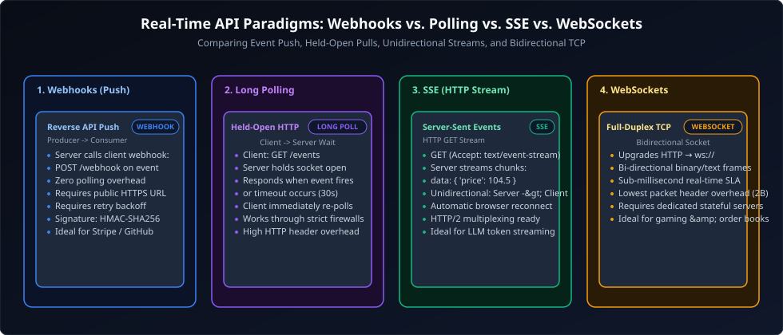

<details>
<summary>View D2 Source</summary>

```d2
direction: right
title: Real-Time API Protocols: Webhooks vs. Polling vs. SSE vs. WebSockets

webhook: 1. Webhook (Reverse API Push) {
  producer: Producer Server
  consumer: Consumer Ingestion API
  producer -> consumer: "HTTP POST /webhook on event"
}

polling: 2. Long Polling (Held-Open Pull) {
  pclient: Client
  pserver: Server
  pclient -> pserver: "HTTP GET /events (socket held open)"
  pserver -> pclient: "Response on event or timeout"
}

sse: 3. Server-Sent Events (SSE) {
  sclient: Client
  sserver: Server
  sclient -> sserver: "HTTP GET text/event-stream"
  sserver -> sclient: "Continuous unidirectional chunk stream"
}

ws: 4. WebSockets (Full Duplex) {
  wclient: Client
  wserver: Server
  wclient <-> wserver: "Bidirectional binary/text frames"
}
```
</details>

#### Detailed Breakdown of the 4 Integration Paradigms

1. **Webhooks (Server-to-Server Event Push):**
   - **Mechanism:** The consumer registers a public HTTPS callback URL with the producer. When a state change occurs (e.g., a payment succeeds in Stripe or a git push occurs in GitHub), the producer initiates an HTTP POST request carrying the JSON event payload directly to the consumer's webhook endpoint.
   - **Resource Economics:** **Zero idle cost.** No TCP sockets remain open while idle; connections exist only for the duration of the HTTP transaction.
   - **Engineering Requirements:** The consumer must expose an externally accessible HTTPS endpoint and implement robust retry mechanisms, dead-letter queues (DLQs), signature verification, and deduplication idempotency keys.

2. **Long Polling (Client-Initiated Suspended HTTP Pull):**
   - **Mechanism:** The consumer opens an HTTP GET request to the producer. If no data is available, the producer suspends the request, holding the TCP socket open until new data arrives or a connection timeout (e.g., 30–60 seconds) is reached. Once data is returned (or timeout occurs), the consumer immediately issues a new request.
   - **Resource Economics:** High socket churn and memory overhead. Each open connection consumes thread or file descriptor state on both client and server.
   - **Best Fit:** Ingestion from legacy third-party APIs that do not support outbound webhooks and sit behind restrictive egress-only NAT firewalls.

3. **Server-Sent Events (SSE - Unidirectional Event Streaming):**
   - **Mechanism:** The consumer initiates a single standard HTTP GET request with `Accept: text/event-stream`. The server keeps the HTTP connection open indefinitely using chunked transfer encoding (`Transfer-Encoding: chunked`), continuously pushing plain text events formatted as `data: {...}\n\n`.
   - **Resource Economics:** Extremely lightweight. Operates over standard HTTP/1.1 or HTTP/2 without protocol upgrades, automatically traverses enterprise corporate proxies and firewalls, and includes built-in client reconnection semantics with event ID tracking.
   - **Best Fit:** Real-time metrics streaming, telemetry ingestion feeds, and generative AI token streaming.

4. **WebSockets (Full-Duplex Bidirectional Framing):**
   - **Mechanism:** The connection starts as a standard HTTP request and executes a protocol upgrade handshake (`Upgrade: websocket`). Once established, the underlying TCP connection remains open for bidirectional, frame-based message exchange with minimal 2-to-10-byte header overhead.
   - **Resource Economics:** Moderate state holding overhead. Requires dedicated stateful gateway connection managers and sticky session routing.
   - **Best Fit:** High-frequency bidirectional interactions (financial market tickers, collaborative canvas editors, interactive gaming).

#### Comprehensive Integration Paradigm Comparison

| Dimension | Webhooks (Server Push) | Long Polling (Client Pull) | Server-Sent Events (SSE) | WebSockets (Bi-Directional) |
| :--- | :--- | :--- | :--- | :--- |
| **Direction** | Producer $\rightarrow$ Consumer | Consumer $\rightarrow$ Producer | Producer $\rightarrow$ Consumer | Full Duplex ($\leftrightarrow$) |
| **Transport** | Standard HTTP POST | HTTP GET (Held open) | HTTP GET (Streaming chunked) | TCP WebSocket Frame |
| **Idle Resource Cost** | **Zero:** TCP socket opens only when event occurs | **High:** TCP connection held open continuously | Low: Single persistent HTTP socket per client | Moderate: State stored in socket connection pool |
| **Firewall Ingress** | Consumer must expose a public HTTPS URL | Runs behind corporate NAT firewalls easily | Runs behind corporate NAT firewalls easily | May be blocked by enterprise proxy firewalls |
| **Best Pipeline Fit** | SaaS Event ingestion (Stripe, GitHub) | Polling legacy APIs without webhook support | Real-time browser log/metric feeds | Real-time financial trading tickers |

---

### 10.2 Cryptographic Webhook Signature Verification & Idempotency Keys

#### 1. Constant-Time HMAC-SHA256 Verification
Because webhooks arrive over the public internet, malicious actors can send spoofed payloads to your webhook receiver. Production endpoints must verify the HMAC-SHA256 signature using `hmac.compare_digest` to prevent **timing attacks**:

```python
import hmac
import hashlib

def verify_stripe_webhook_signature(payload_bytes: bytes, header_sig: str, secret: str) -> bool:
    """
    Validates cryptographic authenticity of webhook payloads using constant-time comparison.
    """
    expected_hmac = hmac.new(
        key=secret.encode("utf-8"),
        msg=payload_bytes,
        digestmod=hashlib.sha256
    ).hexdigest()
    
    # Constant-time comparison protects against side-channel byte timing attacks
    return hmac.compare_digest(expected_hmac, header_sig)
```

#### 2. Deduplication via Idempotency Keys
Because webhook providers guarantee **at-least-once delivery**, network drops will cause providers to resend identical webhooks. Ingestion gateways must store the `X-Event-ID` or `Idempotency-Key` in an in-memory cache (Redis) with a 24-hour TTL, rejecting duplicate event IDs with an instant `200 OK` without re-processing.

---

### 10.3 Reverse ETL: Architecture, Diff Computation & Sync Mechanics

Reverse ETL operationalizes the data warehouse by reading modeled dimensions and predictive scores (e.g., Customer LTV, Churn Risk Score, Propensity to Buy) and syncing them to operational CRM systems (Salesforce, Zendesk, HubSpot).

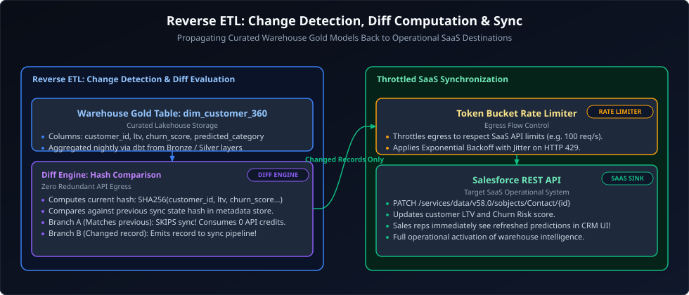

<details>
<summary>View D2 Source</summary>

```d2
direction: right
title: Reverse ETL: Change Detection & Diff Evaluation

detection: Change Detection & Diff Evaluation {
  dw: Warehouse Gold Table (gold.dim_customer_360)
  diff: Diff Engine: Computes SHA256(attributes)
  check: Hash matches previous state? {
    shape: diamond
  }
  skip: Skip Egress (Zero API credits consumed)
  dw -> diff -> check
  check -> skip: "Yes: Unchanged"
}

sync: Throttled SaaS Synchronization {
  limiter: Token Bucket Rate Limiter (Max 100 req/s)
  saas: Salesforce REST API (PATCH /Contact/{id})
  limiter -> saas
}

detection.check -> sync.limiter: "No: Changed Record"
```
</details>

#### Diff Calculation via Row Hashing
To prevent exhausting SaaS API rate limits, Reverse ETL engines compute an SHA-256 hash of all synced attributes:
```sql
SELECT 
    customer_id,
    ltv_amount,
    churn_risk_score,
    SHA256(CONCAT(COALESCE(CAST(ltv_amount AS STRING), ''), '|', COALESCE(churn_risk_score, ''))) AS row_hash
FROM gold.dim_customer_360;
```
The sync engine compares `row_hash` against the hash stored during the previous sync. If the hash is identical, the record is skipped, reducing API calls by **95%+**.

---

### 10.4 Managed Data Integration Platforms: Fivetran vs. Airbyte vs. Custom

#### Architectural Overview & The Build vs. Buy Equation
Extracting data from third-party SaaS applications (e.g., Salesforce, Stripe, NetSuite, Google Ads) into analytical storage is traditionally one of the most operationally burdensome tasks in data engineering. Upstream APIs frequently deprecate endpoints, alter pagination schemes (cursor vs. offset vs. link-header), enforce strict rate-limiting quotas, and silently introduce schema breaking changes.

To address this maintenance overhead, the industry has bifurcated into three distinct architectural strategies:
1. **Fully Managed SaaS ELT (e.g., Fivetran):** Proprietary, closed-source ingestion pipelines. Zero infrastructure management, automated schema migration, and vendor engineers actively monitoring and updating connectors when third-party APIs change.
2. **Open-Source & Self-Hosted ELT (e.g., Airbyte):** Standardized, container-native connector protocol running on Kubernetes. Delivers complete data governance and network isolation with the ability to extend custom connectors via the Airbyte Connector Development Kit (CDK).
3. **Custom In-House Python Extractors:** Hand-crafted scripts executed via orchestrators (Airflow, Dagster). Provides maximum architectural flexibility and zero vendor lock-in, but burdens data platform teams with 100% of connector maintenance, bug fixes, and API adaptation.

#### Engineering Decision Matrix: Fivetran vs. Airbyte vs. Custom

| Evaluation Dimension | Fivetran | Airbyte | Custom Python Extractors |
| :--- | :--- | :--- | :--- |
| **Deployment Model** | 100% Proprietary SaaS | **Open-Source (Self-Hosted on K8s) + Cloud SaaS** | Custom containers in Docker / Airflow |
| **Connector Library** | 300+ Pre-built, battle-tested SaaS connectors | 350+ Open-source community & official connectors | Built in-house from scratch |
| **Extensibility** | Limited; must use external cloud functions | **High: Airbyte CDK (Connector Development Kit)** | Complete freedom: write custom logic |
| **Cost Model** | Monthly Active Rows (MAR) — Can become expensive at scale | Free (Self-Hosted Infra) or Credit-Based Cloud | Infrastructure VM & engineering time |
| **Maintenance Burden** | Zero maintenance: Fivetran engineers fix API breaks | Moderate: Self-managed Kubernetes cluster upgrades | High: In-house team must update code on API changes |

---

# 11. Summary Comparison & Production Engineering Reference Matrix

- **Buffer Cache & Memory Sizing:** For OLTP workloads, maintain a buffer pool cache hit ratio of $\ge 99\%$ (`pg_stat_database`). When sizing working memory (`work_mem`), ensure hash join buckets and external sort operations fit in RAM to avoid multi-batch disk spills (`SortMethod: external merge Disk`), while budgeting overall memory to prevent OS out-of-memory kernel killer invocations.
- **Index Architecture & Sargability Discipline:** Every filter predicate in mission-critical queries must be strictly sargable, avoiding wrapping indexed columns in functions (e.g., `WHERE LOWER(col)` or `WHERE DATE(ts)`). In composite indexes, arrange equality columns at the leading edge followed by range criteria. For high-volume lookup endpoints, deploy covering indexes with `INCLUDE` clauses to achieve pure, heap-free Index-Only Scans.
- **Table Bloat & Autovacuum Tuning:** High-churn tables under Multi-Version Concurrency Control (MVCC) accumulate dead tuples that degrade scan performance and bloat index trees. Reduce `autovacuum_vacuum_scale_factor` to `0.05` or lower on volatile tables, increase vacuum memory workers, and monitor `pg_stat_user_tables.n_dead_tup` to prevent table bloat emergencies.
- **Concurrency Control & Deadlock Elimination:** Mitigate lock contention by acquiring row-level locks in deterministic sorting order across all application endpoints. Distinguish between logical database locks (managed by lock managers to protect transaction semantics) and engine memory latches (lightweight mutexes/spinlocks protecting buffer frames).
- **WAL & Background Checkpoint Governance:** Balance Write-Ahead Logging (WAL) and checkpoint intervals (`checkpoint_timeout` between 15–30 minutes, `max_wal_size` between 16–64 GB) to smooth out dirty-page write spikes onto NVMe SSDs while bounding recovery time objectives (RTO) during crashes.
- **Specialized Index Selection:** For massive append-only analytical or time-series tables where data correlates with physical disk order, deploy Block Range Indexes (BRIN) to achieve orders-of-magnitude smaller index footprints than traditional B+ Trees.

---

- **Consensus & Quorum Arithmetic:** Distributed storage engines requiring strong consistency must satisfy the strict quorum inequality $W + R > N$. Consensus clusters (Raft, KRaft, etcd, ZooKeeper) must operate with strictly odd node counts (3, 5, or 7) to tolerate $(N-1)/2$ failures without split-brain partitioning, while distributed locks must issue monotonically increasing fencing tokens to neutralize garbage collection pauses.
- **Partitioning & Consistent Hashing:** To avoid hotspotting and uneven data distribution, avoid raw sequential timestamps or low-cardinality values as partition keys. Consistent hashing topologies should provision $\ge 100$ virtual nodes (V-nodes) per physical machine to guarantee balanced ring redistribution upon node join or leave events.
- **Client Resilience & Throttling:** Outbound API extractors must implement exponential backoff with full jitter to avoid the "thundering herd" anti-pattern, honor upstream `Retry-After` HTTP headers, and decouple batch calls using token bucket rate limiters. Wrap downstream network endpoints with circuit breakers to prevent thread pool starvation during remote outages.
- **Security & Idempotent Ingestion:** Webhook ingress points must authenticate payloads using constant-time cryptographic HMAC-SHA256 signature verification to prevent timing attacks. Inter-service data channels should enforce Mutual TLS (mTLS) with internal CA verification, and mutation endpoints must leverage deterministic idempotency keys to safely discard duplicate network retries under at-least-once transport.
- **Reverse ETL Efficiency & Sync Optimization:** Reverse ETL systems pushing analytical insights back into transactional SaaS applications must calculate cryptographic diff hashes (SHA-256) at row granularity to transmit only net-new mutations, conserving scarce vendor API quotas and execution credits.

---

# 12. References & Further Reading

- [Database Internals: A Deep Dive into How Distributed Data Systems Work (Alex Petrov)](https://www.databass.dev/) — Comprehensive reference for B+ Trees, LSM Trees, buffer pools, and concurrency control.
- [The Internals of PostgreSQL (Hironobu Suzuki)](https://www.interdb.jp/pg/) — Deep architectural analysis of PostgreSQL process architecture, buffer manager, MVCC, and vacuuming.
- [Architecture of a Database System (Joseph M. Hellerstein, Michael Stonebraker, James Hamilton)](https://dsf.berkeley.edu/papers/fntdb07-architecture.pdf) — Foundations of relational database design and transaction managers.
- [Designing Data-Intensive Applications (Martin Kleppmann)](https://dataintensive.net/) — Storage engines, transaction isolation anomalies, and replication mechanics.
- [PostgreSQL Documentation: Routine Vacuuming & Index Types](https://www.postgresql.org/docs/current/routine-vacuuming.html) — Official operations runbook for database maintenance.

- [Designing Data-Intensive Applications (Martin Kleppmann)](https://dataintensive.net/)
- [In Search of an Understandable Consensus Algorithm (Raft Paper - Ongaro & Ousterhout)](https://raft.github.io/raft.pdf)
- [MapReduce: Simplified Data Processing on Large Clusters (Dean & Ghemawat)](https://research.google/pubs/pub62/)
- [Brewer's Conjecture and the Feasibility of Consistent, Available, Partition-Tolerant Web Services (Gilbert & Lynch)](https://users.ece.cmu.edu/~adrian/731-sp04/readings/GL-cap.pdf)
- [Consistency Tradeoffs in Modern Distributed Database System Design (Daniel Abadi)](http://dbmsmusings.blogspot.com/2010/04/problems-with-cap-and-yahoos-little.html)
- [Exponential Backoff And Jitter (AWS Architecture Blog - Marc Brooker)](https://aws.amazon.com/blogs/architecture/exponential-backoff-and-jitter/)
- [Patterns of Distributed Systems (Martin Fowler)](https://martinfowler.com/articles/patterns-of-distributed-systems/)
- [The Google Spanner Architecture Paper](https://research.google/pubs/pub39966/)
