# 05. Apache Spark & PySpark: Master Distributed Computing Guide

A comprehensive, production-grade guide to Apache Spark distributed computing architecture, Catalyst Optimizer, Tungsten Engine, execution models (Jobs, Stages, Tasks), PySpark DataFrame processing, distributed join strategies, AQE, performance tuning, and Spark UI debugging tailored for Data Engineers and Distributed Systems Practitioners.

---

## Architectural Overview: Apache Spark Cluster & Query Lifecycle Architecture

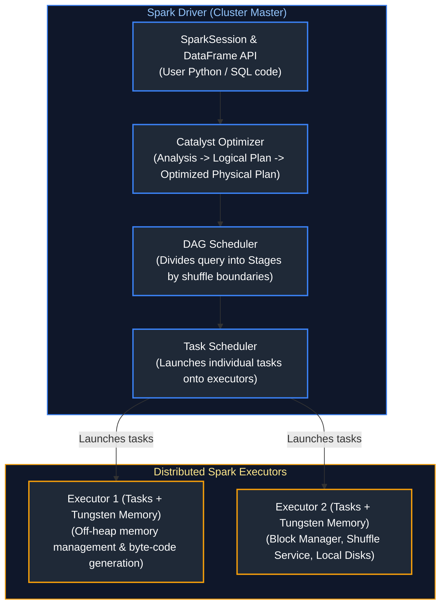

---

## Table of Contents
1. [Spark Fundamentals & Engine Internals](#1-spark-fundamentals--engine-internals)
   - [1.1 Spark Architecture](#11-spark-architecture)
   - [1.2 RDD vs DataFrame vs Dataset](#12-rdd-vs-dataframe-vs-dataset)
   - [1.3 Lazy Evaluation & Execution Plan Generation](#13-lazy-evaluation--execution-plan-generation)
   - [1.4 DAG (Directed Acyclic Graph) Execution Flow](#14-dag-directed-acyclic-graph-execution-flow)
   - [1.5 Catalyst Optimizer Internals](#15-catalyst-optimizer-internals)
   - [1.6 Project Tungsten Execution Engine](#16-project-tungsten-execution-engine)
   - [1.7 Narrow vs Wide Dependencies](#17-narrow-vs-wide-dependencies)
   - [1.8 Transformations vs Actions](#18-transformations-vs-actions)
   - [1.9 Shuffling Mechanics & Network Spill](#19-shuffling-mechanics--network-spill)
2. [Spark Execution Model](#2-spark-execution-model)
   - [2.1 Jobs, Stages, and Tasks Hierarchy](#21-jobs-stages-and-tasks-hierarchy)
   - [2.2 Adaptive Query Execution (AQE)](#22-adaptive-query-execution-aqe)
   - [2.3 Dynamic Partition Pruning (DPP)](#23-dynamic-partition-pruning-dpp)
   - [2.4 Coalesce vs Repartition](#24-coalesce-vs-repartition)
   - [2.5 Shuffle Partition Configuration](#25-shuffle-partition-configuration)
   - [2.6 Spark UI Architecture](#26-spark-ui-architecture)
3. [PySpark Data Processing](#3-pyspark-data-processing)
   - [3.1 PySpark DataFrames & SQL Expressions](#31-pyspark-dataframes--sql-expressions)
   - [3.2 PySpark SQL Functions & Transformations](#32-pyspark-sql-functions--transformations)
   - [3.3 PySpark Window Functions](#33-pyspark-window-functions)
   - [3.4 PySpark Joins & Cartesian Logic](#34-pyspark-joins--cartesian-logic)
   - [3.5 PySpark Aggregations & Pivot](#35-pyspark-aggregations--pivot)
   - [3.6 PySpark UDFs: Python Standard vs Vectorized Pandas UDFs](#36-pyspark-udfs-python-standard-vs-vectorized-pandas-udfs)
   - [3.7 Pandas API on Spark (Koalas)](#37-pandas-api-on-spark-koalas)
   - [3.8 Handling NULLs & Missing Data in PySpark (Imputation & Default Values)](#38-handling-nulls--missing-data-in-pyspark-imputation--default-values)
   - [3.9 Complex Data Types (Array, Map, Struct) & Shredding](#39-complex-data-types-array-map-struct--shredding)
   - [3.10 Inconsistent Timestamps & Time Zone Normalization in PySpark](#310-inconsistent-timestamps--time-zone-normalization-in-pyspark)
   - [3.11 File Corruption & Malformed Record Handling](#311-file-corruption--malformed-record-handling)
4. [Distributed Spark Join Strategies](#4-distributed-spark-join-strategies)
   - [4.1 Broadcast Hash Join (BHJ)](#41-broadcast-hash-join-bhj)
   - [4.2 Shuffle Hash Join (SHJ)](#42-shuffle-hash-join-shj)
   - [4.3 Sort-Merge Join (SMJ)](#43-sort-merge-join-smj)
   - [4.4 Cartesian / Broadcast Nested Loop Join](#44-cartesian--broadcast-nested-loop-join)
   - [4.5 Skew Join Optimization](#45-skew-join-optimization)
   - [4.6 Bucketing for Large Joins (Eliminating Shuffle Exchange)](#46-bucketing-for-large-joins-eliminating-shuffle-exchange)
5. [Spark Performance Optimization](#5-spark-performance-optimization)
   - [5.1 Key Salting for Extreme Data Skew](#51-key-salting-for-extreme-data-skew)
   - [5.2 Broadcast Threshold Tuning](#52-broadcast-threshold-tuning)
   - [5.3 Caching & Persistence Strategies](#53-caching--persistence-strategies)
   - [5.4 Spark Storage Levels](#54-spark-storage-levels)
   - [5.5 Memory Architecture & Spill to Disk](#55-memory-architecture--spill-to-disk)
   - [5.6 Java Garbage Collection (G1GC) Tuning](#56-java-garbage-collection-g1gc-tuning)
6. [Spark Debugging & Troubleshooting](#6-spark-debugging--troubleshooting)
   - [6.1 Reading Spark UI: DAG & Event Timeline](#61-reading-spark-ui-dag--event-timeline)
   - [6.2 Executor Metrics & Peak Memory Diagnostics](#62-executor-metrics--peak-memory-diagnostics)
   - [6.3 Diagnosing Out-Of-Memory (OOM) Errors](#63-diagnosing-out-of-memory-oom-errors)
   - [6.4 Stragglers Detection & Speculative Execution](#64-stragglers-detection--speculative-execution)
   - [6.5 Task Failure Root Causes](#65-task-failure-root-causes)
   - [6.6 End-to-End Spark ETL Optimization Playbook](#66-end-to-end-spark-etl-optimization-playbook)
7. [Summary Comparison & Production Engineering Reference Matrix](#7-summary-comparison--production-engineering-reference-matrix)
8. [References & Further Reading](#8-references--further-reading)

> [!TIP]
> **Deep-Dive Interview Scenarios:**
> - [Q30. Parsing & Flattening Nested JSON in PySpark](frequently_asked_questions/05_apache_spark_and_pyspark_faq.md#q30-medium-parsing--flattening-nested-json-in-pyspark)
> - [Q32. PySpark Live Coding: Upserting New Files into Delta Tables](frequently_asked_questions/05_apache_spark_and_pyspark_faq.md#q32-medium-pyspark-live-coding-upserting-new-files-into-delta-tables)
> - [Q33. PySpark Live Coding: Store Spending > ₹1000 in the Last Month](frequently_asked_questions/05_apache_spark_and_pyspark_faq.md#q33-medium-pyspark-live-coding-store-spending--1000-in-the-last-month)
> - [Q34. PySpark Live Coding: Department-wise Employee Ranking](frequently_asked_questions/05_apache_spark_and_pyspark_faq.md#q34-medium-pyspark-live-coding-department-wise-employee-ranking)
> - [Q49. Performance Impact of Window Functions in Distributed Spark Execution](frequently_asked_questions/05_apache_spark_and_pyspark_faq.md#q49-medium-performance-impact-of-window-functions-in-distributed-spark-execution)
> - [Q51. Decoupled Architecture: Apache Parquet vs Delta Lake vs Spark Executors](frequently_asked_questions/05_apache_spark_and_pyspark_faq.md#q51-easy-decoupled-architecture-apache-parquet-vs-delta-lake-vs-spark-executors)
> - [Q57. Spark Repartition vs Coalesce vs RepartitionByRange Execution Mechanics](frequently_asked_questions/05_apache_spark_and_pyspark_faq.md#q57-easy-spark-repartition-vs-coalesce-vs-repartitionbyrange-execution-mechanics)
> - [Q58. Multi-Source Customer Record Deduplication Across CRM and ERP in PySpark](frequently_asked_questions/05_apache_spark_and_pyspark_faq.md#q58-medium-multi-source-customer-record-deduplication-across-crm-and-erp-in-pyspark)
> - [Q59. PySpark Regional Top 3 Products Sold (Window Ranking Live Coding)](frequently_asked_questions/05_apache_spark_and_pyspark_faq.md#q59-medium-pyspark-regional-top-3-products-sold-window-ranking-live-coding)
> - [Q60. PySpark Live Coding: Masking Sensitive PII (Email Addresses and Mobile Numbers)](frequently_asked_questions/05_apache_spark_and_pyspark_faq.md#q60-medium-pyspark-live-coding-masking-sensitive-pii-email-addresses-and-mobile-numbers)
> - [Q61. PySpark Live Coding: Third-Highest Salary and Highest Salary per Department (Handling Ties)](frequently_asked_questions/05_apache_spark_and_pyspark_faq.md#q61-medium-pyspark-live-coding-third-highest-salary-and-highest-salary-per-department-handling-ties)
> - [Q62. PySpark Live Coding: Second-Highest Age by Department & Overall, Average Age & Headcount](frequently_asked_questions/05_apache_spark_and_pyspark_faq.md#q62-medium-pyspark-live-coding-second-highest-age-by-department--overall-average-age--headcount)
> - [Q63. PySpark Live Coding: Grouping Available States and Products by Country](frequently_asked_questions/05_apache_spark_and_pyspark_faq.md#q63-medium-pyspark-live-coding-grouping-available-states-and-products-by-country)
> - [Q64. PySpark Live Coding: Calculating Team Match Records (Wins, Losses, Ties & Total Matches)](frequently_asked_questions/05_apache_spark_and_pyspark_faq.md#q64-medium-pyspark-live-coding-calculating-team-match-records-wins-losses-ties--total-matches)
> - [Q65. PySpark Live Coding: Deduplicating Records While Retaining the Latest Record & Pipeline Optimization](frequently_asked_questions/05_apache_spark_and_pyspark_faq.md#q65-hard-pyspark-live-coding-deduplicating-records-while-retaining-the-latest-record--pipeline-optimization)
> - [Q66. PySpark Live Coding: Latest Commission per Employee Using Windows and Joins](frequently_asked_questions/05_apache_spark_and_pyspark_faq.md#q66-medium-pyspark-live-coding-latest-commission-per-employee-using-windows-and-joins)
> - [Q67. Manual Versioning on Parquet and Delta Files in PySpark](frequently_asked_questions/05_apache_spark_and_pyspark_faq.md#q67-medium-manual-versioning-on-parquet-and-delta-files-in-pyspark)
---

# 1. Spark Fundamentals & Engine Internals

Apache Spark is an open-source, distributed, general-purpose cluster-computing framework engineered for lightning-fast data processing. It replaces MapReduce disk-based intermediate writes with in-memory execution and advanced query optimization.

---

### 1.1 Spark Architecture

#### Definition
Apache Spark operates on a **Master-Worker architecture** coordinated by a central Driver program and a pluggable Cluster Manager.

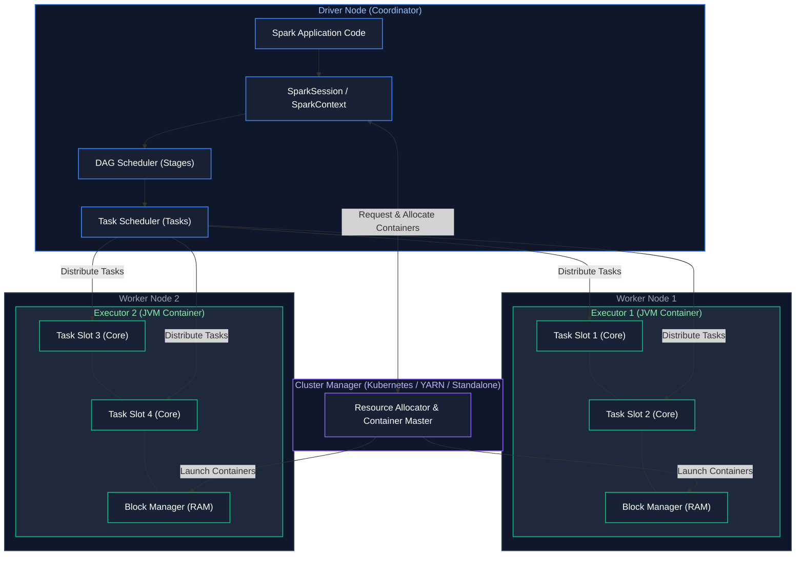

#### Key Architectural Components
1. **Driver Program:** The process running the `main()` method of the application. It creates the `SparkSession`, translates code into a DAG, splits stages, and assigns tasks to executor worker slots.
2. **Cluster Manager:** Controls physical cluster infrastructure and allocates compute containers (YARN, Kubernetes, or Spark Standalone).
3. **Executors:** Worker processes running on cluster nodes. Each executor runs inside a dedicated JVM container, executing tasks in parallel across worker slots and caching data in memory.
4. **Slots (Cores):** The thread execution capacity of an executor. If an executor has 4 CPU cores, it has 4 slots and can run 4 tasks simultaneously.

#### References
- [Apache Spark Official Architecture Documentation](https://spark.apache.org/docs/latest/cluster-overview.html)
- [GeeksforGeeks: Apache Spark Architecture](https://www.geeksforgeeks.org/apache-spark-architecture/)
- [DataCamp: Introduction to Apache Spark](https://www.datacamp.com/tutorial/apache-spark-python)

---

### 1.2 RDD vs DataFrame vs Dataset

#### Definition
Spark provides three core data abstractions:
- **RDD (Resilient Distributed Dataset):** The foundational low-level abstraction. Immutable, partitioned collection of raw JVM objects processed via functional programming (`map`, `flatMap`, `filter`). Lacks schema and Catalyst optimization.
- **DataFrame:** A distributed collection of data organized into named columns (conceptually equivalent to a relational table). Untyped in Java/Scala (`Dataset[Row]`), dynamically typed in Python. Fully optimized by Catalyst and Tungsten.
- **Dataset:** A strongly typed, object-oriented API available only in JVM languages (Scala and Java). Provides compile-time type safety with the performance benefits of Catalyst.

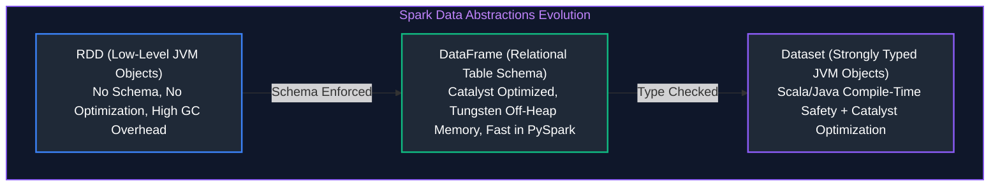

#### Detailed Mechanical Breakdown
1. **Resilient Distributed Datasets (RDDs):**
   - **Internal Mechanics:** RDDs represent the original Spark 1.0 distributed collection. An RDD consists of five core properties: a list of partitions, an iterator function computing elements of each partition, a list of dependencies on parent RDDs (lineage), and optionally a Partitioner (for key-value pairs) and preferred node locations (data locality).
   - **Performance Bottleneck:** RDDs operate on opaque JVM objects (`RDD[T]`). Because Spark cannot inspect the internal schema or field types of `T`, it cannot optimize operations. In Python (`PySpark`), RDD transformations require serializing objects between Python worker processes and the JVM via Py4J/sockets (`PickleSerializer`), incurring massive CPU and memory serialization overhead. Furthermore, every row is a distinct Java object, leading to severe JVM garbage collection pauses.

2. **DataFrames:**
   - **Internal Mechanics:** Introduced in Spark 1.3, DataFrames organize data into named columns with an explicit schema (`StructType`). Under the hood, a DataFrame is represented as an untyped `Dataset[Row]`.
   - **Optimization Engine:** DataFrames unlock the **Catalyst Optimizer** (logical planning, constant folding, predicate pushdown, projection pruning) and **Project Tungsten** (off-heap memory management via binary `UnsafeRow` formats and whole-stage code generation).
   - **PySpark Parity:** In PySpark, DataFrame operations execute in native C++/JVM Tungsten routines without serializing Python objects back and forth, offering equal execution speed to Scala.

3. **Datasets:**
   - **Internal Mechanics:** Introduced in Spark 1.6, Datasets combine the object-oriented, strongly-typed programming model of RDDs with the relational execution benefits of Catalyst. In Scala and Java, Datasets are typed as `Dataset[T]`, where `T` is a case class or POJO.
   - **Encoder Serialization:** Instead of standard Java serialization or Kryo, Datasets use specialized **Encoders** that generate custom bytecode to serialize and deserialize JVM objects directly into Tungsten off-heap binary memory without heap allocations.
   - **Language Support:** Available strictly in Scala and Java. Python does not support Datasets because Python is dynamically typed at runtime.

#### Comparison Matrix
| Feature | RDD | DataFrame | Dataset |
| :--- | :--- | :--- | :--- |
| **Release Version** | Spark 1.0 | Spark 1.3 | Spark 1.6 |
| **Optimization** | None (Manual tuning) | Catalyst Optimizer + Tungsten | Catalyst Optimizer + Tungsten |
| **Type Safety** | Compile-time (Scala/Java) | Runtime | Compile-time |
| **Language Support** | Scala, Java, Python, R | Scala, Java, Python, R | Scala and Java only |
| **PySpark Performance** | Slow (Heavy Py4J serialization) | Extremely fast (Runs C++ / JVM C-code) | N/A |

#### References
- [GeeksforGeeks: Difference between RDD, DataFrame, and DataSet](https://www.geeksforgeeks.org/difference-between-rdd-dataframe-and-dataset-in-apache-spark/)
- [DataCamp: PySpark DataFrames Tutorial](https://www.datacamp.com/tutorial/pyspark-tutorial-getting-started-with-pyspark)

---

### 1.3 Lazy Evaluation & Execution Plan Generation

#### Definition
Spark operations are strictly divided into **Transformations** and **Actions**. Transformations are **lazy**: calling `.filter()` or `.select()` does not compute results or read data from storage immediately; instead, Spark records the transformation into a logical execution graph (**Lineage Graph**). Computation only executes when an **Action** (such as `.count()`, `.collect()`, or `.write`) is invoked.


#### Why Lazy Evaluation Matters
- Enables **Whole-Stage Optimization**: Spark views the entire pipeline before executing, allowing Catalyst to push filters directly into storage readers and combine multiple map operations into a single CPU loop.

#### References
- [GeeksforGeeks: Lazy Evaluation in Spark](https://www.geeksforgeeks.org/lazy-evaluation-in-apache-spark/)
- [DataCamp: Spark Execution Mechanics](https://www.datacamp.com/tutorial/understanding-spark-execution)

---

### 1.4 DAG (Directed Acyclic Graph) Execution Flow

#### Definition
A Directed Acyclic Graph (DAG) is the internal mathematical representation of a Spark job's execution sequence. 
- **Directed:** Tasks flow unidirectionally from inputs to outputs.
- **Acyclic:** No circular loops or infinite cycles.
- **Graph:** Vertices represent RDD partitions and operations; edges represent data transformations.

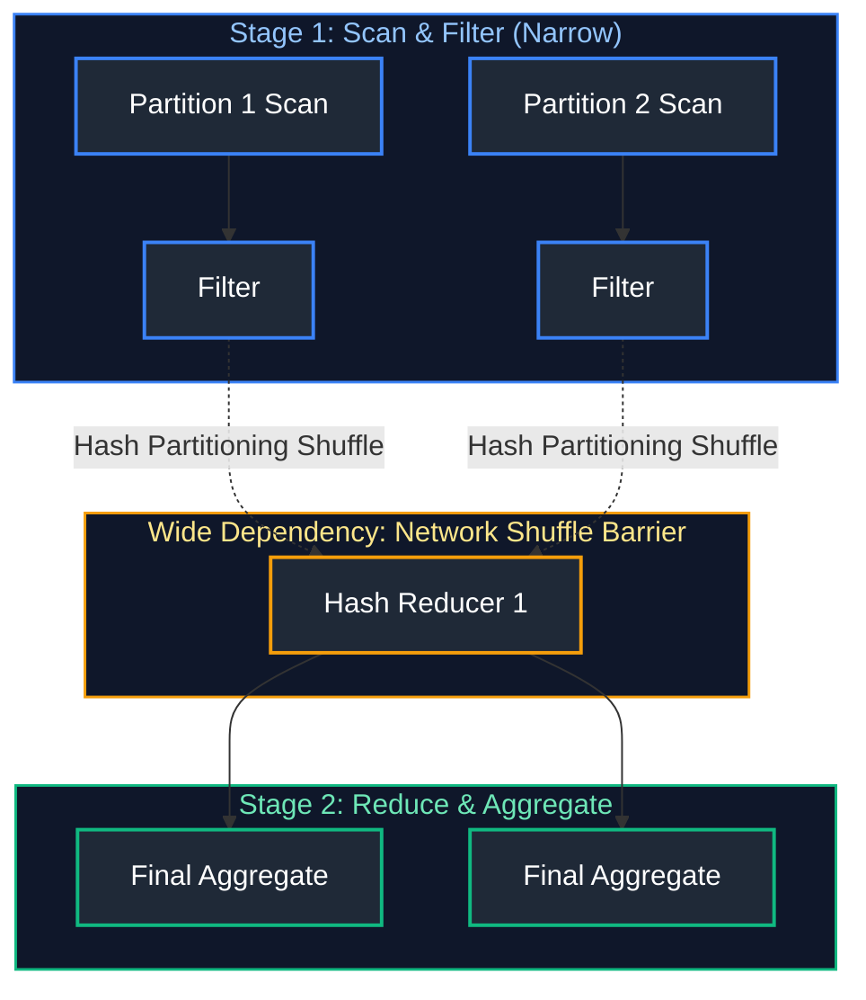

#### Fault Tolerance via Lineage
If an executor crashes and loses a data partition mid-job, Spark does not restart the entire job. It consults the DAG lineage graph to recompute **only the missing partition** from the original source files.

#### Visualizing the End-to-End Lifecycle of a Spark Query

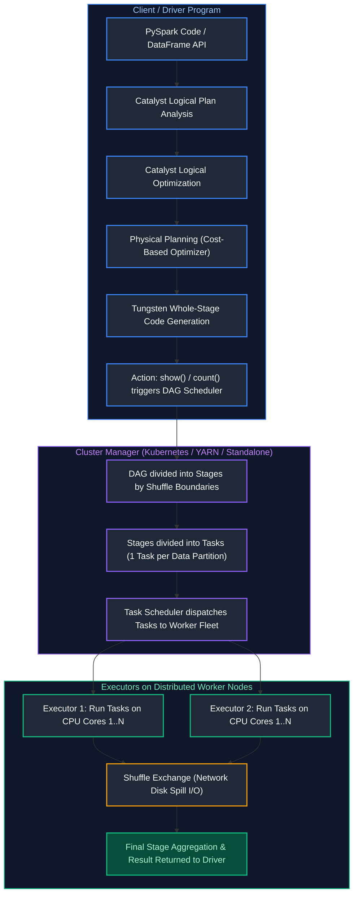

#### References
- [GeeksforGeeks: DAG in Apache Spark](https://www.geeksforgeeks.org/directed-acyclic-graphdag-in-apache-spark/)
- [DataCamp: Spark DAG Execution Explained](https://www.datacamp.com/tutorial/apache-spark-dag)

---

### 1.5 Catalyst Optimizer Internals

#### Definition
The Catalyst Optimizer is the core optimization engine powering Spark SQL, DataFrames, and Datasets. It applies rule-based and cost-based optimizations across four distinct phases:

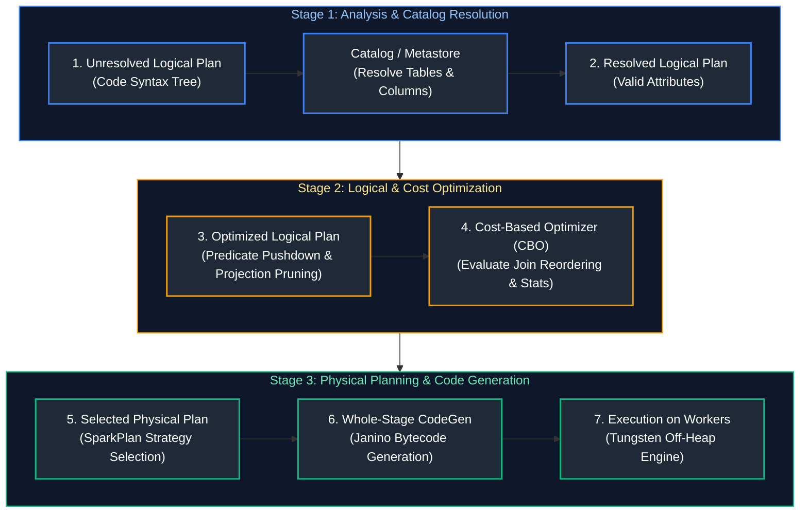

#### Key Optimization Techniques
1. **Predicate Pushdown:** Moves `.filter()` directly into storage readers (Parquet footer min/max).
2. **Projection Pruning:** Discards unneeded columns before caching or shuffling.
3. **Constant Folding:** Simplifies mathematical constants (`1 + 1` $\rightarrow$ `2`) before runtime.
4. **Join Reordering:** Uses table statistics to place smaller dimension tables on the broadcast side.

#### References
- [Databricks: Deep Dive into Catalyst Optimizer](https://www.databricks.com/blog/2015/04/13/deep-dive-into-spark-sqls-catalyst-optimizer.html)
- [GeeksforGeeks: Apache Spark Catalyst Optimizer](https://www.geeksforgeeks.org/apache-spark-catalyst-optimizer/)

---

### 1.6 Project Tungsten Execution Engine

#### Definition
Project Tungsten is the underlying CPU and memory performance engine of Apache Spark, designed to eliminate JVM memory overhead and maximize modern hardware efficiency.

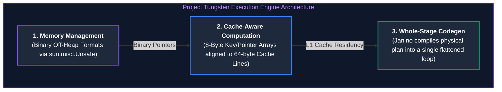

#### Architectural Impact
- **Off-Heap Memory:** Stores tabular rows as compact binary bytes outside the JVM garbage collector heap. A 10GB dataset consumes 10GB of RAM (unlike standard JVM objects which balloon to 40GB with object headers).
- **Whole-Stage Code Generation:** Synthesizes the entire query pipeline into a single tight bytecode loop, eliminating virtual method dispatch overhead.

#### References
- [Databricks: Project Tungsten Overview](https://www.databricks.com/blog/2015/04/28/project-tungsten-bringing-spark-closer-to-bare-metal.html)
- [GeeksforGeeks: Spark Tungsten Engine](https://www.geeksforgeeks.org/apache-spark-tungsten-execution-engine/)

---

### 1.7 Narrow vs Wide Dependencies

#### Definition
- **Narrow Dependency:** Each partition of the parent RDD/DataFrame is used by at most **one** partition of the child. Data does not move across cluster nodes. Highly performant.
- **Wide Dependency:** Multiple child partitions depend on data from a single parent partition. Requires a **Shuffle** where data is serialized, sorted, and transmitted across the cluster network.

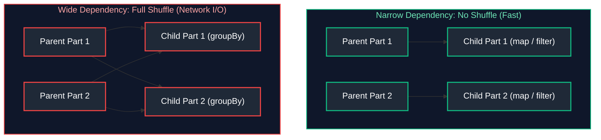

#### Operations Classification
- **Narrow Operations:** `select()`, `filter()`, `map()`, `union()`, `coalesce()`
- **Wide Operations:** `groupBy()`, `distinct()`, `join()`, `repartition()`, `orderBy()`

#### References
- [GeeksforGeeks: Narrow and Wide Dependencies in Apache Spark](https://www.geeksforgeeks.org/narrow-and-wide-dependencies-in-apache-spark/)
- [DataCamp: Spark Dependencies and Shuffling](https://www.datacamp.com/tutorial/apache-spark-dag)

---

### 1.8 Transformations vs Actions

#### Definition & Core Concepts
Every operation in Apache Spark belongs to one of two fundamental functional categories: **Transformations** or **Actions**. Understanding this bifurcation is essential to avoid unnecessary data scans and cluster resource exhaustion.

1. **Transformations (Lazy Computation):**
   - **Operational Mechanics:** Transformations take an existing DataFrame or RDD and return a new DataFrame/RDD without evaluating data or reading bytes from underlying storage. Instead of computing values immediately, Spark records each transformation as a logical operator node in an internal directed acyclic graph (**Lineage Graph** / Logical Plan).
   - **Narrow vs. Wide Dependency:**
     - **Narrow Transformations (`select`, `filter`, `withColumn`):** Each partition of the child DataFrame depends on exactly one partition of the parent DataFrame. These operations execute locally within executor memory without network transfer (in-memory pipelining).
     - **Wide Transformations (`groupBy`, `join`, `distinct`):** Multiple child partitions depend on data distributed across multiple parent partitions. These require **shuffling**, where executors exchange data over the cluster network, establishing distinct execution **Stages**.

2. **Actions (Eager Execution):**
   - **Operational Mechanics:** Actions trigger the physical execution of the entire upstream DAG. When an action is invoked, Spark's `DAGScheduler` decomposes the logical plan into physical stages, creates tasks corresponding to data partitions, and submits them to the `TaskScheduler` for executor thread execution.
   - **Output Destination:** Actions terminate a pipeline by either:
     - Pulling computed results back to the client Driver process (`collect()`, `take()`, `first()`, `count()`).
     - Writing processed data out to durable persistent storage (`write.parquet()`, `write.saveAsTable()`).

#### Catalog Matrix
| Operation Type | Method Examples | Execution Behavior |
| :--- | :--- | :--- |
| **Narrow Transformation** | `filter()`, `select()`, `withColumn()`, `drop()` | Lazy; pipelined in-memory |
| **Wide Transformation** | `groupBy()`, `distinct()`, `join()`, `sort()` | Lazy; establishes stage shuffle boundary |
| **Action (Driver Fetch)** | `collect()`, `take()`, `first()`, `show()`, `count()` | Eager; executes DAG and pulls data to Driver |
| **Action (Storage Write)** | `write.save()`, `write.parquet()`, `saveAsTable()` | Eager; executes DAG and writes files to storage |

#### Key Points & Common Pitfalls
- **The Driver OOM Hazard with `.collect()`:** Running `df.collect()` pulls the entire distributed dataset across all cluster workers into the Driver's single JVM memory. If the dataset exceeds Driver RAM (e.g. 100GB into a 4GB Driver), the Driver crashes with an `OutOfMemoryError`. Always use `.take(n)` or write to disk.

#### References
- [GeeksforGeeks: Transformations and Actions in Apache Spark](https://www.geeksforgeeks.org/transformations-and-actions-in-apache-spark/)
- [DataCamp: PySpark Transformations and Actions](https://www.datacamp.com/tutorial/pyspark-tutorial-getting-started-with-pyspark)

---

### 1.9 Shuffling Mechanics & Network Spill

#### Definition
Shuffling is the physical process of redistributing data across cluster worker nodes so that all records sharing the same partition key (e.g., all rows with `customer_id = 45`) end up located on the same physical worker node for grouping or joining.

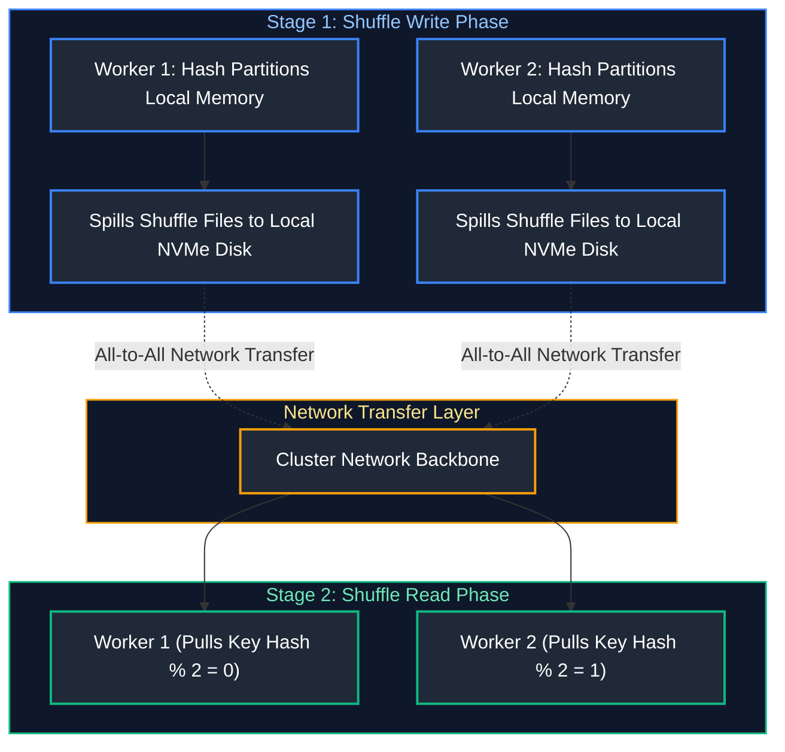

#### Why Shuffling is the #1 Performance Bottleneck
1. **Disk I/O:** Every shuffle writes temporary map files to local worker disks.
2. **Network Contention:** All worker nodes transmit gigabytes of data concurrently to all other worker nodes.
3. **Serialization Overhead:** JVM objects must be serialized into bytes before transmission and deserialized on arrival.

#### References
- [Apache Spark Documentation: Tuning Spark Shuffle](https://spark.apache.org/docs/latest/tuning.html#shuffle-operations)
- [GeeksforGeeks: Shuffling in Spark](https://www.geeksforgeeks.org/shuffling-in-apache-spark/)

> [!TIP]
> **Deep-Dive Interview Scenarios:**
> - [Q1. Spark Physical Cluster Architecture](frequently_asked_questions/05_apache_spark_and_pyspark_faq.md#q1-medium-spark-physical-cluster-architecture)
> - [Q3. Narrow vs Wide Transformations & Stage Boundaries](frequently_asked_questions/05_apache_spark_and_pyspark_faq.md#q3-easy-narrow-vs-wide-transformations--stage-boundaries)
> - [Q4. RDD Immutability & Lineage-Based Fault Tolerance](frequently_asked_questions/05_apache_spark_and_pyspark_faq.md#q4-medium-rdd-immutability--lineage-based-fault-tolerance)
> - [Q5. reduceByKey() vs groupByKey() Efficiency](frequently_asked_questions/05_apache_spark_and_pyspark_faq.md#q5-easy-reducebykey-vs-groupbykey-efficiency)
> - [Q6. map() vs flatMap() Mechanics](frequently_asked_questions/05_apache_spark_and_pyspark_faq.md#q6-easy-map-vs-flatmap-mechanics)
> - [Q14. repartition() vs coalesce() Architectural Comparison](frequently_asked_questions/05_apache_spark_and_pyspark_faq.md#q14-easy-repartition-vs-coalesce-architectural-comparison)
> - [Q18. Identifying & Reducing Excessive Shuffling](frequently_asked_questions/05_apache_spark_and_pyspark_faq.md#q18-medium-identifying--reducing-excessive-shuffling)
> - [Q20. Optimizing Large Intermediate DataFrames & Multiple groupBy Operations](frequently_asked_questions/05_apache_spark_and_pyspark_faq.md#q20-medium-optimizing-large-intermediate-dataframes--multiple-groupby-operations)
> - [Q50. Spark Lazy Evaluation: Lineage Graph Construction, Pipelining & Fault Recovery](frequently_asked_questions/05_apache_spark_and_pyspark_faq.md#q50-medium-spark-lazy-evaluation-lineage-graph-construction-pipelining--fault-recovery)

---

# 2. Spark Execution Model

---

### 2.1 Jobs, Stages, and Tasks Hierarchy

#### Definition
Spark executes applications through a strict three-level hierarchical breakdown:
1. **Application:** The user's submitted program (managed by a `SparkSession`).
2. **Job:** Triggered whenever an **Action** is invoked in the code. A single application can launch multiple Jobs sequentially.
3. **Stage:** A Job is split into multiple Stages separated by **Shuffle boundaries** (Wide Dependencies).
4. **Task:** The smallest unit of execution in Spark. A Stage is split into Tasks based on the number of data partitions. One Task executes on one Partition inside one Executor Slot.

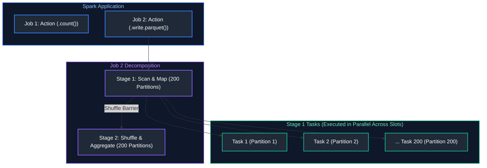

#### References
- [GeeksforGeeks: Jobs, Stages, and Tasks in Spark](https://www.geeksforgeeks.org/apache-spark-jobs-stages-tasks/)
- [DataCamp: Understanding Spark Architecture](https://www.datacamp.com/tutorial/apache-spark-dag)

---

### 2.2 Adaptive Query Execution (AQE)

#### Definition
Introduced in Spark 3.0, Adaptive Query Execution (AQE) is an optimization framework that re-optimizes and mutates the physical query execution plan **at runtime based on actual stage runtime statistics**.

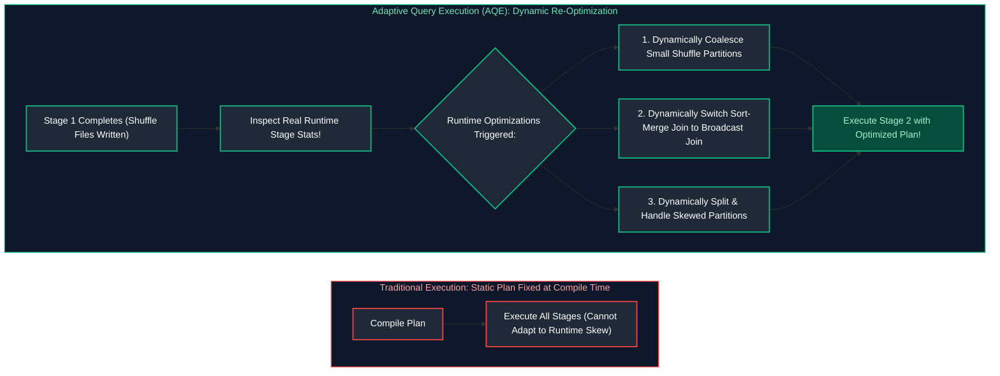

#### The Three Core Features of AQE
1. **Dynamically Coalescing Shuffle Partitions:** If shuffle partitions are tiny (e.g. 200 partitions of 1MB each), AQE merges them into a smaller number of balanced partitions (e.g., 5 partitions of 40MB).
2. **Dynamically Converting Sort-Merge Join to Broadcast Hash Join:** If a filtered table ends up smaller than `spark.sql.autoBroadcastJoinThreshold` at runtime, AQE switches the join on the fly, skipping an expensive shuffle.
3. **Dynamically Handling Data Skew:** Automatically splits oversized skewed partitions into sub-partitions.

```python
# Enabling AQE in PySpark (Enabled by default in Spark 3.2+)
spark.conf.set("spark.sql.adaptive.enabled", "true")
spark.conf.set("spark.sql.adaptive.coalescePartitions.enabled", "true")
spark.conf.set("spark.sql.adaptive.skewJoin.enabled", "true")
```

#### References
- [Databricks Documentation: Adaptive Query Execution](https://docs.databricks.com/en/optimizations/aqe.html)
- [GeeksforGeeks: Adaptive Query Execution in Apache Spark](https://www.geeksforgeeks.org/adaptive-query-execution-in-apache-spark/)

---

### 2.3 Dynamic Partition Pruning (DPP)

#### Definition
Dynamic Partition Pruning (DPP) skips reading irrelevant partitions in large fact tables when filtering on dimension attributes in a join query. 

Unlike static pruning, where the filter is a literal (`WHERE date = '2024-10-01'`), DPP handles dynamic filters (`WHERE dim_store.region = 'EMEA'`) by calculating the list of matching partition keys from the dimension table at runtime and injecting them directly into the fact table scan.


#### References
- [Databricks: Dynamic Partition Pruning](https://www.databricks.com/blog/2020/05/29/dynamic-partition-pruning-in-apache-spark.html)
- [GeeksforGeeks: Partition Pruning in Spark](https://www.geeksforgeeks.org/partitioning-in-apache-spark/)

---

### 2.4 Coalesce vs Repartition

#### Definition
Both functions change the number of partitions in a DataFrame, but they use completely different physical algorithms:

| Dimension | `coalesce(n)` | `repartition(n)` |
| :--- | :--- | :--- |
| **Operation Type** | Narrow Dependency (No shuffle) | Wide Dependency (Full shuffle) |
| **Direction** | **Can only decrease** partition count | Can increase or decrease partition count |
| **Data Distribution** | Uneven (Merges adjacent partitions locally) | Uniform (Hash-distributed across all nodes) |
| **Use Case** | Merging small files before writing to storage | Eliminating data skew; increasing parallelism |

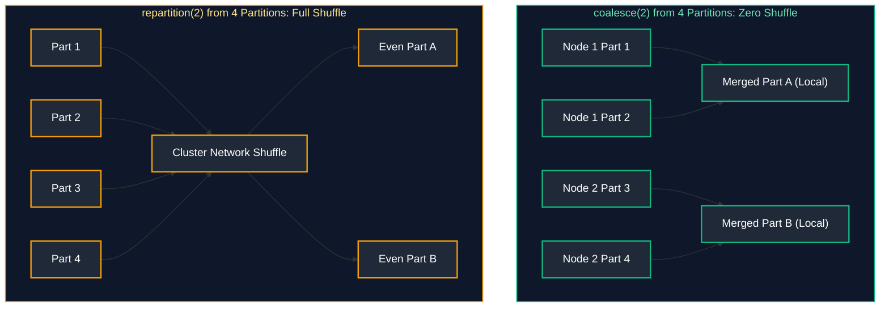

#### Code Example
```python
# Scenario 1: Pre-save file compaction (Zero shuffle overhead)
df_clean.coalesce(10).write.mode("overwrite").parquet("s3://lake/gold_orders/")

# Scenario 2: Distribute skewed data evenly across 200 partitions by key
df_skewed = df_raw.repartition(200, "customer_id")
```

#### References
- [GeeksforGeeks: Difference between Coalesce and Repartition](https://www.geeksforgeeks.org/difference-between-repartition-and-coalesce-in-apache-spark/)
- [DataCamp: Managing Partitions in PySpark](https://www.datacamp.com/tutorial/pyspark-tutorial-getting-started-with-pyspark)

---

### 2.5 Shuffle Partition Configuration

#### Definition
`spark.sql.shuffle.partitions` controls the default number of partitions created after any wide transformation (join, groupBy, distinct). The default value is **200**.

#### Tuning Guidelines
- **Small Datasets (< 1GB):** 200 is way too high! Creates 200 tiny tasks with massive scheduling overhead. Set to `spark.sql.shuffle.partitions = 8` or `16`.
- **Large Datasets (> 1TB):** 200 is too low! Each task must process 5GB of data, leading to memory spills and executor OOMs. Target **100MB to 200MB per shuffle partition**:
$$	ext{Partitions} = \frac{	ext{Total Shuffle Volume (e.g. 500GB)}}{150	ext{MB}} \approx 3,300$$

#### References
- [Apache Spark Tuning Guide](https://spark.apache.org/docs/latest/tuning.html)
- [GeeksforGeeks: Tuning Shuffle Partitions in Spark](https://www.geeksforgeeks.org/apache-spark-performance-tuning/)

---

### 2.6 Spark UI Architecture

#### Definition
The Spark UI is a web dashboard (running by default on port `4040` on the Driver) providing deep operational metrics on running and completed jobs.

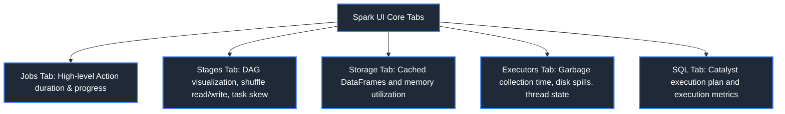

#### Key Diagnostic Checkpoints in Spark UI
1. **SQL Tab:** Inspect the physical plan to verify if broadcast joins and predicate pushdowns were triggered.
2. **Stages Tab:** Check the **Task Deserialization / GC Time / Shuffle Write Time** metrics bar.
3. **Summary Metrics Table:** Compare the **Min**, **Median**, and **Max** task durations. If Median is 2 seconds and Max is 45 minutes, you have severe **Data Skew**.

#### References
- [Apache Spark Official Documentation: Web UI](https://spark.apache.org/docs/latest/web-ui.html)
- [DataCamp: Monitoring Spark Applications](https://www.datacamp.com/tutorial/apache-spark-dag)

> [!TIP]
> **Deep-Dive Interview Scenarios:**
> - [Q2. Spark Execution Flow from spark-submit to Completion](frequently_asked_questions/05_apache_spark_and_pyspark_faq.md#q2-medium-spark-execution-flow-from-spark-submit-to-completion)
> - [Q16. The Small File Problem & Resolution in Spark](frequently_asked_questions/05_apache_spark_and_pyspark_faq.md#q16-medium-the-small-file-problem--resolution-in-spark)
> - [Q19. Adaptive Query Execution (AQE) 3-Pillar Architecture](frequently_asked_questions/05_apache_spark_and_pyspark_faq.md#q19-medium-adaptive-query-execution-aqe-3-pillar-architecture)

---

# 3. PySpark Data Processing

PySpark exposes the Python programming API for Apache Spark. While developers write pythonic code, PySpark delegates computation to the underlying optimized JVM engine.

---

### 3.1 PySpark DataFrames & SQL Expressions

#### Definition
A PySpark DataFrame is an immutable, distributed collection of rows organized into named columns with strict data types. Under the hood, DataFrame operations produce Catalyst expressions rather than executing Python bytecodes directly.

#### Code Example
```python
from pyspark.sql import SparkSession
from pyspark.sql.functions import col, expr

# Initialize distributed SparkSession driver instance
spark = SparkSession.builder \
    .appName("PySparkProcessing") \                     # Application identifier displayed in Spark UI
    .config("spark.sql.adaptive.enabled", "true") \    # Enable Adaptive Query Execution (runtime dynamic plan re-optimization)
    .getOrCreate()                                      # Retrieve existing active session or spin up a new driver

# Sample in-memory collection representing distributed raw input records
data = [("101", "Alice", 1200.50), ("102", "Bob", 450.00)]
# Convert collection into distributed DataFrame across executor partitions with inferred types
df = spark.createDataFrame(data, ["user_id", "user_name", "account_balance"])

# Project, cast types, and compute transformations using column expressions
df_transformed = df.select(
    col("user_id").cast("long"),                         # Cast string identifier to 64-bit BigInt/Long
    col("user_name"),                                   # Preserve user string attribute
    col("account_balance"),                             # Preserve numerical account balance
    expr("account_balance * 0.05").alias("interest_accrued") # Parse SQL arithmetic expression and assign column alias
)

# Trigger Action: collect first 20 rows to driver and render ASCII table to console
df_transformed.show()
```

#### References
- [Apache Spark Official PySpark Documentation](https://spark.apache.org/docs/latest/api/python/)
- [GeeksforGeeks: PySpark DataFrame Tutorial](https://www.geeksforgeeks.org/pyspark-dataframe/)
- [DataCamp: PySpark DataFrame Tutorial](https://www.datacamp.com/tutorial/pyspark-tutorial-getting-started-with-pyspark)

---

### 3.2 PySpark SQL Functions & Transformations

#### Code Example
```python
from pyspark.sql.functions import col, when, concat_ws, lower, to_date

# Perform chaining transformations on distributed DataFrame
df_orders_cleaned = df_orders \
    # Filter predicate pushed down to storage layer: only process successful orders
    .filter(col("status").isin("COMPLETED", "SHIPPED")) \
    # Parse timestamp string into native Spark DateType using ISO format mask
    .withColumn("order_date", to_date(col("timestamp_str"), "yyyy-MM-dd HH:mm:ss")) \
    # Concatenate first and last name separated by whitespace into unified string
    .withColumn("customer_full_name", concat_ws(" ", col("first_name"), col("last_name"))) \
    # Conditional branching (CASE WHEN expression): categorize monetary purchase tiers
    .withColumn("order_tier", 
        when(col("total_amount") >= 1000.0, "High Value")      # Top tier transactions
        .when(col("total_amount") >= 250.0, "Medium Value")    # Mid tier transactions
        .otherwise("Standard")                                 # Fallback default tier
    )
```

#### References
- [GeeksforGeeks: PySpark SQL Functions](https://www.geeksforgeeks.org/pyspark-sql-functions/)
- [DataCamp: Transforming Data with PySpark](https://www.datacamp.com/tutorial/pyspark-tutorial-getting-started-with-pyspark)

---

### 3.3 PySpark Window Functions

#### Definition
PySpark provides the `pyspark.sql.window.Window` utility to define analytical partitions and ordering frames directly in Python.

> [!TIP]
> **Deep-Dive Interview Scenario:**
> - [Q31. PySpark Live Coding: Days Between Status Changes per User](frequently_asked_questions/05_apache_spark_and_pyspark_faq.md#q31-medium-pyspark-live-coding-days-between-status-changes-per-user)

#### Code Example
```python
from pyspark.sql.window import Window
from pyspark.sql.functions import col, row_number, rank, sum as spark_sum, lag

# Define window specification: partition data by store_id, ordered chronologically by transaction_date
window_store_sales = Window.partitionBy("store_id").orderBy(col("transaction_date").asc())

# Define sliding physical frame: includes 2 preceding rows and the current row (-2 to 0)

window_rolling_3days = Window.partitionBy("store_id") \
    .orderBy("transaction_date") \
    .rowsBetween(-2, 0)

# 6. Evaluate analytical window expressions across executor partitions

df_analytics = df_sales \
    # Assign monotonic row index (1, 2, 3...) per store partition to order transactions
    .withColumn("rank_in_store", row_number().over(window_store_sales)) \
    # Fetch previous transaction's sales amount (offset=1) without self-join
    .withColumn("prior_day_sales", lag("sales_amount", 1).over(window_store_sales)) \
    # Compute running cumulative sum from start of partition up to current row
    .withColumn("cumulative_store_revenue", spark_sum("sales_amount").over(window_store_sales)) \
    # Calculate 3-row rolling sum across defined sliding physical boundary
    .withColumn("rolling_3day_sum", spark_sum("sales_amount").over(window_rolling_3days))
```

#### References
- [GeeksforGeeks: PySpark Window Functions](https://www.geeksforgeeks.org/pyspark-window-functions/)
- [DataCamp: PySpark Window Functions Tutorial](https://www.datacamp.com/tutorial/pyspark-window-functions)

---

### 3.4 PySpark Joins & Cartesian Logic

#### Code Example
```python
# Multi-column Inner Join: matches records matching on both customer ID and country code
df_joined = df_orders.join(
    df_customers,
    # Explicit compound equi-join condition across two join keys
    on=(df_orders["customer_id"] == df_customers["customer_id"]) & 
       (df_orders["country_code"] == df_customers["country_code"]),
    how="inner" # Drops unmatched records from both sides
)

# Left Semi Join: returns only left rows having at least 1 match on the right
# Crucial benefit: Avoids row multiplication even if right table contains duplicate customer_id records!
df_valid_orders = df_orders.join(df_customers, on="customer_id", how="left_semi")

# Left Anti Join: returns only left rows that have NO match in the right table (ideal for orphan detection)
df_orphaned_orders = df_orders.join(df_customers, on="customer_id", how="left_anti")
```

#### References
- [GeeksforGeeks: PySpark Join Types](https://www.geeksforgeeks.org/pyspark-join-types/)
- [DataCamp: Joining DataFrames in PySpark](https://www.datacamp.com/tutorial/pyspark-tutorial-getting-started-with-pyspark)

---

### 3.5 PySpark Aggregations & Pivot

#### Code Example
```python
from pyspark.sql.functions import count, sum as spark_sum, avg, round as spark_round

# GroupBy with multiple aggregations
df_summary = df_orders.groupBy("department_id", "region") \
    .agg(
        count("order_id").alias("total_orders"),
        spark_sum("total_amount").alias("gross_revenue"),
        spark_round(avg("total_amount"), 2).alias("avg_order_value")
    )

# Pivot: Transforming row values into columns (e.g., quarterly sales)
df_pivoted = df_sales.groupBy("product_id") \
    .pivot("quarter", ["Q1", "Q2", "Q3", "Q4"]) \
    .agg(spark_sum("revenue"))
```

#### Key Points & Common Pitfalls
- **High Cardinality Pivot:** Always pass the explicit list of pivot values (e.g., `["Q1", "Q2", "Q3", "Q4"]`). If omitted, Spark must run an expensive extra distributed job to discover all distinct values before pivoting.

#### References
- [GeeksforGeeks: PySpark Pivot and Unpivot](https://www.geeksforgeeks.org/pyspark-pivot-and-unpivot-dataframe/)
- [DataCamp: Aggregations in PySpark](https://www.datacamp.com/tutorial/pyspark-tutorial-getting-started-with-pyspark)

---

### 3.6 PySpark UDFs: Python Standard vs Vectorized Pandas UDFs

#### Definition
- **Standard Python UDF:** Executes row-by-row. Data is serialized from the JVM across a local socket to a Python worker process (via Py4J / Pickle), evaluated, and serialized back to the JVM. Extremely slow (10x to 100x slower than native SQL).
- **Vectorized Pandas UDF (`@pandas_udf`):** Built on **Apache Arrow**. Transfers entire batches of columnar records in-memory directly between the JVM and Python processes without serialization overhead, executing SIMD-accelerated NumPy/Pandas operations.

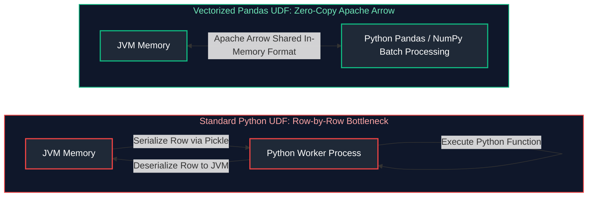

#### Code Example
```python
import pandas as pd
from pyspark.sql.functions import pandas_udf
from pyspark.sql.types import DoubleType

# Vectorized Pandas UDF using Apache Arrow (Fast!)
@pandas_udf(DoubleType())
def calculate_vat_pandas_udf(price_series: pd.Series) -> pd.Series:
    # Executes vector math across the entire Series at once
    return price_series * 0.20

# Invocation
df_with_vat = df_orders.withColumn("vat_amount", calculate_vat_pandas_udf(col("subtotal")))
```

#### References
- [Apache Spark Documentation: Pandas UDFs](https://spark.apache.org/docs/latest/api/python/user_guide/sql/arrow_pandas.html)
- [GeeksforGeeks: PySpark UDF](https://www.geeksforgeeks.org/pyspark-udf-user-defined-function/)
- [DataCamp: Vectorized UDFs in PySpark](https://www.datacamp.com/tutorial/pyspark-udf)

---

### 3.7 Pandas API on Spark (Koalas)

#### Definition
The Pandas API on Spark (formerly known as Koalas) provides a drop-in replacement for the Pandas library that scales transparently to multi-node distributed clusters by compiling Pandas operations into Spark Catalyst execution plans.

#### Code Example
```python
import pyspark.pandas as ps

# Read distributed parquet using standard Pandas syntax
psdf = ps.read_parquet("s3://lakehouse/large_telemetry.parquet")

# Standard Pandas API calls execute as distributed Spark jobs
psdf["net_revenue"] = psdf["gross_revenue"] - psdf["tax"]
mean_val = psdf.groupby("country")["net_revenue"].mean()
```

#### References
- [Apache Spark Documentation: Pandas API on Spark](https://spark.apache.org/docs/latest/api/python/user_guide/pandas_on_spark/index.html)
- [GeeksforGeeks: Pandas API on Apache Spark](https://www.geeksforgeeks.org/pandas-api-on-apache-spark/)

---

### 3.8 Handling NULLs & Missing Data in PySpark (Imputation & Default Values)

#### Problem: Missing Data, Incomplete Telemetry & Null Poisoning
Real-world datasets suffer from dropped sensors, optional form inputs, and network truncations. Indiscriminately dropping rows introduces survivorship bias, while leaving `NULL` values unmanaged can poison mathematical aggregations (e.g., `SUM()` ignoring nulls, but boolean joins failing or resulting in null-trap logic).

#### Solution: Imputation Strategies & Default Fallbacks
1. **Defensive Filtering:** Dropping records missing required non-nullable primary keys (`dropna(subset=["id"])`).
2. **Domain Sentinel Defaults:** Replacing nulls with business fallbacks (`fillna()`, `coalesce()`).
3. **Statistical Imputation via ML `Imputer`:** Imputing missing numeric metrics with the population mean or median across distributed partitions.
4. **Sequential Imputation (Forward-Fill):** Propagating the most recently observed valid value forward across an ordered window.

> [!TIP]
> **Deep-Dive Interview Scenarios:**
> - [Q28. Built-in transform() vs Python UDF vs Pandas UDF](frequently_asked_questions/05_apache_spark_and_pyspark_faq.md#q28-easy-built-in-transform-vs-python-udf-vs-pandas-udf)
> - [Q29. Handling Inconsistent Schemas, Null Values & Incorrect Casing](frequently_asked_questions/05_apache_spark_and_pyspark_faq.md#q29-easy-handling-inconsistent-schemas-null-values--incorrect-casing)

```python
from pyspark.sql.functions import col, coalesce, lit, last
from pyspark.sql.window import Window
from pyspark.ml.feature import Imputer

# Drop records lacking primary identification

df_valid = df_raw.dropna(subset=["order_id", "customer_id"])

# 8. Domain default value replacement

df_defaults = df_valid.fillna({
    "discount_amount": 0.0,
    "shipping_country": "UNKNOWN"
}).withColumn(
    "contact_phone", 
    coalesce(col("mobile"), col("work_phone"), lit("N/A"))
)

# 9. Statistical Imputation (Mean / Median) via Spark ML Imputer

imputer = Imputer(
    inputCols=["user_age", "annual_income"], 
    outputCols=["user_age_imputed", "annual_income_imputed"]
).setStrategy("median")                                       # Options: "mean", "median", "mode"

df_stat_imputed = imputer.fit(df_defaults).transform(df_defaults)

# 10. Sequential Forward-Fill for time-series sensor data

window_spec = Window.partitionBy("device_id").orderBy("event_timestamp") \
    .rowsBetween(Window.unboundedPreceding, 0)

df_clean = df_stat_imputed.withColumn(
    "temperature_ffill",
    last("temperature", ignorenulls=True).over(window_spec)   # Propagates last valid sensor reading
)
```

#### References
- [Apache Spark Documentation: ML Feature Imputer](https://spark.apache.org/docs/latest/ml-features.html#imputer)
- [GeeksforGeeks: Handle NULL values in PySpark](https://www.geeksforgeeks.org/handling-null-values-in-pyspark/)

---

### 3.9 Complex Data Types (Array, Map, Struct) & Shredding

#### Definition
PySpark natively supports complex, semi-structured schemas:
- **`StructType`:** Group of named fields (represents nested JSON objects).
- **`ArrayType`:** List of homogeneous elements.
- **`MapType`:** Dynamic key-value mappings.

#### Code Example
```python
from pyspark.sql.functions import col, explode, size, map_keys

# Explode an array column (creates one new row per array item)
df_exploded = df_orders.select(
    col("order_id"),
    explode(col("items_array")).alias("item")
)

# Extract nested struct attributes
df_item_details = df_exploded.select(
    col("order_id"),
    col("item.product_id").alias("product_id"),
    col("item.unit_price").alias("unit_price"),
    col("item.quantity").alias("quantity")
)
```

#### References
- [GeeksforGeeks: PySpark ArrayType Column](https://www.geeksforgeeks.org/pyspark-arraytype-column/)
- [DataCamp: Complex Data Types in PySpark](https://www.datacamp.com/tutorial/pyspark-tutorial-getting-started-with-pyspark)

---

### 3.10 Inconsistent Timestamps & Time Zone Normalization in PySpark

#### Problem: Mixed Timezones & Ambiguous Wall-Clock Times
Data sources frequently ingest timestamps from multiple regional servers with mixed formats (epoch milliseconds, ISO-8601 strings with varying UTC offsets, and naive local datetimes). Mixing local timezones leads to distorted daily metrics and broken window joins.

#### Solution: Time Standardization (UTC) & Timezone Normalization
- **Lakehouse UTC Standard:** Convert all timestamps to canonical UTC `TimestampType` at the Bronze ingestion boundary.
- **Conversion Functions:**
  - `to_utc_timestamp(col, source_tz)`: Interprets the timestamp as local time in `source_tz` and shifts it to canonical UTC.
  - `from_utc_timestamp(col, target_tz)`: Converts UTC timestamps to local user timezones for reporting presentation.

```python
from pyspark.sql.functions import col, to_timestamp, to_utc_timestamp, from_utc_timestamp

# Ensure Spark SQL session operates in UTC
spark.conf.set("spark.sql.session.timeZone", "UTC")

# Parse string into timestamp and normalize to UTC
df_normalized = df_raw.withColumn(
    "event_ts_raw", 
    to_timestamp(col("raw_event_time"), "yyyy-MM-dd HH:mm:ss")
).withColumn(
    "event_timestamp_utc", 
    to_utc_timestamp(col("event_ts_raw"), "America/New_York")   # Normalized from US Eastern to UTC
).withColumn(
    "report_time_london",
    from_utc_timestamp(col("event_timestamp_utc"), "Europe/London") # Converted for regional presentation
)
```

---

### 3.11 File Corruption & Malformed Record Handling

#### Problem: Truncated Files & Bad Data at Ingestion
Corrupted landing files, unescaped delimiters, or schema mismatches can crash large distributed file reads mid-execution, wasting cluster compute hours.

#### Solution: Defensive Spark Read Modes
Spark provides three defensive read modes when loading CSV or JSON datasets:
1. **`PERMISSIVE` (Default & Recommended):** Sets unparseable fields to `NULL` and routes the original unparseable text into a dedicated column named `_corrupt_record`. The pipeline continues without failure, enabling automated quarantine routing.
2. **`DROPMALFORMED`:** Silently ignores and discards rows containing malformed tokens.
3. **`FAILFAST`:** Immediately throws an exception upon encountering the first corrupt record.

```python
from pyspark.sql.types import StructType, StructField, StringType, IntegerType, DoubleType

# Schema including the designated corrupt record capture column
order_schema = StructType([
    StructField("order_id", IntegerType(), True),
    StructField("customer_id", IntegerType(), True),
    StructField("amount", DoubleType(), True),
    StructField("_corrupt_record", StringType(), True)        # Captures raw malformed string for quarantine
])

# Read landing files in PERMISSIVE mode
df_ingest = spark.read \
    .format("json") \
    .schema(order_schema) \
    .option("mode", "PERMISSIVE") \
    .option("columnNameOfCorruptRecord", "_corrupt_record") \
    .load("s3://landing-bucket/orders/")

# Split valid records from quarantined corrupt records
df_valid = df_ingest.filter(col("_corrupt_record").isNull()).drop("_corrupt_record")
df_quarantine = df_ingest.filter(col("_corrupt_record").isNotNull())

# Write corrupt records to Dead Letter Queue (DLQ) table for alerting
df_quarantine.write.format("delta").mode("append").save("s3://lakehouse/quarantine/corrupt_orders/")
```

> [!TIP]
> **Deep-Dive Interview Scenario:**
> - [Q52. Production Data Cleansing: Filtering Null Identifiers & Dead-Letter Routing](frequently_asked_questions/05_apache_spark_and_pyspark_faq.md#q52-easy-production-data-cleansing-filtering-null-identifiers--dead-letter-routing)

---

# 4. Distributed Spark Join Strategies

When joining two distributed DataFrames across a cluster, Spark selects one of several physical join algorithms based on table size, join keys, and hints.

---

### 4.1 Broadcast Hash Join (BHJ)

#### Definition
A Broadcast Hash Join copies the smaller table across the network to all executor nodes. Each executor builds an in-memory hash table of the small dataset and scans its local partition of the large table. **Zero network shuffling of the large table occurs.**

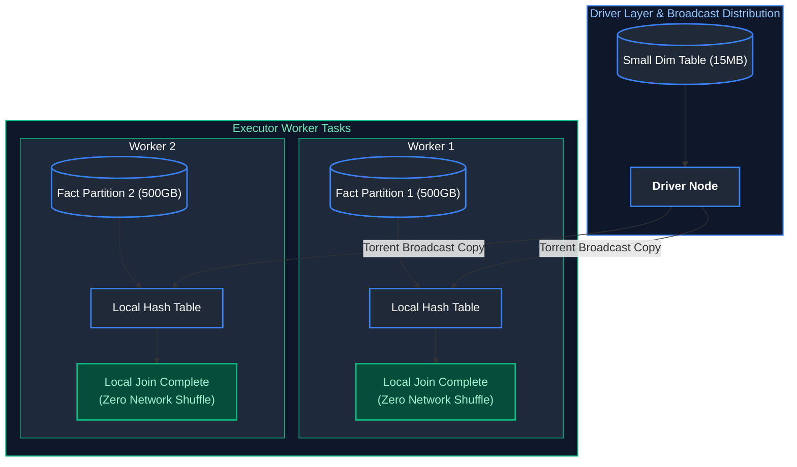

#### Code Example
```python
from pyspark.sql.functions import broadcast

# Broadcast Hash Join (BHJ) Hint:
# Instructs driver to serialize the small dimension table and send a full copy to every executor.
# Eliminates the costly network shuffle of the massive fact table!
df_joined = df_fact_large.join(
    broadcast(df_dim_small), # Wraps small DataFrame in broadcast hint (< spark.sql.autoBroadcastJoinThreshold)
    on="store_id",           # Equi-join key
    how="inner"              # Inner join strategy
)
```

#### Key Thresholds & Pitfalls
- **Default Limit:** Controlled by `spark.sql.autoBroadcastJoinThreshold` (default `10MB`). If set too high (e.g. 2GB), broadcasting large tables will crash the Driver node with an `OutOfMemoryError`.

#### References
- [GeeksforGeeks: Broadcast Join in Spark](https://www.geeksforgeeks.org/broadcast-joins-in-apache-spark/)
- [Databricks Documentation: Join Hints](https://docs.databricks.com/en/optimizations/broadcast-join.html)

---

### 4.2 Shuffle Hash Join (SHJ)

#### Definition
Both tables are hash-partitioned across the network on the join key. For each partition, Spark builds an in-memory hash table of the smaller partition and probes it with rows from the larger partition.

#### When Used
Used when tables are too large to broadcast, but individual partitions fit comfortably inside executor memory, and data is not already sorted.

#### References
- [GeeksforGeeks: Shuffle Hash Join in Apache Spark](https://www.geeksforgeeks.org/apache-spark-join-strategies/)

---

### 4.3 Sort-Merge Join (SMJ)

#### Definition
Sort-Merge Join is the default physical join strategy in Spark for joining two large tables. It executes in three steps:
1. **Shuffle:** Both datasets are hash-partitioned across the cluster by the join key.
2. **Sort:** Each executor sorts its partition locally by the join key.
3. **Merge:** A coordinated pointer streams through both sorted partitions, merging matching keys.

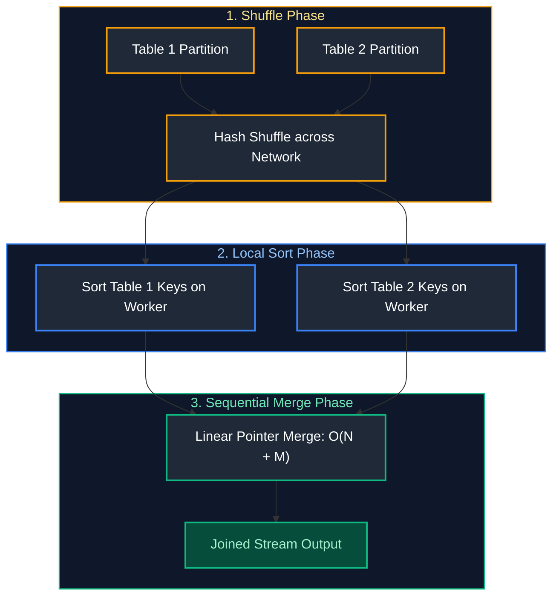

#### Advantages
Extremely robust and scalable. Can handle terabyte-scale datasets because it streams through sorted data without needing to hold entire tables in memory.

#### References
- [GeeksforGeeks: Sort Merge Join in Apache Spark](https://www.geeksforgeeks.org/sort-merge-join-in-apache-spark/)
- [Databricks Documentation: Sort-Merge Join](https://docs.databricks.com/en/optimizations/join-strategies.html)

---

### 4.4 Cartesian / Broadcast Nested Loop Join

#### Definition
Computes the full Cartesian product ($N \times M$). If one side is small, it uses **Broadcast Nested Loop Join (BNLJ)**; if both sides are large, it triggers a catastrophic distributed **Cartesian Join**.

#### Pitfalls
Avoid non-equi joins without bounds in Spark (e.g., `df1.join(df2, df1.val != df2.val)`), which triggers Cartesian execution and causes cluster lockup.

#### References
- [Apache Spark Join Strategies Documentation](https://spark.apache.org/docs/latest/sql-performance-tuning.html)

---

### 4.5 Skew Join Optimization

#### Definition
Data skew occurs when an asymmetric distribution of keys (e.g., 90% of orders belong to `customer_id = 1` - "Guest Checkout") routes massive data volumes to a single reducer partition, causing one worker to run for hours while others sit idle.

#### Automatic Handling via AQE
Adaptive Query Execution automatically detects skewed partitions (partitions exceeding `spark.sql.adaptive.skewJoin.skewedPartitionFactor * medianSize`) and splits the skewed partition into smaller sub-partitions, replicating the matching dimension partition to join them in parallel.

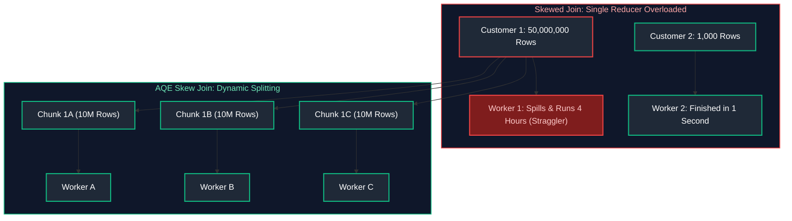

#### References
- [Databricks Documentation: Optimize Skew Joins](https://docs.databricks.com/en/optimizations/skew-join.html)
- [GeeksforGeeks: Handling Data Skew in Apache Spark](https://www.geeksforgeeks.org/handling-data-skew-in-apache-spark/)

---

### 4.6 Bucketing for Large Joins (Eliminating Shuffle Exchange)

#### Problem: Massive Joins & Shuffle Bottlenecks
When joining two large tables (e.g., 500 GB Fact joined with 300 GB Dimension) where neither dataset fits in executor memory for a Broadcast Hash Join, Spark falls back to a **Sort-Merge Join (SMJ)**. This forces a cluster-wide **Shuffle Exchange**, re-partitioning and shuffling hundreds of gigabytes across the physical network switch.

#### Solution: Bucketing
**Bucketing** physically pre-sorts and pre-partitions datasets based on the hash of the join key when writing to storage. If two tables are pre-bucketed on the same join key with identical (or integer-multiple) bucket counts, Spark **completely eliminates the Shuffle Exchange stage**, streaming pre-matched buckets directly into worker sort-merge executors.

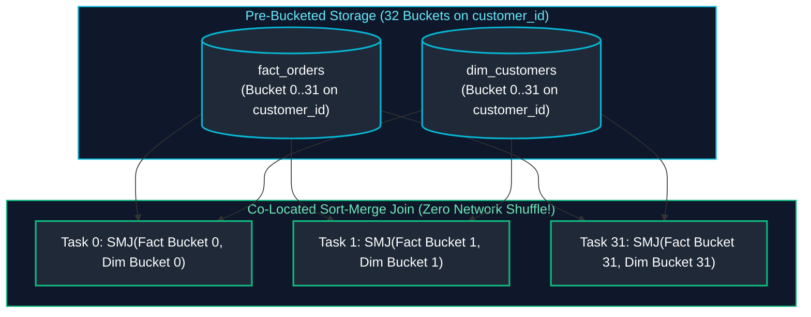

> [!TIP]
> **Deep-Dive Interview Scenarios:**
> - [Q7. Spark Join Strategies & Optimizer Selection Matrix](frequently_asked_questions/05_apache_spark_and_pyspark_faq.md#q7-medium-spark-join-strategies--optimizer-selection-matrix)
> - [Q8. Joining 500 GB DataFrame with 50 MB Lookup DataFrame](frequently_asked_questions/05_apache_spark_and_pyspark_faq.md#q8-medium-joining-500-gb-dataframe-with-50-mb-lookup-dataframe)
> - [Q9. Diagnosing Join Record Multipliers & Cartesian Explodes](frequently_asked_questions/05_apache_spark_and_pyspark_faq.md#q9-hard-diagnosing-join-record-multipliers--cartesian-explodes)
> - [Q10. Joining Two DataFrames with Different Schemas via Row Number](frequently_asked_questions/05_apache_spark_and_pyspark_faq.md#q10-medium-joining-two-dataframes-with-different-schemas-via-row-number)
> - [Q47. Joining 2 TB Fact Table with 200 MB Dimension Table](frequently_asked_questions/05_apache_spark_and_pyspark_faq.md#q47-medium-joining-2-tb-fact-table-with-200-mb-dimension-table)
> - [Q54. Spark Broadcast Join Exceeding Executor Memory: Failure Modes & Safeguards](frequently_asked_questions/05_apache_spark_and_pyspark_faq.md#q54-medium-spark-broadcast-join-exceeding-executor-memory-failure-modes--safeguards)
> - [Q55. Distributed Lock Expiration & Split-Brain Hazard During Long Spark GC Pauses](frequently_asked_questions/05_apache_spark_and_pyspark_faq.md#q55-hard-distributed-lock-expiration--split-brain-hazard-during-long-spark-gc-pauses)

#### Code Example
```python
# Pre-bucket and pre-sort both datasets on the join key

df_orders.write \
    .format("parquet") \
    .bucketBy(32, "customer_id") \
    .sortBy("customer_id") \
    .saveAsTable("orders_bucketed")

df_customers.write \
    .format("parquet") \
    .bucketBy(32, "customer_id") \
    .sortBy("customer_id") \
    .saveAsTable("customers_bucketed")

# 13. Join the pre-bucketed tables (Check explain plan: No Exchange hashpartitioning!)

df_joined = spark.table("orders_bucketed").join(
    spark.table("customers_bucketed"),
    on="customer_id",
    how="inner"
)

# Verify execution plan
df_joined.explain(True)
```

---

# 5. Spark Performance Optimization

Performance tuning in distributed environments requires eliminating data skew, minimizing shuffle I/O, optimizing memory allocations, and leveraging cache layers effectively.

---

### 5.1 Key Salting for Extreme Data Skew

#### Definition
Key Salting is a manual optimization pattern used to resolve extreme data skew when joining two large tables where AQE cannot sufficiently balance the load. A random integer suffix (the "salt", e.g., 0 to $K-1$) is appended to the skewed key of the large table, while the matching dimension table is exploded $K$ times with all salt values.

```mermaid
flowchart TD
    subgraph SaltingProcess ["Salting Process (Salt Factor K = 4)"]
        SkewedRow["Skewed Large Table Row: [Key: 'NULL', Data...]"]
        SaltGen["Append Random Integer: concat('NULL', '_', floor(rand() * 4))"]
        SkewedRow --> SaltGen
        SaltGen --> SalterRows["Produces 4 Evenly Distributed Buckets: 'NULL_0', 'NULL_1', 'NULL_2', 'NULL_3'"]

        SmallDim["Dimension Table: [Key: 'NULL', Info...]"]
        Explode["Explode with Array [0, 1, 2, 3]"]
        SmallDim --> Explode
        Explode --> DimReplicated["4 Replicated Rows: 'NULL_0', 'NULL_1', 'NULL_2', 'NULL_3'"]

        SalterRows & DimReplicated --> BalancedJoin["Evenly Balanced Join Across 4 Workers!"]
    end

    style SaltingProcess fill:#0f172a,stroke:#3b82f6,stroke-width:1.5px,color:#93c5fd

    style SkewedRow fill:#1f2937,stroke:#ef4444,stroke-width:2px,color:#fff
    style SaltGen fill:#1f2937,stroke:#f59e0b,stroke-width:2px,color:#fff
    style SalterRows fill:#1f2937,stroke:#3b82f6,stroke-width:2px,color:#fff
    style SmallDim fill:#1f2937,stroke:#10b981,stroke-width:2px,color:#fff
    style Explode fill:#1f2937,stroke:#10b981,stroke-width:2px,color:#fff
    style DimReplicated fill:#1f2937,stroke:#10b981,stroke-width:2px,color:#fff
    style BalancedJoin fill:#064e3b,stroke:#10b981,stroke-width:2px,color:#a7f3d0
```

#### Code Example (PySpark Key Salting Implementation)
```python
from pyspark.sql.functions import col, concat, lit, rand, floor, explode, array

salt_factor = 4

# 15. Salt the large skewed table with a random integer between 0 and 3

df_large_salted = df_large.withColumn(
    "salted_key",
    concat(col("customer_id"), lit("_"), floor(rand() * salt_factor))
)

# 16. Replicate the small table by exploding an array of all possible salt values

salt_array = array([lit(i) for i in range(salt_factor)])
df_small_replicated = df_small \
    .withColumn("salt", explode(salt_array)) \
    .withColumn("salted_key", concat(col("customer_id"), lit("_"), col("salt")))

# 17. Join on the salted composite key (Completely eliminates data skew!)

df_joined_balanced = df_large_salted.join(
    df_small_replicated,
    on="salted_key",
    how="inner"
).drop("salted_key", "salt")
```

#### References
- [GeeksforGeeks: Salting in Apache Spark](https://www.geeksforgeeks.org/salting-in-apache-spark/)
- [Databricks: Handling Data Skew](https://docs.databricks.com/en/optimizations/skew-join.html)

---

### 5.2 Broadcast Threshold Tuning

#### Definition
Spark uses `spark.sql.autoBroadcastJoinThreshold` to automatically convert joins to Broadcast Hash Joins if a table's estimated size is smaller than the threshold (default: 10MB = `10485760` bytes).

#### Tuning in PySpark
```python
# Increase auto-broadcast threshold to 100MB for clusters with large driver memory
spark.conf.set("spark.sql.autoBroadcastJoinThreshold", 104857600)

# Disable auto-broadcasting completely (useful for benchmarking)
spark.conf.set("spark.sql.autoBroadcastJoinThreshold", -1)
```

#### Key Points & Common Pitfalls
- Setting this threshold too high (e.g. 1GB+) can overwhelm the Driver JVM when collecting and broadcasting tables, leading to catastrophic Driver OOM crashes.

---

### 5.3 Caching & Persistence Strategies

#### Definition
Caching stores the evaluated contents of a DataFrame in cluster memory so that subsequent downstream actions can reuse it without recomputing the entire DAG from scratch.
- `df.cache()`: Shorthand for persisting data at the default storage level (`MEMORY_AND_DISK` in Spark 3+).
- `df.persist(StorageLevel)`: Explicitly defines the storage tier and serialization mode.

#### Code Example
```python
from pyspark.storagelevel import StorageLevel

# Read raw telemetry and filter
df_transformed = spark.read.parquet("s3://lake/events/").filter("status = 'SUCCESS'")

# Persist in memory serialized to save RAM
df_transformed.persist(StorageLevel.MEMORY_ONLY_SER)

# First Action triggers computation and caches the DataFrame
count_val = df_transformed.count()

# Subsequent actions reuse the cached memory state instantly
df_transformed.groupBy("device_type").count().show()

# CRITICAL: Always unpersist when finished to reclaim executor memory!
df_transformed.unpersist()
```

#### References
- [GeeksforGeeks: Cache vs Persist in Apache Spark](https://www.geeksforgeeks.org/difference-between-cache-and-persist-in-apache-spark/)
- [DataCamp: Caching in Spark](https://www.datacamp.com/tutorial/apache-spark-python)

---

### 5.4 Spark Storage Levels

#### Storage Levels Architecture & Trade-Offs
Caching a DataFrame via `.cache()` or `.persist()` instructs Spark to retain computed partition data in memory or disk across action boundaries. However, caching is not free—it consumes cluster RAM and CPU cycles. Spark provides fine-grained control over persistence behavior through **Storage Levels**, balancing three fundamental dimensions:
1. **Memory vs. Disk:** Whether data is held strictly in RAM (`MEMORY_ONLY`), stored in RAM with automatic overflow spilling to local NVMe storage (`MEMORY_AND_DISK`), or persisted directly to disk without consuming heap memory (`DISK_ONLY`).
2. **Deserialized vs. Serialized:** 
   - **Deserialized (Default for RDDs):** Stores raw Java objects. Avoids CPU deserialization overhead during subsequent reads, but increases memory footprint by $2\times - 5\times$ due to JVM object headers and pointer bloat, triggering heavy GC pressure.
   - **Serialized (`_SER`):** Serializes objects into compact byte arrays (using Java or Kryo serializer). Reduces memory footprint drastically, but requires CPU cycles to deserialize records every time they are accessed.
   *(Note: Spark SQL DataFrames automatically cache using Tungsten columnar in-memory format, regardless of whether `_SER` is specified).*
3. **Replication Factor (`_2`):** Suffixing any storage level with `_2` (e.g., `MEMORY_AND_DISK_2`) replicates every partition across two distinct physical worker nodes. If a worker node crashes, the partition is read immediately from the peer node without needing to recompute the lineage graph.

#### Storage Levels Comparison
| Storage Level | Space Used | CPU Overhead | Stored on Disk? | Stored in Memory? | Serialized? |
| :--- | :--- | :--- | :--- | :--- | :--- |
| `MEMORY_ONLY` | High | Low | No | Yes | No (Raw JVM) |
| `MEMORY_ONLY_SER` | Low | High (CPU Deser) | No | Yes | Yes (Kryo Bytes) |
| `MEMORY_AND_DISK` | Medium | Medium | Yes (If spills) | Yes | No (Default) |
| `MEMORY_AND_DISK_SER` | Low | High | Yes (If spills) | Yes | Yes |
| `DISK_ONLY` | Very Low | High | Yes | No | Yes |
| `OFF_HEAP` | Low | Low | No | Off-heap RAM | Yes (Tungsten) |

#### References
- [Apache Spark Official Documentation: Storage Levels](https://spark.apache.org/docs/latest/rdd-programming-guide.html#rdd-persistence)

---

### 5.5 Memory Architecture & Spill to Disk

#### Unified Memory Manager Architecture
Each Spark executor JVM allocates its available memory (`spark.executor.memory`) into distinct regions managed dynamically by the Unified Memory Manager:

```mermaid
flowchart TD
    subgraph TotalJVM ["Total Executor JVM Memory (e.g., 16 GB)"]
        direction LR
        subgraph SystemMemory ["Base Memory Allocations"]
            direction TD
            Reserved["Reserved Memory<br/>(300 MB fixed for Spark internals)"]
            UserMem["User Memory (25%)<br/>(Custom structures, UDFs, maps)"]
        end
        
        subgraph SparkPool ["Spark Memory Pool (75% of remaining RAM)"]
            direction LR
            StoragePool["Storage Memory (50%)<br/>(Cached DataFrames & Broadcasts)"]
            ExecPool["Execution Memory (50%)<br/>(Shuffle, Join & Aggregation Buffers)"]
            
            StoragePool <-->|"Dynamic Borrowing Boundary"| ExecPool
        end
    end

    style TotalJVM fill:#0f172a,stroke:#334155,stroke-width:1.5px,color:#94a3b8
    style SystemMemory fill:#1e293b,stroke:#64748b,stroke-width:1.5px,color:#cbd5e1
    style SparkPool fill:#1e293b,stroke:#3b82f6,stroke-width:1.5px,color:#93c5fd

    style Reserved fill:#0f172a,stroke:#94a3b8,stroke-width:1.5px,color:#fff
    style UserMem fill:#0f172a,stroke:#f59e0b,stroke-width:1.5px,color:#fff
    style StoragePool fill:#0f172a,stroke:#10b981,stroke-width:1.5px,color:#fff
    style ExecPool fill:#0f172a,stroke:#3b82f6,stroke-width:1.5px,color:#fff
```

#### Spill to Disk Explained
When Execution Memory is full and a task requires more memory to complete a sort or hash aggregate, it attempts to borrow memory from Storage. If no storage memory is available, the engine **spills temporary shuffle pages to local executor NVMe disk**.
- **Spill (Memory):** The size of the data in uncompressed JVM memory before spilling.
- **Spill (Disk):** The compressed byte size written to disk.
- **Remedy:** Increase `spark.sql.shuffle.partitions` or allocate more executor RAM.

#### References
- [GeeksforGeeks: Memory Management in Apache Spark](https://www.geeksforgeeks.org/memory-management-in-apache-spark/)
- [Databricks: Understanding Spark Memory Management](https://docs.databricks.com/en/optimizations/memory-management.html)

---

### 5.6 Java Garbage Collection (G1GC) Tuning

#### Definition
In large JVM clusters, standard parallel garbage collection can cause long "Stop-the-World" pauses that trigger heartbeat timeouts and false executor death.

#### G1GC Tuning Configuration
Modern Spark deployments standardize on the **Garbage-First Garbage Collector (G1GC)**:
```bash
--conf "spark.executor.extraJavaOptions=-XX:+UseG1GC -XX:InitiatingHeapOccupancyPercent=35 -XX:G1ReservePercent=15"
```
- `-XX:+UseG1GC`: Enables the low-latency G1 collector.
- `-XX:InitiatingHeapOccupancyPercent=35`: Triggers background GC cycles earlier before memory runs out.

> [!TIP]
> **Deep-Dive Interview Scenarios:**
> - [Q11. Root Causes of the 1-Task Straggler](frequently_asked_questions/05_apache_spark_and_pyspark_faq.md#q11-hard-root-causes-of-the-1-task-straggler)
> - [Q12. Identifying Data Skew in the Spark Web UI](frequently_asked_questions/05_apache_spark_and_pyspark_faq.md#q12-hard-identifying-data-skew-in-the-spark-web-ui)
> - [Q13. Mitigating Data Skew via Key Salting & AQE Skew Join](frequently_asked_questions/05_apache_spark_and_pyspark_faq.md#q13-hard-mitigating-data-skew-via-key-salting--aqe-skew-join)
> - [Q68. Skew Salting & Isolated Broadcast for High-Volume Surge Keys (Friday Night Surge)](frequently_asked_questions/05_apache_spark_and_pyspark_faq.md#q68-hard-skew-salting--isolated-broadcast-for-high-volume-surge-keys-friday-night-surge)
> - [Q46. Solving Data Transformations Without an IDE (Whiteboarding Best Practices)](frequently_asked_questions/05_apache_spark_and_pyspark_faq.md#q46-medium-solving-data-transformations-without-an-ide-whiteboarding-best-practices)
> - [Q48. High Memory Usage & Slow Data Processing Diagnostic Framework](frequently_asked_questions/05_apache_spark_and_pyspark_faq.md#q48-hard-high-memory-usage--slow-data-processing-diagnostic-framework)

---

# 6. Spark Debugging & Troubleshooting

---

### 6.1 Reading Spark UI: DAG & Event Timeline

#### Diagnostic Workflow in Spark UI
1. Open the **Stages** tab and look at the **Event Timeline**.
2. Identify whether execution time is dominated by **Task Deserialization Time**, **Shuffle Fetch Wait Time**, or **Executor Computing Time**.
3. If tasks spend 80% of time in **Shuffle Read Blocked / Wait Time**, network congestion or disk I/O on mapper nodes is the bottleneck.

```mermaid
flowchart LR
    ScanUI["Spark UI Stages Tab"] --> Timeline["Inspect Event Timeline"]
    Timeline --> Skew{"Are all task bars equal?"}
    Skew -- No (One long bar) --> FixSkew["Diagnose Data Skew (Salt Keys / AQE)"]
    Skew -- Yes (All long bars) --> FixCompute["Add Cluster Worker Nodes / Cores"]

    style ScanUI fill:#1f2937,stroke:#3b82f6,stroke-width:2px,color:#fff
    style Timeline fill:#1f2937,stroke:#3b82f6,stroke-width:2px,color:#fff
    style Skew fill:#1f2937,stroke:#3b82f6,stroke-width:2px,color:#fff
    style FixSkew fill:#1f2937,stroke:#3b82f6,stroke-width:2px,color:#fff
    style FixCompute fill:#1f2937,stroke:#3b82f6,stroke-width:2px,color:#fff
```

---

### 6.2 Executor Metrics & Peak Memory Diagnostics

#### Executor Health Checklist
In the **Executors** tab:
- **Task Failure Count:** High failure counts on a specific IP indicate a malfunctioning physical worker node.
- **GC Time / Compute Time Ratio:** If GC time exceeds **10%** of total runtime, executor JVMs are under severe memory pressure. Increase executor memory or reduce worker slots per executor.

---

### 6.3 Diagnosing Out-Of-Memory (OOM) Errors

#### Anatomy of Spark Out-Of-Memory Exceptions
In distributed computing, memory errors occur in distinct runtime tiers. Diagnosing an OOM requires identifying whether the failure occurred on the **Driver process**, within an **Executor JVM heap**, or resulted from **OS / Container Manager memory eviction**.

1. **Driver-Side OOM (`java.lang.OutOfMemoryError: Java heap space` on Driver):**
   - **Mechanism:** The Driver orchestrates the cluster and maintains execution state, task metadata, and broadcast variables. The Driver is not an execution worker.
   - **Root Causes:**
     - Executing eager actions like `df.collect()` or `df.toPandas()` that retrieve all distributed partition data across the entire cluster onto the single Driver JVM.
     - Excessive Broadcast Joins: Broadcasting a DataFrame (`broadcast(df)`) that exceeds `spark.driver.memory` or creating multiple large broadcast structures simultaneously.
     - Massive DAG metadata: Generating millions of small stages or recursive lineage chains that exhaust Driver heap space.

2. **Executor-Side OOM (`java.lang.OutOfMemoryError: Java heap space` on Worker):**
   - **Mechanism:** Executors process tasks in parallel inside their allocated JVM heaps (`spark.executor.memory`).
   - **Root Causes:**
     - **Data Skew:** A single wide transformation partition receives 80% of the dataset keys, causing one executor task to attempt aggregating gigabytes of data in its memory execution pool.
     - **Oversized Partitions:** Having too few partitions (`spark.sql.shuffle.partitions = 200` default on a multi-terabyte dataset), causing individual partitions to exceed available task memory slots.
     - **Memory Leaks in Non-Vectorized Python UDFs:** Standard Python UDFs allocate memory in external Python daemon worker processes (`PySpark`). If objects are retained across batches without proper garbage collection, heap exhaustion occurs.

3. **Container Eviction (`Container killed by YARN/K8s for exceeding memory limits`):**
   - **Mechanism:** Cluster managers (Kubernetes / YARN) monitor total physical container memory, encompassing both JVM heap (`spark.executor.memory`) and off-heap native overhead (`spark.executor.memoryOverhead`).
   - **Root Causes:** Intensive off-heap operations (PyArrow serialization, native C/C++ libraries, decompression buffers, or Netty shuffle network buffers) exceeding the standard 10% memory overhead limit (`max(384MB, 0.10 * executorMemory)`).

#### Driver OOM vs. Executor OOM
| Failure Mode | Root Cause | Solution |
| :--- | :--- | :--- |
| **Driver OOM** (`java.lang.OutOfMemoryError: Java heap space`) | Calling `.collect()` on a large dataset; broadcasting a table > Driver memory. | Replace `.collect()` with `.take()` or `.write()`; reduce `autoBroadcastJoinThreshold`. |
| **Executor OOM** | Partitions too large to fit in memory; non-vectorized Python UDF memory leaks. | Increase `spark.sql.shuffle.partitions`; increase `spark.executor.memory`; rewrite UDFs. |
| **Container Killed by YARN/K8s** (`Container killed by YARN for exceeding memory limits`) | Off-heap memory overhead exceeded by PySpark processes or native libraries. | Increase off-heap overhead: `spark.executor.memoryOverhead = 2048m`. |

#### References
- [GeeksforGeeks: How to Handle OOM in Apache Spark](https://www.geeksforgeeks.org/how-to-handle-outofmemoryerror-in-apache-spark/)
- [Databricks: Debugging Out of Memory Errors](https://docs.databricks.com/en/error-messages/troubleshooting-oom.html)

---

### 6.4 Stragglers Detection & Speculative Execution

#### Definition
A **Straggler** is a single distributed task that runs significantly slower than the remaining tasks in the same stage (often due to data skew or a degraded hardware disk).

#### Speculative Execution
Spark provides automated speculative execution to detect stragglers: if a task is running slower than the median task completion time, Spark launches an identical duplicate copy of that task on a different worker node. Whichever task finishes first is committed, and the slower copy is terminated.

```python
# Enabling Speculative Execution
spark.conf.set("spark.speculation", "true")
spark.conf.set("spark.speculation.multiplier", "2.5")
spark.conf.set("spark.speculation.quantile", "0.9")
```

---

### 6.5 Task Failure Root Causes

#### 1. `FetchFailedException`
- **Cause:** A reducer task attempted to download shuffle output files from an upstream mapper node, but the mapper node was killed, crashed from OOM, or had disk network timeouts.
- **Fix:** Increase shuffle retries and timeout thresholds:
```python
# Increase RPC connection acknowledgment timeout to prevent premature task aborts during heavy GC pauses
spark.conf.set("spark.core.connection.ack.wait.timeout", "600s")

# Increase global network timeout for block fetch requests during massive shuffle stages
spark.conf.set("spark.network.timeout", "800s")
```

#### 2. `Heartbeat Missing / Executor Lost Failure`
- **Cause:** The executor JVM was frozen in a massive Java Garbage Collection pause for longer than `spark.network.timeout` (default 120s), causing the Driver to assume the executor died.
- **Fix:** Tune G1GC parameters and increase executor memory overhead.

#### References
- [Apache Spark Official Troubleshooting Guide](https://spark.apache.org/docs/latest/tuning.html)
- [GeeksforGeeks: Spark Common Exceptions and Solutions](https://www.geeksforgeeks.org/apache-spark-interview-questions/)

---

### 6.6 End-to-End Spark ETL Optimization Playbook

#### Problem: Slow ETL Pipelines, Resource Inefficiency & Long Runtimes
Production ETL jobs frequently degrade over time as data volumes grow. Identifying whether slowdowns are caused by code-level anti-patterns, data skew, unoptimized join strategies, or memory spills requires a structured diagnostic playbook.

#### Solution: 5-Step Spark Optimization Playbook

| Diagnostic Step | Symptom / Bottleneck | Root Cause | Engineering Solution |
| :--- | :--- | :--- | :--- |
| **1. Spark UI Stage Analysis** | A single stage takes 90% of job duration | Wide transformation with expensive shuffle | Enable AQE partition coalescing (`spark.sql.adaptive.coalescePartitions.enabled`). |
| **2. Task Timeline Skew** | One or two tasks run for 30 minutes while 198 tasks finish in 5 seconds | Data skew on join or grouping key | Apply Key Salting or enable AQE Skew Join (`spark.sql.adaptive.skewJoin.enabled`). |
| **3. Spill Diagnosis** | Spark UI shows `Spill (Memory)` and `Spill (Disk)` | Executor working memory exceeded during shuffle/sort | Increase `spark.executor.memory` or decrease `spark.sql.shuffle.partitions` to resize partitions. |
| **4. UDF Replacement** | High CPU utilization with slow record throughput | Standard Python `@udf` SerDe overhead between JVM and Python worker | Replace with native Spark SQL functions or Vectorized PyArrow `@pandas_udf`. |
| **5. Join Strategy Selection** | Slow Sort-Merge Join on dimension tables | Broadcast join disabled or threshold too low | Apply `broadcast(dim_df)` hint or increase `spark.sql.autoBroadcastJoinThreshold`. |

#### Code Optimization: Replacing Inefficient Python UDFs with Vectorized Arrow UDFs
```python
import pandas as pd
from pyspark.sql.functions import pandas_udf, col
from pyspark.sql.types import DoubleType

# Standard Python @udf forces row-by-row JVM <-> Python serialization (EXTREMELY SLOW)
# Vectorized Pandas UDF batches Apache Arrow records (10x-100x FASTER)
@pandas_udf(DoubleType())
def vectorized_discount_calc(price: pd.Series, discount_pct: pd.Series) -> pd.Series:
    # Calculates discounted price using SIMD vectorized C/Arrow instructions
    return price * (1.0 - (discount_pct / 100.0))

# Invocation in PySpark DataFrame pipeline
df_optimized = df_orders.withColumn(
    "final_price", 
    vectorized_discount_calc(col("unit_price"), col("discount_percent"))
)
```

> [!TIP]
> **Deep-Dive Interview Scenarios:**
> - [Q21. Spark Unified Memory Architecture Breakdown](frequently_asked_questions/05_apache_spark_and_pyspark_faq.md#q21-medium-spark-unified-memory-architecture-breakdown)
> - [Q22. cache() vs persist() Storage Levels](frequently_asked_questions/05_apache_spark_and_pyspark_faq.md#q22-easy-cache-vs-persist-storage-levels)
> - [Q23. OutOfMemoryError (OOM) Diagnostic Playbook](frequently_asked_questions/05_apache_spark_and_pyspark_faq.md#q23-hard-outofmemoryerror-oom-diagnostic-playbook)
> - [Q24. Garbage Collection (GC) Optimization & Executor Sizing](frequently_asked_questions/05_apache_spark_and_pyspark_faq.md#q24-hard-garbage-collection-gc-optimization--executor-sizing)
> - [Q25. Production Troubleshooting Playbook for 2hr vs 20min Slowdowns](frequently_asked_questions/05_apache_spark_and_pyspark_faq.md#q25-easy-production-troubleshooting-playbook-for-2hr-vs-20min-slowdowns)
> - [Q26. Why Spark Jobs Run Fine in Dev but Crash in Production](frequently_asked_questions/05_apache_spark_and_pyspark_faq.md#q26-medium-why-spark-jobs-run-fine-in-dev-but-crash-in-production)
> - [Q27. Scaling Playbook for Processing 10 TB Datasets](frequently_asked_questions/05_apache_spark_and_pyspark_faq.md#q27-medium-scaling-playbook-for-processing-10-tb-datasets)
> - [Q53. Diagnosing Spark Job Slowdown: Scaling from 1M to 100M Records](frequently_asked_questions/05_apache_spark_and_pyspark_faq.md#q53-hard-diagnosing-spark-job-slowdown-scaling-from-1m-to-100m-records)
> - [Q56. Kubernetes OOMKilled Executor Pod with Low JVM Heap Usage](frequently_asked_questions/05_apache_spark_and_pyspark_faq.md#q56-hard-kubernetes-oomkilled-executor-pod-with-low-jvm-heap-usage)
> - [Q69. Spark JVM Memory Spilling vs Garbage Collection & Full GC Triage (Kryo & Memory Overhead)](frequently_asked_questions/05_apache_spark_and_pyspark_faq.md#q69-hard-spark-jvm-memory-spilling-vs-garbage-collection--full-gc-triage-kryo--memory-overhead)

---

# 7. Summary Comparison & Production Engineering Reference Matrix

### 7.1 Distributed Spark Join Strategies Reference Matrix

The choice of distributed join algorithm dictates network shuffle volume, memory allocation, and risk of executor Out-Of-Memory (OOM) failures. The Catalyst optimizer dynamically evaluates these strategies based on table statistics, join hints, and Adaptive Query Execution (AQE) metrics.

| Join Strategy | Physical Execution Mechanics | Network Shuffle Overhead | Memory Requirements | Sort Requirement | Supported Join Types | Production Failure Hazards & Optimal Fit |
| :--- | :--- | :--- | :--- | :--- | :--- | :--- |
| **Broadcast Hash Join (BHJ)** | Driver collects small relation and broadcasts full copy to all executor memory pools; executors perform local hash lookups. | **Zero Network Shuffle** (Network broadcast overhead on driver $\rightarrow$ executors) | High driver RAM during collection; fits inside executor memory (`spark.sql.autoBroadcastJoinThreshold`, default 10MB). | None | Inner, Left (if right is broadcast), Right (if left is broadcast). | **Highest performance**. Hazard: Driver OOM if broadcast relation exceeds driver heap; broadcast timeout on slow networks. |
| **Shuffle Hash Join (SHJ)** | Hashes join keys across both datasets, shuffles matching hash partitions to identical executors, builds an in-memory hash table for the smaller partition. | **Full Shuffle** across network for both sides of the join ($O(N + M)$) | High: Smaller relation partition must fit entirely into executor execution memory. | None | Equi-joins only (Inner, Left, Right, Full Outer, Semi, Anti). | Preferred over SMJ when data is not pre-sorted and partition sizes fit in memory; fails with OOM if partition exceeds execution memory. |
| **Sort-Merge Join (SMJ)** | Shuffles datasets across network by hash of join keys, sorts partitions on each executor by join key, then merges sorted streams linearly. | **Full Shuffle** across network for both sides of the join | **Low to Moderate**: Only buffers duplicate keys in memory; spills gracefully to disk. | **Mandatory**: Requires sorting both partitions ($O(K \log K)$ per partition). | Equi-joins only (All join types supported). | **Default workhorse** for massive datasets ($>100\text{GB}$). Highly resilient against OOM; slow when disk spill occurs during sorting. |
| **Broadcast Nested Loop Join (BNLJ)** | Broadcasts one dataset to all executors; executes a nested loop comparison ($O(N \cdot M)$) across all records. | Zero Shuffle (Driver broadcast) | Low executor RAM; high CPU utilization. | None | Non-equi joins (`<`, `>`, `<=`, `>=`), Cartesian products. | **Extreme performance hazard**. Used only as last resort for non-equi joins without equality predicates; causes CPU throttling. |
| **Cartesian Product Join (CPJ)** | Full cross-product across all partitions ($N \times M$ output rows). | **Exhaustive Shuffle** across all cluster slots | Exponential memory expansion; high risk of executor disk saturation. | None | Explicit Cross Joins. | Severe anti-pattern in ETL pipelines; produces quadratic output row explosions ($1\text{M} \times 1\text{M} = 10^{12}$ rows). |

---

### 7.2 Spark Memory Management & Spill Calculus

Spark manages executor memory via a unified memory manager (`UnifiedMemoryManager`) divided into distinct logical regions:

$$\text{Total Executor Memory} = \text{spark.executor.memory} + \text{Overhead Memory} + \text{Off-Heap Memory}$$

| Memory Region | Default Fraction / Size | Configuration Parameter | Operational Functionality | Spill Behavior & OOM Hazard |
| :--- | :--- | :--- | :--- | :--- |
| **Reserved Memory** | Fixed $300\text{ MB}$ | Hardcoded internal limit | System overhead, internal Spark runtime processes, and safety buffers. | Non-configurable. If executor memory is $< 450\text{ MB}$, Spark fails to initialize. |
| **User Memory** | $40\%$ of $(\text{Heap} - 300\text{ MB})$ | $1.0 - \text{spark.memory.fraction}$ | Stores user-defined data structures, internal metadata, UDF execution buffers, and non-Spark objects. | Unmanaged by Spark. Memory leaks in custom Python/Java objects directly cause `java.lang.OutOfMemoryError: Java heap space`. |
| **Spark Execution Memory** | $\approx 30\%$ of $(\text{Heap} - 300\text{ MB})$ | Dynamic borrow pool (`spark.memory.storageFraction`) | Buffers shuffle maps, join hash tables, aggregation hash maps, and sort buffers. | **Can evict Storage Memory**. Spills to local NVMe disk (`spill (Memory)` vs `spill (Disk)`) when execution pool is exhausted. |
| **Spark Storage Memory** | $\approx 30\%$ of $(\text{Heap} - 300\text{ MB})$ | `spark.memory.storageFraction` (default 0.5 of unified pool) | Holds cached DataFrames (`.cache()`, `.persist()`) and broadcast variables. | Cannot evict Execution Memory. Cached blocks are evicted to disk or dropped according to `StorageLevel` policy. |
| **Overhead Memory** | $\max(384\text{ MB}, 0.10 \times \text{Executor Memory})$ | `spark.executor.memoryOverhead` | Off-heap allocations, PySpark JVM inter-process communication, NIO buffers, and OS page cache. | Causes YARN / Kubernetes container termination (`Exit code 137: Container killed by YARN for exceeding memory limits`). |

---

### 7.3 Production Spark Engineering Invariants & Optimization Playbook

- **The 100MB–200MB Partition Sizing Rule:** Always size shuffle partitions such that target partition sizes on disk/RAM range between **$100\text{ MB}$ and $200\text{ MB}$**. Partitions $< 10\text{ MB}$ cause high driver scheduling latency and small file explosion; partitions $> 1\text{ GB}$ cause executor memory spill, GC pauses, and task OOM failures.
- **Adaptive Query Execution (AQE) Mandate:** Ensure `spark.sql.adaptive.enabled = true` is active in all production Spark 3.x deployments. AQE automatically coalesces post-shuffle partitions, converts sort-merge joins to broadcast joins at runtime, and dynamically handles data skew via partition splitting.
- **Key Salting for Extreme Data Skew:** When AQE skew join optimization cannot resolve severe skew (e.g., $95\%$ of records sharing a single `NULL` or default foreign key), isolate skewed keys and append an integer salt $[0, S-1]$ to distribute the key across multiple executor cores before joining.
- **Avoid Python UDF Row Serialization:** Prohibit standard Python `@udf` decorators in ETL pipelines. Python UDFs require row-by-row serialization across the JVM $\leftrightarrow$ Python daemon IPC boundary. Mandate native PySpark SQL expressions (`pyspark.sql.functions`) or Vectorized Apache Arrow Pandas UDFs (`@pandas_udf`), which process columnar record batches with SIMD acceleration.
- **Memory Overhead for PySpark Workloads:** When running heavy PySpark or Pandas UDF workloads, increase `spark.executor.memoryOverheadFactor` from $0.10$ to $0.20-0.25$. PyArrow memory allocations occur in C++ off-heap space outside the JVM heap, exhausting container memory and causing Kubernetes/YARN SIGKILL terminations if overhead headroom is insufficient.
- **Explicit Caching Lifecycle Governance:** Always pair `.cache()` or `.persist()` calls with explicit `.unpersist()` invocations in `finally` blocks once downstream consumption finishes. Abandoned cached DataFrames prevent garbage collection, starve the unified execution memory pool, and force subsequent queries to spill to disk.

---

# 8. References & Further Reading

- [Apache Spark Official Documentation: Tuning Spark](https://spark.apache.org/docs/latest/tuning.html) — Authoritative guidance on memory tuning, serialization, and shuffle optimization.
- [Adaptive Query Execution (AQE) Architectural Overview (Databricks)](https://www.databricks.com/blog/2020/05/29/adaptive-query-execution-speeding-up-spark-sql-at-runtime.html) — Dynamic partition coalescing, runtime join switching, and skew handling.
- [Deep Dive into Project Tungsten: Bringing Spark Closer to Bare Metal (Databricks)](https://www.databricks.com/blog/2015/04/28/project-tungsten-bringing-spark-closer-to-bare-metal.html) — Off-heap binary memory management and whole-stage code generation.
- [Learning Spark: Lightning-Fast Data Analytics, 2nd Edition (Jules S. Damji, Brooke Wenig, Tathagata Das, Denny Lee)](https://www.oreilly.com/library/view/learning-spark-2nd/9781492050032/) — Comprehensive enterprise reference on Spark internals and PySpark.
- [High Performance Spark: Best Practices for Scaling and Optimizing Apache Spark (Holden Karau, Rachel Warren)](https://www.oreilly.com/library/view/high-performance-spark/9781491943199/) — Low-level join strategies, memory spills, and distributed data structures.
- [Spark: Cluster Computing with Working Sets (Zaharia et al., HotCloud 2010)](https://www.usenix.org/legacy/event/hotcloud10/tech/full_papers/Zaharia.pdf) — The seminal research paper introducing the RDD architecture.
- [Resilient Distributed Datasets: A Fault-Tolerant Abstraction for In-Memory Cluster Computing (Zaharia et al., NSDI 2012)](https://www.usenix.org/system/files/conference/nsdi12/nsdi12-final138.pdf) — Architectural principles behind lineage-based fault recovery.
