# 06. Databricks & Delta Lake: Master Enterprise Lakehouse Guide

A unified, comprehensive, production-grade guide to the Databricks Lakehouse Platform, Control vs. Data Plane architecture, Photon engine, Unity Catalog data governance, Workflows, Delta Live Tables (DLT), and Delta Lake storage internals (`_delta_log`, ACID transactions, Liquid Clustering, Z-Ordering, Deletion Vectors, Change Data Feed, and UniForm).

---

## Architectural Overview: High-Level Platform & Lakehouse Architecture

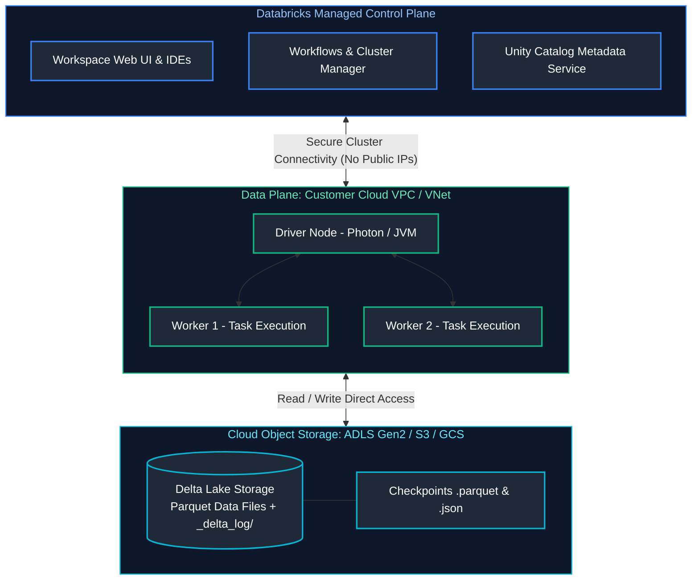

---

## Table of Contents
1. [Databricks Architecture & Workspace](#1-databricks-architecture--workspace)
   - [1.1 Databricks Workspace Architecture](#11-databricks-workspace-architecture)
   - [1.2 Control Plane vs Data Plane](#12-control-plane-vs-data-plane)
   - [1.3 Collaborative Notebooks](#13-collaborative-notebooks)
   - [1.4 Databricks Repos & Git Integration](#14-databricks-repos--git-integration)
   - [1.5 DBFS (Databricks File System) & Mounts](#15-dbfs-databricks-file-system--mounts)
   - [1.6 Unity Catalog Architecture Overview](#16-unity-catalog-architecture-overview)
2. [Databricks Compute Architecture](#2-databricks-compute-architecture)
   - [2.1 All-Purpose Compute vs Job Compute](#21-all-purpose-compute-vs-job-compute)
   - [2.2 Single Node vs Multi-Node Clusters](#22-single-node-vs-multi-node-clusters)
   - [2.3 Serverless Compute Architecture](#23-serverless-compute-architecture)
   - [2.4 Cluster Policies](#24-cluster-policies)
   - [2.5 Autoscaling & Optimized Autoscaling](#25-autoscaling--optimized-autoscaling)
   - [2.6 Spot Instances & Cost Optimization](#26-spot-instances--cost-optimization)
   - [2.7 Driver and Worker Node Sizing](#27-driver-and-worker-node-sizing)
   - [2.8 Cluster Init Scripts](#28-cluster-init-scripts)
   - [2.9 Cluster Logging & Delivery](#29-cluster-logging--delivery)
   - [2.10 Photon Vectorized Execution Engine](#210-photon-vectorized-execution-engine)
   - [2.11 Instance Pools & Warm Pools](#211-instance-pools--warm-pools)
3. [Jobs, Workflows & Delta Live Tables (DLT)](#3-jobs-workflows--delta-live-tables-dlt)
   - [3.1 Databricks Workflows & Multi-Task Jobs](#31-databricks-workflows--multi-task-jobs)
   - [3.2 Task Dependencies & Failure Routing](#32-task-dependencies--failure-routing)
   - [3.3 Job Triggers (Cron, File Arrival, Continuous)](#33-job-triggers-cron-file-arrival-continuous)
   - [3.4 Repair and Rerun Failed Tasks](#34-repair-and-rerun-failed-tasks)
   - [3.5 Alerts and Webhook Notifications](#35-alerts-and-webhook-notifications)
   - [3.6 Delta Live Tables (DLT) Fundamentals](#36-delta-live-tables-dlt-fundamentals)
   - [3.7 DLT Expectations & Data Quality Enforcement](#37-dlt-expectations--data-quality-enforcement)
   - [3.8 DLT Change Data Capture (APPLY CHANGES INTO)](#38-dlt-change-data-capture-apply-changes-into)
   - [3.9 Databricks Lakeflow (Connect, Pipelines & Jobs)](#39-databricks-lakeflow-connect-pipelines--jobs)
4. [DevOps, IaC & CI/CD](#4-devops-iac--cicd)
   - [4.1 Databricks CLI](#41-databricks-cli)
   - [4.2 Databricks REST API](#42-databricks-rest-api)
   - [4.3 Databricks Asset Bundles (DABs)](#43-databricks-asset-bundles-dabs)
   - [4.4 Terraform Provider for Databricks](#44-terraform-provider-for-databricks)
   - [4.5 Environment Promotion (Dev -> Staging -> Prod)](#45-environment-promotion-dev---staging---prod)
5. [Security & Unity Catalog Governance](#5-security--unity-catalog-governance)
   - [5.1 Unity Catalog 3-Level Namespace](#51-unity-catalog-3-level-namespace)
   - [5.2 Catalogs, Schemas, Tables, and Volumes](#52-catalogs-schemas-tables-and-volumes)
   - [5.3 Data Access Control (GRANT / REVOKE)](#53-data-access-control-grant--revoke)
   - [5.4 Row-Level Security (Row Filters)](#54-row-level-security-row-filters)
   - [5.5 Column-Level Masking](#55-column-level-masking)
   - [5.6 External Locations & Storage Credentials](#56-external-locations--storage-credentials)
   - [5.7 Secrets Management: Secret Scopes & Key Vault](#57-secrets-management-secret-scopes--key-vault)
6. [Databricks SQL & BI Warehousing](#6-databricks-sql--bi-warehousing)
   - [6.1 SQL Warehouses (Classic, Pro, Serverless)](#61-sql-warehouses-classic-pro-serverless)
   - [6.2 Dashboards, Queries, and Visualizations](#62-dashboards-queries-and-visualizations)
   - [6.3 SQL Alerts](#63-sql-alerts)
   - [6.4 Query Profile Diagnostics](#64-query-profile-diagnostics)
7. [ML & AI Integration](#7-ml--ai-integration)
   - [7.1 MLflow Tracking & Experiments](#71-mlflow-tracking--experiments)
   - [7.2 Databricks Feature Store](#72-databricks-feature-store)
   - [7.3 MLflow Model Registry](#73-mlflow-model-registry)
   - [7.4 Mosaic AI & Foundation Model Serving](#74-mosaic-ai--foundation-model-serving)
8. [Delta Lake Fundamentals & Log Internals](#8-delta-lake-fundamentals--log-internals)
   - [8.1 Parquet + Transaction Log Architecture](#81-parquet--transaction-log-architecture)
   - [8.2 `_delta_log` Internals & Protocol](#82-_delta_log-internals--protocol)
   - [8.3 JSON Commits & Checkpoint Parquet Files](#83-json-commits--checkpoint-parquet-files)
   - [8.4 ACID Transactions & Optimistic Concurrency Control (OCC)](#84-acid-transactions--optimistic-concurrency-control-occ)
   - [8.5 Schema Enforcement](#85-schema-enforcement)
   - [8.6 Schema Evolution (`mergeSchema`)](#86-schema-evolution-mergeschema)
   - [8.7 Time Travel](#87-time-travel)
   - [8.8 `RESTORE TABLE` Disaster Recovery](#88-restore-table-disaster-recovery)
9. [Delta Performance & Storage Optimization](#9-delta-performance--storage-optimization)
   - [9.1 `OPTIMIZE` & File Bin-Packing](#91-optimize--file-bin-packing)
   - [9.2 Z-Ordering & Space-Filling Curves](#92-z-ordering--space-filling-curves)
   - [9.3 Liquid Clustering](#93-liquid-clustering)
   - [9.4 Data Skipping via Log Statistics](#94-data-skipping-via-log-statistics)
   - [9.5 Auto-Compaction & Optimized Writes](#95-auto-compaction--optimized-writes)
   - [9.6 Deletion Vectors](#96-deletion-vectors)
10. [Advanced Delta Lake Capabilities](#10-advanced-delta-lake-capabilities)
    - [10.1 Change Data Feed (CDF)](#101-change-data-feed-cdf)
    - [10.2 Shallow Clone vs Deep Clone (Disaster Recovery & Replication)](#102-shallow-clone-vs-deep-clone-disaster-recovery--replication)
    - [10.3 `VACUUM` & Retention Period Governance](#103-vacuum--retention-period-governance)
    - [10.4 Delta Sharing Open Protocol](#104-delta-sharing-open-protocol)
    - [10.5 Managed vs External Delta Tables](#105-managed-vs-external-delta-tables)
    - [10.6 UniForm (Universal Format)](#106-uniform-universal-format)
    - [10.7 Identity Columns](#107-identity-columns)
    - [10.8 Generated Columns](#108-generated-columns)
11. [Summary Comparison & Production Engineering Reference Matrix](#11-summary-comparison--production-engineering-reference-matrix)
12. [References & Further Reading](#12-references--further-reading)

> [!TIP]
> **Deep-Dive Interview Scenarios:**
> - [Q2. When to Use MERGE vs INSERT](frequently_asked_questions/06_databricks_and_delta_lake_faq.md#q2-easy-when-to-use-merge-vs-insert)
> - [Q4. The Multiple-Match MERGE Trap & Resolution](frequently_asked_questions/06_databricks_and_delta_lake_faq.md#q4-medium-the-multiple-match-merge-trap--resolution)
> - [Q6. Physical Table Maintenance: OPTIMIZE, Z-ORDER & VACUUM](frequently_asked_questions/06_databricks_and_delta_lake_faq.md#q6-medium-physical-table-maintenance-optimize-z-order--vacuum)
> - [Q8. Millions of Small Files in ADLS: Root Causes & Resolution in Databricks](frequently_asked_questions/06_databricks_and_delta_lake_faq.md#q8-hard-millions-of-small-files-in-adls-root-causes--resolution-in-databricks)
> - [Q9. Partitioning Strategy & Liquid Clustering in Azure Databricks](frequently_asked_questions/06_databricks_and_delta_lake_faq.md#q9-expert-partitioning-strategy--liquid-clustering-in-azure-databricks)
> - [Q10. Recovering Deleted or Overwritten Delta Data via Time Travel](frequently_asked_questions/06_databricks_and_delta_lake_faq.md#q10-medium-recovering-deleted-or-overwritten-delta-data-via-time-travel)
> - [Q11. Automated Rollback Strategy for Failed Deployments](frequently_asked_questions/06_databricks_and_delta_lake_faq.md#q11-medium-automated-rollback-strategy-for-failed-deployments)
> - [Q16. Enforcing Data Quality Constraints in Delta Lake](frequently_asked_questions/06_databricks_and_delta_lake_faq.md#q16-medium-enforcing-data-quality-constraints-in-delta-lake)
> - [Q18. Delta Lake Change Data Feed (CDF) Implementation](frequently_asked_questions/06_databricks_and_delta_lake_faq.md#q18-medium-delta-lake-change-data-feed-cdf-implementation)
> - [Q20. Monitoring and Maintaining Delta Tables in Production](frequently_asked_questions/06_databricks_and_delta_lake_faq.md#q20-medium-monitoring-and-maintaining-delta-tables-in-production)
> - [Q25. Databricks Lakeflow Architecture & Databricks Asset Bundles (DABs)](frequently_asked_questions/06_databricks_and_delta_lake_faq.md#q25-medium-databricks-lakeflow-architecture--databricks-asset-bundles-dabs)
> - [Q26. Catalog Table Referencing vs Direct File Path Ingestion in Delta Lake](frequently_asked_questions/06_databricks_and_delta_lake_faq.md#q26-easy-catalog-table-referencing-vs-direct-file-path-ingestion-in-delta-lake)

---

# 1. Databricks Architecture & Workspace

Databricks is a unified cloud-based data intelligence platform that provides automated infrastructure management for Apache Spark, Delta Lake, Delta Live Tables (DLT), and Unity Catalog.

---

### 1.1 Databricks Workspace Architecture

#### Definition
A Databricks Workspace is a SaaS environment providing a unified interface for data engineers, data scientists, and analysts. It integrates collaborative notebooks, machine learning experiment tracking (MLflow), automated orchestration workflows, and enterprise data governance.

#### References
- [Databricks Official Documentation: Workspace Overview](https://docs.databricks.com/en/workspace/index.html)
- [GeeksforGeeks: Databricks Tutorial](https://www.geeksforgeeks.org/introduction-to-databricks/)

---

### 1.2 Control Plane vs Data Plane

#### Definition
Databricks separates its architecture into two distinct administrative planes:
- **Control Plane:** Hosted in Databricks' own cloud tenant. Manages the web application UI, notebook metadata, cluster management services, job orchestration scheduler, and Unity Catalog metadata catalog.
- **Data Plane (Classic):** Hosted inside the **Customer's Cloud Account** (AWS VPC, Azure Subscription, or GCP Project). Clusters of virtual machines process the actual data; data never leaves the customer's network boundary.
- **Serverless Data Plane:** Managed elastically inside Databricks compute accounts with secure PrivateLink isolation to customer cloud storage.

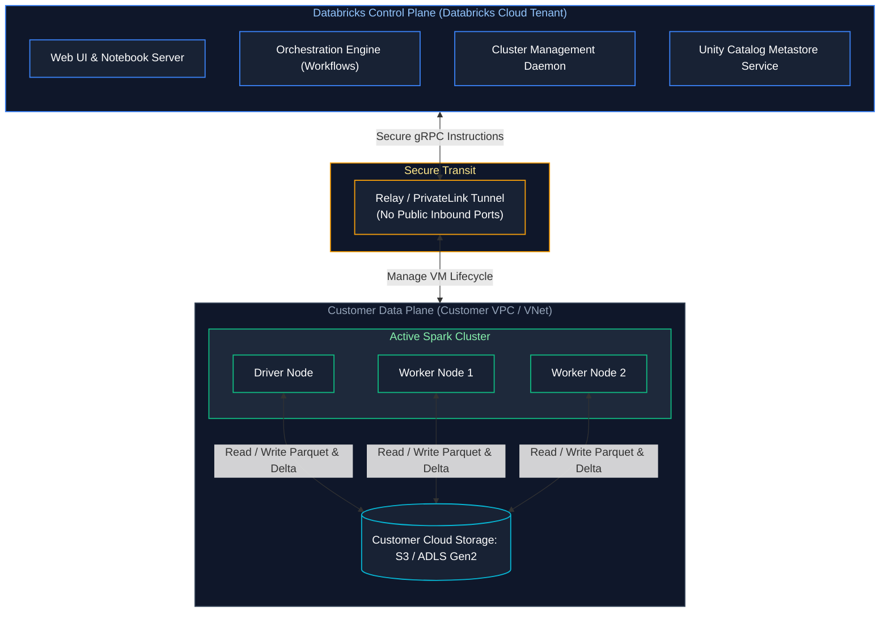

#### Security Implications & Plane Comparison Matrix
Customer data remains entirely within the customer's own cloud perimeter, adhering to strict enterprise data sovereignty and compliance requirements (HIPAA, PCI-DSS, SOC2).

| Architectural Dimension | Control Plane | Classic Data Plane | Serverless Data Plane |
| :--- | :--- | :--- | :--- |
| **Hosting Tenant** | Databricks cloud account (multi-tenant) | Customer cloud account (AWS VPC, Azure VNet, GCP VPC) | Databricks cloud tenant (dedicated compute VPC) |
| **Compute Resources** | Web UI, Workflows scheduler, cluster managers | EC2 instances, Azure VMs, Compute Engine instances | On-demand elastic container instances (< 10s launch) |
| **Data Access** | **Zero customer data access** (stores metadata only) | Direct read/write to customer storage accounts | Secure private networking (PrivateLink) to customer storage |
| **Network Perimeter** | Managed by Databricks with TLS 1.3 | Customer VNet/VPC with internal routing and firewalls | Fully isolated compute planes managed by Databricks |
| **Maintenance & Patching** | Automatic and zero-downtime | Requires cluster recreation or Databricks runtime upgrades | Fully automated instant security and runtime patching |

#### References
- [Databricks Documentation: Architecture Overview](https://docs.databricks.com/en/getting-started/overview.html)
- [DataCamp: Databricks Architecture](https://www.datacamp.com/tutorial/databricks)

---

### 1.3 Collaborative Notebooks

#### Definition
Databricks Notebooks provide a web-based interactive programming environment supporting real-time co-authoring, cell-by-cell execution, automated version history, and interactive visualizations.

#### Polyglot Language Magics
Notebooks support language switching within the same session using magic commands:
- `%python` — Run PySpark and Python code.
- `%sql` — Run Databricks SQL queries.
- `%scala` — Execute JVM Scala commands.
- `%sh` — Execute local bash shell commands on the Driver node.
- `%md` — Render Markdown documentation.

#### References
- [Databricks Documentation: Notebooks](https://docs.databricks.com/en/notebooks/index.html)

---

### 1.4 Databricks Repos & Git Integration

#### Definition
Databricks Repos integrates the workspace directly with external Git providers (GitHub, GitLab, Azure DevOps, Bitbucket). It allows data engineering teams to develop in modular `.py` and `.sql` files, enforce branch protection, perform code reviews, and automate CI/CD deployments.

#### References
- [Databricks Documentation: Git Folders (Repos)](https://docs.databricks.com/en/repos/index.html)

---

### 1.5 DBFS (Databricks File System) & Mounts

#### Storage Abstraction Evolution in Databricks
In distributed lakehouse environments, applications require a standardized file system interface to read and write raw files (JSON, CSV, Parquet, images, audio) across cloud object stores (AWS S3, Azure Data Lake Gen2, Google Cloud Storage). Historically, Databricks utilized the **Databricks File System (DBFS)**, but modern enterprise deployments have migrated to **Unity Catalog Volumes**.

1. **Legacy DBFS Mounts (`dbfs:/mnt/`):**
   - **Operational Model:** DBFS creates a virtual file system layer overlaid on the workspace cloud root bucket. Administrators historically created mounts via `dbutils.fs.mount()` using service principals, access keys, or SAS tokens.
   - **Severe Security Vulnerability:** DBFS mounts suffer from credential passthrough and privilege escalation hazards. Once an external bucket is mounted at `dbfs:/mnt/finance_bucket`, **any user or notebook running on standard compute in that workspace inherits full read/write access** to the underlying cloud bucket. File-level or folder-level access controls cannot be enforced natively.

2. **Unity Catalog Volumes (`/Volumes/`):**
   - **Operational Model:** Volumes provide governed, path-based access to non-tabular data files (machine learning models, raw unstructured files, checkpoint directories) governed directly under Unity Catalog's 3-level namespace: `/Volumes/<catalog>/<schema>/<volume_name>/`.
   - **Unified Access Control:** Volumes enforce standard ANSI SQL grant mechanics (`GRANT READ VOLUME ON VOLUME catalog.schema.vol TO role_analyst`). Access is auditable, identities are authenticated per user session, and cloud storage credentials remain completely abstracted within Unity Catalog **Storage Credentials** and **External Locations**.

#### DBFS Mounts vs. Unity Catalog Volumes
| Characteristic | Legacy DBFS Mounts (`dbfs:/mnt/`) | Unity Catalog Volumes (`/Volumes/`) |
| :--- | :--- | :--- |
| **Security Model** | Shared credentials; vulnerable to privilege escalation | Governed by Unity Catalog RBAC (`GRANT READ`) |
| **Governance Scope** | Workspace-local | Centralized across all workspaces in tenant |
| **Audit Logging** | Limited | Full line-level audit trails in system tables |

#### References
- [Databricks Documentation: DBFS Overview](https://docs.databricks.com/en/dbfs/index.html)

---

### 1.6 Unity Catalog Architecture Overview

#### Definition
Unity Catalog is Databricks' centralized, cross-workspace governance layer for data, files, and AI models across all cloud environments. It enforces a standard **3-level namespace**: `catalog.schema.table_or_volume`.

> [!TIP]
> **Deep-Dive Interview Scenarios:**
> - [Q3. Incremental Loading Architecture & CDC Ingestion](frequently_asked_questions/06_databricks_and_delta_lake_faq.md#q3-medium-incremental-loading-architecture--cdc-ingestion)
> - [Q15. Designing Databricks Solutions for Billions of Records](frequently_asked_questions/06_databricks_and_delta_lake_faq.md#q15-medium-designing-databricks-solutions-for-billions-of-records)

---

# 2. Databricks Compute Architecture

Databricks decouples compute from storage, allowing compute clusters to spin up on demand, autoscale dynamically, and terminate automatically when idle.

---

### 2.1 All-Purpose Compute vs Job Compute

#### Definition
- **All-Purpose Compute (Interactive):** Shared clusters created via the UI/API for collaborative development, data exploration, and ad-hoc notebook execution. Remains running until manually stopped or idle timeout fires. **Billed at higher DBU (Databricks Unit) rates**.
- **Job Compute (Automated):** Dedicated clusters launched automatically by the Databricks Workflow scheduler to execute a specific job or task. Spins up when the job starts and terminates immediately upon task completion. **Billed at a significantly discounted DBU rate (~50% cheaper)**.

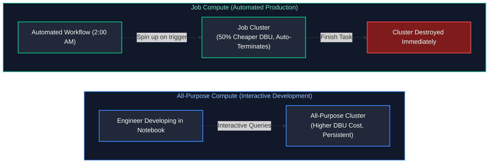

#### Cost Optimization Rule
**Never run production workloads on All-Purpose clusters.** Always execute automated production pipelines using Job clusters to cut compute bills in half.

#### References
- [Databricks Documentation: Compute Types](https://docs.databricks.com/en/compute/index.html)
- [DataCamp: Databricks Compute Management](https://www.datacamp.com/tutorial/databricks)

---

### 2.2 Single Node vs Multi-Node Clusters

#### Definition
- **Single Node Cluster:** Runs with 0 worker nodes; all Spark execution slots, driver tasks, and storage buffers reside on a single virtual machine. Ideal for lightweight Python scripts, small datasets (<10GB), and machine learning training on a single GPU.
- **Multi-Node Cluster:** Distributed cluster consisting of 1 dedicated Driver node and $N$ Worker nodes executing parallel Spark tasks over terabyte/petabyte datasets.

---

### 2.3 Serverless Compute Architecture

#### Definition
Serverless Compute offloads cluster management, VM provisioning, and network configuration to Databricks. 
- Clusters start in **seconds** (compared to 3-5 minutes for classic VM provisioning).
- Automatically scales up and down based on query concurrency and **scales to zero** instantly when no queries are active.

#### References
- [Databricks Documentation: Serverless Compute](https://docs.databricks.com/en/serverless-compute/index.html)

---

### 2.4 Cluster Policies

#### Definition
Cluster Policies enforce administrative governance over compute resources created by developers, preventing runaway cloud costs.
- Enforcing maximum node counts (e.g., maximum 8 worker nodes).
- Enforcing auto-termination timeouts (e.g., terminate after 20 minutes of inactivity).
- Enforcing mandatory cloud cost-center tags.

#### References
- [Databricks Documentation: Compute Policies](https://docs.databricks.com/en/admin/clusters/policies.html)

---

### 2.5 Autoscaling & Optimized Autoscaling

#### Definition
Databricks Autoscaling dynamically adds worker nodes when Spark stages encounter high task queues, and decommission nodes when stages finish, reducing idle cloud VM spend. **Optimized Autoscaling** leverages predictive heuristics to scale workers up 2x faster than standard open-source Spark.

---

### 2.6 Spot Instances & Cost Optimization

#### Definition
Spot Instances (AWS Spot, Azure Spot VMs, GCP Preemptible VMs) allow clusters to run on unused cloud capacity at an **80-90% discount**.
- **Driver Node:** Must **always** run on a On-Demand instance (if the Driver node is preempted, the entire Spark job fails).
- **Worker Nodes:** Can safely utilize Spot instances. If a worker node is preempted by the cloud provider, Spark simply launches a replacement worker and recomputes the lost RDD partitions via lineage.

---

### 2.7 Driver and Worker Node Sizing

#### Sizing Guidelines
- **Worker Nodes:** Selected based on dataset size and operation type. Memory-Optimized VMs (e.g., AWS `r5.2xlarge`, Azure `Standard_E8d_v5`) are preferred for heavy shuffles and aggregations.
- **Driver Node:** Requires larger RAM when performing broadcast joins, heavy AQE metric coordination, or collecting results.

---

### 2.8 Cluster Init Scripts

#### Definition
Init scripts are shell scripts that execute during cluster startup before the Spark driver or worker JVMs launch. Used to install custom OS packages, configure database drivers, and set cluster-wide environment variables.

---

### 2.9 Cluster Logging & Delivery

#### Definition
Cluster logs capture Driver and Worker `log4j`, `stdout`, and `stderr` streams, automatically persisting them to cloud object storage (ADLS Gen2 or S3) every 5 minutes for post-mortem crash analysis.

---

### 2.10 Photon Vectorized Execution Engine

#### Definition
Photon is Databricks' ultra-fast, native, vectorized query engine written completely in **C++** (rather than Java/Scala). It is 100% compatible with Apache Spark APIs, executing physical relational operators (joins, aggregations, scans) using modern CPU SIMD instruction sets.

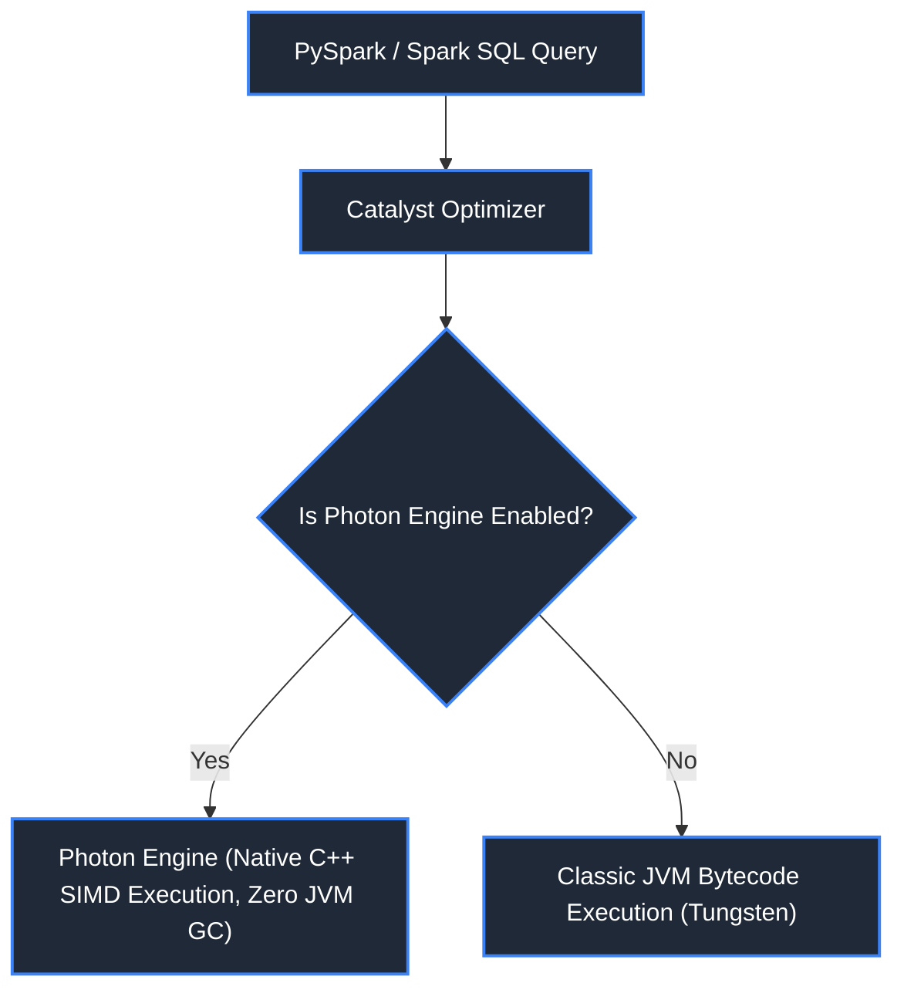

#### Performance Gains
Delivers 2x to 5x faster query performance on analytical SQL workloads, especially for high-cardinality aggregations and string transformations.

#### References
- [Databricks Documentation: Photon Engine](https://docs.databricks.com/en/runtime/photon.html)

---

### 2.11 Instance Pools & Warm Pools

#### Problem: Cluster Startup Latency & Cold-Start Delays
When ephemeral job clusters or auto-scaling events request virtual machines from cloud providers (AWS EC2, Azure VMs, GCP Compute Engine), VM allocation, network interface binding, OS booting, and container runtime initialization take **5 to 8 minutes**. For time-critical SLAs and frequent micro-batch jobs running every 15–30 minutes, this cold-start delay accounts for 30%–50% of total pipeline latency.

#### Solution: Databricks Instance Pools (Warm Pools)
An **Instance Pool** maintains a set of pre-acquired, idle virtual machines running in the customer's cloud account with preloaded Databricks Runtime (DBR) images.
- When an automated job or interactive user launches a cluster attached to the pool, VMs are allocated in **under 30 seconds**.
- When clusters finish or scale down, VMs return to the warm pool rather than terminating.

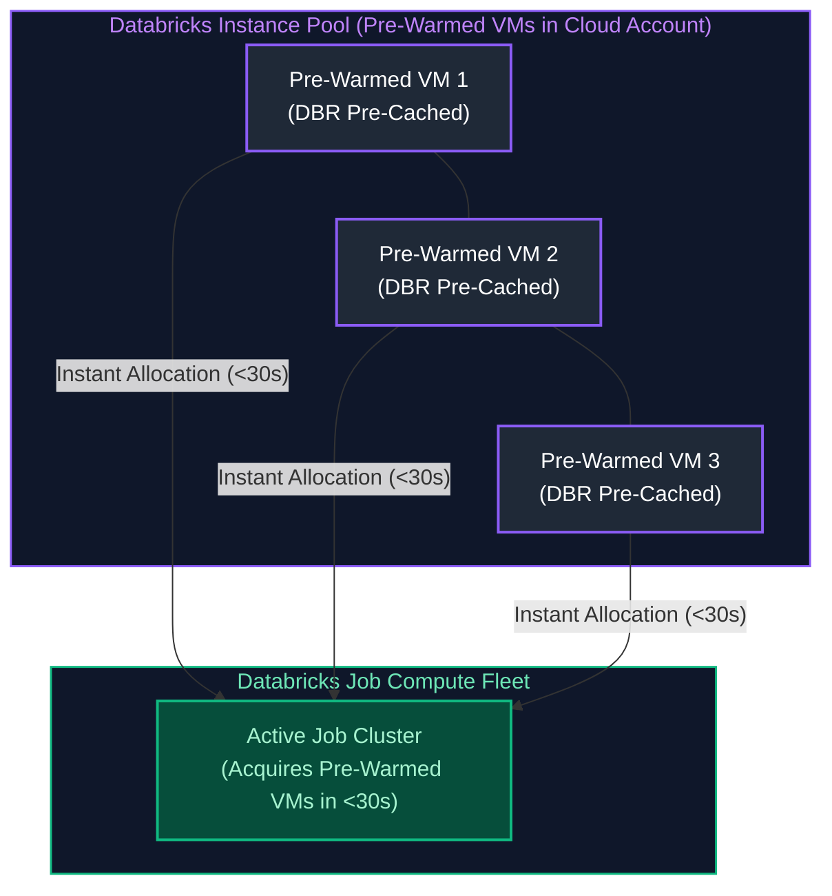

#### Pool Configuration Parameters:
- **`min_idle_instances`:** Minimum number of idle VMs kept warm in the cloud account (costs cloud VM infrastructure, but incurs 0 Databricks DBUs while idle).
- **`max_capacity`:** Hard ceiling on the total number of VMs the pool can acquire across active and idle states, preventing cloud budget overruns.
- **`idle_instance_autotermination_minutes`:** Threshold after which unallocated idle VMs are automatically destroyed (typically 15 to 30 minutes).

#### References
- [Databricks Documentation: Instance Pools](https://docs.databricks.com/en/compute/pools.html)

> [!TIP]
> **Deep-Dive Interview Scenarios:**
> - [Q12. Job Clusters vs All-Purpose Clusters](frequently_asked_questions/06_databricks_and_delta_lake_faq.md#q12-easy-job-clusters-vs-all-purpose-clusters)
> - [Q13. Root-Cause Analysis for 3x Production Job Slowdowns](frequently_asked_questions/06_databricks_and_delta_lake_faq.md#q13-medium-root-cause-analysis-for-3x-production-job-slowdowns)

---

# 3. Jobs, Workflows & Delta Live Tables (DLT)

---

### 3.1 Databricks Workflows & Multi-Task Jobs
> [!NOTE]
> For cross-platform enterprise workflow orchestration comparing Databricks Workflows with Apache Airflow and dbt, see [12. Orchestration (Apache Airflow & dbt)](08_etl_pipelines_orchestration_and_data_quality.md).

#### Definition
Databricks Workflows is a fully managed, enterprise-grade data orchestration service that coordinates complex DAGs of dependent tasks across notebooks, SQL queries, dbt models, Python scripts, and Delta Live Tables pipelines.

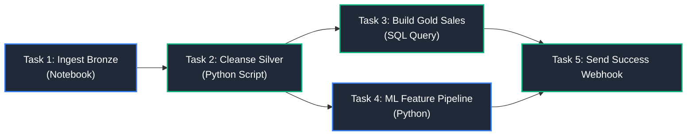

#### References
- [Databricks Documentation: Workflows](https://docs.databricks.com/en/workflows/index.html)
- [DataCamp: Databricks Workflows](https://www.datacamp.com/tutorial/databricks)

---

### 3.2 Task Dependencies & Failure Routing

#### Definition
Tasks within a Workflow DAG can define execution rules (`Run If` conditions):
- `ALL_SUCCESS`: Executes only if all upstream parent tasks succeed.
- `AT_LEAST_ONE_SUCCESS`: Runs if any parent finishes successfully.
- `ALL_FAILED`: Triggers cleanup or error-handling pipelines when failures occur.

---

#### Cross-Task State Passing via Task Values (`dbutils.jobs.taskValues`)
Similar to Airflow XComs, tasks within a multi-task Databricks Workflow communicate dynamic runtime metadata (such as partition watermarks, record counts, and anomaly metrics) without writing temporary files to cloud storage:

```python
# --- In Upstream Task (Task 1: 'bronze_profiler') ---
import dbutils

processed_date = "2026-10-01"
error_count = 14

# Set task values for downstream consumption
dbutils.jobs.taskValues.set(key="run_date", value=processed_date)
dbutils.jobs.taskValues.set(key="anomalies_detected", value=error_count)

# --- In Downstream Task (Task 2: 'gold_aggregator') ---
# Retrieve values emitted by upstream task 'bronze_profiler'
run_date = dbutils.jobs.taskValues.get(taskKey="bronze_profiler", key="run_date")
anomalies = dbutils.jobs.taskValues.get(taskKey="bronze_profiler", key="anomalies_detected")

print(f"Executing Gold aggregation for date: {run_date}, with {anomalies} anomalies recorded.")
```

> [!TIP]
> **Deep-Dive Interview Scenarios:**
> - [Q14. Restarting Failed Jobs Without Reprocessing from Scratch](frequently_asked_questions/06_databricks_and_delta_lake_faq.md#q14-medium-restarting-failed-jobs-without-reprocessing-from-scratch)
> - [Q30. Tracing Record Discrepancies Across Bronze, Silver, and Gold Tables](frequently_asked_questions/06_databricks_and_delta_lake_faq.md#q30-medium-tracing-record-discrepancies-across-bronze-silver-and-gold-tables)
> - [Q31. Executing Databricks Notebooks Programmatically: dbutils.notebook.run vs Databricks Workflows](frequently_asked_questions/06_databricks_and_delta_lake_faq.md#q31-easy-executing-databricks-notebooks-programmatically-dbutilsnotebookrun-vs-databricks-workflows)

#### Databricks Widgets & Secrets Access
```python
# Parameterize notebook execution via widgets

dbutils.widgets.text("environment", "prod", "Deployment Target")
env = dbutils.widgets.get("environment")

# 5. Retrieve credentials securely from Databricks Secret Scopes

db_password = dbutils.secrets.get(scope="financial_kv_scope", key="dw_service_account_token")
```

### 3.3 Job Triggers (Cron, File Arrival, Continuous)

#### Trigger Types
1. **Scheduled (Cron):** Standard time-based execution (e.g., `0 0 2 * * ?` for daily 2:00 AM).
2. **File Arrival (Continuous Ingestion):** Automatically triggers the job when new files land in an external S3/ADLS storage prefix.
3. **Continuous:** Runs an active streaming pipeline that automatically restarts if transient errors occur.

---

### 3.4 Repair and Rerun Failed Tasks

#### Definition
If a 15-task Workflow fails at Task 12 due to an API timeout, developers can use **Repair and Rerun** to execute only Task 12 and its downstream children, **preserving the outputs of Tasks 1 through 11 without re-executing them**.

---

### 3.5 Alerts and Webhook Notifications

#### Definition
Integrated alerts that push automated status updates (Job Started, Succeeded, Failed, or Duration Exceeded SLA) to Slack channels, Microsoft Teams, PagerDuty, or custom REST webhooks.

---

### 3.6 Delta Live Tables (DLT) Fundamentals

#### Definition
Delta Live Tables (DLT) is a declarative ETL framework for building reliable, maintainable, and testable data pipelines on the Lakehouse. Developers write SQL or Python transformations; the DLT runtime automatically constructs the execution DAG, handles state management, manages cluster autoscaling, and enforces data quality.

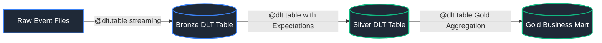

#### Code Example (Declarative Python DLT Pipeline)
```python
import dlt
from pyspark.sql.functions import col

# Define Bronze streaming ingestion table using Auto Loader (cloudFiles)
@dlt.table(
    name="bronze_orders_raw",
    comment="Raw streaming orders ingested incrementally from cloud object store landing zone"
)
def bronze_orders_raw():
    # Read newly arrived files incrementally using schema-inference Auto Loader engine
    return spark.readStream.format("cloudFiles") \
        .option("cloudFiles.format", "json") \                # Parse incoming JSON format documents
        .option("cloudFiles.schemaLocation", "/Volumes/raw_data/landing/schema/") \ # Track evolved schema
        .load("/Volumes/raw_data/landing/orders/")             # Unity Catalog Volume source path

# Define Silver curated table with declarative Data Quality Expectations
@dlt.table(
    name="silver_orders_clean",
    comment="Cleaned orders enforcing referential integrity and positive monetary amounts"
)
# Expectation 1: Quarantine/Drop invalid rows (records with non-positive amounts are dropped and logged to event log)
@dlt.expect_or_drop("valid_amount", "order_amount > 0")
# Expectation 2: Monitor expectation (flags violation in pipeline metrics without dropping row)
@dlt.expect("valid_customer_id", "customer_id IS NOT NULL")
def silver_orders_clean():
    # Ingest streaming micro-batches directly from the upstream bronze DLT table
    return dlt.read_stream("bronze_orders_raw") \
        .select(
            col("order_id").cast("long"),                      # Cast primary key to BigInt
            col("customer_id").cast("long"),                   # Cast foreign key to BigInt
            col("order_amount").cast("double"),                 # Enforce double precision float
            col("order_date").cast("date")                     # Cast ISO date string to DateType
        )
```

#### References
- [Databricks Documentation: Delta Live Tables](https://docs.databricks.com/en/delta-live-tables/index.html)
- [GeeksforGeeks: Introduction to Delta Live Tables](https://www.geeksforgeeks.org/delta-live-tables/)

---

### 3.7 DLT Expectations & Data Quality Enforcement

#### Definition
DLT Expectations provide declarative data quality constraints evaluated row-by-row during pipeline execution.

| Expectation Syntax | Action on Failure |
| :--- | :--- |
| `@dlt.expect("rule", "condition")` | Records metric in pipeline event log; **permits invalid row to flow through**. |
| `@dlt.expect_or_drop("rule", "condition")` | **Silently discards invalid rows** from the target table; records count in event log. |
| `@dlt.expect_or_fail("rule", "condition")` | **Immediately halts the entire pipeline** with an error if any row violates the rule. |

---

### 3.8 DLT Change Data Capture (APPLY CHANGES INTO)

#### Definition
`dlt.apply_changes()` automates low-latency CDC ingestion into Delta tables, handling out-of-order records, updates, and deletes with automatic **SCD Type 1** (overwrite) or **SCD Type 2** (historical tracking) support.

#### Code Example
```python
import dlt
from pyspark.sql.functions import col

# Initialize empty destination streaming Delta table for SCD Type 2 history tracking
dlt.create_streaming_table("silver_customer_scd2")

# Apply declarative Change Data Capture (CDC) mutation stream
dlt.apply_changes(
    target = "silver_customer_scd2",              # Destination historical dimension table
    source = "bronze_cdc_stream",                 # Upstream streaming source containing CDC change events
    keys = ["customer_id"],                       # Natural business entity primary key
    sequence_by = col("cdc_timestamp"),           # Monotonic ordering column to resolve out-of-order deliveries
    apply_as_deletes = col("op_type") == "DELETE",# Expression identifying tombstone/delete events
    stored_as_scd_type = 2                        # Generates __START_AT, __END_AT, and tracks row version history
)
```

#### References
- [Databricks Documentation: CDC with Delta Live Tables](https://docs.databricks.com/en/delta-live-tables/cdc.html)

---

### 3.9 Databricks Lakeflow (Connect, Pipelines & Jobs)

#### Definition & Core Concepts
**Databricks Lakeflow** is the native, end-to-end data engineering platform that unifies and elevates data ingestion, declarative transformation, and workflow orchestration into a single serverless lakehouse experience:

1. **Lakeflow Connect (Universal Ingestion):** Built-in, serverless native ingestion connectors for enterprise relational databases (SQL Server, Oracle, PostgreSQL, MySQL) and enterprise SaaS (Salesforce, Workday, ServiceNow, Google Analytics). Operates via low-latency log-based CDC without requiring third-party tools (like Fivetran) or complex Kafka staging.
2. **Lakeflow Pipelines (Declarative Transformations):** The next evolution of Delta Live Tables (DLT). Enables data engineers to declare transformations using SQL and Python with automated pipeline DAG execution, out-of-the-box incremental processing, state management, and real-time schema evolution.
3. **Lakeflow Jobs (Automated Orchestration):** Serverless orchestration engine providing automated failure recovery, health triage, task-level execution tracing, and intelligent data pipeline SLA alerting.

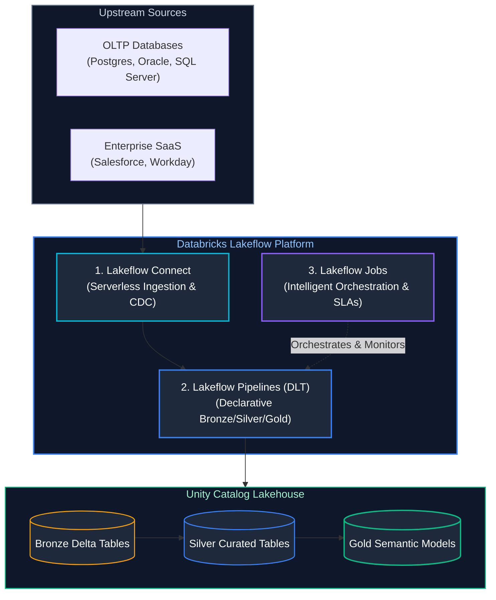

#### Code Example: Declarative Lakeflow Pipeline with Data Quality & CDC
```python
import dlt
from pyspark.sql.functions import col, current_timestamp

# Step 1: Ingest continuous CDC stream via Lakeflow Connect into Bronze
@dlt.table(
    name="bronze_salesforce_leads",
    comment="Raw continuous ingestion from Salesforce via Lakeflow Connect",
    table_properties={"quality": "bronze"}
)
def bronze_salesforce_leads():
    return (
        spark.readStream.format("cloudFiles")
        .option("cloudFiles.format", "json")
        .option("cloudFiles.inferColumnTypes", "true")
        .load("/mnt/lakeflow/salesforce/leads/")
    )

# Step 2: Cleanse and enforce data contracts into Silver
@dlt.table(
    name="silver_salesforce_leads",
    comment="Curated leads enforcing valid email and non-empty status",
    table_properties={"quality": "silver"}
)
@dlt.expect_or_drop("valid_email", "email IS NOT NULL AND email LIKE '%@%.%'")
@dlt.expect("valid_lead_status", "status IN ('New', 'Contacted', 'Qualified', 'Unqualified')")
def silver_salesforce_leads():
    return (
        dlt.read_stream("bronze_salesforce_leads")
        .select(
            col("Id").alias("lead_id"),
            col("Email").alias("email"),
            col("Status").alias("status"),
            col("Company").alias("company"),
            col("CreatedDate").cast("timestamp").alias("created_at"),
            current_timestamp().alias("ingested_at")
        )
    )

# Step 3: Maintain historical changes via SCD Type 2 tracking
dlt.apply_changes(
    target="silver_leads_scd2",
    source="silver_salesforce_leads",
    keys=["lead_id"],
    sequence_by=col("created_at"),
    stored_as_scd_type=2
)
```

#### References
- [Databricks Documentation: Lakeflow Overview](https://docs.databricks.com/en/lakeflow/index.html)
- [Databricks Documentation: Lakeflow Connect](https://docs.databricks.com/en/lakeflow/connect.html)

---

# 4. DevOps, IaC & CI/CD

Enterprise lakehouse deployments require automated, repeatable CI/CD pipelines that manage code promotion, cluster provisioning, and infrastructure state through code.

---

### 4.1 Databricks CLI

#### Definition
The Databricks CLI (v0.200+) is a unified command-line tool that interacts with the Databricks REST API to automate workspace operations, cluster lifecycles, and deployment scripts.

#### Code Example
```bash
# Authenticate using personal access token or OAuth
databricks auth login --host https://adb-123456789.azuredatabricks.net

# List active workspace compute clusters
databricks clusters list

# Trigger an execution of a multi-task workflow
databricks jobs run-now --job-id 490218490
```

#### References
- [Databricks Documentation: Databricks CLI](https://docs.databricks.com/en/dev-tools/cli/index.html)

---

### 4.2 Databricks REST API

#### Definition
The REST API exposes programmatic endpoints to control every facet of the Databricks ecosystem, enabling external orchestrators (Airflow, GitHub Actions, Jenkins) to trigger jobs, manage permissions, and export audit telemetry.

#### References
- [Databricks REST API Reference](https://docs.databricks.com/api/workspace/introduction)

---

### 4.3 Databricks Asset Bundles (DABs)

#### Definition
Databricks Asset Bundles (DABs) is the modern Infrastructure-as-Code (IaC) standard for packaging, testing, and deploying complex Databricks projects (Jobs, DLT pipelines, ML models, notebooks) across multi-stage environments (`dev`, `staging`, `prod`) using declarative YAML configurations.

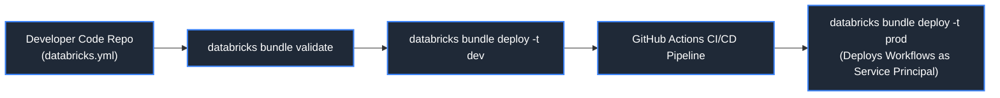

#### Code Example (`databricks.yml` Bundle Configuration)
```yaml
bundle:
  name: revenue_lakehouse_pipeline

include:
  - resources/*.yml

targets:
  dev:
    mode: development
    default: true
    workspace:
      host: https://adb-dev.azuredatabricks.net

  prod:
    mode: production
    workspace:
      host: https://adb-prod.azuredatabricks.net
      root_path: /Shared/.bundles/${bundle.name}
    run_as:
      service_principal_name: 00000000-0000-0000-0000-000000000000
```

#### References
- [Databricks Documentation: Asset Bundles (DABs)](https://docs.databricks.com/en/dev-tools/bundles/index.html)

---

### 4.4 Terraform Provider for Databricks

#### Definition
The official Databricks Terraform Provider enables declarative provisioning of all lakehouse resources (Unity Catalog metastores, cluster policies, SQL warehouses, IAM grants) within enterprise GitOps workflows.

#### Code Example (Terraform HCL)
```hcl
# Provision Serverless Databricks SQL Warehouse for BI querying
resource "databricks_sql_warehouse" "serverless_bi" {
  name                      = "Executive_BI_Serverless" # Warehouse display identifier
  cluster_size              = "Medium"                  # Compute T-shirt size (Medium = 8 vCPUs per worker)
  min_num_clusters          = 1                         # Minimum baseline cluster count
  max_num_clusters          = 5                         # Autoscaling ceiling for handling concurrency spikes
  auto_stop_mins            = 10                        # Idle timeout before spin-down to minimize cloud spend
  enable_serverless_compute = true                      # Instant start (<15 seconds) using serverless pool
}

# Assign Role-Based Access Control (RBAC) privileges in Unity Catalog
resource "databricks_grant" "analyst_access" {
  sql_warehouse = databricks_sql_warehouse.serverless_bi.id # Reference warehouse resource ID
  principal     = "bi_analysts_group"                      # Entra ID synced user group
  privileges    = ["CAN_USE"]                              # Permission to execute queries on the warehouse
}
```

#### References
- [Terraform Registry: Databricks Provider](https://registry.terraform.io/providers/databricks/databricks/latest/docs)

---

### 4.5 Environment Promotion (Dev -> Staging -> Prod)

#### Standard Promotion Pipeline
1. **Dev Branch:** Developers test interactive notebooks and pipelines in their private user schemas (`dev_catalog`).
2. **Pull Request (CI):** Triggers automated linting, unit tests, and `databricks bundle validate`.
3. **Staging Merge:** Deploys pipelines against integration test data; validates DLT expectations.
4. **Production Release:** Triggers a deployment bundle using an isolated **Service Principal** account into the production catalog (`prod_catalog`).

---

# 5. Security & Unity Catalog Governance

---

### 5.1 Unity Catalog 3-Level Namespace

#### Definition
Unity Catalog organizes all data assets into an intuitive, hierarchical 3-level namespace:
$$	ext{Catalog} \longrightarrow 	ext{Schema (Database)} \longrightarrow 	ext{Table / View / Volume}$$

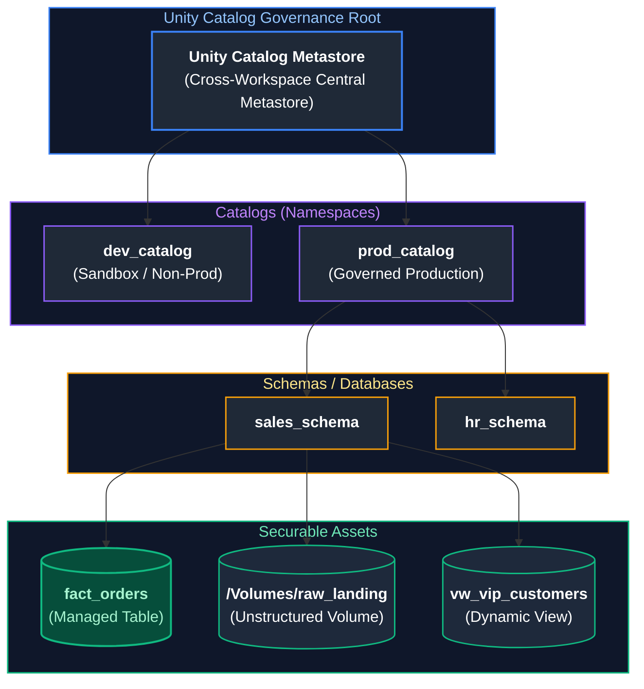

#### References
- [Databricks Documentation: Unity Catalog Overview](https://docs.databricks.com/en/data-governance/unity-catalog/index.html)
- [GeeksforGeeks: Unity Catalog in Databricks](https://www.geeksforgeeks.org/unity-catalog-in-databricks/)

---

### 5.2 Catalogs, Schemas, Tables, and Volumes

#### Managed vs. External Tables
- **Managed Table:** Databricks manages both the metadata and the physical Delta files on storage. Deleting the table (`DROP TABLE`) permanently deletes the underlying storage files.
- **External Table:** Points to an external cloud storage path (`LOCATION 's3://bucket/...'`). Dropping the table removes only metadata from Unity Catalog; physical files on storage remain intact.

#### Unity Catalog Volumes
Volumes govern non-tabular files (PDFs, raw CSVs, images, ZIP files, ML weights) using the same 3-level namespace and access control rules:
`/Volumes/catalog_name/schema_name/volume_name/file.parquet`

---

### 5.3 Data Access Control (GRANT / REVOKE)

#### Code Example (ANSI Standard Grants)
```sql
-- Grant read access on an entire catalog
GRANT USE CATALOG ON CATALOG prod_catalog TO `analysts_group`;

-- Grant select permission on a specific schema's tables
GRANT USE SCHEMA, SELECT ON SCHEMA prod_catalog.sales_schema TO `analysts_group`;

-- Grant read permission on a storage volume
GRANT READ VOLUME ON VOLUME prod_catalog.sales_schema.unstructured_docs TO `data_science_team`;
```

#### References
- [Databricks Documentation: Unity Catalog Privileges](https://docs.databricks.com/en/data-governance/unity-catalog/manage-privileges/privileges.html)

---

### 5.4 Row-Level Security (Row Filters)

#### Definition
Row Filters restrict which rows a user can see when querying a table based on user group membership or identity attributes, without creating separate views.

```sql
-- 1. Create security predicate function
CREATE OR REPLACE FUNCTION security.fn_region_filter(region_code STRING)
RETURN IF(
    IS_ACCOUNT_GROUP_MEMBER('executive_leadership') OR 
    (IS_ACCOUNT_GROUP_MEMBER('us_sales_team') AND region_code = 'US') OR
    (IS_ACCOUNT_GROUP_MEMBER('eu_sales_team') AND region_code = 'EU'),
    TRUE,
    FALSE
);

-- 2. Bind row filter to production table
ALTER TABLE prod_catalog.sales.orders 
SET ROW FILTER security.fn_region_filter ON (region_code);
```

#### References
- [Databricks Documentation: Row Filters](https://docs.databricks.com/en/tables/row-and-column-filters.html)

---

### 5.5 Column-Level Masking

#### Definition
Column Masks dynamically obfuscate or redact sensitive column values (PII, SSN, Credit Cards) at query time based on user role.

```sql
-- 1. Define masking function
CREATE OR REPLACE FUNCTION security.fn_mask_ssn(ssn_val STRING)
RETURN IF(
    IS_ACCOUNT_GROUP_MEMBER('hr_managers'),
    ssn_val,
    CONCAT('***-**-', RIGHT(ssn_val, 4))
);

-- 2. Bind column mask to sensitive column
ALTER TABLE prod_catalog.hr.employees 
ALTER COLUMN social_security_num 
SET MASK security.fn_mask_ssn;
```

#### References
- [Databricks Documentation: Column Masks](https://docs.databricks.com/en/tables/row-and-column-filters.html)

---

### 5.6 External Locations & Storage Credentials

#### Definition
- **Storage Credential:** An Azure Managed Identity or AWS IAM Role registered in Unity Catalog.
- **External Location:** Combines a Storage Credential with a specific cloud storage URI (`abfss://...` or `s3://...`), allowing Unity Catalog to govern storage access without granting IAM roles directly to end-user developers.

---

### 5.7 Secrets Management: Secret Scopes & Key Vault

#### Problem: Hardcoded Credentials & Secret Leakage
Embedding database passwords, API tokens, and service principal client secrets directly within notebook code or job scripts creates critical security vulnerabilities and fails enterprise compliance audits.

#### Solution: Secret Scopes & Azure Key Vault / AWS Secrets Manager
Databricks Secret Scopes securely store and inject credentials into runtime sessions without exposing plaintext tokens.
1. **Azure Key Vault-Backed Scope:** Backed directly by Azure Key Vault, maintaining centralized enterprise secret rotation without duplicating secrets inside Databricks.
2. **Databricks-Backed Scope:** Encrypted key-value store managed directly within the Databricks control plane via the CLI.
3. **Automated Secret Scrubbing:** Databricks automatically redacts any secret value fetched via `dbutils.secrets.get()` from driver stdout, notebook cell results, and log files, printing `[REDACTED]`.

```bash
# Create an Azure Key Vault-backed secret scope via Databricks CLI

databricks secrets create-scope \
    --scope "enterprise-keyvault" \
    --scope-backend-type "AZURE_KEYVAULT" \
    --resource-id "/subscriptions/.../providers/Microsoft.KeyVault/vaults/kv-data-prod" \
    --dns-name "https://kv-data-prod.vault.azure.net/"
```

```python

# 9. Retrieve credentials securely at runtime inside PySpark

db_user = dbutils.secrets.get(scope="enterprise-keyvault", key="jdbc-username")
db_password = dbutils.secrets.get(scope="enterprise-keyvault", key="jdbc-password")

# Connect to relational database without exposing plaintext credentials
df_orders = spark.read \
    .format("jdbc") \
    .option("url", "jdbc:postgresql://db.prod.internal:5432/analytics") \
    .option("dbtable", "raw_orders") \
    .option("user", db_user) \
    .option("password", db_password) \
    .load()
```

#### References
- [Databricks Documentation: Secret Management](https://docs.databricks.com/en/security/secrets/index.html)

---

# 6. Databricks SQL & BI Warehousing

---

### 6.1 SQL Warehouses (Classic, Pro, Serverless)

#### SQL Warehouse Compute Architecture
Databricks SQL Warehouses provide specialized compute resources purpose-built for SQL analytics, BI dashboards, and ad-hoc data exploration. Unlike general-purpose all-purpose clusters that run arbitrary Python, R, or Scala notebooks, SQL Warehouses run optimized ANSI SQL engines decoupled from user-managed infrastructure.

Databricks categorizes SQL Warehouses into three distinct execution tiers:
1. **Classic SQL Warehouse:**
   - **Infrastructure Model:** Virtual machines are provisioned inside the customer's cloud virtual private network (customer data plane).
   - **Characteristics:** Requires standard cloud VM boot and configuration cycles ($3 - 5$ minutes spin-up time). Uses standard Databricks Runtime (DBR) without Photon acceleration by default, lacking advanced caching optimizations.
2. **Pro SQL Warehouse:**
   - **Infrastructure Model:** Deployed within the customer data plane, but introduces deep performance optimizations.
   - **Photon & Predictive I/O:** Powered by the **Photon engine** (a ground-up C++ vectorized query execution engine rewritten to exploit modern CPU SIMD registers) and **Predictive I/O Caching** (which learns query access patterns to prefetch and cache hot columnar data in NVMe SSD storage).
3. **Serverless SQL Warehouse:**
   - **Infrastructure Model:** Compute runs in a secure, multi-tenant fleet managed directly by Databricks in the Databricks cloud account.
   - **Instant Spin-Up & Scale-to-Zero:** Rather than waiting for cloud VMs to provision, Serverless connects queries to warm running container pools within $10 - 15$ seconds. When queries cease, the warehouse scales down to zero instantly, eliminating costly idle VM overheads.

#### Types of SQL Warehouses
| Feature | Classic | Pro | Serverless |
| :--- | :--- | :--- | :--- |
| **Startup Time** | 3 - 5 minutes | 3 - 5 minutes | **10 - 15 seconds** |
| **Photon Vectorization** | Optional | Yes | **Yes (Always On)** |
| **Predictive I/O Caching**| No | Yes | **Yes** |
| **Idle Auto-Stop** | 10 - 20 minutes | 10 - 20 minutes | **Instant (Scale-to-Zero)** |

#### References
- [Databricks Documentation: SQL Warehouses](https://docs.databricks.com/en/compute/sql-warehouse/index.html)

---

### 6.2 Dashboards, Queries, and Visualizations

Databricks SQL provides an interactive query editor, built-in charting engines (bar, scatter, line, choropleth maps), and drag-and-drop BI Dashboards with automated scheduled refreshes and parameter controls.

---

### 6.3 SQL Alerts

Configurable monitors that poll queries periodically and trigger instant alert notifications (via email, Slack, or webhook) if a metric threshold is breached (e.g., alert if `failed_payments > 50` in the last hour).

---

### 6.4 Query Profile Diagnostics

#### Definition
The Query Profile in Databricks SQL provides a graphical tree diagram of SQL query execution, highlighting:
- **Bytes Scanned vs. Bytes Pruned:** Verifies if partition pruning and data skipping operated effectively.
- **Spill to Disk:** Highlights memory starvation in sorting and aggregation stages.
- **Join Type Evaluated:** Confirms whether Photon executed a Broadcast or Sort-Merge join.

---

# 7. ML & AI Integration

---

### 7.1 MLflow Tracking & Experiments

#### Definition
MLflow Tracking logs hyperparameters, code versions, metrics, and output model artifacts across training runs.

```python
import mlflow
import mlflow.sklearn
from sklearn.ensemble import RandomForestRegressor

# Establish MLflow experiment tracking context for training reproducibility
with mlflow.start_run(run_name="RandomForest_v1"):
    # Hyperparameter configuration
    n_estimators = 100
    # Log training hyperparameters to Databricks MLflow tracking server
    mlflow.log_param("n_estimators", n_estimators)
    mlflow.log_param("max_depth", 10)
    
    # Train scikit-learn ensemble model on prepared feature arrays
    model = RandomForestRegressor(n_estimators=n_estimators, max_depth=10)
    model.fit(X_train, y_train)
    
    # Evaluate performance against validation holdout set and log metrics
    val_rmse = 0.42
    mlflow.log_metric("val_rmse", val_rmse)
    
    # Register trained model artifact into Unity Catalog Models with conda environment metadata
    mlflow.sklearn.log_model(
        sk_model=model,
        artifact_path="random_forest_regressor",
        registered_model_name="prod_catalog.ml_models.revenue_forecaster"
    )
```

#### References
- [Databricks Documentation: MLflow Guide](https://docs.databricks.com/en/mlflow/index.html)
- [GeeksforGeeks: Introduction to MLflow](https://www.geeksforgeeks.org/mlflow-tutorial/)

---

### 7.2 Databricks Feature Store

#### Definition
The Databricks Feature Store is a centralized repository that enables data scientists to discover and share curated machine learning features, guaranteeing **point-in-time consistency** during model training and low-latency feature lookup during real-time online inference.

---

### 7.3 MLflow Model Registry

#### Definition
A centralized model catalog providing full model lifecycle management, governance, versioning, automated staging-to-production transitions, and Docker containerized REST endpoint deployments. In modern workspaces, **Models in Unity Catalog** provide centralized cross-workspace governance.

---

### 7.4 Mosaic AI & Foundation Model Serving

#### Definition
Mosaic AI provides enterprise infrastructure for deploying and serving Generative AI, Large Language Models (LLMs), and RAG pipelines on Databricks.
- **Foundation Model APIs:** Pay-per-token or provisioned throughput access to open-source models (Llama 3, DBRX, Mistral).
- **Mosaic AI Vector Search:** Serverless vector database embedded directly into the Lakehouse, automatically syncing vector embeddings with Delta tables.

#### References
- [Databricks Documentation: Mosaic AI](https://docs.databricks.com/en/generative-ai/index.html)
- [DataCamp: Generative AI on Databricks](https://www.datacamp.com/tutorial/databricks)

---

# 8. Delta Lake Fundamentals & Log Internals

Delta Lake is an open-source storage framework that enables building Lakehouse architectures by bringing ACID transactional reliability, data skipping, and time travel to cloud object storage.

---

### 8.1 Parquet + Transaction Log Architecture

#### Definition
Delta Lake stores tabular datasets as a combination of **immutable Apache Parquet data files** alongside an ordered, append-only **ACID Transaction Log** residing in a subfolder named `_delta_log/`.

$$	ext{Delta Table} = 	ext{Parquet Data Files} + 	ext{Transaction Log (\_delta\_log/)}$$

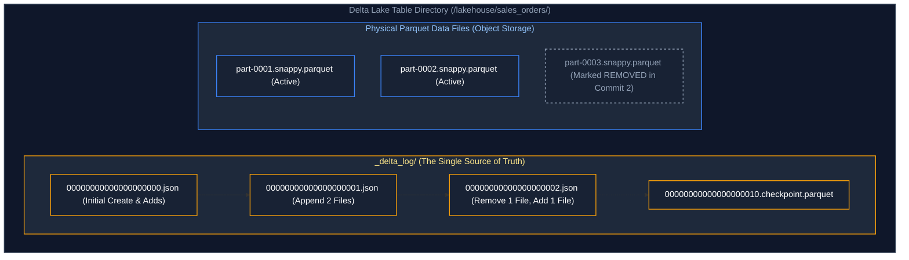

#### Why Parquet Alone is Insufficient
Raw Parquet files on cloud storage lack atomicity: if an append job writing 50 Parquet files fails on file 42, the table is left corrupted with partial data. In Delta Lake, reader engines query the `_delta_log` first. If a commit failed, the orphaned files are never listed in the log and are completely ignored by readers.

#### References
- [Delta Lake Official Documentation](https://delta.io/)
- [GeeksforGeeks: Introduction to Delta Lake](https://www.geeksforgeeks.org/delta-lake/)
- [DataCamp: What is Delta Lake?](https://www.datacamp.com/tutorial/what-is-delta-lake)

---

### 8.2 `_delta_log` Internals & Protocol

#### Definition
Every state change in a Delta table (insert, update, delete, schema alteration) is written as an atomic commit file: `<version_number>.json`. Commits are numbered monotonically starting at `00000000000000000000.json`.

#### Structure of a Commit JSON
```json
{
    "commitInfo": {
        "timestamp": 1727913600000,
        "operation": "WRITE",
        "operationParameters": {
            "mode": "Append"
        }
    }
}
{
    "add": {
        "path": "part-0001.snappy.parquet",
        "size": 1048576,
        "modificationTime": 1727913600000,
        "dataChange": true,
        "stats": "{\"numRecords\":1000,\"minValues\":{\"id\":1},\"maxValues\":{\"id\":1000}}"
    }
}
{
    "remove": {
        "path": "part-0000.snappy.parquet",
        "deletionTimestamp": 1727913600000,
        "dataChange": true
    }
}
```
- `add`: Declares a new active data file and registers its min/max column statistics for data skipping.
- `remove`: Declares a file logically deleted (tombstoned). The file remains physically on disk for historical time-travel queries until purged by `VACUUM`.

#### References
- [Delta Lake Protocol Specification](https://github.com/delta-io/delta/blob/master/PROTOCOL.md)
- [Databricks: How the Delta Transaction Log Works](https://www.databricks.com/blog/2019/08/21/diving-into-delta-lake-unpacking-the-transaction-log.html)

---

### 8.3 JSON Commits & Checkpoint Parquet Files

#### Definition
As thousands of commits accumulate, reading thousands of individual JSON files to reconstruct table state would cause severe query latency. 

Every **10 commits**, Delta automatically triggers a **Checkpoint**: it aggregates the cumulative state of all prior commits into a single, compact `checkpoint.parquet` file. Subsequent queries only need to read the latest checkpoint Parquet file plus any subsequent JSON commits ($<10$ files).

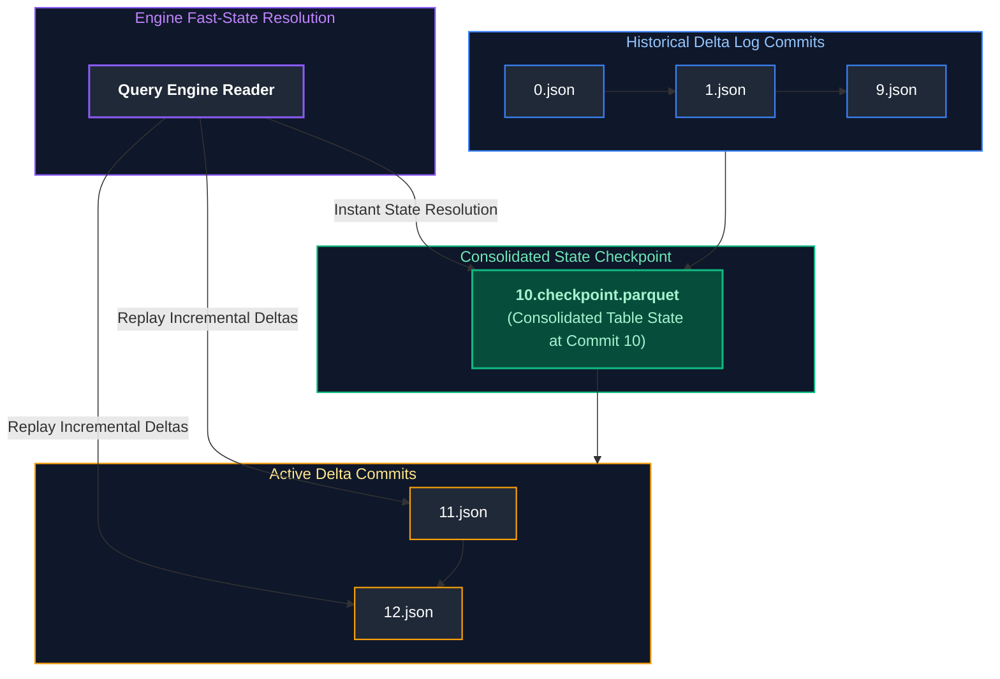

---

### 8.4 ACID Transactions & Optimistic Concurrency Control (OCC)

#### Definition
Delta Lake uses **Optimistic Concurrency Control (OCC)** to manage concurrent transactions without locking the entire table.

#### The OCC Algorithm
1. **Record Snapshot:** Transaction A reads the latest table version (e.g., Version 5).
2. **Execute Operations:** Transaction A writes new Parquet data files to storage.
3. **Attempt Commit:** Transaction A attempts to commit `000006.json`.
4. **Conflict Check:** If Transaction B committed `000006.json` first, Transaction A detects a version collision:
   - If changes do not overlap (e.g., updating separate partitions), Delta automatically **replays and re-commits** Transaction A as `000007.json`.
   - If updates conflict on the exact same row/file, Transaction A aborts with a `ConcurrentModificationException`.

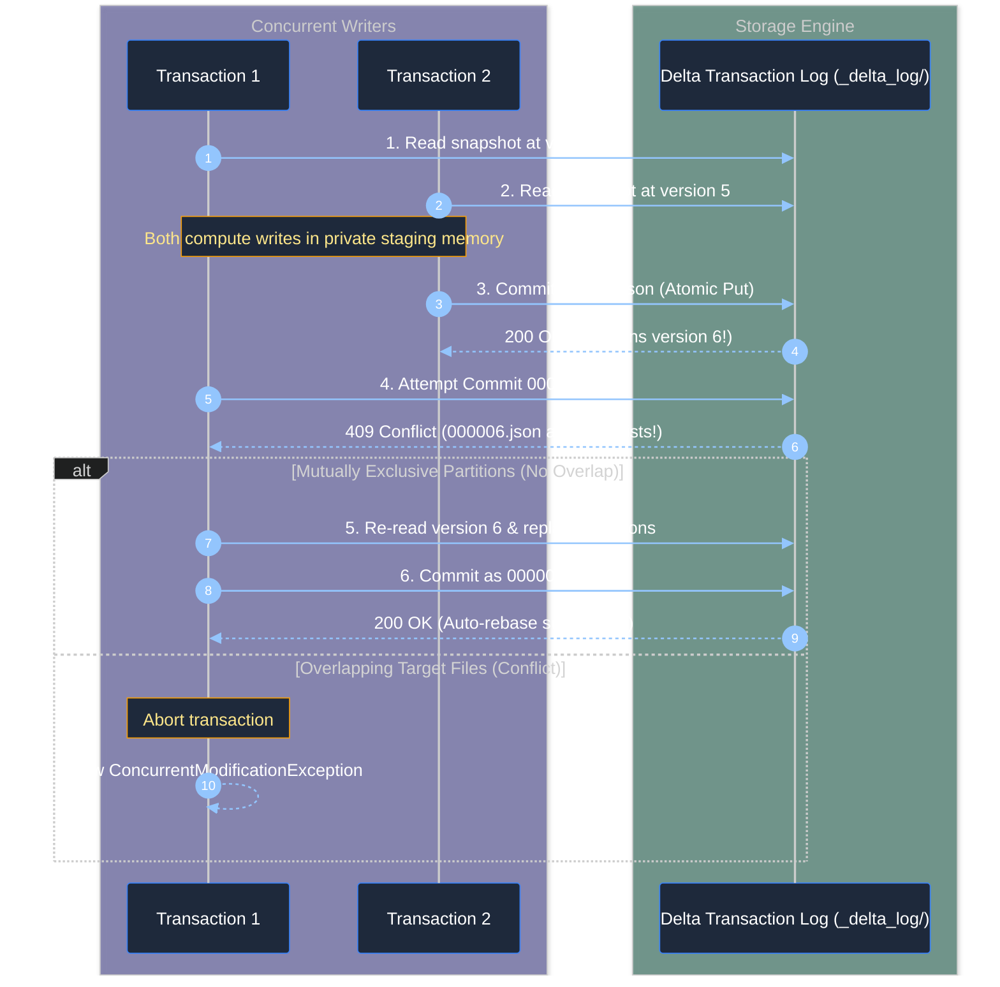

#### References
- [Databricks: Concurrency Control in Delta Lake](https://docs.databricks.com/en/optimizations/concurrency-control.html)
- [GeeksforGeeks: Optimistic Concurrency Control](https://www.geeksforgeeks.org/optimistic-concurrency-control-in-dbms/)

---

### 8.5 Schema Enforcement

#### Definition
Schema Enforcement (Schema Validation) is a defensive safeguard that prevents bad writes from corrupting a table. When data is appended to a Delta table, Delta verifies that the incoming DataFrame's schema strictly matches the target table's schema. If incoming rows contain unexpected columns or incompatible types, the write is immediately rejected with an `AnalysisException`.

#### References
- [Delta Lake Documentation: Schema Enforcement](https://docs.delta.io/latest/delta-batch.html#schema-enforcement)

---

### 8.6 Schema Evolution (`mergeSchema`)

#### Definition
Schema Evolution allows developers to alter a table's schema dynamically to accommodate changing business payloads over time without dropping or rewriting historical data.

#### Code Example
```python
# Enabling schema evolution during append write
df_new_features.write \
    .format("delta") \
    .mode("append") \
    .option("mergeSchema", "true") \
    .save("/lakehouse/customer_profiles/")
```
*Result:* Historical records automatically receive `NULL` for newly added columns; existing columns are preserved.

#### References
- [Databricks Documentation: Delta Lake Schema Evolution](https://docs.databricks.com/en/delta/update-schema.html)

---

### 8.7 Time Travel

#### Definition
Time Travel allows querying historical snapshots of a Delta table using immutable transaction logs and retained historical Parquet files.

#### Usage / Purpose
- Reproducing machine learning training datasets used months ago.
- Re-running financial reports as of a prior quarter close.
- Recovering from accidental `DELETE` or corrupted batch pipelines.

#### Code Example
```sql
-- Query table exactly as it existed at Version 14
SELECT * FROM lakehouse.dim_customers VERSION AS OF 14;

-- Query table state as of midnight yesterday
SELECT * FROM lakehouse.dim_customers TIMESTAMP AS OF '2024-10-02 00:00:00';
```

```python
# PySpark Time Travel Syntax
df_v5 = spark.read.format("delta").option("versionAsOf", 5).load("/lakehouse/dim_customers/")
```

#### References
- [Delta Lake Documentation: Table History & Time Travel](https://docs.delta.io/latest/delta-utility.html#history)
- [DataCamp: Delta Lake Time Travel](https://www.datacamp.com/tutorial/what-is-delta-lake)

---

### 8.8 `RESTORE TABLE` Disaster Recovery

#### Definition
The `RESTORE` statement rolls back a Delta table to a previous version or timestamp in a single atomic transaction.

#### Code Example
```sql
-- Disaster Scenario: A developer accidentally ran DELETE without a WHERE clause!
DELETE FROM lakehouse.orders; -- 0 rows remain!

-- Instant Restoration to prior version
RESTORE TABLE lakehouse.orders TO VERSION AS OF 22;
-- All rows restored in seconds!
```

> [!TIP]
> **Deep-Dive Interview Scenarios:**
> - [Q1. Delta Lake Architecture & ACID Transaction Internals](frequently_asked_questions/06_databricks_and_delta_lake_faq.md#q1-hard-delta-lake-architecture--acid-transaction-internals)
> - [Q5. Slowly Changing Dimensions (SCD Types 1 & 2) in Delta Lake](frequently_asked_questions/06_databricks_and_delta_lake_faq.md#q5-medium-slowly-changing-dimensions-scd-types-1--2-in-delta-lake)
> - [Q19. Concurrent Writes & Optimistic Concurrency Control (OCC)](frequently_asked_questions/06_databricks_and_delta_lake_faq.md#q19-medium-concurrent-writes--optimistic-concurrency-control-occ)
> - [Q29. Manual Versioning & Snapshots in Parquet vs Delta ACID Transaction Logs](frequently_asked_questions/06_databricks_and_delta_lake_faq.md#q29-easy-manual-versioning--snapshots-in-parquet-vs-delta-acid-transaction-logs)
> - [Q32. Manual File Deletion & Delta Transaction Log Divergence (FileNotFoundException & FSCK Repair)](frequently_asked_questions/06_databricks_and_delta_lake_faq.md#q32-medium-manual-file-deletion--delta-transaction-log-divergence-filenotfoundexception--fsck-repair)
> - [Q33. Delta Lake Concurrent Write Conflicts & Safe Optimistic Retry Protocols](frequently_asked_questions/06_databricks_and_delta_lake_faq.md#q33-medium-delta-lake-concurrent-write-conflicts--safe-optimistic-retry-protocols)
> - [Q34. Time Travel Recovery vs VACUUM Retention Divergence (Metadata vs Physical Retention)](frequently_asked_questions/06_databricks_and_delta_lake_faq.md#q34-easy-time-travel-recovery-vs-vacuum-retention-divergence-metadata-vs-physical-retention)
> - [Q35. Production Schema Validation & Type Widening Recovery (Integer to String & Quarantine)](frequently_asked_questions/06_databricks_and_delta_lake_faq.md#q35-medium-production-schema-validation--type-widening-recovery-integer-to-string)

---

# 9. Delta Performance & Storage Optimization

---

### 9.1 `OPTIMIZE` & File Bin-Packing

#### Definition
Over time, streaming jobs and micro-batch writes produce thousands of small files. The `OPTIMIZE` command reads small files (e.g. 1MB each) and rewrites them into large, contiguous, query-optimized Parquet files (~1GB each).

```sql
-- Trigger automatic file compaction (Bin-Packing) across all partitions
-- Rewrites thousands of tiny fragmented Parquet files into uniform ~1GB files
OPTIMIZE lakehouse.fact_transactions;
```

---

### 9.2 Z-Ordering & Space-Filling Curves

#### Definition
Z-Ordering is a multidimensional clustering technique that organizes data along a space-filling curve (Peano curve) across multiple columns simultaneously, maximizing data skipping during range and equality filters.

```sql
-- Optimize table and cluster along customer_id and transaction_date
OPTIMIZE lakehouse.fact_transactions 
ZORDER BY (customer_id, transaction_date);
```

#### References
- [Databricks Documentation: Z-Order Indexing](https://docs.databricks.com/en/delta/data-skipping.html)

---

### 9.3 Liquid Clustering

#### Definition
Liquid Clustering is Databricks' next-generation data clustering technology that replaces both Hive-style partitioning and Z-Ordering. 
- It eliminates fixed partition directory structures.
- It dynamically adapts clustering as data access patterns evolve over time.
- Allows changing clustering keys without rewriting the entire table (`ALTER TABLE ... CLUSTER BY`).

```sql
-- Creating a table with Liquid Clustering
CREATE TABLE lakehouse.telemetry_events (
    device_id STRING,
    event_timestamp TIMESTAMP,
    sensor_reading DOUBLE
)
USING DELTA
CLUSTER BY (device_id, event_timestamp);
```

#### References
- [Databricks Documentation: Use Liquid Clustering](https://docs.databricks.com/en/delta/clustering.html)

---

### 9.4 Data Skipping via Log Statistics

#### Definition
Whenever a Parquet file is committed, Delta automatically extracts and records the **Min**, **Max**, and **Null Count** statistics for the first 32 columns in the `_delta_log`. When a query executes `WHERE amount > 500`, the engine reads the small JSON/Parquet log, evaluates the min/max filters, and bypasses 95%+ of physical storage files.

---

### 9.5 Auto-Compaction & Optimized Writes

#### Definition
- **Optimized Writes:** Reduces small file creation during writes by dynamically repartitioning data into 128MB chunks before committing to storage.
- **Auto-Compaction:** Automatically checks if a write produced small files and triggers an inline compaction job right after the commit.

```sql
-- Enable on Delta table
ALTER TABLE lakehouse.sensor_stream SET TBLPROPERTIES (
    'delta.autoOptimize.optimizeWrite' = 'true',
    'delta.autoOptimize.autoCompact' = 'true'
);
```

---

### 9.6 Deletion Vectors

#### Definition
Traditionally, deleting or updating a single row inside a 500MB Parquet file required reading the entire file, writing a brand-new 500MB Parquet file without that row, and marking the old file removed (**Copy-On-Write overhead**).

**Deletion Vectors (DVs)** revolutionize this: Delta writes a tiny bit-array file (a few bytes) that lists the exact row offsets that have been deleted. Reader engines read the original Parquet file and simply mask out rows marked in the Deletion Vector. **100x faster updates and deletes.**

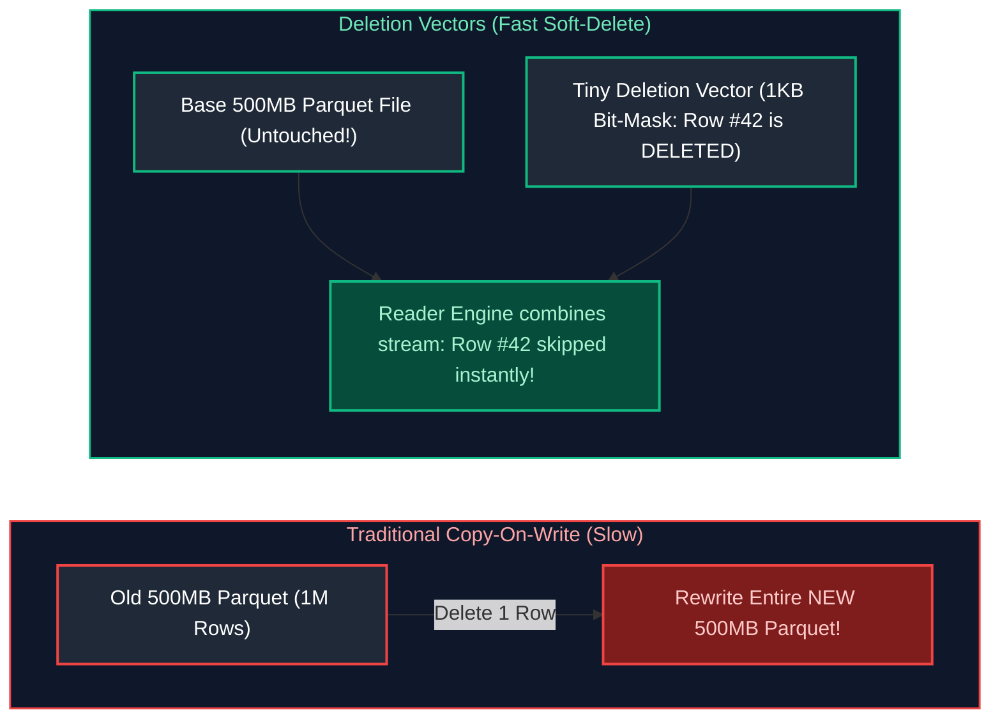

#### References
- [Databricks Documentation: Deletion Vectors](https://docs.databricks.com/en/delta/deletion-vectors.html)

> [!TIP]
> **Deep-Dive Interview Scenario:**
> - [Q28. Diagnosing and Tuning Gold-Layer Delta Table Dashboard Performance](frequently_asked_questions/06_databricks_and_delta_lake_faq.md#q28-hard-diagnosing-and-tuning-gold-layer-delta-table-dashboard-performance)

---

# 10. Advanced Delta Lake Capabilities

---

### 10.1 Change Data Feed (CDF)

#### Definition
Change Data Feed (CDF) records row-level change events (insert, update-preimage, update-postimage, delete) committed to a Delta table, turning the Delta table into an automated streaming CDC source for downstream pipelines.

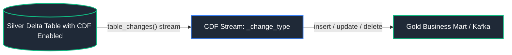

#### Enabling and Querying CDF
```sql
-- Enable CDF on table
ALTER TABLE lakehouse.customers SET TBLPROPERTIES ('delta.enableChangeDataFeed' = 'true');

-- Read row changes between Version 10 and 15
SELECT 
    customer_id, 
    email, 
    _change_type, 
    _commit_version, 
    _commit_timestamp
FROM table_changes('lakehouse.customers', 10, 15);
```
- `insert`: Newly inserted row.
- `update_preimage`: Values before the update.
- `update_postimage`: Values after the update.
- `delete`: Deleted row values.

#### References
- [Databricks Documentation: Change Data Feed](https://docs.databricks.com/en/delta/delta-change-data-feed.html)

---

### 10.2 Shallow Clone vs Deep Clone (Disaster Recovery & Replication)

#### Problem: Disaster Recovery (DR) & Cross-Region Data Replication
Enterprises operating in cloud environments face potential regional outages, ransomware corruption, or accidental drop operations. Meeting stringent **Recovery Point Objectives (RPO)** and **Recovery Time Objectives (RTO)** requires maintaining an independent, synchronized replica of critical lakehouse tables in a secondary cloud region or separate cloud account.

#### Solution: Shallow Clone vs. Deep Clone
- **Shallow Clone (Zero-Copy Clone):** Copies **only the transaction log metadata**. The new table references the original data files in place. Creation is instantaneous ($O(1)$) and costs zero storage. Ideal for ephemeral developer testing, feature engineering sandboxes, and staging validation.
- **Deep Clone (Disaster Recovery & Backup):** Copies both the transaction log metadata and the **actual underlying physical Parquet files** to the target destination. Fully independent table with isolated storage. Subsequent runs execute **incrementally**, copying only new or updated files since the previous sync.

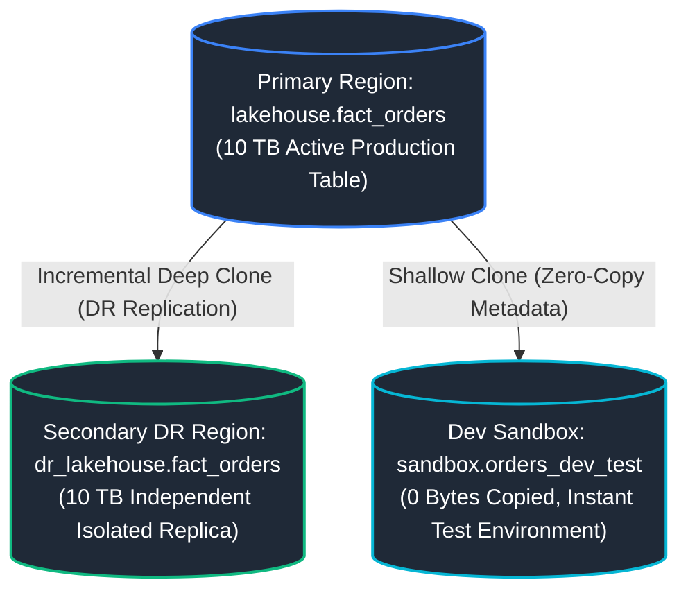

#### Code Example
```sql
-- 1. Ephemeral zero-copy sandbox table for developer experimentation
CREATE TABLE sandbox.orders_dev_test 
SHALLOW CLONE lakehouse.fact_orders;

-- 2. Initial Deep Clone replicating table to secondary disaster recovery region
CREATE TABLE dr_region.fact_orders_replica 
DEEP CLONE lakehouse.fact_orders;

-- 3. Scheduled incremental sync (copies ONLY files added/modified since last sync)
CREATE OR REPLACE TABLE dr_region.fact_orders_replica 
DEEP CLONE lakehouse.fact_orders;
```

#### References
- [Databricks Documentation: Clone Delta Tables](https://docs.databricks.com/en/delta/clone.html)

---

### 10.3 `VACUUM` & Retention Period Governance

#### Definition
`VACUUM` permanently deletes physical Parquet data files that are no longer referenced in the latest transaction log commit and are older than the retention threshold (default: **7 days**).

```sql
-- Clean up orphaned Parquet files older than 7 days
VACUUM lakehouse.fact_orders;

-- Run vacuum with explicit 168-hour (7 day) retention
VACUUM lakehouse.fact_orders RETAIN 168 HOURS;
```

#### The Time-Travel Trade-off
Once a file is vacuumed, **you can no longer time-travel back to versions that required that file**. Never set retention to 0 hours in production.

#### References
- [Databricks Documentation: VACUUM Command](https://docs.databricks.com/en/sql/language-manual/delta-vacuum.html)

---

### 10.4 Delta Sharing Open Protocol

#### Definition
Delta Sharing is the industry's first open, secure REST protocol for data sharing. It enables an organization to share live Delta tables, views, and ML models with external partners or clients using **any compute platform** (Pandas, PowerBI, Presto, Apache Spark) without copying or moving data.

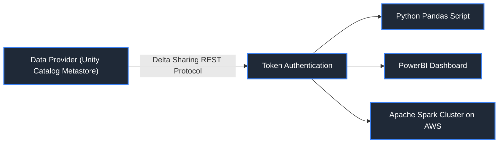

#### References
- [Delta Sharing Official Open Source Project](https://delta.io/sharing/)
- [Databricks Documentation: Delta Sharing](https://docs.databricks.com/en/data-sharing/index.html)

---

### 10.5 Managed vs External Delta Tables

#### Delta Lake Table Types & Lifecycle Management
When registering a Delta table in Unity Catalog or Hive Metastore, engineers choose between two fundamental table types: **Managed Tables** and **External (Unmanaged) Tables**. This distinction governs file storage locations, credential access patterns, and data retention behavior during DDL operations.

1. **Managed Delta Tables:**
   - **Storage Placement:** Managed tables reside within the root storage location configured for the schema or catalog (e.g., `s3://tenant-root/unity-catalog/tables/<table-id>/`). The exact directory path is managed entirely by Unity Catalog; users do not specify a storage URI.
   - **Lifecycle Binding:** Unity Catalog tightly binds the logical table metadata to the physical Parquet data files. Dropping a managed table (`DROP TABLE catalog.schema.orders`) drops the metadata definition **and permanently deletes the underlying Parquet files and `_delta_log` directories from cloud storage**.
   - **Recommended Scope:** Default choice for internal enterprise pipelines (Bronze, Silver, Gold layers) where data governance and lifecycle should be fully automated.

2. **External Delta Tables:**
   - **Storage Placement:** Created by explicitly supplying a physical storage path via the `LOCATION` keyword: `CREATE TABLE catalog.schema.events LOCATION 's3://external-bucket/path/events/'`.
   - **Decoupled Lifecycle:** Dropping an external table (`DROP TABLE catalog.schema.events`) removes the metadata entry from Unity Catalog, but **leaves the underlying Parquet files, transaction logs, and checkpoint data completely untouched on cloud storage**.
   - **Recommended Scope:** Ideal when data is shared with external non-Databricks systems, when migrating existing data lakes in-place, or when storage buckets are owned by separate infrastructure teams.

| Characteristic | Managed Delta Table | External Delta Table |
| :--- | :--- | :--- |
| **Location Specification** | Stored in Unity Catalog root storage | User specifies `LOCATION 's3://...'` |
| **DROP TABLE Behavior** | **Deletes both metadata and Parquet data files** | **Deletes metadata only**; files remain on S3 |
| **Best Practice** | Default choice for curated Silver/Gold tiers | Legacy data lakes; shared multi-cloud storage |

---

### 10.6 UniForm (Universal Format)

#### Definition
Universal Format (UniForm) allows Delta Lake tables to be read as if they were **Apache Iceberg** or **Apache Hudi** tables without duplicating data. Delta automatically generates Iceberg and Hudi metadata files alongside the standard `_delta_log`, allowing engines like Snowflake, BigQuery, and Athena to query Delta tables natively using their built-in Iceberg readers.

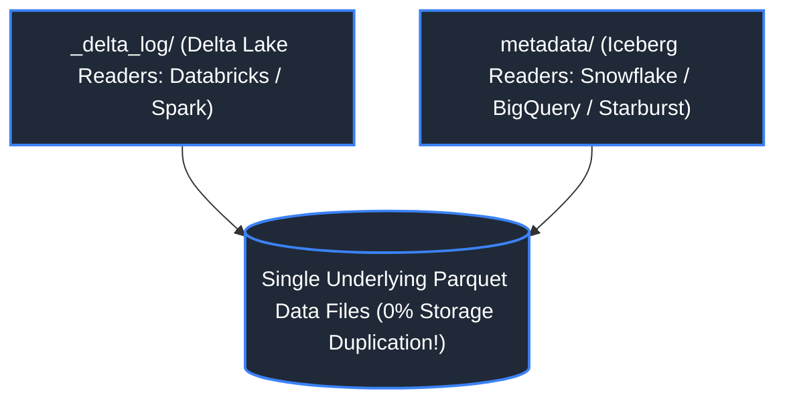

```sql
-- Creating a Delta table readable by Iceberg engines
CREATE TABLE lakehouse.uniform_sales (
    id BIGINT,
    amount DOUBLE
)
TBLPROPERTIES (
    'delta.universalFormat.enabledFormats' = 'iceberg'
);
```

#### References
- [Databricks Documentation: UniForm](https://docs.databricks.com/en/delta/uniform.html)

---

### 10.7 Identity Columns

#### Definition
`GENERATED ALWAYS AS IDENTITY` provides auto-incrementing integer surrogate keys during distributed `INSERT` operations.

```sql
-- Delta Lake table featuring auto-incrementing surrogate primary key
CREATE TABLE lakehouse.dim_customers (
    -- Generates unique monotonically increasing integer surrogate key automatically on INSERT
    customer_key BIGINT GENERATED ALWAYS AS IDENTITY (START WITH 1 INCREMENT BY 1),
    customer_id STRING NOT NULL,      -- Natural business key from source system
    customer_name STRING NOT NULL     -- Customer name attribute
)
USING DELTA;
```

---

### 10.8 Generated Columns

#### Definition
Generated Columns compute values automatically based on other column values in the row (e.g., date partition derived from a timestamp).

```sql
-- Delta Lake table featuring automatically computed partition column
CREATE TABLE lakehouse.events (
    event_id STRING NOT NULL,         -- Unique event UUID
    event_timestamp TIMESTAMP NOT NULL, -- Precise millisecond occurrence timestamp
    -- Automatically extracted date column generated at write time; enables partition pruning for timestamp filters!
    event_date DATE GENERATED ALWAYS AS (CAST(event_timestamp AS DATE))
)
USING DELTA
PARTITIONED BY (event_date);
```

#### References
- [Databricks Documentation: Generated Columns](https://docs.databricks.com/en/tables/generated-columns.html)

> [!TIP]
> **Deep-Dive Interview Scenarios:**
> - [Q7. Optimizing Multi-TB Tables with Frequent Mutations & Small Files](frequently_asked_questions/06_databricks_and_delta_lake_faq.md#q7-medium-optimizing-multi-tb-tables-with-frequent-mutations--small-files)
> - [Q27. Source-to-Target Data Validation Framework for Delta Lake Migrations](frequently_asked_questions/06_databricks_and_delta_lake_faq.md#q27-medium-source-to-target-data-validation-framework-for-delta-lake-migrations)

---

# 11. Summary Comparison & Production Engineering Reference Matrix

### 11.1 Delta Lake Physical Layout & Optimization Strategies Matrix

Delta Lake provides multiple physical storage organization techniques to maximize read skipping and optimize write throughput. The table below details the trade-offs, operational costs, and target use cases for each strategy:

| Optimization Technique | Underlying Physical Mechanics | Write / Compaction Overhead | Multi-Column Skipping Efficiency | Concurrency Conflict Sensitivity | Ideal Table Scale & Cardinality | Best Production Use Case |
| :--- | :--- | :--- | :--- | :--- | :--- | :--- |
| **Physical Directory Partitioning** | Hard directory hierarchy (`/year=2024/month=05/`) | Low during initial append; extreme rewriting if partition key evolves | Rigid single-column or hierarchical 1D pruning only | High: Concurrent writes to distinct partitions succeed, but small file sprawl is severe | Low-cardinality keys ($< 10{,}000$ distinct partitions); table size $> 1\text{ TB}$ | Coarse-grained temporal isolation (e.g., partitioned by `event_date`); prohibited for high-cardinality keys. |
| **Z-Ordering (`OPTIMIZE ZORDER BY`)** | Space-filling Morton curves mapping multi-dimensional keys into 1D linear file order | **Very High**: Requires full rewrite and sorting of all Parquet files in affected partitions | High across $2 - 4$ correlated columns | **High**: Blocks concurrent updates during compaction; non-incremental | Static or append-mostly tables ($100\text{ GB} - 50\text{ TB}$) | Batch analytical fact tables queried on composite filters (e.g., `customer_id` + `transaction_timestamp`). |
| **Liquid Clustering (`CLUSTER BY`)** | Incremental Hilbert space-filling curves; self-tuning file layout | **Low to Moderate**: Incremental compaction without full partition rewriting | **Exceptional**: Dynamic multi-column clustering adapts to data distribution | **Very Low**: Supports concurrent append, update, and cluster operations | Any table size ($1\text{ GB} - \text{Petabytes}$); high-cardinality keys | **Modern Databricks default**: Replaces both partitioning and Z-ordering for dynamic, evolving workloads. |
| **Deletion Vectors (`delta.enableDeletionVectors`)** | Soft-deletion bitmaps stored alongside Parquet files; marks rows deleted without file rewrite | **Minimal**: Instant writes; avoids full Parquet file rewriting on row mutation | Neutral (Read path evaluates bitmap filter during vector scan) | **Ultra-Low**: Completely eliminates write conflicts on updates/deletes | High-frequency update/delete pipelines (CDC, GDPR right-to-be-forgotten) | Streaming CDC upserts, point-deletes, and regulatory GDPR scrubbing without write amplification. |
| **Change Data Feed (CDF)** | Emits row-level change events (`_change_type`: insert, update_preimage, update_postimage, delete) | Low (Generates change files during merge/update) | N/A (Consumable as a streaming/batch change log) | Low | Tables serving downstream consumers | Silver-to-Gold incremental propagation, audit trail generation, and downstream event-driven microservices. |

---

### 11.2 Production Lakehouse Engineering Invariants

- **The Liquid Clustering Default:** For all new production Delta tables on Databricks Runtime 13.3+, mandate **Liquid Clustering (`CLUSTER BY`)** instead of physical directory partitioning. Liquid clustering eliminates partition cardinality bottlenecks, prevents Small File Syndrome, and enables non-disruptive evolution of clustering keys without costly table restructurings.
- **VACUUM Retention vs. Time Travel SLA:** Never execute `VACUUM` with a retention threshold lower than your organization's disaster recovery SLA (default $7$ days, `spark.databricks.delta.vacuum.parallelDelete.enabled = true`). Purging files too aggressively invalidates in-flight reader transactions and permanently breaks Delta Time Travel history.
- **Deletion Vectors for Low-Latency Upserts:** Enable Deletion Vectors (`delta.enableDeletionVectors = true`) on all tables subjected to frequent `MERGE INTO`, `UPDATE`, or `DELETE` operations. Deletion vectors eliminate write amplification by recording localized bitmap masks instead of rewriting entire 500MB Parquet files, reducing write I/O by up to $90\%$.
- **Automated Bin-Packing & Maintenance DAGs:** Schedule scheduled off-peak maintenance jobs executing `OPTIMIZE table_name` and `VACUUM table_name` to maintain uniform target file sizes between $100\text{ MB}$ and $1\text{ GB}$. Unmaintained Delta tables suffer from metadata log bloat and degraded query planning latency.
- **Unity Catalog Centralized Governance:** Enforce 3-level namespace isolation (`catalog.schema.table`) in Unity Catalog. Decouple physical cloud storage credentials using Managed External Locations, and enforce row-level security (RLS) filters and dynamic column masking directly in the governance metastore rather than in client applications.

---

# 12. References & Further Reading

- [Delta Lake: High-Performance ACID Table Storage over Cloud Object Stores (Armbrust et al., VLDB 2020)](https://www.vldb.org/pvldb/vol13/p3411-armbrust.pdf) — Architectural principles behind the Delta transaction log and ACID guarantees.
- [Databricks Documentation: Liquid Clustering Architecture & Guidance](https://docs.databricks.com/en/delta/clustering.html) — Next-generation multi-dimensional layout and incremental clustering.
- [Databricks Documentation: Deletion Vectors Optimization](https://docs.databricks.com/en/delta/deletion-vectors.html) — Mechanics of soft-delete bitmaps and write amplification mitigation.
- [Unity Catalog Architectural Guide (Databricks)](https://docs.databricks.com/en/data-governance/unity-catalog/index.html) — Unified governance, fine-grained access control, and data lineage across clouds.
- [UniForm (Universal Format): Read Delta Lake with Iceberg and Hudi Clients](https://docs.databricks.com/en/delta/uniform.html) — Multi-format metadata translation and lakehouse interoperability.
- [Delta Sharing: An Open Protocol for Secure Data Sharing](https://delta.io/sharing/) — Zero-copy, cross-cloud, cross-platform enterprise data exchange specification.