# 07. Streaming, Apache Kafka & Databricks Auto Loader: Master Real-Time Guide

A comprehensive, production-grade guide to real-time event streaming architectures, Apache Kafka broker internals (KRaft metadata quorum, segment files, zero-copy I/O, consumer rebalancing), and Apache Spark Structured Streaming engines (watermarking, state stores, stream-stream joins, and end-to-end exactly-once delivery guarantees).

---

## Architectural Overview: Distributed Event Streaming & Log Retention Architecture

Event streaming treats data not as static snapshots stored in tables, but as a **continuous, infinite, unbounded stream of events happening in real time**.

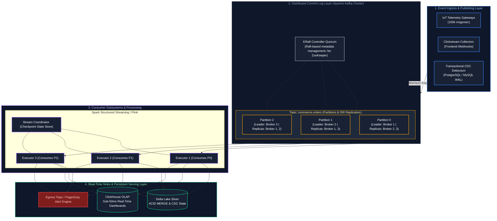

---

## Table of Contents
1. [First Principles: Batch vs. Event Streaming Architectures](#1-first-principles-batch-vs-event-streaming-architectures)
   - [1.1 The Paradigm Shift: Static Tables vs. Infinite Append-Only Logs](#11-the-paradigm-shift-static-tables-vs-infinite-append-only-logs)
   - [1.2 Why Traditional Message Queues (RabbitMQ, SQS) Cannot Scale for Analytics](#12-why-traditional-message-queues-rabbitmq-sqs-cannot-scale-for-analytics)
   - [1.3 The Log as the Source of Truth: CQRS & Event Sourcing](#13-the-log-as-the-source-of-truth-cqrs--event-sourcing)
2. [Apache Kafka Core Fundamentals & Architecture](#2-apache-kafka-core-fundamentals--architecture)
   - [2.1 Topics, Partitions, and Monotonic Offsets](#21-topics-partitions-and-monotonic-offsets)
   - [2.2 Message Anatomy: Magic Bytes, Keys, Values, Timestamps & Headers](#22-message-anatomy-magic-bytes-keys-values-timestamps--headers)
   - [2.3 Producers, Partitioners (Murmur2), and Message Batching Dynamics](#23-producers-partitioners-murmur2-and-message-batching-dynamics)
   - [2.4 Retention Policies: Time-Based, Size-Based, and Log Compaction](#24-retention-policies-time-based-size-based-and-log-compaction)
   - [2.5 Log Compaction & Tombstones (State Store Mechanics)](#25-log-compaction--tombstones-state-store-mechanics)
3. [Kafka Broker Storage Internals & Hardware Mechanics](#3-kafka-broker-storage-internals--hardware-mechanics)
   - [3.1 Physical Segment Files (`.log`, `.index`, `.timeindex`)](#31-physical-segment-files-log-index-timeindex)
   - [3.2 Zero-Copy Network I/O (`sendfile` System Call) & OS PageCache](#32-zero-copy-network-io-sendfile-system-call--os-pagecache)
   - [3.3 ZooKeeper vs. KRaft: Raft Consensus Metadata Architecture](#33-zookeeper-vs-kraft-raft-consensus-metadata-architecture)
   - [3.4 In-Sync Replicas (ISR), High Watermarks (HW) & Log End Offsets (LEO)](#34-in-sync-replicas-isr-high-watermarks-hw--log-end-offsets-leo)
   - [3.5 Producer ACKs (`acks=0`, `acks=1`, `acks=all`) & `min.insync.replicas`](#35-producer-acks-acks0-acks1-acksall--mininsyncreplicas)
   - [3.6 Idempotent & Transactional Producer Mechanics (2PC Across Partitions)](#36-idempotent--transactional-producer-mechanics-2pc-across-partitions)
4. [Kafka Consumer Groups & Rebalance Protocols](#4-kafka-consumer-groups--rebalance-protocols)
   - [4.1 Consumer Groups & Partition Assignment Dynamics](#41-consumer-groups--partition-assignment-dynamics)
   - [4.2 Rebalance Protocols: Eager (Stop-the-World) vs. Cooperative Sticky](#42-rebalance-protocols-eager-stop-the-world-vs-cooperative-sticky)
   - [4.3 Offset Commit Management: Auto-Commit vs. Manual Synchronous/Async](#43-offset-commit-management-auto-commit-vs-manual-synchronousasync)
   - [4.4 Consumer Lag Calculation & Monitoring (`LogEndOffset - CurrentOffset`)](#44-consumer-lag-calculation--monitoring-logendoffset---currentoffset)
5. [Enterprise Integration: Schema Registry & Connect](#5-enterprise-integration-schema-registry--connect)
   - [5.1 Kafka Connect Framework: Source and Sink Connectors](#51-kafka-connect-framework-source-and-sink-connectors)
   - [5.2 Confluent Schema Registry & Binary Avro Wire Format](#52-confluent-schema-registry--binary-avro-wire-format)
6. [Apache Spark Structured Streaming Engine](#6-apache-spark-structured-streaming-engine)
   - [6.1 The Unbounded Table Mental Model & Output Modes](#61-the-unbounded-table-mental-model--output-modes)
   - [6.2 Triggers: Micro-Batch vs. Fixed Interval vs. AvailableNow vs. Continuous](#62-triggers-micro-batch-vs-fixed-interval-vs-availablenow-vs-continuous)
   - [6.3 Checkpointing & Write-Ahead Logs for Fault Recovery](#63-checkpointing--write-ahead-logs-for-fault-recovery)
   - [6.4 Event Time Processing & Watermarking Deep-Dive](#64-event-time-processing--watermarking-deep-dive)
   - [6.5 Streaming Windows: Tumbling, Sliding, and Session Windows](#65-streaming-windows-tumbling-sliding-and-session-windows)
   - [6.6 Stream-Stream Joins & Dual Watermarking Memory Bounds](#66-stream-stream-joins--dual-watermarking-memory-bounds)
   - [6.7 State Management: JVM Heap vs. RocksDB State Store Provider](#67-state-management-jvm-heap-vs-rocksdb-state-store-provider)
   - [6.8 Streaming Deduplication via `dropDuplicates`](#68-streaming-deduplication-via-dropduplicates)
7. [End-to-End Delivery Semantics & System Comparisons](#7-end-to-end-delivery-semantics--system-comparisons)
   - [7.1 Mathematical Guarantees: At-Least-Once, At-Most-Once, Exactly-Once](#71-mathematical-guarantees-at-least-once-at-most-once-exactly-once)
   - [7.2 Stream Engines Compared: Spark Streaming vs. Apache Flink vs. Kafka Streams](#72-stream-engines-compared-spark-streaming-vs-apache-flink-vs-kafka-streams)
   - [7.3 Cloud Message Brokers: Kafka vs. AWS Kinesis vs. Azure Event Hubs](#73-cloud-message-brokers-kafka-vs-aws-kinesis-vs-azure-event-hubs)
8. [Practical Case Study: High-Throughput Real-Time Fraud Detection Pipeline](#8-practical-case-study-high-throughput-real-time-fraud-detection-pipeline)
9. [Summary Comparison & Production Engineering Reference Matrix](#9-summary-comparison--production-engineering-reference-matrix)
10. [References & Further Reading](#10-references--further-reading)

> [!TIP]
> **Deep-Dive Interview Scenarios:**
> - [Q2. Ingesting Millions of Continuously Arriving Files](frequently_asked_questions/07_streaming_kafka_and_event_driven_data_faq.md#q2-medium-ingesting-millions-of-continuously-arriving-files)
> - [Q3. Directory Listing vs File Notification Mode](frequently_asked_questions/07_streaming_kafka_and_event_driven_data_faq.md#q3-easy-directory-listing-vs-file-notification-mode)
> - [Q4. File Type Filtering & Micro-Batch Rate Limiting](frequently_asked_questions/07_streaming_kafka_and_event_driven_data_faq.md#q4-medium-file-type-filtering--micro-batch-rate-limiting)
> - [Q5. Structured Streaming Checkpointing Architecture](frequently_asked_questions/07_streaming_kafka_and_event_driven_data_faq.md#q5-medium-structured-streaming-checkpointing-architecture)
> - [Q7. Schema Evolution Modes in Auto Loader](frequently_asked_questions/07_streaming_kafka_and_event_driven_data_faq.md#q7-medium-schema-evolution-modes-in-auto-loader)
> - [Q8. The Rescued Data Column Pattern for Malformed Data](frequently_asked_questions/07_streaming_kafka_and_event_driven_data_faq.md#q8-medium-the-rescued-data-column-pattern-for-malformed-data)
> - [Q9. Stream Deduplication & State Store Memory Management](frequently_asked_questions/07_streaming_kafka_and_event_driven_data_faq.md#q9-medium-stream-deduplication--state-store-memory-management)
> - [Q10. Monitoring Streaming Progress via StreamingQueryProgress](frequently_asked_questions/07_streaming_kafka_and_event_driven_data_faq.md#q10-medium-monitoring-streaming-progress-via-streamingqueryprogress)
> - [Q11. Diagnosing & Troubleshooting Streaming Backlogs](frequently_asked_questions/07_streaming_kafka_and_event_driven_data_faq.md#q11-hard-diagnosing--troubleshooting-streaming-backlogs)
> - [Q12. Auto Loader Q10 & Streaming Q2. Late-Arriving Data & Event-Time Watermarking](frequently_asked_questions/07_streaming_kafka_and_event_driven_data_faq.md#q12-hard-auto-loader-q10--streaming-q2-late-arriving-data--event-time-watermarking)
> - [Q13. Poison Pill Quarantine & Dead-Letter Stream Handling](frequently_asked_questions/07_streaming_kafka_and_event_driven_data_faq.md#q13-medium-poison-pill-quarantine--dead-letter-stream-handling)
> - [Q15. Kafka Consumer Group Allocation: 12 Partitions vs 15 Consumers](frequently_asked_questions/07_streaming_kafka_and_event_driven_data_faq.md#q15-easy-kafka-consumer-group-allocation-12-partitions-vs-15-consumers)
> - [Q17. Burst Deduplication: 50 Duplicate Updates in 10 Seconds](frequently_asked_questions/07_streaming_kafka_and_event_driven_data_faq.md#q17-medium-burst-deduplication-50-duplicate-updates-in-10-seconds)
> - [Q18. Preventing and Resolving Duplicate Records in Streaming Writes to Delta](frequently_asked_questions/07_streaming_kafka_and_event_driven_data_faq.md#q18-hard-preventing-and-resolving-duplicate-records-in-streaming-writes-to-delta)
> - [Q20. End-to-End Exactly-Once Processing across Kafka, Spark & Lakehouse](frequently_asked_questions/07_streaming_kafka_and_event_driven_data_faq.md#q20-medium-end-to-end-exactly-once-processing-across-kafka-spark--lakehouse)
> - [Q21. Streaming Ingestion Engine Evaluation: Apache Kafka vs AWS Kinesis vs Azure Event Hubs vs GCP Pub/Sub](frequently_asked_questions/07_streaming_kafka_and_event_driven_data_faq.md#q21-easy-streaming-ingestion-engine-evaluation-apache-kafka-vs-aws-kinesis-vs-azure-event-hubs-vs-gcp-pubsub)
> - [Q22. Resilient High-Scale ADLS Ingestion: Auto Loader & Checkpointed Delta MERGE](frequently_asked_questions/07_streaming_kafka_and_event_driven_data_faq.md#q22-medium-resilient-high-scale-adls-ingestion-auto-loader--checkpointed-delta-merge)
> - [Q23. End-to-End Streaming Pipeline: Kafka to Spark Structured Streaming to Delta Lake](frequently_asked_questions/07_streaming_kafka_and_event_driven_data_faq.md#q23-medium-end-to-end-streaming-pipeline-kafka-to-spark-structured-streaming-to-delta-lake)
> - [Q24. Fixing Premature Kafka Offset Commits: Zero Data Loss Commit Strategies & Reprocessing Protection](frequently_asked_questions/07_streaming_kafka_and_event_driven_data_faq.md#q24-hard-fixing-premature-kafka-offset-commits-zero-data-loss-commit-strategies--reprocessing-protection)
> - [Q25. Managing 15-Minute Out-of-Order Kafka Streams with Dynamic Watermarking](frequently_asked_questions/07_streaming_kafka_and_event_driven_data_faq.md#q25-hard-managing-15-minute-out-of-order-kafka-streams-with-dynamic-watermarking)
> - [Q26. Real-Time Dynamic Surge Pricing Engine (30-Second Window Aggregation & Spatial Indexing)](frequently_asked_questions/07_streaming_kafka_and_event_driven_data_faq.md#q26-medium-real-time-dynamic-surge-pricing-engine-30-second-window-aggregation--spatial-indexing)
---

# 1. First Principles: Batch vs. Event Streaming Architectures

### 1.1 The Paradigm Shift: Static Tables vs. Infinite Append-Only Logs

In traditional data engineering, data was modeled as static snapshots stored in relational tables. A nightly batch ETL job would query:
```sql
SELECT * FROM orders WHERE order_date = CURRENT_DATE() - 1;
```
This paradigm introduces an artificial **24-hour latency barrier**. In the real world, businesses do not operate in 24-hour batch dumps. Every user click, GPS coordinate, heart rate monitor ping, and credit card swipe occurs **continuously in real time**.

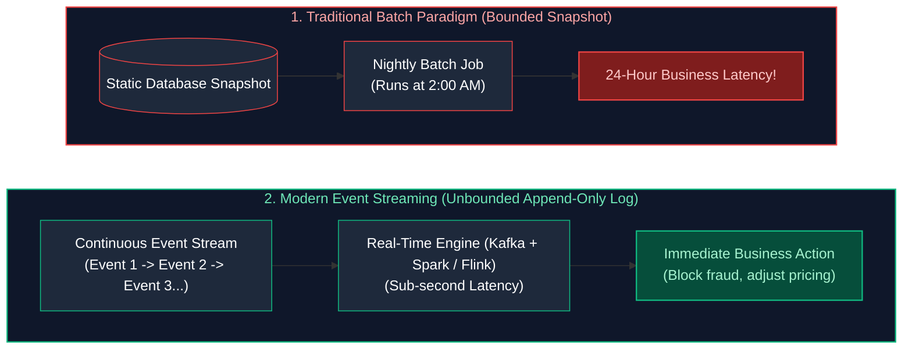

---

### 1.2 Why Traditional Message Queues (RabbitMQ, SQS) Cannot Scale for Analytics

Many software engineers ask: *"Why invent Kafka when we already have RabbitMQ, ActiveMQ, or AWS SQS?"*
The answer lies in **destructive reads vs. replayable commit logs**:

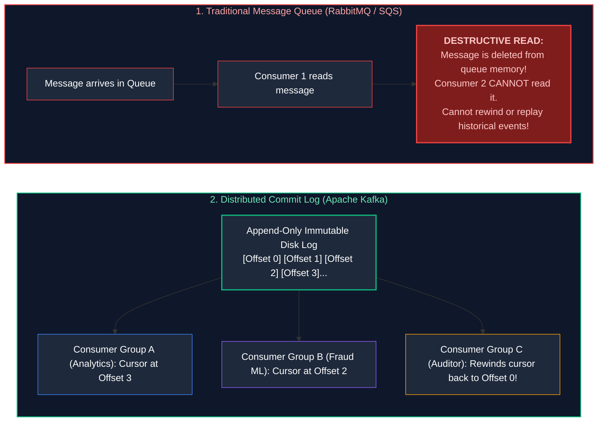

| Dimension | Traditional Message Queue (RabbitMQ / SQS) | Distributed Commit Log (Apache Kafka) |
| :--- | :--- | :--- |
| **Consumption Model** | **Destructive Read:** Message is deleted once acknowledged. | **Non-Destructive Read:** Message persists on disk according to retention policy. |
| **Multi-Consumer** | Messages are shared among workers; fan-out requires separate queues. | **Independent Cursors:** 100 consumers read the same topic at their own pace. |
| **Historical Replay** | **Impossible:** Once read, data is gone. | **Native:** Set consumer offset back to 0 to replay days or years of data. |
| **Throughput Ceiling** | Thousands of messages/sec (Bottlenecked by queue lock state). | **Millions of messages/sec** via sequential disk append and zero-copy I/O. |

---

### 1.3 The Log as the Source of Truth: CQRS & Event Sourcing

In modern architectures, the append-only log is the **Single Source of Truth**:
- **Event Sourcing:** Instead of storing just the current state (e.g., `account_balance = $500`), the application records every state-changing event: `[Deposited $1000]`, `[Withdrew $300]`, `[Withdrew $200]`. Current state is derived by replaying the log.
- **CQRS (Command Query Responsibility Segregation):** Write operations append events to Kafka. Downstream systems project materialized views optimized for reading (Elasticsearch for search, PostgreSQL for transactions, ClickHouse for analytics).

> [!TIP]
> **Deep-Dive Interview Scenario:**
> - [Q1. Batch vs Streaming Pipelines Architectural Comparison](frequently_asked_questions/07_streaming_kafka_and_event_driven_data_faq.md#q1-easy-batch-vs-streaming-pipelines-architectural-comparison)

---

# 2. Apache Kafka Core Fundamentals & Architecture

### 2.1 Topics, Partitions, and Monotonic Offsets

- **Topic:** A logical stream of related records (e.g., `telemetry.sensor_readings` or `payment.settlements`).
- **Partition:** A physical, ordered, immutable commit log file. Topics are divided into **Partitions** to achieve horizontal scaling across cluster brokers.
- **Offset:** A strictly increasing 64-bit integer (`BIGINT`) assigned sequentially to every message inside a partition. Offsets are immutable and unique *within a partition*.

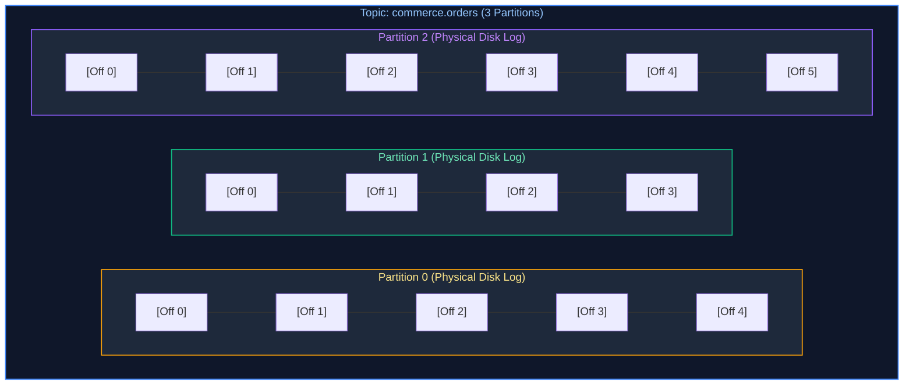

> [!IMPORTANT]
> **Total Ordering Guarantee:**
> Kafka guarantees message order **ONLY within a single partition**.
> There is **no global ordering across different partitions** within a topic. If strict ordering is required for a customer, all events for that customer must be published with `customer_id` as the message key to route to the same partition!

---

### 2.2 Message Anatomy: Magic Bytes, Keys, Values, Timestamps & Headers

A Kafka record serialized on disk conforms to the standard binary layout:

| Field | Size | Description |
| :--- | :--- | :--- |
| **Offset** | 8 Bytes | Monotonic integer offset inside partition. |
| **Length** | 4 Bytes | Total size of record in bytes. |
| **Magic Byte** | 1 Byte | Kafka message format version (e.g., `2` for RecordBatch). |
| **CRC32C** | 4 Bytes | Checksum verifying byte integrity against bit-rot. |
| **Attributes** | 2 Bytes | Compression codec (0=None, 1=GZIP, 2=Snappy, 3=LZ4, 4=ZSTD) and timestamp type. |
| **Timestamp** | 8 Bytes | Milliseconds since Unix epoch (`CreateTime` or `LogAppendTime`). |
| **Key Length & Key** | Varint + Bytes | Byte payload of key (used by Partitioner for routing). Nullable. |
| **Value Length & Value** | Varint + Bytes | Byte payload of value (JSON, Avro, Protobuf, String). Nullable. |
| **Headers** | Array | Metadata key-value string pairs (used for tracing, tracing IDs). |

---

### 2.3 Producers, Partitioners (Murmur2), and Message Batching Dynamics

#### 1. Key-Based Routing via Murmur2 Hashing
When a producer sends a record with a non-null key:
$$\text{Partition} = \text{toPositive}(\text{Murmur2}(\text{key})) \pmod{\text{TotalPartitions}}$$
This deterministic formula guarantees that records with identical keys (e.g., `user_id = 9021`) always land on the **exact same partition**, preserving sequential ordering.

#### 2. The RecordAccumulator & Micro-Batching
Producers do *not* make a network call for every single record. Instead, records are buffered in client memory inside the **RecordAccumulator**:

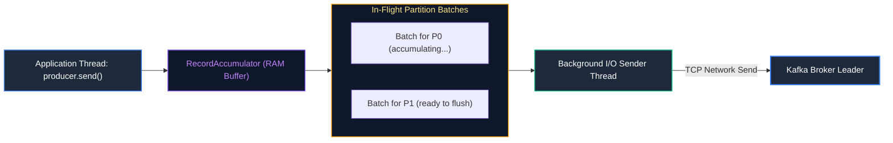

- **`batch.size` (Default 16 KB):** Maximum byte size per partition batch.
- **`linger.ms` (Default 0 ms):** Artificial delay to wait for more records to arrive before sending. Setting `linger.ms = 20` enables the producer to aggregate hundreds of events into a single compressed batch, increasing throughput by 500% with negligible latency cost.

---

### 2.4 Retention Policies: Time-Based, Size-Based, and Log Compaction

Kafka partitions retain data based on declarative retention rules:
1. **Time-Based Retention (`log.retention.hours = 168`):** Segments older than 7 days are automatically marked for deletion.
2. **Size-Based Retention (`log.retention.bytes = 107374182400`):** Deletes oldest segments once partition storage exceeds 100 GB.
3. **Log Compaction (`log.cleanup.policy = compact`):** Retains the **latest known value for every key forever**.

---

### 2.5 Log Compaction & Tombstones (State Store Mechanics)

In compacted topics, a background cleaner thread periodically merges log segments, keeping only the most recent record for each key:

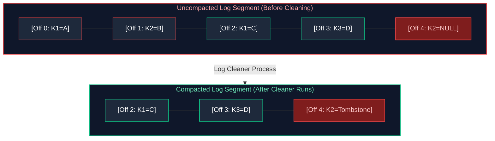

- **Tombstones:** To delete a key from a compacted topic, the producer sends a record with the key and a **`NULL` value**. The cleaner retains this tombstone for `delete.retention.ms` (e.g., 24 hours) so consumers observe the deletion, then purges the key permanently.

---

# 3. Kafka Broker Storage Internals & Hardware Mechanics

### 3.1 Physical Segment Files (`.log`, `.index`, `.timeindex`)

On disk, a partition is not one massive file. It is sliced into **Segments** (typically 1 GB each, configured via `segment.bytes`):

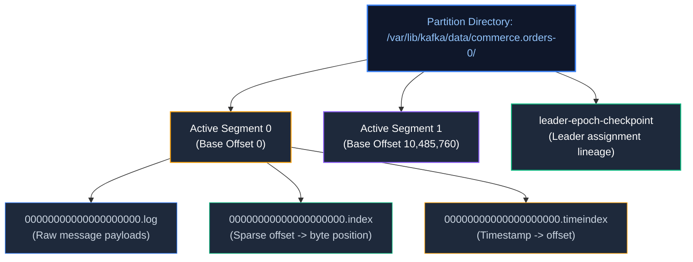

| Segment File Component | Physical File Format | Hardware & OS Lookup Mechanism |
| :--- | :--- | :--- |
| `.log` | Binary append-only record batch | Stored on NVMe/SSD, read via Linux kernel zero-copy `sendfile()`. |
| `.index` | Memory-mapped (`mmap`) sparse index | Maps relative message offset to physical byte position in `.log`. Binary searched in $O(\log N)$. |
| `.timeindex` | Memory-mapped (`mmap`) timestamp index | Maps Unix millisecond epoch timestamp to message offset for time-based seeks and retention. |
| `leader-epoch-checkpoint` | Plaintext state file | Records leader epochs and start offsets to prevent log divergence during broker failover. |

#### How Index Lookups Work ($O(\log N)$ Binary Search)
The `.index` file is a **Memory-Mapped Sparse Index** (`mmap`). It does *not* record an entry for every message; it records an entry every 4 KB (`index.interval.bytes`).
- To fetch Offset #5,020:
  1. The broker binary-searches the `.index` file for the largest indexed offset $\le 5020$ (e.g., Offset 5000 is at Byte Position 409,600).
  2. The broker seeks directly to Byte Position 409,600 in the `.log` file.
  3. It scans sequentially for just 20 records to find Offset #5,020!

---

### 3.2 Zero-Copy Network I/O (`sendfile` System Call) & OS PageCache

Why can a single Kafka broker transmit gigabytes of data per second across 10Gbps/40Gbps network cards without saturating CPU? **Zero-Copy Data Transfer via `sendfile()`**:

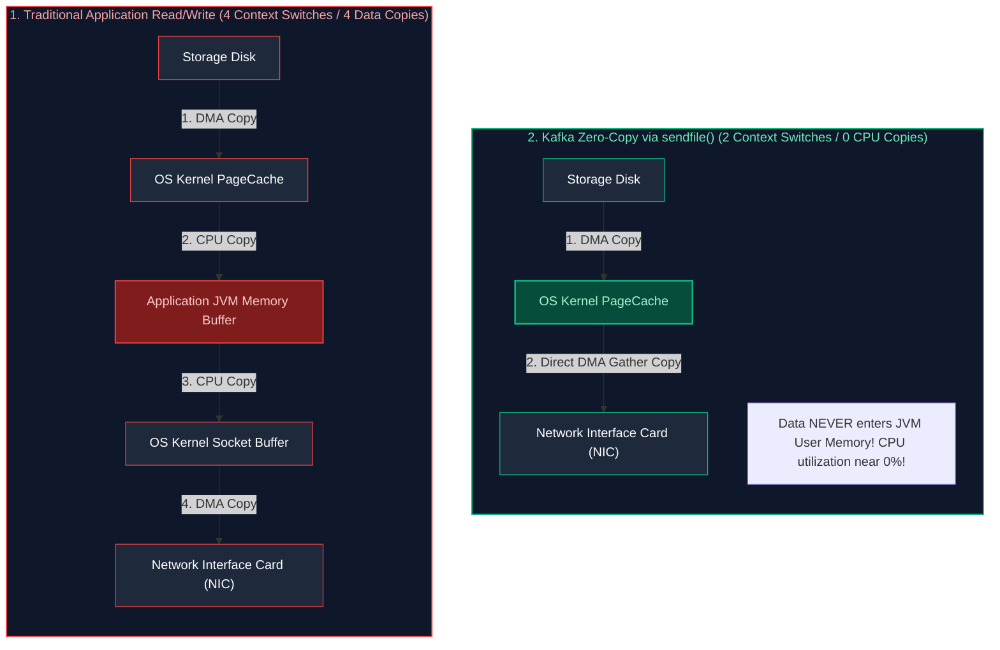

By relying on Linux **`sendfile()`** system call, the kernel transfers bytes directly from the storage cache to the network card via Direct Memory Access (DMA), completely bypassing user-space JVM memory and eliminating CPU copy overhead.

---

### 3.3 ZooKeeper vs. KRaft: Raft Consensus Metadata Architecture

Apache Kafka 3.x+ deprecated external ZooKeeper clusters in favor of **KRaft (Kafka Raft Metadata Mode)**:

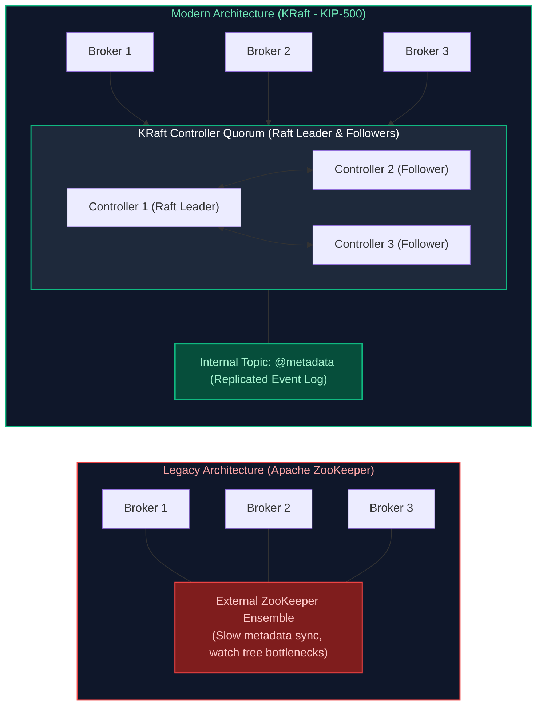

#### Why KRaft is Superior:
1. **Millions of Partitions:** ZooKeeper bottlenecked at $\approx 200,000$ partitions per cluster. KRaft scales to **millions of partitions**.
2. **Instantaneous Failover:** ZooKeeper leader re-election required re-loading all partition state ($O(N)$ seconds/minutes of downtime). KRaft controllers maintain warm in-memory replicated state; failover takes **under 100 milliseconds**.

---

### 3.4 In-Sync Replicas (ISR), High Watermarks (HW) & Log End Offsets (LEO)

- **Leader:** The single broker replica handling all read and write traffic for a partition.
- **Followers:** Passive broker replicas that fetch records from the leader to stay synchronized.
- **In-Sync Replicas (ISR):** The subset of replicas that have caught up to the leader within `replica.lag.time.max.ms` (e.g., 30 seconds).
- **Log End Offset (LEO):** The offset of the *next record to be written* to the partition.
- **High Watermark (HW):** The offset of the latest record that has been successfully replicated to **all brokers in the ISR**. Consumers are **ONLY allowed to read up to the High Watermark** to prevent dirty uncommitted reads.

---

### 3.5 Producer ACKs (`acks=0`, `acks=1`, `acks=all`) & `min.insync.replicas`

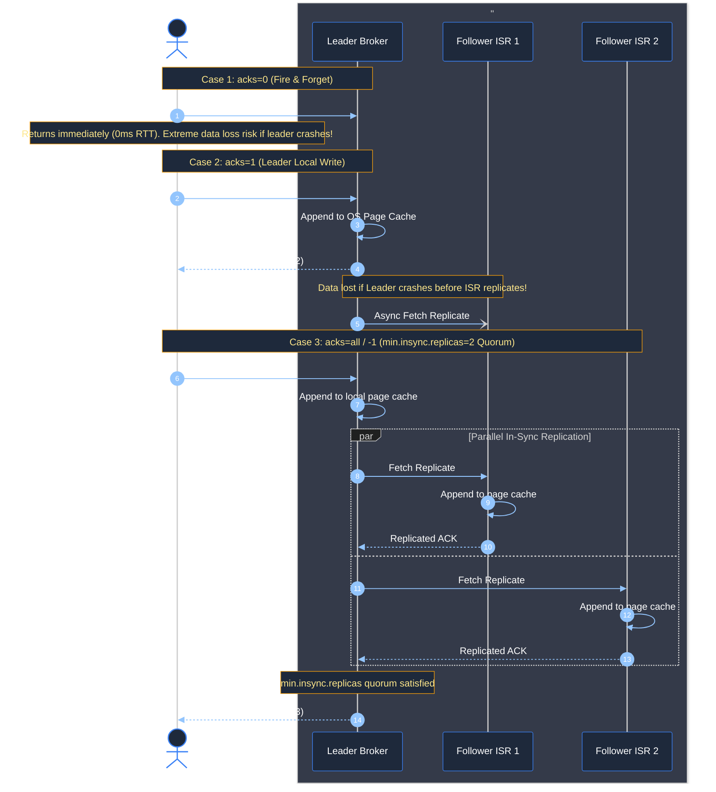

| Acks Configuration | Network Round-Trips | Write Latency ($p99$) | Durability Guarantee | Production Failure Mode |
| :--- | :--- | :--- | :--- | :--- |
| **`acks=0` (Fire & Forget)** | 0 (No response expected) | $< 1\text{ ms}$ (Lowest) | **None:** Records lost in flight or OS socket buffer if leader fails. | Silent data loss on broker restarts or network hiccups. |
| **`acks=1` (Leader Only)** | 1 RTT (Producer $\leftrightarrow$ Leader) | $2 - 5\text{ ms}$ | **Leader Only:** Survives client crashes, but NOT leader broker hardware failure. | If leader crashes before followers fetch the batch, un-replicated records are permanently lost. |
| **`acks=all` / `-1` (Full ISR)** | 2 RTTs (Producer $\leftrightarrow$ Leader + ISR Quorum) | $5 - 15\text{ ms}$ | **Zero Data Loss Guarantee** when paired with `min.insync.replicas >= 2`. | If in-sync replicas drop below `min.insync.replicas`, broker rejects writes with `NotEnoughReplicasException`. |

> [!CAUTION]
> **The Critical Production Pair:**
> Setting `acks=all` alone does **NOT** guarantee durability if `min.insync.replicas = 1`!
> If 2 out of 3 brokers crash, a topic with `min.insync.replicas = 1` will accept writes on the single remaining leader. If that leader crashes, data is permanently lost.
> **Production Standard:** `replication.factor = 3`, `acks = all`, and `min.insync.replicas = 2`.

---

### 3.6 Idempotent & Transactional Producer Mechanics (2PC Across Partitions)

1. **Idempotent Producer (`enable.idempotence = true`):**
   - The broker assigns each producer a unique 64-bit **Producer ID (PID)**.
   - The producer attaches an incrementing **Sequence Number** to every record sent to a partition.
   - If a network retry occurs, the broker detects that Sequence Number $N$ has already been committed and silently drops the duplicate, guaranteeing **zero duplicates without application-side deduplication code**.
2. **Transactional Messaging Across Topics:**
   - Enables atomic multi-partition writes: `sendOffsetsToTransaction()` ensures that consuming from Topic A and writing to Topic B commits or rolls back together via an internal **Two-Phase Commit (2PC)** coordinator.

---

# 4. Kafka Consumer Groups & Rebalance Protocols

### 4.1 Consumer Groups & Partition Assignment Dynamics

A **Consumer Group** represents a coordinated team of consumers cooperating to read from a topic.
- **Rule of Cardinality:** Each partition is assigned to **exactly one consumer thread** within a group.
- If a topic has 6 partitions and you spin up 8 consumers in the same group, **2 consumers will sit idle**.

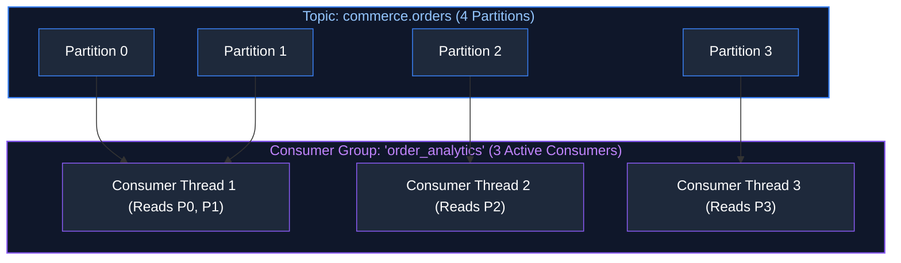

---

### 4.2 Rebalance Protocols: Eager (Stop-the-World) vs. Cooperative Sticky

When a consumer crashes or joins a group, the **Rebalance Protocol** reallocates partition assignments:

1. **Eager Rebalance Protocol (Legacy):**
   - **Stop-The-World:** Every consumer in the group drops its assigned partitions and stops processing completely.
   - Consumers rejoin the group, and assignments are recalculated from scratch.
   - Causes latency spikes and processing pauses of 30–60 seconds in large clusters!
2. **Cooperative Sticky Rebalance Protocol (Modern Default):**
   - **Incremental Rebalance:** Only the specific partitions migrating between consumers are temporarily paused.
   - Consumers whose partition assignments do not change continue processing without interruption.

---

### 4.3 Offset Commit Management: Auto-Commit vs. Manual Synchronous/Async

- **Auto-Commit (`enable.auto.commit = true`):** Commits offsets periodically every `auto.commit.interval.ms` (e.g., 5 seconds) regardless of whether processing succeeded. **Causes data loss if the worker crashes mid-processing!**
- **Manual Commit (`commitSync()` / `commitAsync()`):** The application commits the offset **ONLY AFTER** the record has been fully transformed and written to downstream storage.

---

### 4.4 Consumer Lag Calculation & Monitoring (`LogEndOffset - CurrentOffset`)

$$\text{Consumer Lag} = \text{LogEndOffset (LEO)} - \text{CurrentConsumerOffset}$$
- If Lag is **0**, consumers are keeping up with real-time ingress.
- If Lag is **growing monotonically**, downstream pipelines are bottlenecked (due to slow database sinks, garbage collection, or network saturation), signaling an urgent need to scale out consumer instances.

> [!TIP]
> **Deep-Dive Interview Scenario:**
> - [Q16. Kafka Rebalance Event Duplication & Idempotent Consumer Design](frequently_asked_questions/07_streaming_kafka_and_event_driven_data_faq.md#q16-hard-kafka-rebalance-event-duplication--idempotent-consumer-design)

---

# 5. Enterprise Integration: Schema Registry & Connect

### 5.1 Kafka Connect Framework: Source and Sink Connectors

Kafka Connect provides a declarative, distributed runtime framework for moving data between external datastores and Kafka without writing boilerplate integration code:
- **Source Connectors:** Continuously pull data from external systems into Kafka (e.g., Debezium CDC streaming PostgreSQL WAL changes into topics).
- **Sink Connectors:** Continuously push data from Kafka topics into downstream targets (e.g., Snowflake Sink Connector, S3 Parquet Sink Connector, Elasticsearch Sink).

---

### 5.2 Confluent Schema Registry & Binary Avro Wire Format

To prevent producer schema changes from breaking downstream analytical consumers, enterprise streaming architectures mandate **Confluent Schema Registry**:
- Producers register JSON/Avro/Protobuf schemas with the central registry.
- Kafka messages contain a **5-byte header**: `[Magic 0x00] [4-byte Schema ID]` followed by compact binary values.
- Downstream Spark/Flink consumers fetch the schema once, cache it in local memory, and safely deserialize millions of records without repeating field names.

---

# 6. Apache Spark Structured Streaming Engine

### 6.1 The Unbounded Table Mental Model & Output Modes

Spark Structured Streaming abstracts streaming data as an **Unbounded Table** that grows indefinitely as new records arrive:

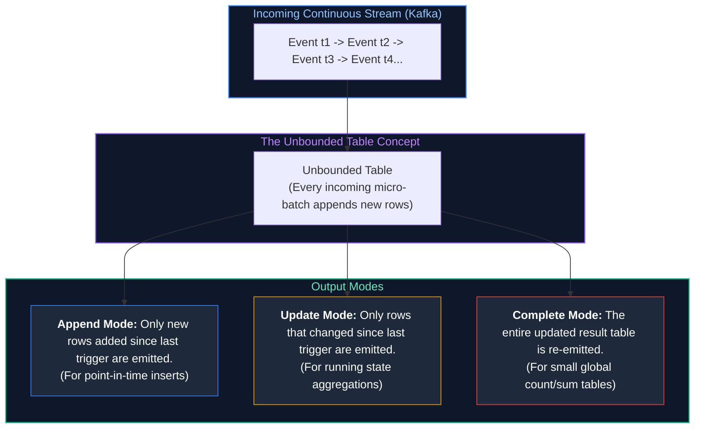

---

### 6.2 Triggers: Micro-Batch vs. Fixed Interval vs. AvailableNow vs. Continuous

#### Streaming Execution Cadence & Trigger Mechanics
In Spark Structured Streaming, the **Trigger** defines the execution timing of streaming queries—determining whether data is evaluated continuously as single events arrive or processed in discretized micro-batches. Choosing the right trigger governs pipeline latency, compute cost, and small-file storage compaction.

1. **Default Micro-Batch (Unspecified Trigger):**
   - **Operational Mechanism:** Executes in an eager continuous micro-batch loop. As soon as the previous micro-batch finishes writing and commits its offsets to the checkpoint directory, the engine immediately checks for newly arrived data and launches the next batch ($100\text{ ms} - 500\text{ ms}$ latency).
   - **Characteristics:** Maximizes pipeline freshness but can lead to high compute costs and small file proliferation if ingestion rates are sparse.

2. **Fixed Interval Micro-Batch (`processingTime='interval'`):**
   - **Operational Mechanism:** The engine executes micro-batches at deterministic clock intervals (e.g., every 10 seconds or every 5 minutes). If the prior batch completes in 2 seconds, the engine idles for the remaining 8 seconds before scanning for new records.
   - **Characteristics:** Allows write buffers to accumulate, producing larger, well-compacted Parquet files and reducing cloud storage API write costs.

3. **Incremental Batch / AvailableNow (`availableNow=True`):**
   - **Operational Mechanism:** Processes all newly arrived data since the last run across one or more dynamically sized micro-batches, and then **cleanly shuts down the streaming query**.
   - **Characteristics:** Unifies streaming logic with batch cost economics. Pipelines can run on a cron schedule (e.g., once every 4 hours or nightly), spinning up on-demand ephemeral compute clusters, processing accumulated increments, and terminating immediately.

4. **Continuous Processing (`continuous='interval'`):**
   - **Operational Mechanism:** A radical departure from micro-batching. Long-running tasks run continuously on executors, reading and writing events record-by-record with asynchronous epoch checkpointing.
   - **Characteristics:** Delivers true sub-millisecond latencies ($\approx 1\text{ ms}$), but supports only a restricted subset of SQL operations (no stateful aggregations, windowing, or full outer joins).

| Trigger Type | Code Syntax | Latency Profile | Primary Use Case |
| :--- | :--- | :--- | :--- |
| **Default (Micro-Batch)** | `.trigger()` (Unspecified) | $100\text{ ms} - 500\text{ ms}$ | Standard streaming pipelines (processes as fast as possible). |
| **Fixed Interval** | `.trigger(processingTime='10 seconds')` | $10\text{ seconds}$ | Prevents small file fragmentation by batching writes. |
| **AvailableNow** | `.trigger(availableNow=True)` | Batch execution | Cost-effective incremental batch ETL (runs like batch, processes like stream). |
| **Continuous Processing**| `.trigger(continuous='10 milliseconds')`| **$\approx 1\text{ ms}$** | Ultra-low-latency alerting (Restricted SQL operations). |

---

### 6.3 Checkpointing & Write-Ahead Logs for Fault Recovery

Fault recovery in Spark Structured Streaming requires specifying a persistent **Checkpoint Directory** on cloud object storage:
```python
query = (
    df_stream.writeStream
    .format("delta")
    .option("checkpointLocation", "s3://lakehouse-checkpoints/orders_pipeline/")
    .start("s3://lakehouse-silver/orders/")
)
```
- **Offsets Log:** Records the exact start and end Kafka partition offsets processed in each micro-batch.
- **Commit Log:** Records completed batches.
- **State Store Checkpoints:** Serializes in-memory state (aggregations, deduplication history) to disk so recovery after a node crash does not lose intermediate counts.

---

### 6.4 Event Time Processing & Watermarking Deep-Dive

#### 1. Event Time vs. Processing Time
- **Processing Time:** The clock time on the machine running the stream processing engine when it receives the event.
- **Event Time:** The real-world timestamp when the event actually occurred on the client device.
- **The Challenge:** Network delays and mobile disconnections mean events can arrive hours out of order.

#### 2. Watermarking Mechanics
A **Watermark** tells the streaming engine how long to wait for late-arriving events before dropping them and purging intermediate state from memory:
$$\text{Watermark} = \max(\text{EventTime Seen So Far}) - \text{Allowed Late Delay}$$

```python
# Streaming orders aggregation with a 15-minute watermark
windowed_counts = (
    orders_stream
    .withWatermark("event_time", "15 minutes")
    .groupBy(
        window(col("event_time"), "10 minutes"),
        col("product_category")
    )
    .sum("order_amount")
)
```

- When the watermark reaches 12:00 PM, Spark purges all aggregation windows ending before 11:45 AM from memory.
- Any event arriving with `event_time < 11:45 AM` is **dropped**, preventing out-of-memory crashes!

---

### 6.5 Streaming Windows: Tumbling, Sliding, and Session Windows

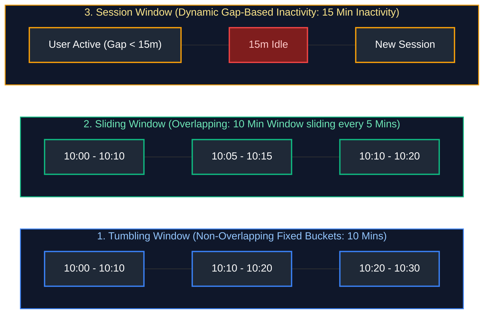

---

### 6.6 Stream-Stream Joins & Dual Watermarking Memory Bounds

Joining two independent streams (e.g., matching `AdImpressions` to `AdClicks`) requires both sides to buffer state in memory waiting for a match. Both streams must declare **Watermarks**, and the join condition must include a **bounded interval predicate**:

```python
# Stream-Stream Join: Match Impressions to Clicks occurring within 1 hour
impressions = stream_impressions.withWatermark("impression_time", "2 hours")
clicks = stream_clicks.withWatermark("click_time", "3 hours")

joined_stream = impressions.join(
    clicks,
    expr="""
        impression_ad_id = click_ad_id AND
        click_time >= impression_time AND
        click_time <= impression_time + interval 1 hour
    """,
    joinType="leftOuter"
)
```

---

### 6.7 State Management: JVM Heap vs. RocksDB State Store Provider

- **Default HDFS State Store:** Keeps state objects directly in JVM Heap memory.
  - *Failure Mode:* If streaming state grows to gigabytes, the JVM triggers massive **Garbage Collection (GC) pauses**, causing heartbeat timeouts and executor crashes.
- **RocksDB State Store Provider:** Offloads state storage to a fast, embedded, off-heap C++ key-value engine running on local NVMe SSDs.
  - *Production Setting:*
    ```properties
    spark.sql.streaming.stateStore.providerClass = org.apache.spark.sql.execution.streaming.state.RocksDBStateStoreProvider
    ```

---

### 6.8 Streaming Deduplication via `dropDuplicates`

```python
# Deduplicate events based on primary key and event timestamp within watermark boundary
deduped_orders = (
    raw_stream
    .withWatermark("event_time", "30 minutes")
    .dropDuplicates(["order_id", "event_time"])
)
```

> [!TIP]
> **Deep-Dive Interview Scenario:**
> - [Q19. Structured Streaming Falling Behind During Traffic Bursts: RCA Playbook](frequently_asked_questions/07_streaming_kafka_and_event_driven_data_faq.md#q19-medium-structured-streaming-falling-behind-during-traffic-bursts-rca-playbook)

---

# 7. End-to-End Delivery Semantics & System Comparisons

### 7.1 Mathematical Guarantees: At-Least-Once, At-Most-Once, Exactly-Once

$$\text{End-to-End Semantics} = \min(\text{Producer Guarantees}, \ \text{Broker Durability}, \ \text{Consumer Idempotence})$$

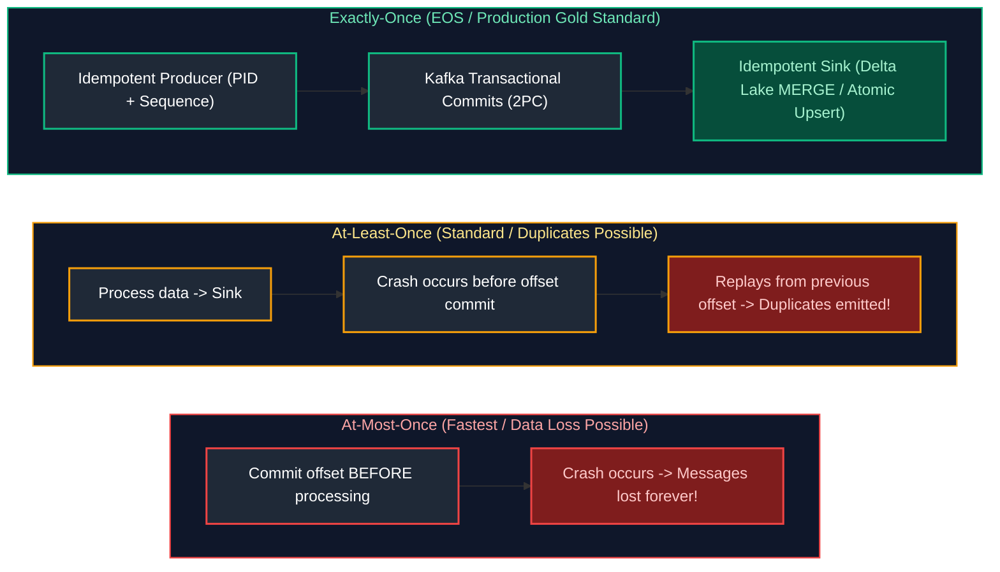

---

### 7.2 Stream Engines Compared: Spark Streaming vs. Apache Flink vs. Kafka Streams

Distributed stream processing architectures solve the challenge of executing stateful computations (windowed aggregations, sessionization, joins) over continuous unbounded data streams. Three dominant engines lead the modern enterprise landscape:

1. **Spark Structured Streaming (Micro-Batch & Hybrid Engine):**
   - **Architectural Mechanics:** Built on Spark SQL's Catalyst and Tungsten engines. By default, it operates on a **micro-batch model**: discretization of time into small bounded batches. It maintains state in memory or an embedded RocksDB instance on executors, checkpointing metadata and offsets to distributed storage.
   - **Production Strengths:** Seamless unification with batch queries and Delta Lake. Allows data engineers to reuse identical DataFrame APIs, machine learning pipelines, and SQL models across both real-time and historical analytics.

2. **Apache Flink (True Event-by-Event Stream Processing):**
   - **Architectural Mechanics:** A ground-up streaming execution engine where batch processing is simply a special case of streaming (finite streams). Flink processes each incoming event immediately through an asynchronous, distributed dataflow pipeline.
   - **Stateful Management & Fault Tolerance:** Employs the **Chandy-Lamport distributed snapshotting algorithm** to periodically take lightweight, asynchronous checkpoints of state stored in an off-heap RocksDB state backend, achieving true sub-10ms event-time latency with strict exactly-once guarantees.

3. **Kafka Streams (Embedded Client Library):**
   - **Architectural Mechanics:** Not a distributed compute cluster (has no master, driver, or dedicated workers). Instead, it is a **lightweight Java client library** embedded directly inside standard backend Java/Scala microservices (e.g., Spring Boot).
   - **Stateful Management:** Maintains local state in an embedded RocksDB database within the microservice container, backed by internal Kafka changelog topics for crash recovery. Scales horizontally by adding more application container instances matching topic partition counts.

| Dimension | Spark Structured Streaming | Apache Flink | Kafka Streams |
| :--- | :--- | :--- | :--- |
| **Processing Paradigm** | **Micro-batch** (default) & continuous | **True Event-by-Event Continuous Streaming** | True Event-by-Event Continuous Streaming |
| **Latency Profile** | $100\text{ ms} - 1\text{ second}$ | **$< 10\text{ milliseconds}$** | $< 20\text{ milliseconds}$ |
| **Stateful Memory Backend**| In-memory HDFS / RocksDB | Managed RocksDB off-heap | Embedded RocksDB instance |
| **SQL Support** | Rich ANSI SQL + DataFrames | Rich Streaming SQL | ksqlDB layer |
| **Deployment Model** | Distributed Cluster (Driver/Executors) | Distributed Cluster (JobManager/TaskManagers) | **Lightweight Java Library** embedded in microservice |
| **Primary Use Case** | Analytical Lakehouse Ingestion & ETL | Real-Time Fraud, CEP, Millisecond Alerting | Event-driven microservices, routing |

---

### 7.3 Cloud Message Brokers: Kafka vs. AWS Kinesis vs. Azure Event Hubs

Distributed append-only message brokers serve as the durable ingestion backbone for streaming architectures, decoupling event producers from downstream stream consumers.

1. **Apache Kafka (Confluent / Amazon MSK):**
   - **Architecture:** Partitioned append-only log running on dedicated broker clusters. Producers write records to partition ends; consumers track positions using committed offsets.
   - **Storage Mechanics:** Retains raw byte segments sequentially on disk. Modern architectures leverage **Tiered Storage** (e.g., in Confluent Cloud and Kafka 3.6+), offloading older log segments to cloud object storage (S3/GCS) to enable infinite retention at commodity storage costs without broker disk saturation.

2. **AWS Kinesis Data Streams:**
   - **Architecture:** Fully managed AWS streaming service scaled by **Shards** ($1\text{ MB/sec}$ ingress, $2\text{ MB/sec}$ egress per shard).
   - **Characteristics:** Tight integration with AWS IAM, Lambda, and DynamoDB. Uses the Kinesis Client Library (KCL) for worker coordination. Data retention caps at 365 days.

3. **Azure Event Hubs:**
   - **Architecture:** Azure-native managed distributed event ingestion platform scaled via **Throughput Units (TUs)** and partitions.
   - **Kafka Protocol Compatibility:** Provides a Kafka-compatible endpoint, allowing existing Kafka applications, Spark Structured Streaming, and Flink jobs to produce and consume directly from Event Hubs without code modifications.

| Metric | Apache Kafka (Confluent / MSK) | AWS Kinesis Data Streams | Azure Event Hubs |
| :--- | :--- | :--- | :--- |
| **Unit of Scale** | Topic Partitions (Dynamically scalable) | **Shards** ($1\text{ MB/s in}, 2\text{ MB/s out}$) | **Throughput Units (TUs)** / Partitions |
| **Max Retention** | **Indefinite (Years with Tiered Storage)**| 365 Days | 90 Days |
| **Protocol** | Native Kafka TCP protocol | AWS REST API / KCL | Kafka API, AMQP, HTTPS |
| **Ecosystem Ecosystem** | Universal (Connect, Schema Registry) | Native AWS services (Lambda, Firehose) | Native Azure Fabric, Synapse, Databricks |

> [!TIP]
> **Deep-Dive Interview Scenario:**
> - [Q6. Stream Failure Recovery & End-to-End Exactly-Once Processing](frequently_asked_questions/07_streaming_kafka_and_event_driven_data_faq.md#q6-medium-stream-failure-recovery--end-to-end-exactly-once-processing)

---

# 8. Practical Case Study: High-Throughput Real-Time Fraud Detection Pipeline

Below is a complete, production-grade PySpark Structured Streaming application that ingests financial transactions from Kafka, unpacks JSON payloads, evaluates fraud thresholds over event-time tumbling windows, and writes valid streams to Delta Lake:

```python
"""
Production PySpark Structured Streaming Application
Ingests Kafka transactions, evaluates fraud rules, writes to Delta Lake with RocksDB State Store.
"""
from pyspark.sql import SparkSession
from pyspark.sql.functions import from_json, col, window, expr, current_timestamp
from pyspark.sql.types import StructType, StructField, StringType, DoubleType, TimestampType

# 9. Initialize SparkSession with RocksDB State Store and Delta Lake

spark = (
    SparkSession.builder
    .appName("RealtimeFraudDetection")
    .config("spark.sql.streaming.stateStore.providerClass", 
            "org.apache.spark.sql.execution.streaming.state.RocksDBStateStoreProvider")
    .config("spark.sql.extensions", "io.delta.sql.DeltaSparkSessionExtension")
    .config("spark.sql.catalog.spark_catalog", "org.apache.spark.sql.delta.catalog.DeltaCatalog")
    .getOrCreate()
)

# 10. Define Strict Transaction Schema

transaction_schema = StructType([
    StructField("transaction_id", StringType(), False),
    StructField("account_id", StringType(), False),
    StructField("merchant_id", StringType(), True),
    StructField("amount", DoubleType(), False),
    StructField("transaction_time", TimestampType(), False)
])

# 11. Read Stream from Kafka Topic

raw_kafka_stream = (
    spark.readStream
    .format("kafka")
    .option("kafka.bootstrap.servers", "kafka-broker-1:9092,kafka-broker-2:9092")
    .option("subscribe", "fintech.transactions")
    .option("startingOffsets", "latest")
    .option("failOnDataLoss", "false")
    .load()
)

# 12. Parse JSON Values and Apply Watermarking

parsed_stream = (
    raw_kafka_stream
    .selectExpr("CAST(value AS STRING) AS json_payload")
    .select(from_json(col("json_payload"), transaction_schema).alias("data"))
    .select("data.*")
    # Apply 10-minute watermark on real-world event time
    .withWatermark("transaction_time", "10 minutes")
)

# 13. Sliding Window Aggregation: Detect Rapid Transaction Velocity (> $5,000 in 5 minutes)

fraud_alerts = (
    parsed_stream
    .groupBy(
        window(col("transaction_time"), "5 minutes", "1 minute"),
        col("account_id")
    )
    .agg(
        expr("count(transaction_id) as tx_count"),
        expr("sum(amount) as total_volume")
    )
    .filter("total_volume > 5000.00 OR tx_count > 10")
    .select(
        col("account_id"),
        col("window.start").alias("alert_window_start"),
        col("window.end").alias("alert_window_end"),
        col("tx_count"),
        col("total_volume"),
        current_timestamp().alias("alert_emitted_at")
    )
)

# 14. Write Alerts Stream to Delta Lake Sink

alert_query = (
    fraud_alerts.writeStream
    .format("delta")
    .outputMode("update")
    .option("checkpointLocation", "s3://fintech-lake-checkpoints/fraud_alerts/")
    .trigger(processingTime="5 seconds")
    .start("s3://fintech-lake-silver/fraud_alerts/")
)

alert_query.awaitTermination()
```

---

# 9. Summary Comparison & Production Engineering Reference Matrix

- **Partition Sizing & Ordering Guarantees:** Kafka guarantees strict sequential ordering only within a single partition. Streaming pipelines requiring per-entity ordering (e.g., account balance mutations or user sessions) must provide deterministic message keys. Partition counts should be sized to match peak downstream consumer core concurrency while accommodating future traffic growth.
- **Producer Durability & Exactly-Once Semantics:** Prevent data loss during broker failover by configuring producers with `acks=all`, `min.insync.replicas=2`, and topic `replication.factor=3`. Enable producer idempotency (`enable.idempotence=true`) to eliminate duplicate records caused by transient network retries without requiring manual deduplication logic.
- **Operating System & Kernel Zero-Copy Tuning:** Maximize Kafka broker throughput by running on modern Linux kernels with page-cache caching and `sendfile()` zero-copy enabled. Set `vm.swappiness=1` and configure JVM heap size to $\le 32\text{ GB}$ (leaving remaining system RAM available for the Linux OS page cache to buffer active log segments).
- **Consumer Group Rebalance Stability:** Prevent catastrophic stop-the-world consumer group rebalances during high-volume spikes by tuning `session.timeout.ms` (45s) and `max.poll.interval.ms` (300s). Ensure batch processing durations within consumer loops do not exceed polling deadlines.
- **Stateful Engine State Stores & Bounded Watermarking:** Stateful stream processing engines (Spark Structured Streaming, Apache Flink) must explicitly declare event-time watermarks on timestamp attributes to purge expired state and bound memory growth. For state stores exceeding 1 GB, configure off-heap RocksDB providers to eliminate JVM garbage collection pauses.
- **End-to-End Delivery Semantics:** True end-to-end exactly-once processing requires pairing idempotent message consumption with transactional sink operations (such as Delta Lake or Apache Iceberg ACID `MERGE` statements).

---

# 10. References & Further Reading

- [Apache Kafka Documentation: Design Principles & Protocols](https://kafka.apache.org/documentation/#design) — Comprehensive guide to Kafka storage architecture, log compaction, and replication.
- [Kafka: The Definitive Guide (Gwen Shapira, Todd Palino, Rajini Sivaram, Krit Petty)](https://www.oreilly.com/library/view/kafka-the-definitive/9781492043072/) — Real-time data and stream processing at scale.
- [Apache Spark Structured Streaming Programming Guide](https://spark.apache.org/docs/latest/structured-streaming-programming-guide.html) — State stores, event-time watermarking, and continuous processing.
- [Apache Flink Architecture: State Management & Checkpointing](https://nightlies.apache.org/flink/flink-docs-stable/docs/concepts/stateful-stream-processing/) — Distributed snapshots and asynchronous barrier checkpointing.
- [Designing Data-Intensive Applications (Martin Kleppmann)](https://dataintensive.net/) — Stream processing, partitioned logs, and dual-write mitigations.
