# 08. ETL Pipelines, Orchestration & Cloud DevOps: Master Production Guide

A comprehensive, production-grade guide to resilient pipeline ingestion patterns (CDC, streaming, batch), workflow orchestration (Apache Airflow DAGs, dynamic mapping, dbt transformation modeling), and enterprise cloud engineering (Azure Data Factory, Synapse, Terraform IaC, Docker, CI/CD automation).

---

## Architectural Overview: End-to-End Enterprise Ingestion & Processing

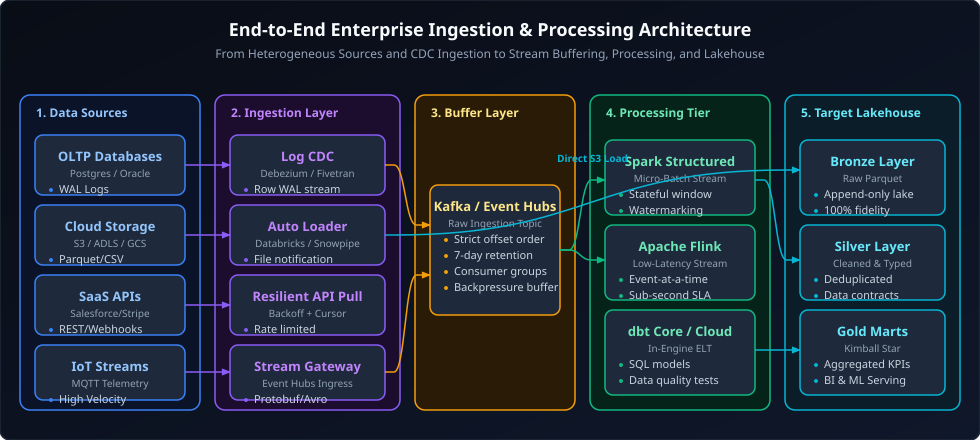

<details>
<summary>D2 Source</summary>

```d2
direction: right
title: End-to-End Enterprise Ingestion & Processing Architecture

sources: 1. Data Sources {
  oltp: OLTP Database (Postgres / MySQL)
  storage: Cloud Storage (S3 / ADLS)
  saas: Third-Party SaaS APIs
  iot: IoT & Telemetry Streams
}

ingestion: 2. Ingestion Layer {
  cdc: Log-Based CDC (Debezium)
  autoloader: Cloud File Ingestion (Auto Loader)
  api: Resilient API Ingestion (Backoff)
  stream_gw: Event Streaming Gateway
}

buffer: 3. Buffer Layer {
  kafka: Kafka / Event Hubs Raw Topic
}

processing: 4. Processing Tier {
  spark: Spark Structured Streaming
  flink: Apache Flink Low-Latency
  dbt: dbt In-Engine Transformations
}

lakehouse: 5. Target Lakehouse {
  bronze: Bronze Layer (Raw Parquet)
  silver: Silver Layer (Cleaned & Typed)
  gold: Gold Marts (Aggregated BI/ML)
}

sources.oltp -> ingestion.cdc
sources.storage -> ingestion.autoloader
sources.saas -> ingestion.api
sources.iot -> ingestion.stream_gw

ingestion.cdc -> buffer.kafka
ingestion.stream_gw -> buffer.kafka
buffer.kafka -> processing.spark
buffer.kafka -> processing.flink

ingestion.autoloader -> lakehouse.bronze: "Direct Cloud Load"
processing.spark -> lakehouse.silver: "Cleanse"
processing.dbt -> lakehouse.gold: "Aggregate"
```
</details>

---

## Table of Contents
1. [ETL vs. ELT & Processing Paradigms](#1-etl-vs-elt--processing-paradigms)
   - [1.1 ETL vs. ELT Architecture & Processing Paradigms](#11-etl-vs-elt-architecture--processing-paradigms)
   - [1.2 Reverse ETL: Operationalizing Data](#12-reverse-etl-operationalizing-data)
   - [1.3 Batch vs. Streaming Processing Paradigms](#13-batch-vs-streaming-processing-paradigms)
   - [1.4 Push vs. Pull Ingestion Architecture](#14-push-vs-pull-ingestion-architecture)
   - [1.5 Micro-Batching Mechanics & Execution Internals](#15-micro-batching-mechanics--execution-internals)
2. [Resilient Pipeline Design Patterns](#2-resilient-pipeline-design-patterns)
   - [2.1 Pipeline Idempotency: The Gold Standard](#21-pipeline-idempotency-the-gold-standard)
   - [2.2 Fault Tolerance, Failover & Self-Healing](#22-fault-tolerance-failover--self-healing)
   - [2.3 Checkpointing & Streaming State Stores](#23-checkpointing--streaming-state-stores)
   - [2.4 Backpressure Management & Dynamic Rate Limiting](#24-backpressure-management--dynamic-rate-limiting)
   - [2.5 Replayability & Event Re-Sourcing](#25-replayability--event-re-sourcing)
   - [2.6 Deduplication Patterns (At-Least-Once to Exactly-Once)](#26-deduplication-patterns-at-least-once-to-exactly-once)
   - [2.7 Late-Arriving & Out-of-Order Data Handling](#27-late-arriving--out-of-order-data-handling)
   - [2.8 Watermarking Mechanics & State Eviction](#28-watermarking-mechanics--state-eviction)
   - [2.9 Dead Letter Queues (DLQ) & Quarantine Routing](#29-dead-letter-queues-dlq--quarantine-routing)
   - [2.10 Bad Records Handling & Engine Permissive Modes](#210-bad-records-handling--engine-permissive-modes)
   - [2.11 Schema Validation & Defensive Ingestion](#211-schema-validation--defensive-ingestion)
   - [2.12 Pipeline Observability: Metrics, Logs & Traces](#212-pipeline-observability-metrics-logs--traces)
   - [2.13 SLA Management, SLOs & Alert Thresholds](#213-sla-management-slos--alert-thresholds)
   - [2.14 Historical Backfilling Strategies](#214-historical-backfilling-strategies)
   - [2.15 Metadata-Driven Pipelines & Control Table Framework](#215-metadata-driven-pipelines--control-table-framework)
3. [Data Quality, Contracts & Governance](#3-data-quality-contracts--governance)
   - [3.1 Data Contracts: Shift-Left Governance](#31-data-contracts-shift-left-governance)
   - [3.2 Great Expectations (GX) Framework](#32-great-expectations-gx-framework)
   - [3.3 Soda Core & Declarative Data Checks](#33-soda-core--declarative-data-checks)
   - [3.4 Apache Spark Deequ (PyDeequ) for Big Data Quality](#34-apache-spark-deequ-pydeequ-for-big-data-quality)
   - [3.5 dbt Test Assertions (Generic & Custom)](#35-dbt-test-assertions-generic--custom)
   - [3.6 Automated Schema Drift Detection](#36-automated-schema-drift-detection)
   - [3.7 Statistical Anomaly Detection in Ingestion Volumes](#37-statistical-anomaly-detection-in-ingestion-volumes)
4. [File-Based Cloud Ingestion Architectures](#4-file-based-cloud-ingestion-architectures)
   - [4.1 Batch File Ingestion vs. Incremental File Processing](#41-batch-file-ingestion-vs-incremental-file-processing)
   - [4.2 Databricks Auto Loader (`cloudFiles`) Internals](#42-databricks-auto-loader-cloudfiles-internals)
   - [4.3 SQL `COPY INTO` (Databricks & Snowflake)](#43-sql-copy-into-databricks--snowflake)
   - [4.4 Snowflake Snowpipe Serverless Ingestion](#44-snowflake-snowpipe-serverless-ingestion)
   - [4.5 Google Cloud BigQuery Load Jobs](#45-google-cloud-bigquery-load-jobs)
   - [4.6 Directory Listing ($O(N)$) vs. Notification-Based Ingestion ($O(1)$)](#46-directory-listing-on-vs-notification-based-ingestion-o1)
   - [4.7 Checkpoint State Tracking for File Streams](#47-checkpoint-state-tracking-for-file-streams)
   - [4.8 Automated Schema Inference & Evolution Policies](#48-automated-schema-inference--evolution-policies)
5. [Change Data Capture (CDC) Patterns](#5-change-data-capture-cdc-patterns)
   - [5.1 Log-Based CDC (Debezium & Kafka Connect)](#51-log-based-cdc-debezium--kafka-connect)
   - [5.2 Query-Based CDC (High-Watermarks & `updated_at`)](#52-query-based-cdc-high-watermarks--updated_at)
   - [5.3 Trigger-Based CDC (Shadow Audit Tables)](#53-trigger-based-cdc-shadow-audit-tables)
6. [Relational Database Ingestion (RDBMS to Lakehouse)](#6-relational-database-ingestion-rdbms-to-lakehouse)
   - [6.1 JDBC & ODBC Extraction Fundamentals](#61-jdbc--odbc-extraction-fundamentals)
   - [6.2 High-Throughput Partitioned JDBC Reads in PySpark](#62-high-throughput-partitioned-jdbc-reads-in-pyspark)
7. [API Ingestion Patterns](#7-api-ingestion-patterns)
   - [7.1 API Pagination Strategies (Offset vs. Page vs. Keyset Cursor)](#71-api-pagination-strategies-offset-vs-page-vs-keyset-cursor)
   - [7.2 Rate Limiting: Exponential Backoff with Full Jitter](#72-rate-limiting-exponential-backoff-with-full-jitter)
   - [7.3 Production API Authentication (OAuth 2.0 Client Credentials)](#73-production-api-authentication-oauth-20-client-credentials)
8. [Streaming Message Ingestion](#8-streaming-message-ingestion)
   - [8.1 Apache Kafka to Lakehouse Streaming Ingestion](#81-apache-kafka-to-lakehouse-streaming-ingestion)
   - [8.2 Azure Event Hubs to Lakehouse Ingestion](#82-azure-event-hubs-to-lakehouse-ingestion)
9. [Production Data Engineering Problem-Solution Master Playbook](#9-production-data-engineering-problem-solution-master-playbook)
10. [Apache Airflow Core Architecture](#10-apache-airflow-core-architecture)
   - [10.1 DAGs, Tasks, and Operators](#101-dags-tasks-and-operators)
   - [10.2 Sensors & Deferrable Operators (Triggerer)](#102-sensors--deferrable-operators-triggerer)
   - [10.3 Hooks & Connections Management](#103-hooks--connections-management)
   - [10.4 XComs & Custom XCom Backends](#104-xcoms--custom-xcom-backends)
   - [10.5 Modern TaskFlow API & Dynamic Task Mapping](#105-modern-taskflow-api--dynamic-task-mapping)
   - [10.6 Airflow 5-Component Architecture & Lifecycle State Machine](#106-airflow-5-component-architecture--lifecycle-state-machine)
   - [10.7 Airflow Executors & Operational Cluster Management](#107-airflow-executors--operational-cluster-management)
   - [10.8 Dynamic DAG Generation](#108-dynamic-dag-generation)
   - [10.9 Backfilling, Scheduling Timetables, and Data Intervals](#109-backfilling-scheduling-timetables-and-data-intervals)
   - [10.10 Pools, Slots & Concurrency Throttling](#1010-pools-slots--concurrency-throttling)
   - [10.11 Trigger Rules and Advanced DAG Control Flow](#1011-trigger-rules-and-advanced-dag-control-flow)
   - [10.12 SLAs, Callbacks & Enterprise Alerting](#1012-slas-callbacks--enterprise-alerting)
   - [10.13 Orchestrator Comparison: Airflow vs Prefect vs Dagster](#1013-orchestrator-comparison-airflow-vs-prefect-vs-dagster)
   - [10.14 Ecosystem Integration: dbt + Airflow (Cosmos)](#1014-ecosystem-integration-dbt--airflow-cosmos)
11. [dbt (Data Build Tool) Modeling & Transformation](#11-dbt-data-build-tool-modeling--transformation)
   - [11.1 dbt Core vs dbt Cloud](#111-dbt-core-vs-dbt-cloud)
   - [11.2 dbt Models & SQL-First Transformation](#112-dbt-models--sql-first-transformation)
   - [11.3 Materialization Strategies](#113-materialization-strategies)
   - [11.4 Incremental Models Deep-Dive (`merge` vs `delete+insert`)](#114-incremental-models-deep-dive-merge-vs-deleteinsert)
   - [11.5 Seeds, Sources, and Automated SCD2 Snapshots](#115-seeds-sources-and-automated-scd2-snapshots)
   - [11.6 dbt Testing & Assertions](#116-dbt-testing--assertions)
   - [11.7 Documentation & Interactive Lineage Graphs](#117-documentation--interactive-lineage-graphs)
   - [11.8 Jinja Templating & Custom Macros](#118-jinja-templating--custom-macros)
   - [11.9 dbt Packages](#119-dbt-packages)
   - [11.10 Exposures & the dbt Semantic Layer (Metric Standardization)](#1110-exposures--the-dbt-semantic-layer-metric-standardization)
   - [11.11 `dbt build` vs `dbt run` & CLI Operations Cheatsheet](#1111-dbt-build-vs-dbt-run--cli-operations-cheatsheet)
12. [End-to-End Enterprise Data Architecture on Microsoft Azure](#12-end-to-end-enterprise-data-architecture-on-microsoft-azure)
   - [12.1 Enterprise Architecture Blueprint & Security Fundamentals](#121-enterprise-architecture-blueprint--security-fundamentals)
   - [12.2 Infrastructure as Code: Complete Terraform Deployment](#122-infrastructure-as-code-complete-terraform-deployment)
   - [12.3 Production PySpark Medallion Pipeline on Azure Databricks](#123-production-pyspark-medallion-pipeline-on-azure-databricks)
13. [Core Azure Data Platform Services](#13-core-azure-data-platform-services)
   - [13.1 Enterprise Lakehouse Reference Architecture on Azure](#131-enterprise-lakehouse-reference-architecture-on-azure)
   - [13.2 ADLS Gen2: Hierarchical Namespace (HNS) Internals & POSIX ACLs](#132-adls-gen2-hierarchical-namespace-hns-internals--posix-acls)
   - [13.3 Azure Data Factory (ADF) Overview](#133-azure-data-factory-adf-overview)
   - [13.4 Azure Synapse Analytics: Dedicated vs. Serverless SQL Pools](#134-azure-synapse-analytics-dedicated-vs-serverless-sql-pools)
   - [13.5 Azure Databricks: Lakehouse, Unity Catalog & VNet Injection](#135-azure-databricks-lakehouse-unity-catalog--vnet-injection)
   - [13.6 Azure Event Hubs: Real-Time Stream Ingestion & Capture](#136-azure-event-hubs-real-time-stream-ingestion--capture)
   - [13.7 Azure Stream Analytics: Real-Time Windowing SQL](#137-azure-stream-analytics-real-time-windowing-sql)
   - [13.8 Azure SQL Database & Hyperscale Architecture](#138-azure-sql-database--hyperscale-architecture)
   - [13.9 Azure Cosmos DB: Multi-Model Distributed NoSQL](#139-azure-cosmos-db-multi-model-distributed-nosql)
   - [13.10 Azure Key Vault & Hardware Security Modules (HSM)](#1310-azure-key-vault--hardware-security-modules-hsm)
   - [13.11 Azure Monitor, Log Analytics & KQL Queries](#1311-azure-monitor-log-analytics--kql-queries)
   - [13.12 Microsoft Fabric: Lakehouse vs. Warehouse Architecture & OneLake](#1312-microsoft-fabric-lakehouse-vs-warehouse-architecture--onelake)
14. [Identity, Security & Cloud Networking](#14-identity-security--cloud-networking)
   - [14.1 Microsoft Entra ID (Azure AD) Fundamentals](#141-microsoft-entra-id-azure-ad-fundamentals)
   - [14.2 Service Principals & App Registrations](#142-service-principals--app-registrations)
   - [14.3 Managed Identities: System-Assigned vs. User-Assigned](#143-managed-identities-system-assigned-vs-user-assigned)
   - [14.4 Role-Based Access Control (Azure RBAC)](#144-role-based-access-control-azure-rbac)
   - [14.5 Databricks Secret Scopes with Azure Key Vault](#145-databricks-secret-scopes-with-azure-key-vault)
   - [14.6 Hub-and-Spoke VNets & Network Security Groups (NSGs)](#146-hub-and-spoke-vnets--network-security-groups-nsgs)
   - [14.7 Private Endpoints & Azure Private Link](#147-private-endpoints--azure-private-link)
15. [Azure Data Factory (ADF) Deep-Dive](#15-azure-data-factory-adf-deep-dive)
   - [15.1 Pipelines, Activities & Control Flow Mechanics](#151-pipelines-activities--control-flow-mechanics)
   - [15.2 Core Activities (Copy, Lookup, Get Metadata, ForEach)](#152-core-activities-copy-lookup-get-metadata-foreach)
   - [15.3 Mapping Data Flows & Spark Execution Translation](#153-mapping-data-flows--spark-execution-translation)
   - [15.4 Integration Runtimes (Azure IR vs. Self-Hosted IR vs. SSIS)](#154-integration-runtimes-azure-ir-vs-self-hosted-ir-vs-ssis)
   - [15.5 Linked Services vs. Datasets](#155-linked-services-vs-datasets)
   - [15.6 Triggers (Schedule vs. Tumbling Window vs. Storage Events)](#156-triggers-schedule-vs-tumbling-window-vs-storage-events)
   - [15.7 Parameters vs. Variables (Dynamic Content Expressions)](#157-parameters-vs-variables-dynamic-content-expressions)
   - [15.8 ADF Monitoring, Alerting & SLA Tracking](#158-adf-monitoring-alerting--sla-tracking)
16. [Azure Synapse Analytics Deep-Dive](#16-azure-synapse-analytics-deep-dive)
   - [16.1 Synapse Dedicated SQL Pools: Massively Parallel Processing (MPP)](#161-synapse-dedicated-sql-pools-massively-parallel-processing-mpp)
   - [16.2 Data Distribution Strategies (Hash vs. Replicated vs. Round Robin)](#162-data-distribution-strategies-hash-vs-replicated-vs-round-robin)
   - [16.3 Synapse Serverless SQL Pools (`OPENROWSET` over Data Lake)](#163-synapse-serverless-sql-pools-openrowset-over-data-lake)
   - [16.4 Synapse Spark Pools & Lake Databases](#164-synapse-spark-pools--lake-databases)
   - [16.5 Synapse Pipelines vs. Standalone ADF](#165-synapse-pipelines-vs-standalone-adf)
17. [DataOps, CI/CD & Version Control](#17-dataops-cicd--version-control)
   - [17.1 The DataOps CI/CD Lifecycle](#171-the-dataops-cicd-lifecycle)
   - [17.2 Git Branching Strategies for Data Engineering](#172-git-branching-strategies-for-data-engineering)
   - [17.3 Automated Pre-Commit Hooks (SQLFluff, Black, Gitleaks)](#173-automated-pre-commit-hooks-sqlfluff-black-gitleaks)
18. [Containers & Cloud Infrastructure as Code](#18-containers--cloud-infrastructure-as-code)
   - [18.1 Docker for Data Engineering: Multi-Stage Containerization](#181-docker-for-data-engineering-multi-stage-containerization)
   - [18.2 Kubernetes for Data: Spark-on-K8s & Airflow KubernetesExecutor](#182-kubernetes-for-data-spark-on-k8s--airflow-kubernetesexecutor)
   - [18.3 Infrastructure as Code: Terraform Architecture & State Locking](#183-infrastructure-as-code-terraform-architecture--state-locking)
   - [18.4 Multi-Environment Promotion (`dev` $\rightarrow$ `stage` $\rightarrow$ `prod`)](#184-multi-environment-promotion-dev-rightarrow-stage-rightarrow-prod)
19. [Testing & Release Engineering for Data Pipelines](#19-testing--release-engineering-for-data-pipelines)
   - [19.1 Unit Testing Transformation Logic with `pytest`](#191-unit-testing-transformation-logic-with-pytest)
   - [19.2 Integration Testing with Testcontainers & Azurite](#192-integration-testing-with-testcontainers--azurite)
   - [19.3 End-to-End Pipeline Testing & Regression Baselines](#193-end-to-end-pipeline-testing--regression-baselines)
   - [19.4 Synthetic Test Data Generation with `Faker`](#194-synthetic-test-data-generation-with-faker)
   - [19.5 Blue-Green Deployments for Zero-Downtime Pipeline Releases](#195-blue-green-deployments-for-zero-downtime-pipeline-releases)
   - [19.6 Canary Deployments & Shadow Pipelines](#196-canary-deployments--shadow-pipelines)
20. [Summary Comparison & Production Engineering Reference Matrix](#20-summary-comparison--production-engineering-reference-matrix)
21. [References & Further Reading](#21-references--further-reading)

> [!TIP]
> **Deep-Dive Interview Scenario:**
> - [Q31. Repartition vs Coalesce in ETL Pipelines](frequently_asked_questions/08_etl_pipelines_orchestration_and_data_quality_faq.md#q31-easy-repartition-vs-coalesce-in-etl-pipelines)

---

# 1. ETL vs. ELT & Processing Paradigms

---

### 1.1 ETL vs. ELT Architecture & Processing Paradigms

#### Intuitive Mental Model
- **Traditional ETL is like a Centralized Catering Kitchen:** Raw ingredients (dirty vegetables, unbutchered meats) are trucked from farms (source databases) to a specialized prep kitchen (an expensive, standalone ETL server like Informatica or a dedicated Spark cluster). In that kitchen, cooks wash, chop, peel, and cook the food. Finally, only finished, plated meals are delivered to the banquet hall (the target data warehouse). If an executive at the banquet hall asks, *"Can I see the vegetable peels or cook the carrots differently?"*, you cannot help them—the peels were discarded at the kitchen.
- **Modern ELT is like a Cook-at-Your-Table Korean BBQ / Hot Pot:** Raw ingredients are brought directly from the market to your table (raw storage / Bronze data lake). The table is equipped with its own powerful, high-heat induction burner (modern elastic cloud compute like Snowflake, BigQuery, or Databricks). Diners cook and season the food right on the table whenever and however they want. If someone wants raw greens later, they are still right there on the table.

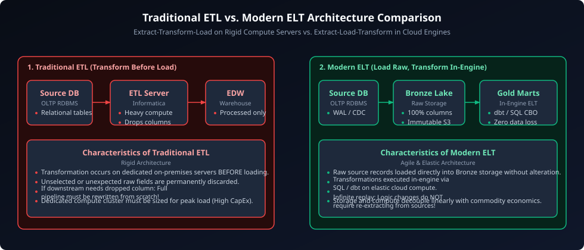

<details>
<summary>D2 Source</summary>

```d2
direction: right
title: Traditional ETL vs. Modern ELT Architecture

traditional: 1. Traditional ETL (Transform Before Load) {
  src: Source DB
  etl_server: Dedicated ETL Server (Informatica / Spark) {
    status: "Transforms & permanently drops unselected fields"
    style.stroke: "#ef4444"
  }
  edw: Data Warehouse (Only processed data)
  src -> etl_server -> edw
}

modern: 2. Modern ELT (Load Raw, Transform In-Engine) {
  src: Source DB
  bronze: Bronze Lakehouse (Raw storage: 100% columns preserved)
  engine: Cloud In-Engine Pushdown Compute (Snowflake / Databricks)
  gold: Silver & Gold Marts (Business Aggregations)
  src -> bronze -> engine -> gold
}
```
</details>

#### End-to-End Concrete Data Walkthrough

To understand the difference mathematically and structurally, observe how a single customer record flows through ETL vs. ELT:

**1. Source Payload (OLTP PostgreSQL `users` table):**
```json
{
  "user_id": 9182,
  "full_name": "Dr. Sarah Connor",
  "email": "sconnor@resistance.mil",
  "raw_address": "8404 Skynet Way, Suite 400, Los Angeles, CA 90210",
  "ssn": "987-65-4321",
  "created_at": "2026-03-15 08:30:00+00"
}
```

**2. Traditional ETL Execution:**
1. **Extract:** An external ETL worker reads the record into memory.
2. **Transform:** 
   - Mask SSN: `ssn` $\to$ `***-**-4321`.
   - Parse name: `first_name = 'Sarah'`, `last_name = 'Connor'`.
   - Discard `raw_address` because the original 2015 warehouse schema only wanted city/state.
3. **Load:** Writes clean record to the warehouse:
   ```sql
   INSERT INTO dw.dim_users (user_id, first_name, last_name, email, city, state)
   VALUES (9182, 'Sarah', 'Connor', 'sconnor@resistance.mil', 'Los Angeles', 'CA');
   ```
   *Consequence:* If business requirements change 6 months later to extract `suite_number` or postal zip from `raw_address`, it is **impossible**. The raw address was permanently thrown away before loading.

**3. Modern ELT Execution:**
1. **Extract & Load:** Ingestion pipeline writes the exact JSON payload to Bronze Delta Lake unmodified:
   ```sql
   -- Bronze Table: bronze_users
   -- Stored with ingestion metadata
   | _ingest_ts | _source_file | raw_payload |
   | 2026-03-15 08:31:02 | s3://.../part0.json | {"user_id":9182, "full_name":"Dr. Sarah Connor", "ssn":"987-65-4321", ...} |
   ```
2. **Transform (In-Lakehouse SQL Pushdown via dbt/Dataform):**
   ```sql
   -- Silver Transformation
   CREATE OR REPLACE TABLE silver.dim_users AS
   SELECT 
       CAST(JSON_VALUE(raw_payload, '$.user_id') AS INT64) AS user_id,
       SPLIT(JSON_VALUE(raw_payload, '$.full_name'), ' ')[OFFSET(1)] AS first_name,
       SPLIT(JSON_VALUE(raw_payload, '$.full_name'), ' ')[OFFSET(2)] AS last_name,
       SHA256(JSON_VALUE(raw_payload, '$.ssn')) AS ssn_masked_hash,
       REGEXP_EXTRACT(JSON_VALUE(raw_payload, '$.raw_address'), r'(\d{5})') AS postal_code,
       _ingest_ts
   FROM bronze.bronze_users;
   ```
   *Consequence:* The raw payload is permanently archived in Bronze. If a new column is required later, you simply alter the SQL query and reprocess from Bronze.

#### Comprehensive Paradigm Comparison Matrix

| Architectural Trait | Traditional ETL | Modern ELT |
| :--- | :--- | :--- |
| **Compute Location** | Standalone middleware server (Informatica, Talend, Airflow worker) | Distributed SQL engine within target warehouse/lakehouse (Snowflake, BigQuery, Databricks) |
| **Raw Data Retention** | **Lost forever:** Unmapped fields are filtered out during transformation | **100% Preserved:** Landed in Bronze object storage (S3/ADLS/GCS) |
| **Transformation Language** | Proprietary GUI workflows, Java, C++, custom Python scripts | Standard declarative SQL, dbt, Dataform, or PySpark DataFrame API |
| **Pipeline Scalability** | **Hardware bottleneck:** Limited by memory and CPU of the intermediate ETL server | **Virtually Infinite:** Scales elastically with cloud warehouse MPP clustering |
| **Time-to-Value for New Fields** | Weeks: Upstream ETL pipeline code must be modified, tested, and redeployed | Hours: Analysts write a new `SELECT` expression on landed Bronze data |
| **Regulatory & Security Fit** | **Superior for strict PII:** Sensitive fields (SSN, credit card) can be anonymized before leaving secure network | Requires Lakehouse-level security (RBAC, column-masking, envelope encryption) |
| **Cost Profile** | High licensing fees for specialized ETL software + separate compute infra | Consolidates compute and storage costs inside the cloud data platform |

---

### 1.2 Reverse ETL: Operationalizing Data

#### Definition & Business Motivation
While traditional ETL/ELT flows data from operational applications (CRMs, ERPs, transactional databases) into an analytical data warehouse, **Reverse ETL** reverses the vector: it synchronizes modeled dimensions, aggregated metrics, and machine learning inferences from the warehouse *back into operational SaaS tools* (Salesforce, HubSpot, Zendesk, Marketo, Stripe).

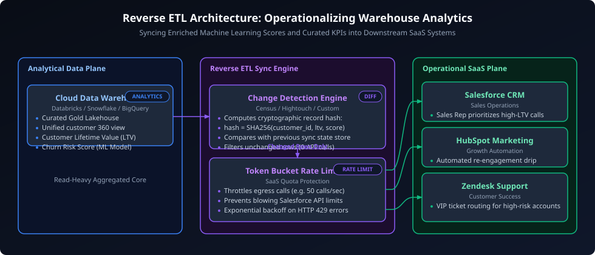

<details>
<summary>D2 Source</summary>

```d2
direction: right
title: Reverse ETL: Operationalizing Warehouse Analytics

analytical: Analytical Data Plane {
  warehouse: Cloud Data Warehouse (Snowflake / BigQuery / Databricks)
  marts: Gold Business Marts (Customer LTV, Churn Score)
  warehouse -> marts
}

engine: Reverse ETL Sync Engine {
  diff: Change Detection (Hash Diff Check)
  limiter: Token Bucket Rate Limiter (SaaS Protection)
  diff -> limiter: "Changed Rows Only"
}

operational: Operational SaaS Plane {
  sfdc: Salesforce CRM (High-LTV lead priority)
  hubspot: HubSpot Marketing (Churn re-engagement)
  zendesk: Zendesk Support (VIP ticket routing)
}

analytical.marts -> engine.diff: "Read gold models"
engine.limiter -> operational.sfdc: "PATCH /Contact"
engine.limiter -> operational.hubspot: "Update contact"
engine.limiter -> operational.zendesk: "Set priority"
```
</details>

#### Technical Challenges in Reverse ETL
1. **API Rate Limiting:** Operational SaaS systems enforce strict API quotas (e.g., Salesforce limits organizations to 100,000 API calls per 24 hours). Syncing a 10-million-row warehouse table naively via `PUT /api/v1/customers` will exhaust API credits in minutes.
2. **State & Diff Tracking:** Reverse ETL engines must maintain state tables or compute MD5/SHA256 row hashes to identify *only records whose attributes changed* since the last sync.
3. **Idempotency & Partial Failure:** If a network blip occurs during an API sync batch of 1,000 records, the engine must safely retry without triggering duplicate webhooks or corrupting customer history.

---

### 1.3 Batch vs. Streaming Processing Paradigms

Data processing architectures fall into two primary spectrums depending on the nature of the data boundary: **Bounded Data (Batch)** and **Unbounded Data (Streaming)**.

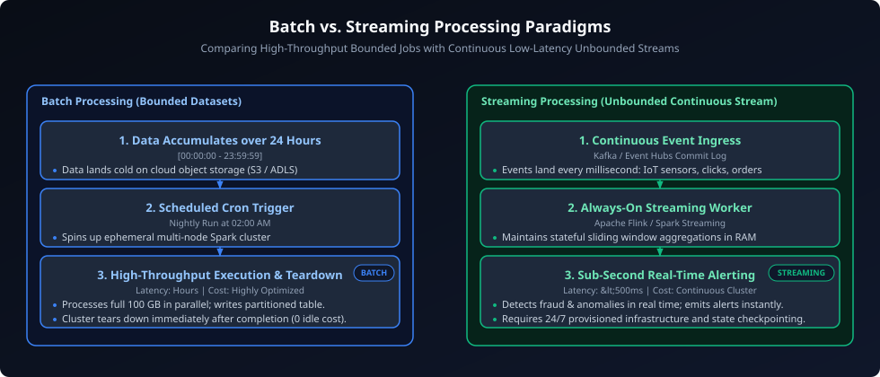

<details>
<summary>D2 Source</summary>

```d2
direction: right
title: Batch vs. Streaming Processing Paradigms

batch: Batch Processing (Bounded Datasets) {
  accumulate: Data Accumulates over 24 Hours [00:00:00 - 23:59:59]
  trigger: Scheduled Cron Trigger (Every day at 02:00 AM)
  cluster: Spin Up Ephemeral Spark Cluster (High Throughput)
  finish: Write Updated Table & Tear Down Cluster (Cost Optimized)
  accumulate -> trigger -> cluster -> finish
}

streaming: Streaming Processing (Unbounded Continuous Stream) {
  events: Continuous Events Land (IoT sensors, clicks, trades)
  buffer: Distributed Message Log (Kafka / Event Hubs)
  worker: Always-On Streaming Worker (Spark Streaming / Flink)
  output: Write Real-Time Metric & Trigger Alert (Sub-Second Latency)
  events -> buffer -> worker -> output
}
```
</details>

#### Detailed Trade-Off Matrix: The Latency-Completeness-Cost Triangle

| Dimension | Batch Processing | Streaming Processing |
| :--- | :--- | :--- |
| **Dataset Boundary** | **Bounded:** Definite start and end point (e.g., partition `date = '2026-03-15'`). | **Unbounded:** Infinite stream of incoming records with no inherent end. |
| **Processing Latency** | Minutes to hours or days (scheduled intervals). | Milliseconds (Flink, continuous Spark) to seconds (micro-batching). |
| **Data Completeness Guarantee** | High: Easy to wait until all daily files have arrived before triggering. | Complex: Late-arriving events require watermarking and state management. |
| **Infrastructure Cost** | **Economical:** Compute is spun up on-demand and terminated upon job completion. | **Higher:** Requires persistent message brokers (Kafka) and 24/7 worker compute. |
| **Compute Engine Standards** | Spark Batch, Trino, Snowflake, BigQuery, dbt, AWS Glue. | Apache Flink, Spark Structured Streaming, Kafka Streams, Materialize. |
| **Canonical Enterprise Use Cases** | End-of-month financial reconciliation, ML model retraining, executive weekly reports. | Fraud detection during credit card checkout, live logistics delivery tracking, system alerting. |

---

### 1.4 Push vs. Pull Ingestion Architecture

Ingestion mechanisms are governed by how data transitions across organizational boundaries:

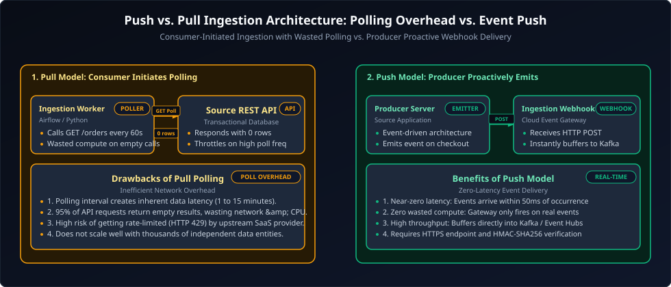

<details>
<summary>D2 Source</summary>

```d2
direction: right
title: Push vs. Pull Ingestion Architecture

pull_model: 1. Pull Model: Consumer Initiates Polling {
  consumer: Ingestion Service (Airflow Worker)
  source: Source REST API / DB
  consumer -> source: "1. GET /orders?since=10:00"
  source -> consumer: "2. Return 0 rows (Empty)"
  consumer -> consumer: "3. Sleep 60 seconds (Wasted Cycles)"
  consumer -> source: "4. GET /orders?since=10:01"
  source -> consumer: "5. Return 12 rows"
}

push_model: 2. Push Model: Producer Proactively Emits {
  producer: Source Application (Order Placed)
  gateway: Ingestion Gateway (Webhook / Event Hub)
  producer -> gateway: "HTTP POST /webhook (Event Instant Push)"
}
```
</details>

#### Push Security: Production HMAC-SHA256 Webhook Verification
When operating push-based webhooks (e.g., Stripe, Shopify, GitHub), bad actors may send spoofed HTTP requests to your ingestion endpoints. Production webhook endpoints **must** cryptographically verify the payload signature before processing:

```python
import hmac
import hashlib
import time
from typing import Dict, Any

def verify_webhook_signature(
    raw_payload_bytes: bytes,
    received_signature_header: str,
    webhook_secret: str,
    max_drift_seconds: int = 300
) -> bool:
    """
    Validates HMAC SHA-256 webhook signatures to prevent payload tampering and replay attacks.
    
    Header Format (e.g., Stripe): 't=1710492000,v1=5257a869e7ecebeda32affa62cd...'
    """
    try:

# 2. Parse timestamp and signature components from header

parts = dict(item.split("=") for item in received_signature_header.split(","))
        timestamp_str = parts.get("t")
        expected_sig = parts.get("v1")
        
        if not timestamp_str or not expected_sig:
            return False

# 3. Guard against Replay Attacks: Ensure payload was signed recently

current_time = int(time.time())
        event_time = int(timestamp_str)
        if abs(current_time - event_time) > max_drift_seconds:
            print(f"[REJECTED] Timestamp drift exceeded: {abs(current_time - event_time)}s")
            return False

# 4. Compute expected cryptographic HMAC hash over (timestamp + '.' + payload)

signed_payload = f"{timestamp_str}.".encode("utf-8") + raw_payload_bytes
        computed_sig = hmac.new(
            key=webhook_secret.encode("utf-8"),
            msg=signed_payload,
            digestmod=hashlib.sha256
        ).hexdigest()

# 5. Perform constant-time comparison to protect against timing attacks

return hmac.compare_digest(computed_sig, expected_sig)
    except Exception as e:
        print(f"[ERROR] Signature verification crashed: {str(e)}")
        return False
```

---

### 1.5 Micro-Batching Mechanics & Execution Internals

Micro-batching (exemplified by Apache Spark Structured Streaming) is not a compromise; it is an architectural decision that trades tens of milliseconds of latency for the full power of vectorized batch query engines (Catalyst Optimizer, Whole-Stage Code Generation).

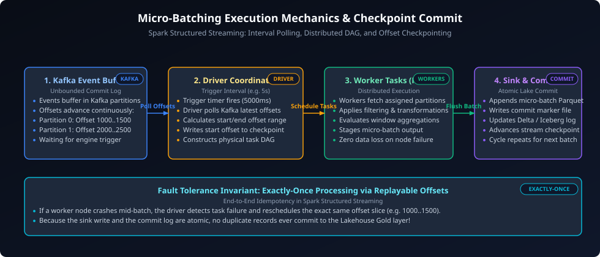

<details>
<summary>D2 Source</summary>

```d2
direction: right
title: Micro-Batching Mechanics & Execution Internals

kafka: 1. Kafka Event Buffer {
  status: "Offsets advance continuously (Unbounded log)"
}

driver: 2. Driver Coordinator (Trigger: 5s) {
  status: "Polls offsets, writes start offset, creates DAG"
}

workers: 3. Worker Tasks in RAM {
  status: "Processes assigned partitions in parallel"
}

sink: 4. Delta Lakehouse Sink & Commit {
  status: "Appends Parquet, writes commit marker file"
}

kafka -> driver: "Poll latest offsets"
driver -> workers: "Schedule distributed tasks"
workers -> sink: "Flush Parquet & Commit"
```
</details>

#### Spark Structured Streaming Trigger Modes Comparison

```python

# 6. Fixed Processing Time (Default micro-batch interval)

query1 = df.writeStream.trigger(processingTime="10 seconds").start()

# 7. Once Trigger (Processes all pending data in a single batch, then halts cluster)

# Legacy mode: Only processes 1 batch regardless of size
query2 = df.writeStream.trigger(once=True).start()

# 8. AvailableNow Trigger (Modern Best Practice for Batch-Triggered Streaming)

# Splits huge accumulated backlogs into multiple right-sized micro-batches, then stops
query3 = df.writeStream.trigger(availableNow=True).start()

# 9. Continuous Processing Mode (Experimental low-latency ~1ms; no micro-batching)

# Uses continuous long-running tasks; limited SQL operator support
query4 = df.writeStream.trigger(continuous="1 second").start()
```

---

# 2. Resilient Pipeline Design Patterns

---

### 2.1 Pipeline Idempotency: The Gold Standard

#### Mathematical Principle & First-Principles Definition
In mathematics and computer science, an operation $f$ is **idempotent** if applying it multiple times produces the identical result as applying it once:

$$\forall x, \quad f(f(x)) = f(x)$$

In data engineering, a pipeline is **idempotent** if re-running the pipeline over the same source data, whether intentionally (backfill) or unintentionally (Airflow task retry after an executor crash), leaves the target database in the **exact same deterministic state** without creating duplicate rows, double-counting metrics, or losing existing data.

#### The 3 Canonical Idempotent Implementation Patterns

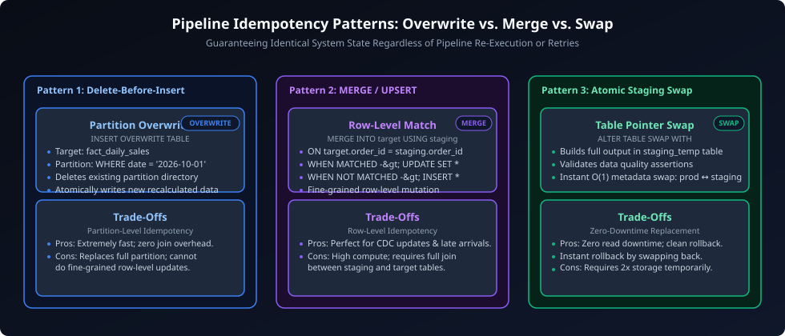

<details>
<summary>D2 Source</summary>

```d2
direction: right
title: Pipeline Idempotency Patterns: Overwrite vs. Merge vs. Swap

p1: Pattern 1: Delete-Before-Insert (Partition Overwrite) {
  cmd: "INSERT OVERWRITE TABLE WHERE date = '2026-10-01'"
  feature: "Replaces entire partition atomically; fast and simple"
}

p2: Pattern 2: Merge / Upsert on Primary Key {
  cmd: "MERGE INTO target USING staging ON target.id = staging.id"
  feature: "Row-level updates; handles late arriving CDC mutations"
}

p3: Pattern 3: Atomic Staging Table Swap {
  cmd: "ALTER TABLE prod_table SWAP WITH staging_table_temp"
  feature: "Zero-downtime O(1) metadata swap; instant rollback capability"
}
```
</details>

#### Production Code: Idempotent Partition Overwrite in PySpark

```python
from pyspark.sql import SparkSession
from pyspark.sql.functions import col, lit

def write_idempotent_partition(
    spark: SparkSession,
    source_df,
    target_table_name: str,
    partition_date: str
):
    """
    Idempotently writes daily partition data using dynamic partition overwrite.
    Guarantees that re-running this function 100 times produces identical results.
    """

# 11. Enforce that input data contains ONLY records for the target partition

filtered_df = source_df.filter(col("event_date") == lit(partition_date))

# 12. Configure Spark session for dynamic partition overwrite mode

# In dynamic mode, Spark only overwrites partitions present in the DataFrame being written
    spark.conf.set("spark.sql.sources.partitionOverwriteMode", "dynamic")

# 13. Atomic overwrite write into target Delta or Parquet table

filtered_df.write \
        .format("delta") \
        .mode("overwrite") \
        .partitionBy("event_date") \
        .saveAsTable(target_table_name)
    
    print(f"Successfully and idempotently committed partition: event_date={partition_date}")
```

---

### 2.2 Fault Tolerance, Failover & Self-Healing

Distributed systems fail continuously: cloud providers preempt spot VMs, network switches experience transient latency spikes, and external databases hit connection limits. Resilient pipelines incorporate self-healing mechanisms at every layer:

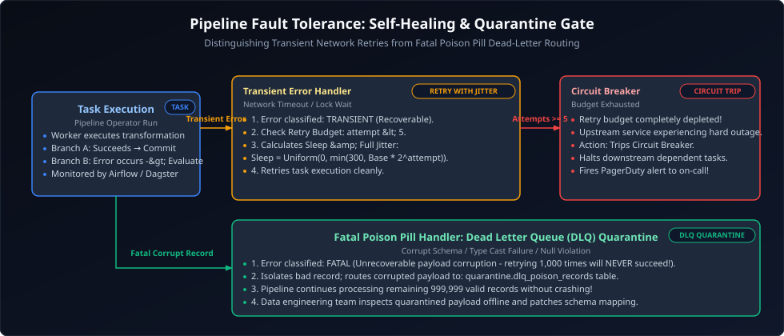

<details>
<summary>D2 Source</summary>

```d2
direction: right
title: Pipeline Fault Tolerance: Self-Healing & Quarantine Gate

task: Task Execution {
  status: "Worker executes transformation"
}

transient: Transient Error Handler {
  check: "Error classified as Transient (Network timeout / Lock wait)"
  retry: "Exponential Backoff with Full Jitter (Attempts < 5)"
}

circuit: Circuit Breaker Trip {
  status: "Attempts >= 5: Halt pipeline & trigger PagerDuty alert"
  style.stroke: "#ef4444"
}

dlq: Fatal Poison Pill Handler (DLQ) {
  status: "Fatal schema corruption: Route record to DLQ; pipeline continues"
  style.stroke: "#10b981"
}

task -> transient: "Transient Failure"
transient -> task: "Retry with Jitter"
transient -> circuit: "Budget Depleted"
task -> dlq: "Fatal Corrupt Data"
```
</details>

#### Key Reliability Metrics
- **RTO (Recovery Time Objective):** The maximum tolerable duration of time a data pipeline can remain offline after a crash before business damage occurs.
- **RPO (Recovery Point Objective):** The maximum acceptable age of data that can be lost when unexpected hardware failure strikes (e.g., RPO = 0 means zero data loss via synchronous write-ahead logs).

---

### 2.3 Checkpointing & Streaming State Stores

#### Directory Internals in Spark Structured Streaming
When you supply `.option("checkpointLocation", "s3://lakehouse/checkpoints/orders/")`, the engine creates a structured metadata tree on object storage:

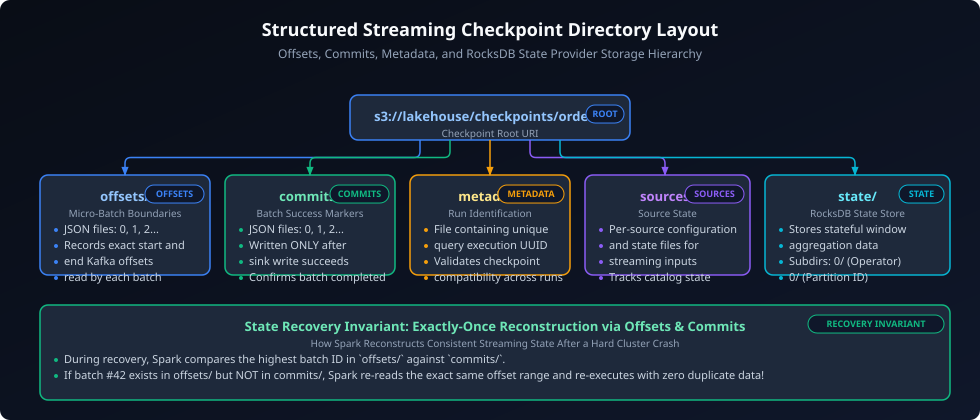

<details>
<summary>D2 Source</summary>

```d2
direction: down
title: Structured Streaming Checkpoint Directory Layout

root: s3://lakehouse/checkpoints/orders/ {
  offsets: offsets/ (JSON start/end offsets per micro-batch)
  commits: commits/ (Batch success marker files)
  meta: metadata (Unique query run UUID)
  sources: sources/ (Configured streaming source states)
  state: state/ (RocksDB / HDFS state provider files) {
    op: 0/ (Operator ID) {
      part: 0/ (Partition ID) {
        delta: 1.delta (RocksDB SST files)
      }
    }
  }
}
```
</details>

| Checkpoint Directory / File | File Type | Production Role & Fault Tolerance Guarantee |
| :--- | :--- | :--- |
| `offsets/{batch_id}` | JSON | Records the exact starting and ending Kafka offsets or file offsets for micro-batch `{batch_id}`. |
| `commits/{batch_id}` | Empty File / JSON | Marks that batch `{batch_id}` completed execution and all sinks finalized writes. |
| `metadata` | JSON | Contains a deterministic run ID ensuring that conflicting queries do not write to the same checkpoint directory. |
| `sources/` | Directory | Persists metadata about streaming sources (e.g., Kafka cluster IDs, Auto Loader discovery logs). |
| `state/{op_id}/{part_id}/` | Binary SST / Delta | RocksDB or HDFS state checkpoint files maintaining aggregation buffers and stream-join match buffers. |

#### State Store Providers: HDFS In-Memory vs. RocksDB
When performing stateful streaming operations (e.g., stream-stream joins or `dropDuplicates()`), the engine maintains state in memory:
1. **Default HDFS Backed In-Memory State Store:** Stores all state as JVM objects inside executor heap memory. If state exceeds several gigabytes, Java Garbage Collection (GC) pauses freeze the cluster, leading to executor timeouts and OOM crashes.
2. **RocksDB State Store Provider:** Backed by an embedded, off-heap C++ key-value store (RocksDB) written directly to local SSDs and lazily checkpointed to cloud storage. Can effortlessly scale to tens of millions of keys per node with zero JVM GC pressure.

```python
# Enabling RocksDB State Store Provider in PySpark
spark.conf.set(
    "spark.sql.streaming.stateStore.providerClass",
    "org.apache.spark.sql.execution.streaming.state.RocksDBStateStoreProvider"
)
```

---

### 2.4 Backpressure Management & Dynamic Rate Limiting

#### The Problem: Consumer Flooding
If a pipeline is down for 6 hours of maintenance, the upstream Kafka broker may accumulate 50 million pending messages. When the streaming worker starts up, it attempts to load all 50 million messages into memory simultaneously, instantly causing `java.lang.OutOfMemoryError: Java heap space`.

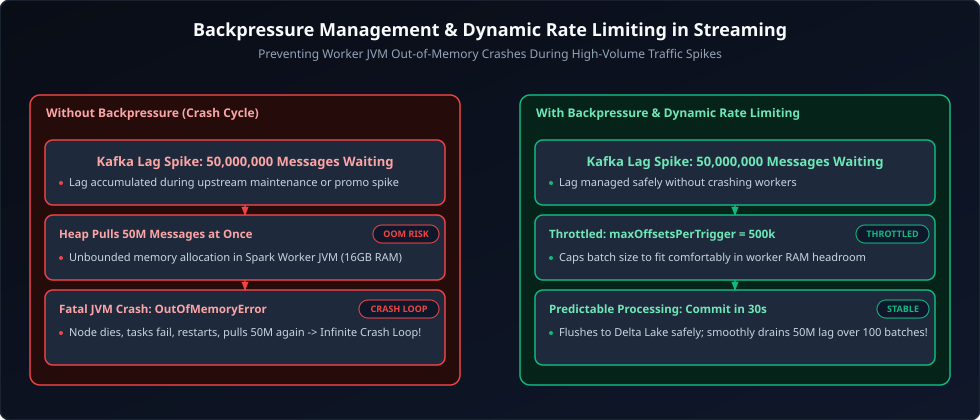

<details>
<summary>D2 Source</summary>

```d2
direction: right
title: Backpressure Management & Dynamic Rate Limiting

no_backpressure: Without Backpressure (Crash Cycle) {
  k1: Kafka: 50,000,000 Messages Waiting
  w1: Worker Heap: Pulls all 50M messages at once! {
    style.stroke: "#ef4444"
  }
  crash: Fatal JVM OutOfMemoryError Crash! {
    style.stroke: "#ef4444"
  }
  k1 -> w1 -> crash
}

with_backpressure: With Backpressure & Rate Limiting {
  k2: Kafka: 50,000,000 Messages Waiting
  w2: Worker Heap: Throttled maxOffsetsPerTrigger=500,000 {
    style.stroke: "#10b981"
  }
  stable: Stable Delta Lake Batch Commit (30s per batch) {
    style.stroke: "#10b981"
  }
  k2 -> w2 -> stable
}
```
</details>

#### Production PySpark Ingestion with Defensive Throttling
```python
df_safe_stream = spark.readStream \
    .format("kafka") \
    .option("kafka.bootstrap.servers", "broker1:9092,broker2:9092") \
    .option("subscribe", "telemetry-events") \
    .option("startingOffsets", "latest") \
    .option("maxOffsetsPerTrigger", 250000) \  # Upper bound: Never pull more than 250k messages per batch
    .option("failOnDataLoss", "false") \       # Prevent crashing if old Kafka logs expired past retention
    .load()
```

---

### 2.5 Replayability & Event Re-Sourcing

Replayability is the operational superpower of event log architectures (Kafka, Redpanda, AWS Kinesis). If a transformation bug is deployed to production on Tuesday and discovered on Friday, traditional database architectures face a catastrophe. In an event-sourced pipeline, you simply reset the consumer group offset and reprocess:

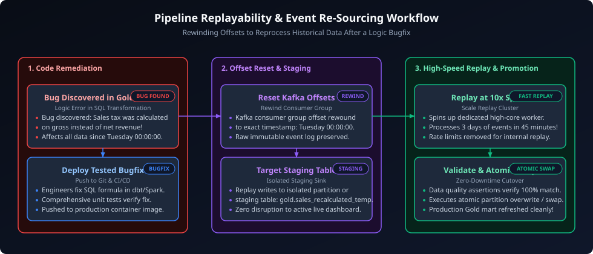

<details>
<summary>D2 Source</summary>

```d2
direction: right
title: Pipeline Replayability & Event Re-Sourcing Workflow

remediation: 1. Code Remediation {
  bug: Bug Discovered (Gold Metric Logic Error)
  fix: Deploy Bugfix to Git & Docker
  bug -> fix
}

reset: 2. Offset Reset & Staging {
  offset: Reset Consumer Offset to Tuesday 00:00:00
  sink: Target Staging Table (gold.sales_recalculated_temp)
  offset -> sink
}

replay: 3. High-Speed Replay & Promotion {
  fast_replay: Replay 3 days of events at 10x speed
  swap: Validate assertions & atomic table swap
  fast_replay -> swap
}

remediation.fix -> reset.offset: "Deploy fix"
reset.sink -> replay.fast_replay: "Execute replay"
```
</details>

#### Resetting Offsets via Kafka CLI
```bash
# Shift consumer group back to a specific historical ISO-8601 timestamp
kafka-consumer-groups.sh \
    --bootstrap-server kafka.prod:9092 \
    --group lakehouse-silver-ingestion \
    --reset-offsets \
    --to-datetime 2026-03-10T00:00:00.000 \
    --topic telemetry-events \
    --execute
```

---

### 2.6 Deduplication Patterns (At-Least-Once to Exactly-Once)

Because distributed networks retry failed TCP packets and message brokers guarantee **At-Least-Once** delivery, duplicate messages are inevitable. Deduplication transforms at-least-once into **effectively-once** downstream state.

#### 1. Batch Deduplication via Window Ranking
In batch pipelines, deduplication retains the latest record for each natural key using `ROW_NUMBER()`:

```sql
WITH ranked_records AS (
    SELECT 
        order_id,
        customer_id,
        order_amount,
        order_status,
        updated_at,
        ROW_NUMBER() OVER (
            PARTITION BY order_id 
            ORDER BY updated_at DESC, ingestion_ts DESC
        ) AS rank_val
    FROM bronze.raw_orders
)
SELECT 
    order_id,
    customer_id,
    order_amount,
    order_status,
    updated_at
FROM ranked_records
WHERE rank_val = 1;
```

#### 2. Streaming Deduplication with Watermark Boundaries
In continuous streaming, state cannot grow unbounded forever. Spark requires a watermark to evict deduplication keys from memory:

```python
# Deduplicate streaming events using natural key + watermark
df_deduped_stream = df_stream \
    .withWatermark("event_timestamp", "2 hours") \
    .dropDuplicates(["transaction_id", "event_timestamp"])
```

---

### 2.7 Late-Arriving & Out-of-Order Data Handling

To process data accurately, data engineers must distinguish between three distinct timestamps:

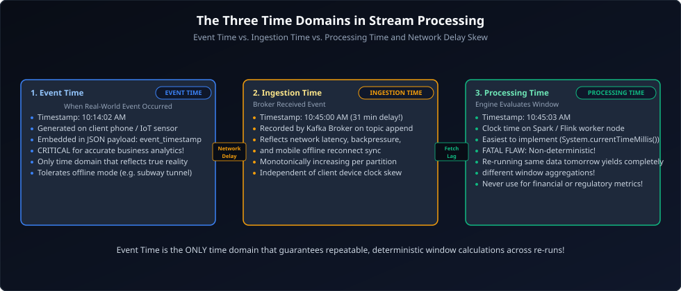

<details>
<summary>D2 Source</summary>

```d2
direction: right
title: The Three Time Domains in Stream Processing

event: 1. EVENT TIME {
  time: "10:14:02 AM on Client Phone / IoT Sensor"
  details: "When real-world action occurred; deterministic"
  style.stroke: "#3b82f6"
}

broker: 2. INGESTION TIME {
  time: "10:45:00 AM on Kafka Broker"
  details: "When message broker received event; includes network lag"
  style.stroke: "#f59e0b"
}

engine: 3. PROCESSING TIME {
  time: "10:45:03 AM on Spark / Flink Worker"
  details: "Local machine clock; non-deterministic across re-runs"
  style.stroke: "#10b981"
}

event -> broker: "Network delay & offline mobile caching"
broker -> engine: "Streaming consumer fetch"
```
</details>

1. **Event Time:** The exact instant the action occurred on the edge client device (e.g., when a user swiped their credit card).
2. **Ingestion Time:** The instant the event reached the central messaging broker (Kafka, Kinesis).
3. **Processing Time:** The clock timestamp of the compute cluster executing the transformation query.

If a smartphone loses cellular reception in a subway tunnel for 40 minutes, it caches transactions locally. When it reconnects, records arrive with a 40-minute gap between Event Time and Processing Time. Calculating hourly sales using *Processing Time* attributes those subway transactions to the wrong business hour!

---

### 2.8 Watermarking Mechanics & State Eviction

A **Watermark** is a moving temporal horizon defined as:

$$\text{Watermark Threshold} = \max(\text{Event Time Observed}) - \text{Allowed Latency Delay}$$

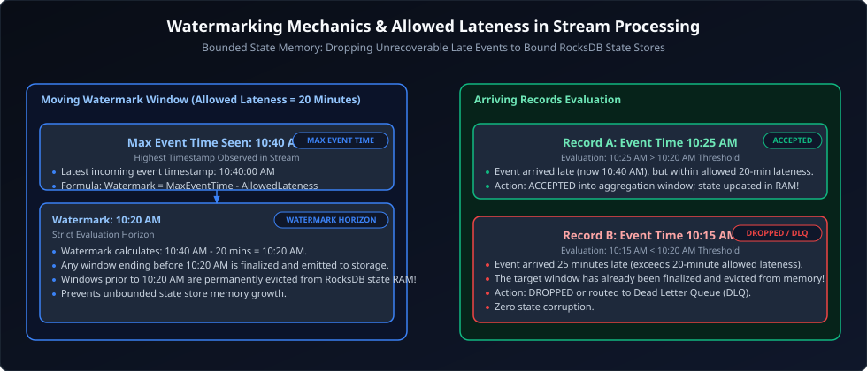

<details>
<summary>D2 Source</summary>

```d2
direction: right
title: Watermarking Mechanics & Allowed Lateness

watermark: Moving Watermark Window (Allowed Lateness = 20 Mins) {
  max_time: "Max Event Time Seen: 10:40 AM"
  threshold: "Watermark Threshold: 10:20 AM (10:40 - 20 mins)"
  max_time -> threshold
}

records: Arriving Records Evaluation {
  rec_a: Record A: Event Time 10:25 AM {
    eval: "10:25 > 10:20 -> ACCEPTED into aggregation window"
    style.stroke: "#10b981"
  }
  rec_b: Record B: Event Time 10:15 AM {
    eval: "10:15 < 10:20 -> DROPPED or routed to DLQ"
    style.stroke: "#ef4444"
  }
}

watermark.threshold -> records.rec_a: "Evaluates"
watermark.threshold -> records.rec_b: "Evaluates"
```
</details>

When the watermark passes 10:20 AM, the streaming engine finalizes the aggregation window for `10:00 - 10:10 AM`, emits the final count to downstream storage, and **purges that window's intermediate state from RAM/RocksDB**, keeping memory consumption strictly flat.

---

### 2.9 Dead Letter Queues (DLQ) & Quarantine Routing

Crashing an entire data pipeline because 1 row out of 10 million contains corrupt JSON is unacceptable in enterprise data engineering. A **Dead Letter Queue (DLQ)** isolates corrupt or schema-violating records into a quarantine table while allowing healthy records to proceed.

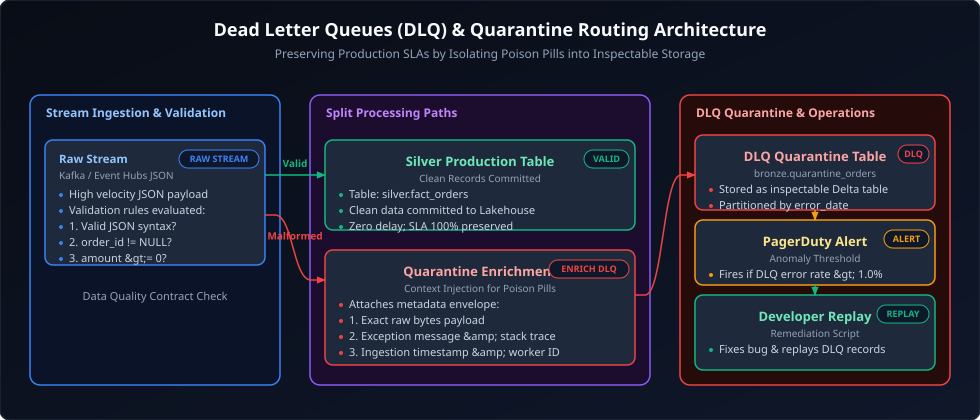

<details>
<summary>D2 Source</summary>

```d2
direction: right
title: Dead Letter Queues (DLQ) & Quarantine Routing

stream: Stream Ingestion & Validation {
  raw: Raw Ingested Stream (JSON)
  validate: Validation Rules (Valid JSON? order_id != NULL? amount >= 0?) {
    shape: diamond
  }
  raw -> validate
}

paths: Split Processing Paths {
  silver: Silver Production Table (Clean data committed)
  enrich: Quarantine Enrichment (Attach raw bytes, error, stack trace)
}

quarantine: Dead Letter Queue (DLQ) & Operations {
  dlq_table: Dead Letter Quarantine Table (bronze.quarantine_orders)
  alert: PagerDuty Alert (Trigger if DLQ Rate > 1%)
  reprocessor: Developer Remediation (Fix bug & replay DLQ)
  dlq_table -> alert
  dlq_table -> reprocessor
}

stream.validate -> paths.silver: "Valid Records"
stream.validate -> paths.enrich: "Malformed Records"
paths.enrich -> quarantine.dlq_table
```
</details>

#### Quarantine Schema Structure
| Column Name | Data Type | Purpose |
| :--- | :--- | :--- |
| `quarantine_id` | `STRING (UUID)` | Unique surrogate identifier for the quarantine incident |
| `raw_payload` | `STRING` | Complete unparsed raw record bytes/string |
| `source_system` | `STRING` | Originating application or message topic |
| `error_code` | `STRING` | Standardized category (e.g., `SCHEMA_MISMATCH`, `NULL_PK`, `INVALID_JSON`) |
| `error_details` | `STRING` | Full Python/Java exception message or stack trace |
| `ingested_at` | `TIMESTAMP (UTC)` | Timestamp when the bad record hit the pipeline |
| `is_resolved` | `BOOLEAN` | Toggled to TRUE after replay job re-ingests repaired payload |

---

### 2.10 Bad Records Handling & Engine Permissive Modes

Apache Spark offers native file reading modes to control how corrupt rows are treated:

```python
from pyspark.sql.types import StructType, StructField, StringType, DoubleType, IntegerType

# Define explicit target schema including internal corruption capture column
orders_schema = StructType([
    StructField("order_id", IntegerType(), True),
    StructField("amount", DoubleType(), True),
    StructField("status", StringType(), True),
    StructField("_corrupt_record", StringType(), True)  # Captures unparseable strings
])

# 14. PERMISSIVE Mode (Default): Populates valid fields, puts corrupt text into _corrupt_record

df_permissive = spark.read \
    .format("json") \
    .option("mode", "PERMISSIVE") \
    .option("columnNameOfCorruptRecord", "_corrupt_record") \
    .schema(orders_schema) \
    .load("s3://landing/dirty_data/")

# 15. Split into clean and quarantine DataFrames

df_clean = df_permissive.filter(col("_corrupt_record").isNull()).drop("_corrupt_record")
df_quarantine = df_permissive.filter(col("_corrupt_record").isNotNull())

# 16. Write out clean to Silver, quarantine to DLQ

df_clean.write.format("delta").mode("append").saveAsTable("silver.clean_orders")
df_quarantine.write.format("delta").mode("append").saveAsTable("bronze.dlq_orders")
```

---

### 2.11 Schema Validation & Defensive Ingestion

Defensive ingestion guarantees that upstream software engineers cannot silently change a column from an integer to an array or drop a required foreign key without the ingestion gate catching it.

```python
from pydantic import BaseModel, Field, field_validator
from datetime import datetime
from typing import Optional

class UserIngestionContract(BaseModel):
    """Defensive schema contract enforced on every raw incoming payload."""
    user_id: int = Field(gt=0, description="Positive integer identifier")
    email: str = Field(pattern=r"^[\w\.-]+@[\w\.-]+\.\w+$")
    signup_timestamp: datetime
    country_code: str = Field(min_length=2, max_length=2)
    referral_code: Optional[str] = None

    @field_validator("country_code")
    @classmethod
    def validate_uppercase_country(cls, v: str) -> str:
        if not v.isupper():
            raise ValueError(f"Country code must be ISO uppercase: {v}")
        return v

def ingest_defensive_record(raw_record_dict: dict) -> dict:
    """Validates raw dictionaries against contract, raising typed exceptions on violation."""
    validated = UserIngestionContract.model_validate(raw_record_dict)
    return validated.model_dump()
```

---

### 2.12 Pipeline Observability: Metrics, Logs & Traces

Modern data engineering observability rests on **The 5 Pillars of Data Reliability**:
1. **Freshness:** When was the table last updated? (Monitors SLA breaches).
2. **Volume:** Did today's batch contain 200,000 rows as expected, or only 500 rows? (Identifies silent upstream extraction failures).
3. **Schema:** Did upstream engineers drop, rename, or alter a field's type?
4. **Data Quality / Distribution:** Did the null rate in `zip_code` jump from 0.1% to 85%?
5. **Lineage:** Which 14 downstream dashboards will break if this table fails?

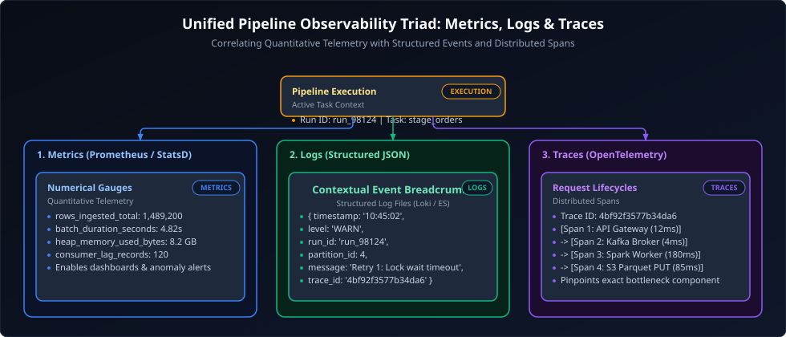

<details>
<summary>D2 Source</summary>

```d2
direction: down
title: Unified Pipeline Observability Triad: Metrics, Logs & Traces

exec: Pipeline Ingestion Execution {
  run: "Run ID: run_98124 | Task: stage_orders"
}

triad: Unified Pipeline Observability Triad {
  metrics: 1. Metrics (Prometheus / StatsD) {
    data: "Aggregatable numbers: rows_ingested, duration_sec, lag"
    style.stroke: "#3b82f6"
  }
  logs: 2. Logs (Structured JSON) {
    data: "Contextual event breadcrumbs: run_id, partition, error traces"
    style.stroke: "#10b981"
  }
  traces: 3. Traces (OpenTelemetry) {
    data: "End-to-end distributed lifecycle spans: API -> Kafka -> Spark -> S3"
    style.stroke: "#8b5cf6"
  }
}

exec -> triad.metrics
exec -> triad.logs
exec -> triad.traces
```
</details>

| Signal Type | Ingestion Example | Tooling Sink | Detection Purpose |
| :--- | :--- | :--- | :--- |
| **Metrics** | `rows_ingested: 104500`, `duration_seconds: 42.1` | Prometheus, Datadog | Real-time threshold alerting & SLA burn rate. |
| **Logs** | `{"level":"INFO","run_id":"uuid-92","partition":"2026-03-15"}` | Elasticsearch, CloudWatch | Root-cause diagnosis & error stack tracing. |
| **Traces** | `trace_id: 4bf92f3577b34da6a3ce929d0e0e4736` | OpenTelemetry, Jaeger | Distributed latency bottleneck identification across hops. |

---

### 2.13 SLA Management, SLOs & Alert Thresholds

- **SLI (Service Level Indicator):** A quantifiable metric of pipeline performance (e.g., *Elapsed time from midnight UTC until the Gold financial table commit is finalized*).
- **SLO (Service Level Objective):** The internal target agreed upon by the data team (e.g., *Gold financial table commit finalized before 06:00 AM UTC in 99.5% of calendar days*).
- **SLA (Service Level Agreement):** The contractual commitment to external business stakeholders with financial or business penalties if breached (e.g., *If financial data is not delivered by 08:00 AM UTC, data team pays a regulatory audit fine*).

#### Three-Tiered Alerting Strategy
1. **P1 (Critical / Page On-Call):** Pipeline halted, financial reporting SLA violated, production customer-facing model data missing.
2. **P2 (High / Slack Notification):** Volume anomaly detected (e.g., 40% drop in rows), non-fatal schema drift routed to rescue column, DLQ quarantine exceeding 2% threshold.
3. **P3 (Informational / Ticket Created):** Cluster spot node reclaimed, job took 10% longer than average, non-urgent deprecation warning logged.

---

### 2.14 Historical Backfilling Strategies

Backfilling is the process of re-executing a pipeline over historical time intervals.

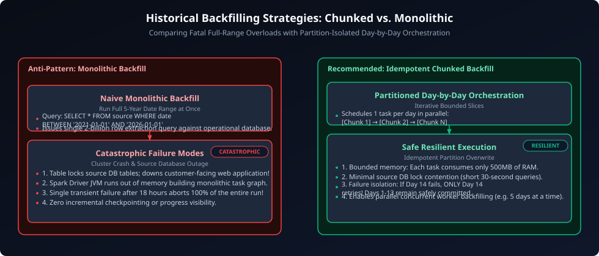

<details>
<summary>D2 Source</summary>

```d2
direction: right
title: Historical Backfilling Strategies: Chunked vs. Monolithic

naive: Anti-Pattern: Monolithic Backfill {
  run: "Naive Backfill: Run full 5-year range at once"
  exhaust: "Resource Exhaustion: Cluster OOM & locks production source DB"
  run -> exhaust
  style.stroke: "#ef4444"
}

chunked: Recommended: Idempotent Chunked Backfill {
  orch: "Partitioned Orchestration: Iterate day-by-day in sequence"
  c1: "Run 2026-01-01"
  c2: "Run 2026-01-02"
  cn: "Run 2026-01-31"
  success: "Safe Execution: Bounded memory, zero lock contention, isolated retries"
  orch -> c1 -> c2 -> cn -> success
  style.stroke: "#10b981"
}
```
</details>

#### Production Bash Backfill Script with Bounded Concurrency
```bash
#!/usr/bin/env bash
set -euo pipefail

START_DATE="2026-01-01"
END_DATE="2026-01-31"

CURRENT_DATE="$START_DATE"
echo "Starting sequential, idempotent backfill from $START_DATE to $END_DATE..."

while [ "$CURRENT_DATE" != "$(date -I -d "$END_DATE + 1 day")" ]; do
    echo "Processing partition: date=$CURRENT_DATE"
    python /opt/pipelines/daily_orders_ingestion.py \
        --execution-date "$CURRENT_DATE" \
        --mode "overwrite-partition" \
        --retries 3
    
    # Increment by 1 day
    CURRENT_DATE=$(date -I -d "$CURRENT_DATE + 1 day")
done

echo "Backfill execution completed successfully."
```

---

### 2.15 Metadata-Driven Pipelines & Control Table Framework

Hardcoding 500 individual ingestion scripts for 500 database tables is an unmaintainable anti-pattern. A **Metadata-Driven Pipeline Framework** uses an external catalog (Postgres table or JSON/YAML specification) to parameterize a single, highly optimized ingestion engine.

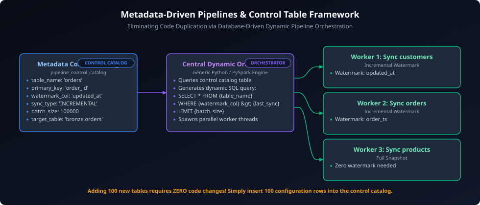

<details>
<summary>D2 Source</summary>

```d2
direction: right
title: Metadata-Driven Pipelines & Control Table Framework

catalog: Metadata Control Catalog {
  schema: "table_name, primary_key, watermark_col, sync_type"
}

engine: Central Metadata Pipeline Orchestrator {
  logic: "Reads catalog & generates parameterized SQL queries dynamically"
}

workers: Parallel Worker Threads {
  w1: "Worker 1: Sync customers (Watermark: updated_at)"
  w2: "Worker 2: Sync orders (Watermark: order_ts)"
  w3: "Worker 3: Sync products (Full Table Snapshot)"
}

audit: Pipeline Audit & Watermark Log {
  schema: "last_successful_sync, rows_loaded, execution_status"
}

catalog -> engine: "Fetch Active Configs"
engine -> workers.w1
engine -> workers.w2
engine -> workers.w3
workers.w1 -> audit: "Update Watermark"
workers.w2 -> audit: "Update Watermark"
workers.w3 -> audit: "Update Watermark"
```
</details>

#### Complete Production Python Implementation

```python
import json
import logging
from dataclasses import dataclass
from typing import List, Optional

logging.basicConfig(level=logging.INFO, format="%(asctime)s [%(levelname)s] %(message)s")

@dataclass
class IngestionMetadataConfig:
    source_schema: str
    source_table: str
    target_lakehouse_table: str
    primary_key: str
    watermark_column: Optional[str] = None
    partition_column: Optional[str] = None
    sync_mode: str = "INCREMENTAL"  # 'INCREMENTAL' or 'FULL_SNAPSHOT'
    is_active: bool = True

class MetadataDrivenPipelineExecutor:
    """
    Dynamically executes dozens of database ingestion jobs 
    driven strictly by metadata configuration schemas.
    """
    def __init__(self, config_file_path: str):
        with open(config_file_path, "r") as f:
            raw_configs = json.load(f)
            self.configs: List[IngestionMetadataConfig] = [
                IngestionMetadataConfig(**item) for item in raw_configs if item.get("is_active", True)
            ]

    def fetch_last_watermark(self, target_table: str) -> str:
        # In production: SELECT MAX(high_watermark) FROM pipeline_control.watermarks WHERE target_table = :target_table
        logging.info(f"Retrieving high-watermark checkpoint for {target_table}")
        return "2026-03-14 00:00:00"

    def record_sync_success(self, target_table: str, new_watermark: str, rows_synced: int):
        # In production: INSERT INTO pipeline_control.audit_log VALUES (...)
        logging.info(f"[SUCCESS] {target_table}: Committed {rows_synced} rows. New Watermark: {new_watermark}")

    def execute(self):
        logging.info(f"Loaded {len(self.configs)} active ingestion configs from catalog.")
        for cfg in self.configs:
            logging.info(f"Starting processing: {cfg.source_schema}.{cfg.source_table} -> {cfg.target_lakehouse_table}")
            
            if cfg.sync_mode == "INCREMENTAL":
                last_watermark = self.fetch_last_watermark(cfg.target_lakehouse_table)
                sql_extract = f"""
                    SELECT * FROM {cfg.source_schema}.{cfg.source_table}
                    WHERE {cfg.watermark_column} > '{last_watermark}'
                    ORDER BY {cfg.watermark_column} ASC
                """
                logging.info(f"Generated SQL: {sql_extract.strip()}")
                # Execute extract -> load to Bronze -> merge to Silver
                self.record_sync_success(cfg.target_lakehouse_table, "2026-03-15 00:00:00", 12450)
            else:
                sql_extract = f"SELECT * FROM {cfg.source_schema}.{cfg.source_table}"
                logging.info(f"Generated Full Snapshot SQL: {sql_extract.strip()}")
                self.record_sync_success(cfg.target_lakehouse_table, "FULL_SYNC_COMPLETE", 500000)
```

---

# 3. Data Quality, Contracts & Governance

---

### 3.1 Data Contracts: Shift-Left Governance

A **Data Contract** is a formal, version-controlled specification written in YAML/JSON that establishes an explicit agreement between software engineering teams producing data and data engineering teams consuming it.

```yaml
# Open Data Contract Standard (ODCS) Specification v2.0
dataContractSpecification: 2.0.0
id: orders-checkout-service-contract
info:
  title: Checkout Microservice Orders Contract
  version: 1.4.0
  owner: team-checkout@enterprise.corp
models:
  orders:
    description: Operational transaction records created at user checkout
    fields:
      order_id:
        type: string
        format: uuid
        required: true
        unique: true
      customer_id:
        type: integer
        required: true
      amount_usd:
        type: number
        minimum: 0.01
        maximum: 100000.00
      order_status:
        type: string
        enum: [PENDING, AUTHORIZED, SHIPPED, DELIVERED, CANCELLED]
      order_timestamp:
        type: string
        format: date-time
        required: true
servicelevels:
  freshness:
    maxDelaySeconds: 300  # Data must arrive within 5 minutes of checkout
  availability: 99.9%
```

#### Enforcement in CI/CD
When an upstream software engineer submits a Pull Request altering the Postgres database schema, a CI/CD GitHub Action validates the change against the Data Contract. If the PR attempts to drop `customer_id` or change `amount_usd` from float to string, the CI pipeline **blocks the PR merge**, stopping breaking changes before they reach production.

---

### 3.2 Great Expectations (GX) Framework

Great Expectations (GX) is an industry-standard Python library that validates, profiles, and documents datasets through expressive assertions called **Expectations**.

```python
import great_expectations as gx

# 18. Initialize GX execution context

context = gx.get_context()

# 19. Connect to data source (Pandas, Spark, or SQL Data Source)

validator = context.sources.pandas_default.read_csv("s3://lakehouse/landing/orders_2026_03_15.csv")

# 20. Declare declarative data quality expectations

validator.expect_column_to_exist(column="order_id")
validator.expect_column_values_to_not_be_null(column="order_id")
validator.expect_column_values_to_be_unique(column="order_id")

validator.expect_column_values_to_be_between(
    column="amount_usd", min_value=0.01, max_value=50000.00
)

validator.expect_column_values_to_be_in_set(
    column="order_status",
    value_set=["PENDING", "AUTHORIZED", "SHIPPED", "DELIVERED", "CANCELLED"]
)

# 21. Execute validation suite and assert success

results = validator.validate()

if not results.success:
    failed_expectations = [res for res in results.results if not res.success]
    print(f"[ALERT] Data quality check failed! {len(failed_expectations)} assertions failed.")
    raise ValueError("Data quality validation failed. Halting pipeline execution.")
else:
    print("[SUCCESS] All Great Expectations assertions passed cleanly.")
```

---

### 3.3 Soda Core & Declarative Data Checks

Soda Core provides a lightweight, human-readable YAML syntax that compiles directly into SQL queries executed inside your data warehouse:

```yaml
# checks_orders.yml
checks for fact_orders:
  # Volume integrity
  - row_count > 0
  - row_count same as fact_orders_yesterday +/- 20%
  
  # Completeness & Uniqueness
  - missing_count(order_id) = 0
  - duplicate_count(order_id) = 0
  - missing_percent(customer_id) < 1%
  
  # Business Logic & Range
  - min(amount_usd) >= 0.01
  - invalid_count(order_status) = 0:
      valid values: ['PENDING', 'AUTHORIZED', 'SHIPPED', 'DELIVERED', 'CANCELLED']
  
  # Freshness SLA
  - freshness(order_timestamp) < 2h
```

---

### 3.4 Apache Spark Deequ (PyDeequ) for Big Data Quality

When validating multi-terabyte or petabyte datasets, single-node tools (Pandas/GX) fail due to driver memory limitations. **Deequ** (developed by AWS and ported to Python as `pydeequ`) compiles quality assertions directly into distributed Spark SQL aggregations, processing billions of rows across worker nodes.

```python
from pydeequ.checks import Check, CheckLevel
from pydeequ.verification import VerificationSuite, VerificationResult

# Build distributed validation suite
check = Check(spark, CheckLevel.Error, "Bronze Orders Quality Review")

check_suite = check \
    .isComplete("order_id") \
    .isUnique("order_id") \
    .isNonNegative("amount_usd") \
    .isContainedIn("order_status", ["PENDING", "SHIPPED", "DELIVERED", "CANCELLED"]) \
    .hasCompleteness("customer_id", lambda x: x >= 0.99)

result = VerificationSuite(spark) \
    .onData(df_spark_orders) \
    .addCheck(check_suite) \
    .run()

# Convert results to PySpark DataFrame for downstream logging
result_df = VerificationResult.checkResults_to_data_frame(spark, result)
result_df.show(truncate=False)

if result.status != "Success":
    raise RuntimeError("PyDeequ distributed validation suite failed!")
```

---

### 3.5 dbt Test Assertions (Generic & Custom)

In the dbt framework, tests are defined declaratively in `schema.yml`:

```yaml
version: 2

models:
  - name: fact_orders
    description: "Curated Gold orders fact table"
    columns:
      - name: order_id
        tests:
          - unique
          - not_null
      - name: customer_id
        tests:
          - not_null
          - relationships:
              to: ref('dim_customers')
              field: customer_id
      - name: order_status
        tests:
          - accepted_values:
              values: ['PENDING', 'SHIPPED', 'DELIVERED', 'CANCELLED']
              quote: true
```

#### Storing Failures for Audit Inspections
Running `dbt test --store-failures` writes violating rows into a dedicated database schema (`target_schema.dbt_test__audit`), allowing engineers to run `SELECT * FROM audit_table` to inspect bad records immediately.

---

### 3.6 Automated Schema Drift Detection

Schema drift occurs when an upstream service alters payloads without warning. Resilient pipelines compare incoming schemas against the historical catalog:

```python
from pyspark.sql.types import StructType

def detect_schema_drift(source_schema: StructType, target_schema: StructType):
    """
    Compares incoming batch schema against target warehouse schema.
    Returns lists of added, removed, or type-altered fields.
    """
    source_fields = {f.name: f.dataType for f in source_schema.fields}
    target_fields = {f.name: f.dataType for f in target_schema.fields}
    
    new_columns = set(source_fields.keys()) - set(target_fields.keys())
    missing_columns = set(target_fields.keys()) - set(source_fields.keys())
    
    type_mismatches = []
    for col_name in set(source_fields.keys()).intersection(set(target_fields.keys())):
        if source_fields[col_name] != target_fields[col_name]:
            type_mismatches.append({
                "column": col_name,
                "source_type": str(source_fields[col_name]),
                "target_type": str(target_fields[col_name])
            })
            
    return {
        "new_columns": list(new_columns),
        "missing_columns": list(missing_columns),
        "type_mismatches": type_mismatches,
        "has_drift": bool(new_columns or missing_columns or type_mismatches)
    }
```

---

### 3.7 Statistical Anomaly Detection in Ingestion Volumes

Static thresholds (e.g., `row_count > 10,000`) fail when business traffic exhibits strong seasonality (e.g., Saturday traffic is naturally 3x lower than Tuesday traffic). Production observability systems compute **Rolling Z-Scores** to detect volume anomalies:

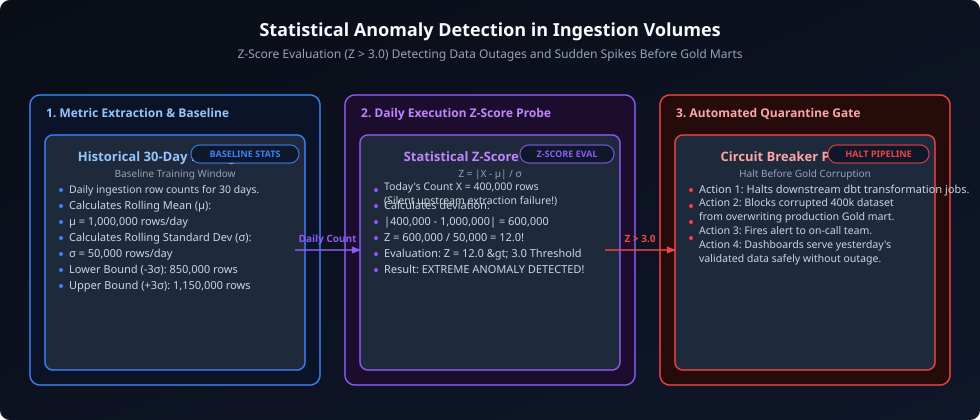

<details>
<summary>D2 Source</summary>

```d2
direction: right
title: Statistical Anomaly Detection in Ingestion Volumes

baseline: 1. Metric Extraction & Baseline Stats {
  history: "Historical 30-Day Rolling Ingestion Counts"
  stats: "Mean (μ): 1,000,000 | StdDev (σ): 50,000"
}

zscore: 2. Z-Score Anomaly Evaluation {
  formula: "Z = |X - μ| / σ"
  probe: "Today: X = 400,000 -> Z = 12.0! (Exceeds 3.0 Threshold)"
}

action: 3. Automated Circuit Breaker Gate {
  halt: "Halts downstream dbt jobs; prevents corrupt data polluting Gold"
  alert: "Triggers PagerDuty anomaly alert"
  style.stroke: "#ef4444"
}

baseline -> zscore: "Evaluate Today Count"
zscore -> action: "Z > 3.0 Detected"
```
</details>

#### Production Python Volume Anomaly Detector
```python
import numpy as np

def evaluate_volume_zscore(
    today_volume: int,
    historical_30_day_volumes: list,
    z_threshold: float = 3.0
) -> dict:
    """
    Evaluates whether today's ingested row volume is a statistical anomaly.
    A Z-score > 3.0 indicates less than a 0.3% probability of being natural variation.
    """
    arr = np.array(historical_30_day_volumes)
    mean = np.mean(arr)
    std = np.std(arr)
    
    if std == 0.0:
        z_score = 0.0
    else:
        z_score = (today_volume - mean) / std
        
    is_anomaly = abs(z_score) > z_threshold
    
    return {
        "today_volume": today_volume,
        "rolling_mean": float(mean),
        "rolling_std": float(std),
        "z_score": float(z_score),
        "is_anomaly": is_anomaly,
        "severity": "CRITICAL" if abs(z_score) > 4.5 else ("HIGH" if is_anomaly else "NORMAL")
    }
```

---

# 4. File-Based Cloud Ingestion Architectures

---

### 4.1 Batch File Ingestion vs. Incremental File Processing

When ingesting files from cloud object storage (AWS S3, Azure ADLS Gen2, Google Cloud Storage):
- **Batch File Crawling:** The pipeline sends HTTP `LIST` requests across the entire bucket on every execution. As the bucket accumulates hundreds of thousands of files over several months, directory listing times explode from seconds to hours before any data can be ingested.
- **Incremental Processing:** The pipeline reads only newly arrived files, relying on cloud event notifications or transactional log tracking.

---

### 4.2 Databricks Auto Loader (`cloudFiles`) Internals

Databricks **Auto Loader** provides an optimized, fault-tolerant source called `cloudFiles` for reading files incrementally from cloud object storage into Delta Lake.

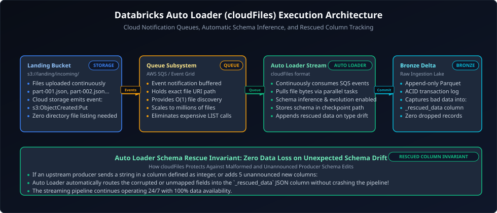

<details>
<summary>D2 Source</summary>

```d2
direction: right
title: Databricks Auto Loader (cloudFiles) Execution Architecture

storage: Cloud Storage Bucket (S3 / ADLS) {
  files: "s3://landing/incoming/*.json"
}

queue: Cloud Event Queue (AWS SQS / Event Grid) {
  events: "Buffered s3:ObjectCreated events"
}

autoloader: Databricks Auto Loader (cloudFiles) {
  engine: "spark.readStream.format('cloudFiles')"
  features: "Schema inference, schema evolution, O(1) queue discovery"
}

bronze: Bronze Delta Lake Table {
  table: "bronze.raw_events"
  column: "_rescued_data (Captures unexpected schema drift)"
}

storage -> queue: "File Upload Notification"
queue -> autoloader: "Consume File URI Events"
autoloader -> bronze: "Append Incremental Micro-Batches"
```
</details>

#### Auto Loader Execution Modes
1. **Directory Listing Mode (`cloudFiles.useNotifications = false`):** Recursively crawls directory prefixes and stores file modification timestamps in an internal RocksDB state store. Highly optimized for buckets with $<1,000,000$ files.
2. **File Notification Mode (`cloudFiles.useNotifications = true`):** Automatically provisions an AWS SNS/SQS or Azure Event Grid service. As new files land, storage events trigger messages in the queue. Auto Loader polls the queue directly, achieving $O(1)$ discovery overhead even across billions of historical files.

#### Production PySpark Auto Loader Ingestion Pipeline
```python
df_autoloader = spark.readStream \
    .format("cloudFiles") \
    .option("cloudFiles.format", "json") \
    .option("cloudFiles.schemaLocation", "s3://lakehouse/metadata/schema_orders/") \
    .option("cloudFiles.schemaEvolutionMode", "addNewColumns") \
    .option("cloudFiles.useNotifications", "true") \
    .load("s3://landing-bucket/raw_orders/")

query = df_autoloader.writeStream \
    .format("delta") \
    .outputMode("append") \
    .option("checkpointLocation", "s3://lakehouse/checkpoints/orders_autoloader/") \
    .toTable("bronze.raw_orders")
```

---

### 4.3 SQL `COPY INTO` (Databricks & Snowflake)

`COPY INTO` provides an idempotent, SQL-native mechanism to load cloud storage files into managed tables. Both Snowflake and Databricks maintain internal metadata catalogs recording loaded file names; re-executing `COPY INTO` on the same directory skips previously loaded files automatically.

```sql
-- Snowflake / Databricks SQL COPY INTO Syntax
COPY INTO bronze.raw_shipments
FROM 's3://logistics-landing/shipments/'
FILEFORMAT = PARQUET
PATTERN = '.*[.]parquet'
COPY_OPTIONS (
    'mergeSchema' = 'true',
    'force' = 'false'  -- Skips previously ingested files
);
```

---

### 4.4 Snowflake Snowpipe Serverless Ingestion

Snowpipe is Snowflake’s serverless, automated event-driven ingestion engine. It loads micro-batches of data within seconds of files appearing in cloud storage without requiring a continuously running virtual warehouse.

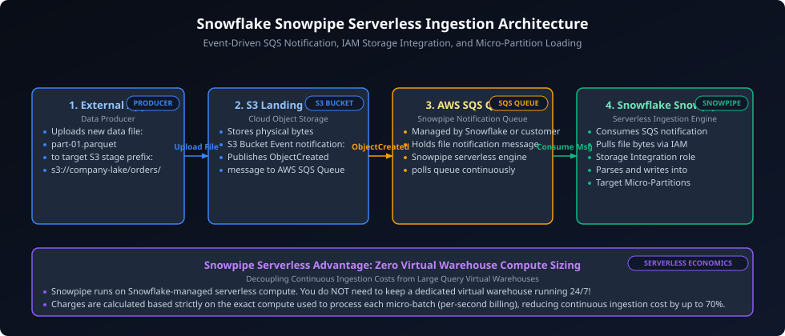

<details>
<summary>D2 Source</summary>

```d2
direction: right
title: Snowflake Snowpipe Serverless Ingestion Sequence

app: 1. External App (Producer)
s3: 2. AWS S3 Landing Bucket
sqs: 3. AWS SQS Notification Queue
pipe: 4. Snowflake Snowpipe (Serverless)
table: 5. Snowflake Target Table (Micro-Partitions)

app -> s3: "Upload part-01.parquet"
s3 -> sqs: "Publish ObjectCreated Event"
sqs -> pipe: "Snowpipe consumes notification"
pipe -> s3: "Pull file bytes via IAM Integration"
pipe -> table: "Commit to micro-partitions"
```
</details>

#### Snowpipe DDL Specification
```sql
-- Create external stage pointing to AWS S3
CREATE OR REPLACE STAGE my_s3_stage
  URL = 's3://mycompany-landing/telemetry/'
  STORAGE_INTEGRATION = my_aws_storage_int;

-- Define automated serverless pipe listening to S3 notifications
CREATE OR REPLACE PIPE telemetry_db.raw.pipe_telemetry
  AUTO_INGEST = TRUE
  AWS_SNS_TOPIC = 'arn:aws:sns:us-east-1:123456789012:s3-object-created-topic'
AS
  COPY INTO telemetry_db.raw.bronze_telemetry
  FROM @my_s3_stage
  FILE_FORMAT = (TYPE = 'JSON');
```

---

### 4.5 Google Cloud BigQuery Load Jobs

Google BigQuery offers dedicated asynchronous **Load Jobs** to import files from Google Cloud Storage (GCS) or local disks. **Crucial Architectural Advantage:** BigQuery Load Jobs do **not** consume BigQuery query slots or incur compute fees—the ingestion compute is completely free; users pay only for downstream table storage.

```bash
# Ingesting compressed Parquet files from GCS into BigQuery via bq CLI
bq load \
    --source_format=PARQUET \
    --autodetect \
    --time_partitioning_field=event_timestamp \
    --clustering_fields=customer_id,region \
    analytics.fact_pageviews \
    gs://my-company-lake/web_logs/*.parquet
```

---

### 4.6 Directory Listing ($O(N)$) vs. Notification-Based Ingestion ($O(1)$)

| Characteristic | Directory Listing Mode | File Notification Mode |
| :--- | :--- | :--- |
| **Complexity of Discovery** | **$O(N)$:** Engine must paginate through all $N$ files in bucket | **$O(1)$:** Reads exact new file paths directly from queue messages |
| **Cloud Storage Latency** | Minutes to hours when bucket has $>1,000,000$ files | Milliseconds (sub-second event notification delivery) |
| **Cloud API Costs** | High: Thousands of HTTP `LIST` requests incurred on every run | Extremely low: Event notifications cost pennies per million events |
| **Infrastructure Setup** | Zero infrastructure needed; just point to S3/ADLS URL | Requires IAM permissions for SNS/SQS or Azure Event Grid |
| **Recommended Threshold** | Small buckets ($<100,000$ files) or batch daily uploads | Enterprise production lakehouses with high-frequency uploads |

---

### 4.7 Checkpoint State Tracking for File Streams

When streaming from file sources, state checkpoints store a monotonically increasing transaction log recording the exact file paths and modification timestamps processed. If a worker node crashes mid-stream, the restart reads the checkpoint, verifies the partial write was not committed to the table, discards any orphan files, and resumes from the exact file boundary, achieving **end-to-end exactly-once guarantees**.

---

### 4.8 Automated Schema Inference & Evolution Policies

#### Auto Loader Schema Evolution Policies Matrix

| Mode | Engine Behavior when New Columns Arrive | Production Fit |
| :--- | :--- | :--- |
| **`addNewColumns`** (Default) | Automatically modifies the target Delta table schema (`ALTER TABLE ADD COLUMN`) and streams cleanly. | Bronze landing tables where raw fidelity and agility are prioritized. |
| **`rescue`** | Retains original schema. Unexpected columns or data type mismatches are JSON-encoded and placed into `_rescued_data`. | Silver tables requiring strict stability without failing on extra fields. |
| **`failOnNewColumns`** | Halts the stream immediately with an exception upon encountering undeclared columns. | Regulated financial or healthcare data where unknown attributes violate compliance. |
| **`none`** | Silently ignores unknown columns; writes only declared fields. | Stable legacy ingestion where auxiliary source fields must be dropped. |

---

# 5. Change Data Capture (CDC) Patterns

---

### 5.1 Log-Based CDC (Debezium & Kafka Connect)

#### Architectural Internals: Tailing the Transaction Log
Every ACID relational database writes state modifications to an append-only sequential disk log (**Write-Ahead Log (WAL)** in PostgreSQL, **Binary Log (Binlog)** in MySQL, **Redo Log** in Oracle) *before* committing modifications to data pages in memory or data files on disk.

Log-based CDC engines (such as Debezium running inside Kafka Connect) act as a logical replication client. They tail this transaction log asynchronously with near-zero overhead on the operational database's CPU and memory:

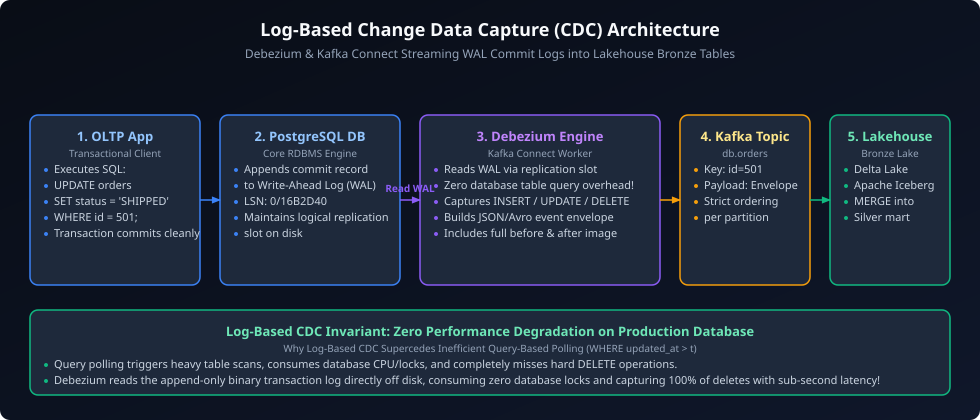

<details>
<summary>D2 Source</summary>

```d2
direction: right
title: Log-Based Change Data Capture (CDC) Architecture

app: 1. OLTP Application
db: 2. PostgreSQL Core Database {
  wal: Write-Ahead Log (WAL on Disk)
}
debezium: 3. Debezium (Kafka Connect) {
  slot: Logical Replication Slot
}
kafka: 4. Kafka Topic (db.orders)
lakehouse: 5. Delta Lake / Iceberg Bronze

app -> db: "UPDATE orders SET status = 'SHIPPED'"
db -> db.wal: "Append Commit Record (LSN: 0/16B2D40)"
db.wal -> debezium.slot: "Stream WAL bytes"
debezium -> kafka: "Publish Event Envelope (Before & After)"
kafka -> lakehouse: "Stream Ingest into Bronze"
```
</details>

#### The Debezium CDC Event Envelope Structure
A log-based CDC event contains complete before-and-after state images, metadata about the transaction, and the operation type:

```json
{
  "before": {
    "order_id": 501,
    "customer_id": 9920,
    "status": "PENDING",
    "updated_at": 1710489600000
  },
  "after": {
    "order_id": 501,
    "customer_id": 9920,
    "status": "SHIPPED",
    "updated_at": 1710493200000
  },
  "source": {
    "version": "2.5.0.Final",
    "connector": "postgres",
    "name": "production_oltp",
    "ts_ms": 1710493200150,
    "db": "sales",
    "schema": "public",
    "table": "orders",
    "txId": 98124,
    "lsn": 23812800
  },
  "op": "u",
  "ts_ms": 1710493200210
}
```
*Operation Codes (`op`):*
- `'c'`: Create / Insert
- `'u'`: Update
- `'d'`: Delete (Crucial: Captures hard deletes!)
- `'r'`: Read (Initial snapshot snapshot read)

#### Applying CDC to the Lakehouse: Merge and Change Data Feed (CDF)
In the Silver layer, the raw CDC events are applied to update dimension or fact tables using a deterministic SQL `MERGE`:

```sql
MERGE INTO silver.dim_orders AS target
USING (
    -- Rank CDC records by LSN to take the most recent state change per order
    SELECT order_id, customer_id, status, updated_at, op
    FROM (
        SELECT 
            CAST(JSON_VALUE(value, '$.after.order_id') AS INT) AS order_id,
            CAST(JSON_VALUE(value, '$.after.customer_id') AS INT) AS customer_id,
            JSON_VALUE(value, '$.after.status') AS status,
            TIMESTAMP_MILLIS(CAST(JSON_VALUE(value, '$.source.ts_ms') AS INT64)) AS updated_at,
            JSON_VALUE(value, '$.op') AS op,
            ROW_NUMBER() OVER (
                PARTITION BY JSON_VALUE(value, '$.after.order_id') 
                ORDER BY CAST(JSON_VALUE(value, '$.source.lsn') AS INT64) DESC
            ) AS rank_val
        FROM bronze.cdc_orders_raw
    )
    WHERE rank_val = 1
) AS source
ON target.order_id = source.order_id
WHEN MATCHED AND source.op = 'd' THEN
    DELETE
WHEN MATCHED AND source.op = 'u' THEN
    UPDATE SET 
        target.customer_id = source.customer_id,
        target.status = source.status,
        target.updated_at = source.updated_at
WHEN NOT MATCHED AND source.op IN ('c', 'r') THEN
    INSERT (order_id, customer_id, status, updated_at)
    VALUES (source.order_id, source.customer_id, source.status, source.updated_at);
```

---

### 5.2 Query-Based CDC (High-Watermarks & `updated_at`)

Query-based CDC queries the source database periodically using a high-watermark timestamp:
```sql
SELECT * FROM production.orders
WHERE updated_at > '2026-03-15 12:00:00'
ORDER BY updated_at ASC;
```

#### Why Query-Based CDC is Flawed for High-Integrity Systems
1. **Silent Missed Deletes:** If an application executes `DELETE FROM orders WHERE id = 501`, the row is physically deleted from the table. There is no `updated_at` column left to query; the lakehouse **never discovers the deletion**, leaving ghost records permanently in analytical marts.
2. **Clock Skew & Race Conditions:** If transaction A begins at 12:00:00 with `updated_at = 12:00:00` but does not commit until 12:00:10, a pipeline querying at 12:00:05 with watermark `12:00:00` will miss transaction A completely during that run. Subsequent runs with watermark `12:00:05` will skip it forever!
3. **Severe Production Load:** Firing full index scans every 60 seconds against a production OLTP database consumes buffer pool cache and CPU, risking production service latency spikes.

---

### 5.3 Trigger-Based CDC (Shadow Audit Tables)

Trigger-based CDC creates database triggers (`AFTER INSERT OR UPDATE OR DELETE`) on application tables that write copies of changed rows into an audit shadow table (`orders_audit_log`).
- **Critical Flaw:** Massive write amplification. Every single application write triggers a second synchronous disk write to the audit table inside the same transaction boundary. Under heavy OLTP traffic, trigger CDC creates severe lock contention, table bloat, and degrades application response times by 30% to 100%.

> [!TIP]
> **Deep-Dive Interview Scenario:**
> - [Q29. Log-Based Change Data Capture (CDC) in Large-Scale Pipelines](frequently_asked_questions/08_etl_pipelines_orchestration_and_data_quality_faq.md#q29-medium-log-based-change-data-capture-cdc-in-large-scale-pipelines)

---

# 6. Relational Database Ingestion (RDBMS to Lakehouse)

---

### 6.1 JDBC & ODBC Extraction Fundamentals

Java Database Connectivity (JDBC) establishes TCP socket connections between distributed compute nodes and relational databases.
- **The Single-Thread Trap:** Running a naive `spark.read.format("jdbc").load()` opens a **single socket connection from a single Spark worker node**. The entire multi-gigabyte table is fetched row-by-row over a single thread while the remaining 99 worker nodes in the Spark cluster sit completely idle!
- **Network Buffering (`fetchsize`):** By default, Postgres and Oracle JDBC drivers may attempt to buffer the entire query result set in memory, or fetch 10 rows per network round-trip. Configuring `.option("fetchsize", "10000")` tunes the driver to stream 10,000 rows per network buffer, optimizing memory and throughput.

---

### 6.2 High-Throughput Partitioned JDBC Reads in PySpark

To extract hundreds of millions of rows in minutes, Spark can parallelize database reads by partitioning queries across worker tasks using an indexed numeric column:

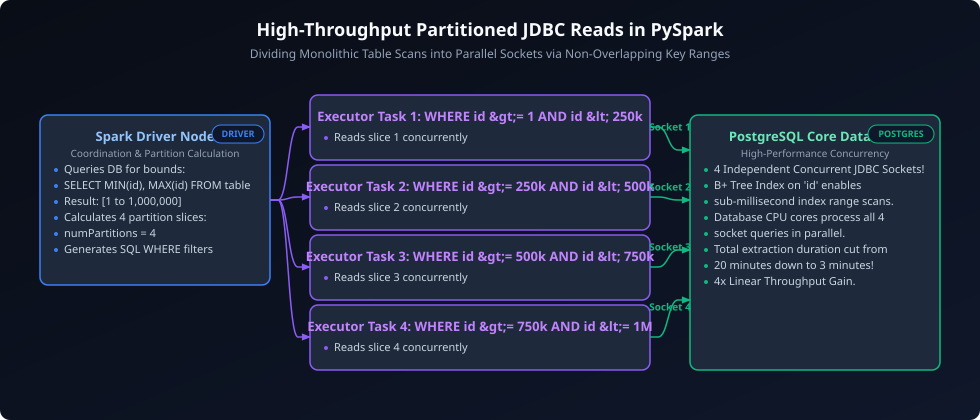

<details>
<summary>D2 Source</summary>

```d2
direction: right
title: High-Throughput Partitioned JDBC Reads in PySpark

driver: Spark Driver {
  calc: "Calculates 4 Non-Overlapping ID Ranges"
}

tasks: Spark Executor Tasks {
  t1: "Task 1: WHERE id >= 1 AND id < 250,000"
  t2: "Task 2: WHERE id >= 250,000 AND id < 500,000"
  t3: "Task 3: WHERE id >= 500,000 AND id < 750,000"
  t4: "Task 4: WHERE id >= 750,000 AND id <= 1,000,000"
}

db: PostgreSQL Database {
  sockets: "4 Concurrent JDBC Sockets"
}

driver -> tasks.t1
driver -> tasks.t2
driver -> tasks.t3
driver -> tasks.t4
tasks.t1 <-> db.sockets: "Concurrent Read"
tasks.t2 <-> db.sockets: "Concurrent Read"
tasks.t3 <-> db.sockets: "Concurrent Read"
tasks.t4 <-> db.sockets: "Concurrent Read"
```
</details>

#### Production Parallel JDBC Extraction Code
```python
from pyspark.sql import SparkSession

def parallel_jdbc_extract(spark: SparkSession) -> DataFrame:
    """
    Extracts a large relational table using parallel concurrent JDBC connections.
    Spawns 16 executor tasks reading non-overlapping ID slices simultaneously.
    """

# 25. Query bounds dynamically from database to avoid hardcoding min/max

bounds_df = spark.read.format("jdbc") \
        .option("url", "jdbc:postgresql://postgres.prod.corp:5432/app_db") \
        .option("dbtable", "(SELECT MIN(transaction_id) as min_id, MAX(transaction_id) as max_id FROM sales.transactions) as bounds") \
        .option("user", "lakehouse_extractor") \
        .option("password", "SecretToken123") \
        .load()
        
    bounds = bounds_df.collect()[0]
    min_id = bounds["min_id"]
    max_id = bounds["max_id"]

# 26. Parallel partitioned extraction

df_transactions = spark.read.format("jdbc") \
        .option("url", "jdbc:postgresql://postgres.prod.corp:5432/app_db") \
        .option("dbtable", "sales.transactions") \
        .option("user", "lakehouse_extractor") \
        .option("password", "SecretToken123") \
        .option("partitionColumn", "transaction_id") \
        .option("lowerBound", str(min_id)) \
        .option("upperBound", str(max_id)) \
        .option("numPartitions", "16") \
        .option("fetchsize", "10000") \
        .load()
        
    return df_transactions
```

---

# 7. API Ingestion Patterns

---

### 7.1 API Pagination Strategies (Offset vs. Page vs. Keyset Cursor)

When ingesting data from REST APIs (Salesforce, Stripe, GitHub, Shopify), data arrives in paginated responses:

| Pagination Architecture | API Request Query Pattern | Database Engine Execution Mechanism | Concurrency Hazard / Insertion Drift | Production Suitability |
| :--- | :--- | :--- | :--- | :--- |
| **Offset-Based Pagination** | `GET /orders?limit=100&offset=50000` | `SELECT * FROM orders OFFSET 50000 LIMIT 100`<br/>(Engine physically scans 50,100 index rows, then discards first 50,000!) | **Severe Record Drift:** If new rows are inserted during ingestion, existing records shift across page boundaries, causing duplicate reads or skipped records. | Flawed for large datasets ($> 10,000$ rows); permissible only for small static admin dashboards. |
| **Page-Based Pagination** | `GET /orders?page=500&size=100` | Syntactic sugar for offset (`offset = (page - 1) * size`). Identical $O(N)$ engine degradation. | Identical drift hazards as offset pagination. | Deprecated in high-scale enterprise ETL. |
| **Keyset / Cursor Pagination** | `GET /orders?limit=100&cursor=eyJpZCI6OTkxMn0=` | `SELECT * FROM orders WHERE id > 9912 ORDER BY id ASC LIMIT 100`<br/>(Direct $O(\log N)$ B+ Tree index seek to cursor boundary). | **Immune to Drift:** New inserts prior to or after the current cursor key never shift records across pages. | **Enterprise Production Standard:** Resumable, linear $O(1)$ per-page retrieval across billions of records. |

#### Production Python Keyset Cursor Extraction Loop
```python
import requests
from typing import Generator, Dict, Any

def fetch_all_records_cursor(base_url: str, auth_token: str) -> Generator[Dict[str, Any], None, None]:
    """
    Traverses cursor-paginated API endpoints safely until exhaustion.
    Yields records as a generator to maintain constant O(1) memory consumption.
    """
    headers = {"Authorization": f"Bearer {auth_token}", "Accept": "application/json"}
    cursor = None
    
    while True:
        params = {"limit": 100}
        if cursor:
            params["cursor"] = cursor
            
        response = requests.get(base_url, headers=headers, params=params, timeout=30.0)
        response.raise_for_status()
        payload = response.json()
        
        records = payload.get("data", [])
        if not records:
            break
            
        for record in records:
            yield record
            
        # Extract next cursor opaque token from pagination envelope
        cursor = payload.get("pagination", {}).get("next_cursor")
        if not cursor:
            # End of paginated dataset reached
            break
```

---

### 7.2 Rate Limiting: Exponential Backoff with Full Jitter

When calling external APIs, encountering HTTP `429 Too Many Requests` is inevitable. Simple static sleeps (`time.sleep(10)`) or simple backoff causes the **Thundering Herd Problem**: dozens of distributed workers wake up at the exact same microsecond, slamming the API and getting throttled again.

**Exponential Backoff with Full Jitter** introduces uniform randomness to break client synchronization:

$$\text{Sleep Duration} = \text{random}(0, \; \min(\text{MaxSleep}, \; \text{BaseSleep} \times 2^{\text{attempt}}))$$

```python
import time
import random
import requests
from typing import Dict, Any

def fetch_api_with_jitter_backoff(
    url: str,
    headers: Dict[str, str],
    max_retries: int = 5,
    base_sleep: float = 1.0,
    max_sleep: float = 60.0
) -> Dict[str, Any]:
    """
    Executes resilient HTTP requests honoring server Retry-After headers
    and implementing Exponential Backoff with Full Jitter.
    """
    attempt = 0
    while attempt < max_retries:
        try:
            response = requests.get(url, headers=headers, timeout=20.0)
            
            if response.status_code == 200:
                return response.json()
                
            elif response.status_code == 429 or 500 <= response.status_code <= 504:
                # Check for explicit Retry-After server header
                retry_after_header = response.headers.get("Retry-After")
                if retry_after_header:
                    sleep_duration = float(retry_after_header)
                else:
                    # Calculate Full Jitter sleep duration
                    calculated_backoff = min(max_sleep, base_sleep * (2 ** attempt))
                    sleep_duration = random.uniform(0, calculated_backoff)
                    
                print(f"[THROTTLED/ERROR {response.status_code}] Sleeping {sleep_duration:.2f}s before retry {attempt + 1}/{max_retries}")
                time.sleep(sleep_duration)
                attempt += 1
            else:
                # Fatal 4xx client errors (401 Unauthorized, 403 Forbidden, 404 Not Found)
                response.raise_for_status()
                
        except (requests.ConnectionError, requests.Timeout) as net_err:
            calculated_backoff = min(max_sleep, base_sleep * (2 ** attempt))
            sleep_duration = random.uniform(0, calculated_backoff)
            print(f"[NETWORK ERROR] {str(net_err)}. Sleeping {sleep_duration:.2f}s before retry {attempt + 1}")
            time.sleep(sleep_duration)
            attempt += 1
            
    raise TimeoutError(f"Exhausted all {max_retries} retries for endpoint: {url}")
```

---

### 7.3 Production API Authentication (OAuth 2.0 Client Credentials)

Enterprise SaaS APIs utilize the **OAuth 2.0 Client Credentials Grant** for machine-to-machine pipeline authentication.

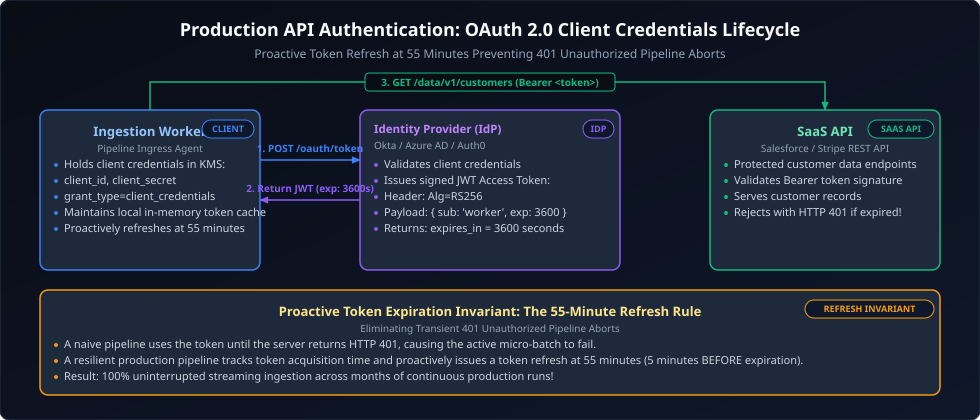

<details>
<summary>D2 Source</summary>

```d2
direction: right
title: Production API Authentication (OAuth 2.0 Client Credentials)

worker: Ingestion Worker {
  creds: "client_id, client_secret (Stored in KMS)"
}

idp: Identity Provider (Okta / Azure AD) {
  token: "Generates signed JWT Access Token (expires in 3600s)"
}

api: SaaS API (Salesforce / Stripe) {
  endpoint: "Protected endpoints (Validates Bearer token)"
}

worker -> idp: "1. POST /oauth/token (client_credentials)"
idp -> worker: "2. Return Access Token JWT (expires_in = 3600s)"
worker -> api: "3. Loop GET /customers (Header: Bearer <token>)"
api -> worker: "4. Return customer records"
```
</details>

---

# 8. Streaming Message Ingestion

---

### 8.1 Apache Kafka to Lakehouse Streaming Ingestion

Streaming data directly from Kafka brokers into Delta Lake or Apache Iceberg guarantees low-latency availability for real-time dashboards and ML feature stores:

```python
from pyspark.sql import SparkSession
from pyspark.sql.functions import col, from_json
from pyspark.sql.types import StructType, StructField, StringType, DoubleType, LongType

# 29. Connect to Kafka stream

df_kafka_raw = spark.readStream \
    .format("kafka") \
    .option("kafka.bootstrap.servers", "broker1:9092,broker2:9092") \
    .option("subscribe", "telemetry.clickstream") \
    .option("startingOffsets", "latest") \
    .option("maxOffsetsPerTrigger", 500000) \
    .option("failOnDataLoss", "false") \
    .load()

# 30. Deserialize Kafka binary byte arrays to string

# Kafka key, value, and headers arrive as binary arrays (VARBINARY)
df_deserialized = df_kafka_raw.selectExpr(
    "CAST(key AS STRING) as partition_key",
    "CAST(value AS STRING) as json_payload",
    "timestamp as kafka_broker_timestamp",
    "partition as kafka_partition",
    "offset as kafka_offset"
)

# 31. Parse JSON schema defensively

payload_schema = StructType([
    StructField("event_id", StringType(), False),
    StructField("user_id", LongType(), True),
    StructField("page_url", StringType(), True),
    StructField("duration_ms", DoubleType(), True)
])

df_parsed = df_deserialized.withColumn("data", from_json(col("json_payload"), payload_schema)) \
    .select("partition_key", "kafka_broker_timestamp", "kafka_partition", "kafka_offset", "data.*")

# 32. Write stream to Bronze Delta Table with ACID transactional checkpointing

query = df_parsed.writeStream \
    .format("delta") \
    .outputMode("append") \
    .option("checkpointLocation", "s3://lakehouse/checkpoints/clickstream_bronze/") \
    .toTable("bronze.raw_clickstream")
```

---

### 8.2 Azure Event Hubs to Lakehouse Ingestion

Azure Event Hubs provides an enterprise event streaming engine supporting native Kafka protocol ingestion.
- **Event Hubs Capture:** An automated feature that continuously dumps incoming event streams directly to Azure Data Lake Storage (ADLS Gen2) as compacted Avro files without writing any code.
- **Direct Streaming Integration:** Streamed directly into Azure Databricks using the Event Hubs Spark connector with Microsoft Entra ID (service principal) security.

---

# 9. Production Data Engineering Problem-Solution Master Playbook

In enterprise data engineering, production incidents cluster into 50 canonical failure modes spanning data quality, streaming backlogs, distributed compute bottlenecks, cluster latency, and regulatory compliance.

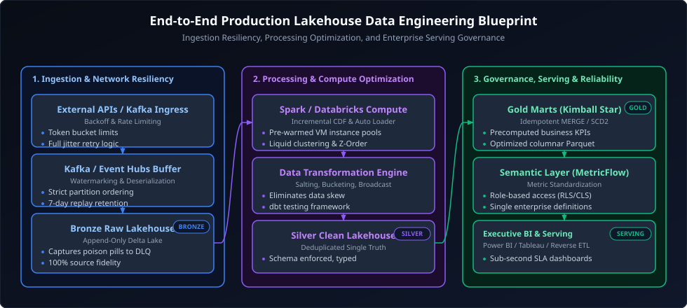

<details>
<summary>D2 Source</summary>

```d2
direction: right
title: End-to-End Production Lakehouse Data Engineering Blueprint

ingestion: 1. Ingestion & Network Resiliency {
  inlet: External APIs / Kafka
  buffer: Kafka / Event Hubs Buffer
  bronze: Bronze Raw Lakehouse (Captures DLQ)
  inlet -> buffer -> bronze
}

processing: 2. Processing & Compute Optimization {
  compute: Spark / Databricks Compute (Instance Pools)
  transform: Data Transformation Engine (Salting & Bucketing)
  silver: Silver Clean Lakehouse
  compute -> transform -> silver
}

governance: 3. Governance, Serving & Reliability {
  gold: Gold Marts (Kimball Star & SCD2)
  semantic: Semantic Layer (Metric Standardization)
  bi: Executive BI & Reverse ETL
  gold -> semantic -> bi
}

ingestion.bronze -> processing.compute: "Auto Loader / CDF"
processing.silver -> governance.gold: "Idempotent MERGE"
```
</details>

### The 50 Canonical Production Problems & Solutions Matrix

| # | Problem | Canonical Solution | Architectural Root Cause | Engineering Implementation & Curriculum Reference |
| :- | :--- | :--- | :--- | :--- |
| **1** | **Duplicate Records** | Deduplication | Network retries, non-idempotent pipeline re-runs, at-least-once streaming delivery. | Window deduplication `ROW_NUMBER() OVER (...)`, Delta `MERGE`, or streaming stateful deduplication. See [01. SQL](01_sql_and_advanced_querying.md#3-three-valued-logic--null-handling), [02. SQL](01_sql_and_advanced_querying.md#134-ranking-functions-row_number-rank-dense_rank-ntile), [10. Pipelines](08_etl_pipelines_orchestration_and_data_quality.md#26-deduplication-patterns-at-least-once-to-exactly-once). |
| **2** | **Late Arriving Data** | Watermarking | Mobile devices offline caching, intermittent network partitions. | Event-time watermarking with bounded allowed lateness window. See [10. Pipelines](08_etl_pipelines_orchestration_and_data_quality.md#28-watermarking-mechanics--state-eviction), [11. Streaming](07_streaming_kafka_and_event_driven_data.md#64-event-time-processing--watermarking-deep-dive). |
| **3** | **CDC Processing** | Change Data Feed (CDF) | Costly full-table scans to identify changed rows. | Log-based CDC (Debezium) and Delta Lake Change Data Feed (`table_changes`). See [09. Databricks](06_databricks_and_delta_lake.md#101-change-data-feed-cdf), [10. Pipelines](08_etl_pipelines_orchestration_and_data_quality.md#11-etl-vs-elt-architecture--processing-paradigms). |
| **4** | **Data Skew** | Salting | Severe cardinality imbalance on join/aggregation keys. | Salting join keys with random prefixes and AQE skew join handling. See [02. SQL](01_sql_and_advanced_querying.md#architectural-overview-relational-query-execution--processing-architecture), [05. Spark](05_apache_spark_and_pyspark.md#51-key-salting-for-extreme-data-skew). |
| **5** | **Small Files** | OPTIMIZE / Compaction | High-frequency streaming micro-batch commits creating thousands of tiny files. | Bin-packing compaction via Delta `OPTIMIZE table ZORDER BY (...)` and Auto-compaction. See [07. File Formats](03_data_modeling_and_lakehouse_storage.md), [09. Databricks](06_databricks_and_delta_lake.md#9-delta-performance--storage-optimization). |
| **6** | **Schema Changes** | Schema Evolution | Upstream microservices altering or adding payload fields. | Delta Lake `mergeSchema` and Confluent Schema Registry backward/forward compatibility. See [09. Databricks](06_databricks_and_delta_lake.md#84-acid-transactions--optimistic-concurrency-control-occ), [10. Pipelines](08_etl_pipelines_orchestration_and_data_quality.md#3-data-quality-contracts--governance). |
| **7** | **Pipeline Failures** | Dead Letter Queue (DLQ) | Poison pill records and schema validation aborts crashing streaming engines. | Isolating malformed records into a dedicated DLQ/quarantine topic or table. See [10. Pipelines](08_etl_pipelines_orchestration_and_data_quality.md#29-dead-letter-queues-dlq--quarantine-routing), [11. Streaming](07_streaming_kafka_and_event_driven_data.md#64-event-time-processing--watermarking-deep-dive). |
| **8** | **Data Quality Issues** | Data Validation Framework | Undetected null poisoning, corrupted distributions, broken business assumptions. | Automated assertion frameworks (Great Expectations, Soda Core, PyDeequ, dbt tests). See [09. Databricks](06_databricks_and_delta_lake.md#3-jobs-workflows--delta-live-tables-dlt), [10. Pipelines](08_etl_pipelines_orchestration_and_data_quality.md#3-data-quality-contracts--governance), [12. Orchestration](08_etl_pipelines_orchestration_and_data_quality.md#11-dbt-data-build-tool-modeling--transformation). |
| **9** | **Missing Data / Nulls** | Imputation / Default Values | Dropped sensor readings, optional form inputs, missing transaction attributes. | Statistical imputation (mean/median via Spark ML `Imputer`), window forward-fill, and domain default fallbacks. See [01. SQL](01_sql_and_advanced_querying.md#3-three-valued-logic--null-handling), [03. Python](02_python_for_data_and_systems.md#1-cpython-internals--the-memory-hierarchy), [08. Spark](05_apache_spark_and_pyspark.md#38-handling-nulls--missing-data-in-pyspark-imputation--default-values). |
| **10** | **Inconsistent Data Formats** | Standardization | Multi-source ingestion with diverging date formats, telephone regexes, and casing. | Medallion Silver canonical schema mapping and standardized string/date casting. See [06. Architecture](03_data_modeling_and_lakehouse_storage.md#03-data-architecture-dimensional-modeling--storage-formats-master-production-guide), [08. Spark](05_apache_spark_and_pyspark.md#32-pyspark-sql-functions--transformations). |
| **11** | **Large Data Volume** | Partitioning | Monolithic tables forcing petabyte-scale full filesystem scans. | Physical Hive directory partitioning by high-cardinality temporal attributes. See [04. Database Internals](04_database_internals_and_distributed_systems.md#110-storage-engine-showdown-b-trees-vs-lsm-trees), [07. File Formats](03_data_modeling_and_lakehouse_storage.md). |
| **12** | **Slow Queries** | Partition Pruning & Indexing | Unindexed query filters and unclustered data layouts. | Dynamic Partition Pruning (DPP), B-Tree / Clustered indexing, and Delta Liquid Clustering. See [02. SQL](01_sql_and_advanced_querying.md#architectural-overview-relational-query-execution--processing-architecture), [04. Database Internals](04_database_internals_and_distributed_systems.md#110-storage-engine-showdown-b-trees-vs-lsm-trees), [09. Databricks](06_databricks_and_delta_lake.md#9-delta-performance--storage-optimization). |
| **13** | **High Latency** | Caching | Repeatedly re-scanning raw storage disks for identical query results. | Distributed Redis caching, Spark `.cache()`, and Databricks Disk Cache. See [05. Distributed Systems](04_database_internals_and_distributed_systems.md#04-database-internals--distributed-systems-architecture-master-production-guide), [08. Spark](05_apache_spark_and_pyspark.md#53-caching--persistence-strategies). |
| **14** | **Frequent Reprocessing** | Incremental Processing | Rebuilding entire analytical warehouse tables on every scheduled execution. | Watermark high-watermark tracking and dbt incremental merge models. See [10. Pipelines](08_etl_pipelines_orchestration_and_data_quality.md#11-etl-vs-elt-architecture--processing-paradigms), [12. Orchestration](08_etl_pipelines_orchestration_and_data_quality.md#11-dbt-data-build-tool-modeling--transformation). |
| **15** | **Unnecessary Full Loads** | Incremental Loads | Transferring identical historical records from source OLTP systems repeatedly. | CDC log-based extraction and watermark column delta copy pipelines. See [10. Pipelines](08_etl_pipelines_orchestration_and_data_quality.md#11-etl-vs-elt-architecture--processing-paradigms), [13. Azure](08_etl_pipelines_orchestration_and_data_quality.md#12-end-to-end-enterprise-data-architecture-on-microsoft-azure). |
| **16** | **Manual Interventions** | Automation | Human-operated backfills, manual run triggering, and error recovery scripts. | Orchestrated DAGs in Apache Airflow and automated CI/CD DataOps delivery. See [12. Orchestration](08_etl_pipelines_orchestration_and_data_quality.md), [13. Azure](08_etl_pipelines_orchestration_and_data_quality.md#17-dataops-cicd--version-control). |
| **17** | **Monitoring Gaps** | Logging & Alerting | Silent pipeline failures discovered only after executive dashboard complaints. | Automated SLA tracking, Airflow alerting callbacks, and Prometheus metrics. See [10. Pipelines](08_etl_pipelines_orchestration_and_data_quality.md#212-pipeline-observability-metrics-logs--traces), [12. Orchestration](08_etl_pipelines_orchestration_and_data_quality.md), [14. Governance](09_unity_catalog_and_data_governance.md). |
| **18** | **Backfill Challenges** | Batch Backfill Strategy | Re-running historical date ranges overwhelming cluster resources and locking tables. | Idempotent date chunking, Airflow CLI backfilling with `catchup=False`. See [10. Pipelines](08_etl_pipelines_orchestration_and_data_quality.md), [12. Orchestration](08_etl_pipelines_orchestration_and_data_quality.md). |
| **19** | **Data Loss** | Checkpointing | Ephemeral executor crashes losing in-memory stream processing state. | Write-Ahead Logging (WAL) and persistent cloud checkpoint directories. See [08. Spark](05_apache_spark_and_pyspark.md#54-spark-storage-levels), [10. Pipelines](08_etl_pipelines_orchestration_and_data_quality.md#23-checkpointing--streaming-state-stores), [11. Streaming](07_streaming_kafka_and_event_driven_data.md). |
| **20** | **Out-of-Order Events** | Event Time Processing | Network latency and multi-threaded consumer processing reordering timestamps. | Event-time windowing using record generation timestamps rather than ingestion arrival times. See [10. Pipelines](08_etl_pipelines_orchestration_and_data_quality.md#27-late-arriving--out-of-order-data-handling), [11. Streaming](07_streaming_kafka_and_event_driven_data.md#64-event-time-processing--watermarking-deep-dive). |
| **21** | **Streaming Backlog** | Trigger Optimization | Unscheduled downtime accumulating millions of messages in Kafka. | `Trigger.AvailableNow` + `maxOffsetsPerTrigger` to safely drain backlogs in bounded chunks. See [11. Streaming](07_streaming_kafka_and_event_driven_data.md#07-streaming-apache-kafka--databricks-auto-loader-master-real-time-guide). |
| **22** | **Memory Pressure (OOM)** | Right-sizing & Caching | Unbounded `.collect()`, undersized executor working heaps, memory leaks. | Driver/executor memory right-sizing, off-heap configuration, and proactive unpersisting. See [08. Spark](05_apache_spark_and_pyspark.md#63-diagnosing-out-of-memory-oom-errors). |
| **23** | **Shuffle Bottlenecks** | Reduce Shuffles / AQE | Unnecessary wide transformations repartitioning gigabytes across network switches. | AQE partition coalescing (`spark.sql.adaptive.coalescePartitions.enabled`) and map-side aggregations. See [08. Spark](05_apache_spark_and_pyspark.md#19-shuffling-mechanics--network-spill), [08. Spark](05_apache_spark_and_pyspark.md#22-adaptive-query-execution-aqe). |
| **24** | **Slow Joins** | Broadcast Join | Network shuffling both sides of a join when one side is small. | Broadcast Hash Join (`broadcast(df)`), replicating the small table to all worker memory. See [02. SQL](01_sql_and_advanced_querying.md#architectural-overview-relational-query-execution--processing-architecture), [08. Spark](05_apache_spark_and_pyspark.md#41-broadcast-hash-join-bhj). |
| **25** | **Large Joins** | Bucketing / Partitioning | Two massive multi-gigabyte tables forcing exhaustive network shuffle exchanges. | Pre-bucketing both tables on the join key (`bucketBy().sortBy()`) to eliminate shuffle exchange. See [07. File Formats](03_data_modeling_and_lakehouse_storage.md), [08. Spark](05_apache_spark_and_pyspark.md#46-bucketing-for-large-joins-eliminating-shuffle-exchange). |
| **26** | **High Cost** | Cluster Optimization | Using expensive interactive all-purpose compute for scheduled production jobs. | Job clusters (3x cheaper than all-purpose), spot/preemptible worker nodes, single-node clusters. See [09. Databricks](06_databricks_and_delta_lake.md#2-databricks-compute-architecture), [09. Databricks](06_databricks_and_delta_lake.md#2-databricks-compute-architecture). |
| **27** | **Underutilized Clusters** | Auto Scaling & Auto Termination | Idle compute nodes running continuously during pipeline inactivity. | Dynamic worker autoscaling and aggressive auto-termination timeouts (15–20 minutes). See [09. Databricks](06_databricks_and_delta_lake.md#2-databricks-compute-architecture). |
| **28** | **Cluster Startup Delays** | Warm Pools / Cluster Pools | Cloud provider VM acquisition taking 5–8 minutes on every cluster launch. | Databricks Instance Pools maintaining pre-warmed VMs with preloaded runtimes (<30s launch). See [09. Databricks](06_databricks_and_delta_lake.md#2-databricks-compute-architecture). |
| **29** | **Security Issues** | RBAC & Unity Catalog | Shared root credentials, unsegmented object store buckets. | Role-Based Access Control (RBAC), Unity Catalog 3-level namespace, and Zero Trust security. See [09. Databricks](06_databricks_and_delta_lake.md#5-security--unity-catalog-governance), [14. Governance](09_unity_catalog_and_data_governance.md). |
| **30** | **Access Control Problems** | Fine-Grained Permissions | All-or-nothing access exposing sensitive columns (SSN, emails) and rows to unauthorized analysts. | Row-Level Security (RLS) filters and Column-Level Security (CLS) dynamic data masking. See [09. Databricks](06_databricks_and_delta_lake.md#5-security--unity-catalog-governance), [14. Governance](09_unity_catalog_and_data_governance.md). |
| **31** | **Secrets Management** | Secret Scopes / Key Vault | Hardcoded passwords and API tokens checked into Git repositories or notebooks. | Databricks Secret Scopes backed by Azure Key Vault or AWS Secrets Manager with log redaction. See [09. Databricks](06_databricks_and_delta_lake.md#5-security--unity-catalog-governance), [13. Azure](08_etl_pipelines_orchestration_and_data_quality.md#12-end-to-end-enterprise-data-architecture-on-microsoft-azure). |
| **32** | **Data Lineage Gaps** | Data Lineage Tools | Unknown upstream dependencies when altering schema or modifying business metrics. | Automated runtime lineage tracking via Unity Catalog, OpenLineage, and Microsoft Purview. See [06. Architecture](03_data_modeling_and_lakehouse_storage.md#03-data-architecture-dimensional-modeling--storage-formats-master-production-guide), [14. Governance](09_unity_catalog_and_data_governance.md). |
| **33** | **Poor Documentation** | Centralized Documentation | Tribal knowledge and undocumented column semantics causing analytical errors. | Centralized enterprise data dictionaries, dbt documentation generator, and automated catalog comments. See [06. Architecture](03_data_modeling_and_lakehouse_storage.md#03-data-architecture-dimensional-modeling--storage-formats-master-production-guide), [12. Orchestration](08_etl_pipelines_orchestration_and_data_quality.md#11-dbt-data-build-tool-modeling--transformation). |
| **34** | **Inconsistent Metrics** | Metric Standardization | Business logic divergence across Tableau, Power BI, Python, and SQL reports. | Centralized Semantic Layer (dbt Semantic Layer / MetricFlow, Cube) standardizing metrics as code. See [06. Architecture](03_data_modeling_and_lakehouse_storage.md#03-data-architecture-dimensional-modeling--storage-formats-master-production-guide), [12. Orchestration](08_etl_pipelines_orchestration_and_data_quality.md#11-dbt-data-build-tool-modeling--transformation). |
| **35** | **Data Drift** | Data Drift Detection | Shifts in upstream user behavior or external economic conditions degrading downstream models. | Continuous drift monitoring using Evidently AI, Population Stability Index (PSI), and KS tests. See [10. Pipelines](08_etl_pipelines_orchestration_and_data_quality.md#3-data-quality-contracts--governance), [14. Governance](09_unity_catalog_and_data_governance.md). |
| **36** | **Dimension Changes (SCD)** | SCD Type 2 | Overwriting historical customer or entity attributes destroying historical reporting truth. | SCD Type 2 dimension versioning with `valid_from`, `valid_to`, and `is_current` flags. See [02. SQL](01_sql_and_advanced_querying.md#151-merge--upsert-mechanics--change-data-capture-cdc), [06. Architecture](03_data_modeling_and_lakehouse_storage.md#03-data-architecture-dimensional-modeling--storage-formats-master-production-guide). |
| **37** | **Reference Data Updates** | Dimension Refresh Strategy | Reference tables (tax codes, postal regions) updating without triggering fact rebuilds. | Dimension refresh strategies: full snapshot reload, incremental CDC merge, or broadcast lookup cache. See [06. Architecture](03_data_modeling_and_lakehouse_storage.md#03-data-architecture-dimensional-modeling--storage-formats-master-production-guide). |
| **38** | **External API Failures** | Retry Logic / Backoff | Transient network blips, HTTP 502/503 errors, and socket drops. | Exponential backoff with full jitter and Circuit Breaker design patterns. See [05. Distributed Systems](04_database_internals_and_distributed_systems.md#04-database-internals--distributed-systems-architecture-master-production-guide), [10. Pipelines](08_etl_pipelines_orchestration_and_data_quality.md#24-backpressure-management--dynamic-rate-limiting). |
| **39** | **Rate Limiting** | Throttling / Queueing | Upstream APIs throttling requests with HTTP 429 Too Many Requests. | Token Bucket / Leaky Bucket rate limiting and message queue buffer throttling. See [05. Distributed Systems](04_database_internals_and_distributed_systems.md#04-database-internals--distributed-systems-architecture-master-production-guide), [10. Pipelines](08_etl_pipelines_orchestration_and_data_quality.md#24-backpressure-management--dynamic-rate-limiting). |
| **40** | **File Corruption** | File Validation & Checksums | Truncated file uploads and disk corruptions causing batch read failures. | Pre-flight cryptographic checksum validation (SHA-256, MD5) and Spark `PERMISSIVE` `_corrupt_record` mode. See [03. Python](02_python_for_data_and_systems.md#1-cpython-internals--the-memory-hierarchy), [08. Spark](05_apache_spark_and_pyspark.md#311-file-corruption--malformed-record-handling). |
| **41** | **Inconsistent Timestamps** | Time Standardization (UTC) | Upstream systems outputting mixed epoch encodings and naive strings. | Mandatory conversion to canonical timezone-aware UTC timestamps at Bronze ingestion. See [03. Python](02_python_for_data_and_systems.md#1-cpython-internals--the-memory-hierarchy), [08. Spark](05_apache_spark_and_pyspark.md#310-inconsistent-timestamps--time-zone-normalization-in-pyspark). |
| **42** | **Time Zone Issues** | Time Zone Normalization | Daylight Saving Time (DST) 1-hour gaps and overlaps corrupting hourly aggregations. | Timezone normalization using `zoneinfo` (`fold` attribute) and Spark `to_utc_timestamp()`. See [03. Python](02_python_for_data_and_systems.md#1-cpython-internals--the-memory-hierarchy), [08. Spark](05_apache_spark_and_pyspark.md#310-inconsistent-timestamps--time-zone-normalization-in-pyspark). |
| **43** | **Orphan Records** | Referential Integrity Checks | Lakehouses lacking physical foreign keys, fact records arriving before dimension entities. | Sentinel `-1` unknown member fallback keys, late-arriving stub insertion, and dbt `relationships` tests. See [06. Architecture](03_data_modeling_and_lakehouse_storage.md#215-referential-integrity--orphan-record-prevention-in-distributed-systems), [12. Orchestration](08_etl_pipelines_orchestration_and_data_quality.md#11-dbt-data-build-tool-modeling--transformation). |
| **44** | **Data Duplication Across Systems** | Idempotent Processing | Microservices emitting duplicate messages across distributed subscribers. | Idempotency keys, deterministic natural hash keys (SHA-256), and atomic upserts. See [05. Distributed Systems](04_database_internals_and_distributed_systems.md#5-distributed-computing-principles), [10. Pipelines](08_etl_pipelines_orchestration_and_data_quality.md#21-pipeline-idempotency-the-gold-standard). |
| **45** | **Slow ETL Jobs** | Optimize Code & Resources | Row-by-row Python UDF SerDe, uncoalesced partitions, unnecessary shuffles. | Replacing Python UDFs with Vectorized PyArrow `@pandas_udf`, enabling AQE, tuning memory. See [08. Spark](05_apache_spark_and_pyspark.md#66-end-to-end-spark-etl-optimization-playbook). |
| **46** | **High I/O Costs** | Data Compression | Uncompressed data consuming excessive cloud bandwidth and storage dollars. | Columnar compression (Snappy for high-throughput ELT, Zstandard / ZSTD for cold storage). See [07. File Formats](03_data_modeling_and_lakehouse_storage.md#6-compression-codecs--splittability). |
| **47** | **Data Retention Issues** | Lifecycle Policies | Storing old snapshots indefinitely, exceeding compliance bounds and budgets. | Cloud storage lifecycle transitions (Hot -> Cool -> Archive) and Delta `VACUUM` retention governance. See [07. File Formats](03_data_modeling_and_lakehouse_storage.md#73-storage-lifecycle-management-policies--worm-compliance), [09. Databricks](06_databricks_and_delta_lake.md#103-vacuum--retention-period-governance). |
| **48** | **Compliance & Governance** | Data Governance Framework | Regulatory liabilities under GDPR, CCPA, and HIPAA privacy mandates. | "Right to be Forgotten" cryptographic erasure, automated tagging, and audit trail logs. See [14. Governance](09_unity_catalog_and_data_governance.md#3-regulatory-compliance--lakehouse-privacy-engineering). |
| **49** | **Disaster Recovery** | Backup & Restore Strategy | Regional cloud datacenter outages, ransomware, or accidental table drop. | Multi-region storage geo-redundancy (GRS/RA-GRS) and incremental Delta `DEEP CLONE` replication. See [09. Databricks](06_databricks_and_delta_lake.md#102-shallow-clone-vs-deep-clone-disaster-recovery--replication), [09. Databricks](06_databricks_and_delta_lake.md#88-restore-table-disaster-recovery), [13. Azure](08_etl_pipelines_orchestration_and_data_quality.md#132-adls-gen2-hierarchical-namespace-hns-internals--posix-acls). |
| **50** | **End-to-End Visibility** | End-to-End Monitoring | Fragmented pipeline stages operating as black boxes without unified health telemetry. | 5 Pillars of Data Observability (Freshness, Volume, Schema, Distribution, Lineage) with centralized alerting. See [10. Pipelines](08_etl_pipelines_orchestration_and_data_quality.md#212-pipeline-observability-metrics-logs--traces), [14. Governance](09_unity_catalog_and_data_governance.md). |

> [!TIP]
> **Deep-Dive Interview Scenario:**
> - [Q30. Enterprise Data Governance & Access Control Using Unity Catalog](frequently_asked_questions/08_etl_pipelines_orchestration_and_data_quality_faq.md#q30-medium-enterprise-data-governance--access-control-using-unity-catalog)

---

# 10. Apache Airflow Core Architecture

In modern production data platforms, enterprise workloads separate the **orchestration layer** (scheduling, dependency management, sensor polling, cluster provisioning, alerting) from the **transformation layer** (in-warehouse compute, SQL logic, incremental merges). Apache Airflow provides a robust, Python-native control plane to schedule and monitor complex workflow graphs, while transformation engines like dbt execute pushdown compute within cloud warehouses.

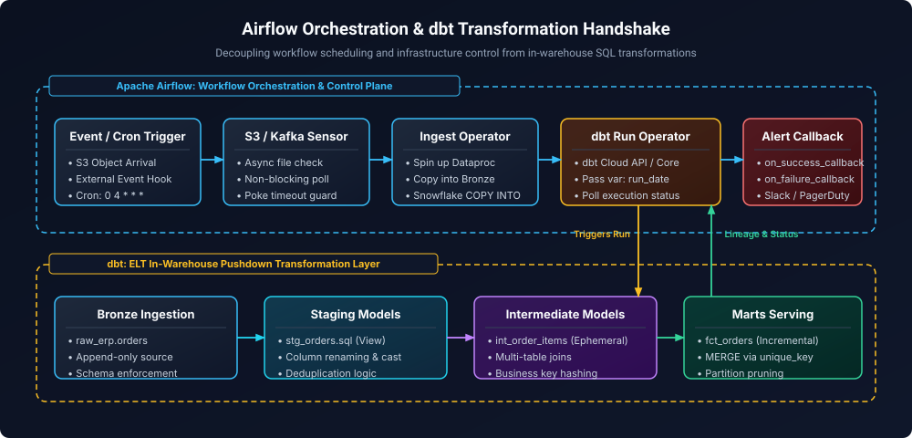

<details>
<summary>D2 Source</summary>

```d2
direction: down
classes: {
  control: { fill: "#1e293b"; stroke: "#38bdf8"; color: "#f8fafc" }
  dbt: { fill: "#451a03"; stroke: "#fbbf24"; color: "#fde68a" }
  marts: { fill: "#064e3b"; stroke: "#34d399"; color: "#a7f3d0" }
}

airflow: "Apache Airflow: Workflow Orchestration & Control Plane" {
  trigger: "Event / Cron Trigger" { class: control }
  sensor: "S3 / Kafka Sensor" { class: control }
  ingest: "Ingest Operator" { class: control }
  dbt_op: "dbt Run Operator" { class: dbt }
  alert: "Alert Callback" { fill: "#7f1d1d"; stroke: "#f87171"; color: "#fecaca" }

  trigger -> sensor -> ingest -> dbt_op -> alert
}

dbt_layer: "dbt: Pushdown Transformation Layer" {
  bronze: "Bronze Ingestion\n(raw_erp.orders)" { class: control }
  staging: "Staging Models\n(stg_orders View)" { fill: "#155e75"; stroke: "#22d3ee"; color: "#67e8f9" }
  intermediate: "Intermediate Models\n(int_order_items)" { fill: "#581c87"; stroke: "#c084fc"; color: "#e9d5ff" }
  marts: "Marts Serving\n(fct_orders Incremental)" { class: marts }

  bronze -> staging -> intermediate -> marts
}

airflow.dbt_op -> dbt_layer.bronze: "Triggers & Polls"
dbt_layer.marts -> airflow.dbt_op: "Lineage & Status"
```
</details>

### Deep-Dive Comparison: Apache Airflow vs. dbt

In modern data platform engineering, **Apache Airflow** and **dbt (Data Build Tool)** are often mentioned together, leading newcomers to mistakenly perceive them as competing technologies. In production architectures, however, they occupy fundamentally complementary tiers of the data lifecycle: Airflow acts as the **global orchestrator (control plane)**, while dbt acts as the **in-warehouse transformation engine (compute pushdown)**.

#### Architectural Separation of Concerns
1. **Apache Airflow (The Orchestration Control Plane):**
   - **Operational Philosophy:** Airflow does not process data itself; it schedules and monitors workflows across diverse heterogeneous systems. An Airflow DAG orchestrates external APIs, starts cloud compute clusters (Dataproc/EMR), invokes data loaders (Fivetran/Airbyte), kicks off Spark/Flink jobs, and triggers dbt runs.
   - **Execution Model:** Airflow schedules tasks based on time intervals or events, tracks state in a centralized metadata database (Postgres/MySQL), manages worker concurrency slots, and provides enterprise alerting (PagerDuty/Slack) when stages fail.

2. **dbt (The In-Warehouse Transformation Engine):**
   - **Operational Philosophy:** dbt focuses strictly on the **"T" in ELT**. It operates under the premise that raw data has already landed inside an elastic analytical data warehouse or lakehouse (Snowflake, BigQuery, Databricks, Redshift).
   - **Execution Model:** dbt compiles modular `SELECT` queries and Jinja templates into raw DDL/DML dialect statements and pushes the physical query execution entirely down into the warehouse compute layer. It enforces software engineering best practices—automated testing, documentation generation, and dynamic DAG lineage inference via `{{ ref() }}` and `{{ source() }}` macros.

| Architectural Dimension | Apache Airflow | dbt (Data Build Tool) |
| :--- | :--- | :--- |
| **Primary Scope** | General-purpose workflow orchestration and scheduling | In-warehouse SQL/Python data transformation and modeling |
| **Execution Model** | Control plane: Manages execution graphs across external engines | Pushdown engine: Compiles SQL and executes directly inside the target DWH |
| **Underlying Language** | Pure Python (DAGs, Operators, Hooks, Sensors) | Pure SQL + Jinja templating (plus optional Python models) |
| **State & Lineage** | Tracks TaskInstance state in Postgres/MySQL metadata database | Infers lineage dynamically via `{{ ref() }}` and `{{ source() }}` macros |
| **Data Movement** | Orchestrates compute across heterogenous systems (Spark, S3, APIs) | Zero data movement: Transforms data already loaded into warehouse tables |
| **Quality Testing** | Custom Python operators, SQLCheckOperators, external tools (Great Expectations) | Built-in generic schema tests (`unique`, `not_null`) & singular SQL assertions |
| **Failure Handling** | Retry policies, exponential backoff, dead-letter routing, SLAs | Halts downstream model builds on test or compile failure |
| **Extensibility** | Provider packages, Custom Operators, Hooks, Plugins, Custom XComs | dbt packages (e.g., `dbt-utils`, `dbt-expectations`), custom Jinja macros |

---

### 10.1 DAGs, Tasks, and Operators

#### Definition
- **DAG (Directed Acyclic Graph)**: A collection of tasks arranged in a directional graph without circular dependencies. It represents the workflow logic, execution schedule, and dependencies between units of work.
- **Operator**: A declarative template or class that defines a single, reusable unit of work (e.g., `BashOperator`, `PythonOperator`, `SQLExecuteQueryOperator`).
- **Task**: The instantiation of an Operator within the context of a DAG (e.g., `task_1 = BashOperator(...)`).
- **TaskInstance**: A specific run of a task bound to a concrete execution interval / `dag_run_id`, holding state in the metadata database (e.g., `queued`, `running`, `success`).

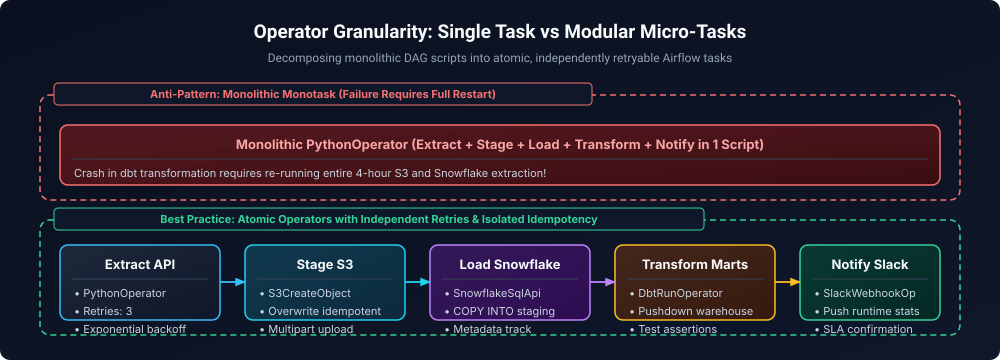

<details>
<summary>D2 Source</summary>

```d2
direction: right
classes: {
  task: { fill: "#1e293b"; stroke: "#38bdf8"; color: "#f8fafc" }
}

extract: "Extract Source API\n(PythonOperator)" { class: task }
stage: "Stage to S3\n(S3CreateObjectOperator)" { fill: "#155e75"; stroke: "#22d3ee"; color: "#67e8f9" }
load: "Load to Snowflake\n(SnowflakeSqlApiOperator)" { fill: "#581c87"; stroke: "#c084fc"; color: "#e9d5ff" }
transform: "Transform Marts\n(DbtRunOperator)" { fill: "#451a03"; stroke: "#fbbf24"; color: "#fde68a" }
notify: "Notify Data Team\n(SlackWebhookOperator)" { fill: "#064e3b"; stroke: "#34d399"; color: "#a7f3d0" }

extract -> stage -> load -> transform -> notify
```
</details>

#### Real-World Production Example: E-Commerce Pipeline
An e-commerce enterprise ingests daily transaction files from external payment gateways (Stripe, PayPal) stored in Cloud Storage, loads them into Snowflake, executes a suite of dbt models to update customer lifetime value (LTV) marts, and broadcasts downstream notifications.
- **Airflow** schedules the workflow daily at midnight, verifies source file arrival using deferrable sensors, provisions the Snowflake warehouse, triggers the dbt pipeline, and issues Slack alerts on failure.
- **dbt** builds the data models (`stg_orders`, `fct_orders`, `dim_customers`), enforces referential integrity constraints, and documents column-level data lineage.

---

### 10.2 Sensors & Deferrable Operators (Triggerer)

In distributed orchestration, pipelines frequently wait for external preconditions: an S3 file upload by a third-party vendor, a Databricks job completion, or a database partition readiness check. Choosing the wrong polling strategy can exhaust an entire worker fleet.

For hands-on coverage, consult GeeksforGeeks' [Airflow DAGs and Operators](https://www.geeksforgeeks.org/airflow-dags-and-operators/) and DataCamp's [Building an ETL Pipeline with Airflow](https://www.datacamp.com/tutorial/airflow-tutorial).

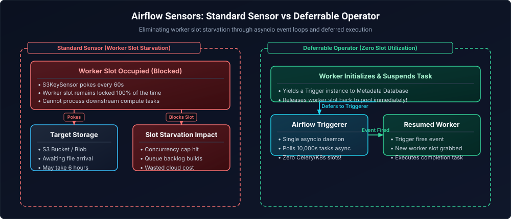

<details>
<summary>D2 Source</summary>

```d2
direction: right
classes: {
  standard: { fill: "#7f1d1d"; stroke: "#f87171"; color: "#fecaca" }
  deferrable: { fill: "#064e3b"; stroke: "#34d399"; color: "#a7f3d0" }
}

standard_sensor: "Standard Sensor (Worker Slot Starvation)" {
  slot: "Worker Slot 1\n(Occupied / Blocked)" { class: standard }
  s3_1: "S3 Bucket" { fill: "#1e293b"; stroke: "#38bdf8"; color: "#f8fafc" }
  starvation: "Resource Waste\n(Zero Task Slots Left)" { class: standard }

  slot -> s3_1: "Poke every 60s"
  slot -> starvation: "Locks worker slot"
}

deferrable_sensor: "Deferrable Operator (Zero Slot Utilization)" {
  init: "Worker Initializes" { class: deferrable }
  triggerer: "Airflow Triggerer\n(AsyncIO Event Loop)" { fill: "#155e75"; stroke: "#22d3ee"; color: "#67e8f9" }
  resumed: "New Worker Slot\n(Executes finish job)" { class: deferrable }

  init -> triggerer: "Releases slot & yields"
  triggerer -> resumed: "Event fired: File detected"
}
```
</details>

### Definitions: Polling Mechanisms

- **Sensor (`BaseSensorOperator`):** A specialized operator that continuously evaluates a condition at defined intervals (`poke_interval`) until it returns `True` or times out (`timeout`).
- **Poke Mode (`mode='poke'`):** The sensor occupies an active worker execution slot continuously, sleeping between checks.
- **Reschedule Mode (`mode='reschedule'`):** The sensor checks the condition; if unmet, it relinquishes its worker slot, transitions to `up_for_reschedule`, and is re-queued after the interval expires.
- **Deferrable Operator (Async Operator):** An operator that suspends itself when waiting for an external event, serializes its state into the metadata database, and offloads polling to the asynchronous **Airflow Triggerer** service. Upon event completion, the task is re-queued onto an active worker to complete execution.

### Sensor Mode Comparison Matrix

| Sensor Mode | Worker Slot Status | Triggerer Required? | Scalability Limit | Resource Impact |
|---|---|---|---|---|
| **Poke Mode** | Occupies worker process continuously throughout wait time. | No | Very Low (20 waiting sensors consume 20 worker slots). | **High**: Causes worker slot starvation and blocks production tasks. |
| **Reschedule Mode** | Releases slot between pokes; re-queues task after delay. | No | Moderate. | **Low to Moderate**: Repeated task startup/teardown introduces overhead. |
| **Deferrable (Async)** | **Suspends task immediately.** Hands polling to Triggerer async event loop. | **Yes** (`airflow triggerer` daemon) | **Near-Infinite**: A single Triggerer process handles thousands of concurrent waiting tasks. | **Negligible**: Zero worker resources consumed while waiting. |

### Code Comparison: Classic Sensor vs. Deferrable Sensor

```python
"""
sensors_vs_deferrable_comparison.py
Demonstrates standard sensors vs. modern deferrable operators in Airflow.
"""

from datetime import datetime, timedelta
from airflow import DAG
from airflow.sensors.filesystem import FileSensor
from airflow.providers.amazon.aws.sensors.s3 import S3KeySensor

default_args = {
    "owner": "data_engineering",
    "retries": 1,
}

with DAG(
    dag_id="file_ingestion_sensing_comparison",
    start_date=datetime(2026, 1, 1),
    schedule="@daily",
    catchup=False,
    default_args=default_args,
) as dag:

    # ---------------------------------------------------------
    # ANTI-PATTERN: Poke mode sensor waiting on an external file
    # Blocks an entire Celery worker slot for up to 2 hours!
    # ---------------------------------------------------------
    bad_poke_sensor = S3KeySensor(
        task_id="bad_poke_sensor",
        bucket_name="company-landing-zone",
        bucket_key="partner_data/incoming_feed.csv",
        mode="poke",
        poke_interval=60,       # Pokes every 60 seconds
        timeout=7200,           # Holds worker slot for up to 2 hours!
    )

    # ---------------------------------------------------------
    # ACCEPTABLE: Reschedule mode sensor
    # Releases worker slot between checks, re-queuing every 5 minutes
    # ---------------------------------------------------------
    good_reschedule_sensor = S3KeySensor(
        task_id="good_reschedule_sensor",
        bucket_name="company-landing-zone",
        bucket_key="partner_data/incoming_feed.csv",
        mode="reschedule",
        poke_interval=300,      # Checks every 5 minutes
        timeout=7200,
        soft_fail=True,         # If timeout occurs, mark as SKIPPED rather than FAILED
    )

    # ---------------------------------------------------------
    # PRODUCTION STANDARD: Deferrable Operator
    # Suspends execution instantly; offloads polling to Airflow Triggerer!
    # ---------------------------------------------------------
    best_deferrable_sensor = S3KeySensor(
        task_id="best_deferrable_sensor",
        bucket_name="company-landing-zone",
        bucket_key="partner_data/incoming_feed.csv",
        deferrable=True,        # Enables non-blocking async execution
        poke_interval=30,
        timeout=7200,
    )
```

**Code Explanation:**
- `deferrable=True`: Instructs Airflow to immediately yield a `Trigger` object. The worker releases the execution slot within milliseconds, while the `Airflow Triggerer` daemon monitors S3 asynchronously via `aiobotocore`. When the file arrives, the Triggerer emits an event, and the scheduler dispatches the task to a worker to finish execution.
- `soft_fail=True`: When a sensor times out, setting `soft_fail=True` transitions the task to `SKIPPED` rather than `FAILED`, allowing downstream branches configured with appropriate trigger rules to handle missing files gracefully.

### Key Points and Best Practices

- **The Sensor Deadlock Trap:** In clusters with a fixed worker concurrency limit (e.g., 16 worker slots), scheduling 16 DAG runs that all use `mode='poke'` sensors will consume every available slot. If the tasks responsible for producing the files are part of the same cluster, the entire system enters a permanent deadlock.
- **Always Define `timeout`:** Never deploy a sensor without an explicit `timeout` parameter. The default timeout is often 7 days (`60 * 60 * 24 * 7` seconds), which can leave failed tasks hanging indefinitely.
- **Standardize on Deferrable Operators:** For cloud providers (AWS, Azure, GCP, Databricks, Snowflake), use deferrable variants (`deferrable=True`) whenever tasks involve external waiting (e.g., `DatabricksSubmitRunOperator`, `BigQueryInsertJobOperator`).

---

### 10.3 Hooks & Connections Management

#### Definition
- **Connection:** Encrypted database records stored in the Airflow Metadata DB (or external secrets backends like AWS Secrets Manager / Azure Key Vault). Stores hostnames, ports, logins, and API tokens.
- **Hook:** Low-level Python abstraction layer that wraps external client libraries (e.g., `PostgresHook`, `S3Hook`, `HttpHook`). Hooks retrieve credentials from Connections automatically, handling retries and connection pooling without exposing secrets in DAG files.

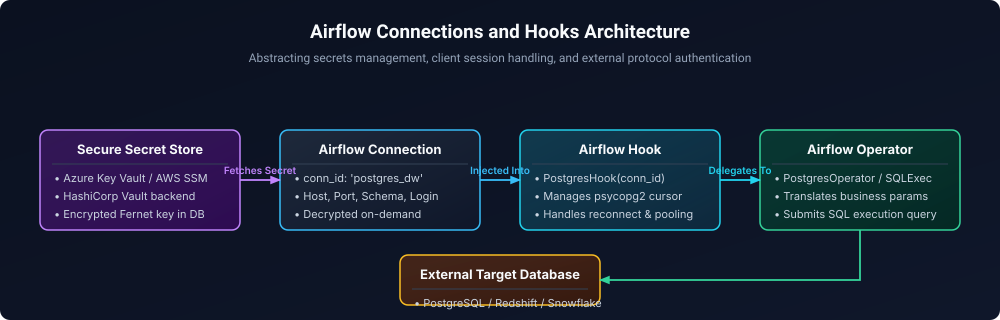

<details>
<summary>D2 Source</summary>

```d2
direction: right
classes: {
  secret: { fill: "#581c87"; stroke: "#c084fc"; color: "#e9d5ff" }
  conn: { fill: "#1e293b"; stroke: "#38bdf8"; color: "#f8fafc" }
  hook: { fill: "#155e75"; stroke: "#22d3ee"; color: "#67e8f9" }
  op: { fill: "#064e3b"; stroke: "#34d399"; color: "#a7f3d0" }
}

vault: "Key Vault / Encrypted DB\n(External Secrets)" { class: secret }
connection: "Airflow Connection\n('postgres_default')" { class: conn }
hook: "Airflow Hook\n(PostgresHook Client)" { class: hook }
operator: "Airflow Operator\n(PostgresOperator)" { class: op }
target: "External PostgreSQL Database" { fill: "#451a03"; stroke: "#fbbf24"; color: "#fde68a" }

vault -> connection: "Fetch Credentials"
connection -> hook: "Inject Config"
hook -> operator: "Session Management"
operator -> target: "Execute Query"
```
</details>

#### Code Example: Using Hooks in TaskFlow Python Functions
```python
from airflow.decorators import task
from airflow.providers.postgres.hooks.postgres import PostgresHook

@task
def query_customer_totals():
    # Automatically pulls credentials from 'postgres_analytics_dw' Connection
    pg_hook = PostgresHook(postgres_conn_id="postgres_analytics_dw")
    
    sql = "SELECT customer_id, SUM(order_total) FROM orders GROUP BY customer_id HAVING SUM(order_total) > 1000;"
    connection = pg_hook.get_conn()
    cursor = connection.cursor()
    cursor.execute(sql)
    records = cursor.fetchall()
    print(f"Extracted {len(records)} high-value customers.")
    return records
```

#### References
- [Apache Airflow Official Documentation: Hooks](https://airflow.apache.org/docs/apache-airflow/stable/authoring-and-scheduling/connections.html)
- [GeeksforGeeks: Airflow Connections and Hooks](https://www.geeksforgeeks.org/apache-airflow-connections-and-hooks/)

---

### 10.4 XComs & Custom XCom Backends

In Airflow, tasks run in isolated processes or completely separate containers. **XComs ("Cross-Communications")** provide the mechanism for tasks to exchange state information.

For conceptual overviews, see GeeksforGeeks' [What is Apache Airflow?](https://www.geeksforgeeks.org/what-is-apache-airflow/) and DataCamp's [Create a Customer Insights Pipeline with Airflow and dbt](https://www.datacamp.com/tutorial/airflow-tutorial).

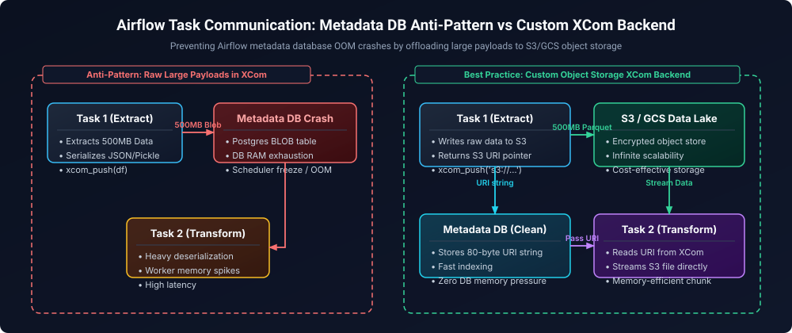

<details>
<summary>D2 Source</summary>

```d2
direction: right
classes: {
  danger: { fill: "#7f1d1d"; stroke: "#f87171"; color: "#fecaca" }
  clean: { fill: "#064e3b"; stroke: "#34d399"; color: "#a7f3d0" }
  norm: { fill: "#1e293b"; stroke: "#38bdf8"; color: "#f8fafc" }
}

anti_pattern: "Anti-Pattern: Raw Data in XCom" {
  t1: "Task 1 (Extract)" { class: norm }
  db_crash: "Airflow Metadata DB\n(BLOB Table OOM)" { class: danger }
  t2: "Task 2 (Transform)" { class: norm }

  t1 -> db_crash: "100MB DataFrame"
  db_crash -> t2: "Heavy Deserialization"
}

best_practice: "Best Practice: S3/GCS Object Storage Backend" {
  t1_good: "Task 1 (Extract)" { class: norm }
  s3: "S3 / GCS Bucket\n(Raw Data)" { class: clean }
  db_light: "Metadata DB\n(URI String only)" { fill: "#155e75"; stroke: "#22d3ee"; color: "#67e8f9" }
  t2_good: "Task 2 (Transform)" { fill: "#581c87"; stroke: "#c084fc"; color: "#e9d5ff" }

  t1_good -> s3: "Writes Parquet Payload"
  t1_good -> db_light: "Pushes 's3://...' URI"
  db_light -> t2_good: "Pulls URI pointer"
  s3 -> t2_good: "Direct S3 Stream"
}
```
</details>

### Definitions: XCom Architecture

- **XCom:** A key-value metadata entry stored in the Airflow metadata database (`xcom` table), defined by a `key`, `value`, `timestamp`, `execution_date`, `task_id`, and `dag_id`.
- **Custom XCom Backend:** A pluggable Python class inheriting from `BaseXCom` that overrides the serialization and deserialization methods (`serialize_value` and `deserialize_value`) to automatically redirect data payloads to external cloud storage (S3, GCS, ADLS) while writing only an object reference pointer to PostgreSQL.

### Comparison: Metadata Database XCom vs. Custom Object Storage Backend

| Architectural Characteristic | Default Metadata Database XCom | Custom Object Storage XCom Backend |
|---|---|---|
| **Underlying Storage** | PostgreSQL `BYTEA` or MySQL `BLOB` column. | Amazon S3, Google Cloud Storage, or Azure Blob Storage. |
| **Payload Size Limit** | Hard limits: MySQL ~64KB, PostgreSQL ~1GB (practical limit < 48KB). | Effectively unlimited (up to 5TB object size in S3/GCS). |
| **Scheduler Impact** | High. Large blobs saturate database connections and cause scheduler OOMs. | Negligible. Database stores only lightweight URI strings. |
| **Data Types Supported** | JSON-serializable primitives (dicts, lists, strings, numbers). | Arbitrary data types: Pandas DataFrames, PyArrow Tables, NumPy arrays, Polars. |
| **Configuration Complexity** | Zero (enabled out-of-the-box). | Requires custom class and `airflow.cfg` setting (`xcom_backend`). |

### Code Example: Production Pointer-Based Passing and Custom XCom Backend

```python
"""
custom_xcom_backend_pattern.py
Demonstrates custom XCom serialization and standard pointer-based data passing.
"""

import json
import uuid
from typing import Any
from airflow.models.xcom import BaseXCom
from airflow.decorators import dag, task
from datetime import datetime

# -------------------------------------------------------------------------
# Enterprise Pattern: Custom XCom Backend Implementation
# Configured via airflow.cfg: [core] xcom_backend = path.to.CustomS3XComBackend
# -------------------------------------------------------------------------
class CustomS3XComBackend(BaseXCom):
    PREFIX = "s3_xcom://"
    BUCKET_NAME = "enterprise-airflow-xcom-storage"

    @staticmethod
    def serialize_value(value: Any, **kwargs) -> Any:
        """
        Intercepts task return values. If large, writes to S3 and returns a URI pointer.
        """
        # Primitive lightweight types remain directly in the metadata DB
        if isinstance(value, (int, float, bool, str)) and len(str(value)) < 256:
            return BaseXCom.serialize_value(value)

        # For dictionaries, dataframes, or large payloads, redirect to cloud storage
        serialized_data = json.dumps(value).encode("utf-8")
        s3_key = f"xcom/{kwargs.get('dag_id')}/{kwargs.get('task_id')}/{uuid.uuid4()}.json"
        
        # In real production: boto3.client('s3').put_object(Bucket=BUCKET_NAME, Key=s3_key, Body=serialized_data)
        print(f"[XCom Backend] Redirected {len(serialized_data)} bytes to s3://{CustomS3XComBackend.BUCKET_NAME}/{s3_key}")
        
        return f"{CustomS3XComBackend.PREFIX}{s3_key}"

    @staticmethod
    def deserialize_value(result: Any) -> Any:
        """
        Detects storage URI pointers and transparently retrieves data from cloud storage.
        """
        if isinstance(result, str) and result.startswith(CustomS3XComBackend.PREFIX):
            s3_key = result.replace(CustomS3XComBackend.PREFIX, "")
            print(f"[XCom Backend] Fetching payload from s3://{CustomS3XComBackend.BUCKET_NAME}/{s3_key}")
            # In real production: response = boto3.client('s3').get_object(...)
            return {"status": "retrieved_from_s3", "data": [1, 2, 3]}
        return BaseXCom.deserialize_value(result)

# -------------------------------------------------------------------------
# Standard DAG Utilizing Pointer-Based Data Passing
# -------------------------------------------------------------------------
@dag(
    dag_id="safe_xcom_data_pipeline",
    start_date=datetime(2026, 1, 1),
    schedule="@daily",
    catchup=False,
    tags=["best_practices"],
)
def safe_xcom_data_pipeline():

    @task
    def extract_large_dataset() -> dict:
        """
        Extracts 1,000,000 records.
        Saves data directly to object storage; passes ONLY the URI pointer via XCom!
        """
        destination_s3_path = "s3://company-lake/raw/sales/2026-10-01/batch_01.parquet"
        print(f"Exported 1,000,000 records to: {destination_s3_path}")
        
        # Return lightweight metadata only!
        return {
            "s3_uri": destination_s3_path,
            "row_count": 1000000,
            "file_size_mb": 42.5,
        }

    @task
    def transform_dataset(extract_metadata: dict):
        """Consumes the lightweight pointer and reads data directly from storage."""
        s3_uri = extract_metadata["s3_uri"]
        row_count = extract_metadata["row_count"]
        print(f"Reading {row_count} records from {s3_uri} into Spark/Snowflake...")

    metadata = extract_large_dataset()
    transform_dataset(metadata)

safe_xcom_data_pipeline()
```

### Key Points and Best Practices

- **The XCom Data Warehouse Anti-Pattern:** Never push Pandas DataFrames, raw JSON files, or query result sets into XCom. Doing so bloats the PostgreSQL metadata database, strains connection pools, degrades webserver responsiveness, and can trigger out-of-memory (OOM) crashes across scheduler pods.
- **Pointer-Based Passing:** Treat Airflow XCom strictly as a **control bus**, never a **data bus**. Pass references (S3/GCS paths, database table names, batch IDs), and let the compute engines (Spark, Trino, Snowflake) read the underlying data directly from storage.
- **XCom Cleanup:** Implement automated maintenance DAGs (e.g., using `airflow.models.xcom.XCom.purge()`) to prune historical XCom records older than 30 or 90 days, keeping metadata database tables lean and responsive.

---

### 10.5 Modern TaskFlow API & Dynamic Task Mapping

Introduced in Airflow 2.0, the **TaskFlow API** provides a modern, Pythonic interface for authoring workflows using decorators (`@dag`, `@task`, `@task.branch`). It eliminates verbose boilerplate operators (`PythonOperator`) and automatically manages task dependencies and cross-task communication (XComs) through standard Python function arguments and return values.

For detailed tutorials on the TaskFlow paradigm, refer to GeeksforGeeks' [Airflow DAGs and Operators](https://www.geeksforgeeks.org/airflow-dags-and-operators/) and DataCamp's [Introduction to Airflow in Python](https://www.datacamp.com/courses/introduction-to-airflow-in-python).

### Definitions: TaskFlow and Dynamic Task Mapping

- **TaskFlow API:** A decorator-based framework (`@dag`, `@task`) that treats Python functions as first-class Airflow tasks, automatically wiring dependency graphs and serializing return values into XComs.
- **Dynamic Task Mapping (`.expand()`):** An Airflow 2.3+ capability that allows a task to spawn an arbitrary number of parallel task instances at runtime based on the output of an upstream task (e.g., generating 50 worker tasks for 50 discovered database tables).

### Practical Use Case

A financial institution must ingest and reconcile transaction partitions from multiple international branches (US, EU, APAC). The list of active branches fluctuates dynamically, and database access concurrency must be throttled to avoid exhausting connection pools.

### Production Implementation: Dynamic Partition Pipeline

```python
"""
production_financial_pipeline.py
Production-grade DAG demonstrating TaskFlow API, Dynamic Task Mapping (.expand),
worker concurrency pools, and retry policies.
"""

from datetime import datetime, timedelta
from airflow.decorators import dag, task
from airflow.models.baseoperator import chain

# Define default arguments applied to all tasks
default_args = {
    "owner": "data_engineering",
    "depends_on_past": False,
    "retries": 3,
    "retry_delay": timedelta(minutes=5),
    "retry_exponential_backoff": True,
    "max_retry_delay": timedelta(hours=1),
    "execution_timeout": timedelta(minutes=45),
    "email_on_failure": True,
    "email": ["alerts-de@company.com"],
}

@dag(
    dag_id="financial_revenue_pipeline",
    default_args=default_args,
    description="Extracts transactions, validates contracts, and loads curated marts",
    schedule="0 2 * * *",  # Runs daily at 02:00 UTC
    start_date=datetime(2026, 1, 1),
    catchup=False,
    max_active_runs=1,
    tags=["finance", "critical"],
)
def financial_revenue_pipeline():

    @task
    def get_source_partitions() -> list[str]:
        """
        Discovers active partitions to process dynamically at runtime.
        Returns a lightweight list of partition identifiers.
        """
        active_regions = ["region_us", "region_eu", "region_apac"]
        print(f"Discovered {len(active_regions)} active partitions: {active_regions}")
        return active_regions

    @task(pool="database_heavy_pool")
    def process_partition(partition_id: str) -> dict:
        """
        Processes an individual partition.
        Worker concurrency is strictly capped by the 'database_heavy_pool' slot limit.
        """
        print(f"Extracting and transforming: {partition_id}")
        
        # Production Best Practice: Return lightweight metadata only!
        # NEVER return full raw datasets or DataFrames via XCom!
        return {
            "partition": partition_id,
            "status": "COMPLETED",
            "record_count": 15400,
            "output_uri": f"s3://lakehouse-curated/finance/2026-10-01/{partition_id}.parquet"
        }

    @task
    def aggregate_audit_metrics(results: list[dict]):
        """
        Consolidates partition metadata and verifies record balance.
        Demonstrates collecting dynamic task mapping outputs into a single downstream task.
        """
        total_rows = sum(r["record_count"] for r in results)
        processed_partitions = [r["partition"] for r in results]
        
        print(f"Pipeline finished successfully!")
        print(f"Total partitions processed: {processed_partitions}")
        print(f"Total rows processed across all partitions: {total_rows}")

    # Orchestration: Dynamic Task Mapping (.expand) creates parallel tasks at runtime
    partitions = get_source_partitions()
    partition_results = process_partition.expand(partition_id=partitions)
    aggregate_audit_metrics(partition_results)

financial_revenue_pipeline()
```

### Advanced Dynamic Mapping with `.partial()`

In production scenarios, tasks often require a mix of constant static parameters (e.g., target environment or bucket names) and dynamic parameters (e.g., partition names). The `.partial()` method supplies invariant kwargs:

```python
@task
def load_data_to_snowflake(bucket: str, table: str, partition: str):
    print(f"Loading {partition} from {bucket} into {table}...")

# Pass static arguments via partial() and dynamically map the partition list
load_data_to_snowflake.partial(
    bucket="s3://enterprise-curated-lake",
    table="analytics.finance.fct_daily_orders"
).expand(
    partition=["2026-10-01", "2026-10-02", "2026-10-03"]
)
```

### Key Points and Best Practices

- **Concurrency Control via Pools:** When using Dynamic Task Mapping to generate dozens or hundreds of parallel tasks, assign tasks to an Airflow Pool (`pool="database_heavy_pool"`) configured in the Admin UI. This prevents parallel workers from overwhelming downstream databases with connection requests.
- **Task Return Serialization:** Values returned by `@task` functions are automatically serialized into the Airflow metadata database as XComs. Ensure returned data is lightweight (IDs, row counts, S3 URIs, status strings). Storing large JSON documents or raw rows will rapidly degrade database performance.
- **Type Annotations:** Always annotate `@task` signatures (e.g., `-> list[str]`). Type hints enhance code readability, simplify static analysis with mypy, and facilitate correct XCom deserialization.

---

### 10.6 Airflow 5-Component Architecture & Lifecycle State Machine

Apache Airflow is a distributed, horizontally scalable platform for authoring, scheduling, and monitoring workflows as code. Understanding its component topology is essential for diagnosing cluster bottlenecks, worker starvation, and database lock contention.

For an architectural breakdown, refer to GeeksforGeeks' [Apache Airflow Architecture](https://www.geeksforgeeks.org/apache-airflow-architecture/) and DataCamp's [Getting Started with Apache Airflow](https://www.datacamp.com/tutorial/airflow-tutorial).

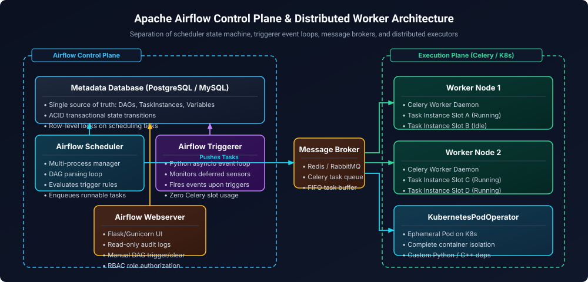

<details>
<summary>D2 Source</summary>

```d2
direction: right
classes: {
  control: { fill: "#1e293b"; stroke: "#38bdf8"; color: "#f8fafc" }
  worker: { fill: "#064e3b"; stroke: "#34d399"; color: "#a7f3d0" }
}

control_plane: "Airflow Control Plane" {
  db: "PostgreSQL / MySQL\nMetadata Database" { fill: "#581c87"; stroke: "#c084fc"; color: "#e9d5ff" }
  scheduler: "Airflow Scheduler\n(State Evaluator)" { class: control }
  triggerer: "Airflow Triggerer\n(Async Event Loop)" { fill: "#155e75"; stroke: "#22d3ee"; color: "#67e8f9" }
  webserver: "Airflow Webserver\n(Gunicorn UI)" { fill: "#451a03"; stroke: "#fbbf24"; color: "#fde68a" }

  scheduler -> db: "Read/Write State"
  triggerer -> db: "Poll Deferrals"
  webserver -> db: "User Action Audit"
}

broker: "Message Broker\n(Redis / RabbitMQ)" { fill: "#451a03"; stroke: "#fbbf24"; color: "#fde68a" }

execution_plane: "Execution Plane" {
  w1: "Worker Node 1\n(Celery Slots)" { class: worker }
  w2: "Worker Node 2\n(Celery Slots)" { class: worker }
  k8s: "KubernetesPodOperator\n(Isolated Pods)" { fill: "#155e75"; stroke: "#22d3ee"; color: "#67e8f9" }
}

control_plane.scheduler -> broker: "Enqueue Task Instances"
broker -> execution_plane.w1: "Pulls Task"
broker -> execution_plane.w2: "Pulls Task"
control_plane.scheduler -> execution_plane.k8s: "API Pod Launch"
```
</details>

### Definitions of Airflow Cluster Components

1. **Metadata Database (RDBMS):** The central state store (typically PostgreSQL or MySQL) recording DAG definitions, task instances, historical execution runs, variables, connections, and XCom metadata.
2. **Airflow Scheduler:** A multi-threaded background service that continuously parses DAG code files, evaluates data interval dependencies, creates `DagRun` and `TaskInstance` state rows in the database, and schedules executable tasks onto the executor queue.
3. **Airflow Triggerer:** An asynchronous Python `asyncio` event loop designed to handle hundreds of thousands of long-running, idle tasks (deferrable operators/sensors) without consuming worker slots.
4. **Airflow Webserver:** A Flask/Gunicorn-based web application rendering the user interface, DAG visual lineage, task logs, and providing a secure REST API.
5. **Worker Nodes:** Distributed execution processes that pull tasks from the executor queue, initialize execution environments, run task logic, and stream logs back to storage.
6. **Message Broker / Queue:** An intermediary queue service (Redis, RabbitMQ, or the Kubernetes API) used by distributed executors (like Celery) to buffer pending task execution messages dispatched by the scheduler.

### Task Instance Lifecycle State Machine

A task instance transitions through a deterministic series of states during execution:

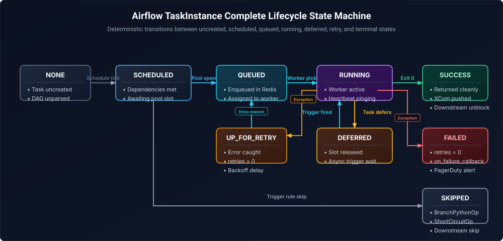

<details>
<summary>D2 Source</summary>

```d2
direction: right
classes: {
  sched: { fill: "#1e293b"; stroke: "#38bdf8"; color: "#f8fafc" }
  run: { fill: "#581c87"; stroke: "#c084fc"; color: "#e9d5ff" }
  def: { fill: "#451a03"; stroke: "#fbbf24"; color: "#fde68a" }
  succ: { fill: "#064e3b"; stroke: "#34d399"; color: "#a7f3d0" }
  fail: { fill: "#7f1d1d"; stroke: "#f87171"; color: "#fecaca" }
}

none: "NONE" { fill: "#1e293b"; stroke: "#64748b"; color: "#94a3b8" }
scheduled: "SCHEDULED" { class: sched }
queued: "QUEUED" { class: sched }
running: "RUNNING" { class: run }
deferred: "DEFERRED" { class: def }
retry: "UP_FOR_RETRY" { class: def }
success: "SUCCESS" { class: succ }
failed: "FAILED" { class: fail }

none -> scheduled: "Scheduler detects run"
scheduled -> queued: "Pool slot available"
queued -> running: "Worker acquires task"
running -> deferred: "Yields Trigger"
deferred -> queued: "Trigger event fired"
running -> retry: "Exception (retries > 0)"
retry -> queued: "Backoff delay expired"
running -> success: "Exit code 0"
running -> failed: "Retries exhausted"
```
</details>

---

### 10.7 Airflow Executors & Operational Cluster Management

#### Airflow Executor Architecture & Task Dispatch Mechanics
In Apache Airflow, the **Scheduler** is responsible for deciding *when* a task is ready to run (verifying upstream dependencies and timetables), but it does not execute the task code itself. The **Executor** is the pluggable operational mechanism responsible for *how* and *where* that task is physically executed across worker compute infrastructure.

Choosing the right executor dictates cluster resource utilization, multi-tenancy isolation, autoscaling responsiveness, and operational maintenance overhead:

1. **SequentialExecutor & LocalExecutor (Single-Node Workloads):**
   - **SequentialExecutor:** Uses a SQLite database and executes tasks one by one in the main process. Strictly intended for local development and smoke-testing; completely unsuitable for concurrent production.
   - **LocalExecutor:** Uses Python's `multiprocessing` library to spawn worker subprocesses on the same virtual machine as the Airflow Scheduler. Tasks communicate state via OS IPC pipes. Eliminates external message broker dependencies, making it optimal for modest, single-host production deployments with bounded concurrency.

2. **CeleryExecutor (Fixed-Fleet Distributed Workers):**
   - **Architecture:** Leverages Celery and an external message broker (RabbitMQ or Redis) to distribute task execution across a dedicated fleet of persistent worker nodes.
   - **Performance:** Offers ultra-fast task pickup latency ($< 100\text{ms}$) because worker processes and Python virtual environments are pre-warmed and running continuously. However, it requires continuous cluster maintenance, does not isolate Python package dependencies between tasks, and incurs high idle compute costs when workloads ebb.

3. **KubernetesExecutor (Dynamic Container-Per-Task Isolation):**
   - **Architecture:** Employs the Kubernetes API to launch a dedicated, ephemeral Kubernetes Pod for every individual task instance. When a task completes, its Pod terminates and releases cluster memory/CPU.
   - **Production Enterprise Standard:** Eliminates worker idle costs (true scale-to-zero), provides 100% environment isolation (different tasks can run entirely different Docker images, Python versions, and CUDA drivers), and scales horizontally to thousands of parallel tasks without worker slot starvation.

4. **CeleryKubernetesExecutor (Hybrid Architecture):**
   - **Architecture:** Simultaneously runs both Celery workers and the Kubernetes API watcher. Tasks can specify which queue they target: fast, lightweight tasks route to persistent Celery workers, while resource-intensive, isolated tasks route to on-demand Kubernetes Pods.

### Airflow Executors Comparison Matrix

| Executor | Scaling Mechanism | Operational Complexity | Worker Slot Idle Cost | Best Production Use Case |
|---|---|---|---|---|
| **SequentialExecutor** | Single process (SQLite). Runs 1 task at a time sequentially. | Minimal (zero configuration). | Low | Local testing and development only. **Never use in production.** |
| **LocalExecutor** | Spawns multiple worker processes on the same machine as the scheduler via multiprocessing. | Low (single VM). | Fixed VM cost. | Small-to-medium single-node production environments with moderate task volumes. |
| **CeleryExecutor** | Distributes tasks across a fleet of persistent Celery worker VMs via Redis or RabbitMQ queues. | Moderate to High (requires broker, workers, Flower monitoring). | High (workers run continuously even when idle). | High-throughput, low-latency task execution where worker warm-up latency must be near-zero (< 100ms). |
| **KubernetesExecutor** | Dynamically spawns a dedicated, isolated Kubernetes Pod for every individual task instance. | Moderate (requires K8s cluster and Helm setup). | **Zero idle cost** (pods terminate immediately upon task completion). | **Enterprise multi-tenant standard**: dynamic autoscaling, complete dependency isolation per task, and zero idle resource waste. |
| **CeleryKubernetesExecutor** | Hybrid: Routes routine tasks to Celery workers and heavy/isolated tasks to K8s Pods. | High | Moderate | Mixed enterprise workloads balancing ultra-low latency with heavy isolated compute jobs. |

### Operational CLI Commands and Cluster Configuration

Production Airflow administrators rely on the CLI for database lifecycle management, user provisioning, and worker management:

```bash
# Initialize or upgrade metadata database schema
airflow db migrate

# Create an enterprise admin user with Role-Based Access Control (RBAC)
airflow users create \
    --username dataops_admin \
    --firstname Jane \
    --lastname Doe \
    --role Admin \
    --email admin-de@enterprise.com \
    --password "SecureProductionSecret123!"

# Verify scheduler health and heartbeat
airflow jobs check --job-type SchedulerJob

# Launch individual cluster daemons (typically handled via systemd or K8s Helm charts)
airflow scheduler -D
airflow webserver -p 8080 -D
airflow triggerer -D
airflow celery worker -q default,heavy_compute -c 8
```

### Key Architectural Pitfalls and Best Practices

- **The Database Connection Pool Exhaustion Trap:** In `CeleryExecutor` or `KubernetesExecutor` setups with hundreds of concurrent workers, each worker task opens direct connections to PostgreSQL. Without a connection pooler like **PgBouncer**, the metadata database will exhaust its maximum connection limit (`max_connections`), locking up the entire cluster.
- **Top-Level Code Latency:** Airflow schedulers parse all Python files in the `dags/` folder continuously (every `min_file_process_interval` seconds, default 30s). Any top-level code (e.g., executing `requests.get()`, reading an S3 file, or querying a database outside a task function) will run on every single parse loop, spiking scheduler CPU to 100% and delaying task dispatch.
- **Shared Storage for Logs:** In multi-node Celery and Kubernetes clusters, configure remote task logging to cloud object storage (S3, GCS, or ADLS) via `airflow.cfg` (`remote_logging = True`) so task logs are viewable from the Web UI regardless of which worker node ran the task.

---

### 10.8 Dynamic DAG Generation

Generating dozens of DAGs programmatically from a single configuration file (YAML/JSON dictionary) to eliminate boilerplate code.

---

### 10.9 Backfilling, Scheduling Timetables, and Data Intervals

A foundational source of confusion in Airflow is the distinction between **Logical Date (formerly `execution_date`)**, **Data Interval**, and **Actual Run Time**.

For hands-on scheduling tutorials, consult GeeksforGeeks' [Airflow DAGs and Operators](https://www.geeksforgeeks.org/airflow-dags-and-operators/) and DataCamp's [Introduction to Airflow in Python](https://www.datacamp.com/courses/introduction-to-airflow-in-python).

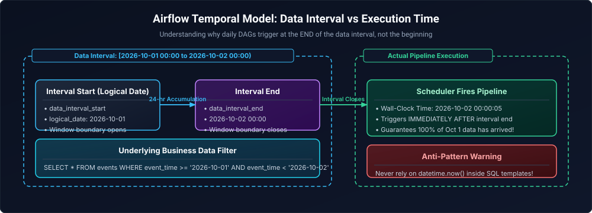

<details>
<summary>D2 Source</summary>

```d2
direction: right
classes: {
  interval: { fill: "#1e293b"; stroke: "#38bdf8"; color: "#f8fafc" }
  exec: { fill: "#064e3b"; stroke: "#34d399"; color: "#a7f3d0" }
}

interval_box: "Data Interval: [2026-10-01 00:00 to 2026-10-02 00:00]" {
  start: "Data Interval Start\n(Logical Date: 2026-10-01)" { class: interval }
  end: "Data Interval End\n(2026-10-02 00:00)" { class: interval }

  start -> end: "24-Hour Collection"
}

exec_box: "Actual Execution" {
  trigger: "Scheduler Triggers Run\n(2026-10-02 00:00:05)\nImmediately after interval closes!" { class: exec }
}

interval_box.end -> exec_box.trigger: "Fires DAG Run"
```
</details>

### Definitions: Temporal Concepts in Airflow

- **Data Interval (`data_interval_start` & `data_interval_end`):** The precise time window covering the data that the DAG run is intended to process.
- **Logical Date (`logical_date`):** Formerly referred to as `execution_date`. Represents the beginning of the data interval (`data_interval_start`). It is **not** the wall-clock timestamp when the pipeline actually runs.
- **Start Date (`start_date`):** The historical timestamp marking when the DAG's schedule begins evaluating. A DAG will not schedule any run whose interval starts before this date.
- **Catchup (`catchup`):** A boolean setting on the DAG. If set to `True`, the scheduler automatically generates historical DAG runs for every completed data interval between `start_date` and the current date.

> [!IMPORTANT]
> **The Golden Rule of Airflow Scheduling:** A daily DAG scheduled for `@daily` (midnight) covering October 1st **does NOT run on October 1st at midnight**. It executes on **October 2nd at 00:00:01**, immediately after the full October 1st data collection window has completely closed!

### Common Cron and Preset Timetables

| Schedule Preset | Cron Equivalent | Interval Duration | When Does It First Run? |
|---|---|---|---|
| `@hourly` | `0 * * * *` | 1 hour | At the end of the first hour (e.g., interval `[01:00, 02:00)` runs at `02:00:01`). |
| `@daily` | `0 0 * * *` | 24 hours | At the end of the day (interval `[2026-10-01, 2026-10-02)` runs on `2026-10-02 00:00:01`). |
| `@weekly` | `0 0 * * 0` | 7 days | At midnight on Sunday night / Monday morning following the week. |
| `@monthly` | `0 0 1 * *` | 1 calendar month | At midnight on the 1st of the subsequent month. |
| `None` | (No schedule) | N/A | Only triggered manually via UI or externally via Airflow REST API. |

### Code Example: Building Idempotent Bounded Queries Using Airflow Context

Idempotent pipelines produce identical results regardless of how many times they are rerun. Airflow provides execution context variables (`data_interval_start`, `data_interval_end`, and `ds`) that allow tasks to query exact data partitions deterministically.

```python
"""
idempotent_partition_extract.py
Demonstrates consuming Airflow data interval parameters for deterministic queries.
"""

from datetime import datetime, timedelta
import pendulum
from airflow.decorators import dag, task

@dag(
    dag_id="idempotent_order_extract",
    schedule="0 1 * * *",  # Runs daily at 01:00 UTC (processes previous day's [00:00, 24:00))
    start_date=pendulum.datetime(2026, 1, 1, tz="UTC"),
    catchup=False,
    max_active_runs=1,
    default_args={
        "owner": "analytics_ops",
        "retries": 3,
        "retry_delay": timedelta(minutes=2),
    },
    tags=["core", "idempotency"],
)
def idempotent_order_extract():

    @task
    def extract_transactions(**context) -> str:
        """
        Extracts transaction records strictly bounded by the data interval.
        Accesses interval boundaries from the injected Airflow runtime context.
        """
        # Retrieve interval boundaries as Pendulum datetime objects
        interval_start = context["data_interval_start"].to_iso8601_string()
        interval_end = context["data_interval_end"].to_iso8601_string()
        ds = context["ds"]  # YYYY-MM-DD formatted string representing logical date

        print(f"Executing idempotent extraction for Logical Date (ds): {ds}")
        print(f"Data Interval Window: [{interval_start} -> {interval_end}]")

        # Bounded SQL query: Completely deterministic and safe to re-run!
        bounded_sql = f"""
            SELECT transaction_id, user_id, amount, transaction_timestamp
            FROM raw_transactions
            WHERE transaction_timestamp >= '{interval_start}'
              AND transaction_timestamp < '{interval_end}';
        """
        print(f"Executing query:\n{bounded_sql}")
        
        # Simulate loading extracted data to an idempotent partition location
        destination_partition = f"s3://company-lakehouse/raw/transactions/date={ds}/"
        return destination_partition

    @task
    def validate_partition(partition_path: str):
        print(f"Validating row counts and checksums at: {partition_path}")

    # Wire task dependencies
    partition_location = extract_transactions()
    validate_partition(partition_location)

idempotent_order_extract()
```

### Backfilling and Historical Reprocessing

When business logic changes or new models are introduced, data teams must recalculate months or years of historical data. Airflow provides a safe, parallelized CLI backfill engine:

```bash
# Reprocess historical daily partitions from January 1, 2026 to January 31, 2026
# --reset-dagruns clears existing records and forces clean re-execution
airflow dags backfill \
    --start-date 2026-01-01 \
    --end-date 2026-01-31 \
    --reset-dagruns \
    --verbose \
    idempotent_order_extract
```

### Key Caveats and Best Practices

- **The Dynamic `datetime.now()` Trap:** Never set `start_date=datetime.now()`. Because Airflow parses DAG files dynamically, `datetime.now()` updates on every evaluation cycle. The scheduler will perceive the start date as constantly shifting forward, resulting in tasks that never trigger. Always use fixed, deterministic dates (e.g., `pendulum.datetime(2026, 1, 1, tz="UTC")`).
- **The Catchup Avalanche:** Setting `catchup=True` on a DAG with a `start_date` months or years in the past will instantly flood the executor queue with hundreds of simultaneous DAG runs, overwhelming databases and external APIs. Set `catchup=False` by default; perform historical reloads intentionally using the CLI backfill command.
- **Timezone Standardization:** Always declare DAG start dates and timetables using explicit timezones (preferably UTC) via `pendulum.timezone("UTC")` to prevent schedule irregularities caused by Daylight Saving Time (DST) shifts.

---

### 10.10 Pools, Slots & Concurrency Throttling

Airflow **Pools** limit the number of concurrent task instances connecting to resource-constrained external systems (e.g., restricting max concurrent connections to an operational ERP database to 5 slots).

---

### 10.11 Trigger Rules and Advanced DAG Control Flow

By default, an Airflow task executes only when all direct upstream tasks have completed with `success` (`trigger_rule="all_success"`). In production workflows, pipelines require conditional branching, error recovery, and guaranteed resource cleanup (e.g., terminating an ephemeral cluster even if processing crashes).

For more on conditional workflows, review GeeksforGeeks' [Airflow DAGs and Operators](https://www.geeksforgeeks.org/airflow-dags-and-operators/).

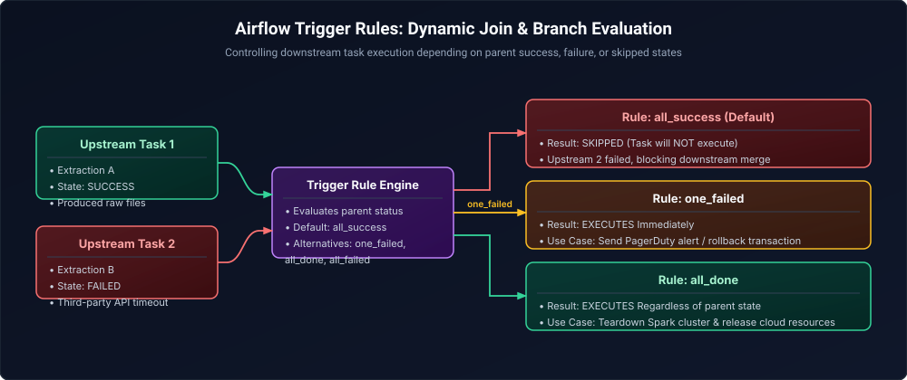

<details>
<summary>D2 Source</summary>

```d2
direction: right
classes: {
  succ: { fill: "#064e3b"; stroke: "#34d399"; color: "#a7f3d0" }
  fail: { fill: "#7f1d1d"; stroke: "#f87171"; color: "#fecaca" }
  eval: { fill: "#581c87"; stroke: "#c084fc"; color: "#e9d5ff" }
}

up1: "Upstream Task 1 (Succeeds)" { class: succ }
up2: "Upstream Task 2 (Fails)" { class: fail }

join: "Trigger Rule Check" { class: eval }

stop: "Blocked: Task Skipped\n(all_success default)" { class: fail }
alert: "Executes: Send Incident Alert\n(one_failed)" { fill: "#451a03"; stroke: "#fbbf24"; color: "#fde68a" }
cleanup: "Executes: Teardown Cluster\n(all_done)" { class: succ }

up1 -> join
up2 -> join
join -> stop: "all_success"
join -> alert: "one_failed"
join -> cleanup: "all_done"
```
</details>

### Definitions: Airflow Trigger Rules

A **Trigger Rule** is a condition evaluated by the scheduler before dispatching a downstream task instance. It inspects the final states (`success`, `failed`, `skipped`, `upstream_failed`) of all direct parent tasks.

### Trigger Rules Reference Matrix

| Trigger Rule Enum | Condition Required for Downstream Execution | Common Enterprise Use Case |
|---|---|---|
| `all_success` (Default) | All direct upstream tasks have completed with `success`. | Standard linear ETL pipeline dependency. |
| `all_failed` | All direct upstream tasks have `failed`. | Fallback failover pipelines. |
| `all_done` | All direct upstream tasks have terminated (`success`, `failed`, or `skipped`). | **Guaranteed resource cleanup** (e.g., shutting down ephemeral Spark clusters or dropping temporary staging tables). |
| `one_failed` | At least one direct upstream task has `failed`. | Immediate error alerting (Slack, PagerDuty, email dispatch). |
| `one_success` | At least one direct upstream task has `success` (does not wait for all to finish). | First-response routing or redundant data source racing. |
| `none_failed` | All upstream tasks succeeded or were skipped; none failed. | Tasks directly following conditional branch operators (`BranchPythonOperator`). |
| `none_failed_min_one_success` | All upstream tasks completed, none failed, and at least one succeeded. | Branch joins where at least one processing path was executed. |
| `all_skipped` | All direct upstream tasks have been `skipped`. | Specialized skip logging or default fallbacks. |

### Code Example: Guaranteed Teardown and Error Alerting

```python
"""
trigger_rules_production_lifecycle.py
Demonstrates Branching, Teardown Cleanup (all_done), and Alerting (one_failed).
"""

from datetime import datetime
from airflow.decorators import dag, task
from airflow.utils.trigger_rule import TriggerRule

@dag(
    dag_id="cluster_lifecycle_with_trigger_rules",
    start_date=datetime(2026, 1, 1),
    schedule="@daily",
    catchup=False,
    tags=["infra", "resilience"],
)
def cluster_lifecycle_with_trigger_rules():

    @task
    def provision_ephemeral_cluster() -> str:
        cluster_id = "spark-cluster-prod-9842"
        print(f"Provisioned ephemeral cloud cluster: {cluster_id}")
        return cluster_id

    @task.branch
    def choose_processing_branch() -> str:
        """Dynamically decides whether to run full batch or delta batch."""
        import random
        # Simulate business decision
        is_delta = True
        return "run_delta_transformation" if is_delta else "run_full_transformation"

    @task
    def run_delta_transformation(cluster_id: str):
        print(f"Running incremental delta job on {cluster_id}...")

    @task
    def run_full_transformation(cluster_id: str):
        print(f"Running full refresh job on {cluster_id}...")

    @task(trigger_rule=TriggerRule.NONE_FAILED_MIN_ONE_SUCCESS)
    def join_branches():
        """Joins after branching without getting skipped by the inactive branch."""
        print("Data transformation branch completed successfully.")

    @task(trigger_rule=TriggerRule.ONE_FAILED)
    def send_incident_alert():
        """Fires immediately if ANY upstream task fails."""
        print("ALERT: One or more upstream tasks failed! Notifying on-call DataOps...")

    @task(trigger_rule=TriggerRule.ALL_DONE)
    def teardown_ephemeral_cluster(cluster_id: str):
        """
        CRITICAL: Guaranteed teardown!
        Executes whether the data processing succeeded, failed, or was skipped.
        Prevents orphaned clusters and cloud billing leaks.
        """
        print(f"Terminating ephemeral cloud cluster: {cluster_id}")

    # Build dependency graph
    cid = provision_ephemeral_cluster()
    branch = choose_processing_branch()
    
    t_delta = run_delta_transformation(cid)
    t_full = run_full_transformation(cid)
    
    cid >> branch >> [t_delta, t_full]
    
    join = join_branches()
    [t_delta, t_full] >> join
    
    # Teardown always executes after processing finishes
    [t_delta, t_full, join] >> teardown_ephemeral_cluster(cid)
    
    # Alert fires if any processing step fails
    [t_delta, t_full, join] >> send_incident_alert()

cluster_lifecycle_with_trigger_rules()
```

### Key Points and Best Practices

- **The "Cascading Skip" Trap:** When using `@task.branch` or `BranchPythonOperator`, tasks on unselected paths are marked as `skipped`. If a downstream join task uses the default `all_success` trigger rule, Airflow treats the skipped upstream task as unmet, causing the join task and all subsequent tasks to be skipped! Always use `none_failed_min_one_success` or `none_failed` on tasks that join divergent branches.
- **Orphaned Cloud Resources:** Always wrap multi-node cloud clusters (EMR, Dataproc, Databricks) in a terminal task with `trigger_rule=TriggerRule.ALL_DONE`. Failing to do so can result in orphaned, running compute instances that accumulate thousands of dollars in cloud charges after an unhandled pipeline exception.

---

### 10.12 SLAs, Callbacks & Enterprise Alerting

Enterprise pipelines require robust observability, strict delivery guarantees, and automated alerting to notify on-call engineers before business consumers notice data delays.

For alerting strategies, refer to DataCamp's [Building an ETL Pipeline with Airflow](https://www.datacamp.com/tutorial/airflow-tutorial).

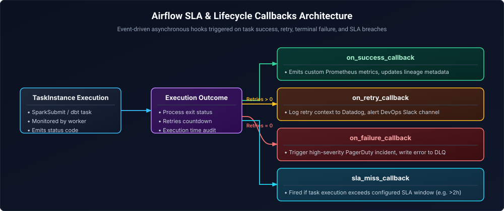

<details>
<summary>D2 Source</summary>

```d2
direction: right
classes: {
  exec: { fill: "#1e293b"; stroke: "#38bdf8"; color: "#f8fafc" }
  hook_g: { fill: "#064e3b"; stroke: "#34d399"; color: "#a7f3d0" }
  hook_r: { fill: "#7f1d1d"; stroke: "#f87171"; color: "#fecaca" }
  hook_a: { fill: "#451a03"; stroke: "#fbbf24"; color: "#fde68a" }
  hook_c: { fill: "#155e75"; stroke: "#22d3ee"; color: "#67e8f9" }
}

task: "Task Instance Execution" { class: exec }
state: "Execution Outcome" { fill: "#581c87"; stroke: "#c084fc"; color: "#e9d5ff" }

success_cb: "Execute: on_success_callback" { class: hook_g }
retry_cb: "Execute: on_retry_callback" { class: hook_a }
fail_cb: "Execute: on_failure_callback\n(Slack / PagerDuty)" { class: hook_r }
sla_cb: "Execute: sla_miss_callback" { class: hook_c }

task -> state
state -> success_cb: "Succeeds"
state -> retry_cb: "Fails (Retries Left)"
state -> fail_cb: "Fails (Retries Exhausted)"
state -> sla_cb: "Exceeds SLA Window"
```
</details>

### Definitions: SLAs and Callbacks

- **Service Level Agreement (SLA):** A configured time limit (`sla=timedelta(...)`) specifying the maximum expected elapsed time between a DAG's `data_interval_start` and the completion of a specific task.
- **Callbacks:** Python callable functions automatically invoked by Airflow when a task instance or DAG run undergoes a state transition:
  - `on_failure_callback`: Triggered when a task exhausts all retry attempts and enters the `FAILED` state.
  - `on_retry_callback`: Triggered every time a task encounters an error but has remaining retries.
  - `on_success_callback`: Triggered when a task completes successfully.
  - `sla_miss_callback`: Triggered by the scheduler when a task misses its configured SLA deadline.

### Code Example: Enterprise Alerting with Custom Callbacks

```python
"""
production_alerting_callbacks.py
Demonstrates enterprise-grade failure and SLA callbacks integrating with Slack/Teams.
"""

from datetime import datetime, timedelta
from airflow.decorators import dag, task
import requests

def send_slack_alert(context: dict, alert_type: str = "FAILURE"):
    """
    Constructs and dispatches a rich Slack webhook notification upon task failure.
    Extracts runtime context: DAG ID, Task ID, execution date, log URL, and exception.
    """
    ti = context.get("task_instance")
    dag_id = context.get("dag").dag_id
    task_id = ti.task_id
    execution_date = context.get("ts")
    log_url = ti.log_url
    exception = context.get("exception", "No explicit exception recorded.")

    slack_payload = {
        "text": f"🚨 *Airflow Pipeline {alert_type} Alert*",
        "attachments": [
            {
                "color": "#FF0000" if alert_type == "FAILURE" else "#FFA500",
                "fields": [
                    {"title": "DAG", "value": dag_id, "short": True},
                    {"title": "Task", "value": task_id, "short": True},
                    {"title": "Execution Date", "value": execution_date, "short": False},
                    {"title": "Error Message", "value": f"```{str(exception)[:300]}```", "short": False},
                    {"title": "Log URL", "value": f"<{log_url}|View Task Instance Logs>", "short": False},
                ],
            }
        ],
    }
    
    # In production:
    # webhook_url = BaseHook.get_connection("slack_webhook").get_password()
    # requests.post(webhook_url, json=slack_payload, timeout=5)
    print(f"[SLACK ALERT DISPATCHED] {slack_payload['text']} for {dag_id}.{task_id}")

default_args = {
    "owner": "financial_dataops",
    "retries": 2,
    "retry_delay": timedelta(minutes=3),
    "on_failure_callback": lambda ctx: send_slack_alert(ctx, alert_type="FAILURE"),
    "on_retry_callback": lambda ctx: send_slack_alert(ctx, alert_type="RETRY_WARNING"),
}

@dag(
    dag_id="sla_monitored_revenue_pipeline",
    default_args=default_args,
    start_date=datetime(2026, 1, 1),
    schedule="0 4 * * *",  # Runs daily at 04:00 UTC
    catchup=False,
    sla_miss_callback=lambda dag, task_list, blocking_task_list, slas, blocking_tis: print(
        f"SLA MISSED! The following tasks exceeded their SLA: {task_list}"
    ),
    tags=["monitoring", "sla"],
)
def sla_monitored_revenue_pipeline():

    @task(
        execution_timeout=timedelta(minutes=30),  # Hard kill task if it runs over 30 mins
        sla=timedelta(hours=2),                   # Alert if not finished 2 hours after interval start
    )
    def calculate_daily_pnl():
        print("Calculating daily Profit and Loss...")
        # Simulate processing logic

    calculate_daily_pnl()

sla_monitored_revenue_pipeline()
```

### Key Differences: `execution_timeout` vs. `sla`

| Parameter | What It Measures | What Action Occurs When Breached? | Where It Is Handled |
|---|---|---|---|
| `execution_timeout` | The wall-clock execution duration of a **single task attempt** on a worker. | **Hard termination**: Task is killed (`AirflowTaskTimeout`), retried or marked `FAILED`. | Worker process. |
| `sla` | The elapsed time from the **start of the data interval** to task completion. | **Non-terminating alert**: Triggers `sla_miss_callback` and sends emails; task continues running. | Scheduler daemon. |

---

### 10.13 Orchestrator Comparison: Airflow vs Prefect vs Dagster

Data orchestration has evolved through three distinct generational philosophies, transitioning from rigid workflow scheduling to highly dynamic, asset-centric data engineering platforms:

1. **Apache Airflow (The Workflow-Centric Patriarch):**
   - **Mental Model:** A **directed acyclic graph (DAG) of tasks**. Tasks are defined as discrete executable actions (`extract >> transform >> load`). Airflow tracks whether tasks succeeded or failed, but is largely agnostic to the actual data produced or consumed by those tasks.
   - **Production Role:** Dominates enterprise infrastructure. Unmatched breadth of provider integrations (AWS, Azure, GCP, Snowflake, Databricks), mature security governance, and massive enterprise adoption.

2. **Prefect (The Developer-Centric Dynamic Python Engine):**
   - **Mental Model:** **Code as Workflows**. Any standard Python function can become an orchestrator task simply by decorating it with `@task` or `@flow`.
   - **Dynamic DAGs:** Eliminates Airflow's static DAG parsing restrictions. Tasks can pass native Python objects directly to downstream functions, dynamically spawn loops at runtime based on API responses, and run locally without requiring a dedicated scheduler daemon.

3. **Dagster (The Asset-Centric Data Platform):**
   - **Mental Model:** **Software-Defined Assets (SDAs)**. Instead of defining *what tasks to run*, engineers define *what data assets should exist* and how they relate to upstream dependencies via `@asset`.
   - **Data-Aware Orchestration:** Dagster understands the underlying dataset schemas, row counts, partition states, and lineage. It schedules materialization jobs based on data freshness SLAs rather than arbitrary clock triggers.

| Feature | Apache Airflow | Prefect | Dagster |
| :--- | :--- | :--- | :--- |
| **Mental Model** | **Workflow / Task-Centric** (DAG of steps) | **Task-Centric** (Python functions) | **Asset-Centric** (Software-Defined Assets) |
| **Data Passing** | Weak (Historically metadata XComs) | Strong (First-class parameter returns) | **Native Asset Materialization** |
| **Dynamic Workflows** | Moderate (Requires dynamic code generation) | Native dynamic DAGs at runtime | Native dynamic graph generation |
| **Market Share** | **Industry Giant (>75% Enterprise adoption)** | Growing cloud footprint | Rapidly growing in modern data teams |

---

### 10.14 Ecosystem Integration: dbt + Airflow (Cosmos)

The modern standard for orchestrating dbt within Apache Airflow is **Astronomer Cosmos** (`astronomer-cosmos`). Instead of running entire dbt projects inside an opaque `BashOperator(bash_command="dbt run")` (which hides individual model status in Airflow UI), Cosmos dynamically parses the dbt project manifest and renders each dbt model as a native Airflow Task within an Airflow `TaskGroup`.

```python
from datetime import datetime
from pathlib import Path
from airflow import DAG
from airflow.operators.empty import EmptyOperator

# In enterprise setups with astronomer-cosmos installed:
# from cosmos import DbtTaskGroup, ProjectConfig, ProfileConfig, RenderConfig
# from cosmos.profiles import SnowflakeUserPasswordProfileMapping

with DAG(
    dag_id="dbt_cosmos_orchestration_enterprise",
    start_date=datetime(2026, 1, 1),
    schedule="@daily",
    catchup=False,
) as dag:

    pre_check = EmptyOperator(task_id="pre_check_raw_data")
    post_notification = EmptyOperator(task_id="notify_pipeline_complete")

    # Cosmos parses the dbt manifest and creates an individual Airflow Task
    # for each stg_, int_, and fct_ model, exposing full DAG lineage in the UI:
    #
    # dbt_tg = DbtTaskGroup(
    #     group_id="dbt_transformation_layer",
    #     project_config=ProjectConfig(manifest_path="/usr/local/airflow/dbt/target/manifest.json"),
    #     profile_config=ProfileConfig(
    #         profile_name="enterprise_dwh",
    #         target_name="prod",
    #         profile_mapping=SnowflakeUserPasswordProfileMapping(conn_id="snowflake_dwh_conn"),
    #     ),
    # )

    pre_check >> post_notification
```

> [!TIP]
> **Deep-Dive Interview Scenarios:**
> - [Q37. Making ETL Pipelines Idempotent After Partial Failures and Airflow Retries](frequently_asked_questions/08_etl_pipelines_orchestration_and_data_quality_faq.md#q37-medium-making-etl-pipelines-idempotent-after-partial-failures-and-airflow-retries)
> - [Q38. Strict Airflow Task Sequential Execution & Failure Handling (`T1 >> T2 >> T3`)](frequently_asked_questions/08_etl_pipelines_orchestration_and_data_quality_faq.md#q38-medium-strict-airflow-task-sequential-execution--failure-handling-t1--t2--t3)
> - [Q39. Upstream Dependency Cascade & Critical Path Delay Propagation](frequently_asked_questions/08_etl_pipelines_orchestration_and_data_quality_faq.md#q39-medium-upstream-dependency-cascade--critical-path-delay-propagation)
> - [Q40. Reusable Metadata-Driven ETL Framework with Multi-Source Ingestion & Dynamic Validation](frequently_asked_questions/08_etl_pipelines_orchestration_and_data_quality_faq.md#q40-medium-reusable-metadata-driven-etl-framework-with-multi-source-ingestion--dynamic-validation)
> - [Q41. Relational Source (PostgreSQL) 90% CPU Spike During Ingestion: Diagnostic Playbook](frequently_asked_questions/08_etl_pipelines_orchestration_and_data_quality_faq.md#q41-hard-relational-source-postgresql-90-cpu-spike-during-ingestion-diagnostic-playbook)
> - [Q42. Production Deployment Failure Rate Spike: Rollback vs Fix-Forward Decision Matrix](frequently_asked_questions/08_etl_pipelines_orchestration_and_data_quality_faq.md#q42-easy-production-deployment-failure-rate-spike-rollback-vs-fix-forward-decision-matrix)
> - [Q43. Azure Data Factory (ADF) Latency Triage Runbook (20 Min to 2 Hours)](frequently_asked_questions/08_etl_pipelines_orchestration_and_data_quality_faq.md#q43-hard-azure-data-factory-adf-latency-triage-runbook-20-min-to-2-hours)
> - [Q44. Incremental ADLS Gen2 Ingestion Across 12,000+ Files Without Directory Scan Bottlenecks](frequently_asked_questions/08_etl_pipelines_orchestration_and_data_quality_faq.md#q44-hard-incremental-adls-gen2-ingestion-across-12000-files-without-directory-scan-bottlenecks)
> - [Q45. Multi-Trigger Concurrency & Idempotency Safeguards in ADF](frequently_asked_questions/08_etl_pipelines_orchestration_and_data_quality_faq.md#q45-medium-multi-trigger-concurrency--idempotency-safeguards-in-adf)
> - [Q46. Dynamic Metadata-Driven ADF Ingestion Framework for 500+ Enterprise Tables](frequently_asked_questions/08_etl_pipelines_orchestration_and_data_quality_faq.md#q46-medium-dynamic-metadata-driven-adf-ingestion-framework-for-500-enterprise-tables)
> - [Q47. Upstream Database Outage Recovery & Safe Pipeline Replay (Azure SQL Down)](frequently_asked_questions/08_etl_pipelines_orchestration_and_data_quality_faq.md#q47-medium-upstream-database-outage-recovery--safe-pipeline-replay-azure-sql-down)
> - [Q48. Zero-Downtime Data Pipeline Deployment & Instant Rollback Strategies](frequently_asked_questions/08_etl_pipelines_orchestration_and_data_quality_faq.md#q48-expert-zero-downtime-data-pipeline-deployment--instant-rollback-strategies)

---

# 11. dbt (Data Build Tool) Modeling & Transformation

dbt enables analytics engineers to transform raw data already residing in cloud data warehouses (Snowflake, BigQuery, Databricks, Redshift) using software engineering best practices: version control, modular SQL modeling, testing assertions, continuous integration, and automated data documentation.

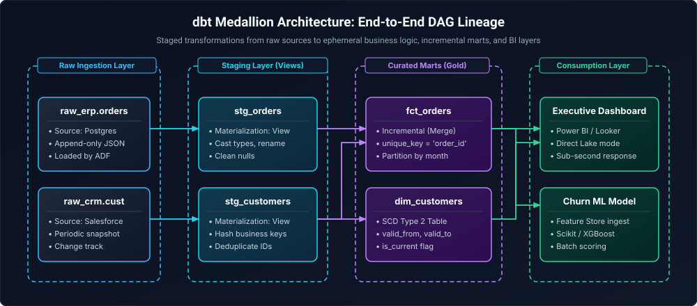

<details>
<summary>D2 Source</summary>

```d2
direction: right
classes: {
  raw: { fill: "#1e293b"; stroke: "#38bdf8"; color: "#f8fafc" }
  stg: { fill: "#155e75"; stroke: "#22d3ee"; color: "#67e8f9" }
  mart: { fill: "#581c87"; stroke: "#c084fc"; color: "#e9d5ff" }
  bi: { fill: "#064e3b"; stroke: "#34d399"; color: "#a7f3d0" }
}

sources: "Raw Ingestion Layer" {
  s1: "raw_erp.orders" { class: raw }
  s2: "raw_crm.customers" { class: raw }
}

staging: "Staging Layer: Views" {
  stg1: "stg_orders (View)" { class: stg }
  stg2: "stg_customers (View)" { class: stg }
}

marts: "Curated Marts: Incremental & Tables" {
  fct: "fct_orders (Incremental Merge)" { class: mart }
  dim: "dim_customers (SCD Type 2)" { class: mart }
}

bi_layer: "Downstream Consumption Layer" {
  dash: "Looker / Tableau Executive Dashboard" { class: bi }
  ml: "Customer Churn ML Model" { class: bi }
}

sources.s1 -> staging.stg1
sources.s2 -> staging.stg2
staging.stg1 -> marts.fct
staging.stg2 -> marts.fct
staging.stg2 -> marts.dim
marts.fct -> bi_layer.dash
marts.dim -> bi_layer.dash
marts.fct -> bi_layer.ml
```
</details>

---

### 11.1 dbt Core vs dbt Cloud

- **dbt Core:** Open-source command-line tool (CLI) invoked via `dbt run`, `dbt test`, and orchestrated in Airflow/GitLab.
- **dbt Cloud:** Hosted SaaS platform with a web-based IDE, job scheduler, semantic layer interface, and CI/CD integration.

---

### 11.2 dbt Models & SQL-First Transformation

#### Definition
A dbt model is a single `SELECT` statement residing in a `.sql` file inside the `models/` directory. dbt wraps this query in DDL/DML (e.g., `CREATE TABLE AS SELECT` or `MERGE INTO`) to persist the relation into the data warehouse. Models reference upstream tables using the `{{ ref('model_name') }}` and `{{ source('source_name', 'table_name') }}` Jinja macros, establishing an automated dependency DAG.

#### Staging Layer Model Implementation (`models/staging/stg_orders.sql`)
Staging models clean, rename, and cast raw source fields without applying business aggregation:

```sql
{{ config(
    materialized='view',
    schema='staging',
    tags=['hourly', 'staging']
) }}

WITH raw_orders AS (
    SELECT * FROM {{ source('ecommerce_raw', 'orders') }}
),

renamed_and_cast AS (
    SELECT
        CAST(order_id AS VARCHAR(64))            AS order_id,
        CAST(customer_id AS VARCHAR(64))         AS customer_id,
        CAST(order_date AS DATE)                 AS order_date,
        LOWER(TRIM(order_status))                AS order_status,
        CAST(net_amount_cents / 100.0 AS NUMERIC(18, 2)) AS net_amount_usd,
        CAST(_loaded_at AS TIMESTAMP_NTZ)        AS ingested_at
    FROM raw_orders
)

SELECT * FROM renamed_and_cast
```

> For SQL Common Table Expression (CTE) syntax, inlining vs materialization semantics, and modular query patterns, see [02. Advanced SQL](01_sql_and_advanced_querying.md#123-common-table-expressions-ctes-inlining-vs-optimization-fences). For foundational SQL data types, safe conversions, and string functions, see [01. SQL Fundamentals](01_sql_and_advanced_querying.md#2-data-types-casting--defensive-conversions).

---

### 11.3 Materialization Strategies

dbt provides four primary materialization strategies configured via `dbt_project.yml` or within individual model `{{ config(...) }}` blocks:

| Materialization | Underlying DDL Executed | Storage Footprint | Refresh Latency / Cost | Recommended Use Case |
| :--- | :--- | :--- | :--- | :--- |
| **`view`** | `CREATE OR REPLACE VIEW ... AS SELECT` | Zero (stores query metadata only) | High query latency; zero write cost | Staging layer, lightweight data cleanup, low-frequency queries |
| **`table`** | `CREATE OR REPLACE TABLE ... AS SELECT` | Full relation size | Heavy compute cost on rebuild; fast reads | Aggregated presentation marts with complex transformations (< 10M rows) |
| **`incremental`** | `MERGE INTO ... USING` or `INSERT INTO` | Persistent storage with append/upsert | Minimal compute cost; transforms only new/updated records | High-volume fact tables (billions of rows), append-heavy event logs |
| **`ephemeral`** | Inlined CTE in downstream queries (`WITH ... AS`) | Zero (never written to DWH) | Inherited by downstream query | Reusable intermediate mathematical logic or code cleanup helper blocks |

---

### 11.4 Incremental Models Deep-Dive (`merge` vs `delete+insert`)

#### Incremental Model Logic
On the first run (`dbt run --full-refresh`), an incremental model builds the entire table. On subsequent runs, dbt executes only the logic inside the `` Jinja block to process records updated since the last build.

#### Curated Mart Layer: Incremental Fact Model (`models/marts/fct_orders.sql`)
```sql
{{ config(
    materialized='incremental',
    unique_key='order_id',
    incremental_strategy='merge',
    on_schema_change='append_new_columns',
    cluster_by=['order_date'],
    schema='marts'
) }}

WITH stg_orders AS (
    SELECT * FROM {{ ref('stg_orders') }}
    
        -- Process only records ingested within the last 3 days to accommodate late-arriving data
        WHERE ingested_at > (
            SELECT DATEADD(day, -3, MAX(ingested_at)) 
            FROM {{ this }}
        )
    
),

stg_customers AS (
    SELECT customer_id, customer_segment FROM {{ ref('stg_customers') }}
),

final_fact AS (
    SELECT
        o.order_id,
        o.customer_id,
        c.customer_segment,
        o.order_date,
        o.order_status,
        o.net_amount_usd,
        o.ingested_at,
        CURRENT_TIMESTAMP() AS dbt_updated_at
    FROM stg_orders o
    LEFT JOIN stg_customers c ON o.customer_id = c.customer_id
)

SELECT * FROM final_fact
```

#### Merge vs. Delete+Insert Strategies
- **`merge` (Snowflake, BigQuery, Databricks)**: Executes an ANSI SQL `MERGE INTO target USING source ON target.unique_key = source.unique_key`. Updates matched records and inserts unmatched rows atomically.
- **`delete+insert` (Redshift, PostgreSQL)**: Deletes records matching the unique key in the target table, then inserts new rows. Ideal for warehouses lacking native partition-level `MERGE` performance.

> For underlying MERGE and UPSERT SQL mechanics, deduplicating CDC staging feeds, and handling non-unique join key constraints, see [02. Advanced SQL](01_sql_and_advanced_querying.md#151-merge--upsert-mechanics--change-data-capture-cdc).

---

### 11.5 Seeds, Sources, and Automated SCD2 Snapshots

- **Sources**: Raw tables loaded into the warehouse by ingestion extractors (Airbyte, Fivetran, Kafka Connect). Defined in YAML along with freshness SLA thresholds.
- **Seeds**: Static CSV files checked into git under `seeds/` (e.g., country codes, zip codes, mapping dictionaries) and loaded via `dbt seed`.
- **Snapshots**: Automated Slowly Changing Dimension Type 2 (SCD2) tables that capture point-in-time record mutations by maintaining validity intervals (`dbt_valid_from`, `dbt_valid_to`).

#### Declaring Sources and Freshness: `models/staging/sources.yml`
```yaml
version: 2

sources:
  - name: ecommerce_raw
    database: raw_datalake
    schema: public
    freshness:
      warn_after: {count: 12, period: hour}
      error_after: {count: 24, period: hour}
    loaded_at_field: _loaded_at
    tables:
      - name: orders
        description: "Raw transaction payloads ingested from payment gateways."
        columns:
          - name: order_id
            description: "Primary key in upstream billing service."
            data_tests:
              - unique
              - not_null
      - name: customers
        description: "Customer registration records."
```

#### Historical Tracking: SCD Type 2 Snapshots (`snapshots/snap_customers.sql`)
```sql


{{
    config(
      target_database='analytics_dwh',
      target_schema='snapshots',
      unique_key='customer_id',
      strategy='check',
      check_cols=['customer_email', 'shipping_address', 'loyalty_tier'],
      invalidate_hard_deletes=True
    )
}}

SELECT
    customer_id,
    customer_email,
    shipping_address,
    loyalty_tier,
    updated_at
FROM {{ source('ecommerce_raw', 'customers') }}


```
When executed via `dbt snapshot`, dbt tracks changes to `loyalty_tier` or `shipping_address`, stamping historical records with `dbt_valid_to = CURRENT_TIMESTAMP()` and inserting new current records where `dbt_valid_to IS NULL`.

---

### 11.6 dbt Testing & Assertions

dbt supports two categories of tests:
1. **Generic Schema Tests**: Declared in YAML (`unique`, `not_null`, `accepted_values`, `relationships`), reusable across columns.
2. **Singular SQL Tests**: Custom queries stored in `tests/`. If the query returns **zero rows**, the test passes; if it returns **one or more rows**, the test fails.

#### Test Assertions: `models/marts/schema.yml`
```yaml
version: 2

models:
  - name: fct_orders
    description: "Curated incremental fact table of customer purchases."
    data_tests:
      - dbt_utils.unique_combination_of_columns:
          combination_of_columns:
            - order_id
            - order_date
    columns:
      - name: order_id
        data_tests:
          - not_null
          - unique
      - name: customer_id
        data_tests:
          - not_null
          - relationships:
              to: ref('dim_customers')
              field: customer_id
      - name: order_status
        data_tests:
          - accepted_values:
              values: ['completed', 'pending', 'cancelled', 'refunded']
      - name: net_amount_usd
        data_tests:
          - not_null
          - dbt_expectations.expect_column_values_to_be_between:
              min_value: 0
              max_value: 500000
```

---

### 11.7 Documentation & Interactive Lineage Graphs

Running `dbt docs generate && dbt docs serve` parses the project DAG and renders an interactive web portal showing column definitions, test results, and **full visual model lineage**:

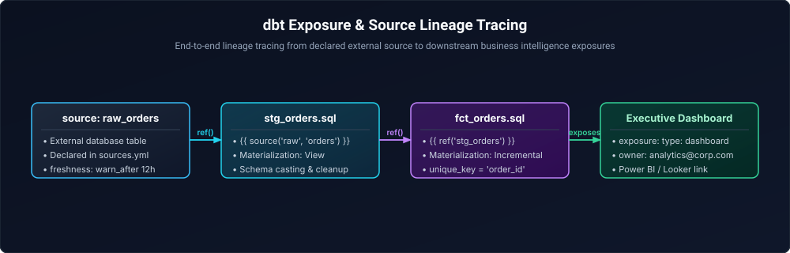

<details>
<summary>D2 Source</summary>

```d2
direction: right
classes: {
  src: { fill: "#1e293b"; stroke: "#38bdf8"; color: "#f8fafc" }
  stg: { fill: "#155e75"; stroke: "#22d3ee"; color: "#67e8f9" }
  mart: { fill: "#581c87"; stroke: "#c084fc"; color: "#e9d5ff" }
  exp: { fill: "#064e3b"; stroke: "#34d399"; color: "#a7f3d0" }
}

src: "source: raw_orders\n(sources.yml)" { class: src }
stg: "stg_orders.sql\n(Staging View)" { class: stg }
mart: "fct_orders.sql\n(Incremental Mart)" { class: mart }
exp: "Exposure: Executive Dashboard\n(Power BI / Looker)" { class: exp }

src -> stg: "source()"
stg -> mart: "ref()"
mart -> exp: "Lineage Exposure"
```
</details>

---

### 11.8 Jinja Templating & Custom Macros

#### Macro Example
```sql
-- macros/cents_to_dollars.sql

    ROUND(CAST({{ column_name }} AS NUMERIC) / 100.0, 2)


-- Usage in Model:
SELECT order_id, {{ cents_to_dollars('amount_in_cents') }} AS amount_usd FROM raw_sales;
```

---

### 11.9 dbt Packages

Modular libraries (e.g., `dbt-utils`, `dbt-expectations`) installed via `packages.yml` to provide advanced SQL macros, cross-database compatibility, and statistical testing.

---

### 11.10 Exposures & the dbt Semantic Layer (Metric Standardization)

#### Problem: Inconsistent Metrics Across Downstream Tools
When business metrics (such as Gross Margin, Churn Rate, or Monthly Active Users) are authored inside individual BI tools (Tableau, Power BI, Looker) or ad-hoc SQL queries, definitions diverge. Different analysts apply conflicting filter conditions (`WHERE status != 'cancelled'` vs `WHERE is_refunded IS FALSE`), resulting in contradictory business reports.

#### Solution: Metric Standardization via the dbt Semantic Layer (MetricFlow)
The **dbt Semantic Layer** (powered by MetricFlow) standardizes metric definitions as version-controlled code directly inside the dbt repository. Downstream consumers query metrics via standard JDBC or GraphQL APIs, ensuring identical metrics across all BI dashboards and Python notebooks.

```yaml
# models/marts/semantic_models/orders_semantic.yml
version: 2

semantic_models:
  - name: orders_semantic
    model: ref('fct_orders')
    description: "Semantic model defining financial order measures and dimensions."
    defaults:
      agg_time_dimension: order_date

    entities:
      - name: order_id
        type: primary
      - name: customer_id
        type: foreign

    dimensions:
      - name: order_date
        type: time
        type_params:
          time_granularity: day
      - name: order_status
        type: categorical

    measures:
      - name: total_revenue
        description: "Gross revenue generated across orders."
        agg: sum
        expr: net_amount_usd
      - name: completed_order_count
        description: "Count of all successfully completed orders."
        agg: count
        expr: order_id

# models/marts/metrics/revenue_metrics.yml
metrics:
  - name: average_order_value
    description: "Average financial value generated per order."
    type: ratio
    type_params:
      numerator: total_revenue
      denominator: completed_order_count
```

#### Exposures: Documenting Downstream Consumption (`models/exposures.yml`)
Exposures formally register external dashboards and applications in the dbt lineage graph, enabling automated impact analysis before modifying upstream models:

```yaml
version: 2

exposures:
  - name: executive_financial_kpi_dashboard
    type: dashboard
    maturity: high
    url: https://app.powerbi.com/groups/.../reports/...
    description: "C-level executive dashboard reporting daily revenue and AOV."
    depends_on:
      - ref('fct_orders')
      - metric('average_order_value')
    owner:
      name: Financial Analytics Team
      email: analytics-eng@enterprise.com
```

---

### 11.11 `dbt build` vs `dbt run` & CLI Operations Cheatsheet

`dbt run` compiles and executes only model transformations. In contrast, **`dbt build`** is the recommended modern command that executes models, runs tests, seeds static data, and executes snapshots in proper DAG topological order. If a model's upstream test fails, `dbt build` immediately halts execution of dependent downstream models.

```bash
# Verify connection to warehouse and validate profiles.yml
dbt debug

# Install external packages defined in packages.yml
dbt deps

# Compile SQL models and preview rendered warehouse dialect queries
dbt compile

# Run models matching a specific tag or path
dbt run --select marts.fct_orders+

# Execute tests on curated models only
dbt test --select tag:production

# Execute dbt build: compiles models, runs tests, and executes snapshots in DAG order
dbt build --select +tag:hourly

# Build only models that have been modified compared to the git main branch (Slim CI)
dbt build --select state:modified+ --state ./target-base

# Generate and host automated interactive documentation and lineage graph
dbt docs generate && dbt docs serve --port 8081
```

---

# 12. End-to-End Enterprise Data Architecture on Microsoft Azure

---

### 12.1 Enterprise Architecture Blueprint & Security Fundamentals

In an enterprise Microsoft Azure data platform, isolation, governance, and zero-trust security are foundational requirements:

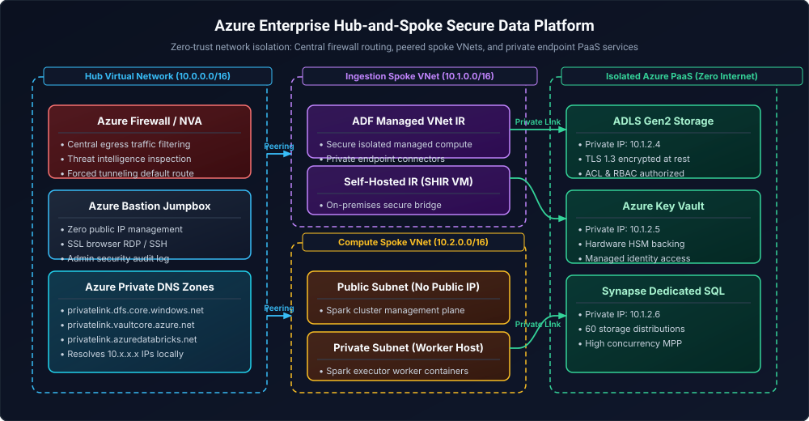

<details>
<summary>D2 Source</summary>

```d2
direction: right
classes: {
  hub: { fill: "#1e293b"; stroke: "#38bdf8"; color: "#f8fafc" }
  spoke_ing: { fill: "#581c87"; stroke: "#c084fc"; color: "#e9d5ff" }
  spoke_comp: { fill: "#451a03"; stroke: "#fbbf24"; color: "#fde68a" }
  paas: { fill: "#064e3b"; stroke: "#34d399"; color: "#a7f3d0" }
}

hub: "Hub Virtual Network (10.0.0.0/16)" {
  fw: "Azure Firewall / NVA\n(Central Egress)" { fill: "#7f1d1d"; stroke: "#f87171"; color: "#fecaca" }
  bastion: "Azure Bastion Jumpbox" { class: hub }
  dns: "Azure Private DNS Zones" { fill: "#155e75"; stroke: "#22d3ee"; color: "#67e8f9" }
}

ingestion_spoke: "Ingestion Spoke VNet (10.1.0.0/16)" {
  adf_ir: "ADF Managed VNet IR" { class: spoke_ing }
  shir: "Self-Hosted IR VM" { class: spoke_ing }
}

compute_spoke: "Compute Spoke VNet (10.2.0.0/16)" {
  db_public: "Databricks Public Subnet" { class: spoke_comp }
  db_private: "Databricks Private Subnet" { class: spoke_comp }
}

paas: "Isolated Azure PaaS (Zero Public Internet)" {
  adls: "ADLS Gen2 Storage\n(Private Endpoint: 10.1.2.4)" { class: paas }
  akv: "Azure Key Vault\n(Private Endpoint: 10.1.2.5)" { class: paas }
  synapse: "Synapse Dedicated SQL\n(Private Endpoint: 10.1.2.6)" { class: paas }
}

hub <-> ingestion_spoke: "VNet Peering"
hub <-> compute_spoke: "VNet Peering"

ingestion_spoke.adf_ir -> paas.adls: "Private Link"
compute_spoke.db_private -> paas.adls: "Private Link"
compute_spoke.db_private -> paas.synapse: "Private Link"
```
</details>

#### Core Enterprise Security Principles
1. **Network Isolation via Hub-and-Spoke Topology:**
   - **Hub VNet:** Houses centralized network inspection appliances, Azure Firewall, ExpressRoute gateways connecting on-premises datacenters, and Azure Private DNS Zones.
   - **Spoke VNets:** Workload-specific subnets (e.g., Ingestion Spoke for ADF, Analytics Spoke for Azure Databricks with VNet injection).
   - **Zero Public Access:** Storage accounts, Key Vaults, and database instances have `public_network_access_enabled = false`. Ingress and egress occur exclusively via **Azure Private Endpoints** using private RFC 1918 IP addresses.
2. **Zero-Credential Management (Managed Identities):**
   - No plaintext passwords, database connection strings, or access tokens exist in pipeline source code or configuration files.
   - Authentication across services is handled natively via **Microsoft Entra ID System-Assigned Managed Identities** and **User-Assigned Managed Identities**.
   - Azure Key Vault stores external third-party API credentials, accessible only through Entra ID Role-Based Access Control (RBAC).
3. **Medallion Lakehouse Governance with Unity Catalog:**
   - **Bronze:** Append-only landing zone preserving 100% of raw source schema fidelity.
   - **Silver:** Conformed, cleansed Delta Lake tables with schema enforcement, deletion vectors, and SCD Type 2 history.
   - **Gold:** Curated, dimensional business marts (star schemas) optimized for Power BI and low-latency serving.
   - **Unity Catalog:** Provides a unified 3-level namespace (`catalog.schema.table`), fine-grained Row-Level Security (RLS), dynamic Column-Level Masking (CLS), and automated audit lineage.

---

### 12.2 Infrastructure as Code: Complete Terraform Deployment

The following enterprise Terraform blueprint provisions a secure Resource Group, Spoke Virtual Network, Subnets, ADLS Gen2 Storage Account with Hierarchical Namespace (HNS), Private Endpoints, and an RBAC-governed Azure Key Vault:

```hcl
# main.tf - Enterprise Azure Data Platform Infrastructure as Code
terraform {
  required_version = ">= 1.5.0"
  required_providers {
    azurerm = {
      source  = "hashicorp/azurerm"
      version = "~> 3.85.0"
    }
  }
  # Remote backend using Azure Blob Storage with Lease-Based State Locking
  backend "azurerm" {
    resource_group_name  = "rg-terraform-state"
    storage_account_name = "sttfstateenterpriseprod"
    container_name       = "tfstate"
    key                  = "data-platform-prod.terraform.tfstate"
  }
}

provider "azurerm" {
  features {
    key_vault {
      purge_soft_delete_on_destroy    = false
      recover_soft_deleted_key_vaults = true
    }
  }
}

# 37. Resource Group

resource "azurerm_resource_group" "rg" {
  name     = "rg-enterprise-data-prod-eastus2"
  location = "East US 2"
  tags = {
    Environment = "Production"
    Team        = "DataPlatform"
    ManagedBy   = "Terraform"
  }
}

# 38. Spoke Virtual Network & Subnets

resource "azurerm_virtual_network" "vnet" {
  name                = "vnet-data-spoke-prod"
  resource_group_name = azurerm_resource_group.rg.name
  location            = azurerm_resource_group.rg.location
  address_space       = ["10.2.0.0/16"]
}

resource "azurerm_subnet" "snet_private_endpoints" {
  name                 = "snet-private-endpoints"
  resource_group_name  = azurerm_resource_group.rg.name
  virtual_network_name = azurerm_virtual_network.vnet.name
  address_prefixes     = ["10.2.1.0/24"]
}

# 39. Secure ADLS Gen2 Storage Account (HNS Enabled + Zero Public Access)

resource "azurerm_storage_account" "adls" {
  name                          = "stadlsprodeastus2"
  resource_group_name           = azurerm_resource_group.rg.name
  location                      = azurerm_resource_group.rg.location
  account_tier                  = "Standard"
  account_replication_type      = "ZRS" # Zone-Redundant Storage
  account_kind                  = "StorageV2"
  is_hns_enabled                = true  # Enables ADLS Gen2 Hierarchical Namespace
  min_tls_version               = "TLS1_2"
  public_network_access_enabled  = false # Prohibits public internet traversal

  network_rules {
    default_action = "Deny"
    bypass         = ["AzureServices", "Logging", "Metrics"]
  }
}

# Medallion Containers
resource "azurerm_storage_data_lake_gen2_filesystem" "bronze" {
  name               = "bronze"
  storage_account_id = azurerm_storage_account.adls.id
}

resource "azurerm_storage_data_lake_gen2_filesystem" "silver" {
  name               = "silver"
  storage_account_id = azurerm_storage_account.adls.id
}

resource "azurerm_storage_data_lake_gen2_filesystem" "gold" {
  name               = "gold"
  storage_account_id = azurerm_storage_account.adls.id
}

# 40. Azure Key Vault with Azure RBAC Authorization

resource "azurerm_key_vault" "kv" {
  name                          = "kv-dataprod-eastus2-01"
  location                      = azurerm_resource_group.rg.location
  resource_group_name           = azurerm_resource_group.rg.name
  tenant_id                     = data.azurerm_client_config.current.tenant_id
  sku_name                      = "standard"
  enable_rbac_authorization    = true # Modern RBAC model (No legacy access policies)
  purge_protection_enabled      = true
  soft_delete_retention_days    = 90
  public_network_access_enabled = false
}

# 41. Private Endpoint for ADLS Gen2 DFS Sub-Resource

resource "azurerm_private_endpoint" "pe_adls_dfs" {
  name                = "pe-adls-dfs-prod"
  location            = azurerm_resource_group.rg.location
  resource_group_name = azurerm_resource_group.rg.name
  subnet_id           = azurerm_subnet.snet_private_endpoints.id

  private_service_connection {
    name                           = "psc-adls-dfs"
    private_connection_resource_id = azurerm_storage_account.adls.id
    subresource_names              = ["dfs"]
    is_manual_connection           = false
  }
}

data "azurerm_client_config" "current" {}
```

---

### 12.3 Production PySpark Medallion Pipeline on Azure Databricks

The following production script runs inside an Azure Databricks cluster governed by Unity Catalog. It reads raw JSON events from the ADLS Gen2 Bronze container using the secure ABFSS protocol, performs schema enforcement and quality filtering, and executes an idempotent ACID `MERGE` into Delta Silver:

```python
from pyspark.sql import SparkSession
from pyspark.sql.functions import col, current_timestamp, to_date, sha2, concat_ws
from delta.tables import DeltaTable

# Initialize Spark session
spark = SparkSession.builder.appName("AzureEnterpriseBronzeToSilver").getOrCreate()

# Path configuration using ABFSS driver (Azure Blob File System Secure)
STORAGE_ACCOUNT = "stadlsprodeastus2"
BRONZE_URI = f"abfss://bronze@{STORAGE_ACCOUNT}.dfs.core.windows.net/raw_transactions/"
SILVER_TABLE_NAME = "enterprise_prod.silver_sales.transactions"

# 42. Read Raw Streaming / Batch JSON Files from ADLS Gen2 Bronze

df_raw = spark.read.format("json").load(BRONZE_URI)

# 43. Defensive Data Cleansing & Deduplication

# Generate deterministic row hash for duplicate payload detection
df_cleansed = df_raw \
    .filter(col("transaction_id").isNotNull()) \
    .filter(col("amount") > 0.0) \
    .withColumn("amount", col("amount").cast("decimal(18,2)")) \
    .withColumn("event_date", to_date(col("event_timestamp"))) \
    .withColumn("row_hash", sha2(concat_ws("||", col("transaction_id"), col("amount"), col("status")), 256)) \
    .withColumn("_ingested_at", current_timestamp())

# 44. Idempotent ACID Upsert (MERGE) into Delta Silver Table

delta_silver = DeltaTable.forName(spark, SILVER_TABLE_NAME)

delta_silver.alias("target").merge(
    source=df_cleansed.alias("source"),
    condition="target.transaction_id = source.transaction_id AND target.event_date = source.event_date"
).whenMatchedUpdate(
    condition="target.row_hash != source.row_hash",  # Only update if payload actually changed
    set={
        "amount": col("source.amount"),
        "customer_id": col("source.customer_id"),
        "status": col("source.status"),
        "row_hash": col("source.row_hash"),
        "_ingested_at": col("source._ingested_at")
    }
).whenNotMatchedInsert(
    values={
        "transaction_id": col("source.transaction_id"),
        "customer_id": col("source.customer_id"),
        "amount": col("source.amount"),
        "status": col("source.status"),
        "event_date": col("source.event_date"),
        "row_hash": col("source.row_hash"),
        "_ingested_at": col("source._ingested_at")
    }
).execute()

print(f"Successfully processed Bronze -> Silver for table: {SILVER_TABLE_NAME}")
```

---

# 13. Core Azure Data Platform Services

---

### 13.1 Enterprise Lakehouse Reference Architecture on Azure

The modern enterprise Lakehouse on Azure unifies data warehouse governance with data lake scalability:

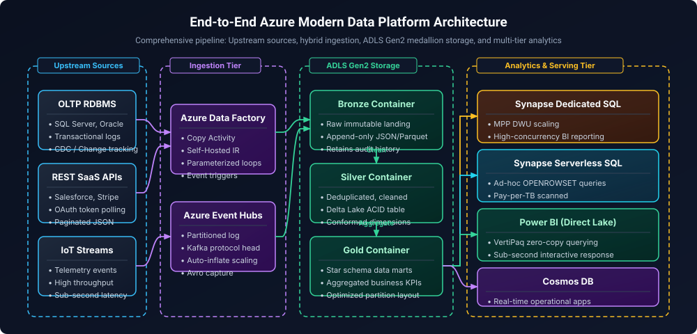

<details>
<summary>D2 Source</summary>

```d2
direction: right
classes: {
  src: { fill: "#1e293b"; stroke: "#38bdf8"; color: "#f8fafc" }
  ing: { fill: "#581c87"; stroke: "#c084fc"; color: "#e9d5ff" }
  lake: { fill: "#064e3b"; stroke: "#34d399"; color: "#a7f3d0" }
  serve: { fill: "#451a03"; stroke: "#fbbf24"; color: "#fde68a" }
}

sources: "Upstream Sources" {
  db: "OLTP RDBMS" { class: src }
  apis: "REST SaaS APIs" { class: src }
  streams: "IoT / Clickstreams" { class: src }
}

ingestion: "Ingestion Tier" {
  adf: "Azure Data Factory" { class: ing }
  eventhubs: "Azure Event Hubs" { class: ing }
}

storage: "ADLS Gen2 (Delta Lake)" {
  bronze: "Bronze Container\n(Raw Append)" { class: lake }
  silver: "Silver Container\n(Cleaned & Filtered)" { class: lake }
  gold: "Gold Container\n(Aggregated Marts)" { class: lake }

  bronze -> silver -> gold
}

serving: "Analytics & Serving Tier" {
  synapse: "Synapse Dedicated SQL" { class: serve }
  serverless: "Synapse Serverless SQL" { fill: "#155e75"; stroke: "#22d3ee"; color: "#67e8f9" }
  pbi: "Power BI Direct Lake" { class: lake }
  cosmos: "Cosmos DB" { class: ing }
}

sources.db -> ingestion.adf
sources.apis -> ingestion.adf
sources.streams -> ingestion.eventhubs
ingestion.adf -> storage.bronze
ingestion.eventhubs -> storage.bronze
storage.gold -> serving.synapse
storage.gold -> serving.serverless
storage.gold -> serving.pbi
storage.gold -> serving.cosmos
```
</details>

---

### 13.2 ADLS Gen2: Hierarchical Namespace (HNS) Internals & POSIX ACLs

#### Hierarchical Namespace (HNS) vs. Flat Object Storage
In standard object storage (Amazon S3 or Azure Blob Storage without HNS), directories do not physically exist. A path like `bronze/year=2026/month=03/part-01.parquet` is merely a single long string key.
- **The $O(N)$ Rename Bottleneck:** When an Apache Spark job commits a batch, it writes to a `_temporary/` directory and renames it to the target directory. In flat object storage, renaming a directory with 10,000 files requires **copying all 10,000 objects one by one** over HTTP and then deleting the old ones ($O(N)$ network I/O).
- **The $O(1)$ Atomic HNS Solution:** In ADLS Gen2 with HNS enabled, directories are true filesystem nodes. Renaming a directory modifies a single pointer in the metadata catalog in milliseconds ($O(1)$ operation), eliminating data movement and enabling atomic job commits.

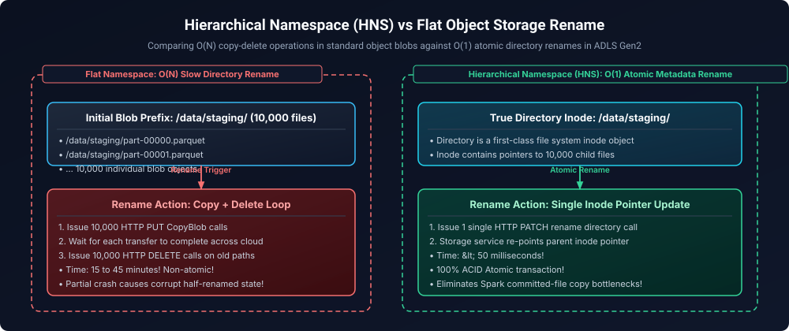

<details>
<summary>D2 Source</summary>

```d2
direction: right
classes: {
  slow: { fill: "#7f1d1d"; stroke: "#f87171"; color: "#fecaca" }
  fast: { fill: "#064e3b"; stroke: "#34d399"; color: "#a7f3d0" }
}

flat: "Flat Namespace: O(N) Slow Rename" {
  f_start: "Virtual Path: /staging/\n(10,000 Blobs)" { fill: "#1e293b"; stroke: "#38bdf8"; color: "#f8fafc" }
  f_action: "Copy + Delete Loop\n(10,000 individual operations\nTakes 15-45 minutes!)" { class: slow }

  f_start -> f_action: "Rename Triggered"
}

hns: "Hierarchical Namespace (HNS): O(1) Atomic Rename" {
  h_start: "True Directory Inode: /staging/\n(Single Metadata Object)" { fill: "#155e75"; stroke: "#22d3ee"; color: "#67e8f9" }
  h_action: "Atomic Inode Pointer Update\n(Single metadata change\nTakes &lt;50ms!)" { class: fast }

  h_start -> h_action: "Atomic Pointer Update"
}
```
</details>

#### POSIX Access Control Lists (ACLs)
ADLS Gen2 supports Linux-style POSIX ACLs in addition to Azure RBAC:
- **Access ACLs:** Enforce read (`r`), write (`w`), and execute (`x`) permissions on specific existing files and directories.
- **Default ACLs:** Templates applied to a parent directory that automatically inherit down to all newly created child files and subdirectories.

---

### 13.3 Azure Data Factory (ADF) Overview

Azure Data Factory is a serverless, hybrid data integration service capable of visual ELT orchestration, data movement across 100+ native connectors, and dispatching distributed transformations to Databricks and Synapse.

---

### 13.4 Azure Synapse Analytics: Dedicated vs. Serverless SQL Pools

| Architectural Dimension | Synapse Dedicated SQL Pool | Synapse Serverless SQL Pool |
| :--- | :--- | :--- |
| **Compute Model** | Provisioned MPP cluster (1 Control node + up to 60 Compute nodes) | Serverless query execution engine distributed on-demand |
| **Primary Workload** | Enterprise Data Warehousing (EDW), fixed SLAs, high concurrency | Ad-hoc lake exploration, querying Parquet/CSV/Delta directly |
| **Storage Architecture** | Decoupled into **exactly 60 underlying storage distributions** | Queries data directly in-place on ADLS Gen2 (`OPENROWSET`) |
| **Billing / Cost Model** | Hourly provisioned capacity measured in DWUs (e.g. DW100c to DW30000c) | Pay-per-query (\$5.00 per TB of data processed/scanned) |
| **Data Modifications** | Full DDL/DML (`INSERT`, `UPDATE`, `DELETE`, `MERGE`, CTAS) | **Read-Only** queries; writes require `CREATE EXTERNAL TABLE AS SELECT` (CETAS) |

---

### 13.5 Azure Databricks: Lakehouse, Unity Catalog & VNet Injection

Azure Databricks is a first-party Microsoft cloud service that provides a collaborative Apache Spark engine:
- **VNet Injection:** Databricks clusters run inside the customer’s private Azure Virtual Network across two subnets: **Public Subnet** (coordinates control plane communication; public IPs can be completely disabled) and **Private Subnet** (inter-worker executor shuffle communication).
- **Unity Catalog:** Centralized data governance layer across all Databricks workspaces in a tenant. Implements a 3-level namespace: `catalog.schema.table`.

---

### 13.6 Azure Event Hubs: Real-Time Stream Ingestion & Capture

Azure Event Hubs provides high-throughput streaming event ingestion with native Apache Kafka protocol wire compatibility.
- **Event Hubs Capture:** An automated feature that streams incoming event batches directly into ADLS Gen2 as compressed **Avro** files without writing code.
- **Partitioned Consumer Model:** Multiple independent consumer groups read from the same partitioned log at different offsets without impacting one another.

---

### 13.7 Azure Stream Analytics: Real-Time Windowing SQL

Azure Stream Analytics (ASA) executes complex temporal queries over real-time streaming data using a SQL-based language:

| Window Function Paradigm | Temporal Overlap Semantics | State Output Trigger Condition | Memory State Retention | Canonical Real-World Scenario |
| :--- | :--- | :--- | :--- | :--- |
| **Tumbling Window** | Fixed, non-overlapping contiguous intervals (e.g., every 5 minutes). | Emits exactly once at the close of every distinct window interval. | Flushes state completely after each window closes; minimal memory footprint. | 5-minute rolling average server telemetry metrics; hourly sales summaries. |
| **Hopping Window** | Fixed duration, overlapping intervals (e.g., 5-minute window hopping every 1 minute). | Emits on every hop interval, summarizing the trailing window duration. | Holds multiple overlapping window states simultaneously in memory. | Moving averages for stock price momentum or algorithmic trading triggers. |
| **Sliding Window** | Evaluates only when an event enters or exits the time duration. | Emits whenever an event arrives, provided at least one event resides in window. | Keeps precise event arrival timestamps in memory buffer. | Alerting when more than 5 failed login attempts occur within any 10-minute span. |
| **Session Window** | Variable duration; groups events by continuous user activity. | Closes and emits only when inactivity gap exceeds timeout threshold. | Variable state duration; expands dynamically until inactivity gap expires. | Tracking user web clickstream sessions; session ends after 15 minutes of inactivity. |

#### Code Example: Real-Time Fraud Aggregation via Tumbling Window
```sql
-- Stream Analytics Query: Detects card transactions exceeding $10,000 in a 5-minute tumbling window
SELECT 
    System.Timestamp() AS window_end_time,
    card_number,
    COUNT(*) AS transaction_count,
    SUM(transaction_amount) AS total_spent
FROM EventHubInput TIMESTAMP BY transaction_time
GROUP BY 
    card_number, 
    TumblingWindow(minute, 5)
HAVING SUM(transaction_amount) > 10000.00;
```

---

### 13.8 Azure SQL Database & Hyperscale Architecture

Azure SQL Database Hyperscale utilizes a distributed tiered architecture that decouples compute from storage:
- **Compute Tier:** Primary read-write replica + up to 30 independent read-scale replicas.
- **Page Servers:** Distributed storage caching tier serving database pages over high-speed RDMA.
- **Log Service:** Ultra-low latency distributed Write-Ahead Log engine enabling near-instantaneous backups and restores regardless of database size (scales up to 100 TB).

---

### 13.9 Azure Cosmos DB: Multi-Model Distributed NoSQL

Azure Cosmos DB is a globally distributed, multi-model NoSQL database with single-digit millisecond response times and multi-region active-active replication.
- **Request Units (RU/s):** Normalized currency measuring CPU, memory, and IOPS consumed per database operation (a 1 KB point read costs 1 RU).
- **The 5 Consistency Levels:**
  1. *Strong:* Linearizability; zero stale data; highest latency.
  2. *Bounded Staleness:* Stale reads bounded by time ($T$) or versions ($K$).
  3. *Session:* Monotonic reads within the user's session (Default).
  4. *Consistent Prefix:* Preserves causal update sequence.
  5. *Eventual:* Lowest latency, highest availability; out-of-order convergence.

---

### 13.10 Azure Key Vault & Hardware Security Modules (HSM)

Azure Key Vault centrally stores and encrypts secrets, passwords, certificates, and encryption keys.
- **Standard SKU:** Software-protected keys backed by FIPS 140-2 Level 2 compliance.
- **Premium SKU:** Dedicated Hardware Security Modules (HSM) with FIPS 140-2 Level 3 validation.
- **Databricks Secret Scopes:** Maps Key Vault secrets directly into Databricks notebooks (`dbutils.secrets.get()`), redacting plaintext passwords from console logs automatically.

---

### 13.11 Azure Monitor, Log Analytics & KQL Queries

Azure Monitor aggregates metrics and execution logs into Log Analytics workspaces. Data engineers use **Kusto Query Language (KQL)** to write operational observability alerts:

```kusto
// KQL Query: Identify all ADF pipeline failures in the last 24 hours with error messages
ADFPipelineRun
| where TimeGenerated >= ago(24h)
| where Status == "Failed"
| project 
    TimeGenerated, 
    PipelineName, 
    RunId, 
    ErrorMessage = FailureMessage, 
    ExecutionDurationMinutes = DurationMs / 60000
| order by TimeGenerated desc
```

---

### 13.12 Microsoft Fabric: Lakehouse vs. Warehouse Architecture & OneLake

Microsoft Fabric is an all-in-one SaaS analytics platform built on **OneLake** using open **Delta Parquet** format:

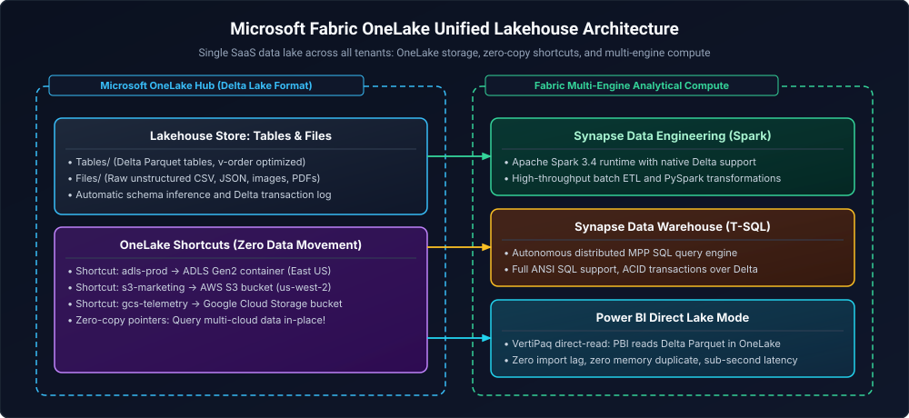

<details>
<summary>D2 Source</summary>

```d2
direction: right
classes: {
  lake: { fill: "#1e293b"; stroke: "#38bdf8"; color: "#f8fafc" }
  shortcuts: { fill: "#581c87"; stroke: "#c084fc"; color: "#e9d5ff" }
  spark: { fill: "#064e3b"; stroke: "#34d399"; color: "#a7f3d0" }
  sql: { fill: "#451a03"; stroke: "#fbbf24"; color: "#fde68a" }
  pbi: { fill: "#155e75"; stroke: "#22d3ee"; color: "#67e8f9" }
}

onelake: "Microsoft OneLake (Unified Multi-Tenant Delta Lake)" {
  store: "Lakehouse Store\n(Tables/ Parquet & Files/ Raw)" { class: lake }
  shortcuts: "OneLake Shortcuts (Zero-Copy)\n(Pointers to AWS S3, GCS, ADLS)" { class: shortcuts }
}

engines: "Multi-Engine Analytical Compute" {
  spark: "Synapse Data Engineering\n(Apache Spark Runtime)" { class: spark }
  dwh: "Synapse Data Warehouse\n(Distributed T-SQL MPP)" { class: sql }
  pbi: "Power BI Direct Lake\n(Direct VertiPaq memory-mapped read)" { class: pbi }
}

onelake.store -> engines.spark: "Read/Write Delta"
onelake.store -> engines.dwh: "Native T-SQL"
onelake.store -> engines.pbi: "Zero-Copy Parquet Scan"
onelake.shortcuts -> engines.spark: "Cross-Cloud Query"
```
</details>

#### Fabric Lakehouse vs. Fabric Warehouse Comparison

| Architectural Trait | Fabric Lakehouse | Fabric Warehouse |
| :--- | :--- | :--- |
| **Primary Persona** | Data Engineers, Data Scientists, Spark developers | Enterprise SQL Developers, BI Architects |
| **Compute Engines** | Apache Spark (Notebooks) + SQL Analytics Endpoint (Read-Only) | Distributed T-SQL (Synapse Distributed Query Engine) |
| **Data Scope** | **Structured, Semi-Structured & Unstructured** (JSON, Images) | **Structured Tabular Data Only** |
| **Folder Layout in OneLake** | Dual: `Tables/` (Delta tables) and `Files/` (raw folder tree) | Single: `Tables/` (Managed Delta Parquet tables only) |
| **Transaction Scope** | Single-table ACID via Delta Lake commit log | **Multi-table cross-statement ACID transactions** |
| **Power BI Integration** | Direct Lake mode | Direct Lake mode + DirectQuery + Import |

---

# 14. Identity, Security & Cloud Networking

---

### 14.1 Microsoft Entra ID (Azure AD) Fundamentals

Microsoft Entra ID is the central identity provider in Azure, issuing cryptographically signed JSON Web Tokens (OAuth 2.0 / OIDC) that authenticate users, automated services, and applications.

---

### 14.2 Service Principals & App Registrations

A **Service Principal** represents an application identity within an Entra ID tenant. Used in CI/CD pipelines (Terraform, GitHub Actions, Azure DevOps) to deploy infrastructure automatically without human intervention.
- *Security Best Practice:* Authenticate Service Principals using **X.509 Certificates** or **Federated OIDC Credentials** rather than long-lived client secret strings.

---

### 14.3 Managed Identities: System-Assigned vs. User-Assigned

Managed Identities eliminate the risk of credential leaks by providing an automatically managed Entra ID identity for Azure resources:
- **System-Assigned Managed Identity:** Tied directly to the lifecycle of a specific resource instance (e.g., Azure Data Factory). If the ADF instance is deleted, the identity is automatically deleted.
- **User-Assigned Managed Identity:** Created as an independent Azure resource. Can be assigned to multiple compute resources (e.g., shared across 10 Databricks worker VMs).

#### How Managed Identity Operates Under the Hood
Compute instances request access tokens locally from the non-routable Azure Instance Metadata Service (IMDS) at `http://169.254.169.254/metadata/identity/oauth2/token`. Azure validates the host VM's identity and returns a short-lived bearer token without any password ever being stored on disk!

---

### 14.4 Role-Based Access Control (Azure RBAC)

Azure RBAC enforces authorization using the principle of least privilege across four scope levels:

$$\text{Management Group} \longrightarrow \text{Subscription} \longrightarrow \text{Resource Group} \longrightarrow \text{Resource}$$

#### Core Built-in Roles for Data Engineers
- `Storage Blob Data Contributor`: Full read, write, and delete permissions on ADLS Gen2 containers.
- `Storage Blob Data Reader`: Read-only access to lakehouse files.
- `Key Vault Secrets User`: Read secret values from Azure Key Vault without administrative permissions.
- `Data Factory Contributor`: Author, edit, and trigger ADF pipelines.

---

### 14.5 Databricks Secret Scopes with Azure Key Vault

```python
# Secure Credential Pattern in Azure Databricks
# The secret value is never displayed in plaintext and is automatically redacted from logs
db_password = dbutils.secrets.get(scope="akv-prod-secrets", key="SalesDatabasePassword")
```

---

### 14.6 Hub-and-Spoke VNets & Network Security Groups (NSGs)

- **VNet (Virtual Network):** Isolates infrastructure inside a private RFC 1918 IP address space (e.g., `10.2.0.0/16`).
- **Network Security Group (NSG):** Stateful Layer 4 packet filter containing inbound and outbound security rules (5-tuple: source IP, source port, destination IP, destination port, protocol).
- **VNet Peering:** Connects the Hub VNet to Spoke VNets over Microsoft's high-speed private backbone network with ultra-low latency and zero internet routing.

---

### 14.7 Private Endpoints & Azure Private Link

Private Endpoints assign a private IP address from your VNet subnet directly to PaaS services (ADLS Gen2, Key Vault, Synapse):
- Public internet access is disabled: `public_network_access_enabled = false`.
- DNS resolution is overridden using Azure Private DNS Zones (e.g., `stadlsprodeastus2.privatelink.dfs.core.windows.net` $\rightarrow$ `10.2.1.4`).
- Traffic flows strictly through the private network switch, neutralizing data exfiltration risks.

---

# 15. Azure Data Factory (ADF) Deep-Dive

---

### 15.1 Pipelines, Activities & Control Flow Mechanics

An ADF **Pipeline** coordinates a sequence of **Activities**:
- **Execution Dependencies:** Connect activities using `Succeeded`, `Failed`, `Completed`, or `Skipped` condition links.
- **Control Flow:** `ForEach` iterates over dynamic arrays in parallel (up to 50 concurrent batches); `IfCondition` branches logic based on runtime parameters.

---

### 15.2 Core Activities (Copy, Lookup, Get Metadata, ForEach)

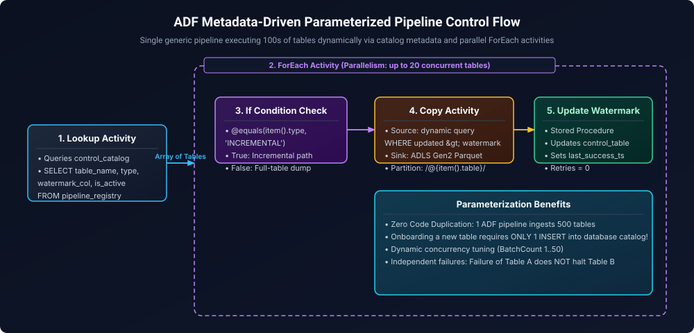

<details>
<summary>D2 Source</summary>

```d2
direction: right
classes: {
  ctrl: { fill: "#1e293b"; stroke: "#38bdf8"; color: "#f8fafc" }
  loop: { fill: "#581c87"; stroke: "#c084fc"; color: "#e9d5ff" }
  copy: { fill: "#451a03"; stroke: "#fbbf24"; color: "#fde68a" }
  wm: { fill: "#064e3b"; stroke: "#34d399"; color: "#a7f3d0" }
}

lookup: "1. Lookup Activity\n(Query Control Table)" { class: ctrl }

foreach: "2. ForEach Activity (Parallel Container)" {
  branch: "3. If Incremental Check" { class: loop }
  copy_act: "4. Parameterized Copy Activity\n(Source -> ADLS Gen2)" { class: copy }
  update_wm: "5. Update Watermark Activity\n(Stored Procedure Update)" { class: wm }

  branch -> copy_act: "Dynamic Query"
  copy_act -> update_wm: "On Success"
}

lookup -> foreach: "Iterate Table Array"
```
</details>

---

### 15.3 Mapping Data Flows & Spark Execution Translation

Mapping Data Flows allow visual construction of ETL transformations without writing code:
- When triggered, ADF provisions an ephemeral **Azure Databricks / Spark cluster** behind the scenes.
- The visual DAG (Join, Aggregate, Conditional Split) is compiled into optimized Scala / Spark Catalyst expressions and executed across Spark executors.

---

### 15.4 Integration Runtimes (Azure IR vs. Self-Hosted IR vs. SSIS)

| Integration Runtime | Hosting Infrastructure | Primary Production Use Case |
| :--- | :--- | :--- |
| **Azure IR** | Fully managed, serverless cloud compute | Cloud-to-cloud data movement, external SaaS APIs, Mapping Data Flows |
| **Self-Hosted IR (SHIR)** | Customer-managed VM on-prem or in a private VNet | Securely extracting data from on-prem databases (Oracle, SAP, SQL Server) behind corporate firewalls |
| **Azure-SSIS IR** | Managed cluster of Azure VMs | Re-hosting legacy SQL Server Integration Services (SSIS) packages in the cloud |

#### Self-Hosted IR Network Security Architecture
The SHIR agent VM initiates **outbound connections only over HTTPS Port 443** to the Azure cloud. **Zero inbound firewall ports need to be opened** on the corporate perimeter firewall, satisfying strict enterprise infosec policies.

---

### 15.5 Linked Services vs. Datasets

- **Linked Service:** Defines the connection string, authentication method, and network path to a data source or compute target (analogous to a connection string).
- **Dataset:** Points to a specific data structure (table, file name, folder path) within the Linked Service.

---

### 15.6 Triggers (Schedule vs. Tumbling Window vs. Storage Events)

1. **Schedule Trigger:** Standard recurring clock trigger (e.g., execute daily at 02:00 AM).
2. **Tumbling Window Trigger:** Fires over contiguous, non-overlapping historical time slices. Essential for historical backfills and maintaining task dependencies (e.g., window 12:00-13:00 cannot run until window 11:00-12:00 completes).
3. **Storage Event Trigger:** Listens to Azure Event Grid events (`Microsoft.Storage.BlobCreated`) to trigger instant processing when a file lands in ADLS Gen2.

---

### 15.7 Parameters vs. Variables (Dynamic Content Expressions)

- **Parameters:** External, read-only arguments passed into the pipeline at runtime:
  ```json
  "@pipeline().parameters.TargetEnvironment"
  ```
- **Variables:** Internal, mutable state updated dynamically during execution via `Set Variable` or `Append Variable` activities.

---

### 15.8 ADF Monitoring, Alerting & SLA Tracking

ADF integrates natively with Azure Monitor:
- Tracks pipeline run metrics: `PipelineRunSucceededRate`, `ActivityDuration`, `DataRead`, `DataWritten`.
- Diagnostic settings forward execution logs to Azure Log Analytics workspaces, triggering PagerDuty / email alerts when SLAs are breached.

---

# 16. Azure Synapse Analytics Deep-Dive

---

### 16.1 Synapse Dedicated SQL Pools: Massively Parallel Processing (MPP)

Synapse Dedicated SQL Pool implements a classic MPP architecture that scales analytical queries across 60 underlying storage distributions:

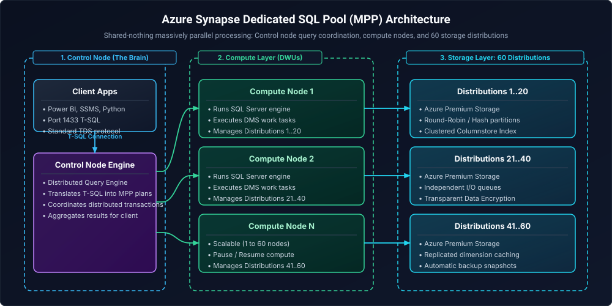

<details>
<summary>D2 Source</summary>

```d2
direction: right
classes: {
  ctrl: { fill: "#1e293b"; stroke: "#38bdf8"; color: "#f8fafc" }
  comp: { fill: "#064e3b"; stroke: "#34d399"; color: "#a7f3d0" }
  store: { fill: "#155e75"; stroke: "#22d3ee"; color: "#67e8f9" }
}

control_layer: "1. Control Node (The Brain)" {
  client: "Client Queries\n(Power BI, SSMS)" { class: ctrl }
  control: "Control Node\n(Distributed Query Engine)" { fill: "#581c87"; stroke: "#c084fc"; color: "#e9d5ff" }

  client -> control: "T-SQL Connection"
}

compute_layer: "2. Compute Layer (MPP Workers)" {
  c1: "Compute Node 1\n(Distributions 1..20)" { class: comp }
  c2: "Compute Node 2\n(Distributions 21..40)" { class: comp }
  cn: "Compute Node N\n(Distributions 41..60)" { class: comp }
}

storage_layer: "3. Storage Layer (60 Azure Storage Distributions)" {
  d1: "Distributions 1..20" { class: store }
  d2: "Distributions 21..40" { class: store }
  d3: "Distributions 41..60" { class: store }
}

control_layer.control -> compute_layer.c1: "Parallel Plan"
control_layer.control -> compute_layer.c2: "Parallel Plan"
control_layer.control -> compute_layer.cn: "Parallel Plan"

compute_layer.c1 -> storage_layer.d1: "Direct Remote I/O"
compute_layer.c2 -> storage_layer.d2: "Direct Remote I/O"
compute_layer.cn -> storage_layer.d3: "Direct Remote I/O"
```
</details>

---

### 16.2 Data Distribution Strategies (Hash vs. Replicated vs. Round Robin)

Every table created in a Dedicated SQL Pool must explicitly declare its physical distribution across the 60 storage buckets:

| Distribution Strategy | Mechanism | Recommended Table Type |
| :--- | :--- | :--- |
| **`HASH(column)`** | Uses a deterministic hashing algorithm on a single key to assign rows to 1 of 60 buckets. | **Large Fact Tables ($>2\text{ GB}$).** Choose high-cardinality join key to prevent data skew. |
| **`REPLICATE`** | Stores a complete physical copy of the entire table on **every single compute node**. | **Small Dimension Tables ($<2\text{ GB}$).** Eliminates network Data Movement Service (DMS) shuffles during joins. |
| **`ROUND_ROBIN`** | Distributes incoming rows sequentially in a circular buffer across all 60 distributions. | **Staging Tables**; fastest possible data loading without key hashing overhead. |

#### Production DDL Example in Synapse Dedicated SQL
```sql
-- Hash Distributed Fact Table with Clustered Columnstore Index
CREATE TABLE edw.fact_financial_transactions (
    transaction_id BIGINT NOT NULL,
    customer_id BIGINT NOT NULL,              -- High-cardinality distribution hash key
    transaction_date_key INT NOT NULL,
    amount DECIMAL(18, 2) NOT NULL
)
WITH (
    DISTRIBUTION = HASH(customer_id),
    CLUSTERED COLUMNSTORE INDEX               -- Maximizes compression into 1M row rowgroups
);

-- Replicated Dimension Table (Zero network shuffle during star schema joins)
CREATE TABLE edw.dim_customers (
    customer_id BIGINT NOT NULL,
    customer_name VARCHAR(100) NOT NULL,
    region_code VARCHAR(10) NOT NULL
)
WITH (
    DISTRIBUTION = REPLICATE,
    CLUSTERED COLUMNSTORE INDEX
);
```

---

### 16.3 Synapse Serverless SQL Pools (`OPENROWSET` over Data Lake)

Synapse Serverless SQL allows querying data files directly in ADLS Gen2 without provisioning or managing a cluster:

```sql
-- Query Parquet files directly in ADLS Gen2 with Serverless SQL
SELECT 
    customer_id,
    COUNT(order_id) AS total_orders,
    SUM(order_amount) AS gross_spend
FROM OPENROWSET(
    BULK 'https://stadlsprodeastus2.dfs.core.windows.net/curated/sales/orders/*.parquet',
    FORMAT = 'PARQUET'
) AS [orders]
GROUP BY customer_id;
```

---

### 16.4 Synapse Spark Pools & Lake Databases

Synapse Spark Pools provide managed auto-scaling Apache Spark clusters integrated with Synapse Studio notebooks, sharing metadata catalogs natively with SQL pools via **Lake Databases**.

---

### 16.5 Synapse Pipelines vs. Standalone ADF

Synapse Pipelines share the identical core codebase, JSON specification, and execution runtime as Azure Data Factory. 
- *Key Difference:* ADF supports cross-service enterprise orchestration with Git integration at the factory level, whereas Synapse Pipelines are embedded within the Synapse workspace environment.

---

# 17. DataOps, CI/CD & Version Control

---

### 17.1 The DataOps CI/CD Lifecycle

DataOps brings agile software engineering rigor to data platform delivery:

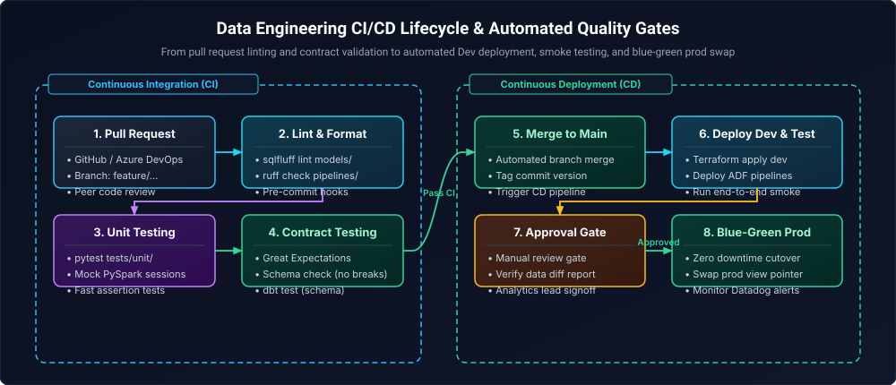

<details>
<summary>D2 Source</summary>

```d2
direction: right
classes: {
  ci: { fill: "#1e293b"; stroke: "#38bdf8"; color: "#f8fafc" }
  cd: { fill: "#064e3b"; stroke: "#34d399"; color: "#a7f3d0" }
}

ci_stage: "Continuous Integration (CI)" {
  pr: "1. Feature Pull Request" { class: ci }
  lint: "2. Linting (sqlfluff, ruff)" { fill: "#155e75"; stroke: "#22d3ee"; color: "#67e8f9" }
  unit: "3. pytest Unit Tests" { fill: "#581c87"; stroke: "#c084fc"; color: "#e9d5ff" }
  contract: "4. Data Contract Tests" { class: cd }

  pr -> lint -> unit -> contract
}

cd_stage: "Continuous Deployment (CD)" {
  merge: "5. Merge to Main" { class: cd }
  deploy_dev: "6. Deploy Dev & Smoke Test" { fill: "#155e75"; stroke: "#22d3ee"; color: "#67e8f9" }
  gate: "7. Manual Approval Gate" { fill: "#451a03"; stroke: "#fbbf24"; color: "#fde68a" }
  deploy_prod: "8. Blue-Green Swap to Prod" { class: cd }

  merge -> deploy_dev -> gate -> deploy_prod
}

ci_stage.contract -> cd_stage.merge: "All Gates Pass"
```
</details>

---

### 17.2 Git Branching Strategies for Data Engineering

- **Trunk-Based Development (Recommended):** Developers work on short-lived feature branches (`feature/add-tax-calculation`) and merge into `main` multiple times per day. Automated CI test suites prevent regressions. Ideal for fast-moving analytics engineering and dbt projects.
- **GitFlow:** Strict branching model with `feature` $\rightarrow$ `develop` $\rightarrow$ `release` $\rightarrow$ `main`. Best suited for regulated enterprise data platforms requiring multi-week formal UAT audit windows.

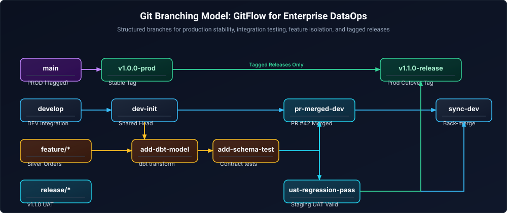

<details>
<summary>D2 Source</summary>

```d2
direction: right
classes: {
  main: { fill: "#064e3b"; stroke: "#34d399"; color: "#a7f3d0" }
  dev: { fill: "#1e293b"; stroke: "#38bdf8"; color: "#f8fafc" }
  feat: { fill: "#451a03"; stroke: "#fbbf24"; color: "#fde68a" }
  rel: { fill: "#155e75"; stroke: "#22d3ee"; color: "#67e8f9" }
}

main: "main (Production Releases)" {
  v10: "v1.0.0-prod" { class: main }
  v11: "v1.1.0-release" { class: main }

  v10 -> v11: "Release Tag"
}

develop: "develop (Shared Integration)" {
  init: "dev-init" { class: dev }
  merged: "pr-merged-dev" { class: dev }
  sync: "sync-develop" { class: dev }

  init -> merged -> sync
}

feature: "feature/silver-orders" {
  c1: "add-dbt-model" { class: feat }
  c2: "add-schema-test" { class: feat }

  c1 -> c2
}

release: "release/v1.1.0" {
  uat: "uat-regression-pass" { class: rel }
}

develop.init -> feature.c1: "branch"
feature.c2 -> develop.merged: "merge PR"
develop.merged -> release.uat: "cut release"
release.uat -> main.v11: "merge prod"
release.uat -> develop.sync: "back-merge"
```
</details>

---

### 17.3 Automated Pre-Commit Hooks (SQLFluff, Black, Gitleaks)

Pre-commit hooks validate code locally on the developer's workstation before a git commit is allowed:

```yaml
# .pre-commit-config.yaml
repos:
  - repo: https://github.com/sqlfluff/sqlfluff
    rev: 2.3.5
    hooks:
      - id: sqlfluff-lint
        args: [--dialect, databricks]
  - repo: https://github.com/psf/black
    rev: 23.9.1
    hooks:
      - id: black
  - repo: https://github.com/gitleaks/gitleaks
    rev: v8.18.0
    hooks:
      - id: gitleaks  # Blocks committing API keys, tokens, or private certificates
```

---

# 18. Containers & Cloud Infrastructure as Code

---

### 18.1 Docker for Data Engineering: Multi-Stage Containerization

Multi-stage Docker builds isolate build-time dependencies, producing minimal, secure production container images:

```dockerfile
# Stage 1: Build & Dependency Isolation
FROM python:3.11-slim AS builder
WORKDIR /install
COPY requirements.txt .
RUN pip install --no-cache-dir --prefix=/install -r requirements.txt

# Stage 2: Minimal Production Runtime with Java JRE for PySpark
FROM eclipse-temurin:17-jre-jammy
WORKDIR /app

# Install minimal Python runtime
RUN apt-get update && apt-get install -y --no-install-recommends \
    python3 \
    python3-pip \
    && rm -rf /var/lib/apt/lists/*

# Copy pre-compiled Python packages from builder stage
COPY --from=builder /install /usr/local
COPY src/ /app/src/

ENV PYTHONPATH="/app"
ENTRYPOINT ["python3", "src/pipeline_entrypoint.py"]
```

---

### 18.2 Kubernetes for Data: Spark-on-K8s & Airflow KubernetesExecutor

1. **Apache Spark on Kubernetes (Spark-on-K8s):**
   - The Spark K8s Operator manages `SparkApplication` custom resources (CRDs).
   - An ephemeral Driver Pod launches and dynamically provisions Worker Executor Pods.
   - When computation completes, executor pods terminate immediately, achieving true **scale-to-zero** cost efficiency.
2. **Apache Airflow `KubernetesExecutor`:**
   - Every individual DAG task runs inside its own isolated Docker container pod.
   - Eliminates package dependency conflicts between different data engineering teams.

---

### 18.3 Infrastructure as Code: Terraform Architecture & State Locking

In production, Terraform state files are stored in an Azure Blob Storage container with **Lease-Based Locking**:
- When `terraform apply` executes, Terraform acquires an exclusive lease lock on the state blob.
- Concurrent pipeline executions are blocked, preventing corrupted infrastructure state.

---

### 18.4 Multi-Environment Promotion (`dev` $\rightarrow$ `stage` $\rightarrow$ `prod`)

| Environment | Data Scope | Access Permissions | Compute Sizing |
| :--- | :--- | :--- | :--- |
| **Development (`dev`)** | Synthetic data or sanitized samples | Developers have Contributor access | Minimal single-node or autoscaling clusters |
| **Staging (`stage`)** | Full production snapshot clone | Automated CI/CD service principals + QA testers | Sized identical to production for load testing |
| **Production (`prod`)** | Live enterprise transactional data | **Zero human interactive access**; CI/CD SPN only | Enterprise resilient multi-node clusters |

---

# 19. Testing & Release Engineering for Data Pipelines

---

### 19.1 Unit Testing Transformation Logic with `pytest`

Pure business transformations should be extracted into stateless Python functions to allow instant execution in local CI test suites:

```python
import pytest

def calculate_customer_tier(total_spend: float, tenure_months: int) -> str:
    """Classifies customers into loyalty tiers based on lifetime spend and tenure."""
    if total_spend < 0:
        raise ValueError("Total spend cannot be negative")
    if total_spend >= 10000.0 and tenure_months >= 12:
        return "PLATINUM"
    elif total_spend >= 5000.0:
        return "GOLD"
    elif total_spend >= 1000.0:
        return "SILVER"
    return "BRONZE"

def test_calculate_customer_tier_platinum():
    assert calculate_customer_tier(12500.0, 18) == "PLATINUM"

def test_calculate_customer_tier_negative_spend():
    with pytest.raises(ValueError, match="Total spend cannot be negative"):
        calculate_customer_tier(-100.0, 5)
```

---

### 19.2 Integration Testing with Testcontainers & Azurite

**Testcontainers** spins up real Docker containers during integration test runs:
- Spins up the **Microsoft Azure Storage Azurite Emulator** container in Docker.
- Tests upload, read, and write operations against the local emulator container.
- Tears down the container automatically upon test completion.

```python
import pytest
from testcontainers.core.container import DockerContainer
from azure.storage.blob import BlobServiceClient

@pytest.fixture(scope="session")
def azurite_container():
    """Spins up local Azurite Azure Storage Emulator inside Docker for testing."""
    with DockerContainer("mcr.microsoft.com/azure-storage/azurite").with_bind_ports(10000, 10000) as container:
        yield container

def test_adls_upload_integration(azurite_container):
    connection_string = "DefaultEndpointsProtocol=http;AccountName=devstoreaccount1;AccountKey=Eby8vdM02xNOcqFlqUwJPLlmEtlCDXJ1OUzFT50uSRZ6IFsuFq2UVErCz4I6tq/K1SZFPTOtr/KBHBeksoGMGw==;BlobEndpoint=http://127.0.0.1:10000/devstoreaccount1;"
    client = BlobServiceClient.from_connection_string(connection_string)
    container_client = client.create_container("test-bronze")
    
    blob_client = container_client.get_blob_client("test_data.parquet")
    blob_client.upload_blob(b"PAR1_MOCK_BYTES", overwrite=True)
    
    assert blob_client.exists() == True
```

---

### 19.3 End-to-End Pipeline Testing & Regression Baselines

End-to-end integration tests execute pipelines against isolated test environments, comparing output datasets against historical golden baselines using statistical diffing.

---

### 19.4 Synthetic Test Data Generation with `Faker`

```python
from faker import Faker
import pandas as pd

fake = Faker()
Faker.seed(42)

def generate_mock_transactions(count: int = 500) -> pd.DataFrame:
    """Generates synthetic e-commerce transaction data for automated integration tests."""
    data = []
    for _ in range(count):
        data.append({
            "transaction_id": fake.uuid4(),
            "customer_id": fake.random_int(min=1000, max=9999),
            "amount": round(fake.pyfloat(left_digits=3, right_digits=2, positive=True), 2),
            "status": fake.random_element(elements=("COMPLETED", "PENDING", "CANCELLED")),
            "event_timestamp": fake.date_time_this_month().isoformat()
        })
    return pd.DataFrame(data)

# Generate synthetic dataset
df_synthetic = generate_mock_transactions(100)
print(f"Generated {len(df_synthetic)} synthetic records for CI pipeline tests.")
```

---

### 19.5 Blue-Green Deployments for Zero-Downtime Pipeline Releases

Blue-Green deployment ensures zero downtime and eliminates broken dashboard queries during pipeline updates:

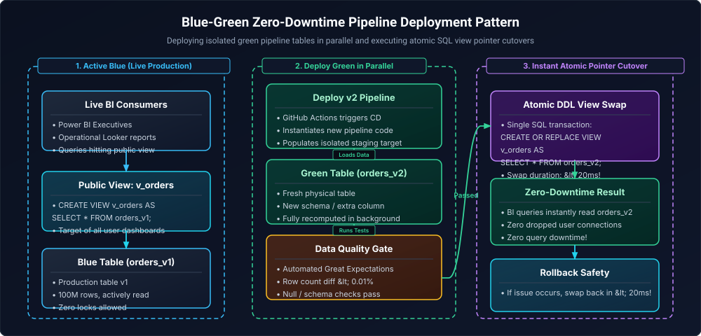

<details>
<summary>D2 Source</summary>

```d2
direction: right
classes: {
  blue: { fill: "#1e293b"; stroke: "#38bdf8"; color: "#f8fafc" }
  green: { fill: "#064e3b"; stroke: "#34d399"; color: "#a7f3d0" }
  swap: { fill: "#581c87"; stroke: "#c084fc"; color: "#e9d5ff" }
}

blue_active: "1. Active Blue Production" {
  bi: "Live BI Dashboard" { class: blue }
  view: "Public View: v_orders" { fill: "#155e75"; stroke: "#22d3ee"; color: "#67e8f9" }
  t_blue: "orders_v1 (Blue)" { class: blue }

  bi -> view -> t_blue
}

green_stage: "2. Deploy Green in Parallel" {
  pipe: "v2 Pipeline Code" { class: green }
  t_green: "orders_v2 (Green)" { class: green }
  dq: "Data Quality Gate" { fill: "#451a03"; stroke: "#fbbf24"; color: "#fde68a" }

  pipe -> t_green -> dq
}

atomic_cutover: "3. Instant Atomic Pointer Cutover" {
  swap: "CREATE OR REPLACE VIEW v_orders\nAS SELECT * FROM orders_v2;" { class: swap }
  swapped_bi: "BI Queries Instantly Directed to Green\n(Zero Downtime)" { class: green }

  swap -> swapped_bi
}

green_stage.dq -> atomic_cutover.swap: "Tests Pass!"
```
</details>

---

### 19.6 Canary Deployments & Shadow Pipelines

- **Shadow Pipeline:** The new pipeline version runs concurrently against live streaming data in parallel with the production pipeline. Output metrics are compared automatically for 48 hours to guarantee zero regression before cutover.
- **Canary Release:** Routes 5% of read queries or downstream batch runs to the new model, monitoring error logs and query latency before rolling out to 100% of enterprise users.

---

# 20. Summary Comparison & Production Engineering Reference Matrix

- **Idempotency as the Gold Standard:** Every production ingestion job must be strictly idempotent: executing a pipeline multiple times over identical source data must produce identical target state without duplicate records or metric amplification. Implement deterministic atomic `MERGE` conditions or dynamic partition overwrites, avoiding non-deterministic generation of random surrogate keys (`UUID()`) or dynamic runtime timestamps during transformation.
- **Fault Tolerance & Dead-Letter Isolation:** Decouple pipeline failure from pipeline crashes. Route malformed, schema-violating, or corrupted records immediately into a quarantined Dead Letter Queue (DLQ) or dead-letter table containing raw byte payloads, failure timestamps, and stack traces. Protect stateful streaming jobs using persistent cloud storage checkpoints backed by RocksDB off-heap state stores.
- **Contract Enforcement & Anomaly Protection:** Schemas must be governed by formal, version-controlled Data Contracts (ODCS YAML or Pydantic) at upstream boundaries. Integrate automated data quality validations (Great Expectations, Soda, or PyDeequ) to assert null thresholds, unique constraints, and range validity before promoting records to Silver/Gold layers. Deploy rolling statistical Z-score checks to detect sudden volume drops or ingestion spikes dynamically.
- **Zero-Trust Security & Credential Isolation:** Hardcoded secrets, API tokens, and connection strings are strictly prohibited in application repositories. All credentials must be dynamically resolved at runtime from enterprise secret stores (Azure Key Vault, AWS Secrets Manager). Enforce least-privilege IAM roles and pseudonymize or cryptographically mask sensitive PII fields upon Bronze landing.
- **Unified Observability & Proactive Alerting:** Continuously track the core pillars of pipeline health—Freshness, Volume, Schema mutations, and Error rates—emitting real-time metrics to Prometheus, CloudWatch, or Datadog. Define tiered alerting policies distinguishing critical Sev-1 pipeline halts (routing to PagerDuty on-call engineers) from informational warnings (routed to team chat channels), and publish automated lineage metadata to central catalogs (Unity Catalog, OpenLineage).

---

### 20.1 Orchestration vs. Transformation: Airflow vs. dbt vs. Modern Alternatives

In production data engineering platforms, pipeline reliability depends on maintaining clear separation between the workflow orchestrator (coordinating task lifecycles, sensors, and heterogeneous compute) and the transformation engine (compiling SQL and executing pushdown logic inside data warehouses).

| Capability / Dimension | Apache Airflow | dbt (Core / Cloud) | Dagster | Prefect (2.x / 3.x) |
| :--- | :--- | :--- | :--- | :--- |
| **Primary Architectural Role** | **Workflow Orchestrator & Control Plane** | **SQL-First In-Warehouse Transformation Engine** | **Asset-Based Data Orchestrator** | **Code-As-Workflows Application Orchestrator** |
| **Execution Abstraction** | Task-based Directed Acyclic Graphs (`DAG`) | Software-Defined SQL/Python Models & DAG Lineage | Software-Defined Assets (`@asset`) with explicit data dependencies | Dynamic functional workflows (`@flow`, `@task`) |
| **Compute Placement** | Orchestrates external compute (EKS, Dataproc, Snowflake) or runs Python operators locally | Pure pushdown: 100% of SQL compute runs inside target warehouse/lakehouse | Hybrid: In-memory Python transformations or delegated warehouse compute | Hybrid: Code runs on ephemeral infrastructure (Work Pools, Docker, K8s) |
| **State & Lineage Tracking** | Metadata DB (PostgreSQL) records task instance states, retries, and run logs | Compiles `manifest.json` documenting full column and model dependency lineage | Native data asset cataloging with automated partitioned materialization tracking | Dynamic task run states and parameters tracked in Prefect Cloud/Server |
| **Testing & Quality Gates** | Custom Python operators, Great Expectations, or SQLCheckOperators | Built-in generic & singular data assertions (`not_null`, `unique`, `relationships`, `accepted_values`) | Built-in asset checks (`@asset_check`) executed immediately after materialization | Custom test tasks or integrated data validation libraries |
| **Failure Recovery & Retries** | Automatic retry policies with exponential backoff; manual task/DAG clearing via UI | Re-run failed models via `dbt retry` or state-modified flags (`state:modified+`) | Re-materialize failed assets or stale upstream dependencies | Dynamic task retries with customizable hooks and pause-for-input states |
| **Recommended Production Pairing** | **Pair with dbt via Astronomer Cosmos** for enterprise data platforms. | **Core transformation standard** inside Snowflake, BigQuery, Databricks, Redshift. | Standalone orchestration for teams prioritizing asset-driven data pipelines. | Modern Python data engineering applications, event-driven pipelines, ML workflows. |

---

### 20.2 Production Pipeline Orchestration & Transformation Invariants

- **Separation of Concerns (Orchestration vs. Execution):** Never execute heavy data transformations directly within Airflow workers or the Airflow scheduler process. Airflow workers must act strictly as lightweight dispatchers triggering pushdown compute (e.g., triggering dbt runs, Databricks jobs, or BigQuery queries) to prevent executor OOM failures and scheduler heartbeat starvation.
- **Astronomer Cosmos for Granular dbt Lineage:** When deploying dbt models within Airflow, use **Astronomer Cosmos** instead of monolithic `BashOperator(bash_command="dbt run")` calls. Cosmos parses your dbt `manifest.json` and renders each individual dbt model as a native Airflow task, providing fine-grained observability, selective task retries, and parallel task scheduling.
- **Idempotency & Deterministic Data Intervals:** All Airflow DAGs and dbt incremental models must be strictly idempotent. Design tasks using Airflow's deterministic logical date variables (`data_interval_start`, `data_interval_end`) rather than runtime wall-clock timestamps (`datetime.now()`) to guarantee identical, repeatable results during historical backfills.
- **Incremental Model Unique Key Contracts:** Every dbt incremental model using `incremental_strategy = 'merge'` must explicitly define a `unique_key`. Omitting the unique key forces dbt into append-only behavior, causing duplicate row explosions whenever downstream pipeline retries or backfills are triggered.
- **Testing in the CI/CD Lifecycle (Slim CI):** Enforce `dbt build` instead of `dbt run` in production pipelines to run unit and data quality tests concurrently with model execution. In development and pull request CI pipelines, leverage Slim CI (`dbt test --select state:modified+ --state ./target-base`) to evaluate only modified models and their immediate downstream dependencies, reducing CI runtime and cloud warehouse compute costs by up to $80\%$.

---

- **Network Isolation & Hub-Spoke Security:** Enterprise Azure data architectures must disable public internet endpoints on ADLS Gen2, Synapse, and Azure Key Vault, routing all intra-cloud traffic across private endpoints linked to hub-and-spoke virtual networks. Azure Databricks workspaces must utilize VNet injection with Secure Cluster Connectivity (No Public IP) to ensure worker nodes communicate entirely within private network perimeters.
- **Identity-First Security & Credential Elimination:** All services and pipeline orchestrators must authenticate via Microsoft Entra ID (formerly Azure AD) System-Assigned or User-Assigned Managed Identities. Static tokens, connection strings, and passwords in pipeline definitions are prohibited; when external secrets are necessary, access Azure Key Vault using Azure RBAC roles (`Key Vault Secrets User`).
- **Lakehouse & Analytical Warehouse Optimization:** Enable ADLS Gen2 Hierarchical Namespace (HNS) for $O(1)$ atomic rename performance during Spark job commits. In Azure Synapse Dedicated SQL Pools, distribute large fact tables ($> 2\text{ GB}$) using hash distribution across 60 compute nodes on high-cardinality join keys, while replicating small dimension tables ($< 2\text{ GB}$) to eliminate data movement service (DMS) shuffle latency.
- **Delta Lake ACID & Merge Efficiency:** Enforce ACID `MERGE` operations on Delta Lake tables with row-level hashing (`SHA-256`) to avoid updating untouched records. Schedule automated compaction (`OPTIMIZE`) and purge deleted tombstones (`VACUUM`) according to negotiated business retention policies.
- **DataOps Automation & Progressive Delivery:** Automate continuous integration with pre-commit credential scanning (`gitleaks`), SQL linting (`sqlfluff`), and containerized integration tests using Testcontainers against Azurite emulators. Enforce Terraform remote state locking with Azure Blob Storage leases, and promote schema updates through shadow pipelines and zero-downtime blue-green table swaps.

---

# 21. References & Further Reading

- [Designing Data-Intensive Applications (Martin Kleppmann)](https://dataintensive.net/)
- [Debezium Official Architecture Guide](https://debezium.io/documentation/reference/stable/architecture.html)
- [Databricks Documentation: What is Auto Loader?](https://docs.databricks.com/en/ingestion/auto-loader/index.html)
- [Snowflake Documentation: Introduction to Snowpipe](https://docs.snowflake.com/en/user-guide/data-load-snowpipe-intro)
- [Google Cloud Documentation: Loading Data into BigQuery](https://cloud.google.com/bigquery/docs/loading-data)
- [Apache Spark Structured Streaming Programming Guide](https://spark.apache.org/docs/latest/structured-streaming-programming-guide.html)
- [Great Expectations Official Documentation](https://docs.greatexpectations.io/)
- [Soda Core Declarative Data Quality Guide](https://docs.soda.io/)
- [Open Data Contract Standard (ODCS) Specification](https://datacontract.com/)
- [Patterns of Distributed Systems (Martin Fowler)](https://martinfowler.com/articles/patterns-of-distributed-systems/)

- [Apache Airflow Official Documentation](https://airflow.apache.org/docs/) — Complete architecture, TaskFlow API, and executor configurations.
- [dbt Official Documentation](https://docs.getdbt.com/) — Model transformations, materialization strategies, incremental logic, and Jinja macros.
- [Astronomer Cosmos: The Bridge Between Airflow and dbt](https://astronomer.github.io/astronomer-cosmos/) — Dynamic translation of dbt projects into Airflow task groups.
- [Data Pipeline Design Patterns: Separation of Orchestration and Transformation](https://martinfowler.com/articles/data-monolith-to-mesh.html) — Enterprise patterns for distributed data platforms.
- [dbt Packages Hub](https://hub.getdbt.com/) — Community packages including `dbt-utils`, `dbt-expectations`, and `codegen`.
- [Apache Airflow DAG Architecture & Best Practices](https://airflow.apache.org/docs/apache-airflow/stable/best-practices.html) — Production guidelines on top-level code performance, pools, and SLAs.

- [Microsoft Learn: Azure Architecture Center (Data Platform Architecture)](https://learn.microsoft.com/en-us/azure/architecture/)
- [Microsoft Learn: Azure Data Lake Storage Gen2 Introduction](https://learn.microsoft.com/en-us/azure/storage/blobs/data-lake-storage-introduction)
- [Microsoft Learn: Azure Synapse Dedicated SQL Pool Design Guidance](https://learn.microsoft.com/en-us/azure/synapse-analytics/sql-data-warehouse/sql-data-warehouse-tables-distribute)
- [Databricks Documentation: Azure Databricks Architecture & Unity Catalog](https://docs.databricks.com/en/index.html)
- [Microsoft Fabric Documentation & OneLake Architecture](https://learn.microsoft.com/en-us/fabric/)
- [HashiCorp Terraform azurerm Provider Documentation](https://registry.terraform.io/providers/hashicorp/azurerm/latest/docs)
- [Designing Data-Intensive Applications (Martin Kleppmann)](https://dataintensive.net/)