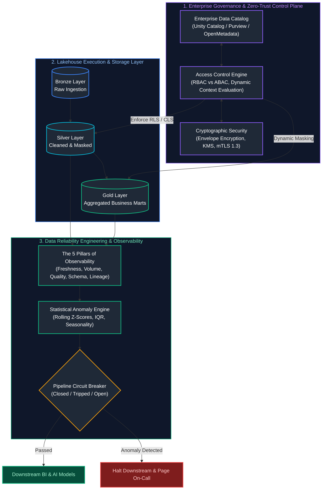
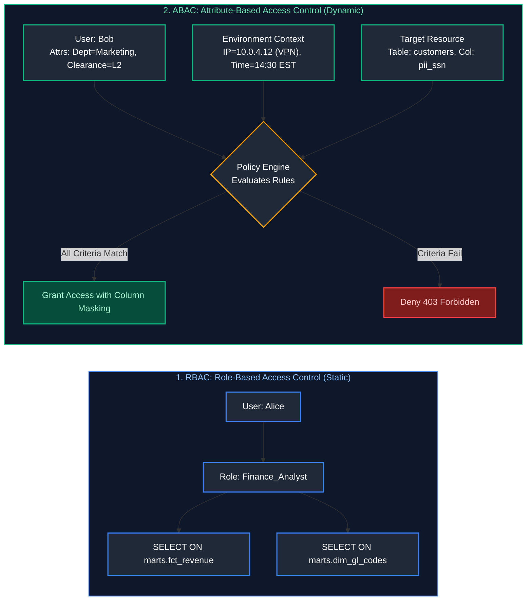
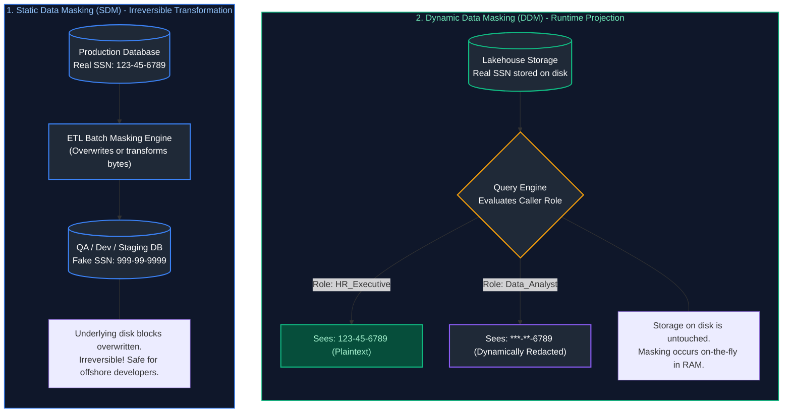
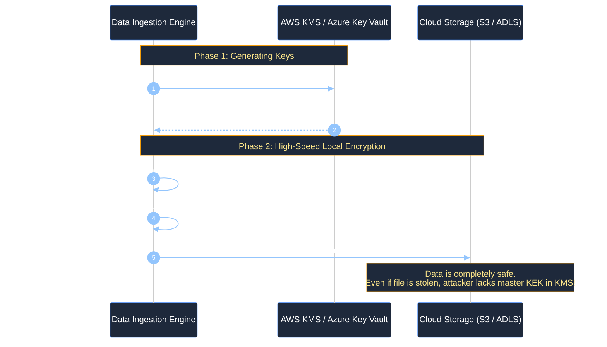
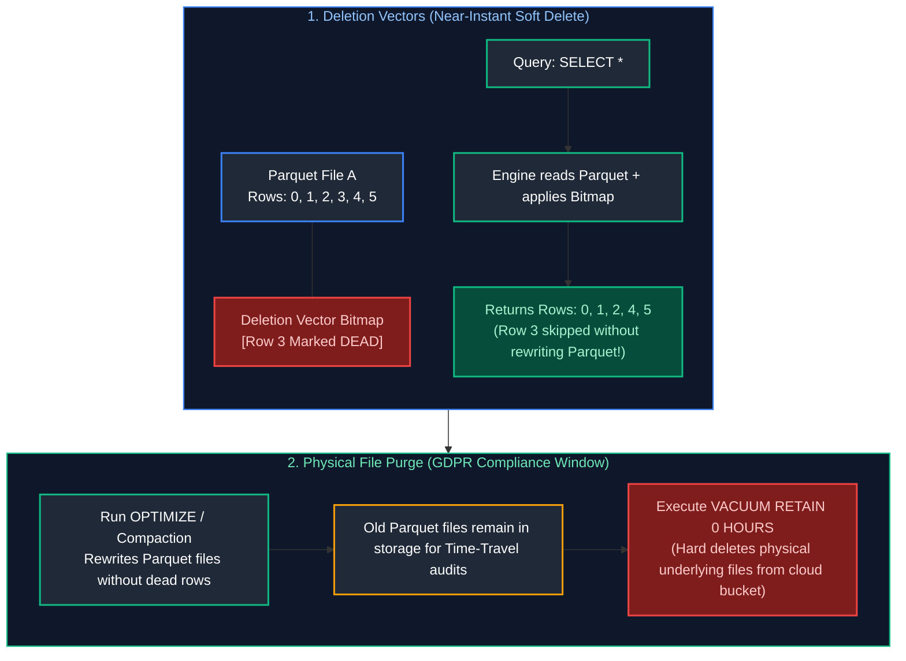
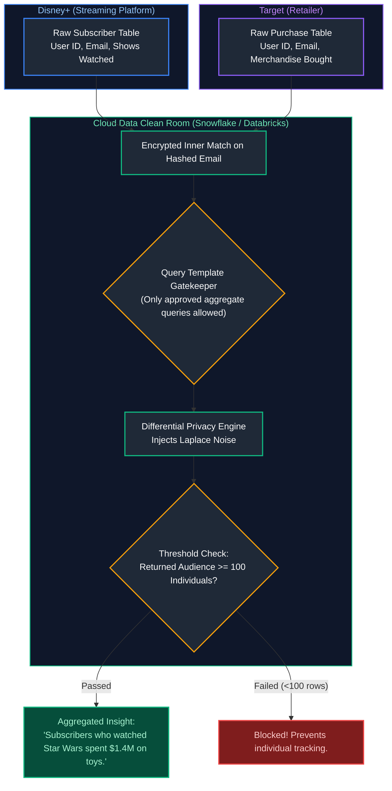
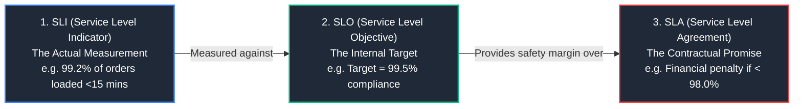
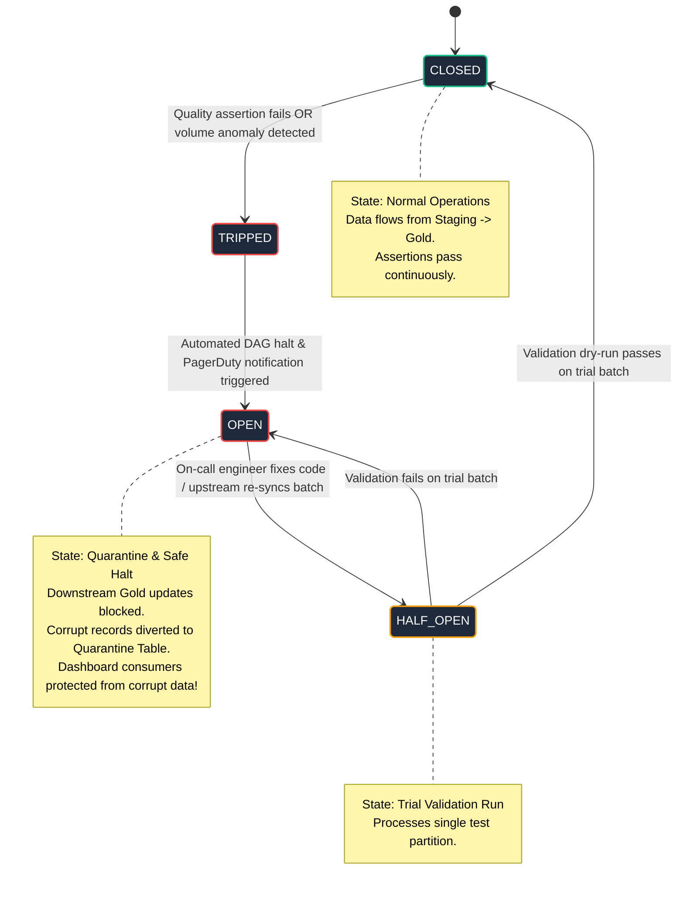
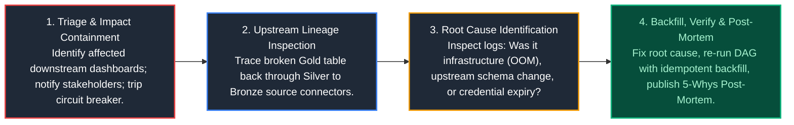

# 09. Unity Catalog, Enterprise Data Governance & Observability: Master Production Guide

A comprehensive, production-grade guide to enterprise data governance, zero-trust security architecture, data privacy regulations, and modern data reliability engineering (observability). Designed to guide a newcomer from foundational intuition to production fluency, while providing experienced data architects with deep operational patterns, cryptographic mechanics, and statistical reliability systems.

---

## Architectural Overview: Enterprise Data Governance, Security & Observability Framework

Data platforms do not operate in a vacuum. A platform that processes petabytes of data at millisecond latencies is an organizational liability if it leaks sensitive customer information, violates international privacy laws, or delivers corrupted metrics to business stakeholders.



---

## Table of Contents
1. [Access Control Paradigms](#1-access-control-paradigms)
   - [1.1 The Intuitive Mental Model: The Airport Security Analogy](#11-the-intuitive-mental-model-the-airport-security-analogy)
   - [1.2 RBAC vs ABAC: Architecture, Mechanics & Role Explosion](#12-rbac-vs-abac-architecture-mechanics--role-explosion)
   - [1.3 Principle of Least Privilege (PoLP) & Zero Trust Architecture](#13-principle-of-least-privilege-polp--zero-trust-architecture)
2. [Data Protection & Obfuscation Techniques](#2-data-protection--obfuscation-techniques)
   - [2.1 Static Data Masking (SDM) vs Dynamic Data Masking (DDM)](#21-static-data-masking-sdm-vs-dynamic-data-masking-ddm)
   - [2.2 Tokenization vs Anonymization vs Pseudonymization (The Coat Check Analogy)](#22-tokenization-vs-anonymization-vs-pseudonymization-the-coat-check-analogy)
   - [2.3 Cryptographic Salted Hashing in Python](#23-cryptographic-salted-hashing-in-python)
   - [2.4 Encryption at Rest: Key Management (KMS) & Envelope Encryption Internals](#24-encryption-at-rest-key-management-kms--envelope-encryption-internals)
   - [2.5 Encryption in Transit: TLS 1.3 & Mutual TLS (mTLS) Architecture](#25-encryption-in-transit-tls-13--mutual-tls-mtls-architecture)
3. [Regulatory Compliance & Lakehouse Privacy Engineering](#3-regulatory-compliance--lakehouse-privacy-engineering)
   - [3.1 The Global Regulatory Landscape: GDPR, CCPA/CPRA, HIPAA, and PCI-DSS](#31-the-global-regulatory-landscape-gdpr-ccpacpra-hipaa-and-pci-dss)
   - [3.2 The Lakehouse Deletion Dilemma: GDPR Article 17 "Right to be Forgotten"](#32-the-lakehouse-deletion-dilemma-gdpr-article-17-right-to-be-forgotten)
   - [3.3 Deletion Vectors, Parquet Rewrites, and VACUUM Retention Operations](#33-deletion-vectors-parquet-rewrites-and-vacuum-retention-operations)
   - [3.4 Cryptographic Erasure (Crypto-Shredding): Mathematical Deletion](#34-cryptographic-erasure-crypto-shredding-mathematical-deletion)
4. [Fine-Grained Security & Secure Collaboration](#4-fine-grained-security--secure-collaboration)
   - [4.1 Row-Level Security (RLS) & Column-Level Security (CLS) Internals](#41-row-level-security-rls--column-level-security-cls-internals)
   - [4.2 Production DDL Implementation in PostgreSQL and Snowflake](#42-production-ddl-implementation-in-postgresql-and-snowflake)
   - [4.3 Data Clean Rooms: Architecture, Differential Privacy & Laplace Noise](#43-data-clean-rooms-architecture-differential-privacy--laplace-noise)
5. [The 5 Pillars of Data Observability](#5-the-5-pillars-of-data-observability)
   - [5.1 The Hospital Vitals Analogy: Why Dashboards Are Not Observability](#51-the-hospital-vitals-analogy-why-dashboards-are-not-observability)
   - [5.2 Pillar 1: Freshness (SLA Boundaries & Ingestion Lag)](#52-pillar-1-freshness-sla-boundaries--ingestion-lag)
   - [5.3 Pillar 2: Volume (Dropoff Detection & Sudden Surges)](#53-pillar-2-volume-dropoff-detection--sudden-surges)
   - [5.4 Pillar 3: Quality (Null Rates, Uniqueness, Domain Drift)](#54-pillar-3-quality-null-rates-uniqueness-domain-drift)
   - [5.5 Pillar 4: Schema Drift (Silent Upstream Column Mutations)](#55-pillar-4-schema-drift-silent-upstream-column-mutations)
   - [5.6 Pillar 5: Lineage (Graph-Based Impact Analysis & Triage)](#56-pillar-5-lineage-graph-based-impact-analysis--triage)
6. [Data Reliability Engineering (DRE) & Downtime](#6-data-reliability-engineering-dre--downtime)
   - [6.1 Calculating Data Downtime & Quantifying Business Impact](#61-calculating-data-downtime--quantifying-business-impact)
   - [6.2 Defining SLIs, SLOs, and SLAs for Data Platforms](#62-defining-slis-slos-and-slas-for-data-platforms)
   - [6.3 Error Budgets: Aligning Velocity with Data Quality](#63-error-budgets-aligning-velocity-with-data-quality)
7. [Automated Anomaly Detection & Circuit Breakers](#7-automated-anomaly-detection--circuit-breakers)
   - [7.1 Statistical Anomaly Detection: Z-Scores, IQR & Seasonality](#71-statistical-anomaly-detection-z-scores-iqr--seasonality)
   - [7.2 Production Python Implementation: Dynamic Volume & Freshness Anomaly Engine](#72-production-python-implementation-dynamic-volume--freshness-anomaly-engine)
   - [7.3 Pipeline Circuit Breakers: State Machines & Quarantine Tables](#73-pipeline-circuit-breakers-state-machines--quarantine-tables)
8. [Observability Tooling & Operational RCA](#8-observability-tooling--operational-rca)
   - [8.1 Tooling Landscape: Elementary, Great Expectations, Monte Carlo, OpenLineage](#81-tooling-landscape-elementary-great-expectations-monte-carlo-openlineage)
   - [8.2 Metadata-Driven Monitoring via Cloud Warehouse System Tables](#82-metadata-driven-monitoring-via-cloud-warehouse-system-tables)
   - [8.3 Alert Fatigue Prevention & Incident Management Runbooks](#83-alert-fatigue-prevention--incident-management-runbooks)
   - [8.4 End-to-End Root Cause Analysis (RCA) Playbook](#84-end-to-end-root-cause-analysis-rca-playbook)
9. [Summary Comparison & Production Engineering Reference Matrix](#9-summary-comparison--production-engineering-reference-matrix)
10. [References & Further Reading](#10-references--further-reading)

> [!TIP]
> **Deep-Dive Interview Scenarios:**
> - [Q1. Unity Catalog 3-Level Namespace & Multi-Environment Architecture](frequently_asked_questions/09_unity_catalog_and_data_governance_faq.md#q1-medium-unity-catalog-3-level-namespace--multi-environment-architecture)
> - [Q10. Multi-Department Data Governance: Finance, Marketing & Operations Security](frequently_asked_questions/09_unity_catalog_and_data_governance_faq.md#q10-medium-multi-department-data-governance-finance-marketing--operations-security)
---

# 1. Access Control Paradigms

### 1.1 The Intuitive Mental Model: The Airport Security Analogy

To understand why modern data engineering has evolved from simple logins to complex authorization engines, consider an international airport:

- **Authentication (AuthN) - *Who are you?*:** You show your passport at the check-in desk. The agent verifies your identity photo and confirms that you are a legitimate human traveler. In databases, this is your username, password, OAuth token, or Kerberos ticket.
- **Authorization (AuthZ) - *What are you allowed to do?*:** Just because you hold a valid passport does not mean you can walk into the cockpit, fuel the aircraft, or inspect baggage carts on the tarmac. Your boarding pass grants you access to Gate B12, Row 14, Seat A. In databases, authorization dictates whether you can run `SELECT` on `sales_summary` or `DROP TABLE customer_pii`.

Access control paradigms define *how* authorization rules are established, maintained, and evaluated at scale.

---

### 1.2 RBAC vs ABAC: Architecture, Mechanics & Role Explosion



#### 1. RBAC (Role-Based Access Control)
- **Mechanism:** Permissions are attached to static **Roles** (e.g., `DATA_SCIENTIST`, `BI_ANALYST`, `FINANCE_AUDITOR`). Users are assigned membership to one or more roles.
- **Advantages:** Simple to conceptualize, straightforward to audit in small organizations, natively supported by every relational database since the 1980s.
- **The "Role Explosion" Crisis:** As companies scale, business logic becomes nuanced:
  - *"Alice is a Finance Analyst, but only for the European division, and only for non-confidential projects."*
  - *"Bob is a Marketing Analyst, but only during the Q4 holiday campaign."*
  To satisfy these granular requirements in pure RBAC, security administrators must create hundreds of highly specific roles:
  `FINANCE_ANALYST_EU`, `FINANCE_ANALYST_US`, `FINANCE_ANALYST_EU_CONFIDENTIAL`, etc.
  In large enterprises, this leads to **Role Explosion**—thousands of unmaintained roles where nobody knows who has access to what, creating massive compliance vulnerabilities.

#### 2. ABAC (Attribute-Based Access Control)
- **Mechanism:** Permissions are evaluated **dynamically at query runtime** by an authorization engine. The engine inspects four sets of attributes:
  1. **Subject Attributes (User):** Department, job title, organizational hierarchy, security clearance, active project assignments.
  2. **Object / Resource Attributes (Data):** Classification tag (`CONFIDENTIAL`, `PUBLIC`, `PII`), data owner, creation date, table schema.
  3. **Action Attributes:** `SELECT`, `INSERT`, `UPDATE`, `EXPORT_CSV`, `DROP`.
  4. **Environment Context Attributes:** Request source IP, VPN status, device health compliance, time of day, geographic location (e.g., request originating within EU borders).
- **The Core Benefit:** A single policy scales across the entire enterprise. For example:
  > *"Allow SELECT on any table tagged with `PII` IF `User.Department == Resource.Department` AND `User.Clearance >= Resource.Clearance` AND `Environment.Location IN ('US', 'EU')`."*

#### Direct Comparison Matrix
| Architectural Dimension | Role-Based Access Control (RBAC) | Attribute-Based Access Control (ABAC) |
| :--- | :--- | :--- |
| **Policy Granularity** | Coarse-grained (Table/Database level) | Extremely fine-grained (Row, Column, Cell, Dynamic) |
| **Scalability** | Degrades rapidly (Role Explosion: 1,000+ roles) | Scales cleanly through declarative rules |
| **Context Awareness** | Zero (Evaluates only static role membership) | High (Evaluates IP, device state, time, location) |
| **Administrative Overhead** | High continuous churn (granting/revoking roles) | Low maintenance once policies are established |
| **Enterprise Tooling** | Native PostgreSQL, MySQL, SQL Server, Snowflake | Unity Catalog, Immuta, Apache Ranger, AWS Lake Formation |

---

### 1.3 Principle of Least Privilege (PoLP) & Zero Trust Architecture

#### The Principle of Least Privilege (PoLP)
Every identity—whether a human analyst, an automated Airflow service account, a Databricks cluster principal, or an API microservice—must be granted **only the absolute minimum set of privileges required to perform its specific business task**, and for the **minimum necessary duration**.

##### Production Anti-Pattern vs Best Practice
- **The Anti-Pattern:** A data engineer connects their Airflow DAG to Snowflake using the `ACCOUNTADMIN` or `SYSADMIN` role because *"it prevents permission errors and just works."*
  - *Risk:* If a malicious dependency is ingested via a third-party Python library, the attacker has complete administrative control to drop production databases or exfiltrate customer databases.
- **The Best Practice:** Create a dedicated service account `SVC_AIRFLOW_INGESTION_ORDERS`. Grant it strictly `INSERT` and `UPDATE` on `staging.raw_orders`, and `USAGE` on the specific warehouse. It cannot read HR compensation tables, drop schemas, or grant privileges.

#### Zero Trust Architecture in Data Engineering
The historical approach to data security was the **"Castle and Moat" model**: everything inside the corporate network perimeter (firewall, VPN) was trusted, while everything outside was untrusted.

The modern **Zero Trust** doctrine states: **"Never Trust, Always Verify."**
Even if a query originates from an internal workstation within the corporate headquarters:
1. **Explicit Identity Verification:** Every API call, query, and pipeline step authenticates explicitly with cryptographic credentials (short-lived OAuth tokens, mTLS certificates).
2. **Micro-Segmentation:** Data lakes are segmented. The marketing platform cannot communicate over the network with the PCI-DSS payment vault, even if both reside in the same AWS/Azure tenant.
3. **Assume Breach:** Security architectures assume that an attacker is already inside the corporate network. Every data access must be continuously inspected, encrypted, logged to immutable audit streams, and checked against real-time anomaly detection.

> [!TIP]
> **Deep-Dive Interview Scenarios:**
> - [Q2. Role-Based Access Control & Privilege Hierarchy](frequently_asked_questions/09_unity_catalog_and_data_governance_faq.md#q2-medium-role-based-access-control--privilege-hierarchy)
> - [Q3. Granting Read Access Across Multiple Tables Cleanly](frequently_asked_questions/09_unity_catalog_and_data_governance_faq.md#q3-medium-granting-read-access-across-multiple-tables-cleanly)
> - [Q6. Permission Diagnostics & 4-Step Access Denial Troubleshooting](frequently_asked_questions/09_unity_catalog_and_data_governance_faq.md#q6-hard-permission-diagnostics--4-step-access-denial-troubleshooting)
> - [Q8. Auditing Sensitive PII Access via System Tables](frequently_asked_questions/09_unity_catalog_and_data_governance_faq.md#q8-medium-auditing-sensitive-pii-access-via-system-tables)

---

# 2. Data Protection & Obfuscation Techniques

### 2.1 Static Data Masking (SDM) vs Dynamic Data Masking (DDM)

Data masking replaces sensitive information (Social Security Numbers, credit card numbers, home addresses) with realistic-looking dummy data.



#### Comparison Matrix
| Feature | Static Data Masking (SDM) | Dynamic Data Masking (DDM) |
| :--- | :--- | :--- |
| **When Applied?** | During ETL extraction/copy to non-prod. | At query runtime during SQL projection. |
| **Storage Impact** | Physical bytes on target disk are permanently replaced. | Physical data on disk remains fully unmasked. |
| **Reversibility** | **Irreversible**. Original data cannot be recovered. | **Reversible**. Privileged roles can read raw values. |
| **Performance** | One-time compute overhead during copy. | Adds slight CPU overhead to every query projection. |
| **Primary Use Case**| Refreshing QA/staging environments for third-party testers. | Protecting production analytics platforms with multiple user tiers. |

---

### 2.2 Tokenization vs Anonymization vs Pseudonymization (The Coat Check Analogy)

Understanding these three terms is mandatory for privacy compliance (GDPR, HIPAA):

#### 1. Tokenization: The "Coat Check" Claim Ticket
- **Analogy:** When you check your winter coat at a high-end restaurant, the attendant hands you a plastic ticket with number `42`. The ticket looks nothing like your coat, holds no warmth, and reveals nothing about your style. Only the attendant possessing the **secure coat-room register (the Token Vault)** can exchange ticket `42` back for your physical coat.
- **In Data Systems:** A credit card `4111-2222-3333-4444` is replaced with a random surrogate string `TKN_98421098`. The true number is stored in a heavily guarded, encrypted Token Vault. The token traverses the analytical pipelines safely.

#### 2. Pseudonymization: The Salted Cryptographic Mask
- **Mechanism:** Identifiers are passed through a cryptographic hash function (e.g., HMAC-SHA256) combined with a secret cryptographic key (salt).
- **GDPR Status:** Pseudonymized data is **STILL REGULATED under GDPR**. Why? Because if the secret key is breached, the hashes can be reversed or re-identified.

#### 3. Anonymization: The Shredder & Aggregate
- **Mechanism:** Information is altered irreversibly so that the individual can **never be re-identified**, directly or indirectly, by anyone, even with additional outside data.
- **Techniques:** $k$-anonymity (ensuring at least $k$ people share identical demographic traits), differential privacy (injecting mathematical noise), or completely stripping identifiers and generalizing metrics (e.g., replacing exact birthdates with age deciles: `"30-40 years old"`).
- **GDPR Status:** Truly anonymized data is **COMPLETELY EXEMPT from GDPR**!

---

### 2.3 Cryptographic Salted Hashing in Python

When engineering ingestion pipelines that anonymize telemetry before landing it in a raw lake, engineers must use keyed cryptographic hashing (HMAC) to prevent **Rainbow Table attacks** (where attackers precompute hashes of all phone numbers or emails to look up leaked values).

```python
import hashlib
import hmac
import os
from typing import Optional

def generate_pii_pseudonym(raw_identifier: str, secret_kms_salt: bytes) -> str:
    """
    Computes a deterministic, collision-resistant cryptographic pseudonym
    using HMAC-SHA256 with an enterprise secret salt.
    
    Why HMAC?
    Standard hashlib.sha256(email) is vulnerable to dictionary/rainbow table
    attacks because emails follow predictable formats. HMAC incorporates a
    secret cryptographic key loaded from Key Vault/KMS.
    
    Args:
        raw_identifier: Plaintext sensitive string (e.g. email, SSN, IP address).
        secret_kms_salt: High-entropy cryptographic secret key (minimum 32 bytes).
        
    Returns:
        Hexadecimal string token representing the pseudonymized identifier.
    """
    if not raw_identifier:
        raise ValueError("Cannot pseudonymize empty identifier.")
        
    # Step 1: Defensive canonicalization (strip whitespace and normalize case)
    # Essential to ensure that 'John@Corp.com ' and 'john@corp.com' produce identical tokens
    canonical_str = raw_identifier.strip().lower().encode("utf-8")
    
    # Step 2: Compute Keyed-Hash Message Authentication Code (HMAC)
    hmac_calculator = hmac.new(
        key=secret_kms_salt,
        msg=canonical_str,
        digestmod=hashlib.sha256
    )
    
    # Step 3: Return hex digest
    return hmac_calculator.hexdigest()

# Example Usage in a PySpark UDF or Ingestion Microservice:
if __name__ == "__main__":
    # In production, fetch this salt from AWS Secrets Manager or Azure Key Vault
    mock_kms_salt = b"k9#mP$2vL@8xZ!1wQ^4jR*7tY&5uI(0o"
    
    user_email_1 = "Alice.Smith@Example.com"
    user_email_2 = "alice.smith@example.com "  # Note lowercase and trailing space
    
    token_1 = generate_pii_pseudonym(user_email_1, mock_kms_salt)
    token_2 = generate_pii_pseudonym(user_email_2, mock_kms_salt)
    
    print(f"Token 1: {token_1}")
    print(f"Token 2: {token_2}")
    assert token_1 == token_2, "Canonicalization failed to produce deterministic join token!"
    print("Verification Successful: Deterministic tokens match across case and whitespace variations.")
```

---

### 2.4 Encryption at Rest: Key Management (KMS) & Envelope Encryption Internals

Data stored on persistent cloud disk drives must be protected against physical theft of hard drives or unauthorized data center access.

#### 1. Key Management Hierarchy
- **Platform-Managed Keys (PMK):** The cloud provider (AWS, Azure, GCP) creates, rotates, and manages keys. Zero maintenance, but the provider holds the mathematical power to decrypt.
- **Customer-Managed Keys (CMK / BYOK):** You generate the master cryptographic key inside your own dedicated Hardware Security Module (HSM) via AWS KMS or Azure Key Vault. You control rotation policies and retain the ability to revoke cloud access instantly.

#### 2. Envelope Encryption Internals
Why doesn't AWS KMS encrypt every single 100GB Parquet file directly?
Because transferring gigabytes of raw data over the network to KMS for encryption is slow and causes extreme network bottlenecks. Modern systems use **Envelope Encryption**:



1. The data platform calls KMS: *"Generate a Data Encryption Key (DEK)."*
2. KMS returns **two items**:
   - A **Plaintext DEK** (e.g., 256-bit AES key).
   - An **Encrypted DEK** (the DEK encrypted under the master Key Encryption Key).
3. The data engine encrypts the large Parquet file locally in memory at hardware speeds using the Plaintext DEK.
4. The engine **wipes the Plaintext DEK from RAM**.
5. The engine stores the **Encrypted DEK alongside the encrypted Parquet file** in storage.
6. To read the file later, the engine sends only the tiny Encrypted DEK to KMS to decrypt.

---

### 2.5 Encryption in Transit: TLS 1.3 & Mutual TLS (mTLS) Architecture

Data moving across physical networks—between Kafka brokers, Spark executors, API gateways, and databases—must be encrypted using **TLS 1.3**.

#### Mutual TLS (mTLS) in Distributed Pipelines
In standard web browsing, only the server provides an SSL certificate (you verify Google's certificate, but Google does not ask for your browser's certificate).
In production data engineering, **Mutual TLS (mTLS)** is enforced across all microservices and Kafka clusters:
- The **Client verifies the Server's certificate** to ensure it isn't sending data to an imposter broker.
- The **Server verifies the Client's certificate** to ensure the client is an authorized, cryptographically attested data pipeline worker.
- Both sides exchange public certificates signed by an internal enterprise Certificate Authority (CA) before any raw records are transmitted.

---

# 3. Regulatory Compliance & Lakehouse Privacy Engineering

### 3.1 The Global Regulatory Landscape: GDPR, CCPA/CPRA, HIPAA, and PCI-DSS

Data engineers must navigate stringent international legal frameworks:

| Regulation | Jurisdiction | Core Technical Mandate for Data Engineers | Financial Penalties |
| :--- | :--- | :--- | :--- |
| **GDPR** | European Union | **Article 17:** Right to be Forgotten (hard deletion).<br/>**Article 25:** Privacy by Design (default masking).<br/>Data sovereignty (EU data cannot leave EU regions without safeguards). | Up to €20M or 4% of global annual turnover. |
| **CCPA / CPRA** | California, USA | Consumer right to opt-out of data sale/sharing.<br/>Right to delete personal information.<br/>Audit trails on data distribution. | Up to $7,500 per intentional violation. |
| **HIPAA** | USA (Healthcare) | Strict encryption standards for Protected Health Information (PHI).<br/>Immutable audit logs recording every single query accessing medical records. | Up to $1.5M/year per violation tier. |
| **PCI-DSS** | Global (Credit Cards) | Primary Account Numbers (PAN) must be encrypted or tokenized.<br/>CVV codes can **never be stored on disk** under any circumstances. | Fines of $5,000–$100,000/month; loss of card processing rights. |

---

### 3.2 The Lakehouse Deletion Dilemma: GDPR Article 17 "Right to be Forgotten"

Under GDPR Article 17, when a customer submits a "Right to be Forgotten" request, the organization has **30 days** to purge that individual's personal information across all systems.

#### Why This Broke Traditional Data Lakes
Traditional data lakes (Hadoop HDFS, AWS S3 with Parquet) were designed to be **append-only, immutable stores**.
- A customer's purchase records might be scattered across 50,000 separate Parquet files spanning 5 years of historical partitions.
- Parquet files cannot be updated in-place; to delete a single row from a 500MB Parquet file, an engine had to read all 500MB into memory, filter out the single row, write a brand new 499.99MB Parquet file to S3, and delete the old file!
- Performing this rewrite across thousands of files for hundreds of daily deletion requests caused massive **write amplification**, cost thousands of dollars in cloud compute, and created severe table locking conflicts.

---

### 3.3 Deletion Vectors, Parquet Rewrites, and VACUUM Retention Operations

Modern table formats (Delta Lake, Apache Iceberg) solve the GDPR deletion crisis through advanced storage mechanics:



#### Production GDPR Deletion Lifecycle
1. **Soft Delete via Deletion Vectors:**
   When a GDPR deletion request arrives, Delta Lake / Iceberg does not immediately rewrite the data files. It writes a lightweight **Deletion Vector** (a Roaring Bitmap) recording the exact row offsets to ignore. The customer disappears from queries in sub-seconds.
2. **Periodic Compaction (File Rewriting):**
   A scheduled weekly maintenance job executes `OPTIMIZE` or compaction, merging active rows into clean Parquet files and stripping dead rows.
3. **Physical Purging via `VACUUM`:**
   Because Delta Lake maintains historical versions for "Time Travel," the old Parquet files containing the deleted customer still physically exist on S3! To satisfy GDPR's 30-day legal mandate, the platform must run:
   ```sql
   -- Set retention to 7 days (compliant with GDPR 30-day requirement)
   VACUUM core.dim_customers RETAIN 168 HOURS;
   ```
   This deletes the physical underlying files from storage.

---

### 3.4 Cryptographic Erasure (Crypto-Shredding): Mathematical Deletion

What if you have data archived in cold, immutable tape backups, AWS Glacier, or write-once-read-many (WORM) storage where physical file deletion is legally or technically impossible?

**Crypto-Shredding** solves this problem through mathematics:
1. Every individual user is assigned their own unique **User Encryption Key (UEK)**.
2. When the user's data is written to the lake, bronze storage, and long-term backups, it is encrypted using that user's specific UEK.
3. The UEK is stored in a centralized key vault indexed by `user_id`.
4. When the user exercises their GDPR Right to be Forgotten:
   - You do **not** touch the petabytes of immutable Parquet backups.
   - You simply **delete the user's UEK from the key vault**.
5. Without the key, the user's data across all historical storage instantly becomes unrecoverable mathematical noise (ciphertext). Regulators worldwide recognize cryptographic destruction as valid erasure under GDPR Article 17!

---

# 4. Fine-Grained Security & Secure Collaboration

### 4.1 Row-Level Security (RLS) & Column-Level Security (CLS) Internals

- **Column-Level Security (CLS) / Dynamic Masking:** Restricts visibility of specific columns based on user identity (e.g., masking credit cards, stripping salaries).
- **Row-Level Security (RLS):** Restricts which *rows* a user can see (e.g., a regional manager can only view sales records within their assigned country).

#### How Query Planners Execute RLS Under the Hood
RLS is not magic. When an authorized user executes a query, the database query planner intercepts the SQL parse tree and **injects security predicates directly into the logical query plan**:

```
User Writes:
SELECT * FROM sales_orders;

Engine Transforms to:
SELECT * FROM sales_orders
WHERE sales_region = CURRENT_USER_REGION()
  AND is_deleted = FALSE;
```

---

### 4.2 Production DDL Implementation in PostgreSQL and Snowflake

#### 1. PostgreSQL Row-Level Security (RLS)
```sql
-- Step 1: Enable RLS on the target production table
ALTER TABLE core.sales_transactions ENABLE ROW LEVEL SECURITY;

-- Step 2: Create dynamic tenant isolation policy
-- Only rows matching the user's authorized tenant ID are projected
CREATE POLICY tenant_isolation_policy ON core.sales_transactions
    FOR ALL                                                      -- Applies to SELECT, INSERT, UPDATE, DELETE
    TO application_role                                          -- Applies to web app connection pool
    USING (tenant_id = CURRENT_SETTING('app.current_tenant_id')); -- Runtime session setting

-- Step 3: Enforce strict policy compliance even for table owners
ALTER TABLE core.sales_transactions FORCE ROW LEVEL SECURITY;
```

#### 2. Snowflake Dynamic Column Masking (CLS)
```sql
-- Step 1: Create a reusable masking policy
CREATE OR REPLACE MASKING POLICY security.mask_pii_ssn AS (val STRING) 
RETURNS STRING ->
    CASE 
        -- Executives and compliance auditors see raw SSN
        WHEN CURRENT_ROLE() IN ('COMPLIANCE_OFFICER', 'AUDIT_LEAD') THEN val
        -- General analytics roles see only masked trailing 4 digits
        WHEN CURRENT_ROLE() IN ('DATA_ANALYST', 'BI_DEVELOPER') THEN '***-**-' || RIGHT(val, 4)
        -- All unauthorized roles see completely redacted placeholder
        ELSE 'REDACTED_CONFIDENTIAL'
    END;

-- Step 2: Attach masking policy to column in physical table
ALTER TABLE core.dim_customer 
MODIFY COLUMN national_id 
SET MASKING POLICY security.mask_pii_ssn;
```

---

### 4.3 Data Clean Rooms: Architecture, Differential Privacy & Laplace Noise

A **Data Clean Room** allows multiple distinct enterprises (e.g., Disney and Target, or an Airline and a Bank) to collaborate, join their first-party customer datasets, and measure advertising ROI **without either company sharing, viewing, or exporting the other's raw customer data**.



#### The Three Core Technical Pillars of Clean Rooms
1. **No Data Movement / Zero Copy:** Raw records never leave the owner's cloud storage account. Queries execute across virtual shared shares.
2. **Minimum Cardinality Gates:** Queries returning results derived from fewer than 50 or 100 individual users are blocked by the query compiler to prevent inferring a specific person's identity.
3. **Differential Privacy ($\epsilon$-Noise):** The engine mathematically perturbs the returned counts by drawing random noise from a Laplace distribution:
   $$\text{Output} = \text{True Aggregate} + \text{Laplace}\left(0, \frac{\Delta f}{\epsilon}\right)$$
   This provides mathematical proof that an adversary cannot determine whether any single individual was present in the dataset.

> [!TIP]
> **Deep-Dive Interview Scenarios:**
> - [Q4. Dynamic Column Masking for PII Protection](frequently_asked_questions/09_unity_catalog_and_data_governance_faq.md#q4-medium-dynamic-column-masking-for-pii-protection)
> - [Q5. Row-Level Security with Dynamic User and Group Filtering](frequently_asked_questions/09_unity_catalog_and_data_governance_faq.md#q5-medium-row-level-security-with-dynamic-user-and-group-filtering)
> - [Q9. Storage Credentials & External Locations Cloud Security](frequently_asked_questions/09_unity_catalog_and_data_governance_faq.md#q9-medium-storage-credentials--external-locations-cloud-security)

---

# 5. The 5 Pillars of Data Observability

### 5.1 The Hospital Vitals Analogy: Why Dashboards Are Not Observability

Many teams believe that because they have a Looker or Tableau dashboard showing daily sales, they have "observability."
This is like believing that looking at a patient's photograph tells you if they are having a heart attack.

#### The Hospital Mental Model
In an Intensive Care Unit (ICU), medical monitors continuously measure five core vital signs:
- **Heart Rate** (Is the rhythm pumping regularly?)
- **Blood Pressure** (Is the volume circulating?)
- **Oxygen Saturation** (Is the gas composition pure?)
- **Body Temperature** (Is there an infection?)
- **Respiratory Rate** (Is the cycle functioning?)

If any vital sign drops outside statistical norms, an audible alarm sounds immediately to alert doctors *before the patient collapses*.

In data engineering, **Data Observability** is the automated, continuous monitoring of the health, reliability, and accuracy of your data pipelines across **5 Fundamental Pillars**:

| Observability Pillar | Monitored Pipeline Dimension | Operational Failure Mode If Compromised | Automated Detection Assertion & Alert |
| :--- | :--- | :--- | :--- |
| **1. Freshness** | Time lag between event generation and warehouse availability. | Upstream Airflow DAG stalls; executive dashboards display stale yesterday data. | `MAX(ingestion_time) < NOW() - INTERVAL 2 HOUR` |
| **2. Volume** | Expected record counts across ingestion batches. | Silent upstream API failure: ingestion job runs successfully but extracts 0 rows! | `ROW_COUNT BETWEEN (historical_mean * 0.8) AND (historical_mean * 1.2)` |
| **3. Distribution** | Statistical distribution of column values (mean, median, nulls, ranges). | Currency conversion glitch: all payment amounts suddenly multiplied by 100. | Z-score anomaly detection on numerical metrics; percentage of nulls $> 1\%$. |
| **4. Schema** | Structural integrity of table definitions, datatypes, and columns. | Source database renames `user_id` to `customer_id`, breaking 50 downstream dbt models. | Schema drift contract tests: assert exact column names and datatypes on incoming JSON/Parquet. |
| **5. Lineage** | Complete upstream and downstream dependency map from source to dashboard. | Engineer drops a "useless" staging table, unknowingly taking down the CEO weekly financial report. | Automated OpenLineage / dbt DAG parsing to trace blast radius before modifying tables. |

---

### 5.2 Pillar 1: Freshness (SLA Boundaries & Ingestion Lag)
- **Question Answered:** *Is the data current, or has the ingestion pipeline stalled?*
- **Mechanism:** Measures the time delta between the current timestamp and the maximum timestamp present in the target table:
  $$\text{Freshness Lag} = \text{CURRENT\_TIMESTAMP}() - \max(\text{event\_timestamp})$$
- **Failure Scenario:** An upstream Fivetran connector or Kafka consumer silently hangs due to an expired API token. The table stops updating, and by morning, the CEO is reviewing yesterday's stale sales numbers.

---

### 5.3 Pillar 2: Volume (Dropoff Detection & Sudden Surges)
- **Question Answered:** *Did we receive the expected volume of records?*
- **Mechanism:** Monitors row counts per ingestion batch or hourly partition against historical moving averages.
- **Failure Scenario:**
  - *Zero-Row Ingestion:* An upstream API changed its pagination parameter; the batch script exits with status code 0 (success) but loads 0 rows.
  - *Volume Explosion:* A mobile client bug enters an infinite retry loop, flooding Kafka with 100x the normal daily event volume, threatening warehouse compute costs.

---

### 5.4 Pillar 3: Quality (Null Rates, Uniqueness, Domain Drift)
- **Question Answered:** *Are the values within the columns accurate, valid, and within expected statistical boundaries?*
- **Mechanism:** Automated assertion tests checking:
  - Primary Key uniqueness and non-null guarantees.
  - Value ranges (e.g., `discount_pct` must be between $0.0$ and $1.0$; negative pricing is rejected).
  - Categorical validity (e.g., `country_code` must match ISO-3166 standards).

---

### 5.5 Pillar 4: Schema Drift (Silent Upstream Column Mutations)
- **Question Answered:** *Has the structure of the data changed without notice?*
- **Mechanism:** Compares current catalog metadata against yesterday's schema definition.
- **Failure Scenario:** A software engineer refactors the production checkout service, renaming `customer_id` to `userId` and altering `zip_code` from `VARCHAR` to `INTEGER`. Downstream dbt models fail, breaking critical dashboards.

---

### 5.6 Pillar 5: Lineage (Graph-Based Impact Analysis & Triage)
- **Question Answered:** *When an upstream table breaks, what downstream assets are impacted?*
- **Mechanism:** Constructs a Directed Acyclic Graph (DAG) mapping every source database, pipeline task, intermediate transform, and downstream BI report/machine learning model.
- **Incident Response:** When `stg_payments` fails at 3:00 AM, lineage immediately identifies that only the "European Fraud Detection Model" is impacted, while the "Executive Revenue Dashboard" is safe, preventing panic.

---

# 6. Data Reliability Engineering (DRE) & Downtime

### 6.1 Calculating Data Downtime & Quantifying Business Impact

Site Reliability Engineering (SRE) revolutionized web applications by defining system uptime. **Data Reliability Engineering (DRE)** applies SRE principles directly to data platforms.

#### The Data Downtime Equation
$$\text{Data Downtime} = \text{Incident Duration (Hours)} \times \text{Impact Factor}$$

Where $\text{Impact Factor}$ can be measured as the number of broken downstream tables, critical executive dashboards, or customer-facing API endpoints affected.

#### Why Data Downtime Destroys Enterprise Value
1. **Executive Decision Paralysis:** Business leaders lose faith in analytics, resorting to gut instincts instead of data-driven decisions.
2. **Financial Bleed:** Automated ML bidding systems make erroneous bids on advertising platforms based on faulty conversion feedback loops.
3. **Wasted Engineering Hours:** Highly paid data engineers spend 40% of their working hours manually debugging broken pipelines ("data fire drills") instead of building strategic data products.

---

### 6.2 Defining SLIs, SLOs, and SLAs for Data Platforms

Modern data platforms establish formal reliability agreements with their internal consumers:



1. **SLI (Service Level Indicator):** A quantifiable, real-time metric of data pipeline performance.
   - *Example:* *"% of daily batch orders materialized in `fct_sales` before 06:00 AM UTC."*
2. **SLO (Service Level Objective):** The internal reliability goal agreed upon by the data engineering team.
   - *Example:* *"The 06:00 AM batch delivery SLI must achieve $\ge 99.5\%$ success over a rolling 30-day window."*
3. **SLA (Service Level Agreement):** The formal agreement with external clients or executive leadership, often carrying commercial penalties or contractual repercussions if breached.
   - *Example:* *"If core reporting data is delayed past 08:00 AM more than 1% of the time, the data platform team incurs formal audit sanctions."*

---

### 6.3 Error Budgets: Aligning Velocity with Data Quality

An **Error Budget** is the mathematically allowed margin of failure:

$$\text{Error Budget} = 100\% - \text{SLO}$$

If your SLO for table freshness is **99.5%**, your team possesses an Error Budget of **0.5%** downtime per month ($0.005 \times 720 \text{ hours} \approx 3.6 \text{ hours}$ of allowable pipeline failure).

#### The Operational Governance Rule
- **While Error Budget > 0%:** The data team is authorized to innovate rapidly, deploy experimental pipelines, migrate infrastructure, and test new tools.
- **When Error Budget is Exhausted (0%):** **All feature development halts immediately!** The data team enters a code freeze and focuses 100% of sprint capacity on pipeline hardening, automated testing, circuit breakers, and root-cause remediation until reliability is restored.

---

# 7. Automated Anomaly Detection & Circuit Breakers

### 7.1 Statistical Anomaly Detection: Z-Scores, IQR & Seasonality

Static threshold alerts (e.g., *"Alert if rows ingested < 1,000"*) fail in enterprise environments because business activity is naturally cyclical:
- On Cyber Monday, ingesting 10,000 rows might indicate an outage (expected 50,000).
- On Christmas Day, ingesting 500 rows might be completely normal.

Reliability engines use dynamic statistical models:

#### 1. Rolling Z-Score Model
Measures how many standard deviations ($\sigma$) a new data point $x$ lies away from the historical rolling mean ($\mu$):

$$Z = \frac{x - \mu}{\sigma}$$

- If $|Z| > 3.0$, the event has less than a $0.3\%$ probability of occurring under normal conditions. Flag as an **Anomaly**!

#### 2. Interquartile Range (IQR) Model
Robust against historical outliers that distort mean and standard deviation:
$$\text{IQR} = Q_3 - Q_1$$
$$\text{Lower Bound} = Q_1 - 1.5 \times \text{IQR}$$
$$\text{Upper Bound} = Q_3 + 1.5 \times \text{IQR}$$

---

### 7.2 Production Python Implementation: Dynamic Volume & Freshness Anomaly Engine

```python
import numpy as np
import pandas as pd
from datetime import datetime, timezone
from typing import Dict, Any, List

class DataObservabilityEngine:
    """
    Production-grade statistical observability engine that computes
    dynamic anomaly thresholds for pipeline volume and freshness.
    """
    
    def __init__(self, z_score_threshold: float = 3.0):
        self.z_score_threshold = z_score_threshold

    def detect_volume_anomaly(self, current_batch_count: int, historical_counts: List[int]) -> Dict[str, Any]:
        """
        Evaluates current ingestion volume against a 30-day historical baseline
        using rolling Z-score and Interquartile Range (IQR).
        """
        history = np.array(historical_counts, dtype=np.float64)
        if len(history) < 7:
            return {"status": "INSUFFICIENT_DATA", "is_anomaly": False}

        # Calculate parametric metrics (Z-score)
        mean_val = np.mean(history)
        std_val = np.std(history)
        # Avoid division by zero if history is completely uniform
        std_val = std_val if std_val > 0 else 1.0
        z_score = (current_batch_count - mean_val) / std_val

        # Calculate non-parametric metrics (IQR)
        q25, q75 = np.percentile(history, [25, 75])
        iqr = q75 - q25
        lower_bound = max(0, q25 - (1.5 * iqr))
        upper_bound = q75 + (1.5 * iqr)

        is_anomaly = bool(abs(z_score) > self.z_score_threshold or current_batch_count < lower_bound)

        return {
            "current_volume": current_batch_count,
            "historical_mean": round(float(mean_val), 2),
            "historical_std": round(float(std_val), 2),
            "z_score": round(float(z_score), 2),
            "iqr_lower_bound": round(float(lower_bound), 2),
            "iqr_upper_bound": round(float(upper_bound), 2),
            "is_anomaly": is_anomaly,
            "severity": "CRITICAL" if abs(z_score) > 4.0 or current_batch_count == 0 else "WARNING"
        }

    def detect_freshness_anomaly(self, latest_record_timestamp: datetime, sla_max_minutes: int) -> Dict[str, Any]:
        """
        Evaluates data arrival lag against SLA boundary.
        """
        now = datetime.now(timezone.utc)
        lag_seconds = (now - latest_record_timestamp).total_seconds()
        lag_minutes = round(lag_seconds / 60.0, 2)
        
        is_breached = lag_minutes > sla_max_minutes

        return {
            "current_lag_minutes": lag_minutes,
            "sla_threshold_minutes": sla_max_minutes,
            "is_sla_breached": is_breached,
            "alert_required": is_breached
        }

# Execution Verification:
if __name__ == "__main__":
    detector = DataObservabilityEngine(z_score_threshold=3.0)
    
    # 30-day baseline of daily orders (mean ~ 10,000 rows)
    simulated_history = [9800, 10200, 10150, 9900, 10050, 10300, 9750, 10100] * 4
    
    # Test Scenario 1: Normal Tuesday batch
    res_normal = detector.detect_volume_anomaly(10120, simulated_history)
    print(f"Normal Batch: Anomaly={res_normal['is_anomaly']}, Z-Score={res_normal['z_score']}")
    
    # Test Scenario 2: Pipeline Silent Failure (Upstream API returns empty payload)
    res_zero = detector.detect_volume_anomaly(0, simulated_history)
    print(f"Zero Batch: Anomaly={res_zero['is_anomaly']}, Severity={res_zero['severity']}, Z-Score={res_zero['z_score']}")
    
    assert res_zero["is_anomaly"] is True, "Failed to flag zero-row ingestion anomaly!"
    print("Verification Successful: Statistical anomaly detector accurately identified failure mode.")
```

---

### 7.3 Pipeline Circuit Breakers: State Machines & Quarantine Tables

A **Pipeline Circuit Breaker** borrows from electrical engineering: when a short-circuit occurs, the breaker trips instantly to prevent the house from catching fire.

In data engineering, if raw or staging data contains critical corruptions (e.g., 20% NULL primary keys or volume drops by 80%), the circuit breaker **trips**, halting downstream DAG execution and preventing corrupted data from polluting clean production Gold reporting tables.



#### Production SQL Implementation: Quarantine Diversion Pattern
Rather than letting a batch job simply crash, a resilient pipeline diverts bad records into a `quarantine` table while promoting clean records:

```sql
-- Step 1: Ingest batch with automated contract validation flags
WITH evaluated_batch AS (
    SELECT 
        raw_order_id,
        customer_id,
        order_amount,
        ingested_at,
        CASE 
            WHEN raw_order_id IS NULL THEN 'MISSING_PRIMARY_KEY'
            WHEN customer_id  IS NULL THEN 'MISSING_FOREIGN_KEY'
            WHEN order_amount <= 0.00 THEN 'INVALID_NEGATIVE_AMOUNT'
            ELSE 'PASS'
        END AS validation_status
    FROM staging.raw_inbound_orders
)
-- Step 2: Route clean records to production Silver layer
INSERT INTO silver.orders (order_id, customer_id, order_amount, processed_at)
SELECT raw_order_id, customer_id, order_amount, CURRENT_TIMESTAMP
FROM evaluated_batch
WHERE validation_status = 'PASS';

-- Step 3: Divert invalid records to quarantine for dead-letter analysis
INSERT INTO quarantine.failed_orders (raw_order_id, error_reason, quarantined_at)
SELECT raw_order_id, validation_status, CURRENT_TIMESTAMP
FROM evaluated_batch
WHERE validation_status != 'PASS';
```

> [!TIP]
> **Deep-Dive Interview Scenario:**
> - [Q7. Automated Data Lineage for Root-Cause Analysis](frequently_asked_questions/09_unity_catalog_and_data_governance_faq.md#q7-medium-automated-data-lineage-for-root-cause-analysis)

---

# 8. Observability Tooling & Operational RCA

### 8.1 Tooling Landscape: Elementary, Great Expectations, Monte Carlo, OpenLineage

Data observability and quality frameworks ensure pipelines detect silent data corruption, schema drift, volumetric anomalies, and lineage breaks before bad data propagates to downstream business reporting and machine learning models. The ecosystem bifurcates into distinct operational archetypes:

1. **Assertion-Based Data Contract Testing (e.g., Great Expectations):**
   - **Operational Paradigm:** Pre-flight and in-flight assertion testing. Engineers write explicit, declarative test suites ("Expectations") such as `expect_column_values_to_not_be_null` or `expect_table_row_count_to_be_between`.
   - **Pipeline Integration:** Embedded directly into orchestration tasks (Airflow, Prefect) or Spark/Python transformation code. If an assertion fails, the pipeline halts or routes bad batches to dead-letter quarantine queues before writing to production tables.

2. **In-Warehouse Analytical Observability (e.g., Elementary Data):**
   - **Operational Paradigm:** Warehouse-native observability specifically optimized for modern SQL and dbt transformation workflows.
   - **Mechanics:** Installs as a lightweight dbt package that models metadata, test results, and runtime performance tables directly inside the data warehouse (Snowflake, BigQuery, Databricks). It uses historical query logs and statistical modeling to detect volume anomalies, execution duration spikes, and schema drift without sending raw customer data outside the warehouse boundary.

3. **Autonomous End-to-End SaaS Observability (e.g., Monte Carlo, Datadog Data Observability):**
   - **Operational Paradigm:** Agentless, ML-driven enterprise telemetry. Connects via read-only service accounts to cloud warehouses, lakehouses, orchestrators, and BI dashboards.
   - **Autonomous Baselines:** Learns normal data freshness intervals, row arrival rates, and schema modifications over time. When an upstream API silently deprecates a column or an ingestion pipeline drops 50% of daily transactions, it flags anomaly alerts with automated downstream impact radiuses directly into Slack and PagerDuty.

4. **Open Standard Lineage Telemetry (e.g., OpenLineage & Marquez):**
   - **Operational Paradigm:** Standardized, vendor-neutral lineage instrumentation governed under the Linux Foundation.
   - **Event-Driven Telemetry:** Spark listeners, Airflow plugins, and Flink operators emit standardized JSON events describing dataset inputs, outputs, job runtimes, and facet schemas at `START`, `RUNNING`, and `COMPLETE` phases, creating a unified cross-engine graph in backend engines like Marquez or DataHub.

| Tool | Category | Deployment Model | Key Strengths & Production Fit |
| :--- | :--- | :--- | :--- |
| **Great Expectations (GX)** | Assertion Testing | Python Library / Open Source | Declarative data contracts executed during batch ETL or pre-flight pipelines. |
| **Elementary Data** | Observability for dbt | dbt Package / Open Source & Cloud | Runs anomaly detection and test reporting natively inside your warehouse using dbt models. |
| **Monte Carlo** | End-to-End Enterprise Observability | SaaS Platform | Zero-code ML anomaly detection across Snowflake, BigQuery, Databricks, Airflow, and Tableau. |
| **OpenLineage / Marquez** | Metadata & Lineage Standard | Linux Foundation Standard / Open Source | Open API standard emitted by Spark, Airflow, and Flink to map end-to-end lineage graphs. |

---

### 8.2 Metadata-Driven Monitoring via Cloud Warehouse System Tables

Data engineers do not need to purchase expensive tools to start monitoring data health. Modern cloud warehouses provide rich system metadata tables that can be queried directly:

#### 1. Snowflake: Detect Tables Stale for > 24 Hours
```sql
SELECT 
    table_catalog,
    table_schema,
    table_name,
    row_count,
    last_altered,
    DATEDIFF('hour', last_altered, CURRENT_TIMESTAMP()) AS hours_since_update
FROM snowflake.account_usage.tables
WHERE deleted IS NULL
  AND table_schema = 'GOLD_MARTS'
  AND last_altered < DATEADD('hour', -24, CURRENT_TIMESTAMP())
ORDER BY hours_since_update DESC;
```

#### 2. BigQuery: Identify Rapid Volume Drops via `INFORMATION_SCHEMA`
```sql
SELECT 
    table_id,
    row_count,
    TIMESTAMP_MILLIS(last_modified_time) AS last_modified,
    -- Flag if row count is zero
    CASE WHEN row_count = 0 THEN 'CRITICAL_EMPTY_TABLE' ELSE 'HEALTHY' END AS status
FROM `my_project.my_dataset.__TABLES__`
WHERE TIMESTAMP_MILLIS(last_modified_time) >= TIMESTAMP_SUB(CURRENT_TIMESTAMP(), INTERVAL 1 DAY);
```

---

### 8.3 Alert Fatigue Prevention & Incident Management Runbooks

One of the greatest operational failures in data engineering is **Alert Fatigue**: when a Slack channel (`#data-alerts`) receives 500 notifications a day, engineers begin ignoring them. When a truly catastrophic outage occurs, nobody notices.

#### Principles of Alert Hygiene
1. **Never Alert on Non-Actionable Events:** If an alert does not require an engineer to wake up or take immediate action, it should not be an alert; it should be a daily digest report.
2. **Implement Severity Tiers:**
   - **P1 (Critical / Page On-Call via PagerDuty):** Production Gold table has failed freshness SLA; CEO dashboard or customer billing pipeline is down.
   - **P2 (Major / Priority Slack Channel):** Staging pipeline failed, but retry mechanism is active. Downstream impact delayed.
   - **P3 (Minor / Daily Warning Digest):** Schema drift detected on non-critical column; minor volume deviation (<5%).
3. **Mandatory Runbooks:** Every automated alert must include a direct hyperlink to its specific **Operational Runbook** explaining:
   - What the table represents.
   - Who owns the upstream data source.
   - Exact CLI/Airflow commands to re-trigger or backfill the dataset.

---

### 8.4 End-to-End Root Cause Analysis (RCA) Playbook

When a P1 data incident strikes, follow this 4-step triage sequence:



1. **Containment:** Trip the circuit breaker to prevent bad records from propagating further. Post a message to `#data-status` informing stakeholders that the dashboard is currently paused for maintenance.
2. **Lineage Tracing:** Use the lineage graph to determine the earliest upstream point of failure. If `fct_revenue` is wrong, check `stg_payments`. If `stg_payments` is fine, the bug is inside your transformation SQL logic.
3. **Root Cause Analysis (The 5 Whys):**
   - *Why is revenue zero?* Because `stg_stripe` was empty.
   - *Why was it empty?* Because the Fivetran sync failed at 02:00 AM.
   - *Why did the sync fail?* Because the Stripe API returned `401 Unauthorized`.
   - *Why 401?* Because the payment team rotated the API secret key without updating the data platform's Key Vault.
4. **Remediation & Prevention:** Update the Key Vault secret, trigger an idempotent backfill, verify data quality assertions pass, and implement an automated notification contract between the payment team and the data platform.

---

# 9. Summary Comparison & Production Engineering Reference Matrix

- **Access Governance & Authorization Architecture:** Role-Based Access Control (RBAC) maps permissions to broad organizational titles but suffers from severe "Role Explosion" as data complexity scales. Attribute-Based Access Control (ABAC) eliminates role sprawl by dynamically evaluating multidimensional user context (department, geographic region, project clearance) against tagged metadata attributes on target tables and columns at runtime.
- **Cryptographic Security & Privacy Engineering:** Data platforms must implement Envelope Encryption: customer data is encrypted with local Data Encryption Keys (DEKs), while DEKs are encrypted and managed under hardware security modules via Key Encryption Keys (KEKs). To satisfy GDPR Article 17 ("Right to be Forgotten") in immutable Parquet data lakes without triggering costly full-partition file rewrites, implement Delta/Iceberg Deletion Vectors or Crypto-Shredding (permanently destroying the user's specific encryption key).
- **Fine-Grained Row and Column Protection:** Enforce Dynamic Data Masking (DDM) to hash, pseudonymize, or redact sensitive PII (SSN, credit card, email) based on the session user's role. Combine DDM with Row-Level Security (RLS) predicate injection to restrict multi-tenant data visibility at the query engine layer without duplicating underlying physical tables.
- **The 5 Pillars of Unified Data Observability:** Comprehensive data reliability requires continuous monitoring across five distinct axes: **Freshness** (SLA latency and ingestion staleness), **Volume** (row count completeness and ingestion dropouts), **Quality** (schema conformance, null rates, and distribution boundaries), **Schema** (breaking column deletions or incompatible type mutations), and **Lineage** (directed acyclic dependency graph tracking for impact analysis and root-cause triage).
- **Statistical Anomaly Detection & Pipeline Circuit Breakers:** Replace brittle, hardcoded alert thresholds with adaptive statistical models (rolling Z-scores or Interquartile Range / IQR) that account for hourly seasonality and day-of-week volume patterns. Integrate automated Pipeline Circuit Breakers that trip upon detecting anomalous error spikes, quarantining corrupt batches to Dead Letter storage before bad data propagates into executive BI reporting.

---

# 10. References & Further Reading

- [NIST Special Publication 800-162: Guide to Attribute Based Access Control (ABAC)](https://csrc.nist.gov/publications/detail/sp/800-162/final) — The authoritative federal standard for fine-grained authorization architecture.
- [General Data Protection Regulation (GDPR) Article 17: Right to Erasure](https://gdpr-info.eu/art-17-gdpr/) — Official legal specifications and technical compliance requirements.
- [OpenLineage Specification & Ecosystem Architecture](https://openlineage.io/) — Open standard for data lineage metadata collection and graph tracing.
- [Designing Data-Intensive Applications (Martin Kleppmann)](https://dataintensive.net/) — Security, data reliability, distributed logging, and compliance engineering.
- [Google Site Reliability Engineering: Monitoring Distributed Systems](https://sre.google/sre-book/monitoring-distributed-systems/) — Observability principles, alerting hygiene, and alert fatigue mitigation.
