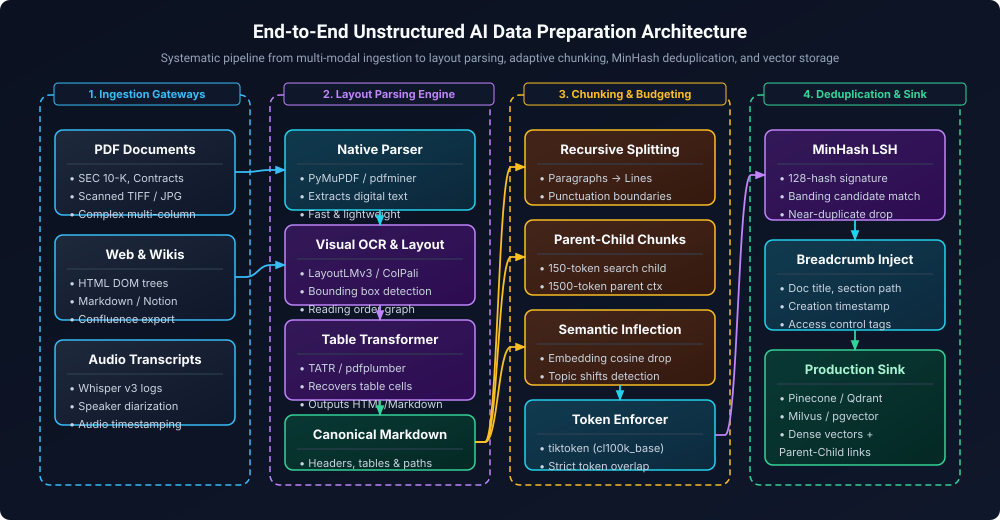
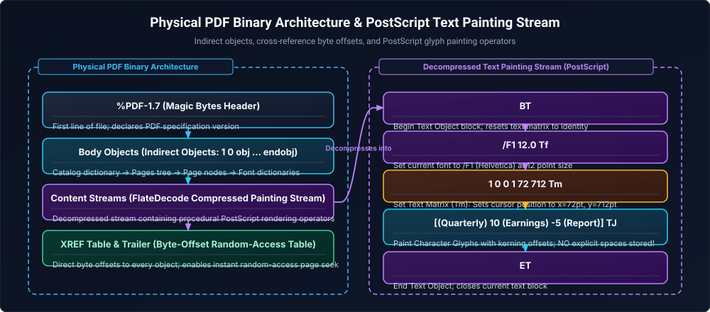
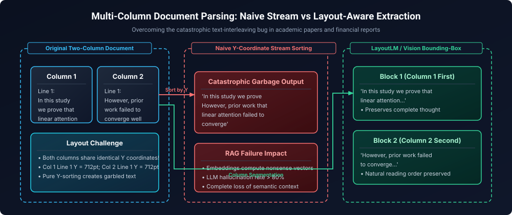
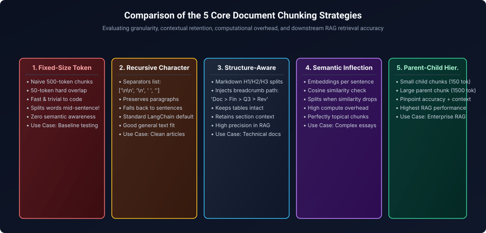
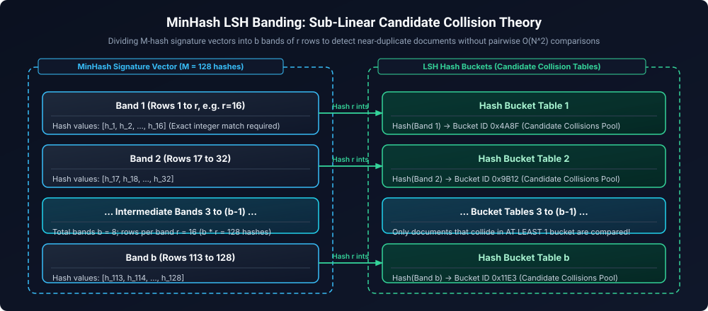

# 10. Document Processing & Data Preparation for AI Pipelines

A comprehensive, production-grade guide to unstructured document ingestion, OCR layout parsing, visual document understanding, table extraction, chunking strategies, tokenization mechanics, semantic deduplication via MinHash LSH, and multimodal data engineering for Retrieval-Augmented Generation (RAG) and LLM fine-tuning pipelines.

---

## Architectural Overview: Enterprise AI Document Ingestion & Preparation Pipeline



<details>
<summary>D2 Source</summary>

```d2
direction: right
classes: {
  ing: { fill: "#1e293b"; stroke: "#38bdf8"; color: "#f8fafc" }
  parse: { fill: "#581c87"; stroke: "#c084fc"; color: "#e9d5ff" }
  chunk: { fill: "#451a03"; stroke: "#fbbf24"; color: "#fde68a" }
  sink: { fill: "#064e3b"; stroke: "#34d399"; color: "#a7f3d0" }
}

gateways: "1. Ingestion Gateways" {
  pdf: "PDFs / Scans" { class: ing }
  html: "Web & Wikis" { class: ing }
  audio: "Audio Transcripts" { class: ing }
}

parsing: "2. Layout Parsing Engine" {
  native: "Native Stream Parser\n(PyMuPDF)" { fill: "#155e75"; stroke: "#22d3ee"; color: "#67e8f9" }
  ocr: "Visual OCR & Layout\n(LayoutLMv3 / ColPali)" { class: parse }
  table: "Table Transformer (TATR)" { class: parse }
  md: "Canonical Markdown" { class: sink }

  native -> table
  ocr -> table
  table -> md
}

chunking: "3. Advanced Chunking Strategy" {
  rec: "Recursive Character" { class: chunk }
  hier: "Parent-Child (Hierarchical)" { class: chunk }
  sem: "Semantic Inflection" { class: chunk }
  enforce: "Token Budget Enforcer\n(cl100k_base)" { fill: "#155e75"; stroke: "#22d3ee"; color: "#67e8f9" }

  rec -> enforce
  hier -> enforce
  sem -> enforce
}

enrichment: "4. Deduplication & Storage" {
  minhash: "MinHash LSH Deduplication" { class: parse }
  meta: "Breadcrumb Injection" { fill: "#155e75"; stroke: "#22d3ee"; color: "#67e8f9" }
  vdb: "Vector Store & Doc Store\n(Dense Vectors + Hierarchy)" { class: sink }

  minhash -> meta -> vdb
}

gateways.pdf -> parsing.native
parsing.md -> chunking.rec
chunking.enforce -> enrichment.minhash
```
</details>

---

## Table of Contents
1. [Unstructured Data Ingestion & Binary Document Internals](#1-unstructured-data-ingestion--binary-document-internals)
   - 1.1 The Anatomy of Portable Document Format (PDF) Internals
   - 1.2 Font Dictionaries, Glyphs & ToUnicode CMap Corruption
   - 1.3 Digital Text Streams vs Scanned Bitmaps
2. [Document Layout Analysis & Visual Document Understanding (VDU)](#2-document-layout-analysis--visual-document-understanding-vdu)
   - 2.1 Reading Order Disruption in Multi-Column Documents
   - 2.2 Deep Learning Layout Models: LayoutLMv1–v3 vs Donut vs Nougat
   - 2.3 The Vision-Native Revolution: ColPali Late-Interaction Patch Embeddings
3. [Table Extraction & Relational Structure Preservation](#3-table-extraction--relational-structure-preservation)
   - 3.1 Why Naive Plain-Text Extraction Destroys Tables
   - 3.2 Deep Learning Table Detection (TATR) vs Rule-Based Geometric Parsers
   - 3.3 Multi-Tier Headers, Merged Cells & Markdown/HTML Serialization
4. [Advanced Chunking Strategies: Mechanics & Mathematical Trade-Offs](#4-advanced-chunking-strategies-mechanics--mathematical-trade-offs)
   - 4.1 Fixed-Size Token Chunking with Sliding Overlap
   - 4.2 Recursive Character Text Splitting
   - 4.3 Document-Aware Header Hierarchy Splitting
   - 4.4 Semantic Chunking via Embedding Cosine Inflection
   - 4.5 Hierarchical Parent-Child & Anthropic Contextual Retrieval
5. [Tokenization Mechanics & Context Window Budgeting](#5-tokenization-mechanics--context-window-budgeting)
   - 5.1 Byte-Pair Encoding (BPE), WordPiece & SentencePiece
   - 5.2 Token Inflation: Code, Numerical Tables & Multilingual Text
   - 5.3 Silent Truncation Hazards in Dense Embedding Models
6. [Near-Duplicate Detection via MinHash & Locality-Sensitive Hashing (LSH)](#6-near-duplicate-detection-via-minhash--locality-sensitive-hashing-lsh)
   - 6.1 $k$-Shingling & Jaccard Similarity Foundations
   - 6.2 MinHash Signature Generation
   - 6.3 Locality-Sensitive Hashing (LSH) Banding Mathematics & S-Curve Derivation
7. [Multimodal Ingestion: Audio, Video & Vision-Language Processing](#7-multimodal-ingestion-audio-video--vision-language-processing)
   - 7.1 Speech-to-Text Ingestion with OpenAI Whisper & Speaker Diarization
   - 7.2 Video Keyframe Extraction & VLM Diagram Captioning
8. [Production Code Implementation: End-to-End Enterprise Ingestion Pipeline](#8-production-code-implementation-end-to-end-enterprise-ingestion-pipeline)
9. [Failure Modes, Diagnostic Runbooks & Production Reference Matrix](#9-failure-modes-diagnostic-runbooks--production-reference-matrix)
10. [References & Further Reading](#10-references--further-reading)

---

## 1. Unstructured Data Ingestion & Binary Document Internals

In traditional data engineering, ETL pipelines ingest structured records from relational engines or columnar files (Parquet, ORC, Delta Lake). In AI data engineering, over 80% of enterprise knowledge resides in unstructured documents: 100-page financial SEC 10-K filings, clinical medical trials, legal contracts, engineering blueprints, and scanned PDF forms.

### 1.1 The Anatomy of Portable Document Format (PDF) Internals

To build reliable extraction systems, an engineer must understand that **a PDF is not a document format; it is a compiled vector display instruction manual designed for printers and screens, not natural language processing.**

A PDF file consists of four primary binary structural layers:
1. **Header:** Specifies the PDF specification version (e.g., `%PDF-1.7`).
2. **Body:** A directed graph of indirect objects (`obj ... endobj`):
   - **Catalog Object:** The root of the document object hierarchy (`/Type /Catalog`).
   - **Pages Tree:** A balanced B-tree of page objects (`/Type /Pages` and `/Type /Page`).
   - **Content Streams:** Compressed binary streams (`/Filter /FlateDecode`) containing PostScript-like operator instructions that place graphical elements and text characters onto a 2D Cartesian plane.
3. **Cross-Reference Table (`xref`):** A byte-offset directory allowing random access to any indirect object within the file without scanning the entire file sequentially.
4. **Trailer:** Points to the root catalog object and gives the byte offset of the start of the `xref` table.



<details>
<summary>D2 Source</summary>

```d2
direction: right
classes: {
  pdf: { fill: "#1e293b"; stroke: "#38bdf8"; color: "#f8fafc" }
  post: { fill: "#581c87"; stroke: "#c084fc"; color: "#e9d5ff" }
}

binary: "Physical PDF Binary Architecture" {
  header: "%PDF-1.7 (Magic Bytes Header)" { class: pdf }
  body: "Body Objects (/Catalog, /Pages, /Page)" { fill: "#155e75"; stroke: "#22d3ee"; color: "#67e8f9" }
  stream: "Content Streams (PostScript Painting Operators)" { class: post }
  xref: "XREF Table & Trailer (Byte Offset Index)" { fill: "#064e3b"; stroke: "#34d399"; color: "#a7f3d0" }

  header -> body -> stream -> xref
}

painting: "Decompressed Text Painting Stream" {
  bt: "BT (Begin Text)" { class: post }
  tf: "/F1 12.0 Tf (Set Font)" { class: post }
  tm: "1 0 0 1 72 712 Tm (Position x=72, y=712)" { fill: "#451a03"; stroke: "#fbbf24"; color: "#fde68a" }
  tj: "[(Quarterly) 10 (Earnings)] TJ (Paint Glyphs)" { fill: "#155e75"; stroke: "#22d3ee"; color: "#67e8f9" }
  et: "ET (End Text)" { class: post }

  bt -> tf -> tm -> tj -> et
}

binary.stream -> painting.bt: "Decompressed Stream"
```
</details>

### 1.2 Font Dictionaries, Glyphs & ToUnicode CMap Corruption

A fundamental trap in PDF extraction is assuming that glyphs painted on a page correspond directly to standard ASCII or UTF-8 characters.
- In a PDF content stream, the operator `[(abc)] TJ` does not store characters `a`, `b`, and `c`. It stores **glyph indices** $0, 1, 2$ referencing a font descriptor dictionary (`/Type /Font`).
- **ToUnicode CMap:** To convert glyph indices back into readable text, the PDF must contain a **Character Map (CMap)** table mapping glyph indices to Unicode code points (`/ToUnicode`).
- **The Extraction Failure (CMap Corruption):** Many proprietary PDF generators (e.g., scanner software, legacy report generators) embed custom subsetted fonts where glyph 65 (which visually renders as the letter A) is mapped to Unicode code point `U+0001` or omitted entirely. When tools like PyPDF or pdfminer extract this stream, they output gibberish strings like `` despite the text appearing perfectly legible on screen!
- **Resolution:** When CMap extraction detects non-printable character ratios $> 15\%$, the pipeline must automatically route the page through high-resolution OCR layout analysis rather than naive text stream extraction.

### 1.3 Digital Text Streams vs Scanned Bitmaps

Every incoming document must undergo pre-flight format classification:
1. **Native Digital PDF:** Contains valid PostScript text streams (`BT ... ET`) and valid `/ToUnicode` CMaps. Extracted in milliseconds using `PyMuPDF (fitz)` or `pdfminer.six` with zero GPU compute.
2. **Scanned Raster PDF:** Contains no text objects; each page is simply a high-resolution bitmap image (`/Subtype /Image`) embedded inside a content stream. Requires optical character recognition (OCR) with deskewing and thresholding.
3. **Hybrid Digital PDF:** Contains native text for prose, but embedded raster bitmaps for architectural diagrams, financial charts, and signatures. Requires a dual-stream parsing architecture.

> [!TIP]
> **Deep-Dive Interview Scenarios & Production Runbooks:**
> - [Scenario 1: Preserving Table Structure and Reading Order in Scanned Financial PDFs](frequently_asked_questions/10_document_processing_and_data_preparation_for_ai_faq.md#scenario-1-medium-preserving-table-structure-and-reading-order-in-scanned-financial-pdfs)
> - [Scenario 5: End-to-End Extraction Pipeline for Complex Unstructured PDF Documents](frequently_asked_questions/10_document_processing_and_data_preparation_for_ai_faq.md#scenario-5-medium-end-to-end-extraction-pipeline-for-complex-unstructured-pdf-documents)

---

## 2. Document Layout Analysis & Visual Document Understanding (VDU)

### 2.1 Reading Order Disruption in Multi-Column Documents

Standard open-source text extractors read PDF text streams sequentially by Y-coordinate or by the physical order of objects in the binary content stream.
- In a 2-column academic paper or legal brief, column 1 line 1 sits at coordinate $(x=50, y=700)$ and column 2 line 1 sits at $(x=350, y=700)$.
- A naive parser sorting by Y-coordinate merges the two columns line-by-line:
  > *"Transformer architectures have revolutionized natural language because they eliminate recurrence in favor of multi-head self-attention mechanisms..."*
  becomes:
  > *"Transformer architectures have because they eliminate multi-head self-attention revolutionized natural language recurrence in favor of mechanisms..."*
- The resulting text is semantically destroyed. When vectorized, the embedding model captures syntactic noise, causing complete retrieval failure in downstream RAG systems.



<details>
<summary>D2 Source</summary>

```d2
direction: right
classes: {
  doc: { fill: "#1e293b"; stroke: "#38bdf8"; color: "#f8fafc" }
  bad: { fill: "#7f1d1d"; stroke: "#f87171"; color: "#fecaca" }
  good: { fill: "#064e3b"; stroke: "#34d399"; color: "#a7f3d0" }
}

page: "Multi-Column Page Layout" {
  c1: "Column 1:\nIn this study we prove that linear attention" { class: doc }
  c2: "Column 2:\nHowever, prior work failed to converge" { class: doc }
}

naive: "Naive Y-Coordinate Sorting\n(Garbled Output)" {
  bad_text: "Line 1: In this study we prove However, prior work\nLine 2: that linear attention failed to converge" { class: bad }
}

layout_aware: "LayoutLM / Vision Bounding Box\n(Reading Order Graph)" {
  b1: "Block 1: In this study we prove that linear attention" { class: good }
  b2: "Block 2: However, prior work failed to converge" { class: good }

  b1 -> b2: "Natural Reading Order"
}

page -> naive: "Naive Y-Sort"
page -> layout_aware: "Bounding Box Segmentation"
```
</details>

### 2.2 Deep Learning Layout Models: LayoutLMv1–v3 vs Donut vs Nougat

To overcome reading order collapse, modern document pipelines treat document layout as a multimodal computer vision and NLP problem:

| Model Architecture | Input Modality | Core Mechanism | Strengths | Production Failure Modes |
| :--- | :--- | :--- | :--- | :--- |
| **LayoutLMv3 (Microsoft)** | Text tokens + Bounding Box coordinates $(x_0, y_0, x_1, y_1)$ + Document Image Patches | Multimodal Transformer with spatial 2D position embeddings | SOTA detection of semantic blocks (Headers, Footers, Tables, Figures, Columns) | Requires upstream OCR to produce initial bounding boxes; heavy inference latency |
| **Donut (Document Understanding Transformer)** | Document Image Only (End-to-End OCR-free) | Swin Transformer encoder + BART decoder | Bypasses OCR errors completely; maps image directly to structured JSON | Hallucinates numbers on complex accounting tables; struggles with multi-page contexts |
| **Nougat (Meta)** | Document Image Only | Vision Transformer (Swin) + mBART decoder | Converts academic PDF page images directly to clean Markdown and LaTeX equations | Extremely high compute cost; occasionally loops repetitively on empty margins |

### 2.3 The Vision-Native Revolution: ColPali Late-Interaction Patch Embeddings

The most significant architectural breakthrough in AI document processing is **ColPali** (Faysse et al., 2024), built upon the PaliGemma vision-language model:
- **The Core Flaw of OCR Pipelines:** Classical pipelines convert images $	o$ OCR text $	o$ clean text $	o$ dense text embedding. If OCR fails on an architectural flowchart, chemical structure, or financial graphic, the information is permanently lost.
- **The ColPali Mechanism:**
  1. Rasterizes document pages directly into 300 DPI images (no OCR whatsoever!).
  2. Passes the image into a Vision Transformer that projects $32 	imes 32$ pixel patches into a grid of 128-dimensional multi-vector embeddings (producing $pprox 1024$ patch vectors per page).
  3. Text queries are tokenized into 128-dimensional multi-vectors.
  4. Matching occurs via **Late-Interaction MaxSim operator** (borrowed from ColBERT):
     $$	ext{Score}(Q, D) = \sum_{q \in Q} \max_{d \in D} (q \cdot d^T)$$
- **Why It Dominates:** Text queries match directly against visual patches of charts, fonts, logos, and tables with zero layout destruction.

> [!TIP]
> **Deep-Dive Interview Scenarios & Production Runbooks:**
> - [Scenario 4: Processing PDFs Containing Both Text and Images in Multimodal RAG](frequently_asked_questions/10_document_processing_and_data_preparation_for_ai_faq.md#scenario-4-medium-processing-pdfs-containing-both-text-and-images-in-multimodal-rag)

---

## 3. Table Extraction & Relational Structure Preservation

### 3.1 Why Naive Plain-Text Extraction Destroys Tables

When a standard text parser processes an accounting balance sheet:
```text
Cash and cash equivalents       $ 14,200    $ 12,500
Short-term investments             8,100       9,300
Total current assets              22,300      21,800
```
Without bounding-box line reconstruction, the text extractor emits:
`Cash and cash equivalents Short-term investments Total current assets $ 14,200 $ 12,500 8,100 9,300 22,300 21,800`.
The association between row labels, values, and fiscal years is completely erased. When an LLM reads this chunk, it hallucinates financial metrics.

### 3.2 Deep Learning Table Detection (TATR) vs Rule-Based Geometric Parsers

Production table processing uses a hybrid two-tier approach:
1. **Rule-Based Geometric Parsing (pdfplumber / Camelot):**
   - *Lattice Method:* Detects explicit graphical lines (`stroke` paths in PDF vector streams) forming grid rectangles. Highly accurate for borders.
   - *Stream Method:* Uses whitespace distance heuristics to infer columns when border lines are absent.
2. **Deep Learning Object Detection (Microsoft Table Transformer - TATR):**
   - Fine-tuned DETR (Detection Transformer) model that predicts bounding boxes for:
     - `table`: Bounding box of the entire table structure.
     - `table row` & `table column`: Structural grid lines.
     - `table column header`: Distinguishes multi-row headers from data rows.

### 3.3 Multi-Tier Headers, Merged Cells & Markdown/HTML Serialization

Once grid coordinates are detected, tables must be serialized into structured formats optimized for LLM comprehension:
- **Markdown Tables:** Lightweight and token-efficient for simple 2D tables:
  ```markdown
  | Metric | FY 2023 ($M) | FY 2024 ($M) |
  | :--- | :---: | :---: |
  | Net Income | 4,500 | 5,200 |
  ```
- **HTML Tables (`<table>...</table>`):** Essential for complex tables with merged cells (`colspan`, `rowspan`) and multi-tier nested headers.
- **Breadcrumb Header Replication:** For financial accounting tables spanning multiple pages, replicate the parent column header into every individual cell payload to prevent semantic detachment when chunks are sliced.

---

## 4. Advanced Chunking Strategies: Mechanics & Mathematical Trade-Offs

Chunking is the single most critical hyperparameter in RAG retrieval pipelines. A poor chunking strategy leads to two failure modes:
1. **Chunk Fragmentation:** The chunk is too small; definitions are separated from their context.
2. **Context Dilution:** The chunk is too large; the relevant fact is drowned in irrelevant noise, reducing embedding cosine similarity.



<details>
<summary>D2 Source</summary>

```d2
direction: right
classes: {
  fixed: { fill: "#7f1d1d"; stroke: "#f87171"; color: "#fecaca" }
  rec: { fill: "#451a03"; stroke: "#fbbf24"; color: "#fde68a" }
  struct: { fill: "#1e293b"; stroke: "#38bdf8"; color: "#f8fafc" }
  sem: { fill: "#581c87"; stroke: "#c084fc"; color: "#e9d5ff" }
  hier: { fill: "#064e3b"; stroke: "#34d399"; color: "#a7f3d0" }
}

c1: "1. Fixed-Size Token\n(Arbitrary boundaries)" { class: fixed }
c2: "2. Recursive Character\n(Paragraphs -> Lines)" { class: rec }
c3: "3. Structure-Aware\n(Breadcrumb Injection)" { class: struct }
c4: "4. Semantic Inflection\n(Cosine drop split)" { class: sem }
c5: "5. Parent-Child Multi-Vector\n(High Precision + Full Context)" { class: hier }

c1 -> c2 -> c3 -> c4 -> c5
```
</details>

### 4.1 Fixed-Size Token Chunking with Sliding Overlap
- **Mechanics:** Slices the token stream into fixed blocks (e.g. 512 tokens) with a sliding overlap window (e.g. 50 tokens or 10%).
- **Pros:** Trivial to compute; deterministic memory footprint.
- **Cons:** Splits sentences mid-word or mid-clause; breaks code blocks and tables across arbitrary boundaries.

### 4.2 Recursive Character Text Splitting
- **Mechanics:** Attempts to split text using a prioritized hierarchy of natural language separators: `["

", "
", " ", ""]`.
- Slices at paragraph breaks first; if a paragraph exceeds the target token limit, it splits at sentence breaks (`. `), then spaces, preserving semantic cohesion.

### 4.3 Document-Aware Header Hierarchy Splitting
- **Mechanics:** Parses document Markdown syntax (`#`, `##`, `###`). Chunks correspond directly to logical sections.
- **Breadcrumb Injection:** Automatically prepends the full structural hierarchy path to the chunk body:
  `[SEC 10-K > Item 7. Management Discussion > Liquidity and Capital Resources]`. Ensures the dense vector captures the entity and topic even if the body contains generic prose.

### 4.4 Semantic Chunking via Embedding Cosine Inflection
- **Mechanics:**
  1. Splits document into individual sentences: $S_1, S_2, \dots, S_N$.
  2. Computes sentence embeddings using a fast embedding model.
  3. Calculates the cosine distance between adjacent sentences: $d_i = 1 - \cos(\mathbf{e}_i, \mathbf{e}_{i+1})$.
  4. Identifies inflection points where $d_i$ exceeds a statistical threshold (e.g., $95	ext{th}$ percentile of distances). A distance spike indicates a sudden topic transition, placing a chunk boundary.

### 4.5 Hierarchical Parent-Child & Anthropic Contextual Retrieval
- **The Dilemma:** Small chunks (150 tokens) produce sharp, high-precision vector matches, but lack the surrounding conversational context required by the LLM. Large chunks (1,500 tokens) contain full context, but dilute vector embeddings.
- **Hierarchical Parent-Child Architecture:**
  - Create small **child chunks** (150 tokens) for vector indexing.
  - Link each child chunk via foreign key to a large **parent section** (1,500 tokens) stored in a key-value database (Redis / PostgreSQL JSONB).
  - When vector search matches the child chunk, retrieve and inject the parent section into the LLM context window!
- **Anthropic Contextual Retrieval:** Passes each chunk to a lightweight LLM alongside the full document to prepend a 50-word clarifying prefix explaining document scope, reducing retrieval failures by up to 49%.

> [!TIP]
> **Deep-Dive Interview Scenarios & Production Runbooks:**
> - [Scenario 2: Overcoming Chunk Boundary Splitting in Legal Contracts](frequently_asked_questions/10_document_processing_and_data_preparation_for_ai_faq.md#scenario-2-medium-overcoming-chunk-boundary-splitting-in-legal-contracts)
> - [Scenario 3: Chunking Strategies for RAG: How to Choose the Optimal Strategy](frequently_asked_questions/10_document_processing_and_data_preparation_for_ai_faq.md#scenario-3-medium-chunking-strategies-for-rag-how-to-choose-the-optimal-strategy)

---

## 5. Tokenization Mechanics & Context Window Budgeting

### 5.1 Byte-Pair Encoding (BPE), WordPiece & SentencePiece

LLMs do not read characters or English words; they process numerical token IDs generated by subword tokenization algorithms.
- **Byte-Pair Encoding (BPE):** Starts with individual bytes (0–255). Iteratively counts the most frequent adjacent pairs in a training corpus and merges them into a vocabulary dictionary (typically 32,000 to 128,000 tokens).
- Used by OpenAI (`tiktoken`, `cl100k_base`, `o200k_base`) and Meta LLaMA.

### 5.2 Token Inflation: Code, Numerical Tables & Multilingual Text

Token counts vary dramatically depending on the linguistic and structural nature of the text:

$$	ext{Token Inflation Factor} = rac{	ext{Token Count}}{	ext{Word Count}}$$

- **English Prose:** Averages $pprox 0.75$ words per token ($1000	ext{ words} pprox 1333	ext{ tokens}$).
- **Python / SQL Code:** Averages $pprox 1.5$ to $2.5$ tokens per word due to indentation, brackets, and syntax characters.
- **Financial Tables:** Numeric values with commas and decimals (`$14,250,890.45`) are frequently split into 5 to 7 separate subword tokens!
- **Non-Latin Scripts (Hindi, Japanese, Arabic):** Experience massive token inflation (up to 4x to 8x more tokens than English for identical semantic content).

### 5.3 Silent Truncation Hazards in Dense Embedding Models

Most enterprise dense embedding models have strict maximum context length limits:
- `text-embedding-3-small` / `large`: 8,192 tokens.
- Open-source BGE / GTE models: Often **512 tokens**.
- **The Silent Truncation Bug:** If an engineer slices text by raw character count (e.g. 2,000 characters) assuming 4 characters per token ($2000 / 4 = 500	ext{ tokens}$), a chunk containing a code snippet or German compound words might actually expand to 750 tokens.
- Many embedding client libraries **silently truncate** tokens beyond position 512 without throwing an error! The trailing 238 tokens are completely discarded from the vector embedding, creating fatal retrieval blind spots.

---

## 6. Near-Duplicate Detection via MinHash & Locality-Sensitive Hashing (LSH)

When aggregating corporate knowledge bases, scraping documentation, or crawling technical whitepapers, duplicate and near-duplicate documents (e.g., policy drafts with 2 modified sentences) pollute vector databases. Storing duplicate chunks wastes vector DB memory and causes the top-$K$ search results to be saturated with identical passages.

### 6.1 $k$-Shingling & Jaccard Similarity Foundations

To measure textual similarity mathematically:
1. **$k$-Shingle:** A contiguous sequence of $k$ characters or words extracted from a document.
   - For text *"apple juice"* with $k=5$ character shingles: `{"apple", "pple ", "ple j", "le ju", "e jui", " juic", "juice"}`.
2. **Jaccard Similarity:** Measures set overlap between documents $D_1$ and $D_2$:
   $$J(D_1, D_2) = rac{|S(D_1) \cap S(D_2)|}{|S(D_1) \cup S(D_2)|}$$

Computing pairwise Jaccard similarity across $N = 1,000,000$ documents requires $pprox rac{N^2}{2} = 5 	imes 10^{11}$ comparisons—computationally impossible in production.

### 6.2 MinHash Signature Generation

MinHash reduces large shingle sets into compact signature vectors while preserving Jaccard similarity:
- Apply $M$ independent uniform hash functions ($h_1, h_2, \dots, h_M$) to each shingle in document set $S$.
- The MinHash value for hash function $h_i$ is the minimum hash value produced over all shingles in $S$:
  $$h_{\min, i}(S) = \min_{s \in S} h_i(s)$$
- **Core Mathematical Theorem:** The probability that two documents yield the identical minimum hash value equals their exact Jaccard similarity:
  $$P(h_{\min}(S_1) = h_{\min}(S_2)) = J(S_1, S_2)$$
- Storing $M=128$ integer hashes per document compresses megabytes of text into a 512-byte signature vector.

### 6.3 Locality-Sensitive Hashing (LSH) Banding Mathematics & S-Curve Derivation

Locality-Sensitive Hashing partitions MinHash signature vectors to detect candidates colliding with similarity $s \ge t$ in sub-linear time $O(1)$:
- Divide the $M$ signature hashes into $b$ bands of $r$ rows each ($M = b \cdot r$).
- Hash each band of $r$ integers into a hash bucket. Two documents are candidate duplicates if they collide in **at least one band**.



<details>
<summary>D2 Source</summary>

```d2
direction: right
classes: {
  sig: { fill: "#1e293b"; stroke: "#38bdf8"; color: "#f8fafc" }
  bucket: { fill: "#064e3b"; stroke: "#34d399"; color: "#a7f3d0" }
}

matrix: "MinHash Signature Vector (M = 128 hashes)" {
  b1: "Band 1 (Rows 1 to r)" { class: sig }
  b2: "Band 2 (Rows r+1 to 2r)" { class: sig }
  bb: "Band b (Rows (b-1)r+1 to M)" { class: sig }
}

buckets: "LSH Hash Buckets (Candidate Collision Tables)" {
  h1: "Bucket Table 1\n(Hash of Band 1)" { class: bucket }
  h2: "Bucket Table 2\n(Hash of Band 2)" { class: bucket }
  hb: "Bucket Table b\n(Hash of Band b)" { class: bucket }
}

matrix.b1 -> buckets.h1: "Hash r integers"
matrix.b2 -> buckets.h2: "Hash r integers"
matrix.bb -> buckets.hb: "Hash r integers"
```
</details>

#### Mathematical S-Curve Derivation
Let Jaccard similarity between two documents be $s$:
1. Probability that all $r$ hashes match in a single specific band:
   $$P(	ext{band match}) = s^r$$
2. Probability that a band does *not* match:
   $$P(	ext{band mismatch}) = 1 - s^r$$
3. Probability that *no* band matches across all $b$ bands:
   $$P(	ext{no collision}) = (1 - s^r)^b$$
4. Probability of **at least one collision** (Candidate Identification):
   $$P(	ext{collision}) = 1 - (1 - s^r)^b$$

The transition threshold (inflection point) where $P(	ext{collision}) = 0.5$ is:
$$t pprox \left(rac{1}{b}
ight)^{1/r}$$
By tuning $b$ and $r$ (e.g. $b=16, r=8 \implies t pprox 0.70$), the system automatically drops near-identical documents with $>70\%$ similarity while inspecting $<0.1\%$ of the total corpus!

---

## 7. Multimodal Ingestion: Audio, Video & Vision-Language Processing

### 7.1 Speech-to-Text Ingestion with OpenAI Whisper & Speaker Diarization
- Corporate meetings, earnings calls, and customer support audio contain vital institutional intelligence.
- **Whisper Sequence-to-Sequence Architecture:** An audio Mel-spectrogram is processed by an encoder-decoder Transformer predicting 30-second timestamped token segments.
- **Speaker Diarization (PyAnnote):** Extracts voice biometrics embeddings to segment text by speaker: `[00:04:12] Speaker 1 (CEO): Our gross margin improved...`. Preserves attribution in vector chunks.

### 7.2 Video Keyframe Extraction & VLM Diagram Captioning
- Video files (e.g. recorded technical presentations) must be sampled at scene transitions using OpenCV optical flow (`cv2.calcOpticalFlowFarneback`).
- Extracted keyframe images of architecture diagrams or slides are processed by a Vision-Language Model (e.g., `gpt-4o-mini` or `claude-3-5-haiku`) to emit dense, searchable technical summaries embedded directly into the knowledge base.

---

## 8. Production Code Implementation: End-to-End Enterprise Ingestion Pipeline

```python
"""
Production Document Processing & Chunking Engine (Python 3.10+)
Implements Document Layout Triage, Structure-Aware Markdown Chunking,
Token Budget Enforcing via tiktoken, and MinHash LSH Near-Duplicate Filtering.
"""

import re
import hashlib
from typing import List, Dict, Any, Optional, Set
from dataclasses import dataclass, field
import tiktoken


@dataclass(frozen=True)
class DocumentChunk:
    chunk_id: str
    doc_id: str
    content: str
    token_count: int
    header_path: str
    metadata: Dict[str, Any] = field(default_factory=dict)


class MinHashDeduplicator:
    """
    High-Performance MinHash LSH Near-Duplicate Detector.
    """
    def __init__(self, num_perm: int = 128, threshold: float = 0.8, k_shingle: int = 5):
        self.num_perm = num_perm
        self.threshold = threshold
        self.k = k_shingle
        # Deterministic pseudo-random coefficients for universal hashing
        # h_i(x) = (a_i * x + b_i) % prime
        self.prime = 4294967311 # 2^32 - 5
        self.a_coeffs = [(idx * 10007 + 3) % self.prime for idx in range(num_perm)]
        self.b_coeffs = [(idx * 20011 + 7) % self.prime for idx in range(num_perm)]
        self.seen_signatures: List[List[int]] = []

    def get_shingles(self, text: str) -> Set[int]:
        clean = re.sub(r"\s+", " ", text.lower()).strip()
        shingles = set()
        for i in range(max(1, len(clean) - self.k + 1)):
            shingle_str = clean[i:i + self.k]
            # 32-bit hash
            shingle_hash = int(hashlib.md5(shingle_str.encode("utf-8")).hexdigest()[:8], 16)
            shingles.add(shingle_hash)
        return shingles

    def compute_signature(self, shingles: Set[int]) -> List[int]:
        if not shingles:
            return [0] * self.num_perm
        signature = []
        for a, b in zip(self.a_coeffs, self.b_coeffs):
            min_val = min(((a * s + b) % self.prime) for s in shingles)
            signature.append(min_val)
        return signature

    def is_duplicate(self, signature: List[int]) -> bool:
        for existing in self.seen_signatures:
            matches = sum(1 for x, y in zip(signature, existing) if x == y)
            similarity = matches / self.num_perm
            if similarity >= self.threshold:
                return True
        self.seen_signatures.append(signature)
        return False


class ProductionDocumentProcessor:
    """
    Enterprise Document Ingestion Engine with Structure-Aware Hierarchy
    and Token Budget Alignment.
    """
    def __init__(
        self,
        target_tokens: int = 400,
        overlap_tokens: int = 40,
        encoding_name: str = "cl100k_base"
    ):
        self.target_tokens = target_tokens
        self.overlap_tokens = overlap_tokens
        self.tokenizer = tiktoken.get_encoding(encoding_name)
        self.deduplicator = MinHashDeduplicator(num_perm=128, threshold=0.85)

    def count_tokens(self, text: str) -> int:
        return len(self.tokenizer.encode(text, disallowed_special=()))

    def parse_markdown_sections(self, markdown_text: str) -> List[Dict[str, str]]:
        """
        Extracts sections based on Markdown headers (#, ##, ###) while preserving hierarchy.
        """
        header_pattern = re.compile(r"^(#{1,3})\s+(.+)$", re.MULTILINE)
        matches = list(header_pattern.finditer(markdown_text))
        
        if not matches:
            return [{"header_path": "Root", "body": markdown_text.strip()}]
            
        sections: List[Dict[str, str]] = []
        current_hierarchy: Dict[int, str] = {}
        last_end = 0
        
        for idx, match in enumerate(matches):
            level = len(match.group(1))
            title = match.group(2).strip()
            
            if idx > 0:
                body = markdown_text[last_end:match.start()].strip()
                if body:
                    path = " > ".join(current_hierarchy[lvl] for lvl in sorted(current_hierarchy.keys()))
                    sections.append({"header_path": path, "body": body})
                    
            current_hierarchy = {lvl: t for lvl, t in current_hierarchy.items() if lvl < level}
            current_hierarchy[level] = title
            last_end = match.end()
            
        # Trailing text
        body = markdown_text[last_end:].strip()
        if body:
            path = " > ".join(current_hierarchy[lvl] for lvl in sorted(current_hierarchy.keys()))
            sections.append({"header_path": path, "body": body})
            
        return sections

    def chunk_section(self, doc_id: str, section: Dict[str, str]) -> List[DocumentChunk]:
        path = section["header_path"]
        body = section["body"]
        total_tokens = self.count_tokens(body)
        
        if total_tokens <= self.target_tokens:
            enriched = f"[{path}]\n{body}"
            return [
                DocumentChunk(
                    chunk_id=f"{doc_id}_{abs(hash(body)) % 1000000:06d}",
                    doc_id=doc_id,
                    content=enriched,
                    token_count=self.count_tokens(enriched),
                    header_path=path
                )
            ]
            
        # Recursive splitting on paragraphs
        paragraphs = [p.strip() for p in body.split("\n\n") if p.strip()]
        chunks: List[DocumentChunk] = []
        current_paras: List[str] = []
        current_tokens = 0
        
        for para in paragraphs:
            para_tokens = self.count_tokens(para)
            if current_tokens + para_tokens <= self.target_tokens:
                current_paras.append(para)
                current_tokens += para_tokens
            else:
                if current_paras:
                    block = "\n\n".join(current_paras)
                    enriched = f"[{path}]\n{block}"
                    chunks.append(
                        DocumentChunk(
                            chunk_id=f"{doc_id}_{len(chunks):04d}",
                            doc_id=doc_id,
                            content=enriched,
                            token_count=self.count_tokens(enriched),
                            header_path=path
                        )
                    )
                current_paras = [para]
                current_tokens = para_tokens
                
        if current_paras:
            block = "\n\n".join(current_paras)
            enriched = f"[{path}]\n{block}"
            chunks.append(
                DocumentChunk(
                    chunk_id=f"{doc_id}_{len(chunks):04d}",
                    doc_id=doc_id,
                    content=enriched,
                    token_count=self.count_tokens(enriched),
                    header_path=path
                )
            )
            
        return chunks

    def process_document(self, doc_id: str, raw_markdown: str) -> List[DocumentChunk]:
        # 1. Near-duplicate deduplication check
        shingles = self.deduplicator.get_shingles(raw_markdown)
        sig = self.deduplicator.compute_signature(shingles)
        if self.deduplicator.is_duplicate(sig):
            # Duplicate rejected
            return []
            
        # 2. Structure-aware section parsing
        sections = self.parse_markdown_sections(raw_markdown)
        
        # 3. Token-bounded chunk generation
        all_chunks: List[DocumentChunk] = []
        for sec in sections:
            all_chunks.extend(self.chunk_section(doc_id, sec))
            
        return all_chunks
```

---

## 9. Failure Modes, Diagnostic Runbooks & Production Reference Matrix

| Document Ingestion Failure | Root Cause & Low-Level Mechanism | Diagnostic Indicator | Canonical Production Resolution |
| :--- | :--- | :--- | :--- |
| **Scrambled Multi-Column Text** | Text stream objects parsed horizontally by naive Y-coordinate order | Retrieved chunks interleave sentences from different columns | Implement bounding-box layout column segmentation via LayoutLMv3 or PaddleOCR |
| **ToUnicode CMap Corruption** | Font subsetting mapped glyph indexes to arbitrary Unicode private code points | Extracted text renders as unprintable `` or garbage ASCII | Pre-flight CMap inspection: if non-printable ratio $>15\%$, route page to optical OCR |
| **Table Semantics Erased** | Cell borders stripped; values concatenated into single text string | Model outputs hallucinated financial metrics or associates numbers with wrong years | Table Transformer (TATR) or pdfplumber line detection; serialize to Markdown or HTML `<table>` |
| **Legal Clause Fragmentation** | 512-token fixed boundary slices defined term on page 14 away from obligation on page 15 | RAG query returns *"Clause not found"* despite contract containing obligation | Hierarchical Parent-Child retrieval (150-token child vectors linked to 1,500-token parent documents) |
| **Silent Embedding Truncation** | Token inflation on code/numeric tables exceeds 512-token embedding limit | Embedding model silently drops tokens past 512; trailing paragraphs unsearchable | Enforce strict token budgeting using `tiktoken` rather than naive character counting |
| **Vector DB Redundancy Pollution** | Multiple revisions of identical policy document ingested into index | Top-5 RAG retrieval returns 5 identical variations of the same passage | MinHash LSH deduplication filter during ingestion ($M=128, b=16, r=8$, reject $>80\%$ similarity) |

---

## 10. References & Further Reading

- [Lewis, Patrick, et al. *Retrieval-Augmented Generation for Knowledge-Intensive NLP Tasks*. NeurIPS.](https://arxiv.org/abs/2005.11401)
- [Faysse, Manuel, et al. *ColPali: Efficient Document Retrieval with Vision Language Models* (2024).](https://arxiv.org/abs/2407.01449)
- [Huang, Yupan, et al. *LayoutLMv3: Pre-training for Document AI with Multimodal Productivity* (2022).](https://arxiv.org/abs/2204.08387)
- [Broder, Andrei Z. *On the Resemblance and Containment of Documents*. SEQUENCES97.](https://gatekeeper.dec.com/pub/DEC/SRC/publications/broder/positano-final-wp.pdf)
- [Anthropic: Introducing Contextual Retrieval](https://www.anthropic.com/news/contextual-retrieval)
- [Companion Interview Guide: Document Processing & Data Preparation FAQs](frequently_asked_questions/10_document_processing_and_data_preparation_for_ai_faq.md)
