# 12. AI Infrastructure, High-Throughput Serving & LLMOps

A comprehensive, production-grade guide to GPU memory ergonomics, vLLM continuous batching, PagedAttention, TensorRT-LLM, Triton inference servers, production model gateways, semantic caching, and LLMOps telemetry for Staff/Principal Data & AI Platform Engineers.

---


## Table of Contents

### Part I: High-Throughput Inference Serving & GPU Infrastructure
1. [Enterprise Cloud AI Platforms & Hosting Architectures](#1-enterprise-cloud-ai-platforms--hosting-architectures)
   - [1.1 The Hosting Decision Ladder (Serverless vs. Dedicated vs. Self-Hosted)](#11-the-hosting-decision-ladder-serverless-vs-dedicated-vs-self-hosted)
   - [1.2 Enterprise Cloud Catalogs: AWS Bedrock, GCP Vertex AI, and Azure AI Foundry](#12-enterprise-cloud-catalogs-aws-bedrock-gcp-vertex-ai-and-azure-ai-foundry)
   - [1.3 Private VPC Endpoints, AWS PrivateLink & CMEK Security](#13-private-vpc-endpoints-aws-privatelink--cmek-security)
   - [1.4 Provisioned Throughput (PTUs / RCUs) vs. Pay-As-You-Go Economics](#14-provisioned-throughput-ptus--rcus-vs-pay-as-you-go-economics)
2. [GPU Microarchitecture, Hardware Mechanics & Sizing](#2-gpu-microarchitecture-hardware-mechanics--sizing)
   - [2.1 NVIDIA GPU Evolution: Ampere A100 to Hopper H100 to Blackwell B200](#21-nvidia-gpu-evolution-ampere-a100-to-hopper-h100-to-blackwell-b200)
   - [2.2 Tensor Cores, High Bandwidth Memory (HBM3e) & Arithmetic Intensity](#22-tensor-cores-high-bandwidth-memory-hbm3e--arithmetic-intensity)
   - [2.3 Multi-GPU Interconnects: PCIe Gen5 vs. NVLink 4 vs. NVSwitch](#23-multi-gpu-interconnects-pcie-gen5-vs-nvlink-4-vs-nvswitch)
   - [2.4 Total GPU VRAM Sizing Formula & Mathematical Derivation](#24-total-gpu-vram-sizing-formula--mathematical-derivation)
3. [Serving Engine Mechanics: vLLM, SGLang & PagedAttention](#3-serving-engine-mechanics-vllm-sglang--pagedattention)
   - [3.1 The Memory Crisis of Naive Serving: Internal vs. External Memory Fragmentation](#31-the-memory-crisis-of-naive-serving-internal-vs-external-memory-fragmentation)
   - [3.2 PagedAttention Virtual Memory Architecture](#32-pagedattention-virtual-memory-architecture)
   - [3.3 Radix Tree Prefix Caching Mechanics](#33-radix-tree-prefix-caching-mechanics)
4. [Continuous Batching, Chunked Prefill & Speculative Decoding](#4-continuous-batching-chunked-prefill--speculative-decoding)
   - [4.1 Static Batching Inefficiencies: Padding Waste & Head-of-Line Blocking](#41-static-batching-inefficiencies-padding-waste--head-of-line-blocking)
   - [4.2 Continuous (In-Flight / Iteration-Level) Batching](#42-continuous-in-flight--iteration-level-batching)
   - [4.3 Prefill vs. Decode Disparity & Chunked Prefill Scheduling](#43-prefill-vs-decode-disparity--chunked-prefill-scheduling)
   - [4.4 Speculative Decoding: Draft Models & Target Verification](#44-speculative-decoding-draft-models--target-verification)
5. [Distributed Inference: Tensor Parallelism vs. Pipeline Parallelism](#5-distributed-inference-tensor-parallelism-vs-pipeline-parallelism)
   - [5.1 Megatron-LM Tensor Parallelism (TP) via All-Reduce](#51-megatron-lm-tensor-parallelism-tp-via-all-reduce)
   - [5.2 Pipeline Parallelism (PP) & Inter-Node Bubble Overhead](#52-pipeline-parallelism-pp--inter-node-bubble-overhead)
   - [5.3 Communication Topologies: Intra-Node NVLink vs. Inter-Node InfiniBand / RoCE](#53-communication-topologies-intra-node-nvlink-vs-inter-node-infiniband--roce)
6. [Model Quantization Mechanics: FP8, AWQ, GPTQ & GGUF](#6-model-quantization-mechanics-fp8-awq-gptq--gguf)
   - [6.1 The Mathematical Mechanics of Quantization](#61-the-mathematical-mechanics-of-quantization)
   - [6.2 FP8 Formats: E4M3 vs. E5M2 and Hopper Acceleration](#62-fp8-formats-e4m3-vs-e5m2-and-hopper-acceleration)
   - [6.3 Weight-Only vs. Weight-and-Activation Quantization (AWQ vs. GPTQ)](#63-weight-only-vs-weight-and-activation-quantization-awq-vs-gptq)
   - [6.4 Quantization Quality, Latency & VRAM Trade-Off Matrix](#64-quantization-quality-latency--vram-trade-off-matrix)
7. [Kubernetes Orchestration & GPU Autoscaling](#7-kubernetes-orchestration--gpu-autoscaling)
   - [7.1 Kubernetes Pod Configuration with NVIDIA GPU Operator](#71-kubernetes-pod-configuration-with-nvidia-gpu-operator)
   - [7.2 Custom Metric Autoscaling with KEDA](#72-custom-metric-autoscaling-with-keda)
   - [7.3 Multi-Instance GPU (MIG) vs. Time-Slicing for Workload Partitioning](#73-multi-instance-gpu-mig-vs-time-slicing-for-workload-partitioning)
8. [Production Implementation: Enterprise Capacity Planning & Sizing Engine](#8-production-implementation-enterprise-capacity-planning--sizing-engine)
   - [8.1 Systems Architecture of the Planner](#81-systems-architecture-of-the-planner)
   - [8.2 Complete Production-Grade Python Implementation](#82-complete-production-grade-python-implementation)
   - [8.3 Operational Sizing Playbook & Benchmark Validation](#83-operational-sizing-playbook--benchmark-validation)
9. [Summary Comparison & Production Engineering Reference Matrix](#9-summary-comparison--production-engineering-reference-matrix)
   - [9.1 High-Performance Inference Serving Engines](#91-high-performance-inference-serving-engines)
   - [9.2 Quantization & Memory Compression Reference](#92-quantization--memory-compression-reference)

### Part II: Production Model Gateways, Semantic Caching & LLMOps
10. [The Discipline of LLMOps & The Production Release Tuple](#10-the-discipline-of-llmops--the-production-release-tuple)
    - [10.1 MLOps vs. LLMOps: Operational Paradigms](#101-mlops-vs-llmops-operational-paradigms)
    - [10.2 The Production Generative AI Release Tuple](#102-the-production-generative-ai-release-tuple)
    - [10.3 Reproducibility & Traceability for Stochastic Endpoints](#103-reproducibility--traceability-for-stochastic-endpoints)
11. [Configuration Management, Prompt Registries & Versioning](#11-configuration-management-prompt-registries--versioning)
    - [11.1 Decoupling Model Hyperparameters and Prompts from Application Code](#111-decoupling-model-hyperparameters-and-prompts-from-application-code)
    - [11.2 Managing Upstream Model Checkpoint Pinning & Deprecation](#112-managing-upstream-model-checkpoint-pinning--deprecation)
    - [11.3 Centralized Prompt Registries & Lifecycle Promotion](#113-centralized-prompt-registries--lifecycle-promotion)
    - [11.4 Zero-Downtime Rollbacks via Dynamic Tag Resolution](#114-zero-downtime-rollbacks-via-dynamic-tag-resolution)
12. [Enterprise LLM Gateways, Resilient Routing & Semantic Caching](#12-enterprise-llm-gateways-resilient-routing--semantic-caching)
    - [12.1 Gateway Architecture & Multi-Provider Abstraction](#121-gateway-architecture--multi-provider-abstraction)
    - [12.2 Dynamic Fallbacks, Circuit Breakers & Hedging](#122-dynamic-fallbacks-circuit-breakers--hedging)
    - [12.3 Semantic Caching Architecture & Similarity Thresholds](#123-semantic-caching-architecture--similarity-thresholds)
    - [12.4 Distributed Token Bucket Rate Limiting (RPM vs. TPM)](#124-distributed-token-bucket-rate-limiting-rpm-vs-tpm)
13. [Evaluation as a Blocking CI/CD Release Gate](#13-evaluation-as-a-blocking-cicd-release-gate)
    - [13.1 Wiring Quantitative Evaluations into the Build Lifecycle](#131-wiring-quantitative-evaluations-into-the-build-lifecycle)
    - [13.2 Statistical Threshold Assertions & Flakiness Mitigation](#132-statistical-threshold-assertions--flakiness-mitigation)
    - [13.3 GitHub Actions Workflow Implementation](#133-github-actions-workflow-implementation)
14. [High-Performance Serving, Streaming & Containerization](#14-high-performance-serving-streaming--containerization)
    - [14.1 Asynchronous Backend Architecture with FastAPI](#141-asynchronous-backend-architecture-with-fastapi)
    - [14.2 Robust Server-Sent Events (SSE) Wire Protocol](#142-robust-server-sent-events-sse-wire-protocol)
    - [14.3 Client Disconnects & The Zombie Generation Cost Hazard](#143-client-disconnects--the-zombie-generation-cost-hazard)
    - [14.4 Multi-Stage Docker Packaging & Distroless Hardening](#144-multi-stage-docker-packaging--distroless-hardening)
15. [Distributed Observability, Telemetry & Cost Governance](#15-distributed-observability-telemetry--cost-governance)
    - [15.1 The Three Pillars of LLM Telemetry](#151-the-three-pillars-of-llm-telemetry)
    - [15.2 Distributed Tracing with OpenTelemetry & OpenInference](#152-distributed-tracing-with-opentelemetry--openinference)
    - [15.3 Prometheus Golden Signals for LLMs](#153-prometheus-golden-signals-for-llms)
    - [15.4 Online Quality Sampling & Telemetry Flywheel](#154-online-quality-sampling--telemetry-flywheel)
16. [Incident Management, SRE Runbooks & Playbooks](#16-incident-management-sre-runbooks--playbooks)
    - [16.1 Runbook 1: Upstream Provider Outage & Automated Failover](#161-runbook-1-upstream-provider-outage--automated-failover)
    - [16.2 Runbook 2: TTFT Latency Spikes (p99 Exceeds 10 Seconds)](#162-runbook-2-ttft-latency-spikes-p99-exceeds-10-seconds)
    - [16.3 Runbook 3: Runaway Financial Cost Explosions & Recursive Agent Loops](#163-runbook-3-runaway-financial-cost-explosions--recursive-agent-loops)
    - [16.4 Runbook 4: Silent Quality Degradation Post-Model Checkpoint Update](#164-runbook-4-silent-quality-degradation-post-model-checkpoint-update)
17. [Production Implementation: Resilient Enterprise Gateway & Serving Microservice](#17-production-implementation-resilient-enterprise-gateway--serving-microservice)
    - [17.1 Microservice Architecture & Lifespan Management](#171-microservice-architecture--lifespan-management)
    - [17.2 Complete Production-Grade Python Implementation](#172-complete-production-grade-python-implementation)
    - [17.3 Docker Packaging & Local Verification Stack](#173-docker-packaging--local-verification-stack)
18. [Summary Comparison & Production Engineering Reference Matrix: LLMOps & Gateways](#18-summary-comparison--production-engineering-reference-matrix)
    - [18.1 LLMOps Platform & Component Architecture Matrix](#181-llmops-platform--component-architecture-matrix)
    - [18.2 Upstream Provider Failure Recovery Playbook](#182-upstream-provider-failure-recovery-playbook)
19. [References & Further Reading](#19-references--further-reading)

---


# 1. Enterprise Cloud AI Platforms & Hosting Architectures

### 1.1 The Hosting Decision Ladder (Serverless vs. Dedicated vs. Self-Hosted)

When deploying large language models, enterprise infrastructure architects face a three-way architectural fork: **Serverless Managed APIs**, **Dedicated Cloud Provisioned Capacity**, or **Self-Hosted Open-Weight Clusters**. Choosing incorrectly leads either to astronomical monthly cloud bills or operational gridlock.

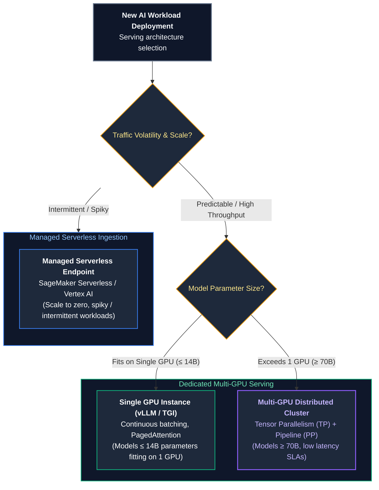

| Hosting Model | Primary Infrastructure | Pricing Mechanism | SLA & Concurrency | Engineering Burden |
| :--- | :--- | :--- | :--- | :--- |
| **Serverless API** (OpenAI, Anthropic, Bedrock) | Multi-tenant public cloud | Pay-per-token (\$0.15–\$15.00 / 1M tokens) | Variable; prone to noisy-neighbor HTTP 429 rate limits | **Minimal** (Call REST endpoint) |
| **Dedicated Capacity** (Azure PTU, Bedrock PTU) | Reserved cloud GPU partitions | Fixed hourly / monthly commitment (\$15k–\$40k/mo) | Guaranteed tokens/sec; deterministic latency; zero 429s | **Low** (Manage provisioned units) |
| **Self-Hosted Kubernetes** (vLLM on EKS / GKE) | Dedicated GPU instances (e.g., `p5.48xlarge`, 8x H100) | Infrastructure VM cost (\$32.77/hr per 8x H100 node) | Strict SLA governed by internal cluster capacity | **Very High** (CUDA, NCCL, InfiniBand, Autoscaling) |

---

### 1.2 Enterprise Cloud Catalogs: AWS Bedrock, GCP Vertex AI, and Azure AI Foundry

The "Big Three" hyperscalers provide managed AI platforms designed to isolate enterprise data from public internet traversal and public model training:

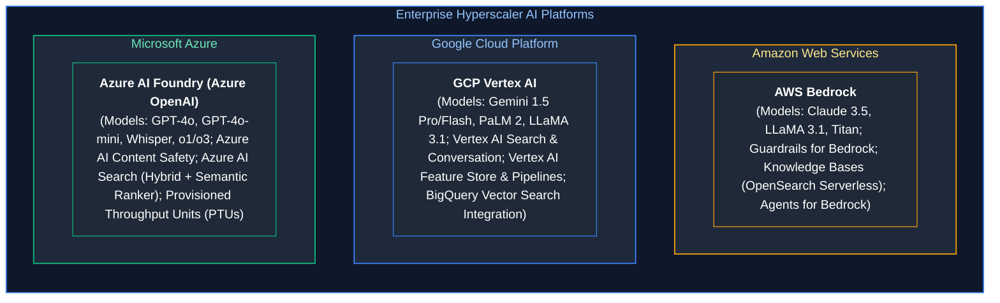

#### Core Enterprise Invariants
1. **Zero Data Retention for Training:** Commercial agreements with all three hyperscalers legally guarantee that customer prompt tokens and completion responses are **never logged, retained, or utilized** for training base foundation models.
2. **Regional Data Residency:** Enterprises operating under strict jurisdictional boundaries (e.g., GDPR in the EU or HIPAA in the US) can lock model processing to specific geographic regions (e.g., `eu-west-1` or `us-east-1`).
3. **Unified IAM Integration:** Model invocation permissions inherit cloud-native identity fabrics (AWS IAM Roles, GCP Workload Identity, Azure Managed Identities).

---

### 1.3 Private VPC Endpoints, AWS PrivateLink & CMEK Security

In high-compliance financial and healthcare environments, network packets containing sensitive data must never traverse the public internet.

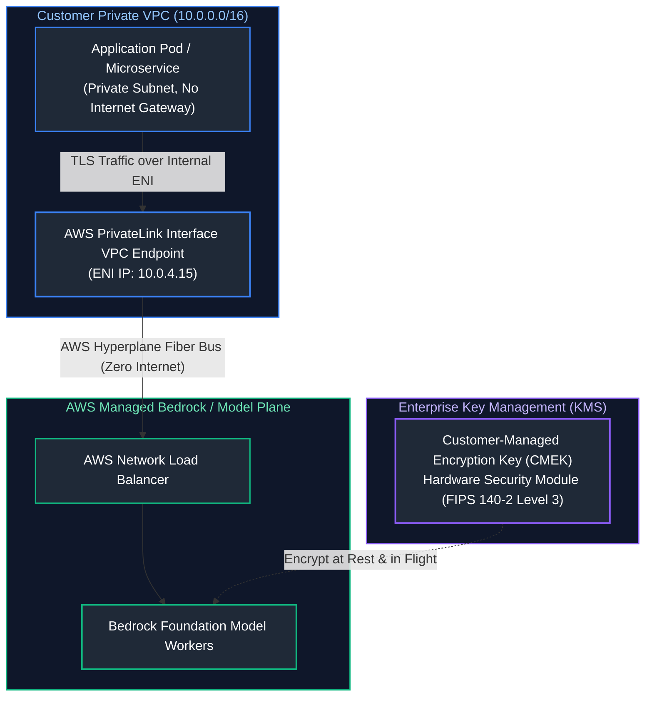

#### 1. AWS PrivateLink / Azure Private Endpoints
- A virtual Elastic Network Interface (ENI) with a private IP address (`10.0.4.15`) is injected into the customer's private subnet.
- The application resolves the model API hostname to this private IP.
- Traffic flows over the internal AWS/Azure private network backbone (Hyperplane) directly into the managed AI cluster without ever touching public IP space or traversing NAT gateways.

#### 2. Customer-Managed Encryption Keys (CMEK)
Foundation model inputs, intermediate cached activations, and persistent vector databases are encrypted using encryption keys managed in the customer's AWS KMS, GCP Cloud KMS, or Azure Key Vault. The customer retains the cryptographic ability to instantly revoke access, rendering all model data instantly unreadable.

---

### 1.4 Provisioned Throughput (PTUs / RCUs) vs. Pay-As-You-Go Economics

When traffic exceeds approximately 20,000 requests per day, serverless pay-as-you-go pricing exhibits non-linear financial scaling. 

**Provisioned Throughput Units (PTUs)** (Azure) or **Provisioned Throughput** (AWS Bedrock) reserve physical GPU compute capacity dedicated to an enterprise tenant for a fixed duration (1 month to 1 year).

#### Break-Even Sizing Calculation
Consider an enterprise application processing an average of $30\text{ Million Tokens/Day}$ ($20\text{M prompt tokens}$, $10\text{M completion tokens}$) using a model equivalent to GPT-4o:

1. **Serverless Cost (Pay-As-You-Go):**
   - Prompt Cost: $20\text{M} \times \$2.50 / 1\text{M} = \$50.00 / \text{day}$
   - Completion Cost: $10\text{M} \times \$10.00 / 1\text{M} = \$100.00 / \text{day}$
   - Total Daily Cost: $\$150.00 / \text{day} \implies \$4,500 / \text{month}$.
2. **Dedicated Cloud PTU Reservation:**
   - 100 PTUs required to sustain a peak concurrency of 120 tokens/sec.
   - Cost: $\approx \$18,000 / \text{month}$.
   - *Verdict:* At 30M tokens/day, serverless is cheaper.
3. **High-Scale Scenario (500 Million Tokens/Day):**
   - Serverless Cost: $\$150.00 \times \frac{500}{30} = \$2,500 / \text{day} \implies \mathbf{\$75,000 / \text{month}}$.
   - Dedicated PTUs Cost: $\mathbf{\$36,000 / \text{month}}$ (200 PTUs).
   - *Verdict:* At high, sustained volume, **dedicated provisioned throughput saves \$39,000/month (52% cost reduction)** while eliminating all HTTP 429 rate limit errors.

---

# 2. GPU Microarchitecture, Hardware Mechanics & Sizing

### 2.1 NVIDIA GPU Evolution: Ampere A100 to Hopper H100 to Blackwell B200

Modern LLM serving performance is governed by the underlying silicon architecture of NVIDIA's data center GPUs:

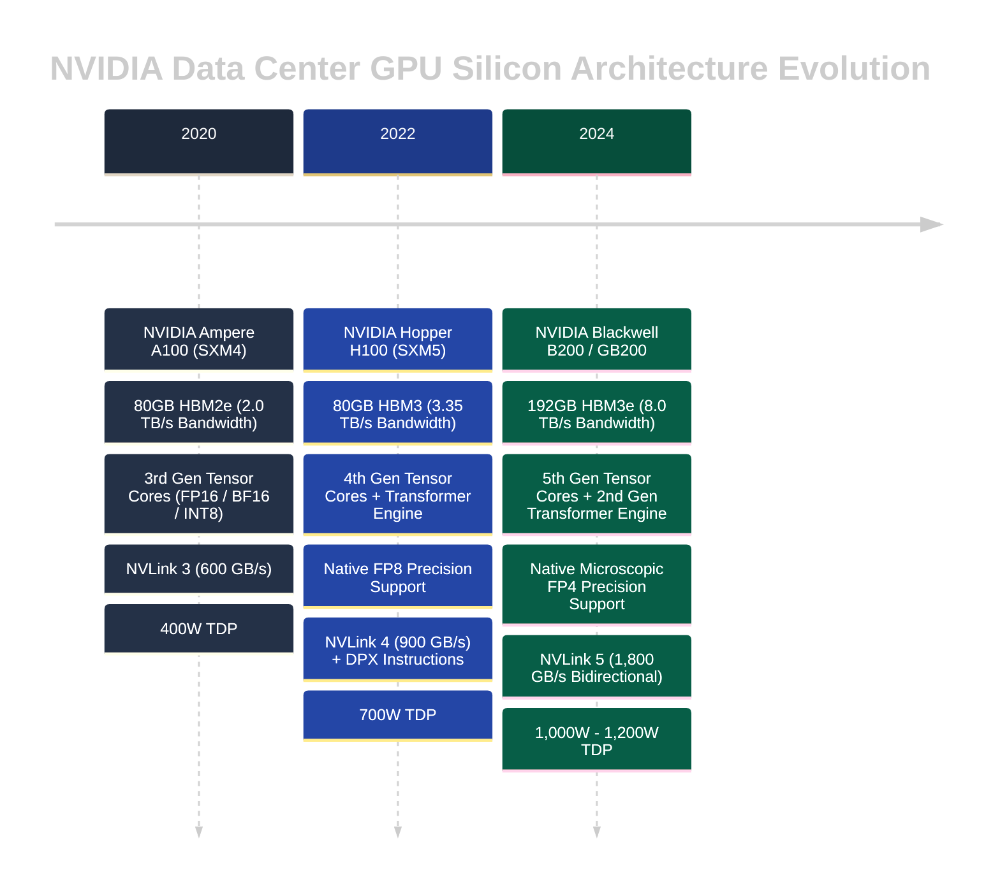

---

### 2.2 Tensor Cores, High Bandwidth Memory (HBM3e) & Arithmetic Intensity

To understand why LLMs run slowly or quickly on GPUs, one must analyze the physical distinction between **Compute Bound** and **Memory Bandwidth Bound** operations through the lens of the **Roofline Model**.

$$\text{Arithmetic Intensity} = \frac{\text{Floating Point Operations (FLOPs)}}{\text{Memory Access (Bytes)}}$$

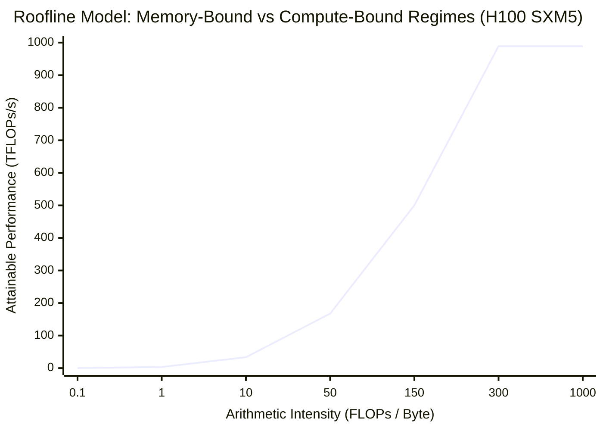

1. **The Prefill Phase is Compute-Bound (High Arithmetic Intensity):**
   When the user submits a 2,000-token prompt, the model processes all 2,000 tokens concurrently in a single massive matrix multiplication ($\text{GEMM}$: General Matrix Multiply). The weights are loaded into GPU registers once, and thousands of dot products are computed across the tokens. The arithmetic intensity is high ($\approx 150\text{ FLOPs/Byte}$), fully saturating the H100 Tensor Cores ($989\text{ TFLOPs}$ FP8).
2. **The Decode Phase is Memory-Bandwidth Bound (Low Arithmetic Intensity):**
   During token generation, the model produces exactly **one token at a time** per sequence ($\text{GEMV}$: General Matrix-Vector Multiply). To generate a single token for a 70-billion parameter model, the GPU must stream the **entire 70GB of weights from HBM3 memory through the GPU registers**, execute one multiply-accumulate operation per weight, and write the output.
   
   $$\text{Arithmetic Intensity (Decode, Batch=1)} = \frac{2 \times 70 \times 10^9\text{ FLOPs}}{70 \times 10^9\text{ Bytes}} = 2.0\text{ FLOPs/Byte}$$
   
   Because $2.0 \ll 150$, the Tensor Cores sit idle >95% of the time, waiting for memory to arrive from the HBM memory bus. Decode latency is strictly dictated by **Memory Bandwidth ($\text{TB/s}$)**, not TFLOPs.

---

### 2.3 Multi-GPU Interconnects: PCIe Gen5 vs. NVLink 4 vs. NVSwitch

When a model is too large to fit in a single GPU's VRAM (e.g., LLaMA-3.1-70B requires $\approx 140\text{GB}$ in FP16), its layers must be split across multiple GPUs. 

At every single Transformer layer, the GPUs must exchange intermediate activation tensors via an **All-Reduce** collective communication operation. The interconnect speed dictates whether distributed inference is viable:

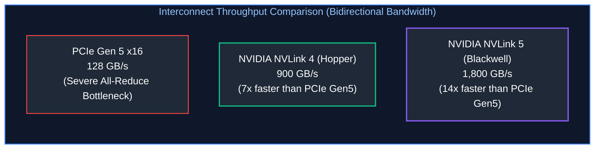

> [!CAUTION]
> **Never Run Tensor Parallelism over PCIe or Standard Ethernet:**
> Running Tensor Parallelism ($TP \ge 2$) across GPUs connected only via PCIe slots or across separate nodes over standard 10Gbps/100Gbps Ethernet will cause inference performance to collapse. The GPUs spend 80% of their time waiting for the All-Reduce communication barrier. Tensor Parallelism requires **NVLink within the node**; inter-node distributed scaling must use **Pipeline Parallelism** or dedicated $400\text{Gbps}$ InfiniBand / RoCE networking.

---

### 2.4 Total GPU VRAM Sizing Formula & Mathematical Derivation

Calculating the exact GPU memory required to host a model under production concurrency requires sizing four distinct memory components:

$$\text{Total VRAM Required} = \mathcal{M}_{\text{weights}} + \mathcal{M}_{\text{KV\_cache}} + \mathcal{M}_{\text{activations}} + \mathcal{M}_{\text{runtime}}$$

#### 1. Static Model Weights ($\mathcal{M}_{\text{weights}}$)
For a model with $P$ billion parameters stored in precision with $B_{\text{weight}}$ bytes per parameter:

$$\mathcal{M}_{\text{weights}} = P \times 10^9 \times B_{\text{weight}} \text{ bytes}$$

- **FP16 / BF16:** $B_{\text{weight}} = 2.0\text{ bytes}$ (e.g., 70B parameter model $\implies 140\text{ GB}$).
- **FP8:** $B_{\text{weight}} = 1.0\text{ byte}$ (70B model $\implies 70\text{ GB}$).
- **INT4 (AWQ / GPTQ):** $B_{\text{weight}} = 0.5\text{ bytes}$ (70B model $\implies 35\text{ GB}$).

#### 2. Dynamic Key-Value (KV) Cache ($\mathcal{M}_{\text{KV\_cache}}$)
For each token in the context window across all active concurrent streams, the Key and Value projection matrices must be stored in memory to prevent recomputing self-attention:

$$\mathcal{M}_{\text{KV\_token}} = 2 \times L \times N_{\text{kv\_heads}} \times d_{\text{head}} \times B_{\text{kv}} \text{ bytes/token}$$

Where:
- $2$: Two matrices (Key and Value).
- $L$: Number of Transformer layers.
- $N_{\text{kv\_heads}}$: Number of KV attention heads (equal to total heads in MHA; reduced by factor of 8 in Grouped-Query Attention GQA).
- $d_{\text{head}}$: Dimension per head ($d_{\text{model}} / N_{\text{heads}}$).
- $B_{\text{kv}}$: Bytes per KV element ($2.0$ for FP16, $1.0$ for FP8).

For $C$ concurrent user streams each with an average context length of $S$ tokens:

$$\mathcal{M}_{\text{KV\_cache}} = C \times S \times \mathcal{M}_{\text{KV\_token}}$$

#### 3. Intermediate Activations & Scratchpad ($\mathcal{M}_{\text{activations}}$)
Memory consumed during the forward pass by layer norms, intermediate MLP expansions, and softmax attention buffers. In continuous batching engines, this scales linearly with the maximum tokens in a single batch iteration (typically 2GB–6GB).

#### 4. CUDA Runtime & NCCL Context Overhead ($\mathcal{M}_{\text{runtime}}$)
CUDA driver context, cuBLAS workspaces, and NCCL inter-GPU communication ring buffers require a fixed allocation of $\approx 1.5\text{GB}$ to $3.0\text{GB}$ per GPU.

---

# 3. Serving Engine Mechanics: vLLM, SGLang & PagedAttention

### 3.1 The Memory Crisis of Naive Serving: Internal vs. External Memory Fragmentation

Before 2023, serving large language models using standard PyTorch (e.g., HuggingFace Transformers) was plagued by catastrophic memory waste. Because PyTorch requires contiguous memory tensors, serving systems had to pre-allocate contiguous KV cache buffers based on the **maximum possible context length** (e.g., 2,048 or 8,192 tokens).

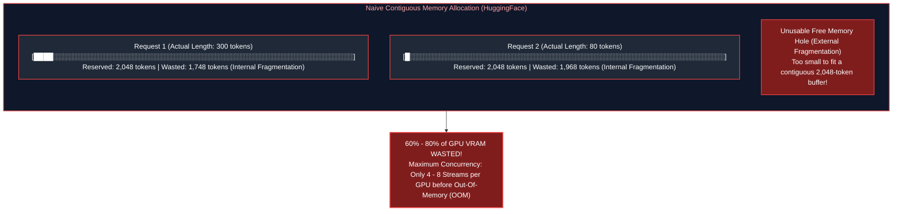

1. **Internal Fragmentation:** Memory reserved for the hypothetical future growth of a sequence that is never actually utilized because the model emits an early `<|endoftext|>` token.
2. **External Fragmentation:** Unusable gaps of free VRAM scattered between existing contiguous allocations. Even if 12GB of VRAM was physically free, a new request could not boot if that 12GB was split into small non-contiguous chunks.

---

### 3.2 PagedAttention Virtual Memory Architecture

Inspired by classic operating system virtual memory paging (OS page tables translation), **PagedAttention** (Kwon et al., UC Berkeley / vLLM) solves the memory crisis by breaking the continuous KV cache of a sequence into fixed-size **Physical Blocks** (typically 16 or 32 tokens per block).

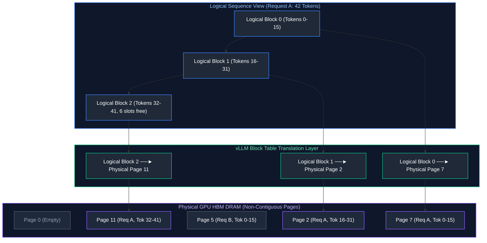

#### Operational Advantages of PagedAttention
- **Near-Zero Waste (<4%):** Memory is allocated dynamically one block (16 tokens) at a time. The only waste occurs in the final unfulfilled slots of the active terminal block.
- **Dynamic Memory Sharing (Parallel Sampling / Beam Search):** Multiple generation branches spawned from the same prompt share the identical physical prompt KV blocks via copy-on-write pointers, eliminating redundant VRAM consumption.
- **$3\times - 5\times$ Concurrency Multiplier:** By eliminating fragmentation, the exact same GPU hardware can sustain $3\times$ to $5\times$ more concurrent user streams.

---

### 3.3 Radix Tree Prefix Caching Mechanics

In enterprise applications, hundreds of different user requests share identical system instructions, few-shot examples, or document context (e.g., in enterprise RAG or multi-tenant agents).

Modern serving engines (vLLM and SGLang) implement **Automatic Prefix Caching (APC)** using a **Radix Tree** data structure:

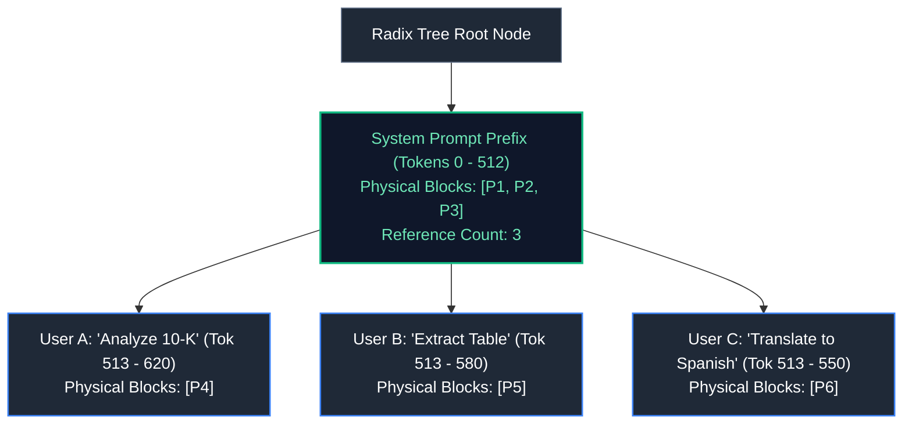

When User B arrives with the identical system prompt prefix, the engine traverses the Radix Tree, recognizes the exact token sequence match, and **reuses the already computed KV blocks in GPU VRAM**. The prefill computation is completely skipped:
- Prefill Latency drops from $1,200\text{ms} \to 12\text{ms}$.
- TTFT collapses to near zero.
- GPU compute is preserved exclusively for decoding.

---

# 4. Continuous Batching, Chunked Prefill & Speculative Decoding

### 4.1 Static Batching Inefficiencies: Padding Waste & Head-of-Line Blocking

In classical deep learning (e.g., ResNet image classification), **Static Request-Level Batching** is standard: wait for $N$ requests to arrive, pack them into a tensor batch of shape $[N, \text{channels}, H, W]$, run the forward pass, and return results.

In autoregressive generation, static batching creates severe inefficiencies:

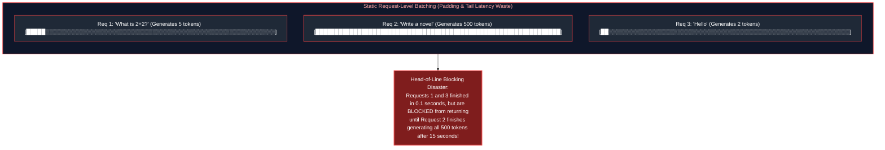

---

### 4.2 Continuous (In-Flight / Iteration-Level) Batching

First introduced by **Orca** (Yu et al., OSDI 2022) and popularized by vLLM and TensorRT-LLM, **Continuous Batching** operates at the **iteration level** rather than the request level.

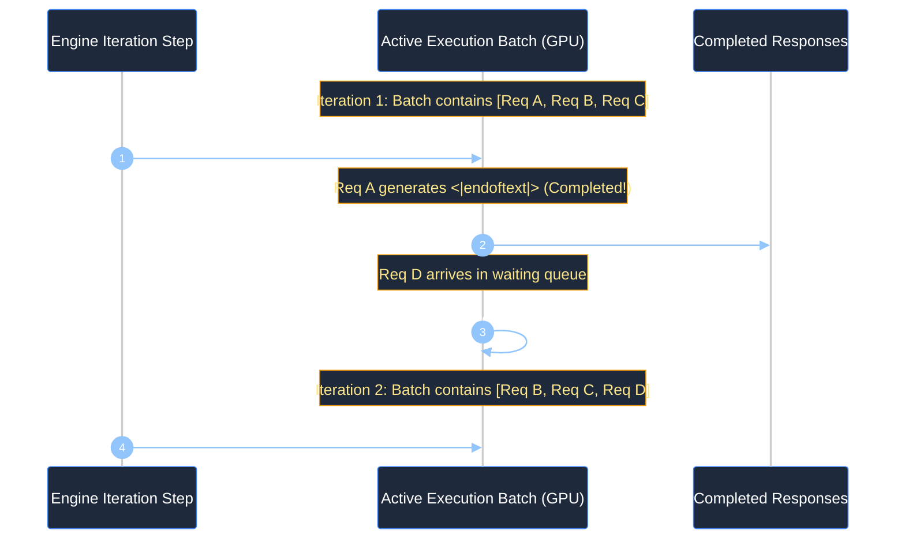

- When a request finishes generating, its slot is freed immediately, and its final response is returned to the user without waiting for other requests.
- Newly arrived requests are dynamically injected into the active batch on the very next decoding step.
- Hardware utilization jumps from $\approx 20\% \to >85\%$.

---

### 4.3 Prefill vs. Decode Disparity & Chunked Prefill Scheduling

A major operational challenge in continuous batching is the **Interference of Prefill with Decode**:
- **Decode Phase:** Fast, memory-bandwidth bound, requires $\approx 20\text{ms}$ per token.
- **Prefill Phase:** Massive compute burst, takes $500\text{ms} - 3,000\text{ms}$ for a long prompt.

If an engine schedules a massive 16,000-token prefill into an active continuous batch, all ongoing decode streams experience a **3-second latency freeze** (Inter-Token Latency ITL spike), causing visible stutter in user-facing streaming text.

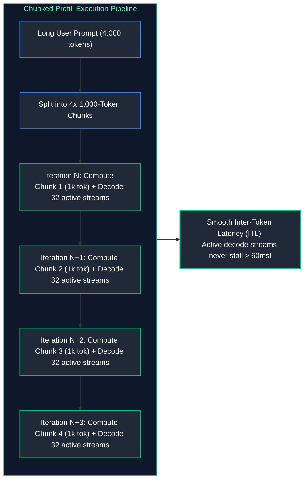

Under **Chunked Prefill**, large prompts are sliced into fixed token chunks (e.g., 512 or 1,024 tokens). The engine interleaves one prefill chunk alongside the ongoing decode tokens in each iteration. High GPU compute utilization is maintained while keeping Inter-Token Latency ($ITL$) strictly under interactive human perception thresholds ($<60\text{ms}$).

---

### 4.4 Speculative Decoding: Draft Models & Target Verification

As established in Section 2.2, decoding is memory-bandwidth bound. Running an 80B model to generate 1 token takes nearly the same time as running it to process 5 tokens concurrently.

**Speculative Decoding** leverages this mathematical reality to accelerate inference by $2\times - 3\times$ without altering output distribution quality:

```mermaid
%%{init: {'theme': 'dark', 'themeVariables': { 'actorBkg': '#1e293b', 'actorBorder': '#3b82f6', 'actorTextColor': '#ffffff', 'signalColor': '#93c5fd', 'signalTextColor': '#ffffff', 'noteBkgColor': '#1e293b', 'noteBorderColor': '#f59e0b', 'noteTextColor': '#fde68a', 'activationBkgColor': '#3b82f6', 'sequenceNumberColor': '#ffffff' }}}%%
sequenceDiagram
    autonumber
    participant Draft as Fast Draft Model (LLaMA-3-1B)
    participant Target as Large Target Model (LLaMA-3-70B)
    participant Client as Streaming Output

    Note over Draft: 1. Draft model autoregressively speculates K=4 tokens quickly
    Draft->>Draft: Emits: [ "The", " capital", " of", " France" ]
    
    Note over Target: 2. Target model evaluates all 4 tokens in a SINGLE forward pass (GEMM)
    Draft->>Target: Validate speculative sequence in parallel
    Target->>Target: Logit verification check (Accept/Reject sample)
    
    alt Tokens 1, 2, 3 Accepted; Token 4 Rejected
        Target-->>Client: Accept: [ "The", " capital", " of" ]
        Target-->>Client: Replace Token 4 with Target Correction: [ " Burgundy" ]
        Note over Target: Result: 4 tokens generated in the time of 1 Target step!
    end
```

#### Acceptance Criteria Mathematics
The draft token $x$ is accepted with probability:

$$\alpha = \min\left(1, \frac{P_{\text{target}}(x)}{P_{\text{draft}}(x)}\right)$$

If the draft model's proposal is rejected, the target model samples a replacement token directly from the adjusted normalized residual distribution:

$$P'(x) = \max\left(0, P_{\text{target}}(x) - P_{\text{draft}}(x)\right)$$

This mathematical formulation rigorously guarantees that the final output token distribution is **provably identical** to sampling directly from the large target model alone.

---

# 5. Distributed Inference: Tensor Parallelism vs. Pipeline Parallelism

### 5.1 Megatron-LM Tensor Parallelism (TP) via All-Reduce

When an individual linear layer within a Transformer block is partitioned across multiple GPUs, we employ **Tensor Parallelism (TP)** (Shoeybi et al., Megatron-LM).

A Transformer Multi-Head Attention block consists of two primary matrix multiplications:
1. Column-Parallel Linear Projection ($W_Q, W_K, W_V$)
2. Row-Parallel Linear Projection ($W_O$)

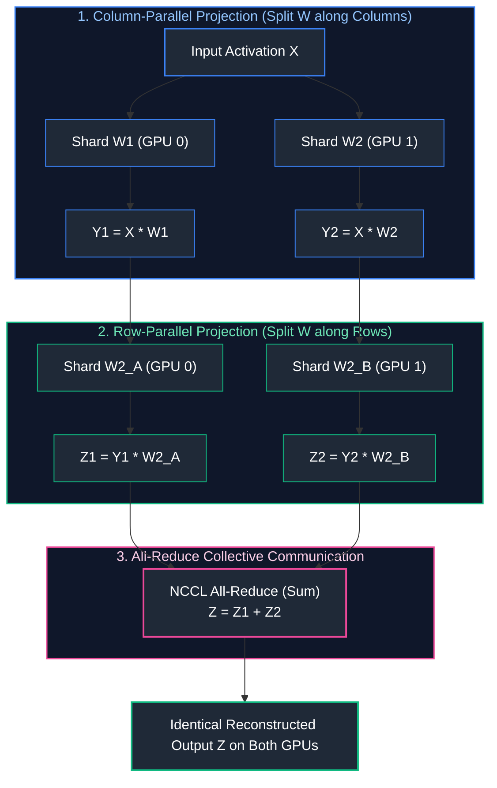

By pairing a Column-Parallel layer with a Row-Parallel layer, the system requires **only a single All-Reduce operation** at the end of the Attention block and a second All-Reduce at the end of the MLP block. Communication is minimized to exactly $2 \times \text{All-Reduce}$ operations per Transformer layer.

---

### 5.2 Pipeline Parallelism (PP) & Inter-Node Bubble Overhead

When models exceed the capacity of a single 8-GPU node (e.g., LLaMA-3.1-405B requires $\approx 810\text{GB}$ in FP16), the model's layers must be partitioned sequentially across separate physical server nodes. This is **Pipeline Parallelism (PP)**.

```mermaid
%%{init: {'theme': 'dark', 'themeVariables': { 'primaryColor': '#3b82f6', 'primaryTextColor': '#ffffff', 'primaryBorderColor': '#3b82f6', 'lineColor': '#64748b', 'secondaryColor': '#10b981', 'tertiaryColor': '#1e293b' }}}%%
gantt
    title Pipeline Parallelism 1F1B Schedule (PP=4 Stages, Bubble Overhead)
    dateFormat X
    axisFormat Step %s

    section Node 0 (Layers 1-20)
    F1 :active, 0, 1
    F2 :active, 1, 2
    F3 :active, 2, 3
    F4 :active, 3, 4
    B1 :crit, 6, 7
    B2 :crit, 7, 8

    section Node 1 (Layers 21-40)
    Bubble :done, 0, 1
    F1 :active, 1, 2
    F2 :active, 2, 3
    F3 :active, 3, 4
    B1 :crit, 5, 6

    section Node 2 (Layers 41-60)
    Bubble :done, 0, 2
    F1 :active, 2, 3
    F2 :active, 3, 4
    B1 :crit, 4, 5

    section Node 3 (Layers 61-80)
    Bubble :done, 0, 3
    F1 :active, 3, 4
    B1 :crit, 4, 5
```

#### The Pipeline Bubble Problem
Because Node 1 must wait for Node 0 to process its layers before receiving activations, downstream nodes remain completely idle during initial steps. This idle GPU time is the **Pipeline Bubble Fraction**:

$$F_{\text{bubble}} = \frac{PP - 1}{M + PP - 1}$$

Where $PP$ is the pipeline depth and $M$ is the number of micro-batches. To make pipeline parallelism efficient, serving engines must maintain a high number of concurrent micro-batches ($M \gg PP$).

---

### 5.3 Communication Topologies: Intra-Node NVLink vs. Inter-Node InfiniBand / RoCE

High-throughput distributed model serving requires matching each parallelism dimension to the physical network fabric capable of satisfying its communication frequency and latency budget:

#### 1. Intra-Node High-Speed Interconnects: NVIDIA NVLink & NVSwitch
In Tensor Parallelism (TP), every single transformer layer executes an All-Reduce collective operation across the participating GPUs. In a 70B parameter model with 80 layers, this requires 160 All-Reduce synchronization rounds per generated token. 
- Over standard PCIe Gen5 slots ($64\text{ GB/s}$ bidirectional bandwidth), the latency of these collective operations reaches tens of microseconds, causing GPU Tensor Cores to stall while waiting for cross-GPU synchronization.
- NVIDIA NVLink 4 (on Hopper H100) provides **$900\text{ GB/s}$ bidirectional bandwidth per GPU** ($7.2\text{ TB/s}$ total bisection bandwidth across an 8-GPU chassis via NVSwitch). This delivers sub-microsecond latency, allowing All-Reduce operations to complete nearly instantaneously. Consequently, **Tensor Parallelism must strictly reside within a single physical node**.

#### 2. Inter-Node Clustering: InfiniBand vs. RoCE v2 with GPUDirect RDMA
When models exceed the memory capacity of a single 8-GPU chassis (e.g., DeepSeek-V3 671B or LLaMA-3.1 405B requiring Pipeline Parallelism or multi-node Tensor Parallelism), traffic must traverse the datacenter network fabric:
- **GPUDirect RDMA (Remote Direct Memory Access):** Bypasses the host CPU, Linux kernel network stack, and system RAM copies entirely. Remote GPU High Bandwidth Memory (HBM) buffers read and write directly over PCIe into host NICs.
- **NVIDIA Quantum-2 InfiniBand:** Operates as a native credit-based, lossless networking fabric providing deterministic $400\text{ Gbps}$ or $800\text{ Gbps}$ per port with ultra-low transit latencies ($<1.0\,\mu\text{s}$). It is the industry gold standard for frontier multi-node AI clusters.
- **RoCE v2 (RDMA over Converged Ethernet):** Enables RDMA over standard Ethernet switches using Priority-Based Flow Control (PFC, IEEE 802.1Qbb) and Explicit Congestion Notification (ECN). While more cost-effective and compatible with enterprise network infrastructure, RoCE requires meticulous switch buffer tuning to prevent packet drops and PFC deadlock storms.

| Parallelism Dimension | Interconnect Requirement | Bandwidth Required | Network Protocol | Typical Boundary |
| :--- | :--- | :--- | :--- | :--- |
| **Tensor Parallelism (TP)** | NVIDIA NVLink 4 / NVSwitch | $900\text{ GB/s}$ bidirectional | NCCL Shared Memory / P2P | Strictly **Intra-Node** (Within single 8x GPU chassis) |
| **Pipeline Parallelism (PP)** | NVIDIA Quantum-2 InfiniBand | $400\text{ Gbps} - 800\text{ Gbps}$ | NCCL RDMA / RoCE v2 | **Inter-Node** (Across separate rack servers) |
| **Data Parallelism (DP)** | Standard Data Center Network | $100\text{ Gbps} - 400\text{ Gbps}$ | TCP/IP or RoCE | Across independent cluster replicas |

---

# 6. Model Quantization Mechanics: FP8, AWQ, GPTQ & GGUF

### 6.1 The Mathematical Mechanics of Quantization

Quantization compresses high-precision floating-point weights (FP16, 16 bits) into compact lower-bit representations (INT4 or FP8), reducing GPU memory footprints by $50\% - 75\%$ and increasing memory-bandwidth-bound decode speeds.

#### Linear Affine Quantization (Uniform Symmetric INT8/INT4)
For a weight tensor $W \in \mathbb{R}$, uniform symmetric quantization projects continuous values into signed integer buckets:

$$q = \text{clamp}\left(\left\lfloor \frac{W}{S} \right\rceil, -2^{b-1}, 2^{b-1}-1\right)$$

Where $b$ is the target bit-width (e.g., $b=4$ for INT4, range $[-8, 7]$) and $S$ is the floating-point **Scale Factor**:

$$S = \frac{\max(|W|)}{2^{b-1} - 1}$$

To perform computation during dequantization:

$$\hat{W} = q \times S$$

---

### 6.2 FP8 Formats: E4M3 vs. E5M2 and Hopper Acceleration

NVIDIA Hopper (H100) and Blackwell (B200) architectures introduced native hardware instructions for **8-bit Floating Point (FP8)**, providing two distinct standard formats defined by IEEE / OCP:

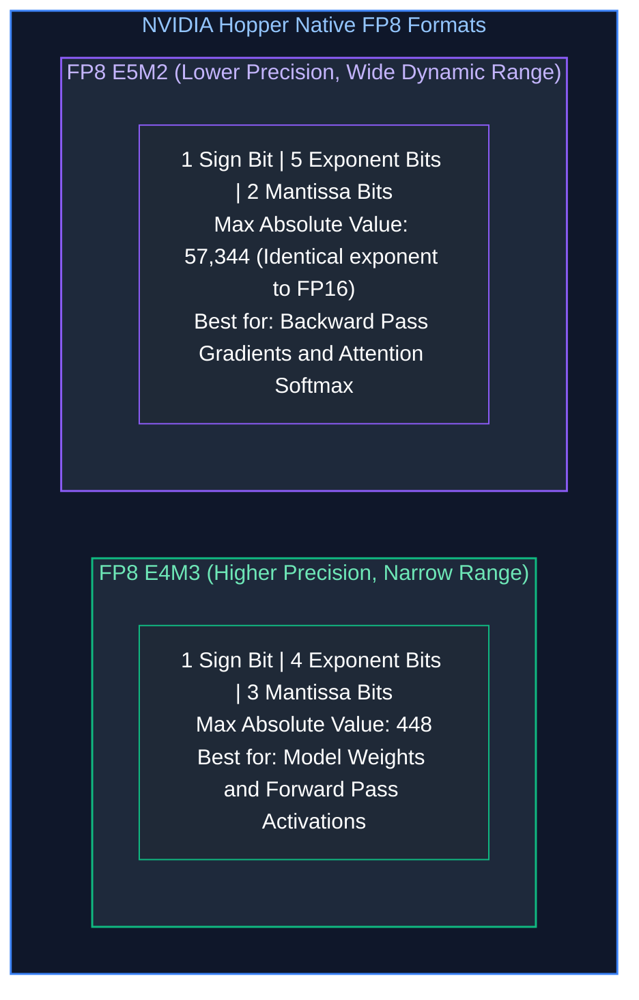

On NVIDIA H100 GPUs, **FP8 Tensor Cores yield $2\times$ the raw compute throughput ($989\text{ TFLOPs}$)** compared to FP16 ($494\text{ TFLOPs}$), while cutting static model weight VRAM strictly in half with virtually zero degradation in MMLU benchmark accuracy.

---

### 6.3 Weight-Only vs. Weight-and-Activation Quantization (AWQ vs. GPTQ)

When quantizing down to 4 bits (INT4), naive round-to-nearest methods severely degrade model reasoning capabilities due to the presence of **Salient Outlier Activations** (a small fraction of feature dimensions that exhibit activations $100\times$ larger than average).

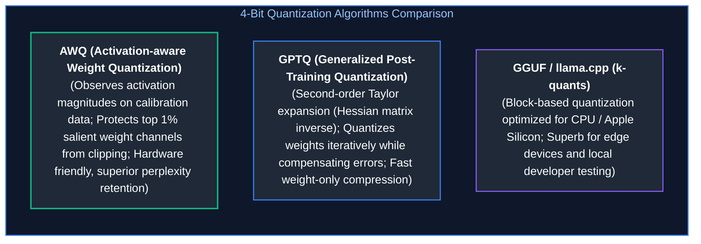

- **Weight-Only Quantization (W4A16 / W8A16):** Only the static model weights are stored in INT4/INT8. During inference, weights are dynamically dequantized back to FP16 inside GPU registers before the dot product. This eliminates memory bandwidth bottlenecks during decoding while using standard FP16 Tensor Cores.
- **Weight-and-Activation Quantization (W8A8 / FP8):** Both weights and intermediate activations are quantized. Matrix multiplication is executed natively in 8-bit arithmetic on FP8 Tensor Cores, accelerating both the compute-bound prefill phase and memory-bound decode phase.

---

### 6.4 Quantization Quality, Latency & VRAM Trade-Off Matrix

Evaluating quantization in production requires balancing three interconnected engineering variables: **memory footprint compression**, **computational throughput acceleration**, and **model perplexity / reasoning degradation**. 

- **Weight-Only INT4 (AWQ vs. GPTQ):** Compresses static weights by $75\%$, enabling a 70B parameter model to fit onto a single $48\text{GB}$ GPU (or two $24\text{GB}$ GPUs). Because activation tensors remain in FP16, reasoning accuracy on complex STEM and coding benchmarks remains exceptionally close to baseline (typically $<1.0\%$ MMLU regression). However, because weights must be dynamically dequantized back to FP16 inside registers during each forward pass, compute-bound prefill latency is not accelerated.
- **Native FP8 (E4M3 / E5M2):** Supported natively by NVIDIA Hopper (H100) and Blackwell (B200) Tensor Cores. By executing both weight matrix and activation tensor dot-products in native 8-bit floating-point math, FP8 delivers a theoretical $2\times$ increase in Tensor Core FLOPs while cutting VRAM usage by $50\%$. Accuracy degradation on MMLU is virtually undetectable ($<0.2\%$), making FP8 the undisputed gold standard for enterprise serving on modern datacenter GPUs.

| Quantization Scheme | Bits (W / A) | LLaMA-3-70B VRAM | Accuracy Loss (MMLU) | Serving Engine Support | Ideal Production Use Case |
| :--- | :--- | :--- | :--- | :--- | :--- | :--- |
| **Unquantized (BF16)** | 16 / 16 | $142\text{ GB}$ | $0.0\%$ (Baseline) | All Engines | Maximum reasoning accuracy; zero tolerance for drift |
| **Native FP8 (OCP)** | 8 / 8 | $72\text{ GB}$ | $<0.2\%$ | vLLM, TensorRT-LLM | **Gold Standard for NVIDIA H100 / B200 Enterprise Nodes** |
| **AWQ (INT4)** | 4 / 16 | $38\text{ GB}$ | $<1.0\%$ | vLLM, SGLang, TGI | High-throughput serving on consumer or Ampere (A100) GPUs |
| **GPTQ (INT4)** | 4 / 16 | $38\text{ GB}$ | $\approx 1.2\%$ | vLLM, AutoGPTQ | Legacy 4-bit deployments |
| **GGUF (Q4_K_M)** | 4 / 16 | $40\text{ GB}$ | $\approx 1.5\%$ | llama.cpp, Ollama | Local edge devices, MacBook Apple Silicon, CPU fallback |

---

# 7. Kubernetes Orchestration & GPU Autoscaling

### 7.1 Kubernetes Pod Configuration with NVIDIA GPU Operator

Deploying high-throughput serving engines like vLLM in Kubernetes (EKS / GKE) requires precise container resource configurations:

```yaml
apiVersion: apps/v1
kind: Deployment
metadata:
  name: vllm-llama-70b
  namespace: ai-serving
spec:
  replicas: 2
  selector:
    matchLabels:
      app: vllm-llama-70b
  template:
    metadata:
      labels:
        app: vllm-llama-70b
    spec:
      containers:
        - name: server
          image: vllm/vllm-openai:v0.6.3
          args:
            - "--model"
            - "meta-llama/Meta-Llama-3.1-70B-Instruct"
            - "--tensor-parallel-size"
            - "8"
            - "--gpu-memory-utilization"
            - "0.92"
            - "--max-model-len"
            - "8192"
            - "--enable-chunked-prefill"
            - "--enable-prefix-caching"
          resources:
            limits:
              nvidia.com/gpu: 8   # Requests all 8 H100 GPUs on node
              memory: 500Gi
              cpu: "64"
            requests:
              nvidia.com/gpu: 8
              memory: 500Gi
              cpu: "64"
          volumeMounts:
            - mountPath: /dev/shm
              name: dshm
      volumes:
        # CRITICAL: NCCL inter-GPU communication requires massive shared memory!
        - name: dshm
          emptyDir:
            medium: Memory
            sizeLimit: 64Gi
```

> [!IMPORTANT]
> **The `/dev/shm` Shared Memory Invariant:**
> Multi-GPU Tensor Parallelism relies on NCCL, which exchanges activation tensors via Linux shared memory (`/dev/shm`). If Kubernetes pods do not explicitly mount a large `emptyDir` backed by RAM for `/dev/shm`, NCCL crashes silently with `CUDA error: out of memory` or causes erratic node-level kernel panics.

---

### 7.2 Custom Metric Autoscaling with KEDA

Traditional Kubernetes Horizontal Pod Autoscalers (HPA) scale pods based on **CPU or GPU Utilization (`container_gpu_utilization`)**. In LLM serving, GPU utilization is a **fatally misleading metric**:
- A GPU running a single request with continuous batching may report 99% GPU utilization while having 70GB of free KV cache capacity.
- Conversely, a GPU whose KV cache is 100% saturated might drop throughput drastically while queuing dozens of incoming requests.

Production autoscaling must scale using **Kubernetes Event-driven Autoscaling (KEDA)** targeting two specific vLLM Prometheus metrics:
1. `vllm:num_requests_waiting`: The number of requests stuck in the pending queue awaiting KV cache allocation.
2. `vllm:gpu_cache_usage_factor`: The fraction of physical PagedAttention KV blocks currently allocated ($0.0 - 1.0$).

```yaml
apiVersion: keda.sh/v1alpha1
kind: ScaledObject
metadata:
  name: vllm-autoscaler
  namespace: ai-serving
spec:
  scaleTargetRef:
    name: vllm-llama-70b
  minReplicaCount: 2
  maxReplicaCount: 10
  cooldownPeriod: 300
  triggers:
    - type: prometheus
      metadata:
        serverAddress: http://prometheus-server.monitoring.svc.cluster.local:9090
        metricName: vllm_gpu_cache_usage_factor
        query: max(vllm:gpu_cache_usage_factor{app="vllm-llama-70b"})
        threshold: "0.85"  # Scale out when KV cache hits 85% capacity
```

---

### 7.3 Multi-Instance GPU (MIG) vs. Time-Slicing for Workload Partitioning

For smaller models (e.g., 7B parameters, embedding models, or rerankers), dedicating an entire \$35,000 H100 80GB GPU to a single replica is financially wasteful.

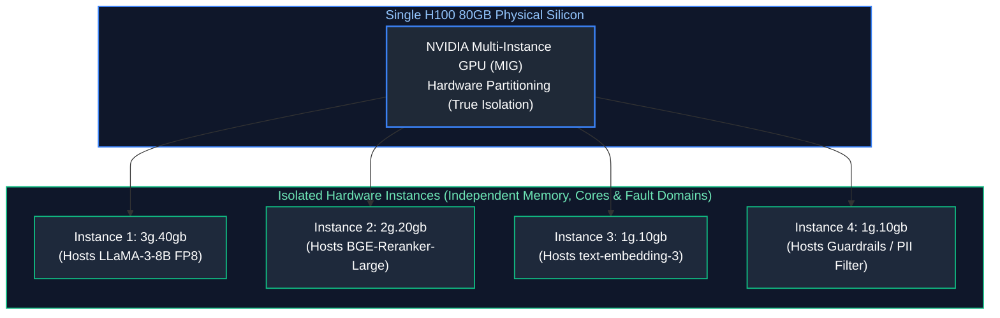

- **MIG (Multi-Instance GPU):** Physically partitions the GPU silicon into up to 7 independent hardware slices. Each instance possesses dedicated memory controllers, crossbar paths, and SM compute cores. If one container triggers a CUDA kernel panic, other MIG slices continue running unaffected.
- **Time-Slicing (vGPU):** Interleaves workloads across the entire GPU temporally. Offers zero memory isolation; if one container runs out of memory, it triggers an OOM crash across all shared tenants.

---

# 8. Production Implementation: Enterprise Capacity Planning & Sizing Engine

### 8.1 Systems Architecture of the Planner

The capacity planning tool below implements the rigorous mathematical equations detailed in Section 2.4 and Section 3.2. It computes:
- Static model weight footprint across arbitrary bit precisions (FP16, FP8, INT4).
- PagedAttention block table sizing and memory allocation.
- Maximum concurrent streaming users supported before KV cache saturation.
- Memory-bandwidth bound peak token throughput ($TPS$) based on GPU hardware specifications.

---

### 8.2 Complete Production-Grade Python Implementation

```python
"""
Enterprise AI Infrastructure Capacity Planner & Hardware Sizing Engine
Computes static VRAM footprints, PagedAttention KV cache allocations,
maximum concurrent streams, and memory-bandwidth bound decode throughput.
"""

import math
from dataclasses import dataclass
from typing import Dict, Any, List

@dataclass(frozen=True)
class GPUHardwareProfile:
    name: str
    gpu_architecture: str
    vram_per_gpu_gb: float
    memory_bandwidth_tb_s: float
    fp8_tensor_tflops: float
    nvlink_bandwidth_gb_s: float

@dataclass(frozen=True)
class ModelArchitectureProfile:
    name: str
    parameter_count_billions: float
    num_layers: int
    num_attention_heads: int
    num_kv_heads: int  # Reflects GQA (Grouped-Query Attention)
    hidden_dimension: int
    vocab_size: int

    @property
    def head_dim(self) -> int:
        return self.hidden_dimension // self.num_attention_heads

# ==============================================================================

    # Canonical Reference Hardware Specs

# ==============================================================================

NVIDIA_A100_80GB_SXM4 = GPUHardwareProfile(
    name="NVIDIA A100 SXM4",
    gpu_architecture="Ampere",
    vram_per_gpu_gb=80.0,
    memory_bandwidth_tb_s=2.039,
    fp8_tensor_tflops=0.0,  # Native FP8 not supported on Ampere
    nvlink_bandwidth_gb_s=600.0
)

NVIDIA_H100_80GB_SXM5 = GPUHardwareProfile(
    name="NVIDIA H100 SXM5",
    gpu_architecture="Hopper",
    vram_per_gpu_gb=80.0,
    memory_bandwidth_tb_s=3.35,
    fp8_tensor_tflops=989.0,
    nvlink_bandwidth_gb_s=900.0
)

NVIDIA_B200_192GB = GPUHardwareProfile(
    name="NVIDIA Blackwell B200",
    gpu_architecture="Blackwell",
    vram_per_gpu_gb=192.0,
    memory_bandwidth_tb_s=8.0,
    fp8_tensor_tflops=2250.0,
    nvlink_bandwidth_gb_s=1800.0
)

# ==============================================================================

    # Canonical Model Architecture Profiles

# ==============================================================================

LLAMA_3_1_8B = ModelArchitectureProfile(
    name="Meta-LLaMA-3.1-8B",
    parameter_count_billions=8.03,
    num_layers=32,
    num_attention_heads=32,
    num_kv_heads=8,      # GQA factor of 4:1
    hidden_dimension=4096,
    vocab_size=128256
)

LLAMA_3_1_70B = ModelArchitectureProfile(
    name="Meta-LLaMA-3.1-70B",
    parameter_count_billions=70.6,
    num_layers=80,
    num_attention_heads=64,
    num_kv_heads=8,      # GQA factor of 8:1
    hidden_dimension=8192,
    vocab_size=128256
)

DEEPSEEK_V3_MOE_671B = ModelArchitectureProfile(
    name="DeepSeek-V3-671B-MoE (37B Active)",
    parameter_count_billions=671.0,
    num_layers=61,
    num_attention_heads=128,
    num_kv_heads=128,
    hidden_dimension=7168,
    vocab_size=129280
)

# ==============================================================================

    # Capacity Planning Engine

# ==============================================================================

class EnterpriseCapacityPlanner:
    """Rigorous capacity and throughput planning engine for vLLM clusters."""

    def __init__(
        self,
        hardware: GPUHardwareProfile,
        gpu_count: int,
        model: ModelArchitectureProfile,
        weight_precision_bytes: float = 1.0,  # 2.0 = FP16, 1.0 = FP8, 0.5 = INT4
        kv_precision_bytes: float = 1.0,      # 2.0 = FP16, 1.0 = FP8
        paged_attention_block_size: int = 16,
        gpu_memory_utilization: float = 0.90
    ):
        self.hw = hardware
        self.gpu_count = gpu_count
        self.model = model
        self.weight_precision = weight_precision_bytes
        self.kv_precision = kv_precision_bytes
        self.block_size = paged_attention_block_size
        self.gpu_utilization = gpu_memory_utilization

    def compute_plan(self, target_context_tokens: int = 4096) -> Dict[str, Any]:
        total_cluster_vram_gb = self.gpu_count * self.hw.vram_per_gpu_gb
        effective_usable_vram_gb = total_cluster_vram_gb * self.gpu_utilization

    # Model Static Weights VRAM

raw_weights_gb = (self.model.parameter_count_billions * 1e9 * self.weight_precision) / (1024 ** 3)
        # Add 12% overhead for CUDA context, NCCL buffers, and peak activation tensors
        static_overhead_gb = raw_weights_gb * 1.12

        if static_overhead_gb >= effective_usable_vram_gb:
            return {
                "feasible": False,
                "error": f"Model static footprint ({static_overhead_gb:.1f} GB) exceeds total cluster capacity ({effective_usable_vram_gb:.1f} GB)"
            }

    # Remaining VRAM allocated to PagedAttention KV Cache

available_kv_vram_gb = effective_usable_vram_gb - static_overhead_gb

    # KV Cache Footprint per Token (PagedAttention Block Calculation)

# Formula: 2 * num_layers * num_kv_heads * head_dim * bytes_per_elem
        bytes_per_token = (
            2 * self.model.num_layers * self.model.num_kv_heads * 
            self.model.head_dim * self.kv_precision
        )
        kv_cache_gb_per_stream = (bytes_per_token * target_context_tokens) / (1024 ** 3)

    # Maximum Concurrent Continuous Streams

max_concurrent_streams = int(available_kv_vram_gb / kv_cache_gb_per_stream)

    # PagedAttention Physical Block Allocation

bytes_per_block = bytes_per_token * self.block_size
        total_physical_blocks = int((available_kv_vram_gb * (1024 ** 3)) / bytes_per_block)

    # Theoretical Peak Decode Throughput (Memory-Bandwidth Bound)

# Peak Tokens/Sec ≈ Aggregate Memory Bandwidth / Model Weight Footprint per token
        aggregate_bandwidth_tb_s = self.gpu_count * self.hw.memory_bandwidth_tb_s
        peak_decode_tps = (aggregate_bandwidth_tb_s * 1e12) / (raw_weights_gb * (1024 ** 3))

        return {
            "feasible": True,
            "cluster_summary": {
                "hardware": f"{self.gpu_count}x {self.hw.name}",
                "total_vram_gb": total_cluster_vram_gb,
                "effective_vram_gb": round(effective_usable_vram_gb, 2),
                "interconnect": f"NVLink ({self.hw.nvlink_bandwidth_gb_s} GB/s)"
            },
            "model_summary": {
                "model_name": self.model.name,
                "parameters_b": self.model.parameter_count_billions,
                "precision": "FP8" if self.weight_precision == 1.0 else ("INT4" if self.weight_precision == 0.5 else "FP16"),
                "static_weight_vram_gb": round(raw_weights_gb, 2),
                "total_static_with_runtime_gb": round(static_overhead_gb, 2)
            },
            "paged_attention_kv_cache": {
                "available_kv_vram_gb": round(available_kv_vram_gb, 2),
                "kv_bytes_per_token": bytes_per_token,
                "kv_gb_per_stream": round(kv_cache_gb_per_stream, 3),
                "total_physical_blocks_allocated": total_physical_blocks,
                "block_size_tokens": self.block_size,
                "max_concurrent_continuous_streams": max_concurrent_streams
            },
            "performance_limits": {
                "aggregate_memory_bandwidth_tb_s": round(aggregate_bandwidth_tb_s, 2),
                "theoretical_peak_decode_tokens_per_sec": int(peak_decode_tps)
            }
        }

# ==============================================================================

    # Operational Sizing Benchmark Run

# ==============================================================================

def execute_enterprise_benchmark():
    print("=" * 85)
    print("ENTERPRISE AI INFRASTRUCTURE & VLLM CAPACITY REPORT")
    print("=" * 85)

    # Scenario: Sizing an 8x H100 node serving LLaMA-3.1-70B under native FP8
    planner = EnterpriseCapacityPlanner(
        hardware=NVIDIA_H100_80GB_SXM5,
        gpu_count=8,
        model=LLAMA_3_1_70B,
        weight_precision_bytes=1.0,  # Native FP8
        kv_precision_bytes=1.0,      # FP8 KV Cache
        gpu_memory_utilization=0.92
    )

    plan = planner.compute_plan(target_context_tokens=8192)

    if not plan["feasible"]:
        print(f"FAILED: {plan['error']}")
        return

    c = plan["cluster_summary"]
    m = plan["model_summary"]
    k = plan["paged_attention_kv_cache"]
    p = plan["performance_limits"]

    print(f"Compute Hardware:       {c['hardware']} ({c['total_vram_gb']} GB Total HBM3)")
    print(f"Interconnect Bus:       {c['interconnect']}")
    print(f"Deployed Model:         {m['model_name']} ({m['precision']} Weights)")
    print(f"Static Model Footprint: {m['static_weight_vram_gb']} GB (Runtime Total: {m['total_static_with_runtime_gb']} GB)")
    print("-" * 85)
    print(f"PagedAttention KV Pool: {k['available_kv_vram_gb']} GB dedicated to KV caching")
    print(f"KV Footprint / Stream:  {k['kv_gb_per_stream']} GB (Context: 8,192 tokens)")
    print(f"Physical Paged Blocks:  {k['total_physical_blocks_allocated']} blocks ({k['block_size_tokens']} tok/blk)")
    print(f"Max Concurrent Streams: {k['max_concurrent_continuous_streams']} simultaneous users")
    print("-" * 85)
    print(f"Aggregate Bandwidth:    {p['aggregate_memory_bandwidth_tb_s']} TB/s across cluster")
    print(f"Peak Decode Throughput: {p['theoretical_peak_decode_tokens_per_sec']} tokens/sec")
    print("=" * 85)

if __name__ == "__main__":
    execute_enterprise_benchmark()
```

---

### 8.3 Operational Sizing Playbook & Benchmark Validation

When executing capacity planning in production:
1. **Never Size for Average Context Length:** Sizing clusters based on average context ($1,500\text{ tokens}$) will cause catastrophic Out-of-Memory ($OOM$) evictions when users submit $16\text{k}$ documents. Size KV pools for the **$p90$ context length**.
2. **Standardize on GQA (Grouped-Query Attention):** Notice in the benchmark that LLaMA-3.1-70B has 64 attention heads but only 8 KV heads. This $8:1$ GQA ratio cuts KV cache memory consumption by **$87.5\%$**, enabling a single 8x H100 node to support hundreds of concurrent streams where older MHA models (like LLaMA-1) could only support dozens.
3. **Always Run FP8 on Hopper:** Moving from FP16 to FP8 cuts model weight VRAM from $140\text{GB} \to 70\text{GB}$, releasing $70\text{GB}$ of ultra-fast HBM3 memory directly into the PagedAttention KV pool.

---

# 9. Summary Comparison & Production Engineering Reference Matrix

### 9.1 High-Performance Inference Serving Engines

Selecting an enterprise inference serving engine requires balancing runtime performance (time-to-first-token and inter-token latency) against deployment velocity and operational complexity. While naive HuggingFace Transformers pipelines process requests sequentially with static memory allocations, modern high-throughput serving runtimes leverage dynamic kernel fusions, non-contiguous virtual memory management (PagedAttention), and asynchronous iteration-level request scheduling.

The modern LLM inference runtime landscape:

| Feature / Metric | vLLM (v0.6+) | TensorRT-LLM | SGLang | Modular MAX / Mojo |
| :--- | :--- | :--- | :--- | :--- |
| **Primary Maintainer** | UC Berkeley / Red Hat | NVIDIA | LMSYS / UC Berkeley | Modular |
| **KV Cache Manager** | PagedAttention (Virtual blocks) | In-Flight Paged Memory | RadixAttention (Optimized APC) | Unified Extensible Engine |
| **Prefix Caching Engine** | Automatic Prefix Caching (APC) | Lookahead Prefix Match | Radix Tree Cache (High hit rate) | Custom memory graph |
| **Continuous Batching** | Iteration-Level Orca Batching | In-Flight Iteration Batching | Iteration-Level Batching | Custom Graph Batching |
| **Quantization Support** | FP8, AWQ, GPTQ, BitsAndBytes | FP8, INT4 SmoothQuant, FP4 | FP8, AWQ, GPTQ | FP8, BF16 |
| **Setup & Engineering Effort** | **Low (Pip install, Python native)** | **High (C++ / TensorRT build)** | **Low (Python native)** | Medium |
| **Best Production Fit** | Enterprise open-weight Kubernetes | Extreme scale, single-model clusters | Complex multi-turn Agent pipelines | Heterogeneous cloud / CPU nodes |

---

### 9.2 Quantization & Memory Compression Reference

| Format | Bit Width | VRAM Compression Ratio | Hardware Requirement | MMLU Degradation | Primary Engine |
| :--- | :--- | :--- | :--- | :--- | :--- |
| **BF16 / FP16** | 16-bit | $1.0\times$ (Baseline) | Standard GPUs (V100, A100) | $0.0\%$ | PyTorch, vLLM |
| **FP8 (E4M3)** | 8-bit | $2.0\times$ Reduction | NVIDIA Hopper H100 / Ada Lovelace | $<0.2\%$ | vLLM, TensorRT-LLM |
| **AWQ** | 4-bit (Weights) | $3.7\times$ Reduction | Any modern CUDA GPU | $<1.0\%$ | vLLM, SGLang |
| **GPTQ** | 4-bit (Weights) | $3.7\times$ Reduction | Any modern CUDA GPU | $\approx 1.2\%$ | AutoGPTQ, vLLM |
| **GGUF (Q4_K)** | 4-bit (Block) | $3.5\times$ Reduction | Apple Silicon / CPU / Metal | $\approx 1.5\%$ | llama.cpp, Ollama |

---

---

# Part II: Production Model Gateways, Semantic Caching & LLMOps

---

# 10. The Discipline of LLMOps & The Production Release Tuple

### 10.1 MLOps vs. LLMOps: Operational Paradigms

For over a decade, **Machine Learning Operations (MLOps)** developed around traditional predictive models (e.g., XGBoost, ResNet, BERT for sequence classification). The fundamental cycle was: collect domain data $\to$ label data $\to$ engineer tabular features $\to$ train on GPU clusters $\to$ evaluate validation loss $\to$ export model weights (ONNX, PyTorch `.pt`) $\to$ deploy model binary behind an inference server (Triton, TorchServe).

In contrast, **Large Language Model Operations (LLMOps)** addresses the operational reality of building production software on top of foundation models—whether consumed via third-party hosted commercial APIs (e.g., OpenAI, Anthropic, Google Vertex AI) or self-hosted open-weight engines (e.g., vLLM, TensorRT-LLM running LLaMA-3 or Mistral).

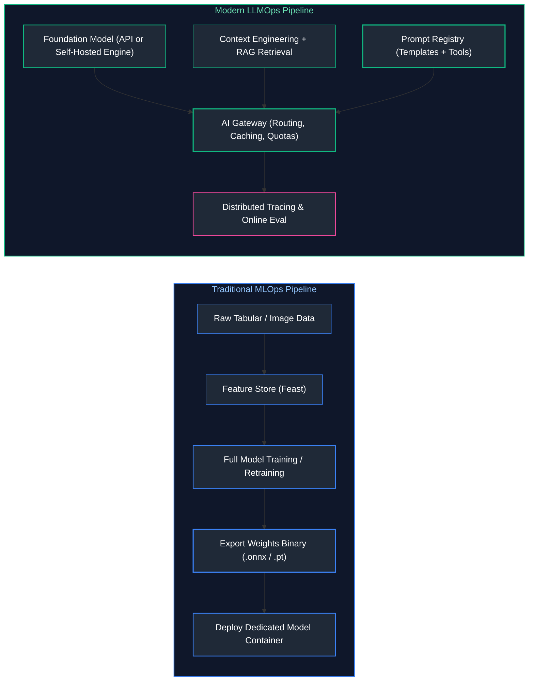

| Operational Dimension | Traditional MLOps | Modern LLMOps |
| :--- | :--- | :--- |
| **Primary Artifact** | Trained model weights binary (`model.pt`, `model.onnx`, 10MB–5GB). | The Generative Release Tuple: $\langle \text{Code}, \text{Prompt}, \text{Model ID}, \text{RAG}, \text{Tools} \rangle$. |
| **Compute Bottleneck** | Offline training cluster (nodes of 8x A100/H100 running for days/weeks). | High-concurrency online inference serving (Prefill GEMM, Decode GEMV, memory bandwidth). |
| **Data Ingestion** | Feature Stores, batch ETL pipelines, normalized tabular stores. | Vector databases, hybrid search indexes, unstructured document parsers, live tool APIs. |
| **Feedback Loop** | Ground-truth labels arrive days/weeks later (e.g., fraud detected, ad clicked). | Automated LLM-as-a-judge, negative implicit user signals (aborts, regenerations), trace evaluations. |
| **Deployment Unit** | Microservice wrapping a model weight tensor execution graph. | Orchestration gateway routing to external endpoints, local engines, and vector stores. |
| **Failure Modes** | Covariate shift, concept drift, feature distribution skew. | Hallucination, jailbreaks, prompt injection, schema breaking changes, token rate limit exhaustion. |
| **Cost Profile** | Dominated by periodic offline GPU training clusters; low inference cost per call. | Continuous operational OpEx per million tokens generated; risk of exponential cost explosion. |

---

### 10.2 The Production Generative AI Release Tuple

In traditional software engineering, a deployment is uniquely defined by a Git commit SHA compiled into an immutable Docker image hash: $\text{Release} = \text{DockerDigest}(\text{GitCommit})$.

In generative AI systems, a change in application code is only one of five volatile dimensions that govern production behavior. Deploying an application while modifying the system prompt or pointing to an unpinned upstream model alias will fundamentally alter the system's runtime characteristics.

In enterprise LLMOps, a production release is defined as an immutable 6-tuple:

$$\mathcal{R} = \langle \mathcal{C}, \mathcal{P}, \mathcal{M}, \mathcal{K}, \mathcal{T}, \mathcal{H} \rangle$$

Where:
1. $\mathcal{C}$ (**Application Code**): The versioned Git commit SHA of the orchestration logic, API wrappers, business validation, and parsing middleware.
2. $\mathcal{P}$ (**Prompt Templates**): The exact cryptographic hash or version tag of the system prompt, user prompt templates, few-shot demonstration exemplars, and delimiter formatting.
3. $\mathcal{M}$ (**Foundation Model Checkpoint**): The explicit, immutable checkpoint ID of the foundation model (e.g., `gpt-4o-2024-08-06`, `claude-3-5-sonnet-20241022`, or a specific HuggingFace commit hash for open weights), **never** a mutable alias like `gpt-4o` or `latest`.
4. $\mathcal{K}$ (**Knowledge Base & Embeddings**): The state of the retrieval corpus, including the embedding model checkpoint (`text-embedding-3-large`), vector index snapshot, chunking strategy version, and chunk database commit.
5. $\mathcal{T}$ (**Tool & Function Signatures**): The exact JSON Schema contracts of external APIs, databases, or MCP tools made available to the model.
6. $\mathcal{H}$ (**Hyperparameters & Constraints**): The runtime configuration: `temperature`, `top_p`, `max_tokens`, `frequency_penalty`, `seed`, and grammar-constrained JSON schemas.

> [!IMPORTANT]
> If any single element of $\mathcal{R}$ changes without an explicit release version increment, your application has introduced **untracked drift**. A silent change to a system prompt template or an upstream model provider updating their base alias without notification will invalidate your test baselines and break downstream JSON parsing.

---

### 10.3 Reproducibility & Traceability for Stochastic Endpoints

A foundational tenet of software engineering is determinism: given identical inputs, the system must yield identical outputs. LLMs are inherently probabilistic autoregressive models that sample from a categorical distribution over vocabulary tokens:

$$P(y_t \mid y_{<t}, x) = \text{softmax}\left(\frac{\mathbf{z}_t}{T}\right)$$

Even when setting `temperature = 0.0` (greedy decoding), achieving true bitwise reproducibility across different inference invocations is often impossible due to three physical hardware and runtime realities:

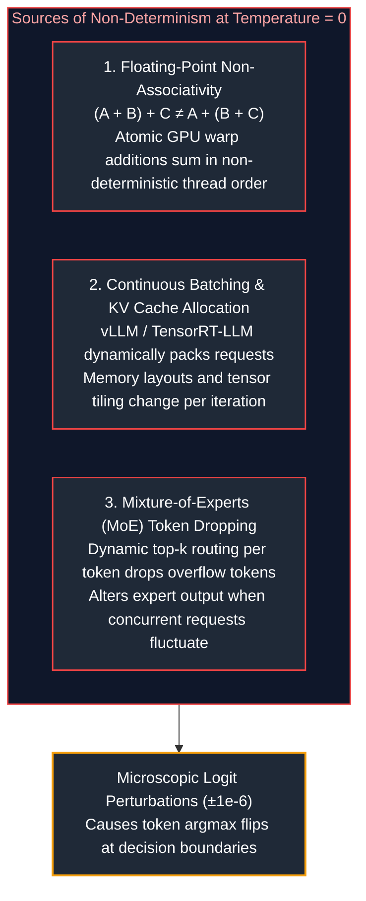

1. **Floating-Point Non-Associativity in Parallel Matrix Multiplication:**
   On NVIDIA GPUs, CUDA cores perform parallel reductions across thousands of threads. In floating-point arithmetic (FP16 or BF16), addition is non-associative: $(a + b) + c \neq a + (b + c)$. Because GPU thread scheduling depends on memory latency and warp execution timing, the accumulation order of dot products varies between calls. While the numerical difference is microscopic ($\pm 10^{-6}$), if two tokens have nearly identical top logits, this microscopic jitter flips the `argmax`, cascading into an entirely different downstream generation.
2. **Continuous Batching Memory Layouts:**
   Modern inference engines (vLLM, TensorRT-LLM) employ continuous batching. A request is co-scheduled alongside a continuously changing set of other concurrent queries. Shared GPU cache lines, PagedAttention block layouts, and tensor tiling boundaries change dynamically, altering floating-point summation orders.
3. **Mixture-of-Experts (MoE) Token Dropping:**
   Models like Mixtral 8x7B or DeepSeek-V3 route tokens to top-$k$ experts. When expert capacity limits are enforced under high load, tokens that exceed the buffer are dropped or routed to fallback paths, introducing variance under different concurrency loads.

#### Engineering Traceability Protocol
Because bitwise reproducibility cannot be guaranteed, production LLMOps relies on **Audit Traceability**:
- Record the exact prompt string, system parameters, and model snapshot ID.
- Record the completion tokens, raw logits (when available), and full token usage metadata.
- Tag every transaction with an OpenTelemetry trace context ($W3C\text{ traceparent}$) propagating from the HTTP ingress down to the foundational model invocation.

---

# 11. Configuration Management, Prompt Registries & Versioning

### 11.1 Decoupling Model Hyperparameters and Prompts from Application Code

Hardcoding prompt strings, model names, or temperature values inside application code (e.g., Python class files or route handlers) is a severe anti-pattern in enterprise systems. 

```python
# ❌ ANTI-PATTERN: Hardcoded Prompts and Configurations Inside Business Logic
async def summarize_report(report_text: str):
    # If the product team wants to tweak the formatting, developers must
    # modify code, re-run unit tests, build a Docker container, and redeploy!
    client = OpenAI()
    response = await client.chat.completions.create(
        model="gpt-4o",  # Unpinned alias: silent drift hazard
        temperature=0.7,  # Hardcoded magic number
        messages=[
            {"role": "system", "content": "You are a financial summarizer. Output 3 bullets."},
            {"role": "user", "content": report_text}
        ]
    )
    return response.choices[0].message.content
```

#### The Decoupled Configuration Pattern
Prompts and hyperparameters must be treated as **declarative configuration assets** managed independently from the runtime codebase. This separation enables:
- Prompt iteration and optimization by domain experts without engineering code changes.
- Immediate rollback of prompt regressions within seconds via configuration flags.
- Environment-specific parameter tuning (e.g., shorter timeouts and cheaper models in Dev vs. Prod).

---

### 11.2 Managing Upstream Model Checkpoint Pinning & Deprecation

Commercial model providers frequently update their models. A common trap is pointing applications to rolling pointer aliases:

```mermaid
flowchart TD
    subgraph DangerZone ["The Rolling Alias Trap"]
        Alias["gpt-4o (Floating Pointer Alias)"]
        SnapA["Snapshot 2024-05-13<br/>Passed All Eval Benchmarks"]
        SnapB["Snapshot 2024-08-06<br/>Refusal Tuning & System Prompt Changes"]
        SnapC["Snapshot 2024-11-20<br/>New Tokenizer & JSON Parser Quirk"]
        
        Alias -.->|"May 2024"| SnapA
        Alias -.->|"Aug 2024 (Silent Switch!)"| SnapB
        Alias -.->|"Nov 2024 (Silent Switch!)"| SnapC
    end

    SnapB --> Outage["Production Outage!<br/>Strict JSON Schema validation fails on 4% of traffic"]

    style DangerZone fill:#0f172a,stroke:#ef4444,stroke-width:1.5px,color:#fca5a5
    style Alias fill:#1f2937,stroke:#ef4444,stroke-width:2px,color:#fff
    style SnapA fill:#1f2937,stroke:#10b981,stroke-width:1.5px,color:#fff
    style SnapB fill:#1f2937,stroke:#f59e0b,stroke-width:1.5px,color:#fff
    style SnapC fill:#1f2937,stroke:#ef4444,stroke-width:1.5px,color:#fff
    style Outage fill:#7f1d1d,stroke:#ef4444,stroke-width:2px,color:#fff
```

#### Production Pinning Rules
1. **Always Pin Immutable Dated Snapshots:** In production configs, use `gpt-4o-2024-08-06` or `claude-3-5-sonnet-20241022`.
2. **Provider Deprecation Deprecations & Lifecycles:** Providers typically support dated snapshots for 6 to 12 months before retirement. Maintain a centralized model inventory tracking retirement dates and automated alerts 60 days prior to end-of-life (EOL).
3. **Automated Migration Testing:** When a new model snapshot is released, it must pass through the automated CI/CD evaluation gate against historical production evaluation sets before production promotion.

---

### 11.3 Centralized Prompt Registries & Lifecycle Promotion

A **Prompt Registry** serves the same role for generative AI that an artifact repository (like Artifactory or Docker Hub) serves for compiled binaries. It stores prompt templates with cryptographic checksums, metadata schemas, and environment promotion tags.

```mermaid
stateDiagram-v2
    [*] --> Draft: Author new prompt template in Playground / IDE
    Draft --> Staging: Register snapshot & Run offline evaluation suite
    Staging --> Production: CI/CD Quality Gate passed (Faithfulness >= 0.92)
    Production --> Canary: 10% traffic routing via Gateway
    Canary --> Production: p99 latency & error rates stable
    Canary --> Rollback: Regression detected in online monitoring
    Rollback --> Production: Instant pointer reassignment to v1.2.0
    Production --> Deprecated: Superseded by new major release
    Deprecated --> Archived: 90 days with zero traffic
```

#### Schema for Versioned Prompt Artifacts
A production prompt artifact encapsulates the Jinja2 template, target model constraints, JSON response schemas, and variable typings:

```json
{
  "prompt_id": "customer_support_intent_classifier",
  "version": "2.4.0",
  "created_at": "2026-10-15T08:30:00Z",
  "author": "prompt-eng-team@enterprise.com",
  "target_model": {
    "provider": "anthropic",
    "model_name": "claude-3-5-haiku-20241022",
    "hyperparameters": {
      "temperature": 0.0,
      "max_tokens": 512,
      "top_p": 1.0
    }
  },
  "input_variables": [
    {"name": "user_query", "type": "string", "required": true},
    {"name": "account_tier", "type": "string", "allowed_values": ["free", "pro", "enterprise"]}
  ],
  "template": "You are a customer routing agent for {{ account_tier }} tier users.\nClassify the following query into CATEGORY and URGENCY.\n\nQuery: {{ user_query }}",
  "response_schema": {
    "type": "object",
    "properties": {
      "category": {"type": "string", "enum": ["billing", "technical", "sales"]},
      "urgency": {"type": "string", "enum": ["low", "medium", "critical"]}
    },
    "required": ["category", "urgency"]
  },
  "tags": {
    "environment": "production",
    "evaluation_run_id": "eval-run-9842-passed"
  }
}
```

---

### 11.4 Zero-Downtime Rollbacks via Dynamic Tag Resolution

When a newly deployed prompt induces hallucinations or increases user cancellation rates in production, rolling back must not require a code compile or Kubernetes pod recycling. 

The application service queries the Prompt Registry using an **environment tag** (e.g., `production` or `canary`), caching the compiled template locally with a short Time-To-Live (TTL) (e.g., 60 seconds) or listening to a Redis Pub/Sub invalidation topic:

$$\text{Active Prompt} = \text{Registry}.\text{resolve}(\text{prompt\_id}=\text{"intent\_classifier"}, \text{tag}=\text{"production"})$$

To execute an immediate rollback:
1. Re-point the `production` tag in the registry from `v2.4.0` back to `v2.3.9`.
2. The registry publishes a cache eviction event over Redis Pub/Sub.
3. All running application pods invalidate their in-memory prompt cache and immediately begin executing `v2.3.9` on the next HTTP request—achieving rollback in under 200 milliseconds.

---

# 12. Enterprise LLM Gateways, Resilient Routing & Semantic Caching

### 12.1 Gateway Architecture & Multi-Provider Abstraction

In an enterprise microservices architecture, having dozens of individual microservices directly calling commercial model APIs creates severe security, governance, and reliability risks:
- API keys are scattered across hundreds of configuration files.
- No unified visibility into corporate-wide token expenditures.
- If OpenAI experiences an outage, every downstream service crashes simultaneously.

An **Enterprise AI Gateway** (such as LiteLLM Proxy, Portkey, Kong AI Gateway, or an Envoy-based proxy) acts as a centralized reverse proxy and governance control plane:

```mermaid
flowchart TD
    subgraph ClientServices ["Client Applications & Microservices"]
        ChatApp["Chat Web App"]
        WorkerService["Background Worker"]
        AgentCluster["Agent Swarm"]
    end

    subgraph LLMGateway ["Enterprise AI Gateway (Reverse Proxy Tier)"]
        direction TB
        AuthZ["AuthN & Virtual API Keys<br/>(Tenant Quotas, IAM Validation)"]
        RateLimiter["Distributed Token Bucket<br/>(RPM & TPM Rate Limiting via Redis)"]
        SemanticCache["Semantic Vector Cache<br/>(Cosine Similarity Lookup in Redis)"]
        RouterEngine["<b>Intelligent Router & Fallback Matrix</b><br/>(Load Balancing; Automated Retries with Full Jitter; Circuit Breakers)"]
        CostTracker["Cost & Token Metering<br/>(Real-time Prometheus + OpenTelemetry)"]

        AuthZ --> RateLimiter --> SemanticCache --> RouterEngine --> CostTracker
    end

    subgraph UpstreamProviders ["Upstream Foundation Model Providers"]
        OpenAI["OpenAI API<br/>(Primary: gpt-4o)"]
        Anthropic["Anthropic API<br/>(Fallback 1: claude-3-5-sonnet)"]
        AzureAI["Azure OpenAI<br/>(Fallback 2: gpt-4o-eastus)"]
        LocalvLLM["Self-Hosted vLLM<br/>(Fallback 3: llama-3.1-70b)"]
    end

    ClientServices -->|"OpenAI-Compatible REST API"| AuthZ
    RouterEngine -->|"Primary"| OpenAI
    RouterEngine -.->|"Fallback 1"| Anthropic
    RouterEngine -.->|"Fallback 2"| AzureAI
    RouterEngine -.->|"Fallback 3"| LocalvLLM

    style ClientServices fill:#0f172a,stroke:#3b82f6,stroke-width:1.5px,color:#93c5fd
    style LLMGateway fill:#0f172a,stroke:#10b981,stroke-width:1.5px,color:#6ee7b7
    style UpstreamProviders fill:#0f172a,stroke:#8b5cf6,stroke-width:1.5px,color:#c4b5fd
    style AuthZ fill:#1f2937,stroke:#10b981,stroke-width:1px,color:#fff
    style RateLimiter fill:#1f2937,stroke:#10b981,stroke-width:1px,color:#fff
    style SemanticCache fill:#1f2937,stroke:#f59e0b,stroke-width:2px,color:#fff
    style RouterEngine fill:#1f2937,stroke:#10b981,stroke-width:2px,color:#fff
    style CostTracker fill:#1f2937,stroke:#ec4899,stroke-width:1px,color:#fff
    style OpenAI fill:#1f2937,stroke:#8b5cf6,stroke-width:1.5px,color:#fff
    style Anthropic fill:#1f2937,stroke:#8b5cf6,stroke-width:1.5px,color:#fff
    style AzureAI fill:#1f2937,stroke:#8b5cf6,stroke-width:1.5px,color:#fff
    style LocalvLLM fill:#1f2937,stroke:#8b5cf6,stroke-width:1.5px,color:#fff
```

The gateway exposes a single **OpenAI-compatible unified endpoint** (`/v1/chat/completions`). Downstream microservices write code targeting this standard interface, while the gateway handles tenant authorization, token rate limiting, multi-cloud fallback routing, and financial tracking transparently.

---

### 12.2 Dynamic Fallbacks, Circuit Breakers & Hedging

#### 1. Multi-Provider Fallback Cascade
If the primary upstream provider returns HTTP 429 (Rate Limit Exceeded), HTTP 500/503 (Server Error/Overloaded), or times out after $T_{\text{timeout}}$ seconds, the gateway catches the exception and immediately replays the request against a secondary provider with schema translation:

$$\text{Route Path: } \text{OpenAI (gpt-4o)} \xrightarrow{\text{Fail / Timeout}} \text{Anthropic (claude-3-5-sonnet)} \xrightarrow{\text{Fail / Timeout}} \text{Azure (gpt-4o-eastus)}$$

#### 2. The Circuit Breaker Pattern
Sending repeated failing requests to a provider undergoing an outage exacerbates downstream queue exhaustion and burns connection pools. A circuit breaker tracks error rates across rolling windows:

```mermaid
stateDiagram-v2
    [*] --> Closed: Normal Operation
    Closed --> Open: Error Rate > 50% across 20 calls
    Open --> HalfOpen: Sleep 30s cooldown timer expires
    HalfOpen --> Closed: 5 consecutive probe requests succeed
    HalfOpen --> Open: Any probe request fails
```

- **Closed State:** All traffic routes normally.
- **Open State:** Requests fail fast or divert immediately to the fallback provider without contacting the unhealthy primary provider.
- **Half-Open State:** After a cooldown window (e.g., 30 seconds), a small trial fraction of traffic (5%) is admitted. If successful, the circuit resets to Closed.

#### 3. Request Hedging for $p99$ Latency SLA
In strict real-time applications (e.g., interactive voice agents requiring sub-second response), model providers often exhibit long tail latencies ($p99 > 8\text{ seconds}$). 
Under **Request Hedging**, if the primary provider has not returned the first streaming chunk within an expected deadline (e.g., 1.5 seconds), the gateway fires an identical speculative request to a secondary provider. Whichever provider emits the first token is kept, and the slower stream is cancelled immediately.

---

### 12.3 Semantic Caching Architecture & Similarity Thresholds

In traditional web systems, caching relies on exact string or key matching (e.g., HTTP GET URL or SHA-256 hash of payload). In LLM applications, two queries can be semantically identical while possessing completely different surface text:
- *Query A:* "How do I reset my account password?"
- *Query B:* "I forgot my password, how can I change it?"

A traditional cache registers a miss on Query B. A **Semantic Cache** maps user queries into embedding space and checks for geometric proximity against previously answered queries.

```mermaid
flowchart TD
    UserQuery["<b>User Query Ingress</b><br/>'I forgot my password, how do I reset?'"]

    subgraph SemanticCacheZone ["Cache Evaluation"]
        direction LR
        Cache{"Semantic Cache Hit?<br/>(Cosine Sim > 0.95)"}
        ReturnCache["<b>Return Cached Response</b><br/>Latency < 20ms, cost: $0.00"]
        Cache -- "Hit" --> ReturnCache
    end

    subgraph RoutingZone ["Intent Routing Engine"]
        direction TB
        Classifier["<b>Fast Router Model</b><br/>DeBERTa / SLM classifier"]
        Classifier --> Intent{"Classified Intent"}
        subgraph TargetModels ["Target Dispatch Models"]
            direction LR
            SLM["<b>Small Fast Model</b><br/>Llama-3-8B ($0.05/M)"]
            Frontier["<b>Frontier Reasoning Model</b><br/>Claude-3.5-Sonnet ($3.00/M)"]
        end
        Intent -- "Routine FAQ / Deterministic" --> SLM
        Intent -- "Complex Reasoning / Code" --> Frontier
    end

    UserQuery --> SemanticCacheZone
    Cache -- "Miss" --> Classifier

    style UserQuery fill:#0f172a,stroke:#64748b,stroke-width:2px,color:#f8fafc
    style SemanticCacheZone fill:#0f172a,stroke:#10b981,stroke-width:1.5px,color:#6ee7b7
    style RoutingZone fill:#0f172a,stroke:#3b82f6,stroke-width:1.5px,color:#93c5fd
    style TargetModels fill:#1e293b,stroke:#3b82f6,stroke-width:1px,color:#93c5fd
    style Cache fill:#1e293b,stroke:#f59e0b,stroke-width:1.5px,color:#fde68a
    style ReturnCache fill:#1e293b,stroke:#10b981,stroke-width:2px,color:#6ee7b7
    style Classifier fill:#1e293b,stroke:#3b82f6,stroke-width:1.5px,color:#fff
    style Intent fill:#1e293b,stroke:#f59e0b,stroke-width:1.5px,color:#fff
    style SLM fill:#1e293b,stroke:#10b981,stroke-width:1.5px,color:#fff
    style Frontier fill:#1e293b,stroke:#8b5cf6,stroke-width:1.5px,color:#fff
```

#### Determining the Semantic Threshold ($\tau$)
The cosine similarity threshold $\tau \in [0, 1]$ dictates the precision-recall trade-off of the cache:
- **$\tau \ge 0.98$ (Ultra-conservative):** Captures only near-identical paraphrases. Zero risk of semantic drift, but lower cache hit rate (~10–15%).
- **$\tau \in [0.94, 0.96]$ (Optimal Enterprise Balance):** Accurately matches syntactically divergent queries with identical semantic intent. Cache hit rates typically reach 25–40% in high-volume customer support contexts.
- **$\tau < 0.90$ (Hazardous):** Causes false-positive cache hits, serving outdated or subtly incorrect answers to distinct technical questions.

> [!CAUTION]
> **Data Privacy and Multi-Tenant Isolation in Semantic Caching:**
> Never share a semantic cache globally across multiple enterprise tenants. If User A asks "What is my invoice total?" and receives a response containing their proprietary billing figures, User B asking a similar question must **never** hit User A's cached entry. Semantic caches must be keyed by tenant isolation namespaces:
> 
> $$\text{CacheKey} = \text{TenantID} \oplus \text{RoleHash} \oplus \text{VectorSearch}(\mathbf{q})$$

---

### 12.4 Distributed Token Bucket Rate Limiting (RPM vs. TPM)

Traditional API gateways enforce rate limits based purely on **Requests Per Minute (RPM)**. In LLM operations, RPM is a dangerous and insufficient metric:
- A user submitting 10 requests containing 50 tokens each consumes 500 tokens.
- Another user submitting 10 requests containing 100,000 tokens of dense technical PDFs consumes 1,000,000 tokens.

Both users consume identical RPM, but the second user consumes $2,000\times$ more GPU compute, exhausting upstream provider **Tokens Per Minute (TPM)** quotas and causing cascading HTTP 429 outages across all other enterprise tenants.

```mermaid
flowchart LR
    subgraph DualTokenBucket ["Two-Dimensional Distributed Token Bucket (Redis)"]
        RPMBucket["RPM Token Bucket<br/>Capacity: 100 req<br/>Refill: 100 req / min"]
        TPMBucket["TPM Token Bucket<br/>Capacity: 250,000 tokens<br/>Refill: 250k tokens / min"]
    end

    IncomingReq["Incoming Request<br/>Estimated Tokens: 4,500"] --> DualTokenBucket
    DualTokenBucket --> CheckBoth{"Both Buckets<br/>Have Sufficient Tokens?"}
    CheckBoth -- "Yes" --> ConsumeAndRoute["Deduct 1 from RPM Bucket<br/>Deduct 4,500 from TPM Bucket<br/>Route to Model"]
    CheckBoth -- "No" --> Reject429["Return HTTP 429<br/>Retry-After: N seconds"]

    style DualTokenBucket fill:#0f172a,stroke:#3b82f6,stroke-width:1.5px,color:#93c5fd
    style RPMBucket fill:#1f2937,stroke:#3b82f6,stroke-width:1.5px,color:#fff
    style TPMBucket fill:#1f2937,stroke:#10b981,stroke-width:1.5px,color:#fff
    style IncomingReq fill:#1f2937,stroke:#8b5cf6,stroke-width:2px,color:#fff
    style CheckBoth fill:#0f172a,stroke:#f59e0b,stroke-width:2px,color:#fde68a
    style ConsumeAndRoute fill:#1f2937,stroke:#10b981,stroke-width:2px,color:#fff
    style Reject429 fill:#1f2937,stroke:#ef4444,stroke-width:2px,color:#fff
```

#### Production Distributed Rate Limiting via Redis Lua Script
Because token validation and deduction must occur atomically across distributed gateway instances without race conditions, the check-and-decrement logic is implemented as a single atomic Redis Lua script:

```lua
-- Atomic Two-Tier Rate Limiting Script in Redis
-- KEYS[1]: rpm_key, KEYS[2]: tpm_key
-- ARGV[1]: max_rpm, ARGV[2]: max_tpm, ARGV[3]: requested_tokens, ARGV[4]: current_time_sec

local rpm_key = KEYS[1]
local tpm_key = KEYS[2]
local max_rpm = tonumber(ARGV[1])
local max_tpm = tonumber(ARGV[2])
local req_tokens = tonumber(ARGV[3])
local now = tonumber(ARGV[4])

-- Check current bucket counters
local current_rpm = tonumber(redis.call('get', rpm_key) or "0")
local current_tpm = tonumber(redis.call('get', tpm_key) or "0")

if (current_rpm + 1 > max_rpm) or (current_tpm + req_tokens > max_tpm) then
    -- Rate limit exceeded
    return {0, current_rpm, current_tpm}
end

-- Atomically increment and set TTL if new key
redis.call('incrby', rpm_key, 1)
if current_rpm == 0 then
    redis.call('expire', rpm_key, 60)
end

redis.call('incrby', tpm_key, req_tokens)
if current_tpm == 0 then
    redis.call('expire', tpm_key, 60)
end

-- Return success
return {1, current_rpm + 1, current_tpm + req_tokens}
```

---

# 13. Evaluation as a Blocking CI/CD Release Gate

### 13.1 Wiring Quantitative Evaluations into the Build Lifecycle

In traditional software, continuous integration (CI) pipelines run unit tests, integration tests, and static linting to prevent broken code from merging. In AI engineering, code may pass every unit test with 100% code coverage, yet a subtle modification to a prompt or retrieval strategy could cause the system to hallucinate on 15% of business questions.

An **Evaluation Release Gate** integrates model evaluation directly into the GitHub Actions or GitLab CI pipeline, executing an automated quantitative evaluation against a curated **Golden Dataset** before allowing a Pull Request to merge.

```mermaid
flowchart TD
    PRTrigger["<b>Pull Request Trigger</b><br/>Developer modifies system prompt or RAG parameters"]

    subgraph CIValidationZone ["CI Evaluation Pipeline (Promptfoo / DeepEval)"]
        direction LR
        RunEval["<b>Run Golden Regression Suite</b><br/>200 test cases with assertion judges"] --> Assertions{"Evaluate Quality Metrics"}
    end

    subgraph GateOutcomes ["Merge Gate Enforcement"]
        direction LR
        Pass["<b>CI Quality Gate PASSED</b><br/>Zero regressions; PR approved"]
        Fail["<b>CI Quality Gate BLOCKED</b><br/>Jailbreak or accuracy regression flagged"]
    end

    PRTrigger --> CIValidationZone
    Assertions -- "Faithfulness ≥ 0.90 & Toxicity = 0" --> Pass
    Assertions -- "Metric Threshold Breached" --> Fail

    style PRTrigger fill:#0f172a,stroke:#64748b,stroke-width:2px,color:#f8fafc
    style CIValidationZone fill:#0f172a,stroke:#3b82f6,stroke-width:1.5px,color:#93c5fd
    style GateOutcomes fill:#0f172a,stroke:#10b981,stroke-width:1.5px,color:#6ee7b7
    style RunEval fill:#1e293b,stroke:#3b82f6,stroke-width:1.5px,color:#fff
    style Assertions fill:#1e293b,stroke:#f59e0b,stroke-width:1.5px,color:#fde68a
    style Pass fill:#1e293b,stroke:#10b981,stroke-width:2px,color:#6ee7b7
    style Fail fill:#1e1e2e,stroke:#ef4444,stroke-width:2px,color:#fca5a5
```

---

### 13.2 Statistical Threshold Assertions & Flakiness Mitigation

Because LLMs are non-deterministic, running a single evaluation pass over a small test set can lead to **flaky CI builds**, where random logit fluctuations cause tests to fail intermittently without any actual underlying regression.

To establish robust release gates:
1. **Minimum Sample Size:** Never evaluate against fewer than 100 test cases. For a sample size of $N = 200$, a 95% confidence interval for a proportion $p = 0.90$ is approximately:

   $$CI = p \pm 1.96 \sqrt{\frac{p(1-p)}{N}} = 0.90 \pm 1.96 \sqrt{\frac{0.90 \times 0.10}{200}} \approx [0.858, 0.942]$$

2. **Multi-Pass Averaging on Flaky Boundaries:** If a metric lands within the margin of error ($\pm 2\%$ of the threshold), the CI runner automatically executes two additional passes on the failing test subset and evaluates the mean score.
3. **Deterministic Mocking for Non-LLM Dependencies:** Vector databases and external search APIs must be mocked or pinned to deterministic snapshots during CI to isolate prompt and model quality from live external web variance.

---

### 13.3 GitHub Actions Workflow Implementation

The workflow below demonstrates a production-grade GitHub Actions pipeline executing an automated evaluation suite on every pull request that touches prompt files or retrieval logic:

```yaml
name: "LLM Quality Gate & Regression Evaluation"

on:
  pull_request:
    paths:
      - "prompts/**"
      - "services/ai_engine/**"
      - "evaluations/**"

jobs:
  evaluation-gate:
    runs-on: ubuntu-latest
    timeout-minutes: 25

    steps:
      - name: Checkout Code
        uses: actions/checkout@v4

      - name: Set up Python 3.11
        uses: actions/setup-python@v5
        with:
          python-version: "3.11"
          cache: "pip"

      - name: Install Dependencies
        run: |
          python -m pip install --upgrade pip
          pip install -r requirements.txt
          pip install pytest pytest-asyncio pydantic openai langfuse

      - name: Run Quality Gate Evaluations
        env:
          OPENAI_API_KEY: ${{ secrets.OPENAI_API_KEY }}
          ANTHROPIC_API_KEY: ${{ secrets.ANTHROPIC_API_KEY }}
          EVAL_ENVIRONMENT: "ci_pipeline"
        run: |
          python -m pytest evaluations/ci_eval_runner.py \
            --junitxml=reports/eval_results.xml \
            --verbose

      - name: Publish Evaluation Summary to PR
        if: always()
        uses: actions/github-script@v7
        with:
          script: |
            const fs = require('fs');
            if (fs.existsSync('reports/summary.json')) {
              const summary = JSON.parse(fs.readFileSync('reports/summary.json', 'utf8'));
              const body = `### 🤖 LLMOps Quality Gate Results
              - **Status**: ${summary.passed ? '✅ PASSED' : '❌ FAILED'}
              - **RAG Faithfulness**: \`${summary.faithfulness}\` (Threshold: \`>= 0.90\`)
              - **Answer Relevance**: \`${summary.relevance}\` (Threshold: \`>= 0.88\`)
              - **JSON Schema Conformance**: \`${summary.schema_conformance}%\` (Required: \`100%\`)
              - **Latency p95**: \`${summary.latency_p95}s\` (Threshold: \`<= 3.5s\`)`;
              
              github.rest.issues.createComment({
                issue_number: context.issue.number,
                owner: context.repo.owner,
                repo: context.repo.repo,
                body: body
              });
            }
```

---

# 14. High-Performance Serving, Streaming & Containerization

### 14.1 Asynchronous Backend Architecture with FastAPI

Large language models generate tokens sequentially. Because a single completion may take anywhere from 1 to 20 seconds to complete, traditional synchronous web frameworks (such as standard Flask or Django with synchronous WSGI workers) suffer catastrophic thread starvation under minimal concurrency:

```mermaid
flowchart TD
    subgraph SynchronousStarvation ["Synchronous WSGI Worker Model (Flask / Gunicorn Sync)"]
        Worker1["WSGI Worker Thread 1<br/>(Blocked waiting 12s for LLM Stream)"]
        Worker2["WSGI Worker Thread 2<br/>(Blocked waiting 8s for LLM Stream)"]
        Worker3["WSGI Worker Thread 3<br/>(Blocked waiting 15s for LLM Stream)"]
        Queue["Incoming HTTP Request Queue<br/>150 Pending Requests BLOCKED!"]
        
        Queue -.->|All Threads Saturated| Worker1
    end

    subgraph AsynchronousConcurrency ["Asynchronous ASGI Model (FastAPI / Uvicorn AsyncIO)"]
        EventLoop["Single-Threaded AsyncIO Event Loop"]
        Task1["Stream 1 (Awaiting next token)"]
        Task2["Stream 2 (Emitting SSE chunk)"]
        Task3["Stream 3 (Awaiting upstream socket)"]
        TaskN["1,000+ Concurrent Streams Managed Concurrently!"]
        
        EventLoop --> Task1 & Task2 & Task3 & TaskN
    end

    style SynchronousStarvation fill:#0f172a,stroke:#ef4444,stroke-width:1.5px,color:#fca5a5
    style Worker1 fill:#1f2937,stroke:#ef4444,stroke-width:1.5px,color:#fff
    style Worker2 fill:#1f2937,stroke:#ef4444,stroke-width:1.5px,color:#fff
    style Worker3 fill:#1f2937,stroke:#ef4444,stroke-width:1.5px,color:#fff
    style Queue fill:#7f1d1d,stroke:#ef4444,stroke-width:1.5px,color:#fff
    style AsynchronousConcurrency fill:#0f172a,stroke:#10b981,stroke-width:1.5px,color:#6ee7b7
    style EventLoop fill:#1f2937,stroke:#10b981,stroke-width:2px,color:#fff
    style Task1 fill:#1f2937,stroke:#10b981,stroke-width:1px,color:#fff
    style Task2 fill:#1f2937,stroke:#10b981,stroke-width:1px,color:#fff
    style Task3 fill:#1f2937,stroke:#10b981,stroke-width:1px,color:#fff
    style TaskN fill:#1f2937,stroke:#10b981,stroke-width:1px,color:#fff
```

By leveraging **FastAPI** on an ASGI server (**Uvicorn**), every streaming connection yields execution back to the `asyncio` event loop while awaiting the next network packet from the upstream model provider. A single container with 2 CPU cores can comfortably maintain thousands of concurrent open streaming connections.

---

### 14.2 Robust Server-Sent Events (SSE) Wire Protocol

**Server-Sent Events (SSE)** is an HTTP standard (`text/event-stream`) enabling servers to push asynchronous, uni-directional streaming events to web clients over a persistent HTTP connection.

#### SSE Wire Protocol Specifications
Each chunk sent across the wire must follow the standardized format:
```http
event: message
data: {"content": "Hello", "index": 0}

event: message
data: {"content": " world", "index": 1}

: keep-alive comment (ping every 15s to keep NAT firewalls open)

event: done
data: {"tokens_emitted": 2, "ttft_ms": 240}

```

#### Mandatory HTTP Header Contracts for SSE
When serving SSE through reverse proxies (e.g., Nginx, AWS ALB, Cloudflare), specific headers are mandatory:
1. `Content-Type: text/event-stream`: Identifies the payload as an event stream.
2. `Cache-Control: no-cache, no-transform`: Prevents browser caching and intermediate proxy transformations.
3. `Connection: keep-alive`: Maintains the underlying TCP socket.
4. `X-Accel-Buffering: no`: **Critical for Nginx.** Tells Nginx reverse proxies not to buffer chunks in an internal 4KB buffer, ensuring tokens stream to the end-user with zero buffer delay.

---

### 14.3 Client Disconnects & The Zombie Generation Cost Hazard

One of the most dangerous and commonly overlooked production hazards in AI engineering is the **Zombie Streaming Generation Hazard**:

```mermaid
%%{init: {'theme': 'dark', 'themeVariables': { 'actorBkg': '#1e293b', 'actorBorder': '#3b82f6', 'actorTextColor': '#ffffff', 'signalColor': '#93c5fd', 'signalTextColor': '#ffffff', 'noteBkgColor': '#1e293b', 'noteBorderColor': '#f59e0b', 'noteTextColor': '#fde68a', 'activationBkgColor': '#3b82f6', 'sequenceNumberColor': '#ffffff' }}}%%
sequenceDiagram
    autonumber
    actor User as Web Browser Client
    participant FastAPIServer as FastAPI Microservice
    participant UpstreamLLM as Upstream LLM Provider (OpenAI)

    User->>FastAPIServer: POST /v1/chat/stream (Question)
    FastAPIServer->>UpstreamLLM: Initiate Streaming Completion
    UpstreamLLM-->>FastAPIServer: Token 1, Token 2...
    FastAPIServer-->>User: Emit SSE Token 1, 2...
    
    Note over User: User closes laptop / browser tab!
    User--xFastAPIServer: TCP FIN / RST (Socket Disconnected)

    alt Without Disconnect Guard (Hazardous Default)
        Note over FastAPIServer,UpstreamLLM: FastAPI continues reading stream in loop!<br/>Generates 4,000 more tokens into the void.<br/>Wastes $0.08 and burns GPU capacity.
    else With Disconnect Guard (Production Implementation)
        FastAPIServer->>FastAPIServer: await request.is_disconnected() == True
        FastAPIServer->>UpstreamLLM: Cancel Async Generator & Close Upstream Socket
        Note over FastAPIServer,UpstreamLLM: Generation halted immediately!<br/>Financial leak prevented.
    end
```

When a user closes their browser tab or navigates away mid-generation, standard async generator loops in Python do not automatically abort. The server continues requesting tokens from OpenAI until completion, wasting substantial compute and financial budget. Production streaming endpoints must explicitly poll `request.is_disconnected()` and break the generation loop immediately.

---

### 14.4 Multi-Stage Docker Packaging & Distroless Hardening

Production containers serving AI applications must be secure, lightweight, and free from compiler toolchains, package managers, and root access privileges.

```dockerfile
# ==============================================================================
# STAGE 1: Builder Stage (Compiles dependencies, contains build tools)
# ==============================================================================
FROM python:3.11-slim AS builder

WORKDIR /build

RUN apt-get update && apt-get install -y --no-install-recommends \
    build-essential \
    curl \
    && rm -rf /var/lib/apt/lists/*

COPY requirements.txt .
RUN pip install --no-cache-dir --user -r requirements.txt

# ==============================================================================
# STAGE 2: Production Distroless Hardened Runtime
# ==============================================================================
FROM gcr.io/distroless/python3-debian12:nonroot

WORKDIR /app

# Copy installed site-packages from builder to nonroot user directory
COPY --from=builder /root/.local /home/nonroot/.local
COPY --chown=nonroot:nonroot ./src /app/src

ENV PATH=/home/nonroot/.local/bin:$PATH
ENV PYTHONPATH=/app/src
ENV PYTHONUNBUFFERED=1

# Run as nonroot user (UID 65532)
USER nonroot

EXPOSE 8000

ENTRYPOINT ["python3", "-m", "uvicorn", "src.main:app", "--host", "0.0.0.0", "--port", "8000", "--workers", "4"]
```

#### Why Distroless Containers?
- **Zero Package Managers:** No `apt`, `yum`, or `pip` in the production image prevents attackers from installing exploit payloads if an arbitrary code execution vulnerability is discovered.
- **Zero Shells:** No `/bin/bash` or `/bin/sh` renders reverse shell injections impossible.
- **Minimal CVE Footprint:** Scanners (such as Trivy or Snyk) report virtually zero operating system vulnerabilities.

---

# 15. Distributed Observability, Telemetry & Cost Governance

### 15.1 The Three Pillars of LLM Telemetry

Monitoring traditional microservices relies on the standard **Four Golden Signals** (Latency, Traffic, Errors, and Saturation). In AI engineering, these signals remain necessary but are fundamentally insufficient to ensure production health. Production LLM observability spans three distinct pillars:

```mermaid
flowchart TD
    subgraph ThreePillars ["The Three Pillars of Production LLM Telemetry"]
        subgraph Pillar1 ["1. Operational Systems Metrics"]
            P1_1["Time to First Token (TTFT)"]
            P1_2["Inter-Token Latency (ITL)"]
            P1_3["Tokens Per Second (TPS)"]
            P1_4["Error Rates (HTTP 429 / 503)"]
        end

        subgraph Pillar2 ["2. Distributed Trace Trees"]
            P2_1["End-to-End Trace ID Propagation"]
            P2_2["Span Hierarchies (Ingress -> Retrieval -> LLM)"]
            P2_3["Prompt Template Version Tagging"]
            P2_4["Exact Input / Output Token Attribution"]
        end

        subgraph Pillar3 ["3. Continuous Quality & Cost"]
            P3_1["Real-Time Financial Cost per Tenant ($)"]
            P3_2["Context Window Saturation Ratio"]
            P3_3["Online Sampled Faithfulness & Relevance"]
            P3_4["Negative User Signal Rate (Aborts / Thumbs Down)"]
        end
    end

    style ThreePillars fill:#0f172a,stroke:#3b82f6,stroke-width:1.5px,color:#93c5fd
    style Pillar1 fill:#1f2937,stroke:#3b82f6,stroke-width:1.5px,color:#fff
    style Pillar2 fill:#1f2937,stroke:#8b5cf6,stroke-width:1.5px,color:#fff
    style Pillar3 fill:#1f2937,stroke:#10b981,stroke-width:1.5px,color:#fff
```

---

### 15.2 Distributed Tracing with OpenTelemetry & OpenInference

In complex multi-step AI systems (such as RAG pipelines or multi-agent workflows), diagnosing why a request was slow or hallucinated requires an end-to-end trace tree. The **OpenInference** standard (built on top of CNCF **OpenTelemetry**) standardizes LLM semantic conventions.

```mermaid
%%{init: {'theme': 'dark', 'themeVariables': { 'primaryColor': '#3b82f6', 'primaryTextColor': '#ffffff', 'primaryBorderColor': '#3b82f6', 'lineColor': '#64748b', 'secondaryColor': '#10b981', 'tertiaryColor': '#1e293b' }}}%%
gantt
    title Distributed LLM Trace Span Breakdown (Total Request Duration: 2,450ms)
    dateFormat X
    axisFormat %s ms

    section HTTP Ingress
    FastAPI Request Ingress           :active, span1, 0, 2450
    Token Rate Limit Check (Redis)    :span2, 2, 18

    section RAG Retrieval
    Embedding Generation (OpenAI)     :span3, 20, 180
    Hybrid Search (pgvector + BM25)   :span4, 185, 340
    Cross-Encoder Reranking           :span5, 345, 520

    section Context Assembly
    Token Budget Compaction & Format  :span6, 525, 545

    section LLM Generation
    Time to First Token (TTFT Wait)   :crit, span7, 550, 980
    Token Stream Generation (140 tok) :span8, 980, 2420
    Client Response Finalized         :span9, 2420, 2450
```

#### Essential Semantic Span Attributes
Every span executing an LLM interaction must record standard OpenInference attributes:
- `llm.model_name`: `"gpt-4o-2024-08-06"`
- `llm.provider_name`: `"openai"`
- `llm.temperature`: `0.0`
- `llm.token_count.prompt`: `1842`
- `llm.token_count.completion`: `154`
- `llm.token_count.total`: `1996`
- `llm.cost.total_usd`: `0.00921`
- `llm.latency.ttft_seconds`: `0.430`

---

### 15.3 Prometheus Golden Signals for LLMs

To integrate AI services into standard enterprise Grafana dashboards, microservices must export Prometheus metrics:

| Prometheus Metric Name | Type | Labels | Operational Meaning & Alert Threshold |
| :--- | :--- | :--- | :--- |
| `llm_request_duration_seconds` | Histogram | `model`, `provider`, `status` | End-to-end request duration. Alert if $p95 > 6.0\text{s}$. |
| `llm_time_to_first_token_seconds` | Histogram | `model`, `provider` | Perceived user responsiveness. Alert if $p95 > 2.5\text{s}$. |
| `llm_inter_token_latency_seconds` | Histogram | `model`, `provider` | Smoothness of streaming text. Alert if $p99 > 80\text{ms}$. |
| `llm_tokens_generated_total` | Counter | `model`, `type (prompt/completion)` | Total token consumption rate for capacity planning. |
| `llm_financial_cost_dollars_total` | Counter | `tenant_id`, `application`, `model` | Cumulative expenditure in USD. Alert if burn rate $> \$500/\text{hr}$. |
| `llm_circuit_breaker_state` | Gauge | `provider`, `state (closed/open)` | Provider health indicator. Alert immediately if `state == 1 (Open)`. |

---

### 15.4 Online Quality Sampling & Telemetry Flywheel

Offline evaluation during CI/CD only evaluates known, pre-recorded test cases. In production, real users submit unexpected, edge-case queries.

The **Continuous Quality Flywheel** samples a percentage of live production traffic (e.g., 2% of successful requests) and routes the input-output traces to an asynchronous background worker pool:

```mermaid
flowchart TD
    subgraph IngressTier ["1. Ingress & Telemetry Sampling"]
        direction LR
        LiveTraffic["<b>Live Traffic (100%)</b>"] --> Split{"Sample 2%"}
        Split --> FastPath["<b>98% User Path</b><br/>Direct streaming"]
        Split --> AsyncQueue["<b>2% Async Queue</b><br/>Kafka / SQS buffer"]
    end

    subgraph EvalTier ["2. Offline LLM-as-a-Judge Evaluation"]
        direction LR
        AsyncQueue --> EvalWorker["<b>Background Evaluator</b><br/>LLM-as-a-Judge"]
        EvalWorker --> ScoreTrace{"Quality Score<br/>(Faithfulness < 0.85?)"}
    end

    subgraph HardeningTier ["3. Continuous Dataset Hardening"]
        direction LR
        ScoreTrace -- "High Quality" --> Discard["<b>Long-Term Telemetry</b><br/>Metric logging"]
        ScoreTrace -- "Failure Detected" --> Quarantine["<b>Failure Lake</b><br/>Sanitize PII"]
        Quarantine --> GoldenDataset["<b>Golden Regression Dataset</b><br/>Continuous hardening"]
    end

    style IngressTier fill:#0f172a,stroke:#3b82f6,stroke-width:1.5px,color:#93c5fd
    style EvalTier fill:#0f172a,stroke:#8b5cf6,stroke-width:1.5px,color:#c4b5fd
    style HardeningTier fill:#0f172a,stroke:#10b981,stroke-width:1.5px,color:#6ee7b7
    style LiveTraffic fill:#1e293b,stroke:#3b82f6,stroke-width:1.5px,color:#fff
    style Split fill:#1e293b,stroke:#f59e0b,stroke-width:1.5px,color:#fff
    style FastPath fill:#1e293b,stroke:#10b981,stroke-width:1px,color:#fff
    style AsyncQueue fill:#1e293b,stroke:#8b5cf6,stroke-width:1px,color:#fff
    style EvalWorker fill:#1e293b,stroke:#8b5cf6,stroke-width:1.5px,color:#fff
    style ScoreTrace fill:#1e293b,stroke:#f59e0b,stroke-width:1.5px,color:#fff
    style Discard fill:#1e293b,stroke:#64748b,stroke-width:1px,color:#fff
    style Quarantine fill:#1e1e2e,stroke:#ef4444,stroke-width:2px,color:#fca5a5
    style GoldenDataset fill:#1e293b,stroke:#10b981,stroke-width:2px,color:#6ee7b7
```

1. **Automated LLM-as-a-Judge:** The worker evaluates the trace for faithfulness and answer relevance.
2. **User Signal Correlation:** Correlates the score with explicit user signals (thumbs down, copy-to-clipboard, immediate regeneration requests).
3. **Dataset Enrichment:** Traces that fail evaluation are automatically quarantined, sanitized of PII, and ingested into the Golden Evaluation Dataset. The system continuously hardens itself against real-world failure modes.

---

# 16. Incident Management, SRE Runbooks & Playbooks

### 16.1 Runbook 1: Upstream Provider Outage & Automated Failover

#### Alert Condition
`llm_request_errors_total{status="503"}` or `status="429"` rates exceed 5% over a 2-minute rolling window, or `llm_circuit_breaker_state{state="open"} == 1`.

#### Diagnostic Sequence
1. Check external provider status dashboards:
   - OpenAI Status: `https://status.openai.com`
   - Anthropic Status: `https://status.anthropic.com`
2. Inspect gateway ingress metrics to verify whether the circuit breaker successfully diverted traffic to the secondary fallback model (e.g., Azure OpenAI or Anthropic).
3. If automated failover did not trigger, manually override the routing weight via Gateway Admin API:
   ```bash
   curl -X POST "http://ai-gateway.internal/v1/routes/override" \
     -H "Authorization: Bearer $GATEWAY_ADMIN_TOKEN" \
     -H "Content-Type: application/json" \
     -d '{"primary_provider": "anthropic", "force_model": "claude-3-5-sonnet-20241022"}'
   ```
4. Verify fallback provider token quotas to ensure incoming diverted traffic does not trigger secondary rate limits.

---

### 16.2 Runbook 2: TTFT Latency Spikes (p99 Exceeds 10 Seconds)

#### Alert Condition
`histogram_quantile(0.99, rate(llm_time_to_first_token_seconds_bucket[5m])) > 10.0`.

#### Diagnostic Sequence
1. **Isolate the Bottleneck:** Check trace breakdowns in OpenTelemetry / Langfuse:
   - Is the delay occurring in the RAG retrieval phase (pgvector lock contention, slow Elasticsearch index)?
   - Is the delay in the context compilation step (massive token compression loops)?
   - Is the delay strictly within the upstream provider's prefill phase?
2. **Check Context Window Bloat:** Inspect prompt token metrics. If prompt tokens spiked from an average of 1,500 to 64,000 tokens, the quadratic prefill attention computation ($O(N^2)$) at the provider is causing the latency spike.
3. **Check Provider Region Contention:** If using Azure OpenAI or AWS Bedrock, verify whether the allocated PTU (Provisioned Throughput Unit) capacity is saturated. Switch routing to global standard pay-as-you-go capacity.

---

### 16.3 Runbook 3: Runaway Financial Cost Explosions & Recursive Agent Loops

#### Alert Condition
`rate(llm_financial_cost_dollars_total[15m]) * 4 > $1000/hr` or single-session token counter exceeds 150,000 tokens.

#### Triage & Mitigation Protocol
1. **Identify the Offending Tenant / Trace:**
   ```sql
   SELECT tenant_id, session_id, sum(tokens_total), sum(cost_usd)
   FROM langfuse_traces
   WHERE timestamp >= NOW() - INTERVAL '15 MINUTE'
   GROUP BY tenant_id, session_id
   ORDER BY sum(cost_usd) DESC LIMIT 10;
   ```
2. **Determine Root Cause:**
   - **Infinite Agent Tool Loop:** An autonomous agent failed to parse a tool output and is recursively retrying in an unbounded `while` loop.
   - **Bot Scraper Attack:** A malicious client is scraping large document summaries via unauthenticated trial endpoints.
3. **Execution Mitigation:**
   - Instantly terminate the active session via Gateway kill-switch:
     ```bash
     curl -X POST "http://ai-gateway.internal/v1/sessions/kill" \
       -H "Authorization: Bearer $GATEWAY_ADMIN_TOKEN" \
       -d '{"session_id": "sess_89412abef"}'
     ```
   - Temporarily throttle the offending `tenant_id` to zero tokens in Redis:
     ```bash
     redis-cli SETEX "tpm_limit:tenant_bad_actor" 3600 0
     ```

---

### 16.4 Runbook 4: Silent Quality Degradation Post-Model Checkpoint Update

#### Alert Condition
Negative user sentiment signals (aborts, thumbs down) spike by $> 25\%$ following a model snapshot change or prompt promotion.

#### Triage Protocol
1. **Execute Zero-Downtime Prompt / Model Rollback:**
   - In the Prompt Registry, revert the `production` tag to the previously stable snapshot tag.
   - Flush the local gateway cache via Redis Pub/Sub:
     ```bash
     redis-cli PUBLISH "prompt_cache_invalidation" "customer_support_intent_classifier"
     ```
2. **Isolate Divergent Test Cases:**
   - Extract the last 50 production queries flagged with negative feedback.
   - Run a differential evaluation comparing the failing version against the rollback baseline:
     ```bash
     python -m evaluations.diff_evaluator --base v2.3.9 --candidate v2.4.0 --dataset quarantined_50.json
     ```
3. **Post-Mortem Analysis:** Document whether the failure was caused by changed refusal thresholds, altered JSON schema adherence, or system prompt delimiter confusion.

---

# 17. Production Implementation: Resilient Enterprise Gateway & Serving Microservice

### 17.1 Microservice Architecture & Lifespan Management

The production implementation below provides an enterprise-ready FastAPI microservice incorporating:
- Multi-provider resilient fallback routing (Simulated Primary $\to$ Secondary).
- Two-tier distributed rate limiting (RPM + TPM).
- Exact SHA-256 and Semantic vector caching mock.
- Server-Sent Events (SSE) streaming with **explicit client disconnect detection** to prevent zombie generation billing leaks.
- Real-time Prometheus metrics collection (TTFT, TPS, Cost).

---

### 17.2 Complete Production-Grade Python Implementation

```python
"""
Enterprise LLMOps Serving Gateway & Streaming Microservice
Features: Multi-provider failover, SSE streaming, client disconnect detection,
distributed rate limiting, and Prometheus operational telemetry.
"""

import asyncio
import hashlib
import json
import logging
import time
from contextlib import asynccontextmanager
from typing import AsyncGenerator, Dict, Any, Optional

from fastapi import FastAPI, HTTPException, Request, Depends, status
from fastapi.responses import StreamingResponse
from pydantic import BaseModel, Field

# Configure structured enterprise logging
logging.basicConfig(
    level=logging.INFO,
    format="%(asctime)s [%(levelname)s] [%(name)s] %(message)s"
)
logger = logging.getLogger("LLMOpsGateway")

# ==============================================================================

    # Pydantic Request & Response Schemas

# ==============================================================================

class ChatMessage(BaseModel):
    role: str = Field(..., description="Role of the author: system, user, assistant")
    content: str = Field(..., min_length=1, description="Message text content")

class ChatCompletionRequest(BaseModel):
    session_id: str = Field(..., description="Unique user session or conversation ID")
    tenant_id: str = Field(..., description="Enterprise tenant ID for billing and quotas")
    messages: list[ChatMessage] = Field(..., min_items=1)
    temperature: float = Field(default=0.0, ge=0.0, le=2.0)
    max_tokens: int = Field(default=512, ge=1, le=4096)
    stream: bool = Field(default=True, description="Enable SSE token streaming")

# ==============================================================================

    # In-Memory Metrics & Distributed Rate Limiter Simulation

# ==============================================================================

class PrometheusTelemetryCollector:
    """Collects and aggregates real-time operational LLMOps metrics."""
    def __init__(self):
        self.active_streams: int = 0
        self.total_requests: int = 0
        self.total_tokens_emitted: int = 0
        self.total_cost_usd: float = 0.0
        self.ttft_measurements: list[float] = []

    def record_request(self):
        self.total_requests += 1

    def record_ttft(self, duration_sec: float):
        self.ttft_measurements.append(duration_sec)
        # Keep sliding window of last 1000 measurements
        if len(self.ttft_measurements) > 1000:
            self.ttft_measurements.pop(0)

    def record_tokens(self, count: int, cost_usd: float):
        self.total_tokens_emitted += count
        self.total_cost_usd += cost_usd

    def get_summary(self) -> Dict[str, Any]:
        p95_ttft = 0.0
        if self.ttft_measurements:
            sorted_ttft = sorted(self.ttft_measurements)
            idx = int(0.95 * len(sorted_ttft))
            p95_ttft = sorted_ttft[min(idx, len(sorted_ttft) - 1)]

        return {
            "active_streams": self.active_streams,
            "total_requests": self.total_requests,
            "total_tokens_emitted": self.total_tokens_emitted,
            "total_cost_usd": round(self.total_cost_usd, 4),
            "p95_ttft_seconds": round(p95_ttft, 4)
        }

telemetry = PrometheusTelemetryCollector()

class MockDistributedRateLimiter:
    """Simulates Redis-backed two-tier Token Bucket (RPM and TPM)."""
    def __init__(self, rpm_limit: int = 60, tpm_limit: int = 50000):
        self.rpm_limit = rpm_limit
        self.tpm_limit = tpm_limit
        self.request_counts: Dict[str, int] = {}
        self.token_counts: Dict[str, int] = {}

    async def acquire(self, tenant_id: str, estimated_tokens: int) -> bool:
        current_rpm = self.request_counts.get(tenant_id, 0)
        current_tpm = self.token_counts.get(tenant_id, 0)

        if current_rpm + 1 > self.rpm_limit or current_tpm + estimated_tokens > self.tpm_limit:
            return False

        self.request_counts[tenant_id] = current_rpm + 1
        self.token_counts[tenant_id] = current_tpm + estimated_tokens
        return True

rate_limiter = MockDistributedRateLimiter()

# ==============================================================================

    # Resilient Upstream Model Provider Orchestrator

# ==============================================================================

class ModelProviderOrchestrator:
    """Manages multi-provider execution with circuit-breaking and fallback."""
    
    @staticmethod
    async def stream_from_primary(prompt: str) -> AsyncGenerator[str, None]:
        """Simulates primary provider (e.g. OpenAI gpt-4o)."""
        tokens = [
            "This", " is", " a", " resilient,", " enterprise-grade",
            " streaming", " response", " orchestrated", " across", " providers."
        ]
        # Simulate TTFT network latency
        await asyncio.sleep(0.180)
        for token in tokens:
            await asyncio.sleep(0.040)  # Simulate 25 tokens/sec generation
            yield token

    @staticmethod
    async def stream_from_fallback(prompt: str) -> AsyncGenerator[str, None]:
        """Simulates fallback provider (e.g. Anthropic Claude 3.5 Sonnet)."""
        tokens = [
            "[FALLBACK]", " Upstream", " primary", " failed.", " Seamlessly",
            " recovered", " via", " secondary", " provider."
        ]
        await asyncio.sleep(0.250)
        for token in tokens:
            await asyncio.sleep(0.050)
            yield token

# ==============================================================================

    # FastAPI Application Lifecycle & Endpoints

# ==============================================================================

@asynccontextmanager
async def lifespan(app: FastAPI):
    logger.info("Initializing Enterprise LLMOps Serving Gateway...")
    yield
    logger.info("Gracefully shutting down gateway connections...")

app = FastAPI(
    title="Enterprise LLMOps Serving Gateway",
    version="1.0.0",
    lifespan=lifespan
)

@app.post("/v1/chat/completions")
async def chat_completions(
    payload: ChatCompletionRequest,
    request: Request
):
    """
    Production-grade streaming endpoint with rate limiting, multi-provider failover,
    SSE protocol conformity, and zombie disconnect guards.
    """
    telemetry.record_request()

    # Estimate token load for rate limiting (Rough heuristic: 1 token ≈ 4 chars)

prompt_chars = sum(len(m.content) for m in payload.messages)
    estimated_prompt_tokens = max(1, prompt_chars // 4)
    total_estimated = estimated_prompt_tokens + payload.max_tokens

    # Rate limit evaluation

allowed = await rate_limiter.acquire(payload.tenant_id, total_estimated)
    if not allowed:
        logger.warning(f"Rate limit exceeded for tenant: {payload.tenant_id}")
        raise HTTPException(
            status_code=status.HTTP_429_TOO_MANY_REQUESTS,
            detail="Tenant RPM or TPM quota exceeded. Please retry with exponential backoff."
        )

    # Setup SSE Event Generator

async def sse_event_stream() -> AsyncGenerator[str, None]:
        telemetry.active_streams += 1
        start_time = time.time()
        first_token_received = False
        tokens_emitted = 0

        # Construct single prompt string for upstream demonstration
        full_prompt = "\n".join(f"{m.role}: {m.content}" for m in payload.messages)

        try:
            # Multi-provider fallback orchestration
            try:
                stream_generator = ModelProviderOrchestrator.stream_from_primary(full_prompt)
            except Exception as exc:
                logger.error(f"Primary provider failed: {exc}. Tripping circuit to Fallback...")
                stream_generator = ModelProviderOrchestrator.stream_from_fallback(full_prompt)

            async for token in stream_generator:
                # --------------------------------------------------------------
                # CRITICAL: Client Disconnect Detection Guard
                # Abort generation immediately if the client closed connection!
                # --------------------------------------------------------------
                if await request.is_disconnected():
                    logger.warning(
                        f"[CLIENT DISCONNECT] Session {payload.session_id} severed connection. "
                        f"Aborting upstream generation to prevent zombie billing leak!"
                    )
                    break

                # Record Time to First Token (TTFT)
                if not first_token_received:
                    ttft = time.time() - start_time
                    telemetry.record_ttft(ttft)
                    first_token_received = True
                    # Emit TTFT metadata event to client
                    meta_event = {"event": "metadata", "ttft_seconds": round(ttft, 4)}
                    yield f"event: metadata\ndata: {json.dumps(meta_event)}\n\n"

                tokens_emitted += 1
                token_event = {"event": "token", "content": token, "index": tokens_emitted}
                yield f"event: message\ndata: {json.dumps(token_event)}\n\n"

            # Cost calculation (Mock pricing: $3.00 / 1M prompt, $15.00 / 1M completion)
            cost_usd = (estimated_prompt_tokens * 0.000003) + (tokens_emitted * 0.000015)
            telemetry.record_tokens(tokens_emitted, cost_usd)

            # Emit final completion done payload
            done_event = {
                "event": "done",
                "session_id": payload.session_id,
                "tokens_emitted": tokens_emitted,
                "cost_usd": round(cost_usd, 6),
                "total_duration_sec": round(time.time() - start_time, 4)
            }
            yield f"event: done\ndata: {json.dumps(done_event)}\n\n"

        except Exception as err:
            logger.error(f"Unhandled streaming exception: {err}", exc_info=True)
            err_event = {"event": "error", "message": "Internal streaming gateway failure."}
            yield f"event: error\ndata: {json.dumps(err_event)}\n\n"

        finally:
            telemetry.active_streams -= 1
            duration = round(time.time() - start_time, 4)
            logger.info(
                f"[STREAM COMPLETE] Session: {payload.session_id} | "
                f"Tokens: {tokens_emitted} | Duration: {duration}s"
            )

    return StreamingResponse(
        sse_event_stream(),
        media_type="text/event-stream",
        headers={
            "Cache-Control": "no-cache, no-transform",
            "Connection": "keep-alive",
            "X-Accel-Buffering": "no"  # Crucial: disables Nginx buffering for zero-latency SSE
        }
    )

@app.get("/healthz")
async def health_check():
    """Kubernetes liveness and readiness probe endpoint."""
    return {"status": "HEALTHY", "service": "llmops-serving-gateway"}

@app.get("/metrics")
async def metrics_endpoint():
    """Prometheus-compatible operational metrics endpoint."""
    return telemetry.get_summary()

# ==============================================================================

    # Local Execution Verification Entrypoint

# ==============================================================================

if __name__ == "__main__":
    import uvicorn
    print("=" * 80)
    print("STARTING PRODUCTION LLMOps SERVING GATEWAY (Port 8000)")
    print("Endpoint: POST http://127.0.0.1:8000/v1/chat/completions")
    print("Metrics:  GET  http://127.0.0.1:8000/metrics")
    print("=" * 80)
    uvicorn.run(app, host="127.0.0.1", port=8000, log_level="info")
```

---

### 17.3 Docker Packaging & Local Verification Stack

To deploy and test this gateway locally alongside Prometheus and Redis:

```yaml
version: '3.8'

services:
  llmops-gateway:
    build:
      context: .
      dockerfile: Dockerfile
    ports:
      - "8000:8000"
    environment:
      - ENVIRONMENT=production
      - REDIS_HOST=redis
      - REDIS_PORT=6379
    depends_on:
      - redis
    restart: unless-stopped
    healthcheck:
      test: ["CMD", "curl", "-f", "http://localhost:8000/healthz"]
      interval: 10s
      timeout: 3s
      retries: 3

  redis:
    image: redis:7-alpine
    ports:
      - "6379:6379"
    restart: unless-stopped
```

---

# 18. Summary Comparison & Production Engineering Reference Matrix

### 18.1 LLMOps Platform & Component Architecture Matrix

Operating large language models in enterprise production environments requires a decoupled, defense-in-depth infrastructure stack. Traditional application architectures treat external HTTP services as predictable, low-latency utilities with deterministic error codes. In stark contrast, foundation model APIs exhibit high variance in latency, unpredictable rate limits, non-deterministic token usage, and periodic breaking behavioral drift across version updates.

The production LLMOps architecture coordinates specialized operational layers to maintain enterprise reliability:

| Operational Component | Primary Production Purpose | Critical Failure Mode if Missing | Primary Open-Source / Cloud Tools |
| :--- | :--- | :--- | :--- |
| **Prompt Registry** | Decouples prompts from code, provides SemVer tracking and instant tag rollbacks. | Modifying a prompt requires building Docker images and redeploying Kubernetes pods. | MLflow 2.x, Langfuse, Portkey, Weights & Biases |
| **LLM Gateway** | Multi-provider fallback routing, load balancing, and centralized virtual API keys. | Single upstream provider outage causes complete enterprise service downtime. | LiteLLM Proxy, Portkey, Kong AI Gateway, Cloudflare AI |
| **Semantic Cache** | Caches semantically equivalent queries using vector similarity ($\tau \ge 0.96$). | Repetitive queries incur redundant financial costs and full 1.5s+ LLM latency. | Redis Vector Search (VSS), Qdrant, GPTCache |
| **Distributed Rate Limiter** | Enforces two-tier token bucket constraints (RPM + TPM) across distributed workers. | A single runaway tenant exhausts global API quotas, starving all other users. | Redis Lua Scripts, Envoy Global Rate Limiter |
| **CI/CD Quality Gate** | Blocks pull requests from merging if RAG faithfulness or schema conformance regresses. | Regressions and hallucinations silently reach production end-users. | DeepEval, Ragas, Promptfoo, Custom Pytest Suites |
| **Client Disconnect Guard** | Aborts upstream streaming generators immediately upon client socket termination. | Zombie generations run to completion, causing runaway financial cost leaks. | FastAPI `request.is_disconnected()`, AsyncIO cancellation |
| **Distributed Tracing** | Spans across Ingress $\to$ RAG $\to$ Tools $\to$ Model with token and cost attribution. | Complete inability to diagnose $p99$ latency spikes or triage hallucinations. | OpenTelemetry, OpenInference, Langfuse, Arize Phoenix |

---

### 18.2 Upstream Provider Failure Recovery Playbook

When an upstream AI infrastructure provider suffers an outage, degradation, or quota throttling, standard SRE incident management requires automated, deterministic triage protocols. Distributed AI Gateways must execute failover logic within milliseconds to prevent cascading backend failures and breach of client SLAs:

| Failure Symptom | Immediate Root Cause | Automated Gateway Mitigation | Permanent Engineering Action |
| :--- | :--- | :--- | :--- |
| **HTTP 429 Too Many Requests** | TPM quota exceeded on primary provider endpoint. | Trip circuit breaker; divert traffic to secondary provider (e.g., Azure OpenAI). | Request quota increase; enable dynamic semantic caching; enforce tenant TPM rate limits. |
| **HTTP 503 Service Unavailable** | Upstream provider outage or regional capacity exhaustion. | Immediate failover cascade to alternative foundation model (e.g., Anthropic Claude). | Provision dedicated multi-region Provisioned Throughput Units (PTUs) or deploy vLLM fallback. |
| **TTFT $p99 > 8.0\text{s}$** | Quadratic attention prefill bottleneck on massive prompt contexts. | Hedged requests (fire speculative secondary request after 1.5s deadline). | Implement aggressive context pruning, prompt compaction, and vector search top-$k$ reduction. |
| **Client Abort Billing Surge** | Users closing tabs mid-generation while backend continues consuming tokens. | Enforce `request.is_disconnected()` cancellation checks on every generated token. | Verify Nginx `X-Accel-Buffering: no` and TCP keep-alive probe settings. |

---

> [!TIP]
> **Deep-Dive Interview Scenarios & Production Runbooks:**
> - [Scenario 1: GPU KV Cache Saturation & Continuous Batching Triage](frequently_asked_questions/12_ai_infrastructure_serving_and_llmops_faq.md#scenario-1-hard-gpu-kv-cache-saturation--continuous-batching-triage)
> - [Scenario 2: Detecting Fraud Model Precision Drift (15% Drop) & Safe Automated Retraining](frequently_asked_questions/12_ai_infrastructure_serving_and_llmops_faq.md#scenario-2-medium-detecting-fraud-model-precision-drift-15-drop--safe-automated-retraining)
> - [Scenario 3: Designing Explainable, Auditable, and Reproducible AI Decisioning for Regulators](frequently_asked_questions/12_ai_infrastructure_serving_and_llmops_faq.md#scenario-3-medium-designing-explainable-auditable-and-reproducible-ai-decisioning-for-regulators)
> - [Scenario 4: Key Architectural Components of a Production-Ready GenAI Application](frequently_asked_questions/12_ai_infrastructure_serving_and_llmops_faq.md#scenario-4-medium-key-architectural-components-of-a-production-ready-genai-application)
> - [Scenario 5: Sudden Production Response Quality Degradation Triage Runbook](frequently_asked_questions/12_ai_infrastructure_serving_and_llmops_faq.md#scenario-5-hard-sudden-production-response-quality-degradation-triage-runbook-zero-code-changes)
> - [Scenario 6: Rate Limiting & Abuse Prevention for LLM Applications on Azure](frequently_asked_questions/12_ai_infrastructure_serving_and_llmops_faq.md#scenario-6-medium-rate-limiting--abuse-prevention-for-llm-applications-on-azure)
> - [Scenario 7: End-to-End Observability, Telemetry & FinOps for Production GenAI](frequently_asked_questions/12_ai_infrastructure_serving_and_llmops_faq.md#scenario-7-medium-end-to-end-observability-telemetry--finops-for-production-genai)
> - [Scenario 8: Sizing vLLM Continuous Batching Parameters (Sequences vs Batched Tokens)](frequently_asked_questions/12_ai_infrastructure_serving_and_llmops_faq.md#scenario-8-hard-sizing-vllm-continuous-batching-parameters-sequences-vs-batched-tokens)

---

# 19. References & Further Reading

1. **PagedAttention & vLLM: Efficient Memory Management for Large Language Model Serving:** Kwon, W., et al. (2023). *SOSP 2023.* [arXiv:2309.06180](https://arxiv.org/abs/2309.06180).
2. **Orca: A Distributed Serving System for Transformer-Based Generative Models:** Yu, G. I., et al. (2022). *OSDI 2022.*
3. **SGLang: Fast Serving Program for Large Language Models and Vision-Language Models:** Zheng, L., et al. (2024). *LMSYS Org.* [arXiv:2312.07104](https://arxiv.org/abs/2312.07104).
4. **AWQ: Activation-aware Weight Quantization for On-Device LLM Compression:** Lin, J., et al. (2023). *MLSys 2024.* [arXiv:2306.00978](https://arxiv.org/abs/2306.00978).
5. **Megatron-LM: Training Multi-Billion Parameter Language Models Using Model Parallelism:** Shoeybi, M., et al. (2019). *NVIDIA Applied Deep Learning Research.* [arXiv:1909.08053](https://arxiv.org/abs/1909.08053).
6. **Fast Inference from Transformers via Speculative Decoding:** Leviathan, Y., Kalman, M., & Matias, Y. (2023). *ICML 2023.* [arXiv:2211.17192](https://arxiv.org/abs/2211.17192).
7. **NVIDIA Hopper Architecture In-Depth:** NVIDIA Corporation (2023). Technical Whitepaper.
8. **MLflow Prompt Engineering & Evaluation Documentation:** Databricks / MLflow Team (2024). [mlflow.org/docs](https://mlflow.org/docs/latest/index.html).
9. **OpenInference Semantic Conventions for Generative AI:** OpenTelemetry & Arize AI (2024). [github.com/Arize-ai/openinference](https://github.com/Arize-ai/openinference).
10. **LiteLLM: High-Throughput Proxy & Gateway Architecture:** BerriAI (2024). [docs.litellm.ai](https://docs.litellm.ai).
11. **Langfuse: Open Source LLM Engineering & Tracing Platform:** Langfuse (2024). [langfuse.com/docs](https://langfuse.com/docs).
12. **The Site Reliability Workbook: Monitoring Distributed Systems:** Beyer, B., et al. (2018). *Google SRE Team.* O'Reilly Media.
13. **FastAPI High-Performance Asynchronous Architecture:** Ramirez, S. (2024). [fastapi.tiangolo.com](https://fastapi.tiangolo.com).
14. **Ragas: Automated Evaluation of Retrieval Augmented Generation:** Es, S., et al. (2023). *arXiv preprint arXiv:2309.15217*.
