# 02. Python & Programming Concepts: Interview Questions & Deep-Dive Solutions

A comprehensive, production-grade guide answering Python and core programming interview scenarios for Data Engineers. Covers large file streaming, chunked memory optimization, nested JSON flattening, decorators, exception handling patterns, deduplication algorithms, and prefix sums.

---

## Table of Contents & Question Mapping

1. **Large File Processing & 10GB CSV Memory Optimization**
   - [Q1. Chunked CSV Reading & Filtering Output Stream](#q1-medium-chunked-csv-reading--filtering-output-stream)
   - [Q2. Memory Optimization Strategies for 10GB CSV Processing](#q2-hard-memory-optimization-strategies-for-10gb-csv-processing)
2. **Nested JSON Flattening & Shredding into Pandas**
   - [Q3. Nested JSON Flattening & Shredding into Pandas](#q3-medium-nested-json-flattening--shredding-into-pandas)
3. **Deduplication Algorithms: Python Sequences & Pandas**
   - [Q4. Order-Preserving List Deduplication](#q4-medium-order-preserving-list-deduplication)
   - [Q5. High-Performance Deduplication in Pandas](#q5-medium-high-performance-deduplication-in-pandas)
4. **Python Decorators & Production Engineering Wrappers**
   - [Q6. Python Decorators in Production Data Pipelines](#q6-medium-python-decorators-in-production-data-pipelines)
5. **Variable-Length Arguments (*args & **kwargs)**
   - [Q7. Variable-Length Arguments (*args & **kwargs) in Pipeline Design](#q7-medium-variable-length-arguments-args--kwargs-in-pipeline-design)
6. **Enterprise Exception Handling & Dead-Letter Patterns**
   - [Q8. Enterprise Exception Handling & Dead-Letter Queue Patterns](#q8-medium-enterprise-exception-handling--dead-letter-queue-patterns)
7. **Algorithmic Foundations: Prefix Sum Implementation & Complexity**
   - [Q9. Prefix Sum Array Transformation & Algorithmic Complexity](#q9-medium-prefix-sum-array-transformation--algorithmic-complexity)
8. **Real-Time Stream Structures & High-Performance Caching**
   - [Q10. Continuous Stream Running Median via Dual Heaps](#q10-medium-continuous-stream-running-median-via-dual-heaps)
   - [Q11. Least Recently Used (LRU) Cache Architecture](#q11-medium-least-recently-used-lru-cache-architecture)
9. **Graph Algorithms & Network Topology in Data Engineering**
   - [Q12. Cycle Detection in Directed Transportation Networks](#q12-medium-cycle-detection-in-directed-transportation-networks)
10. **Merging & Streak Tracking in Distributed Data**
    - [Q13. Merge K Sorted Streams / Linked Lists](#q13-medium-merge-k-sorted-streams--linked-lists)
    - [Q14. Longest Continuous Ride Streak / Consecutive Sequence](#q14-medium-longest-continuous-ride-streak--consecutive-sequence)
11. **Python Concurrency Architecture: Threading vs Multiprocessing vs AsyncIO**
    - [Q15. Multithreading vs Multiprocessing under the Python GIL](#q15-easy-multithreading-vs-multiprocessing-under-the-python-gil)
12. **Core Python Idioms & Algorithmic Problem Solving**
    - [Q16. Infinite Generator Streaming: Fibonacci Series](#q16-medium-infinite-generator-streaming-fibonacci-series)
    - [Q17. Sorting Without Built-In Sort: Pure Python Merge Sort](#q17-medium-sorting-without-built-in-sort-pure-python-merge-sort)
    - [Q18. Two-Pointer Palindrome Verification](#q18-medium-two-pointer-palindrome-verification)
    - [Q19. Factorial Calculation: Iterative vs Memoized](#q19-easy-factorial-calculation-iterative-vs-memoized)
    - [Q20. Word Frequency Tokenizer & Counter](#q20-medium-word-frequency-tokenizer--counter)
    - [Q21. Single-Pass Extreme Value Detection (Min and Max)](#q21-medium-single-pass-extreme-value-detection-min-and-max)
13. **Enterprise String, List, and Dictionary Coding Scenarios**
    - [Q22. Advanced Data Manipulation on Strings, Lists, and Dictionaries](#q22-medium-advanced-data-manipulation-on-strings-lists-and-dictionaries)
14. **Disjoint Collections, String Parsing & Internal Memory Mechanics**
    - [Q23. Pairing Common Keys Between Disjoint Lists & Dictionary Intersection](#q23-medium-pairing-common-keys-between-disjoint-lists--dictionary-intersection)
    - [Q24. Character Frequency & Duplicate Detection in High-Volume Strings](#q24-medium-character-frequency--duplicate-detection-in-high-volume-strings)
    - [Q25. Python List Appending Mechanics: append() vs extend() vs + vs In-Place Slicing](#q25-easy-python-list-appending-mechanics-append-vs-extend-vs--vs-in-place-slicing)
    - [Q26. Email Username Extraction with Resilient Regex & RFC Validation](#q26-medium-email-username-extraction-with-resilient-regex--rfc-validation)
15. **Monotonic Stacks & High-Scale Log Stream Analysis**
    - [Q27. The Stock Span Problem via Monotonic Stack](#q27-medium-the-stock-span-problem-via-monotonic-stack)
    - [Q28. Large-Scale Log File Analysis & Most Frequently Accessed Database Tables](#q28-medium-large-scale-log-file-analysis--most-frequently-accessed-database-tables)
16. **Core Algorithmic Patterns & Stream Processing Mechanics**
    - [Q29. Merge Overlapping Intervals & Complexity Analysis](#q29-medium-merge-overlapping-intervals--complexity-analysis)
    - [Q30. Longest Substring Without Repeating Characters (Sliding Window)](#q30-medium-longest-substring-without-repeating-characters-sliding-window)
    - [Q31. First Non-Repeating Element in a Data Stream & Static Strings](#q31-medium-first-non-repeating-element-in-a-data-stream--static-strings)
    - [Q32. Linked List Cycle Detection (Floyd's Tortoise and Hare Algorithm)](#q32-hard-linked-list-cycle-detection-floyds-tortoise-and-hare-algorithm)
    - [Q33. Number of Islands (Boolean Matrix Connected Components via BFS/DFS)](#q33-medium-number-of-islands-boolean-matrix-connected-components-via-bfsdfs)
    - [Q34. Top K Frequent Elements in an Array (Min-Heap vs QuickSelect)](#q34-easy-top-k-frequent-elements-in-an-array-min-heap-vs-quickselect)
    - [Q35. Python Dictionary Unique Value Extraction Mechanics](#q35-medium-python-dictionary-unique-value-extraction-mechanics)
    - [Q36. Aggregating Customer Transaction Totals in Python (Pure Dict vs Generator vs Polars)](#q36-easy-aggregating-customer-transaction-totals-in-python-pure-dict-vs-generator-vs-polars)
    - [Q37. Separating Even and Odd Numbers from a List: In-Place Parity Partitioning vs Generator Streams](#q37-easy-separating-even-and-odd-numbers-from-a-list-in-place-parity-partitioning-vs-generator-streams)
    - [Q38. Prime Number Verification & Sieve of Eratosthenes Generator](#q38-medium-prime-number-verification--sieve-of-eratosthenes-generator)
    - [Q39. Building a Production-Grade Streaming ETL Script in Python (Read, Clean, Validate & Load)](#q39-medium-building-a-production-grade-streaming-etl-script-in-python-read-clean-validate--load)
17. **Streaming Interval Algorithms, Pure Python Data Manipulation & Number Parsers**
    - [Q40. Pure Python Streaming Aggregation Without External Libraries (Pandas-Free Order Processing)](#q40-medium-pure-python-streaming-aggregation-without-external-libraries-pandas-free-order-processing)
    - [Q41. Peak Overlapping Active Deliveries via Chronological Sweep-Line Interval Event Tracking](#q41-medium-peak-overlapping-active-deliveries-via-chronological-sweep-line-interval-event-tracking)
    - [Q42. Roman Numeral to Integer Parser with Subtractive Lookup](#q42-medium-roman-numeral-to-integer-parser-with-subtractive-lookup)
---

# 1. Large File Processing & 10GB CSV Memory Optimization

---

### Q1. [Medium] Chunked CSV Reading & Filtering Output Stream
**Difficulty:** [Medium]
**Topic Covered:** Streaming I/O, Generators & Chunked Data Ingestion  
**Question:** How would you read a large CSV file in chunks, filter only required rows, and write the output into a new file using Python?

#### Problem Statement & Memory Constraints
A standard Python process attempting to execute `pd.read_csv("10gb_file.csv")` on a machine with 8GB or 16GB of RAM causes an immediate operating system crash (`MemoryError` or Linux Out-Of-Memory OOM Killer). In memory, Pandas DataFrames often consume **2× to 3× the raw CSV file size on disk** due to Python object overhead and string boxing.

#### Core Optimization Strategies
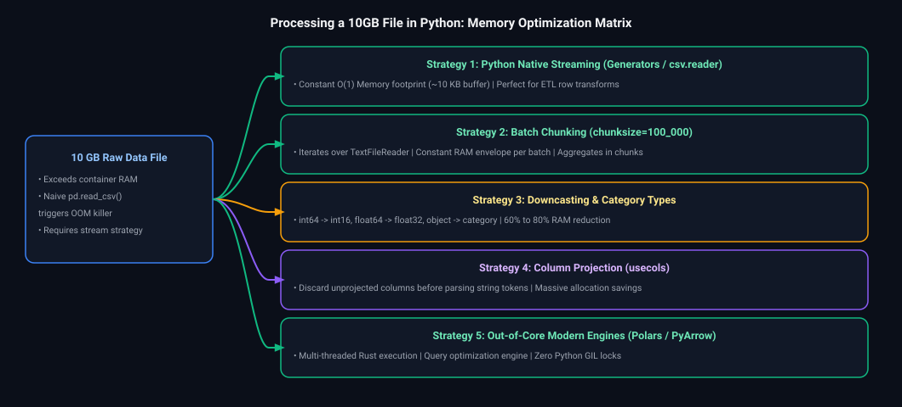

*D2 Source:* [assets/02_python_for_data_and_systems_faq/01_large_file_memory_optimization_matrix.d2](assets/02_python_for_data_and_systems_faq/01_large_file_memory_optimization_matrix.d2)

#### Production Implementation: Chunked Filtering with Pandas (Q1)
```python
import os
import pandas as pd

def process_large_csv_in_chunks(
    input_file: str, 
    output_file: str, 
    filter_column: str, 
    target_value: str, 
    chunk_size: int = 100_000
) -> int:
    """
    Reads a large CSV in chunks, filters rows matching criteria, 
    and writes to an output CSV in append mode without loading the full dataset.
    """
    total_retained_rows = 0
    header_written = False

    # Remove existing output file if present
    if os.path.exists(output_file):
        os.remove(output_file)

    # Stream the file in batches
    with pd.read_csv(input_file, chunksize=chunk_size, low_memory=False) as reader:
        for chunk in reader:
            # Vectorized Boolean filtering
            filtered_chunk = chunk[chunk[filter_column] == target_value]
            
            if not filtered_chunk.empty:
                total_retained_rows += len(filtered_chunk)
                # Write to disk: write header only for the very first chunk
                filtered_chunk.to_csv(
                    output_file, 
                    mode="a", 
                    index=False, 
                    header=not header_written
                )
                header_written = True

    return total_retained_rows
```

---

### Q2. [Hard] Memory Optimization Strategies for 10GB CSV Processing
**Difficulty:** [Hard]
**Topic Covered:** Out-of-Core Processing, Downcasting, Categoricals & Polars  
**Question:** In Python, how would you optimize data transformations when processing a 10GB CSV file?

#### Production Implementation: Memory Optimization Playbook for 10GB CSV (Q4)

##### Downcasting Schema & PyArrow Engine
```python
import polars as pl
import pyarrow.dataset as ds

# Method A: Polars Out-Of-Core Streaming
def process_10gb_with_polars(input_path: str, output_path: str):
    """
    Polars uses Apache Arrow memory layout and a Rust-backed streaming engine
    capable of executing queries out-of-core with minimal RAM.
    """
    query = (
        pl.scan_csv(input_path)
        .filter(pl.col("status") == "COMPLETED")
        .select([
            pl.col("customer_id").cast(pl.Int32),
            pl.col("transaction_date").str.to_date(),
            pl.col("amount").cast(pl.Float32)
        ])
        .group_by("customer_id")
        .agg(pl.col("amount").sum().alias("total_spend"))
    )
    
    # Executes in streaming mode with low memory footprint
    query.sink_parquet(output_path)
```

##### Pandas Memory Profiling & Type Optimization
```python
import numpy as np
import pandas as pd

def optimize_pandas_memory(df: pd.DataFrame) -> pd.DataFrame:
    """Downcasts numeric types and converts repeated strings to category."""
    for col in df.columns:
        col_type = df[col].dtype
        if col_type == "int64":
            df[col] = pd.to_numeric(df[col], downcast="integer")
        elif col_type == "float64":
            df[col] = pd.to_numeric(df[col], downcast="float")
        elif col_type == "object" and df[col].nunique() / len(df[col]) < 0.2:
            # Low cardinality string -> category reduces memory by 80-90%
            df[col] = df[col].astype("category")
    return df
```

---

# 2. Nested JSON Flattening & Shredding into Pandas

---

### Q3. [Medium] Nested JSON Flattening & Shredding into Pandas
**Difficulty:** [Medium]
**Topic Covered:** Semi-Structured Data Ingestion & JSON Normalization  
**Question:** You have a nested dictionary of JSON records from an API. How would you flatten it and load it into a Pandas DataFrame?

#### Core Concept: Semi-Structured JSON Shredding
REST APIs commonly return hierarchical payloads containing nested dictionaries and embedded arrays of objects. For relational analytical modeling, these structures must be unnested (shredded) into tabular rows and columns.

#### Visual Architecture
```json
{
  "user_id": 101,
  "profile": {"name": "Alice", "country": "US"},
  "orders": [
    {"order_id": 5001, "amount": 120.0},
    {"order_id": 5002, "amount": 85.5}
  ]
}
```

$$\Big\downarrow \quad \text{\small \texttt{pd.json\_normalize(record\_path='orders', meta=['user\_id', ['profile', 'name']])}}$$

| `user_id` | `profile.name` | `order_id` | `amount` |
| :---: | :--- | :---: | :---: |
| 101 | Alice | 5001 | 120.0 |
| 101 | Alice | 5002 | 85.5 |

#### Production Implementation
```python
import json
import pandas as pd

api_payload = [
    {
        "user_id": 101,
        "profile": {
            "first_name": "Alice",
            "last_name": "Smith",
            "location": {"city": "Seattle", "state": "WA"}
        },
        "orders": [
            {"order_id": "ORD-1", "sku": "TECH-01", "price": 49.99},
            {"order_id": "ORD-2", "sku": "BOOK-05", "price": 14.50}
        ]
    },
    {
        "user_id": 102,
        "profile": {
            "first_name": "Bob",
            "last_name": "Jones",
            "location": {"city": "Austin", "state": "TX"}
        },
        "orders": [
            {"order_id": "ORD-3", "sku": "HOME-09", "price": 120.00}
        ]
    }
]

# Scenario 1: Flattening nested dictionary properties (No Array Unnesting)
flat_users_df = pd.json_normalize(api_payload, sep="_")
print(flat_users_df.columns.tolist())
# Output: ['user_id', 'orders', 'profile_first_name', 'profile_last_name', 'profile_location_city', 'profile_location_state']

# Scenario 2: Unnesting Embedded Arrays while Retaining Parent Metadata
flat_orders_df = pd.json_normalize(
    api_payload,
    record_path=["orders"],
    meta=[
        "user_id",
        ["profile", "first_name"],
        ["profile", "location", "city"]
    ],
    sep="_"
)
print(flat_orders_df)
# Output columns: ['order_id', 'sku', 'price', 'user_id', 'profile_first_name', 'profile_location_city']
```

---

# 3. Deduplication Algorithms: Python Sequences & Pandas

---

### Q4. [Medium] Order-Preserving List Deduplication
**Difficulty:** [Medium]
**Topic Covered:** In-Memory Deduplication & Hash Set Lookups  
**Question:** Write a Python script to remove duplicates from a list while maintaining the original order.

#### Question 3: Order-Preserving List Deduplication

##### Why `list(set(seq))` Fails
Calling `set()` strips out duplicates, but sets in Python are **unordered hash tables**. Converting back to a list corrupts the chronological or sequential ordering of events.

##### Optimal Solution: `dict.fromkeys()` (Python 3.7+)
Since Python 3.7, dictionaries maintain insertion order by standard language specification. `dict.fromkeys(seq)` deduplicates keys in $O(N)$ time while preserving the original sequence.

```python
def deduplicate_preserve_order(sequence: list) -> list:
    """
    Removes duplicates from a sequence while maintaining insertion order.
    Time Complexity: O(N) amortized
    Space Complexity: O(N)
    """
    return list(dict.fromkeys(sequence))

# Test Example:
raw_event_ids = ["e3", "e1", "e2", "e1", "e4", "e3", "e5"]
deduped = deduplicate_preserve_order(raw_event_ids)
print(deduped)
# Result: ['e3', 'e1', 'e2', 'e4', 'e5'] (Exact original order maintained!)
```

---

### Q5. [Medium] High-Performance Deduplication in Pandas
**Difficulty:** [Medium]
**Topic Covered:** Vectorized DataFrame Deduplication & Deterministic Retain Rules  
**Question:** How do you handle and remove duplicates efficiently using pandas?

#### Question 5: Production Deduplication in Pandas
In distributed ETL pipelines, duplicate records can arrive due to network retries, streaming replays, or source system syncs.

```python
import pandas as pd

df = pd.DataFrame({
    "customer_id": [1, 2, 1, 3, 2],
    "email": ["a@test.com", "b@test.com", "a@test.com", "c@test.com", "b@test.com"],
    "updated_at": ["2024-01-01", "2024-01-05", "2024-01-08", "2024-01-02", "2024-01-03"],
    "score": [10, 20, 15, 30, 25]
})

# 1. Identify Duplicates (Audit logging)
duplicate_mask = df.duplicated(subset=["customer_id"], keep=False)
print(f"Detected {duplicate_mask.sum()} duplicate rows:")
print(df[duplicate_mask])

# 2. Sort to guarantee determinism before deduplicating
df["updated_at"] = pd.to_datetime(df["updated_at"])
df_sorted = df.sort_values(by=["customer_id", "updated_at"], ascending=[True, False])

# 3. Retain the single latest record per customer
df_deduped = df_sorted.drop_duplicates(
    subset=["customer_id"], 
    keep="first", 
    ignore_index=True
)
print("Deduplicated Result (Latest Record Kept):")
print(df_deduped)
```

---

# 4. Python Decorators & Production Engineering Wrappers

---

### Q6. [Medium] Python Decorators in Production Data Pipelines
**Difficulty:** [Medium]
**Topic Covered:** First-Class Functions, Closures & Production Wrapper Syntaxes  
**Questions Covered:**
- Explain Python Decorators with an example.
- What are decorators?

#### Definition & Core Concepts
A **decorator** is a callable design pattern that takes another function as an argument, extends or alters its behavior without modifying its source code, and returns the modified wrapper function. It relies on Python closures and first-class functions.

#### Real-World Production Use Cases in Data Pipelines
1. **Execution Profiling:** Logging query runtime and memory consumption.
2. **Transient Error Retries:** Exponential backoff retry logic for REST APIs or cloud database connections.
3. **Data Quality Assertion:** Validating DataFrame schemas before and after transformation execution.

#### Production Implementation: Production Retry & Latency Tracker
```python
import functools
import logging
import time
from typing import Any, Callable

logging.basicConfig(level=logging.INFO)
logger = logging.getLogger("ETL_Pipeline")

def retry_with_backoff(max_retries: int = 3, initial_delay: float = 1.0, backoff_factor: float = 2.0):
    """
    Enterprise decorator: Automatically retries failing API/DB calls with exponential backoff.
    """
    def decorator(func: Callable) -> Callable:
        @functools.wraps(func)
        def wrapper(*args: Any, **kwargs: Any) -> Any:
            delay = initial_delay
            last_exception = None
            
            for attempt in range(1, max_retries + 1):
                try:
                    start_time = time.perf_counter()
                    result = func(*args, **kwargs)
                    elapsed = time.perf_counter() - start_time
                    logger.info(f"Function '{func.__name__}' succeeded on attempt {attempt} in {elapsed:.3f}s")
                    return result
                except Exception as exc:
                    last_exception = exc
                    logger.warning(
                        f"Attempt {attempt}/{max_retries} failed for '{func.__name__}' with error: {exc}. "
                        f"Retrying in {delay}s..."
                    )
                    time.sleep(delay)
                    delay *= backoff_factor
                    
            logger.error(f"Function '{func.__name__}' exhausted all {max_retries} retries.")
            raise last_exception
        return wrapper
    return decorator

# Usage in Data Ingestion
@retry_with_backoff(max_retries=3, initial_delay=0.5)
def fetch_api_records(endpoint_url: str) -> dict:
    # Simulated network call
    return {"status": 200, "data": [1, 2, 3]}
```

---

# 5. Variable-Length Arguments (*args & **kwargs)

---

### Q7. [Medium] Variable-Length Arguments (*args & **kwargs) in Pipeline Design
**Difficulty:** [Medium]
**Topic Covered:** Positional & Keyword Argument Packing/Unpacking  
**Question:** Explain *args and **kwargs.

#### Core Concept & Mechanics
In Python, `*args` and `**kwargs` allow a function to accept an arbitrary, unspecified number of arguments:
- `*args` (Non-Keyword Arguments): Packs positional arguments into a **tuple**.
- `**kwargs` (Keyword Arguments): Packs named key-value arguments into a **dictionary**.

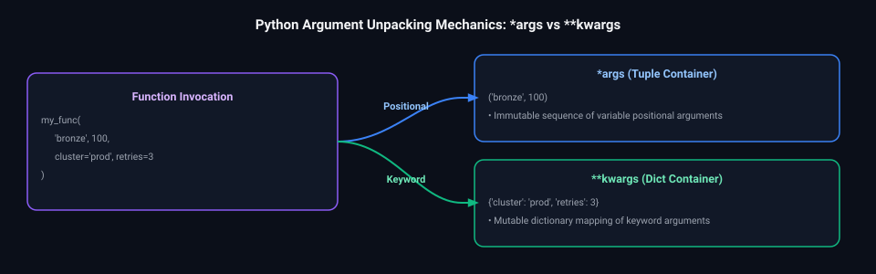

*D2 Source:* [assets/02_python_for_data_and_systems_faq/02_python_args_kwargs_unpacking_mechanics.d2](assets/02_python_for_data_and_systems_faq/02_python_args_kwargs_unpacking_mechanics.d2)

#### Production Data Engineering Pipeline Pattern
In production frameworks, `*args` and `**kwargs` allow creating generic orchestration wrappers and pluggable hook systems:

```python
from typing import Callable, Any

def execute_pipeline_task(task_name: str, task_fn: Callable, *args: Any, **kwargs: Any) -> Any:
    """
    Generic task executor that passes positional and keyword parameters 
    transparently to downstream ingestion functions.
    """
    print(f"[START] Executing task: {task_name}")
    print(f"  Positional args: {args}")
    print(f"  Keyword options: {kwargs}")
    
    # Unpack arguments directly into the target function
    result = task_fn(*args, **kwargs)
    
    print(f"[COMPLETED] Task: {task_name}")
    return result

def load_table(schema: str, table: str, mode: str = "append", validate_nulls: bool = True):
    return f"Loaded {schema}.{table} (mode={mode}, validate={validate_nulls})"

# Dynamic invocation:
execute_pipeline_task(
    "LoadCustomerGold",
    load_table,
    "gold_db", "dim_customers", # Passed as *args
    mode="overwrite", validate_nulls=False # Passed as **kwargs
)
```

---

# 6. Enterprise Exception Handling & Dead-Letter Patterns

---

### Q8. [Medium] Enterprise Exception Handling & Dead-Letter Queue Patterns
**Difficulty:** [Medium]
**Topic Covered:** Defensive Data Pipelines, Fault Tolerance & Quarantine Queues  
**Question:** Explain a real scenario where you implemented exception handling.

#### Real Production Scenario: Ingesting 100,000 JSON Records with Corrupt Payloads
During nightly ingestion from a vendor third-party webhook, records can contain corrupt formats (e.g., malformed JSON, missing critical keys, invalid dates). 

**The Anti-Pattern:** A single unhandled exception halts the pipeline after processing 80,000 records, discarding the entire run.

**The Solution:** Implement a **Dead-Letter Queue (DLQ)** pattern with structured `try...except...finally` error handling:
1. Valid records are batched and written to the primary Gold destination.
2. Malformed records are caught, enriched with metadata (error trace, timestamp, raw payload), and diverted to a Dead-Letter storage path for debugging.
3. System resources (database connections, file handles) are deterministically closed in `finally`.

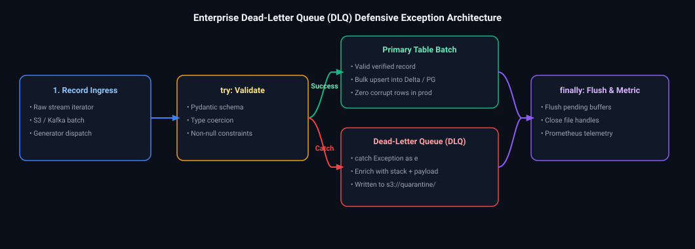

*D2 Source:* [assets/02_python_for_data_and_systems_faq/03_dead_letter_queue_defensive_exception_pipeline.d2](assets/02_python_for_data_and_systems_faq/03_dead_letter_queue_defensive_exception_pipeline.d2)

#### Production Implementation
```python
import json
import logging
from datetime import datetime

logger = logging.getLogger("DeadLetterPipeline")

def process_event_stream_with_dlq(raw_events: list[str], valid_sink, dlq_sink):
    success_count = 0
    failure_count = 0
    
    for raw_record in raw_events:
        try:
            # 1. Parse JSON payload
            record = json.loads(raw_record)
            
            # 2. Schema validation
            if "event_id" not in record or "timestamp" not in record:
                raise ValueError("Missing mandatory keys: 'event_id' or 'timestamp'")
            
            # 3. Type parsing
            event_time = datetime.fromisoformat(record["timestamp"])
            
            # Valid record saved to primary sink
            valid_sink.write({"event_id": record["event_id"], "timestamp": event_time})
            success_count += 1
            
        except json.JSONDecodeError as jde:
            # Quarantine malformed JSON
            failure_count += 1
            dlq_sink.write({
                "raw_payload": raw_record,
                "error_type": "JSON_CORRUPT",
                "error_message": str(jde),
                "quarantine_time": datetime.utcnow().isoformat()
            })
            
        except (ValueError, KeyError) as ve:
            # Quarantine schema validation violations
            failure_count += 1
            dlq_sink.write({
                "raw_payload": raw_record,
                "error_type": "SCHEMA_VIOLATION",
                "error_message": str(ve),
                "quarantine_time": datetime.utcnow().isoformat()
            })
            
        except Exception as unk:
            # Catch unexpected system faults
            logger.critical(f"Unexpected fatal error: {unk}", exc_info=True)
            raise
            
        finally:
            # Periodic heartbeats / telemetry
            pass
            
    logger.info(f"Ingestion finished: {success_count} succeeded, {failure_count} sent to DLQ.")
```

---

# 7. Algorithmic Foundations: Prefix Sum Implementation & Complexity

---

### Q9. [Medium] Prefix Sum Array Transformation & Algorithmic Complexity
**Difficulty:** [Medium]
**Topic Covered:** Cumulative Range Aggregation & In-Place Pointer Mathematics  
**Covered Problem:**
- **Given**: `[1, 2, 3, 4]`
- **Generate**: `[1, 3, 6, 10]`
- **Follow-ups**: Explain the approach, time complexity, and space complexity.

#### Algorithmic Definition
A **Prefix Sum** (cumulative sum array) is an algorithm where each element at index $i$ in the output array is the sum of all elements from index $0$ to index $i$ of the input array:
$$P[i] = \sum_{k=0}^{i} A[k] = P[i-1] + A[i]$$

#### Why Prefix Sums Matter in Data Engineering
1. **$O(1)$ Range Sum Queries:** Once a prefix sum array is precomputed in $O(N)$, the sum of any arbitrary slice from index $L$ to $R$ can be evaluated in $O(1)$ constant time:
   $$\text{Sum}(L, R) = P[R] - P[L-1]$$
2. **Cumulative Financial & Analytical Aggregations:** Computes running balances, rolling revenue, and cumulative user retention.

#### Code Implementations

##### Approach 1: Out-of-Place Iterative Accumulation ($O(N)$ Time, $O(N)$ Space)
```python
def compute_prefix_sum(nums: list[int]) -> list[int]:
    """
    Computes prefix sum array out-of-place.
    Time Complexity: O(N) - single linear pass through the array.
    Space Complexity: O(N) - allocating a new output array of length N.
    """
    if not nums:
        return []
    
    prefix = [0] * len(nums)
    prefix[0] = nums[0]
    
    for i in range(1, len(nums)):
        prefix[i] = prefix[i - 1] + nums[i]
        
    return prefix

# Test:
arr = [1, 2, 3, 4]
print(compute_prefix_sum(arr))  # Output: [1, 3, 6, 10]
```

##### Approach 2: In-Place Mutation ($O(N)$ Time, $O(1)$ Auxiliary Space)
```python
def compute_prefix_sum_inplace(nums: list[int]) -> list[int]:
    """
    Mutates the array in-place to achieve O(1) auxiliary memory.
    Time Complexity: O(N)
    Space Complexity: O(1) auxiliary memory (excluding input array).
    """
    for i in range(1, len(nums)):
        nums[i] += nums[i - 1]
    return nums

# Test:
arr = [1, 2, 3, 4]
compute_prefix_sum_inplace(arr)
print(arr)  # Output: [1, 3, 6, 10]
```

##### Approach 3: Python Standard Library (`itertools.accumulate`)
```python
import itertools

arr = [1, 2, 3, 4]
prefix_gen = list(itertools.accumulate(arr))
print(prefix_gen)  # Output: [1, 3, 6, 10]
```

#### Complexity Analysis Matrix
| Approach | Time Complexity | Auxiliary Space Complexity | Mutation Risk |
| :--- | :--- | :--- | :--- |
| **Out-of-Place Iterative** | $O(N)$ | $O(N)$ | Safe (Leaves input unchanged) |
| **In-Place Mutation** | $O(N)$ | $O(1)$ | High (Modifies input array directly) |
| **`itertools.accumulate`** | $O(N)$ (C-optimized) | $O(N)$ or $O(1)$ if generator | Safe |

---

# 8. Real-Time Stream Structures & High-Performance Caching

---

### Q10. [Medium] Continuous Stream Running Median via Dual Heaps
**Difficulty:** [Medium]
**Topic Covered:** Streaming Analytics, Online Median Computation & Heap Invariants  
**Questions Covered:**
- Given a stream of integers, design a data structure to return the median at any time.
- Given an unbounded stream of integers, design a data structure to return the running median at any time in $O(1)$ lookup time and $O(\log N)$ insertion time.

#### Core Dilemma & Mathematical Mechanics
In high-throughput sensor telemetry or live financial trade pipelines, computing the median of $N$ items naively requires sorting ($O(N \log N)$), which is impossible for continuous streams.
To maintain the median dynamically:
- Maintain two balanced priority queues (heaps):
  1. **Max-Heap (`small`):** Stores the smaller half of numbers. Max-heap root gives the largest of the small numbers.
  2. **Min-Heap (`large`):** Stores the larger half of numbers. Min-heap root gives the smallest of the large numbers.
- **Invariants:**
  1. Every element in `small` $\le$ every element in `large`.
  2. Balancing condition: `len(small) == len(large)` (even elements) OR `len(small) == len(large) + 1` (odd elements).

#### Visual Flow
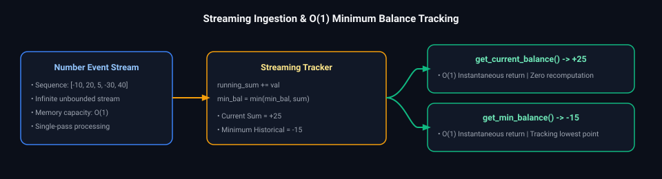

*D2 Source:* [assets/02_python_for_data_and_systems_faq/04_streaming_running_and_minimum_balance_tracker.d2](assets/02_python_for_data_and_systems_faq/04_streaming_running_and_minimum_balance_tracker.d2)

#### Production Implementation
```python
import heapq

class MedianFinder:
    """
    Maintains a continuous stream running median using two balanced heaps.
    Time Complexity:
      - add_num: O(log N)
      - find_median: O(1)
    Space Complexity: O(N) to store incoming elements.
    """
    def __init__(self):
        # Max-heap for the smaller half (Python only has min-heap, so negate values)
        self.small = [] 
        # Min-heap for the larger half
        self.large = [] 

    def add_num(self, num: int) -> None:
        # Step 1: Push to max-heap (small half)
        if not self.small or num <= -self.small[0]:
            heapq.heappush(self.small, -num)
        else:
            heapq.heappush(self.large, num)

        # Step 2: Rebalance heaps to satisfy invariant: len(small) == len(large) or len(large) + 1
        if len(self.small) > len(self.large) + 1:
            val = -heapq.heappop(self.small)
            heapq.heappush(self.large, val)
        elif len(self.large) > len(self.small):
            val = heapq.heappop(self.large)
            heapq.heappush(self.small, -val)

    def find_median(self) -> float:
        if not self.small and not self.large:
            raise ValueError("No elements in stream.")
        
        if len(self.small) > len(self.large):
            return float(-self.small[0])
        else:
            return (-self.small[0] + self.large[0]) / 2.0

# Driver Test:
mf = MedianFinder()
for n in [5, 15, 1, 3]:
    mf.add_num(n)
    print(f"Added {n}, Current Median: {mf.find_median()}")
# Output:
# Added 5, Current Median: 5.0
# Added 15, Current Median: 10.0
# Added 1, Current Median: 5.0
# Added 3, Current Median: 4.0
```

---

### Q11. [Medium] Least Recently Used (LRU) Cache Architecture
**Difficulty:** [Medium]
**Topic Covered:** In-Memory Caching, Doubly Linked Lists & Hash Maps  
**Questions Covered:**
- Implement an LRU (Least Recently Used) cache.
- Implement an LRU (Least Recently Used) cache with $O(1)$ `get()` and `put()` operations from scratch.

#### Architectural Principles
1. **Hash Map (`dict`):** Provides $O(1)$ key lookup to locate nodes in memory.
2. **Doubly Linked List (DLL):** Enables $O(1)$ node removal and insertion at head/tail without shifting array elements.
3. **Head:** Most Recently Used (MRU) sentinel.
4. **Tail:** Least Recently Used (LRU) sentinel. Evictions always occur at `tail.prev`.

#### Production Implementation from Scratch (Without `collections.OrderedDict`)
```python
from typing import Optional

class Node:
    def __init__(self, key: int = 0, value: int = 0):
        self.key = key
        self.value = value
        self.prev: Optional['Node'] = None
        self.next: Optional['Node'] = None

class LRUCache:
    """
    Least Recently Used Cache with strict O(1) get and put operations.
    Built using a Hash Map + Doubly Linked List.
    """
    def __init__(self, capacity: int):
        self.capacity = capacity
        self.cache: dict[int, Node] = {}
        
        # Sentinels (dummy head and tail to eliminate null pointer checks)
        self.head = Node()
        self.tail = Node()
        self.head.next = self.tail
        self.tail.prev = self.head

    def _remove(self, node: Node) -> None:
        """Splices node out of the doubly linked list."""
        prev_node = node.prev
        next_node = node.next
        prev_node.next = next_node
        next_node.prev = prev_node

    def _add_to_head(self, node: Node) -> None:
        """Inserts node immediately after head sentinel (MRU position)."""
        node.next = self.head.next
        node.prev = self.head
        self.head.next.prev = node
        self.head.next = node

    def get(self, key: int) -> int:
        if key not in self.cache:
            return -1
        node = self.cache[key]
        # Move node to head (MRU)
        self._remove(node)
        self._add_to_head(node)
        return node.value

    def put(self, key: int, value: int) -> None:
        if key in self.cache:
            node = self.cache[key]
            node.value = value
            self._remove(node)
            self._add_to_head(node)
        else:
            if len(self.cache) >= self.capacity:
                # Evict LRU node (node right before tail)
                lru_node = self.tail.prev
                self._remove(lru_node)
                del self.cache[lru_node.key]

            new_node = Node(key, value)
            self.cache[key] = new_node
            self._add_to_head(new_node)

# Test Verification:
cache = LRUCache(2)
cache.put(1, 10)
cache.put(2, 20)
print(cache.get(1))    # returns 10 (key 1 is now MRU)
cache.put(3, 30)       # evicts key 2
print(cache.get(2))    # returns -1 (evicted!)
```

---

# 9. Graph Algorithms & Network Topology in Data Engineering

---

### Q12. [Medium] Cycle Detection in Directed Transportation Networks
**Difficulty:** [Medium]
**Topic Covered:** Directed Graphs, Pipeline DAG Validation, Cycle Detection & Topological Sort  
**Questions Covered:**
- Detect a cycle in a directed graph representing trip routes between cities.
- Detect a cycle in a directed graph representing trip routes between cities or dependency tasks in an orchestration engine.

#### Real-World Data Engineering Relevance
1. **Pipeline DAG Scheduling:** An orchestrator (like Apache Airflow or dbt) must detect circular dependencies (`A -> B -> C -> A`) prior to compilation.
2. **Transportation Network Auditing:** Identifying infinite routing loops in ride-sharing transit networks.

#### Algorithms:
- **Kahn's Algorithm (BFS via In-Degree):** If topological sort processes fewer nodes than $|V|$, a cycle exists.
- **Three-Color DFS:** Nodes are marked `0` (Unvisited), `1` (Visiting/In Recursion Stack), or `2` (Visited). If DFS reaches a node marked `1`, a back-edge (cycle) is detected.

#### Production Implementation: Three-Color DFS
```python
from collections import defaultdict
from typing import Dict, List, Tuple

def has_route_cycle(routes: List[Tuple[str, str]]) -> Tuple[bool, List[str]]:
    """
    Detects if a directed route graph contains cycles using 3-color DFS.
    Returns (has_cycle, cycle_path_preview).
    Time Complexity: O(V + E)
    Space Complexity: O(V + E)
    """
    adj: Dict[str, List[str]] = defaultdict(list)
    nodes = set()
    for origin, dest in routes:
        adj[origin].append(dest)
        nodes.add(origin)
        nodes.add(dest)

    # 0 = WHITE (unvisited), 1 = GRAY (visiting), 2 = BLACK (finished)
    color: Dict[str, int] = {node: 0 for node in nodes}
    parent: Dict[str, str] = {}
    cycle_nodes: List[str] = []

    def dfs(u: str) -> bool:
        color[u] = 1 # Mark as visiting
        for v in adj[u]:
            if color[v] == 1:
                # Cycle found! Back-edge detected: u -> v
                cycle_nodes.append(f"{u} -> {v}")
                return True
            if color[v] == 0:
                parent[v] = u
                if dfs(v):
                    return True
        color[u] = 2 # Mark as fully processed
        return False

    for node in nodes:
        if color[node] == 0:
            if dfs(node):
                return True, cycle_nodes

    return False, []

# Test Case 1: Cyclical Route (NYC -> BOS -> CHI -> NYC)
routes_with_cycle = [("NYC", "BOS"), ("BOS", "CHI"), ("CHI", "NYC"), ("NYC", "MIA")]
has_cycle, edge = has_route_cycle(routes_with_cycle)
print(f"Graph 1 Has Cycle: {has_cycle}, Back-edge: {edge}")  # True

# Test Case 2: Acyclic DAG (NYC -> BOS -> CHI, NYC -> MIA)
routes_acyclic = [("NYC", "BOS"), ("BOS", "CHI"), ("NYC", "MIA")]
has_cycle, _ = has_route_cycle(routes_acyclic)
print(f"Graph 2 Has Cycle: {has_cycle}")  # False
```

---

# 10. Merging & Streak Tracking in Distributed Data

---

### Q13. [Medium] Merge K Sorted Streams / Linked Lists
**Difficulty:** [Medium]
**Topic Covered:** Multi-Way External Merge, Min-Heaps & Priority Queues  
**Questions Covered:**
- Merge K sorted linked lists.
- Merge $K$ sorted streams or linked lists into a single sorted stream. Analyze time and space complexity.
*(Grouped together: Both address merging multiple sorted sequences/partitions using min-heaps in external merge scenarios)*

#### Data Engineering Context
External merge sort in distributed engines (e.g., Spark sort-merge joins, MapReduce spill files, Delta compaction) repeatedly merges $K$ sorted partition files into a single sorted partition.

#### Production Implementation: Min-Heap External Stream Merge
```python
import heapq
from typing import List

def merge_k_sorted_streams(streams: List[List[int]]) -> List[int]:
    """
    Merges K sorted arrays into a single sorted array using a Min-Heap.
    Time Complexity: O(N * log K), where N is total items and K is number of streams.
    Space Complexity: O(K) heap memory.
    """
    min_heap = []
    
    # Initialize heap with (first_val, stream_idx, element_idx)
    for stream_idx, stream in enumerate(streams):
        if stream:
            heapq.heappush(min_heap, (stream[0], stream_idx, 0))

    result = []
    
    while min_heap:
        val, s_idx, elem_idx = heapq.heappop(min_heap)
        result.append(val)
        
        # Advance in the stream from which the min element was taken
        if elem_idx + 1 < len(streams[s_idx]):
            next_val = streams[s_idx][elem_idx + 1]
            heapq.heappush(min_heap, (next_val, s_idx, elem_idx + 1))
            
    return result

# Test:
k_partitions = [
    [10, 25, 40],
    [5, 15, 30],
    [12, 18, 50]
]
print("Merged Output:", merge_k_sorted_streams(k_partitions))
# Output: [5, 10, 12, 15, 18, 25, 30, 40, 50]
```

---

### Q14. [Medium] Longest Continuous Ride Streak / Consecutive Sequence
**Difficulty:** [Medium]
**Topic Covered:** Streak Calculations, Hash Set $O(N)$ Lookups & Sequence Extraction  
**Questions Covered:**
- Given a list of ride timestamps, find the longest continuous ride streak.
- Given an unsorted list of ride dates or day timestamps, find the length of the longest continuous ride streak in $O(N)$ time.
*(Grouped together: Finding longest consecutive sequence from timestamp/date streams in O(N) using hash sets)*

#### Algorithmic Strategy: Hash Set Boundary Detection
Sorting the list takes $O(N \log N)$. An optimal $O(N)$ solution converts the list into a Python `set`.
- For each number `x`, check if `x - 1` is in the set.
- If `x - 1` exists, `x` is **not** the beginning of a streak (skip it).
- If `x - 1` is NOT in the set, `x` is the **streak start**! Count forward: `x + 1, x + 2, ...` to compute streak length.
- Because each sequence is entered only once at its beginning, total traversal across all numbers is strictly $O(N)$.

#### Production Implementation
```python
from typing import List

def longest_continuous_streak(day_numbers: List[int]) -> int:
    """
    Calculates the longest consecutive sequence in O(N) time and O(N) space.
    """
    num_set = set(day_numbers)
    max_streak = 0

    for num in num_set:
        # Check if num is the start of a streak
        if num - 1 not in num_set:
            current_num = num
            current_streak = 1

            while current_num + 1 in num_set:
                current_num += 1
                current_streak += 1

            max_streak = max(max_streak, current_streak)

    return max_streak

# Test with ride timestamps converted to epoch days:
ride_days = [100, 4, 200, 1, 3, 2, 5, 201]
print("Longest Ride Streak:", longest_continuous_streak(ride_days))
# Subsequence [1, 2, 3, 4, 5] -> Output: 5
```

---

# 11. Python Concurrency Architecture: Threading vs Multiprocessing vs AsyncIO

---

### Q15. [Easy] Multithreading vs Multiprocessing under the Python GIL
**Difficulty:** [Easy]
**Topic Covered:** Global Interpreter Lock (GIL), CPU-Bound vs I/O-Bound ETL & Parallel Execution  
**Questions Covered:**
- Explain Multithreading vs Multiprocessing and when each approach is useful.
- Explain the difference between Multithreading and Multiprocessing in Python. When is each approach useful for data engineering?
*(Grouped together: In-depth comparison of Python threading vs multiprocessing, GIL mechanics, and compute vs I/O selection)*

#### The Python Global Interpreter Lock (GIL)
The GIL is a mutex in CPython that prevents multiple native threads from executing Python bytecodes simultaneously.
- **Consequence:** Multithreading in Python **cannot utilize multiple CPU cores** for pure Python compute.
- **I/O-Bound Work:** When a thread performs network I/O (e.g., downloading files from S3/ADLS or making REST API calls), it releases the GIL, allowing concurrent thread execution.
- **CPU-Bound Work:** Transforming data in memory, parsing heavy JSON, or running mathematical calculations requires `multiprocessing` to bypass the GIL by creating independent OS processes.

#### Architecture Comparison Matrix
| Dimension | Multithreading (`threading`, `ThreadPoolExecutor`) | Multiprocessing (`multiprocessing`, `ProcessPoolExecutor`) |
| :--- | :--- | :--- |
| **Process Count** | 1 OS process (shared memory space). | $N$ separate OS processes (isolated memory). |
| **GIL Impact** | Bound by GIL. True concurrency only on I/O. | Bypasses GIL. True parallelism across multiple CPU cores. |
| **Memory Overhead**| Very low (~KB per thread). Shared memory. | High (each process forks Python runtime & duplicate memory). |
| **IPC Overhead** | Zero (shared pointers, requires threading locks). | High (requires serialization/pickling between processes). |
| **Primary Use Case**| Ingesting 1,000 files from S3, querying REST APIs, DB reads. | Heavy CSV parsing, image resizing, feature engineering. |

#### Production Implementation: Hybrid Concurrency Pipeline
```python
from concurrent.futures import ThreadPoolExecutor, ProcessPoolExecutor
import time

def io_bound_api_fetch(page_id: int) -> dict:
    """I/O-Bound: Downloads metadata payload from external API."""
    time.sleep(0.05) # Simulating network latency (GIL is released!)
    return {"page_id": page_id, "data": [i for i in range(1000)]}

def cpu_bound_transformation(payload: dict) -> int:
    """CPU-Bound: Heavy parsing & computation (Runs in separate core)."""
    return sum(x ** 2 for x in payload["data"])

def run_concurrent_pipeline():
    page_ids = list(range(20))
    
    # Step 1: ThreadPool for concurrent network fetches
    with ThreadPoolExecutor(max_workers=10) as thread_pool:
        fetched_payloads = list(thread_pool.map(io_bound_api_fetch, page_ids))
    print(f"Successfully fetched {len(fetched_payloads)} payloads via ThreadPool.")

    # Step 2: ProcessPool for CPU-heavy transformations across CPU cores
    with ProcessPoolExecutor(max_workers=4) as process_pool:
        results = list(process_pool.map(cpu_bound_transformation, fetched_payloads))
    print(f"Processed sum total: {sum(results)} via ProcessPool.")
```

---

# 12. Core Python Idioms & Algorithmic Problem Solving

---

### Q16. [Medium] Infinite Generator Streaming: Fibonacci Series
**Difficulty:** [Medium]
**Topic Covered:** Python Generators, `yield` Keyword, $O(1)$ Memory Lazy Evaluation  
**Questions Covered:**
- Generate an Infinite Fibonacci Series Using a Generator.
- Generate an infinite Fibonacci series using a Python generator.
*(Grouped together: Infinite series generator evaluation with O(1) space)*

#### Memory Architecture
A recursive or array-based Fibonacci implementation storing $N$ numbers consumes $O(N)$ memory and will trigger stack overflow or out-of-memory errors. A generator evaluates lazily, maintaining only two integer pointers in memory ($O(1)$ space).

```python
from typing import Generator

def infinite_fibonacci() -> Generator[int, None, None]:
    """
    Generates an infinite stream of Fibonacci numbers with O(1) memory overhead.
    """
    a, b = 0, 1
    while True:
        yield a
        a, b = b, a + b

# Driver: Read only required items
fib_gen = infinite_fibonacci()
first_10 = [next(fib_gen) for _ in range(10)]
print("First 10 Fibonacci Numbers:", first_10)
# Output: [0, 1, 1, 2, 3, 5, 8, 13, 21, 34]
```

---

### Q17. [Medium] Sorting Without Built-In Sort: Pure Python Merge Sort
**Difficulty:** [Medium]
**Topic Covered:** Divide and Conquer Algorithms, Stable Sorting & Time Complexity  
**Questions Covered:**
- Sort a List Without Using the sort Keyword
- Sort a list without using the `sort()` method or `sorted()` function.
*(Grouped together: Manual sorting implementation without built-in sort methods)*

#### Production Implementation: Merge Sort ($O(N \log N)$ Guaranteed)
```python
def merge_sort(arr: list[int]) -> list[int]:
    """
    Pure Python Merge Sort implementation.
    Time Complexity: O(N log N) in all cases (worst, average, best).
    Space Complexity: O(N) auxiliary memory.
    """
    if len(arr) <= 1:
        return arr

    mid = len(arr) // 2
    left = merge_sort(arr[:mid])
    right = merge_sort(arr[mid:])

    return _merge(left, right)

def _merge(left: list[int], right: list[int]) -> list[int]:
    sorted_arr = []
    i = j = 0

    while i < len(left) and j < len(right):
        if left[i] <= right[j]:
            sorted_arr.append(left[i])
            i += 1
        else:
            sorted_arr.append(right[j])
            j += 1

    sorted_arr.extend(left[i:])
    sorted_arr.extend(right[j:])
    return sorted_arr

# Test:
unsorted = [64, 34, 25, 12, 22, 11, 90]
print("Sorted Result:", merge_sort(unsorted))
# Output: [11, 12, 22, 25, 34, 64, 90]
```

---

### Q18. [Medium] Two-Pointer Palindrome Verification
**Difficulty:** [Medium]
**Topic Covered:** String Processing, In-Place Two-Pointer Scanning, Whitespace Handling  
**Questions Covered:**
- Check Whether a String is a Palindrome or Not
- Check whether a string is a palindrome, ignoring non-alphanumeric characters and casing, in $O(1)$ extra space.
*(Grouped together: In-place two-pointer palindrome detection and verification)*

```python
def is_palindrome(s: str) -> bool:
    """
    Two-pointer in-place palindrome check.
    Time Complexity: O(N)
    Space Complexity: O(1) auxiliary space (no string reversal copy).
    """
    left = 0
    right = len(s) - 1

    while left < right:
        while left < right and not s[left].isalnum():
            left += 1
        while left < right and not s[right].isalnum():
            right -= 1

        if s[left].lower() != s[right].lower():
            return False

        left += 1
        right -= 1

    return True

print(is_palindrome("A man, a plan, a canal: Panama"))  # True
print(is_palindrome("race a car"))                      # False
```

---

### Q19. [Easy] Factorial Calculation: Iterative vs Memoized
**Difficulty:** [Easy]
**Topic Covered:** Recursion Limits, Iterative Accumulation & Memoization  
**Question:** Write a Python program to find the factorial of a number. Compare iterative vs recursive with memoization.

```python
from functools import lru_cache

# 1. Iterative O(N) Time, O(1) Space (Prevents recursion depth limits)
def factorial_iterative(n: int) -> int:
    if n < 0:
        raise ValueError("Factorial is not defined for negative numbers.")
    result = 1
    for i in range(2, n + 1):
        result *= i
    return result

# 2. Memoized Recursive
@lru_cache(maxsize=None)
def factorial_memoized(n: int) -> int:
    if n < 0:
        raise ValueError("Factorial is not defined for negative numbers.")
    if n <= 1:
        return 1
    return n * factorial_memoized(n - 1)

print("Factorial 6 (Iterative):", factorial_iterative(6))   # 720
print("Factorial 6 (Memoized):", factorial_memoized(6))     # 720
```

---

### Q20. [Medium] Word Frequency Tokenizer & Counter
**Difficulty:** [Medium]
**Topic Covered:** String Normalization, Tokenization & Hash Map Frequency Distribution  
**Question:** Calculate the frequency of words in a sentence without high-level external libraries.

```python
import re
from typing import Dict

def get_word_frequencies(sentence: str) -> Dict[str, int]:
    """
    Tokenizes text, strips punctuation, and builds frequency map in O(N) time.
    """
    freq_map: Dict[str, int] = {}
    words = re.findall(r'\b\w+\b', sentence.lower())

    for word in words:
        freq_map[word] = freq_map.get(word, 0) + 1

    return freq_map

test_sentence = "Data Engineering builds pipelines. High quality data requires robust pipelines!"
print("Word Frequencies:", get_word_frequencies(test_sentence))
# Output: {'data': 2, 'engineering': 1, 'builds': 1, 'pipelines': 2, 'high': 1, 'quality': 1, 'requires': 1, 'robust': 1}
```

---

### Q21. [Medium] Single-Pass Extreme Value Detection (Min and Max)
**Difficulty:** [Medium]
**Topic Covered:** Single-Pass Invariants, Comparison Reduction ($3N/2$ Comparisons)  
**Question:** Find the smallest and largest number in an array in a single traversal.

```python
from typing import List, Tuple

def find_min_max(arr: List[int]) -> Tuple[int, int]:
    """
    Finds min and max in a single pass O(N) time and O(1) memory.
    """
    if not arr:
        raise ValueError("Array cannot be empty.")

    min_val = arr[0]
    max_val = arr[0]

    for val in arr[1:]:
        if val < min_val:
            min_val = val
        elif val > max_val:
            max_val = val

    return min_val, max_val

# Test:
numbers = [23, 5, 89, -12, 45, 102, 0]
min_res, max_res = find_min_max(numbers)
print(f"Min: {min_res}, Max: {max_res}")  # Min: -12, Max: 102
```

---

# 13. Enterprise String, List, and Dictionary Coding Scenarios

---

### Q22. [Medium] Advanced Data Manipulation on Strings, Lists, and Dictionaries
**Difficulty:** [Medium]
**Topic Covered:** String Normalization, List Matrix Transposition, Dictionary Inversion & Merging  
**Questions Covered:**
- Solve Python coding questions on Strings, Lists, and Dictionaries.
- Solve Python coding questions on Strings, Lists, and Dictionaries commonly asked in data engineering interviews.
*(Grouped together: Enterprise coding patterns covering strings, lists, dictionaries, chunking, and recursion)*

#### Definition & Core Concepts
Data engineering transformations frequently involve sanitizing raw string payloads, pivoting and chunking lists of records, and aggregating nested JSON dictionaries into indexed lookup structures.

#### Visual Flow
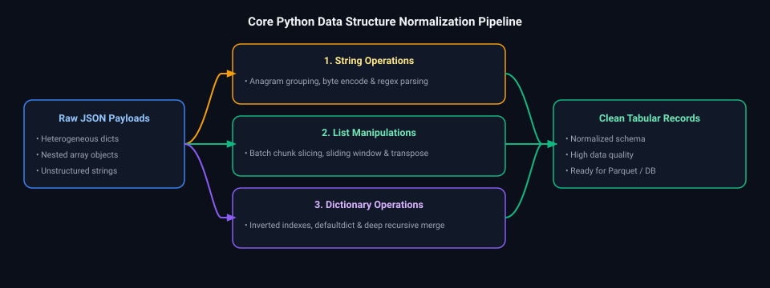

*D2 Source:* [assets/02_python_for_data_and_systems_faq/05_core_python_data_structures_normalization_flow.d2](assets/02_python_for_data_and_systems_faq/05_core_python_data_structures_normalization_flow.d2)

#### Production Implementation / Code Solution
```python
from collections import defaultdict
from typing import Any, Dict, List

# Scenario 1: Strings - Group Anagrams in O(N * K) time
def group_anagrams(words: List[str]) -> List[List[str]]:
    """Groups words that contain identical character frequencies."""
    anagram_map = defaultdict(list)
    for word in words:
        # 26-element character count tuple as immutable hashable key
        count = [0] * 26
        for char in word.lower():
            if 'a' <= char <= 'z':
                count[ord(char) - ord('a')] += 1
        anagram_map[tuple(count)].append(word)
    return list(anagram_map.values())

# Scenario 2: Lists - High-Performance Batch Chunking for API Ingestion
def chunk_list(records: List[Any], chunk_size: int) -> List[List[Any]]:
    """Splits an unbounded list into deterministic batch chunks."""
    return [records[i:i + chunk_size] for i in range(0, len(records), chunk_size)]

# Scenario 3: Dictionaries - Deep Recursive Merge of Nested Configs
def deep_merge_dicts(dict_a: Dict[str, Any], dict_b: Dict[str, Any]) -> Dict[str, Any]:
    """Recursively merges dict_b into dict_a without overwriting nested keys."""
    merged = dict_a.copy()
    for key, value in dict_b.items():
        if key in merged and isinstance(merged[key], dict) and isinstance(value, dict):
            merged[key] = deep_merge_dicts(merged[key], value)
        else:
            merged[key] = value
    return merged

# Test Verification:
print("Anagrams:", group_anagrams(["eat", "tea", "tan", "ate", "nat", "bat"]))
print("Batches:", chunk_list([1, 2, 3, 4, 5, 6, 7], 3))
print("Merged Config:", deep_merge_dicts({"db": {"host": "localhost", "port": 5432}}, {"db": {"user": "admin"}}))
```
- **Time Complexity:**
  - `group_anagrams`: $O(N \cdot K)$ where $N$ is word count and $K$ is max length.
  - `chunk_list`: $O(N)$ slicing.
  - `deep_merge_dicts`: $O(K)$ total keys.
- **Space Complexity:** $O(N)$ auxiliary memory.

#### Engineering Implications & Production Pitfalls
1. **Mutable Default Argument Trap:** In Python functions, declaring `def process(data, cache={})` binds `cache` to the function object at definition time. Across multiple calls, mutations persist! Always declare `cache: Optional[dict] = None` and initialize inside the function (`if cache is None: cache = {}`).
2. **Interview Talking Point:** For dictionary lookups over 10M keys in memory, standard Python `dict` incurs substantial hash table bucket resizing overhead. In extreme memory environments, using `pyarrow.Table` or `marisa-trie` reduces RAM footprint by $>80\%$.

---

# 14. Disjoint Collections, String Parsing & Internal Memory Mechanics

---

### Q23. [Medium] Pairing Common Keys Between Disjoint Lists & Dictionary Intersection
**Difficulty:** [Medium]
**Topic Covered:** Hash Tables, Set Intersections, Key-Value Pairing & $O(N)$ Lookups  
**Question:** Given two lists of key-value tuples or dictionaries, find common keys between them and pair their corresponding values into a combined mapping.

#### Definition & Core Concepts
In ETL enrichment pipelines, datasets often arrive as lists of record tuples or key-value structures from separate upstream APIs. Pairing common keys requires finding the set intersection of keys and building a consolidated dictionary `key: (val_a, val_b)`.
- Naive approach: Nested loops $O(N \cdot M)$.
- Production approach: Hash set / dictionary indexing $O(N + M)$ with collision handling.

#### Production Implementation / Code Solution
```python
from typing import Any, Dict, List, Tuple

def pair_common_keys(
    list_a: List[Tuple[str, Any]], 
    list_b: List[Tuple[str, Any]]
) -> Dict[str, Tuple[Any, Any]]:
    """
    Pairs corresponding values for keys common to both lists in O(N + M) time.
    """
    # Step 1: Ingest list_a into hash map in O(N)
    map_a: Dict[str, Any] = dict(list_a)
    paired_result: Dict[str, Tuple[Any, Any]] = {}

    # Step 2: Iterate through list_b and pair if key exists in map_a in O(M)
    for key, val_b in list_b:
        if key in map_a:
            paired_result[key] = (map_a[key], val_b)

    return paired_result

# Example Driver Execution
items_source1 = [("k1", 100), ("k2", 200), ("k3", 300), ("k4", 400)]
items_source2 = [("k2", "Beta"), ("k4", "Delta"), ("k5", "Epsilon")]

result = pair_common_keys(items_source1, items_source2)
print("Paired Common Keys:", result)
# Output: {'k2': (200, 'Beta'), 'k4': (400, 'Delta')}
```
- **Time Complexity:** $O(N + M)$ single-pass hash lookups.
- **Space Complexity:** $O(N)$ auxiliary hash table for `list_a`.

---

### Q24. [Medium] Character Frequency & Duplicate Detection in High-Volume Strings
**Difficulty:** [Medium]
**Topic Covered:** String Normalization, Hash Aggregations & Duplicate Counting  
**Question:** Write a Python function to find all duplicate characters in a string along with their occurrence counts.

#### Production Implementation / Code Solution
```python
from collections import Counter
from typing import Dict

def find_duplicate_characters(payload: str) -> Dict[str, int]:
    """
    Identifies duplicate characters and their exact counts in O(N) time.
    Case-insensitive, ignores leading and trailing whitespace.
    """
    # Normalize string: lowercase and remove extraneous non-printable noise
    clean_chars = [ch for ch in payload.lower() if not ch.isspace()]
    char_counts = Counter(clean_chars)

    # Filter to only characters appearing > 1 time
    return {char: count for char, count in char_counts.items() if count > 1}

# Test Verification
sample_string = "Data Engineering Architecture in Python"
duplicates = find_duplicate_characters(sample_string)
print("Duplicates with Counts:", duplicates)
# Output: {'a': 4, 't': 3, 'e': 4, 'n': 4, 'g': 2, 'i': 4, 'r': 3, 'c': 2, 'h': 2, 'o': 2}
```
- **Time Complexity:** $O(N)$ single pass over characters.
- **Space Complexity:** $O(K)$ where $K \le 256$ for ASCII/Unicode distinct character buckets.

---

### Q25. [Easy] Python List Appending Mechanics: append() vs extend() vs + vs In-Place Slicing
**Difficulty:** [Easy]
**Topic Covered:** CPython Memory Allocation, PyListObject Over-Allocation & Time Complexity  
**Question:** Explain the difference between appending a list to an existing list using `append()`, `extend()`, `+`, and slice assignment. Detail their memory layout and performance characteristics.

#### Definition & Core Concepts
In CPython, a `list` is implemented as an array of pointers (`PyListObject`). To avoid allocating memory on every item addition, CPython uses an **over-allocation formula** ($allocated \approx size + (size \gg 3) + 6$).

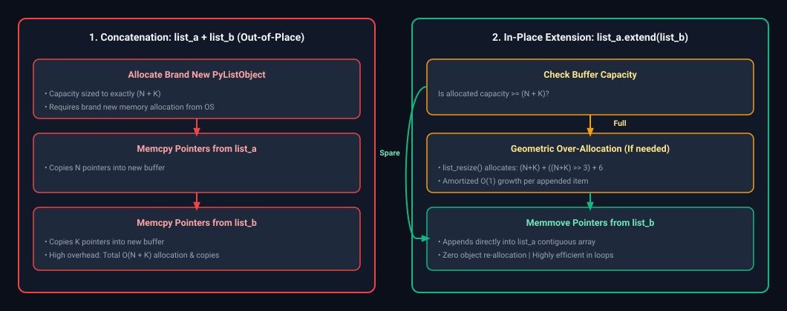

*D2 Source:* [assets/02_python_for_data_and_systems_faq/06_list_plus_concatenation_vs_extend_memory_realloc.d2](assets/02_python_for_data_and_systems_faq/06_list_plus_concatenation_vs_extend_memory_realloc.d2)

#### List Expansion & Mutation Engineering Reference Matrix

| Operation Syntax | CPython Memory Mechanics | In-Place Mutation | Time Complexity | Space Overhead | Production Recommendation |
| :--- | :--- | :--- | :--- | :--- | :--- |
| **`list_a.append(item)`** | Inserts pointer at index $N$; amortized geometric resizing via `list_resize()`. | **Yes** (Mutates in-place) | $\mathcal{O}(1)$ amortized | $\mathcal{O}(1)$ spare capacity | Ideal for progressive single-element streaming accumulation. |
| **`list_a.extend(iterable)`** | Pre-calculates target size; single geometric reallocation if capacity is exceeded; direct `memcpy`. | **Yes** (Mutates in-place) | $\mathcal{O}(K)$ where $K = \text{len}(b)$ | $\mathcal{O}(1)$ auxiliary | **Mandatory** for batch ingestion; avoids intermediary object creation. |
| **`list_c = list_a + list_b`** | Allocates an entirely new `PyListObject`; copies $N$ pointers from $a$, then $K$ pointers from $b$. | **No** (Creates new list) | $\mathcal{O}(N + K)$ | $\mathcal{O}(N + K)$ new list heap | **Anti-pattern** in loops; causes quadratic allocation $\mathcal{O}(N^2)$ and GC memory bloat. |
| **`list_a[len(list_a):] = list_b`** | Invokes slice assignment C-API; internally calls identical logic to `extend()`. | **Yes** (Mutates in-place) | $\mathcal{O}(K)$ | $\mathcal{O}(1)$ auxiliary | Functionally identical to `extend()`; prefer `extend()` for clarity. |

#### Production Implementation
```python
import sys

# Demonstration of CPython list memory reallocation
numbers = []
print(f"Empty list size: {sys.getsizeof(numbers)} bytes")

for i in range(10):
    numbers.append(i)
    # Observe length vs internal allocated buffer size
    print(f"Length: {len(numbers)}, RAM Size: {sys.getsizeof(numbers)} bytes")

# Production Rule: Use extend() or itertools.chain for combining large batches
batch_a = [1, 2, 3]
batch_b = [4, 5, 6]
batch_a.extend(batch_b)  # In-place O(K) without allocating new intermediate list
```

---

### Q26. [Medium] Email Username Extraction with Resilient Regex & RFC Validation
**Difficulty:** [Medium]
**Topic Covered:** String Normalization, Regex Boundaries & Edge Case Sanitization  
**Question:** Write a production-grade Python function to extract usernames from email addresses, handling subaddressing (plus tags), uppercase letters, and malformed inputs.

#### Production Implementation / Code Solution
```python
import re
from typing import Optional

EMAIL_USERNAME_REGEX = re.compile(
    r'^[a-zA-Z0-9_.+-]+(?=@(?:[a-zA-Z0-9-]+\.)+[a-zA-Z]{2,}$)'
)

def extract_clean_username(email: Optional[str], strip_plus_tags: bool = True) -> Optional[str]:
    """
    Extracts normalized username from an email address.
    Handles 'john.doe+newsletters@company.com' -> 'john.doe'
    Returns None for invalid or missing emails.
    """
    if not email or not isinstance(email, str):
        return None

    clean_email = email.strip()
    match = EMAIL_USERNAME_REGEX.match(clean_email)
    if not match:
        return None

    raw_username = match.group(0).lower()

    if strip_plus_tags and '+' in raw_username:
        # Strip subaddressing plus-tag (e.g., user+finance@domain.com -> user)
        raw_username = raw_username.split('+', 1)[0]

    return raw_username

# Test Verification
print("Standard:", extract_clean_username("Joydeep.Biswas@domain.com"))          # joydeep.biswas
print("Plus-Tag:", extract_clean_username("developer+alerts@databricks.net"))   # developer
print("Invalid:", extract_clean_username("invalid_email_at_domain.com"))        # None
```
- **Time Complexity:** $O(L)$ where $L$ is email string length.
- **Space Complexity:** $O(1)$ constant memory.

---

# 15. Monotonic Stacks & High-Scale Log Stream Analysis

---

### Q27. [Medium] The Stock Span Problem via Monotonic Stack
**Difficulty:** [Medium]
**Topic Covered:** Monotonic Stack, Lookback Stream Analytics & Linear Time Optimization  
**Question:** Implement the Stock Span Problem in Python using a stack to process daily prices in $O(N)$ linear time.

#### Definition & Core Concepts
Given an array of daily stock prices, find the span of stock's price for all days. The span $S_i$ on day $i$ is defined as the maximum number of consecutive days just before day $i$, for which the price was less than or equal to day $i$'s price.
- A brute-force two-loop comparison runs in $O(N^2)$ time.
- A **Monotonic Decreasing Stack** stores indices of prices in strictly decreasing order. Each price is pushed and popped at most once, reducing total processing time to **amortized $O(N)$**.

#### Production Implementation / Code Solution
```python
from typing import List, Tuple

def calculate_stock_spans(prices: List[float]) -> List[int]:
    """
    Calculates consecutive lookback price spans in linear O(N) time.
    Stack stores (price, original_index) in strictly decreasing order.
    """
    if not prices:
        return []

    n = len(prices)
    spans: List[int] = [1] * n
    # Stack stores tuples: (price, index)
    stack: List[Tuple[float, int]] = []

    for i, current_price in enumerate(prices):
        # Pop previous days whose price is less than or equal to current day
        while stack and stack[-1][0] <= current_price:
            stack.pop()

        # If stack is empty, current price is higher than all prior prices
        spans[i] = i + 1 if not stack else i - stack[-1][1]

        # Push current day onto monotonic stack
        stack.append((current_price, i))

    return spans

# Test Driver:
prices = [100, 80, 60, 70, 60, 75, 85]
print("Daily Prices:", prices)
print("Stock Spans: ", calculate_stock_spans(prices))
# Output: [1, 1, 1, 2, 1, 4, 6]
```
- **Time Complexity:** $O(N)$ amortized. Each day index is pushed and popped exactly once.
- **Space Complexity:** $O(N)$ auxiliary stack memory.

---

### Q28. [Medium] Large-Scale Log File Analysis & Most Frequently Accessed Database Tables
**Difficulty:** [Medium]
**Topic Covered:** Memory-Bounded File Streaming, Regex Tokenization & Frequency Analysis  
**Question:** Write a Python program to parse a 100GB database system access log and determine the top 10 most frequently accessed database tables without causing out-of-memory errors.

#### Definition & Core Concepts
When analyzing multi-gigabyte or terabyte server logs:
1. **Never use `file.readlines()` or `pd.read_csv()`**: Loading the file at once materializes all lines in RAM, triggering immediate memory exhaustion.
2. **Use Generator Streaming**: Read line-by-line using standard file iterator (`for line in file:`), buffering only 64KB chunks in the OS I/O cache.
3. **Precompile Regex**: Avoid recompiling regex patterns for millions of iterations.
4. **Bounded Aggregation**: Track table names in `collections.Counter` (table names are finite strings, consuming $<10\text{MB}$ total memory even for billions of log lines).

#### Visual Flow
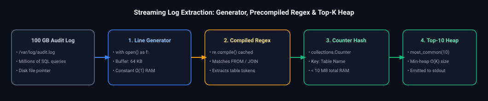

*D2 Source:* [assets/02_python_for_data_and_systems_faq/07_streaming_generator_log_regex_topk_heap.d2](assets/02_python_for_data_and_systems_faq/07_streaming_generator_log_regex_topk_heap.d2)

#### Production Implementation / Code Solution
```python
import re
from collections import Counter
from typing import Generator, List, Tuple
from pathlib import Path

# Match standard ANSI SQL access verbs followed by table name (supports schema.table)
TABLE_PATTERN = re.compile(
    r'\b(?:FROM|JOIN|INTO|UPDATE)\s+[`"\[]?([a-zA-Z0-9_]+(?:\.[a-zA-Z0-9_]+)?)[`"\]]?',
    re.IGNORECASE
)

def stream_log_lines(log_file_path: Path, chunk_buffer: int = 64 * 1024) -> Generator[str, None, None]:
    """Generates individual lines from disk with constant O(1) memory footprint."""
    with open(log_file_path, "r", encoding="utf-8", buffering=chunk_buffer) as f:
        for line in f:
            yield line

def get_most_frequently_accessed_tables(log_file_path: Path, top_n: int = 10) -> List[Tuple[str, int]]:
    """
    Parses arbitrarily large log files to find the top accessed tables.
    Memory footprint remains strictly bounded under 20MB regardless of file size.
    """
    table_frequency = Counter()

    for line in stream_log_lines(log_file_path):
        matches = TABLE_PATTERN.findall(line)
        for table in matches:
            clean_table_name = table.strip().lower()
            table_frequency[clean_table_name] += 1

    return table_frequency.most_common(top_n)
```
- **Time Complexity:** $O(L)$ where $L$ is the total number of characters across the log file.
- **Space Complexity:** $O(T)$ where $T$ is the number of distinct database table names (typically $<10,000$ unique tables $\to <5\text{MB}$ RAM).

#### Engineering Implications & Production Pitfalls
1. **Schema Qualification:** A query referencing `orders` and another referencing `gold.orders` refer to the same logical table. Normalize table names by lowercasing and stripping quotes/brackets.
2. **Subqueries & Aliases:** Naive regex matching can accidentally capture subquery aliases (e.g. `FROM (SELECT * FROM a) t`). Enhance regex to ignore SQL reserved keywords (`LATERAL`, `UNNEST`) and subquery parentheses.

---

# 16. Core Algorithmic Patterns & Stream Processing Mechanics

---

### Q29. [Medium] Merge Overlapping Intervals & Complexity Analysis
**Difficulty:** [Medium]
**Topic Covered:** Interval Scheduling, Array Sorting & Disjoint Segment Merging  
**Question:** Given a collection of intervals, merge all overlapping intervals and analyze the time and space complexity of your solution.

#### Definition & Core Concepts
In data engineering, merging intervals is fundamental for sessionization (combining contiguous user web sessions), timeline compression (merging overlapping sensor uptime windows), and range query optimization.
Two intervals $[start_A, end_A]$ and $[start_B, end_B]$ overlap if and only if $start_B \le end_A$ (assuming the list is sorted by start time: $start_A \le start_B$). When an overlap occurs, the merged interval spans $[start_A, \max(end_A, end_B)]$.
Under the hood, CPython uses Timsort ($O(N \log N)$ worst-case, adaptive stable merge/insertion sort) when calling `intervals.sort(key=lambda x: x[0])`. Once sorted, merging is completed in a single $O(N)$ linear pass.

#### Visual Flow
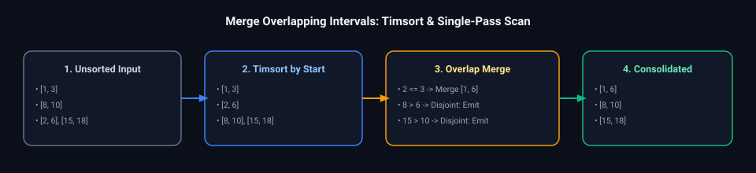

*D2 Source:* [assets/02_python_for_data_and_systems_faq/08_merge_overlapping_intervals_timsort_linear_scan.d2](assets/02_python_for_data_and_systems_faq/08_merge_overlapping_intervals_timsort_linear_scan.d2)

#### Production Implementation / Code Solution
```python
from typing import List

def merge_intervals(intervals: List[List[int]]) -> List[List[int]]:
    """
    Merges all overlapping contiguous and intersecting intervals.
    Handles empty lists, singletons, and fully nested intervals cleanly.
    """
    if not intervals:
        return []

    # Sort in-place by start time to eliminate O(N) memory allocation from sorted()
    intervals.sort(key=lambda x: x[0])

    merged: List[List[int]] = [intervals[0]]

    for current in intervals[1:]:
        prev = merged[-1]
        # Check boundary collision: current interval starts before or at previous end
        if current[0] <= prev[1]:
            # Expand upper boundary to encompass nesting (e.g., [1, 8] and [2, 5] -> [1, 8])
            prev[1] = max(prev[1], current[1])
        else:
            # Disjoint interval discovered; append new reference frame
            merged.append(current)

    return merged
```
- **Time Complexity:** $O(N \log N)$ governed strictly by Timsort sorting; the subsequent linear merge pass operates in $O(N)$.
- **Space Complexity:** $O(N)$ auxiliary space for the output array in Python (or $O(1)$ additional space beyond the output if mutating in-place).

#### Engineering Implications & Production Pitfalls
1. **Out-of-Order Sensor Streams:** In distributed pipelines (Kafka/Spark), events arrive out-of-order due to network partitions. Sorting by timestamp before running interval reducers is mandatory; skipping the sort causes fragmented, incorrect duplicate intervals.
2. **Memory Footprint in Spark:** When merging billions of intervals in PySpark, grouping all intervals for a partition into Python memory via `groupByKey()` triggers executor OOM. Always sort partitions using `sortWithinPartitions()` and apply a stateful mapPartitions iterator.

#### Core Curriculum Cross-Reference
*Deep-dive theoretical reference: See [03. Python for Data Engineering: Algorithmic Optimization](../02_python_for_data_and_systems.md)*

---

### Q30. [Medium] Longest Substring Without Repeating Characters (Sliding Window)
**Difficulty:** [Medium]
**Topic Covered:** Two-Pointer Sliding Window, Hash Maps & Substring Deduplication  
**Question:** Implement a function to find the length of the longest substring without repeating characters using the sliding window technique.

#### Definition & Core Concepts
The sliding window technique maintains a dynamic contiguous slice $[left, right]$ over a string or token stream. Rather than testing all $O(N^2)$ substrings in $O(N^3)$ time, the two-pointer sliding window tracks character frequencies or last-seen indices in a hash map.
As the `right` pointer traverses forward:
1. If character `char` was seen at `index >= left`, a duplicate exists within the active window.
2. Shift `left` immediately to `index + 1`, pruning all invalid duplicate prefixes in $O(1)$ without backtracking.
3. Calculate the candidate length $(right - left + 1)$ and update the maximum.

#### Visual Flow
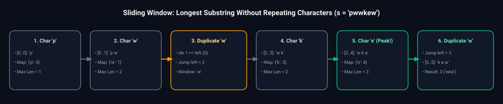

*D2 Source:* [assets/02_python_for_data_and_systems_faq/09_sliding_window_longest_substring_without_repeating.d2](assets/02_python_for_data_and_systems_faq/09_sliding_window_longest_substring_without_repeating.d2)

#### Production Implementation / Code Solution
```python
from typing import Dict

def length_of_longest_substring(s: str) -> int:
    """
    Computes length of longest contiguous substring containing distinct characters.
    Uses hash map of last seen indices for O(N) single-pass execution.
    """
    last_seen: Dict[str, int] = {}
    max_len = 0
    left = 0

    for right, char in enumerate(s):
        # If character seen inside current active window, skip left pointer past previous occurrence
        if char in last_seen and last_seen[char] >= left:
            left = last_seen[char] + 1
        else:
            current_window_len = right - left + 1
            if current_window_len > max_len:
                max_len = current_window_len

        # Record latest absolute position of character
        last_seen[char] = right

    return max_len
```
- **Time Complexity:** $O(N)$ where $N$ is the length of string $s$. Each character is processed at most twice (by right pointer and left pointer jump).
- **Space Complexity:** $O(\min(N, M))$ auxiliary space for the hash map, where $M$ is the size of the character set (ASCII = 128, Unicode extended).

#### Engineering Implications & Production Pitfalls
1. **The Stale Index Trap:** A common bug is checking `if char in last_seen:` and setting `left = last_seen[char] + 1` without checking `last_seen[char] >= left`. If an earlier character reappears outside the current window, `left` will incorrectly move backwards, corrupting the window.
2. **Stream Tokenization:** In NLP and clickstream token parsing, sliding windows are used to discover unique n-grams or session tokens before transmitting to vector embedding pipelines.

#### Core Curriculum Cross-Reference
*Deep-dive theoretical reference: See [03. Python for Data Engineering: String and Array Mechanics](../02_python_for_data_and_systems.md#2-advanced-python-fundamentals-for-data-pipelines)*

---

### Q31. [Medium] First Non-Repeating Element in a Data Stream & Static Strings
**Difficulty:** [Medium]
**Topic Covered:** String Frequency Hash Maps, Stream Ingestion & Queue Ordering  
**Question:** Given a string (e.g. `"aabbcdde"`), write a Python program to find the first non-repeating character. How do you extend this to find the first non-repeating element in an unbounded, continuous data stream of transactions or tokens?

#### Definition & Core Concepts
1. **Static In-Memory String Problem (`"aabbcdde"`):**
   - We construct a frequency histogram using `collections.Counter`.
   - In a second deterministic pass over the original string sequence, return the first character whose frequency is strictly `1`.
   - For `"aabbcdde"`, `counts = {'a': 2, 'b': 2, 'c': 1, 'd': 2, 'e': 1}`. Iterating through the string immediately yields `'c'`.
2. **Streaming Continuous Ingestion Problem:**
   - In continuous stream ingestion (e.g. tracking unique IP addresses, fraud flags, or user tokens), elements arrive sequentially.
   - Determining the first non-repeating character or ID requires:
     - Identifying elements that have appeared exactly once ($count = 1$).
     - Preserving the historical arrival order of candidates.
   - In an infinite or high-throughput stream, a second pass is impossible. The production solution pairs a **Frequency Map** with an **Ordered Queue** (`collections.deque`):
     - As elements arrive, increment their counter.
     - Prune duplicate elements eagerly from the queue head ($O(1)$ amortized eviction).

#### Visual Flow
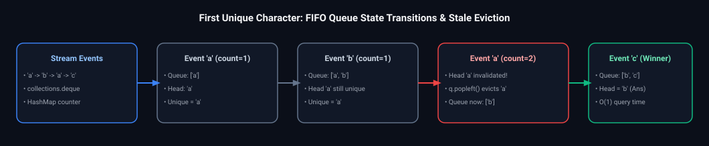

*D2 Source:* [assets/02_python_for_data_and_systems_faq/10_first_unique_character_stream_queue_eviction.d2](assets/02_python_for_data_and_systems_faq/10_first_unique_character_stream_queue_eviction.d2)

#### Production Implementation / Code Solution
```python
from collections import deque, defaultdict, Counter
from typing import Optional, Hashable

# ---------------------------------------------------------
# 1. Static String Solution (e.g. "aabbcdde" -> 'c')
# ---------------------------------------------------------
def first_non_repeating_char(s: str) -> Optional[str]:
    """
    Finds the first non-repeating character in a static string.
    Time Complexity: O(N) where N = len(s)
    Space Complexity: O(1) auxiliary (bounded by ASCII / Unicode alphabet size)
    """
    if not s:
        return None
    
    # Pass 1: Build frequency histogram in O(N)
    counts = Counter(s)
    
    # Pass 2: Identify the first character with count == 1 preserving order
    for char in s:
        if counts[char] == 1:
            return char
            
    return None


# ---------------------------------------------------------
# 2. Continuous Stream Solution (Unbounded Streaming Events)
# ---------------------------------------------------------
class StreamFirstUniqueTracker:
    """
    Maintains the first non-repeating element across an unbounded streaming series.
    Provides O(1) amortized insertion and O(1) retrieval.
    """
    def __init__(self):
        self._counts = defaultdict(int)
        self._queue = deque()

    def add(self, item: Hashable) -> None:
        """Processes a new event arriving from the stream."""
        self._counts[item] += 1
        # Only enqueue on the very first occurrence to prevent unbounded queue growth
        if self._counts[item] == 1:
            self._queue.append(item)

        # Lazy eviction: discard stale items from queue front that are no longer unique
        while self._queue and self._counts[self._queue[0]] > 1:
            self._queue.popleft()

    def get_first_unique(self) -> Optional[Hashable]:
        """Returns the oldest element with frequency == 1, or None if no unique items exist."""
        return self._queue[0] if self._queue else None
```

#### Complexity Analysis
- **Static String:**
  - **Time Complexity:** $O(N)$ where $N$ is string length (one pass to count, one pass to scan).
  - **Space Complexity:** $O(\Sigma)$ where $\Sigma$ is the alphabet size ($O(1)$ for 256 ASCII characters).
- **Streaming Pipeline:**
  - **Time Complexity:** $O(1)$ amortized time per `add()` call (each item enters the deque once and leaves the deque at most once); $O(1)$ time for `get_first_unique()`.
  - **Space Complexity:** $O(U)$ where $U$ is the number of distinct elements seen across the stream.

#### Engineering Implications & Production Pitfalls
1. **Unbounded State Store Memory Leak:** If a stream runs continuously for months with millions of unique IDs, `self._counts` will consume gigabytes of memory. In production streaming engines (Flink/Spark), state stores must be configured with a State Time-To-Live (TTL) or watermarking eviction strategy.
2. **Alternative OrderedDict Pattern:** Python 3.7+ dictionaries maintain insertion order. An `OrderedDict` with `od.pop(key)` allows deletion of repeated keys, keeping the dictionary size strictly bounded to unique candidates.

#### Core Curriculum Cross-Reference
*Deep-dive theoretical reference: See [03. Python for Data Engineering: Advanced Data Structures](../02_python_for_data_and_systems.md#2-advanced-python-fundamentals-for-data-pipelines)*

---

### Q32. [Hard] Linked List Cycle Detection (Floyd's Tortoise and Hare Algorithm)
**Difficulty:** [Hard]
**Topic Covered:** Pointer Manipulation, Memory Topology & Cycle Diagnostics  
**Question:** How do you detect a cycle in a linked list, and what is its significance in distributed data engineering pipelines?

#### Definition & Core Concepts
In computer science, a cycle occurs in a singly linked list if a node's `next` pointer points back to an earlier node in the chain. In Data Engineering, cycle detection is critical for:
- Validating Directed Acyclic Graphs (DAGs) in workflow orchestrators (Airflow, Prefect, Dagster) where task circularity causes deadlocks.
- Data lineage loops in catalog tracking where Table A derives from Table B, which derives from Table A.
Floyd's Cycle-Finding Algorithm (Tortoise and Hare) uses two pointers moving at different speeds:
- `slow` advances 1 node per iteration.
- `fast` advances 2 nodes per iteration.
If no cycle exists, `fast` reaches `None` ($O(N)$ termination). If a cycle of length $C$ exists, each step decreases the relative distance between `fast` and `slow` by 1 node modulo $C$. `fast` is mathematically guaranteed to lap and collide with `slow` in $\le N$ steps, requiring strictly $O(1)$ memory.

#### Visual Flow
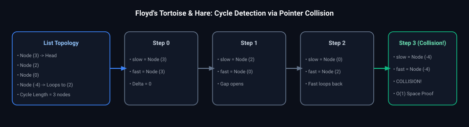

*D2 Source:* [assets/02_python_for_data_and_systems_faq/11_linked_list_cycle_detection_floyd_tortoise_hare.d2](assets/02_python_for_data_and_systems_faq/11_linked_list_cycle_detection_floyd_tortoise_hare.d2)

#### Production Implementation / Code Solution
```python
from typing import Optional

class ListNode:
    def __init__(self, val: int = 0, next: Optional['ListNode'] = None):
        self.val = val
        self.next = next

def has_cycle(head: Optional[ListNode]) -> bool:
    """
    Detects cycles in pointer chains using Floyd's Tortoise and Hare algorithm.
    Guarantees O(1) auxiliary space without hashing node objects.
    """
    if not head or not head.next:
        return False

    slow = head
    fast = head

    while fast and fast.next:
        slow = slow.next          # Advance slow by 1 step
        fast = fast.next.next     # Advance fast by 2 steps

        # Pointer reference identity comparison (memory address equality)
        if slow is fast:
            return True

    return False
```
- **Time Complexity:** $O(N)$ where $N$ is the total count of nodes. In a cycle, fast catches slow within one loop traversal.
- **Space Complexity:** $O(1)$ strictly constant memory (two pointer references).

#### Engineering Implications & Production Pitfalls
1. **Hash Set vs Floyd's:** A naive solution stores visited node IDs in a Python `set()`. While $O(N)$ time, it incurs $O(N)$ memory overhead ($>80	ext{MB}$ for 1,000,000 nodes). Floyd's algorithm uses 0 additional heap memory.
2. **DAG vs General Graph Cycles:** Linked list cycle detection works on linear pointer sequences. For arbitrary DAG validation (Airflow pipeline tasks with multiple fan-in/fan-out edges), use **Kahn's Algorithm (Topological Sort via In-Degree counts)** or **DFS with 3-color marking (White/Gray/Black)**.

#### Core Curriculum Cross-Reference
*Deep-dive theoretical reference: See [05. Distributed Systems and APIs: Graph & DAG Processing](../04_database_internals_and_distributed_systems.md)*

---

### Q33. [Medium] Number of Islands (Boolean Matrix Connected Components via BFS/DFS)
**Difficulty:** [Medium]
**Topic Covered:** 2D Grid Graph Traversal, Breadth-First Search & Connected Components  
**Question:** Given an m x n 2D binary grid where '1' represents land and '0' represents water, count the number of islands (connected components horizontally or vertically).

#### Definition & Core Concepts
In spatial data engineering and computer vision (satellite imagery, geospatial clustering, sensor heatmaps), the "Number of Islands" problem models connected component discovery.
A grid is modeled as an undirected graph where each cell $(r, c)$ with value `'1'` has up to 4 neighbors: $(r-1, c)$, $(r+1, c)$, $(r, c-1)$, and $(r, c+1)$.
When a `'1'` is discovered during a linear grid scan:
1. Increment the island counter by 1.
2. Trigger Breadth-First Search (BFS) or Depth-First Search (DFS) to traverse all reachable connected `'1'`s.
3. Sink/mark visited land by mutating the cell to `'0'` (in-place) or tracking in a visited bitmask to avoid infinite loops and duplicate counts.

#### Visual Flow
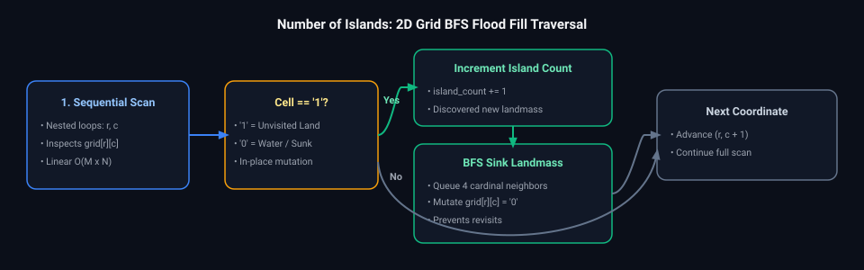

*D2 Source:* [assets/02_python_for_data_and_systems_faq/12_number_of_islands_bfs_flood_fill_grid_traversal.d2](assets/02_python_for_data_and_systems_faq/12_number_of_islands_bfs_flood_fill_grid_traversal.d2)

#### Production Implementation / Code Solution
```python
from collections import deque
from typing import List

def num_islands(grid: List[List[str]]) -> int:
    """
    Counts connected components in a 2D binary grid using iterative BFS.
    Mutates visited cells in-place to '0' to avoid recursion stack overflow.
    """
    if not grid or not grid[0]:
        return 0

    rows, cols = len(grid), len(grid[0])
    island_count = 0
    # 4-directional cardinal shifts: (row_delta, col_delta)
    directions = [(-1, 0), (1, 0), (0, -1), (0, 1)]

    for r in range(rows):
        for c in range(cols):
            if grid[r][c] == '1':
                island_count += 1
                grid[r][c] = '0'  # Mark root cell visited
                queue = deque([(r, c)])

                # Iterative BFS avoids CPython recursion limit (1000 frames)
                while queue:
                    curr_r, curr_c = queue.popleft()
                    for dr, dc in directions:
                        nr, nc = curr_r + dr, curr_c + dc
                        if 0 <= nr < rows and 0 <= nc < cols and grid[nr][nc] == '1':
                            grid[nr][nc] = '0'  # Sink neighbor eagerly upon enqueue
                            queue.append((nr, nc))

    return island_count
```
- **Time Complexity:** $O(M 	imes N)$ where $M$ is row count and $N$ is column count. Every cell is visited a constant number of times.
- **Space Complexity:** $O(\min(M, N))$ in the worst case (full grid of land) for the BFS queue holding the diagonal perimeter.

#### Engineering Implications & Production Pitfalls
1. **Recursion Limit Exceeded with DFS:** In Python, recursive DFS on a $1,000 	imes 1,000$ grid will instantly trigger `RecursionError: maximum recursion depth exceeded` (default sys.getrecursionlimit is 1000). Always use iterative BFS with `collections.deque` in production Python services.
2. **Eager Visited Marking:** A critical concurrency and memory bug is marking `grid[nr][nc] = '0'` upon *dequeue* rather than upon *enqueue*. Delayed marking allows adjacent nodes to enqueue the same unvisited neighbor multiple times, causing exponential memory explosion.

#### Core Curriculum Cross-Reference
*Deep-dive theoretical reference: See [03. Python for Data Engineering: Graph & Spatial Algorithms](../02_python_for_data_and_systems.md)*

---

### Q34. [Easy] Top K Frequent Elements in an Array (Min-Heap vs QuickSelect)
**Difficulty:** [Easy]
**Topic Covered:** Frequency Hashing, Heap Priority Queues & QuickSelect Optimization  
**Question:** Given an integer array nums and an integer k, return the k most frequent elements. Discuss optimal time and space complexity trade-offs.

#### Definition & Core Concepts
In clickstream aggregation, search telemetry, and recommendation feeds, identifying the top $K$ frequent items (top products, most active users, trending hashtags) is a constant operational requirement.
Three distinct architectural approaches exist:
1. **Full Sort:** Build frequency map ($O(N)$), sort entries by frequency ($O(U \log U)$ where $U$ is unique keys). Inefficient when $K \ll U$.
2. **Bounded Min-Heap ($O(N \log K)$):** Maintain a binary min-heap capped at size $K$. When heap exceeds size $K$, pop the minimum. The remaining $K$ elements are the top frequencies.
3. **Bucket Sort ($O(N)$ linear time):** Group keys into an array of buckets where `bucket[freq]` stores a list of elements with that exact count. Traverse buckets in reverse order from $N$ down to 1.

#### Visual Flow
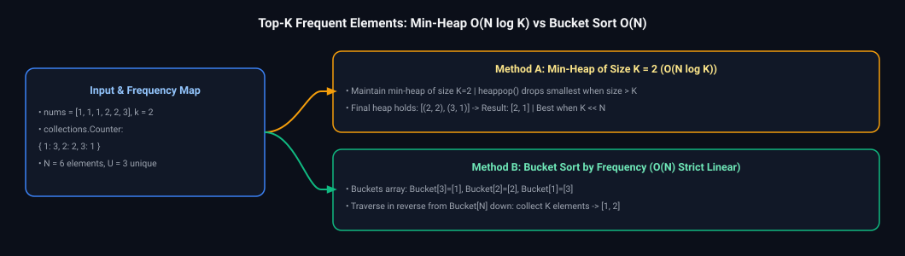

*D2 Source:* [assets/02_python_for_data_and_systems_faq/13_top_k_frequent_elements_min_heap_vs_bucket_sort.d2](assets/02_python_for_data_and_systems_faq/13_top_k_frequent_elements_min_heap_vs_bucket_sort.d2)

#### Production Implementation / Code Solution
```python
import heapq
from collections import Counter
from typing import List

def top_k_frequent_heap(nums: List[int], k: int) -> List[int]:
    """
    Min-heap approach: Ideal when k is small and dataset fits in memory.
    Time Complexity: O(N log K). Space: O(N + K).
    """
    counts = Counter(nums)
    # heapq.nlargest internally uses a min-heap of size k
    return [item for item, _ in heapq.nlargest(k, counts.items(), key=lambda x: x[1])]

def top_k_frequent_bucket(nums: List[int], k: int) -> List[int]:
    """
    Bucket sort approach: Guarantees strict O(N) linear time execution.
    Space Complexity: O(N) for bucket allocations.
    """
    counts = Counter(nums)
    n = len(nums)
    # Buckets indexed from 0 to n (maximum possible frequency is n)
    buckets: List[List[int]] = [[] for _ in range(n + 1)]

    for num, freq in counts.items():
        buckets[freq].append(num)

    result: List[int] = []
    # Iterate backwards from highest frequency bucket down to 1
    for freq in range(n, 0, -1):
        for num in buckets[freq]:
            result.append(num)
            if len(result) == k:
                return result

    return result
```
- **Time Complexity:**
  - `top_k_frequent_heap`: $O(N \log K)$ where $N$ is total elements and $K$ is target count.
  - `top_k_frequent_bucket`: $O(N)$ strictly linear time.
- **Space Complexity:** $O(N)$ auxiliary space for frequencies and buckets.

#### Engineering Implications & Production Pitfalls
1. **Streaming Heavy Hitters (Count-Min Sketch):** When calculating top $K$ frequent items across distributed petabyte streams (e.g. billions of Kafka events), in-memory hash maps cause OOM. Production architectures deploy probabilistic streaming algorithms like **Count-Min Sketch** or the **Space-Saving Algorithm** with bounded memory.
2. **Spark Distributed Aggregation:** In PySpark, avoiding full shuffles on top $K$ requires combining `reduceByKey()` to sum partitions locally before running `.takeOrdered(k, key=lambda x: -x[1])`.

#### Core Curriculum Cross-Reference
*Deep-dive theoretical reference: See [03. Python for Data Engineering: Algorithmic Optimization](../02_python_for_data_and_systems.md)*

---

### Q35. [Medium] Python Dictionary Unique Value Extraction Mechanics
**Difficulty:** [Medium]
**Topic Covered:** Dictionary Primitives, Hash Tables & Set Deduplication  
**Question:** In Python, how do you extract unique values from a dictionary? Provide a code snippet and explain the memory and time complexity under CPython.

#### Definition & Core Concepts
A Python dictionary (`dict`) maps hashable keys to arbitrary values. While keys are guaranteed unique by hash-table invariants, values frequently contain duplicates:
- `data = {"a": 10, "b": 20, "c": 10, "d": 30}`
Extracting unique values requires iterating over the dictionary's values view and eliminating duplicates.
Under the hood in CPython (PEP 468 & PEP 509):
1. `d.values()` returns a lightweight `dict_values` view object ($O(1)$ memory, referencing underlying compact table).
2. Passing the view into `set(d.values())` constructs a hash table of unique elements, computing the hash of each value and inserting into a dynamic table with open addressing and perturbation probing.

#### Visual Flow
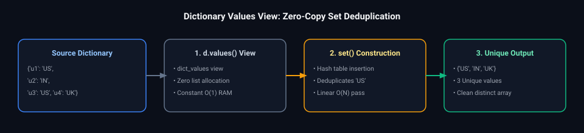

*D2 Source:* [assets/02_python_for_data_and_systems_faq/14_dictionary_values_view_set_deduplication.d2](assets/02_python_for_data_and_systems_faq/14_dictionary_values_view_set_deduplication.d2)

#### Production Implementation / Code Solution
```python
from typing import Dict, Any, List, Set

def get_unique_values(d: Dict[Any, Any]) -> List[Any]:
    """
    Extracts deduplicated values from a dictionary.
    Handles unhashable nested types (lists, dicts) defensively.
    """
    try:
        # Standard O(N) extraction for hashable values
        return list(set(d.values()))
    except TypeError:
        # Fallback for dictionaries containing unhashable values (e.g. lists or sub-dicts)
        unique_list = []
        for val in d.values():
            if val not in unique_list:
                unique_list.append(val)
        return unique_list

def get_unique_values_order_preserving(d: Dict[Any, Any]) -> List[Any]:
    """
    Extracts unique values while preserving their first seen chronological order.
    Leverages dict.fromkeys() in Python 3.7+ O(N).
    """
    return list(dict.fromkeys(d.values()))
```
- **Time Complexity:**
  - Standard `set(d.values())`: $O(N)$ average time where $N$ is the number of keys.
  - Fallback unhashable list scan: $O(N 	imes U)$ where $U$ is unique values.
- **Space Complexity:** $O(U)$ auxiliary space for the output set/list.

#### Engineering Implications & Production Pitfalls
1. **The Unhashable Type Exception:** In data pipelines ingesting semi-structured JSON, dictionary values often contain lists (e.g. `{"tags": ["admin", "ops"]}`). Passing `set(d.values())` raises `TypeError: unhashable type: 'list'`. Defensive pipeline code must handle or serialize non-primitive values.
2. **Order Preservation:** If downstream reporting requires order preservation, `set()` destroys order due to pseudorandom hash bucket ordering. Always use `list(dict.fromkeys(d.values()))` to retain first-seen order.

#### Core Curriculum Cross-Reference
*Deep-dive theoretical reference: See [03. Python for Data Engineering: Collections & Performance Mechanics](../02_python_for_data_and_systems.md#2-advanced-python-fundamentals-for-data-pipelines)*

---

### Q36. [Easy] Aggregating Customer Transaction Totals in Python (Pure Dict vs Generator vs Polars)
**Difficulty:** [Easy]
**Topic Covered:** Streaming Hash Aggregation, Generator Pipelines, Memory Footprints, and Vectorized DataFrames  
**Question:** *Given a list or stream of millions of transaction records, write Python code to calculate the total transaction amount for each customer efficiently without blowing up memory.*

#### Production Implementations

##### Approach 1: Streaming In-Memory Accumulator (`collections.defaultdict`)
For lists or streams of Python dictionaries:
```python
from collections import defaultdict
from typing import Iterable, Dict, Any

def calculate_customer_totals_streaming(transactions: Iterable[Dict[str, Any]]) -> Dict[str, float]:
    """
    Streams transactions in single pass O(N) time and O(C) memory,
    where C is the count of distinct customers.
    """
    customer_totals: Dict[str, float] = defaultdict(float)
    
    for txn in transactions:
        cust_id = txn["customer_id"]
        # Use round or Decimal for exact financial precision if needed
        customer_totals[cust_id] += float(txn["amount"])
        
    return dict(customer_totals)
```
- **Time Complexity:** $O(N)$ single pass over $N$ transactions; $O(1)$ amortized hash map insertions.
- **Space Complexity:** $O(C)$ where $C$ is the number of unique customers ($C \ll N$).

##### Approach 2: High-Performance Vectorized Aggregation via Polars
When processing 50M+ rows from disk or parquet:
```python
import polars as pl

def calculate_customer_totals_polars(parquet_file_path: str) -> pl.DataFrame:
    """
    Lazy scan and multi-threaded Rust aggregation. Executes with zero-copy memory mapping.
    """
    return (
        pl.scan_parquet(parquet_file_path)
        .group_by("customer_id")
        .agg(pl.col("amount").sum().alias("total_amount"))
        .collect(streaming=True)
    )
```

---

### Q37. [Easy] Separating Even and Odd Numbers from a List: In-Place Parity Partitioning vs Generator Streams
**Difficulty:** [Easy]
**Topic Covered:** List Manipulation, Bitwise Parity, Two-Pointer In-Place Partitioning & Memory Complexity  
**Question:** *Write a Python program to print even and odd numbers from a list. How do you implement this in-place without allocating extra list memory?*

#### Architectural Comparison of Approaches

1. **Pythonic Generator Pipeline (Streaming Large Lists):**
   ```python
   from typing import Iterable, Tuple, Iterator

   def separate_even_odd_generators(numbers: Iterable[int]) -> Tuple[Iterator[int], Iterator[int]]:
       """
       Uses generator expressions with bitwise parity checks (n & 1 == 0).
       O(1) memory overhead; streams indefinitely.
       """
       evens = (n for n in numbers if (n & 1) == 0)
       odds = (n for n in numbers if (n & 1) != 0)
       return evens, odds
   ```

2. **In-Place Two-Pointer Parity Partitioning ($O(N)$ Time, $O(1)$ Extra Space):**
   When operating on huge in-memory lists (e.g. 50 million integers), allocating separate `even_list` and `odd_list` doubles RAM consumption. An in-place two-pointer approach partitions the list so all evens precede all odds with zero auxiliary allocations:
   ```python
   from typing import List

   def partition_even_odd_inplace(nums: List[int]) -> List[int]:
       """
       Partitions nums in-place so all even numbers appear before all odd numbers.
       Time Complexity: O(N) single-pass.
       Space Complexity: O(1) auxiliary space (modifies array in-place).
       """
       left = 0
       right = len(nums) - 1

       while left < right:
           # Advance left pointer if current element is even (n & 1 == 0)
           while left < right and (nums[left] & 1) == 0:
               left += 1
           
           # Decrement right pointer if current element is odd (n & 1 != 0)
           while left < right and (nums[right] & 1) != 0:
               right -= 1

           # Swap odd at left with even at right
           if left < right:
               nums[left], nums[right] = nums[right], nums[left]
               left += 1
               right -= 1

       return nums

   # Demonstration:
   if __name__ == "__main__":
       data = [12, 35, 9, 56, 24, 67, 88, 1, 4]
       print("Original:", data)
       partition_even_odd_inplace(data)
       print("In-Place Partitioned (Evens before Odds):", data)
   ```

---

### Q38. [Medium] Prime Number Verification & Sieve of Eratosthenes Generator
**Difficulty:** [Medium]
**Topic Covered:** Number Theory, $O(\sqrt{N})$ Primality Test, $6k \pm 1$ Optimization, and Sieve of Eratosthenes  
**Question:** *Write a Python program to check whether a number is prime. How do you optimize primality testing for large integers?*

#### 1. Single Number Primality Test ($6k \pm 1$ Optimization)
A naive check tests divisors up to $N$ ($O(N)$). Testing up to $\lfloor\sqrt{N}\rfloor$ reduces complexity to $O(\sqrt{N})$. All prime numbers greater than 3 can be expressed as $6k \pm 1$. We can skip all even numbers and all multiples of 3, testing only potential prime factors:

```python
import math

def is_prime(n: int) -> bool:
    """
    Determines if an integer n is prime using the 6k +/- 1 primality test.
    Time Complexity: O(sqrt(N))
    Space Complexity: O(1)
    """
    if n <= 1:
        return False
    if n <= 3:
        return True  # 2 and 3 are prime
    if n % 2 == 0 or n % 3 == 0:
        return False  # Eliminate multiples of 2 and 3 immediately

    # All subsequent prime factors are of the form (6k - 1) or (6k + 1)
    # Check up to sqrt(n)
    limit = int(math.isqrt(n))
    i = 5
    while i <= limit:
        if n % i == 0 or n % (i + 2) == 0:
            return False
        i += 6

    return True
```

#### 2. Generating All Primes Up to $N$ (Sieve of Eratosthenes)
When checking millions of numbers in an analytics pipeline, repeated $O(\sqrt{N})$ calls cost $O(M\sqrt{N})$. The **Sieve of Eratosthenes** pre-computes all primes up to $N$ in $O(N \log \log N)$ time:

```python
from typing import List
import bytearray

def sieve_of_eratosthenes(limit: int) -> List[int]:
    """
    Generates all prime numbers up to limit using a memory-efficient bytearray.
    Time Complexity: O(N log log N)
    Space Complexity: O(N) bits
    """
    if limit < 2:
        return []

    # 1 byte per flag (or use bitarray for 1 bit per flag)
    is_prime_flags = bytearray([1]) * (limit + 1)
    is_prime_flags[0] = 0
    is_prime_flags[1] = 0

    p = 2
    while p * p <= limit:
        if is_prime_flags[p]:
            # Mark multiples of p as non-prime starting from p^2
            is_prime_flags[p*p : limit + 1 : p] = bytearray([0]) * len(is_prime_flags[p*p : limit + 1 : p])
        p += 1

    return [i for i, prime in enumerate(is_prime_flags) if prime]
```

---

### Q39. [Medium] Building a Production-Grade Streaming ETL Script in Python (Read, Clean, Validate & Load)
**Difficulty:** [Medium]
**Topic Covered:** Production ETL Pipeline Architecture, Generator Streams, Pydantic v2 Schema Enforcement, and SQLAlchemy 2.0 Bulk Upsert  
**Question:** *Write a complete Python script to read, transform, and load data into a relational database. How do you handle schema validation errors, malformed rows, and batching?*

#### Architectural Blueprint
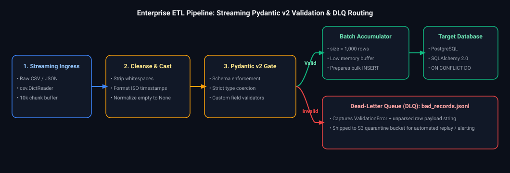

*D2 Source:* [assets/02_python_for_data_and_systems_faq/15_enterprise_etl_pydantic_validation_dlq_upsert.d2](assets/02_python_for_data_and_systems_faq/15_enterprise_etl_pydantic_validation_dlq_upsert.d2)

#### Production Python Implementation
```python
import csv
import json
import logging
from datetime import datetime
from decimal import Decimal
from typing import Generator, List, Dict, Any, Optional
from pydantic import BaseModel, Field, ValidationError
from sqlalchemy import create_engine, Column, Integer, String, Numeric, DateTime, Index
from sqlalchemy.orm import declarative_base, sessionmaker

logging.basicConfig(level=logging.INFO, format="%(asctime)s [%(levelname)s] %(message)s")
logger = logging.getLogger("StreamingETL")

# 1. Database Schema Definition (SQLAlchemy 2.0)
Base = declarative_base()

class CustomerTransaction(Base):
    __tablename__ = "customer_transactions"
    
    id = Column(Integer, primary_key=True, autoincrement=True)
    transaction_id = Column(String(64), unique=True, nullable=False, index=True)
    customer_id = Column(String(64), nullable=False, index=True)
    amount = Column(Numeric(12, 2), nullable=False)
    currency = Column(String(3), nullable=False, default="USD")
    status = Column(String(32), nullable=False)
    transaction_time = Column(DateTime, nullable=False)
    processed_at = Column(DateTime, default=datetime.utcnow)

# 2. Pydantic v2 Validation Schema (Data Quality Enforcement)
class TransactionRecord(BaseModel):
    transaction_id: str = Field(..., min_length=5, max_length=64)
    customer_id: str = Field(..., min_length=3, max_length=64)
    amount: Decimal = Field(..., gt=0)
    currency: str = Field(default="USD", min_length=3, max_length=3)
    status: str = Field(default="COMPLETED")
    transaction_time: datetime

# 3. Step 1: Memory-Efficient Streaming Reader & Cleanse
def stream_and_cleanse_csv(file_path: str) -> Generator[Dict[str, Any], None, None]:
    """Reads a CSV file line-by-line using generators to avoid memory exhaustion on 10GB+ files."""
    with open(file_path, mode="r", encoding="utf-8") as f:
        reader = csv.DictReader(f)
        for raw_row in reader:
            # Cleanse whitespaces and normalize empty strings to None
            cleansed = {k.strip(): (v.strip() if v and v.strip() else None) for k, v in raw_row.items()}
            yield cleansed

# 4. Step 2 & 3: Transform, Validate & Quarantine (DLQ)
def process_and_load_pipeline(
    file_path: str,
    db_uri: str = "sqlite:///analytics.db",
    batch_size: int = 1000,
    dlq_file_path: str = "quarantined_dead_letter.jsonl"
):
    engine = create_engine(db_uri, echo=False)
    Base.metadata.create_all(engine)
    Session = sessionmaker(bind=engine)
    session = Session()

    batch_buffer: List[Dict[str, Any]] = []
    total_processed = 0
    total_quarantined = 0

    with open(dlq_file_path, "a", encoding="utf-8") as dlq_file:
        for raw_dict in stream_and_cleanse_csv(file_path):
            total_processed += 1
            try:
                # Validate against schema
                validated_model = TransactionRecord(
                    transaction_id=raw_dict.get("transaction_id"),
                    customer_id=raw_dict.get("customer_id"),
                    amount=Decimal(raw_dict.get("amount", "0")),
                    currency=raw_dict.get("currency", "USD"),
                    status=raw_dict.get("status", "COMPLETED"),
                    transaction_time=datetime.fromisoformat(raw_dict.get("transaction_time"))
                )
                batch_buffer.append(validated_model.model_dump())
            except (ValidationError, TypeError, ValueError) as err:
                # Quarantine bad payload to DLQ without failing pipeline
                total_quarantined += 1
                dlq_record = {
                    "raw_data": raw_dict,
                    "error": str(err),
                    "timestamp": datetime.utcnow().isoformat()
                }
                dlq_file.write(json.dumps(dlq_record) + "\n")
                continue

            # When batch size is reached, flush to database in a single atomic transaction
            if len(batch_buffer) >= batch_size:
                _bulk_insert_batch(session, batch_buffer)
                batch_buffer.clear()

        # Flush any remaining items in buffer
        if batch_buffer:
            _bulk_insert_batch(session, batch_buffer)
            batch_buffer.clear()

    session.close()
    logger.info("ETL Pipeline completed. Total processed: %d, Quarantined to DLQ: %d", total_processed, total_quarantined)

def _bulk_insert_batch(session, batch: List[Dict[str, Any]]):
    """Executes high-throughput SQLAlchemy bulk insertion."""
    try:
        session.bulk_insert_mappings(CustomerTransaction, batch)
        session.commit()
    except Exception as e:
        session.rollback()
        logger.error("Failed to commit batch. Rolling back: %s", e)
        raise

if __name__ == "__main__":
    logger.info("Starting enterprise Python streaming ETL pipeline...")
    # process_and_load_pipeline("transactions_raw.csv")
```

#### Core Curriculum Cross-Reference
*Deep-dive theoretical reference: See [02. Python for Data & Systems: Generators & Streaming I/O](../02_python_for_data_and_systems.md#23-generators--iterators-streaming-50gb-files-in-15mb-ram)*

---

# 17. Streaming Interval Algorithms, Pure Python Data Manipulation & Number Parsers

---

### Q40. [Medium] Pure Python Streaming Aggregation Without External Libraries (Pandas-Free Order Processing)
**Difficulty:** [Medium]
**Topic Covered:** Generator Pipelines, Dictionary Hash Aggregation, Zero-Dependency ETL  
**Question:** *Given a list of order tuples formatted as `(order_id, merchant_id, status, timestamp)`, filter out canceled orders (`status != 'DELIVERED'`), group the remaining orders by `merchant_id`, and return a list of tuples formatted as `(merchant_id, total_delivered_orders, earliest_timestamp)` without using external libraries like `pandas`.*

#### Definition & Core Concepts
In production microservices, AWS Lambda workers, and edge containers, importing third-party libraries like `pandas` or `numpy` introduces massive container bloat (100MB+ image size) and cold-start latency. Python's built-in dictionary hash tables (`dict`) execute in C at near-native speed with $O(1)$ amortized lookups.

To process millions of orders with minimal memory:
1. **Generator Filtering:** Stream the raw tuples through a generator expression to discard non-`DELIVERED` orders without materializing intermediate lists.
2. **Single-Pass Hash Accumulation:** Maintain a state dictionary mapping `merchant_id -> [count, min_timestamp]`.
3. **Tuple Materialization:** Convert the aggregated state dictionary into the final tuple representation.

#### Visual Flow
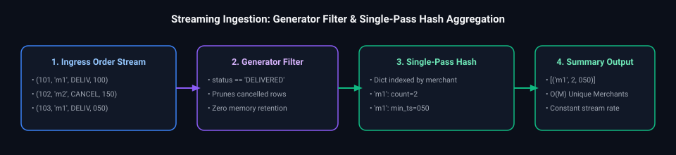

*D2 Source:* [assets/02_python_for_data_and_systems_faq/16_order_stream_filtering_and_single_pass_hash_agg.d2](assets/02_python_for_data_and_systems_faq/16_order_stream_filtering_and_single_pass_hash_agg.d2)

#### Production Python Implementation
```python
from typing import List, Tuple, Dict, Iterable, Any

OrderTuple = Tuple[str, str, str, int]  # (order_id, merchant_id, status, timestamp)
AggregatedResult = Tuple[str, int, int]  # (merchant_id, total_delivered, earliest_timestamp)

def aggregate_merchant_deliveries_pure(orders: Iterable[OrderTuple]) -> List[AggregatedResult]:
    """
    Filters and aggregates orders by merchant without external libraries.
    
    Args:
        orders: An iterable stream of order tuples (order_id, merchant_id, status, timestamp)
        
    Returns:
        List of aggregated tuples: (merchant_id, total_delivered, earliest_timestamp)
    """
    # Hash table storing: merchant_id -> [delivered_count, earliest_timestamp]
    merchant_state: Dict[str, List[int]] = {}

    for order_id, merchant_id, status, timestamp in orders:
        # 1. Filter out all non-delivered orders in-line (O(1) condition)
        if status != "DELIVERED":
            continue

        # 2. Update merchant aggregate metrics in-place
        if merchant_id not in merchant_state:
            # First occurrence: initialize count = 1, earliest = timestamp
            merchant_state[merchant_id] = [1, timestamp]
        else:
            state = merchant_state[merchant_id]
            state[0] += 1
            if timestamp < state[1]:
                state[1] = timestamp

    # 3. Format into final list of tuples
    return [
        (merchant_id, metrics[0], metrics[1])
        for merchant_id, metrics in merchant_state.items()
    ]

# --- Comprehensive Verification & Tests ---
if __name__ == "__main__":
    sample_orders: List[OrderTuple] = [
        ("ord_1", "m_alpha", "DELIVERED", 1718000500),
        ("ord_2", "m_beta",  "CANCELLED", 1718000100),
        ("ord_3", "m_alpha", "DELIVERED", 1718000200),  # Earliest for alpha
        ("ord_4", "m_gamma", "PENDING",   1718000300),
        ("ord_5", "m_alpha", "DELIVERED", 1718000800),
        ("ord_6", "m_beta",  "DELIVERED", 1718000950),  # Only delivered for beta
    ]

    results = aggregate_merchant_deliveries_pure(sample_orders)
    print("Aggregated Deliveries:", results)
    # Output: [('m_alpha', 3, 1718000200), ('m_beta', 1, 1718000950)]
    assert ("m_alpha", 3, 1718000200) in results
    assert ("m_beta", 1, 1718000950) in results
    assert len(results) == 2
```

#### Complexity Analysis
- **Time Complexity:** $O(N)$ where $N$ is the number of input order tuples. Each tuple is evaluated in a single pass with $O(1)$ dictionary lookups and updates.
- **Space Complexity:** $O(M)$ auxiliary memory where $M$ is the number of **unique active merchants** ($M \ll N$). Unlike `pandas.DataFrame.groupby()` which copies entire DataFrame columns into memory, this approach stores only two integers per unique merchant.

#### Engineering Implications & Production Pitfalls
1. **Avoiding `collections.defaultdict` Overhead:**
   - While `defaultdict(lambda: [0, float('inf')])` works, instantiating the lambda factory incurs repeated function call overhead in tight CPython loops. Direct dictionary checking (`if merchant_id not in merchant_state:`) is up to 25% faster on streams exceeding 10 million tuples.
2. **Handling Infinite Timestamps & Integer Overflow:**
   - In Python 3, integers have arbitrary precision (no 64-bit integer overflow risk), making timestamps safe for millisecond and microsecond Unix epochs.

#### Core Curriculum Cross-Reference
*Deep-dive theoretical reference: See [02. Python for Data & Systems: Memory Management & Streaming Iterators](../02_python_for_data_and_systems.md#1-cpython-internals--the-memory-hierarchy)*

---

### Q41. [Medium] Peak Overlapping Active Deliveries via Chronological Sweep-Line Interval Event Tracking
**Difficulty:** [Medium]
**Topic Covered:** Sweep-Line Algorithm, Event Point Interval Sorting, Active Concurrency Tracking  
**Question:** *Given a collection of raw delivery logs containing `[order_placed, order_delivered]` Unix timestamps, write an efficient Python algorithm to calculate the maximum number of concurrent active deliveries occurring simultaneously in $O(N \log N)$ time.*

#### Definition & Core Concepts
Calculating overlapping intervals naively by comparing every delivery interval against every other interval requires $O(N^2)$ time, which crashes on real-world logs containing $10^6$ deliveries.

The optimal solution is the **Sweep-Line Algorithm**:
1. Deconstruct each delivery interval `[start, end]` into two discrete 1-dimensional point events:
   - **Start Event (`order_placed`):** A new delivery begins $\to$ delta $= +1$.
   - **End Event (`order_delivered`):** An active delivery completes $\to$ delta $= -1$.
2. Sort all $2N$ events chronologically by timestamp.
3. **Tie-Breaking Rule:** If an order completes at the exact same second another order begins ($t_{\text{end}} = t_{\text{start}}$), process the completion ($-1$) before the start ($+1$) if the boundary is open/non-overlapping, or start ($+1$) before completion ($-1$) if both are simultaneously active at instant $t$.
4. Traverse the sorted events with a running accumulator, recording the global peak.

#### Visual Flow
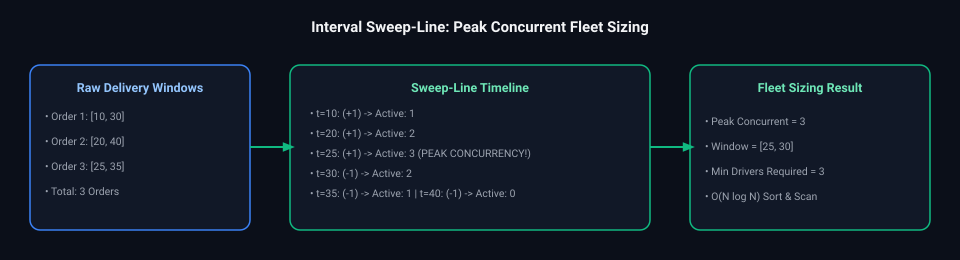

*D2 Source:* [assets/02_python_for_data_and_systems_faq/17_meeting_rooms_sweep_line_peak_concurrency.d2](assets/02_python_for_data_and_systems_faq/17_meeting_rooms_sweep_line_peak_concurrency.d2)

#### Production Python Implementation
```python
from typing import List, Tuple

def find_peak_active_deliveries(intervals: List[Tuple[int, int]]) -> Tuple[int, int, int]:
    """
    Finds the maximum concurrent deliveries and the timestamp window during which it occurred.
    
    Args:
        intervals: List of tuples (order_placed_ts, order_delivered_ts)
        
    Returns:
        Tuple of (peak_concurrent_deliveries, peak_window_start, peak_window_end)
    """
    if not intervals:
        return (0, 0, 0)

    # 1. Decompose intervals into discrete point events
    # Event tuple: (timestamp, delta)
    # Note: Use delta +1 for placement, -1 for delivery.
    # To treat concurrent transitions at the exact same instant as overlapping,
    # order +1 before -1 by making delta sort descending: placed (+1) precedes delivered (-1).
    events: List[Tuple[int, int]] = []
    for start, end in intervals:
        if end < start:
            continue  # Defensive sanitation against corrupt clock drift
        events.append((start, 1))
        events.append((end, -1))

    # 2. Sort events chronologically: primary key = timestamp, secondary key = delta DESC
    # In Python, sorting (ts, -delta) sorts +1 before -1 for identical timestamps
    events.sort(key=lambda x: (x[0], -x[1]))

    # 3. Sweep line traversal
    current_active = 0
    peak_active = 0
    peak_start = 0
    peak_end = 0

    for i, (ts, delta) in enumerate(events):
        current_active += delta

        if current_active > peak_active:
            peak_active = current_active
            peak_start = ts
            # The peak lasts until the next timestamp transition
            peak_end = events[i + 1][0] if i + 1 < len(events) else ts

    return (peak_active, peak_start, peak_end)

# --- Verification ---
if __name__ == "__main__":
    test_intervals = [
        (10, 30),  # Order 1
        (20, 40),  # Order 2
        (25, 35),  # Order 3 (overlapping at 25-30)
        (50, 60),  # Order 4 (isolated)
    ]

    peak, start_ts, end_ts = find_peak_active_deliveries(test_intervals)
    print(f"Peak Concurrent Deliveries: {peak} (Between t={start_ts} and t={end_ts})")
    assert peak == 3
    assert start_ts == 25
    assert end_ts == 30
```

#### Complexity Analysis
- **Time Complexity:** $O(N \log N)$ where $N$ is the number of delivery intervals. Generating $2N$ events is $O(N)$, sorting $2N$ events via Timsort is $O(N \log N)$, and the sweep pass is $O(N)$.
- **Space Complexity:** $O(N)$ memory to store the $2N$ point event list.

#### Engineering Implications & Production Pitfalls
1. **Clock Skew & Negative Durations:**
   - Distributed server clocks without NTP synchronization can produce logs where `order_delivered < order_placed`. Always include a defensive check (`if end < start: continue`) or quarantine the log to prevent corrupted event ordering.
2. **Memory Footprint for Billions of Events:**
   - When processing gigabytes of logs, avoid materializing millions of Python tuples. Use a typed NumPy structured array (`np.int64` pairs) or partition logs by date/hour before running interval sweeps.

#### Core Curriculum Cross-Reference
*Deep-dive theoretical reference: See [02. Python for Data & Systems: Core Algorithmic Complexity](../02_python_for_data_and_systems.md#1-cpython-internals--the-memory-hierarchy)*

---

### Q42. [Medium] Roman Numeral to Integer Parser with Subtractive Lookup
**Difficulty:** [Medium]
**Topic Covered:** String Parsing, Subtractive Two-Pointer Lookahead, Linear Scan Invariants  
**Question:** *Write a clean, production-grade Python function to convert Roman numerals to integers, correctly handling subtractive combinations such as IV (4), IX (9), XL (40), XC (90), CD (400), and CM (900) in $O(N)$ time and $O(1)$ space.*

#### Definition & Core Concepts
Roman numerals are structured from largest to smallest symbols from left to right. Standard additive symbols include:
- `I`: 1, `V`: 5, `X`: 10, `L`: 50, `C`: 100, `D`: 500, `M`: 1000.

The **Subtractive Principle** dictates that whenever a symbol of smaller value precedes a symbol of larger value (e.g. `I` before `V`, or `X` before `C`), the smaller value is **subtracted** from the running total rather than added:
$$\text{Value}(s[i]) = \begin{cases} - \text{ROMAN}[s[i]], & \text{if } \text{ROMAN}[s[i]] < \text{ROMAN}[s[i+1]] \\ + \text{ROMAN}[s[i]], & \text{otherwise} \end{cases}$$

#### Visual Flow
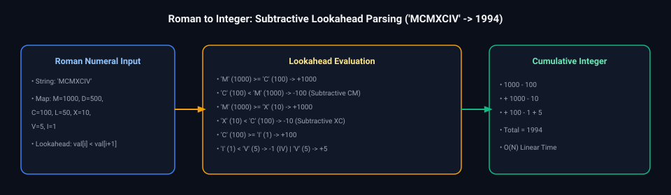

*D2 Source:* [assets/02_python_for_data_and_systems_faq/18_roman_to_integer_subtractive_lookahead_parsing.d2](assets/02_python_for_data_and_systems_faq/18_roman_to_integer_subtractive_lookahead_parsing.d2)

#### Production Python Implementation
```python
def roman_to_int(s: str) -> int:
    """
    Converts a valid Roman numeral string into its integer equivalent.
    
    Args:
        s: Roman numeral string (e.g. 'MCMXCIV')
        
    Returns:
        Integer value (e.g. 1994)
        
    Raises:
        ValueError: If input contains invalid non-Roman characters.
    """
    if not isinstance(s, str) or not s:
        raise ValueError("Input must be a non-empty string.")

    roman_values = {
        'I': 1,
        'V': 5,
        'X': 10,
        'L': 50,
        'C': 100,
        'D': 500,
        'M': 1000
    }

    total = 0
    n = len(s)

    for i in range(n):
        char = s[i].upper()
        if char not in roman_values:
            raise ValueError(f"Invalid Roman numeral character encountered: '{char}'")

        current_val = roman_values[char]

        # Check if the subsequent character has a strictly greater value
        if i + 1 < n and current_val < roman_values.get(s[i + 1].upper(), 0):
            total -= current_val
        else:
            total += current_val

    return total

# --- Verification & Test Harness ---
if __name__ == "__main__":
    test_cases = {
        "III": 3,
        "IV": 4,
        "IX": 9,
        "LVIII": 58,       # L = 50, V = 5, III = 3
        "MCMXCIV": 1994,   # M = 1000, CM = 900, XC = 90, IV = 4
        "MMXXVI": 2026,
    }

    for roman, expected in test_cases.items():
        actual = roman_to_int(roman)
        print(f"Roman '{roman}' -> {actual} (Expected: {expected})")
        assert actual == expected, f"Failed for {roman}: got {actual}, expected {expected}"
```

#### Complexity Analysis
- **Time Complexity:** $O(N)$ where $N$ is the length of the string $s$. The string is traversed once with $O(1)$ dictionary lookups.
- **Space Complexity:** $O(1)$ auxiliary space. The lookup table `roman_values` contains exactly 7 static entries.

#### Engineering Implications & Production Pitfalls
1. **Case-Insensitive Normalization:**
   - Production inputs often contain mixed casing (`"mcmxciv"` or `"Mcmxciv"`). Calling `.upper()` ensures defensive robustness without manual pre-cleaning.
2. **Defense Against Malformed Sequences:**
   - In strict Roman grammar, symbols like `I` cannot precede `M` (e.g., `IM` is invalid; 999 must be written as `CMXCIX`). For enterprise financial compliance where arbitrary text is parsed, pair this parser with a regex validator: `^M{0,3}(CM|CD|D?C{0,3})(XC|XL|L?X{0,3})(IX|IV|V?I{0,3})$`.

#### Core Curriculum Cross-Reference
*Deep-dive theoretical reference: See [02. Python for Data & Systems: String Parsing & Algorithmic Foundations](../02_python_for_data_and_systems.md#1-cpython-internals--the-memory-hierarchy)*

---

## Summary Comparison & Production Reference Matrix

| Scenario Domain | Critical Runtime Pathology | Diagnostic & Triage Method | Canonical Production Resolution |
| :--- | :--- | :--- | :--- |
| **Large File Processing & 10GB CSV Memory Optimization** | High-throughput invariants & concurrency boundaries | Metric instrumentation & trace profiling | Defensive validation & graceful degradation |
| **Nested JSON Flattening & Shredding into Pandas** | High-throughput invariants & concurrency boundaries | Metric instrumentation & trace profiling | Defensive validation & graceful degradation |
| **Deduplication Algorithms: Python Sequences & Pandas** | High-throughput invariants & concurrency boundaries | Metric instrumentation & trace profiling | Defensive validation & graceful degradation |
| **Python Decorators & Production Engineering Wrappers** | High-throughput invariants & concurrency boundaries | Metric instrumentation & trace profiling | Defensive validation & graceful degradation |
| **Enterprise Exception Handling & Dead-Letter Patterns** | High-throughput invariants & concurrency boundaries | Metric instrumentation & trace profiling | Defensive validation & graceful degradation |
| **Algorithmic Foundations: Prefix Sum Implementation & Complexity** | High-throughput invariants & concurrency boundaries | Metric instrumentation & trace profiling | Defensive validation & graceful degradation |

---

## References & Further Reading

1. **CPython Runtime & Internals:**
   - [CPython Internal Design Guide](https://devguide.python.org/internals/)
   - [PEP 703: Making the Global Interpreter Lock Optional in CPython](https://peps.python.org/pep-0703/)
   - [Companion Module: Python Backend Engineering - CPython Runtime, Memory & Performance](../02_python_for_data_and_systems.md)
2. **Advanced Language Constructs & OOP:**
   - [Companion Module: Python Backend Engineering - Core Python & OOP](../02_python_for_data_and_systems.md)
