# 03. Data Modeling & Warehousing: Interview Questions & Deep-Dive Solutions

A comprehensive, production-grade guide answering dimensional modeling, data warehousing, physical storage, and schema design interview scenarios. Covers Star vs Snowflake architectures, Kimball methodology, Slowly Changing Dimensions (SCD Types 1, 2, 3), domain modeling (Vendor Payments, Lending Book), inferred members, and multi-currency exchange handling.

---

## Table of Contents & Question Mapping

1. **OLTP vs OLAP Architecture & Normalization vs Denormalization**
   - [Q1. OLTP vs OLAP Architecture & Why Analytical Queries Bypass OLTP](#q1-easy-oltp-vs-olap-architecture--why-analytical-queries-bypass-oltp)
   - [Q2. Normalization vs Denormalization in Data Warehouses](#q2-easy-normalization-vs-denormalization-in-data-warehouses)
2. **Data Lake vs Data Warehouse vs Data Lakehouse**
   - [Q3. Data Lake vs Data Warehouse vs Data Lakehouse Architecture](#q3-easy-data-lake-vs-data-warehouse-vs-data-lakehouse-architecture)
   - [Q4. Medallion Architecture (Bronze, Silver, Gold) in the Modern Lakehouse](#q4-medium-medallion-architecture-bronze-silver-gold-in-the-modern-lakehouse)
3. **Dimensional Modeling Foundations: Star vs Snowflake Schemas**
   - [Q5. Star Schema vs Snowflake Schema Architecture & Selection Criteria](#q5-easy-star-schema-vs-snowflake-schema-architecture--selection-criteria)
   - [Q6. Sales Fact Table Design with Product and Customer Dimensions](#q6-medium-sales-fact-table-design-with-product-and-customer-dimensions)
4. **Row-Oriented vs Columnar Storage & Physical Optimization**
   - [Q7. Row-Oriented vs Columnar Physical Storage Mechanics](#q7-easy-row-oriented-vs-columnar-physical-storage-mechanics)
   - [Q8. Partitioning vs Bucketing in Big Data Systems](#q8-easy-partitioning-vs-bucketing-in-big-data-systems)
5. **Domain Data Model Design: Vendor Payment System**
   - [Q9. End-to-End Data Model Design: Vendor Payment System](#q9-medium-end-to-end-data-model-design-vendor-payment-system)
6. **Domain Data Model Design: Lending Book Architecture**
   - [Q10. End-to-End Data Model Design: Lending Book Architecture](#q10-medium-end-to-end-data-model-design-lending-book-architecture)
7. **Slowly Changing Dimensions (SCD Types 1, 2, 3) in Spark & Delta Lake**
   - [Q11. Slowly Changing Dimensions (SCD Types 1, 2, 3) in Spark & Delta Lake](#q11-medium-slowly-changing-dimensions-scd-types-1-2-3-in-spark--delta-lake)
8. **Handling Inferred Members & Late-Arriving Dimensions**
   - [Q12. Handling Inferred Members & Late-Arriving Dimensions](#q12-medium-handling-inferred-members--late-arriving-dimensions)
9. **Global Multi-Currency Sales Modeling & Daily Exchange Rates**
   - [Q13. Multi-Currency Sales Fact Modeling & Daily Exchange Rate Joins](#q13-medium-multi-currency-sales-fact-modeling--daily-exchange-rate-joins)
10. **Large-Scale User Watch-History & Telemetry Data Modeling**
    - [Q14. Global User Watch-History Data Model at Scale](#q14-medium-global-user-watch-history-data-model-at-scale)
    - [Q15. High-Throughput Log Data Modeling: Fast Writes vs Fast Reads](#q15-easy-high-throughput-log-data-modeling-fast-writes-vs-fast-reads)
11. **Schema Evolution & Versioned Warehouse Schemas Across Multiple Teams**
    - [Q16. Managing Schema Evolution & Versioning Across Multiple Analytics Teams](#q16-medium-managing-schema-evolution--versioning-across-multiple-analytics-teams)
12. **Data Governance, Audit Lineage & OLTP-to-OLAP Consistency**
    - [Q17. Enterprise Data Governance, Lineage & Consistency Guarantees](#q17-medium-enterprise-data-governance-lineage--consistency-guarantees)
13. **Data Lakehouse Security, Data Privacy & PII Protection**
    - [Q18. Securing Sensitive Customer Data, PII & Enforcing Row-Level Access Controls](#q18-medium-securing-sensitive-customer-data-pii--enforcing-row-level-access-controls)
14. **Multi-Dimensional Aggregations & High-Scale Table Operations**
    - [Q19. Dimensional Data Modeling for Multi-Level Sales (Product, Vendor, Location)](#q19-medium-dimensional-data-modeling-for-multi-level-sales-product-vendor-location)
    - [Q20. Managing and Querying Billion-Row Tables in Analytical Warehouses](#q20-medium-managing-and-querying-billion-row-tables-in-analytical-warehouses)
    - [Q21. Enterprise Cloud Storage Cost Optimization in Data Lakes & Warehouses](#q21-hard-enterprise-cloud-storage-cost-optimization-in-data-lakes--warehouses)
15. **Next-Generation Analytical Storage & Concurrency Architecture**
    - [Q22. Microsoft Fabric Lakehouse vs Fabric Warehouse: Architectural Comparison](#q22-easy-microsoft-fabric-lakehouse-vs-fabric-warehouse-architectural-comparison)
    - [Q23. End-to-End Database Design: Movie Ticket Booking Platform](#q23-medium-end-to-end-database-design-movie-ticket-booking-platform)
    - [Q24. Schema Evolution & Safe Data Model Migration in Active Pipelines](#q24-medium-schema-evolution--safe-data-model-migration-in-active-pipelines)
16. **Physical Table Life Cycles, Payment Schemas & Data Discrepancy Diagnostics**
    - [Q25. Transient Tables vs Temporary Tables in Enterprise Warehouses](#q25-easy-transient-tables-vs-temporary-tables-in-enterprise-warehouses)
    - [Q26. Swipe Payment API Relational Schema & Idempotent Ledger Design](#q26-medium-swipe-payment-api-relational-schema--idempotent-ledger-design)
    - [Q27. University Relational Database Schema Design (Colleges, Students, Professors)](#q27-medium-university-relational-database-schema-design-colleges-students-professors)
    - [Q28. High-Velocity Web Traffic Event Log Schema (Clicks/Swipes)](#q28-medium-high-velocity-web-traffic-event-log-schema-clicksswipes)
    - [Q29. Data Integrity Discrepancy Between Data Warehouse and Source Post-Incremental Load](#q29-hard-data-integrity-discrepancy-between-data-warehouse-and-source-post-incremental-load)
    - [Q30. Fact Table Grain vs. Aggregation Level: Dimensional Design Principles & Multi-Grain Traps](#q30-easy-fact-table-grain-vs-aggregation-level-dimensional-design-principles--multi-grain-traps)
    - [Q31. Designing an Enterprise Calendar / Date Dimension with Fiscal Offsets, ISO Weeks & Holiday Calendars](#q31-medium-designing-an-enterprise-calendar--date-dimension-with-fiscal-offsets-iso-weeks--holiday-calendars)
    - [Q32. Incremental Restatement of Historical Aggregates under Late-Arriving & Corrected Ledger Records](#q32-medium-incremental-restatement-of-historical-aggregates-under-late-arriving--corrected-ledger-records)
    - [Q33. Designing Gold-Layer Tables for Governed Self-Service BI Without Duplicate Business Logic](#q33-medium-designing-gold-layer-tables-for-governed-self-service-bi-without-duplicate-business-logic)
    - [Q34. Food Delivery & Ride-Sharing Dimensional Architecture (Dynamic Fees, Settlements & Status Timestamps)](#q34-medium-food-delivery--ride-sharing-dimensional-architecture-dynamic-fees-settlements--status-timestamps)
16. **Enterprise Data Retention & Cloud Object Storage Lifecycle Management**
    - [Q35. Multi-Year Transaction Data Retention, Cold Storage Tiering & Compliant Archival](#q35-medium-multi-year-transaction-data-retention-cold-storage-tiering--compliant-archival)
    - [Q36. Micro-Partitions and Clustering Keys in Cloud Warehouses & Lakehouses: Query Acceleration vs Reclustering Cost Governance](#q36-medium-micro-partitions-and-clustering-keys-in-cloud-warehouses--lakehouses-query-acceleration-vs-reclustering-cost-governance)
---

# 1. OLTP vs OLAP Architecture & Normalization vs Denormalization

---

### Q1. [Easy] OLTP vs OLAP Architecture & Why Analytical Queries Bypass OLTP
**Difficulty:** [Easy]
**Topic Covered:** Relational Systems vs Distributed Analytical Warehouses  
**Question:** Difference between OLTP and OLAP systems — and why you don't report directly off OLTP.

#### Architectural Comparison Matrix: OLTP vs OLAP
| Architectural Dimension | OLTP (Online Transaction Processing) | OLAP (Online Analytical Processing) |
| :--- | :--- | :--- |
| **Primary Workload** | High-concurrency, short, atomic ACID reads and writes. | Long-running, high-throughput complex analytical scans and aggregations. |
| **Data Schema** | Highly normalized (3NF / BCNF) to eliminate redundancy. | Denormalized (Star, Snowflake, One Big Table - OBT) to eliminate joins. |
| **Storage Layout** | Row-oriented storage (e.g., PostgreSQL heap, MySQL InnoDB). | Columnar storage (Parquet, ORC, Snowflake FDN, Delta Lake). |
| **Query Pattern** | `SELECT * FROM orders WHERE order_id = 9812;` ($O(1)$ index lookup). | `SELECT category, SUM(amount) FROM sales GROUP BY category;` (Terabyte scan). |
| **Indexing** | Highly indexed with B-Tree indexes on Primary/Foreign keys. | Min/Max zone maps, sparse indexes, data clustering / Z-ordering. |

#### Why You Must NEVER Run Analytical Reporting Directly off OLTP
1. **Catastrophic Lock Contention:** Analytical queries execute long table scans. In OLTP engines (like MySQL or SQL Server with default isolation levels), shared read locks (`S` locks) block incoming transactional write locks (`X` locks), causing timeouts and operational downtime for customer checkouts.
2. **Resource Exhaustion:** Complex joins and aggregations saturate CPU and RAM buffer pools, starving the transaction engine.
3. **Lack of Point-in-Time History:** OLTP databases overwrite historical values (e.g., updating a customer address overwrites the past). Analytical reporting requires historical accuracy (point-in-time state).
4. **Dispersed Data Silos:** OLTP systems only reflect their isolated application database. Warehouses aggregate CRM, ERP, payments, and web analytics into an integrated enterprise model.

---

### Q2. [Easy] Normalization vs Denormalization in Data Warehouses
**Difficulty:** [Easy]
**Topic Covered:** Normal Forms (3NF) vs Dimensional Flattening & Query Performance  
**Question:** Normal Forms and Normalization vs Denormalization (why warehouses denormalize on purpose).

#### Why Data Warehouses Denormalize on Purpose
In relational theory, 3NF ensures no data redundancy by splitting entities into distinct tables. In distributed data warehousing (Snowflake, BigQuery, Databricks), joining 15 normalized tables requires massive distributed **network shuffles**. 

**Denormalization** deliberately duplicates dimension attributes directly into wider dimension tables (or flat fact tables). 
- Eliminates multi-hop joins across distributed worker nodes.
- Vastly simplifies BI tool query construction and reporting usability.
- Enables extreme compression in columnar formats where repeating column values compress by 80–95% via Run-Length Encoding (RLE).

---

# 2. Data Lake vs Data Warehouse vs Data Lakehouse

---

### Q3. [Easy] Data Lake vs Data Warehouse vs Data Lakehouse Architecture
**Difficulty:** [Easy]
**Topic Covered:** Modern Lakehouse Architecture & Storage Engine Evolution  
**Question:** How do you design a data lake vs a data warehouse, and when would you use each?

#### Architectural Evolution & Comparison
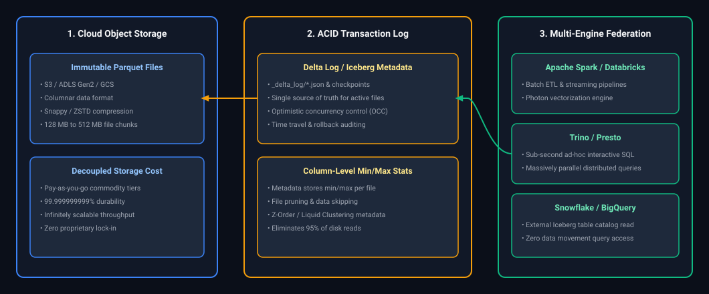

*D2 Source: [`01_cloud_storage_metadata_acid_lakehouse_architecture.d2`](assets/03_data_modeling_and_lakehouse_storage_faq/01_cloud_storage_metadata_acid_lakehouse_architecture.d2)*

#### Decision Matrix: When to Use Which
| Scenario / Requirement | Data Lake | Data Warehouse | Data Lakehouse |
| :--- | :---: | :---: | :---: |
| **Unstructured Data (Audio, Video, PDFs)** |  (Ideal) |  (Not supported) |  (Via metadata links) |
| **Strict Sub-Second Executive BI Dashboards** |  (Too slow) |  (Native strength) |  (With BI caching) |
| **Unified Platform for BI + ML Training** |  (Clunky) |  (Expensive) |  (Optimal choice) |
| **Total Cost of Ownership (Petabyte Scale)**|  (Lowest cost) |  (Can be high) |  (Balanced) |

---

### Q4. [Medium] Medallion Architecture (Bronze, Silver, Gold) in the Modern Lakehouse
**Difficulty:** [Medium]
*(Grouped together: Medallion pattern definition, tier-by-tier flow, and data lakehouse advantages)*  
**Topic Covered:** Bronze/Silver/Gold Lakehouse Architecture, Data Quality Promotion, ACID Guarantees  
**Questions Covered:**
- Explain the Medallion Architecture (Bronze, Silver, Gold).
- How does the Medallion Architecture (Bronze, Silver, Gold) work, and what are its advantages?

#### Definition & Core Concepts
The Medallion Architecture is a data design pattern that logically organizes data into three distinct refinement layers within a Lakehouse (Delta Lake / Apache Iceberg):
1. **Bronze (Raw Ingestion / Landing Layer):**
   - Stores raw, immutable data exactly as received from source systems (APIs, CDC logs, IoT streams).
   - Preserves append-only full history with audit metadata (`_ingested_timestamp`, `_source_file`).
   - Schema enforcement is relaxed, allowing rescued data capturing unexpected attributes.
2. **Silver (Cleansed, Conformed & Enriched Layer):**
   - Cleansed, filtered, deduplicated, and conformed data.
   - Enforces strict schemas, null checks, and domain validation rules.
   - Performs stateful joins, dimension lookups, and Slowly Changing Dimension (SCD) merges.
3. **Gold (Aggregated Business & Semantic Analytics Layer):**
   - High-performance, read-optimized dimensional models (Star/Snowflake schemas) and pre-aggregated KPI tables.
   - Directly feeds executive dashboards, BI tools (PowerBI, Tableau), and ML feature stores.

#### Visual Flow
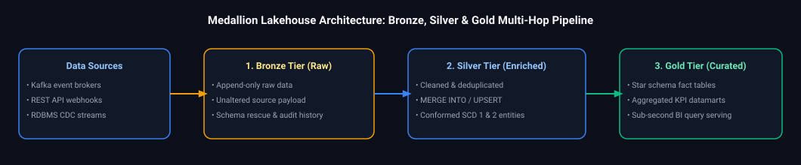

*D2 Source: [`02_medallion_architecture_bronze_silver_gold.d2`](assets/03_data_modeling_and_lakehouse_storage_faq/02_medallion_architecture_bronze_silver_gold.d2)*

#### Production PySpark Delta Implementation
```python
from pyspark.sql import functions as F

# 1. Bronze Ingestion: Raw ingestion with lineage metadata
bronze_df = (spark.readStream
    .format("cloudFiles")
    .option("cloudFiles.format", "json")
    .option("cloudFiles.schemaLocation", "/lake/checkpoints/bronze_schema")
    .load("/lake/landing/orders/")
    .withColumn("_ingested_at", F.current_timestamp())
    .withColumn("_source_file", F.input_file_name()))

(bronze_df.writeStream
    .format("delta")
    .outputMode("append")
    .option("checkpointLocation", "/lake/checkpoints/bronze_orders")
    .toTable("bronze.orders"))

# 2. Silver Transformation: Deduplicate & Filter Invalid Records
silver_clean_df = (spark.readTable("bronze.orders")
    .filter(F.col("order_id").isNotNull() & (F.col("amount") > 0))
    .dropDuplicates(["order_id"])
    .withColumn("order_timestamp", F.to_timestamp("order_time")))

silver_clean_df.write.format("delta").mode("overwrite").saveAsTable("silver.orders")

# 3. Gold Aggregation: Pre-computed daily revenue KPI mart
gold_daily_kpi = (spark.readTable("silver.orders")
    .groupBy(F.to_date("order_timestamp").alias("order_date"), "store_id")
    .agg(
        F.sum("amount").alias("daily_revenue"),
        F.countDistinct("customer_id").alias("unique_customers"),
        F.count("order_id").alias("total_orders")
    ))

gold_daily_kpi.write.format("delta").mode("overwrite").saveAsTable("gold.daily_store_kpi")
```

#### Engineering Implications & Production Pitfalls
1. **Replayability:** If business logic changes in Silver or Gold, having an immutable Bronze layer guarantees you can recompute historical downstream data without requesting re-extraction from operational source databases.
2. **Compute-Storage Separation:** Bronze, Silver, and Gold reside in cloud object storage as Delta tables, allowing different compute clusters (e.g., streaming clusters for Bronze/Silver vs SQL serverless warehouses for Gold BI queries) to scale independently.

---

# 3. Dimensional Modeling Foundations: Star vs Snowflake Schemas

---

### Q5. [Easy] Star Schema vs Snowflake Schema Architecture & Selection Criteria
**Difficulty:** [Easy]
**Topic Covered:** Dimensional Modeling Foundations & Schema Selection Trade-offs  
**Questions Covered:**
- **Q2**: Star vs Snowflake Schema — differences and when to choose one over the other.
- **Q6**: Choosing the right schema for a given data application + justification.

#### Kimball's 4-Step Dimensional Design Process
1. **Select the Business Process:** e.g., Retail Sales Checkout.
2. **Declare the Grain:** The individual line item on a retail sales receipt.
3. **Identify the Dimensions:** Date, Customer, Store, Product, Promotion.
4. **Identify the Numeric Facts:** Quantity Sold, Unit Selling Price, Discount Amount, Net Extended Sales Amount, Tax Amount.

#### Star Schema vs Snowflake Schema Comparison
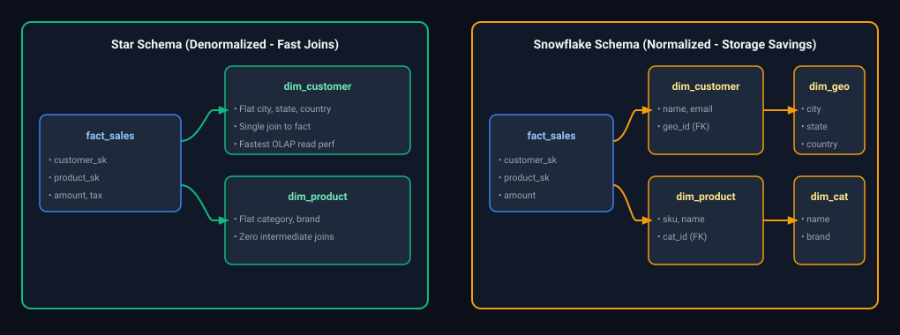

*D2 Source: [`03_star_schema_vs_snowflake_schema_normalization.d2`](assets/03_data_modeling_and_lakehouse_storage_faq/03_star_schema_vs_snowflake_schema_normalization.d2)*

| Dimension | Star Schema | Snowflake Schema |
| :--- | :--- | :--- |
| **Dimension Structure** | Completely denormalized. Single table per dimension. | Normalized. Hierarchies split into sub-dimension tables. |
| **Query Complexity** | Simplest SQL queries (1 join per dimension). | Complex SQL with multi-level nested joins. |
| **Performance** | Significantly faster in OLAP engines (fewer distributed shuffles). | Slower query execution due to excessive join hops. |
| **Maintenance** | Dimension updates require updating redundant rows (addressed by SCD).| Updates to a category occur in 1 normalized row. |
| **When to Choose** | Standard Enterprise Data Warehouses, Databricks Lakehouse, PowerBI. | Specialized edge cases with huge, highly dynamic attribute trees. |

---

### Q6. [Medium] Sales Fact Table Design with Product and Customer Dimensions
**Difficulty:** [Medium]
**Topic Covered:** Kimball Fact Table DDL, Surrogate Keys & Grain Definition  
**Question:** Explain dimensional modeling and how you would design a sales fact table with product and customer dimensions.

#### Production DDL Design: Sales Fact Table with Product & Customer Dimensions (Q12)
```sql
-- Dimension: Customer (Denormalized)
CREATE TABLE dim_customer (
    customer_sk BIGINT PRIMARY KEY, -- Surrogate Key
    customer_id VARCHAR(64) NOT NULL, -- Business / Natural Key
    first_name VARCHAR(100),
    last_name VARCHAR(100),
    email VARCHAR(255),
    city VARCHAR(100),
    state_code VARCHAR(10),
    country VARCHAR(50),
    customer_tier VARCHAR(20),
    effective_start_date DATE NOT NULL,
    effective_end_date DATE NOT NULL,
    is_current BOOLEAN NOT NULL
);

-- Dimension: Product (Denormalized)
CREATE TABLE dim_product (
    product_sk BIGINT PRIMARY KEY,
    product_id VARCHAR(64) NOT NULL,
    sku VARCHAR(100) NOT NULL,
    product_name VARCHAR(255),
    subcategory_name VARCHAR(100),
    category_name VARCHAR(100),
    brand_name VARCHAR(100),
    base_unit_cost NUMERIC(12, 4)
);

-- Fact: Retail Sales (Grain: One Line Item per Receipt)
CREATE TABLE fact_retail_sales (
    sales_receipt_id VARCHAR(64) NOT NULL, -- Degenerate Dimension
    line_item_number INT NOT NULL,         -- Degenerate Dimension
    date_sk INT NOT NULL,                  -- Foreign Key -> dim_date
    customer_sk BIGINT NOT NULL,          -- Foreign Key -> dim_customer
    product_sk BIGINT NOT NULL,           -- Foreign Key -> dim_product
    store_sk INT NOT NULL,                -- Foreign Key -> dim_store
    
    -- Additive Numeric Metrics
    quantity_sold INT NOT NULL,
    unit_price NUMERIC(12, 4) NOT NULL,
    discount_amount NUMERIC(12, 4) DEFAULT 0.0,
    tax_amount NUMERIC(12, 4) DEFAULT 0.0,
    net_sales_amount NUMERIC(12, 4) NOT NULL,
    cost_amount NUMERIC(12, 4) NOT NULL,
    gross_margin_amount NUMERIC(12, 4) NOT NULL,
    
    CONSTRAINT pk_fact_sales PRIMARY KEY (sales_receipt_id, line_item_number)
);
```

---

# 4. Row-Oriented vs Columnar Physical Storage

---

### Q7. [Easy] Row-Oriented vs Columnar Physical Storage Mechanics
**Difficulty:** [Easy]
**Topic Covered:** Physical Disk Page Layout, I/O Projection Pruning & Vectorized Scans  
**Question:** Row vs. Columnar Storage

##### Logical Table Representation

| ID | Name | Amount |
| :---: | :--- | :---: |
| 1 | Alice | 100 |
| 2 | Bob | 200 |
| 3 | Carol | 300 |

##### Physical Layout Across Disk Blocks

| Storage Format | Disk Block Allocation | Analytical Scan Behavior (`SELECT SUM(Amount)`) |
| :--- | :--- | :--- |
| **Row-Oriented**<br/>(PostgreSQL Heap, CSV, MySQL) | `[Block 1]: [1, "Alice", 100] \| [2, "Bob", 200] \| [3, "Carol", 300]` | Reads **every column for all rows** into memory; discards non-aggregated attributes in RAM. |
| **Columnar**<br/>(Parquet, ORC, Delta Lake, Snowflake) | • `[Block 1 (ID)]`: `[1, 2, 3]`<br/>• `[Block 2 (Name)]`: `["Alice", "Bob", "Carol"]`<br/>• `[Block 3 (Amount)]`: `[100, 200, 300]` | **Projection Pruning:** Reads **strictly Block 3**, eliminating over 90% of disk I/O bandwidth. |

#### Why Columnar Storage Dominates Data Warehousing
1. **Column Pruning (I/O Elimination):** In analytical queries like `SELECT SUM(amount) FROM sales`, a columnar engine reads **only Disk Block 3**. Row stores must read all columns for every row into RAM, wasting 90% of disk I/O bandwidth.
2. **Extreme Compression Ratios:** Columns contain values of the exact same data type and high cardinality repetition. Columnar stores apply Run-Length Encoding (RLE), Dictionary Encoding, and Snappy/ZSTD, achieving $5\times$ to $10\times$ disk compression.
3. **Vectorized SIMD Processing:** Modern CPUs process 512-bit vector registers simultaneously (processing 16 numbers in a single CPU cycle) directly over contiguous columnar memory arrays.

---

### Q8. [Easy] Partitioning vs Bucketing in Big Data Systems
**Difficulty:** [Easy]
*(Grouped together: Physical data layout, directory partitioning, hash bucketing, and shuffle optimization)*  
**Topic Covered:** Physical File Layout, Directory Pruning, Hash Partitioning & Co-located Joins  
**Questions Covered:**
- What is the difference between partitioning and bucketing in big data systems, and when would you prefer one over the other?

#### Definition & Core Concepts
In big data distributed storage (Hive, Spark, Presto/Trino, Databricks), physical data layout directly governs query execution performance and disk I/O costs:
1. **Partitioning:** Segregates data into dedicated directory structures on disk based on distinct column values (e.g., `/country=US/year=2024/`).
   - **Mechanism:** Query engine inspects query predicate `WHERE country = 'US'` and completely avoids scanning other country directories (**Partition Pruning**).
   - **Best for:** Low-cardinality fields ($<10,000$ values) such as date, month, geography, or status.
2. **Bucketing (Clustering):** Decomposes data within a partition into a fixed number of hash-distributed files (`part-00000.parquet` to `part-00031.parquet`).
   - **Mechanism:** Computes `hash(column) % N_BUCKETS`. Rows with identical keys always land in the exact same physical bucket file across both tables.
   - **Best for:** High-cardinality join/group-by keys (e.g., `user_id`, `device_id`) allowing **Bucket-to-Bucket Sort-Merge Joins** that eliminate network shuffles.

#### Visual Architecture
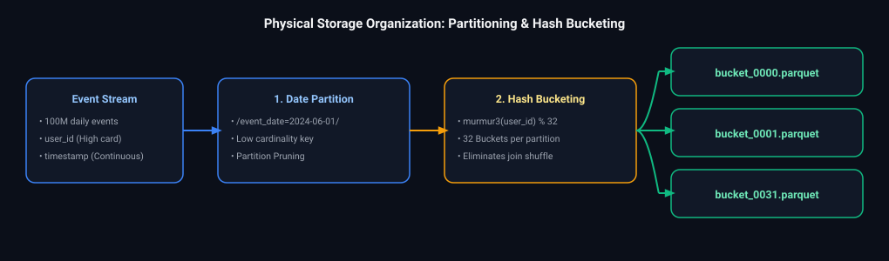

*D2 Source: [`04_partitioning_and_bucketing_physical_storage_layout.d2`](assets/03_data_modeling_and_lakehouse_storage_faq/04_partitioning_and_bucketing_physical_storage_layout.d2)*

#### Production PySpark Implementation: Co-located Bucket Joins
```python
# Create pre-bucketed tables to guarantee shuffle-free joins
(orders_df.write
    .format("parquet")
    .mode("overwrite")
    .bucketBy(32, "customer_id")
    .sortBy("order_id")
    .saveAsTable("warehouse.orders_bucketed"))

(customers_df.write
    .format("parquet")
    .mode("overwrite")
    .bucketBy(32, "customer_id")
    .sortBy("customer_id")
    .saveAsTable("warehouse.customers_bucketed"))

# Reading and joining pre-bucketed tables skips Exchange (Shuffle) entirely!
spark.conf.set("spark.sql.autoBroadcastJoinThreshold", -1) # Disable broadcast
joined_df = spark.sql("""
    SELECT o.order_id, o.amount, c.customer_name
    FROM warehouse.orders_bucketed o
    JOIN warehouse.customers_bucketed c
      ON o.customer_id = c.customer_id
""")
# Explain plan will verify SortMergeJoin WITHOUT an Exchange node!
```

#### Engineering Implications & Production Pitfalls
1. **The Small File Trap of Over-Partitioning:** Partitioning by a high-cardinality key like `timestamp` or `user_id` generates millions of tiny 100 KB files. Metastore reads take 10x longer than actual data decompression.
2. **Modern Alternative (Liquid Clustering):** Delta Lake and Snowflake modern warehouses replace rigid partitioning and bucketing with **Liquid Clustering / Dynamic Micro-Partition Clustering**, which automatically optimizes layout without user maintenance.

---

# 5. Domain Data Model Design: Vendor Payment System

---

### Q9. [Medium] End-to-End Data Model Design: Vendor Payment System
**Difficulty:** [Medium]
**Topic Covered:** Financial Event Modeling, Invoice-Payment Granularity & Fact Lineage  
**Question:** Design a Vendor Payment System (Fact vs Dimension, Business Events mapping, Granularity, Payment Batch vs Order-Level Tracking).

#### Business Process & Event Mapping
In enterprise ERPs (SAP, NetSuite), the Procure-to-Pay lifecycle involves distinct business events:
1. **Purchase Order (PO) Created** $\to$ Commitment.
2. **Goods Receipt (GR) Logged** $\to$ Inventory Receipt.
3. **Vendor Invoice Received** $\to$ Accounts Payable Liability.
4. **Payment Batch Executed** $\to$ Cash Disbursement.

#### Granularity Dilemma: Payment Batch vs Order/Invoice Line Item
- **The Problem:** A single vendor invoice can reference 10 purchase orders. A single bank payment batch can settle 500 invoices across 50 vendors.
- **The Solution:** We implement a **Grain-Aligned Dual Fact Architecture**:
  1. `fact_vendor_invoice_line`: Detailed invoice line level tracking.
  2. `fact_vendor_payment_disbursement`: Payment execution batch level tracking.
  3. `bridge_payment_invoice`: Bridge table resolving the Many-to-Many ($M:N$) settlement mapping between payment allocations and invoices.

#### Relational Architecture Diagram
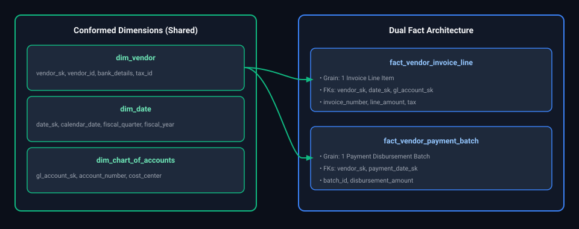

*D2 Source: [`05_conformed_dimensions_dual_fact_architecture.d2`](assets/03_data_modeling_and_lakehouse_storage_faq/05_conformed_dimensions_dual_fact_architecture.d2)*

---

# 6. Domain Data Model Design: Lending Book Architecture

---

### Q10. [Medium] End-to-End Data Model Design: Lending Book Architecture
**Difficulty:** [Medium]
**Topic Covered:** Loan Lifecycle Modeling, Periodic Snapshot vs Accumulating Snapshot Facts  
**Question:** Design a Data Model for a Lending Book.

#### Core Lending Book Domain Concepts
A lending institution (Fintech, Bank) manages a portfolio of loans. A robust data model requires tracking:
1. **Origination & Underwriting:** Principal loan amount, interest rate, term, risk rating.
2. **Amortization Schedule:** Expected monthly installments (Principal + Interest).
3. **Repayment Transactions:** Actual borrower payments, early prepayments, late fees.
4. **Daily Lending Book Snapshot (Periodic Snapshot Fact):** Current outstanding balance, accrued interest, Days Past Due (DPD), and loan delinquency bucket (Performing, 30 DPD, 60 DPD, Default).

#### Lending Book Schema Design
```sql
-- Dimension: Loan Account (SCD Type 2 to track status changes)
CREATE TABLE dim_loan_account (
    loan_account_sk BIGINT PRIMARY KEY,
    loan_id VARCHAR(64) NOT NULL,
    borrower_sk BIGINT NOT NULL,
    product_type VARCHAR(50),      -- Personal, Mortgage, SME
    origination_date DATE NOT NULL,
    maturity_date DATE NOT NULL,
    initial_principal_amount NUMERIC(15, 2) NOT NULL,
    interest_rate_apr NUMERIC(5, 4) NOT NULL,
    loan_term_months INT NOT NULL,
    loan_status VARCHAR(30) NOT NULL, -- Active, Settled, Defaulted, Written-off
    effective_start_date DATE NOT NULL,
    effective_end_date DATE NOT NULL,
    is_current BOOLEAN NOT NULL
);

-- Fact 1: Loan Transactions (Transaction Fact Table)
-- Grain: One financial transaction event (Disbursement, Repayment, Fee, Adjustment)
CREATE TABLE fact_loan_transaction (
    transaction_id VARCHAR(64) PRIMARY KEY,
    loan_account_sk BIGINT NOT NULL,
    transaction_date_sk INT NOT NULL,
    transaction_type VARCHAR(30) NOT NULL, -- DISBURSEMENT, REPAYMENT, PENALTY
    principal_component NUMERIC(15, 2) NOT NULL,
    interest_component NUMERIC(15, 2) NOT NULL,
    fee_component NUMERIC(15, 2) NOT NULL,
    total_transaction_amount NUMERIC(15, 2) NOT NULL
);

-- Fact 2: Daily Loan Book Snapshot (Periodic Snapshot Fact Table)
-- Grain: One record per active loan account per day (Crucial for risk & delinquency analytics)
CREATE TABLE fact_daily_loan_snapshot (
    snapshot_date_sk INT NOT NULL,
    loan_account_sk BIGINT NOT NULL,
    current_principal_outstanding NUMERIC(15, 2) NOT NULL,
    accrued_interest_receivable NUMERIC(15, 2) NOT NULL,
    days_past_due (DPD) INT NOT NULL,
    delinquency_bucket VARCHAR(20) NOT NULL, -- 'CURRENT', '1-30 DPD', '31-60 DPD', '90+ DPD'
    expected_monthly_installment NUMERIC(15, 2) NOT NULL,
    cumulative_principal_repaid NUMERIC(15, 2) NOT NULL,
    cumulative_interest_paid NUMERIC(15, 2) NOT NULL,
    is_non_performing_loan (NPL) BOOLEAN NOT NULL,
    
    CONSTRAINT pk_daily_loan_snapshot PRIMARY KEY (snapshot_date_sk, loan_account_sk)
);
```

---

# 7. Slowly Changing Dimensions (SCD Types 1, 2, 3) in Spark & Delta Lake

---

### Q11. [Medium] Slowly Changing Dimensions (SCD Types 1, 2, 3) in Spark & Delta Lake
**Difficulty:** [Medium]
*(Grouped together: SCD Types 1, 2, 3 concepts, use cases, and high-scale pipeline design)*  
**Topic Covered:** Temporal History Preservation, High-Scale SCD Pipelines & Delta Lake MERGE  
**Questions Covered:**
- Explain Slowly Changing Dimensions (SCD Type 1, Type 2, and Type 3) and their use cases.
- How would you design a slowly changing dimension (SCD) pipeline that supports Type 1 and Type 2 updates at high scale?
- SCD (Slowly Changing Dimensions) Types (Type 1, 2, 3) and implementation in Spark/Delta Lake.

#### SCD Types Overview
- **SCD Type 0 (Fixed):** Values never change (e.g., `date_of_birth`).
- **SCD Type 1 (Overwrite):** Updates existing record in-place. **No history retained**. Ideal for correcting data entry typos.
- **SCD Type 2 (Add New Row):** Preserves full historical audit trail by inserting a new record with `effective_start_date`, `effective_end_date`, and `is_current` flag.
- **SCD Type 3 (Add New Column):** Tracks only current and previous value side-by-side using dedicated columns (`current_city`, `previous_city`). Limited historical window.

#### SCD Type 2 Architecture
> **Incoming Event:** Customer `101` moves from `'Seattle'` to `'New York'` on `2024-06-01`.

##### Resulting `dim_customer` Table

| `cust_sk` | `customer_id` | `city` | `start_date` | `end_date` | `is_current` |
| :---: | :---: | :--- | :---: | :---: | :---: |
| 1001 | 101 | Seattle | 2021-01-01 | 2024-05-31 | `FALSE` |
| 1002 | 101 | New York | 2024-06-01 | 9999-12-31 | `TRUE` |

#### Production PySpark Delta Lake Implementation: SCD Type 2
```python
from delta.tables import DeltaTable
from pyspark.sql import functions as F

def merge_scd_type2_delta(spark, delta_table_path: str, staging_df, merge_key: str):
    """
    Executes a performant SCD Type 2 MERGE in Delta Lake.
    """
    target_table = DeltaTable.forPath(spark, delta_table_path)
    
    # 1. Prepare staging records for both:
    # A) Closing out existing current records (UPDATE)
    # B) Inserting the new current record (INSERT)
    
    staged_updates = staging_df.join(
        target_table.toDF().filter("is_current = true"),
        on=merge_key,
        how="inner"
    ).filter(
        # Detect if any monitored attribute has changed
        staging_df["city"] != target_table.toDF()["city"]
    ).select(
        staging_df[merge_key],
        staging_df["city"],
        staging_df["effective_date"]
    )
    
    # Rows needing update (set is_current = false, end_date = effective_date)
    update_rows = staged_updates.withColumn("merge_key_join", F.col(merge_key))
    
    # Rows needing insert (new version with is_current = true)
    insert_rows = staging_df.withColumn("merge_key_join", F.lit(None))
    
    combined_staging = update_rows.unionByName(insert_rows)
    
    # Delta MERGE
    target_table.alias("tgt").merge(
        combined_staging.alias("stg"),
        "tgt.customer_id = stg.merge_key_join AND tgt.is_current = true"
    ).whenMatchedUpdate(
        condition="tgt.city != stg.city",
        set={
            "is_current": "false",
            "effective_end_date": "stg.effective_date"
        }
    ).whenNotMatchedInsert(
        values={
            "customer_id": "stg.customer_id",
            "city": "stg.city",
            "effective_start_date": "stg.effective_date",
            "effective_end_date": "to_date('9999-12-31')",
            "is_current": "true"
        }
    ).execute()
```

---

# 8. Handling Inferred Members & Late-Arriving Dimensions

---

### Q12. [Medium] Handling Inferred Members & Late-Arriving Dimensions
**Difficulty:** [Medium]
**Topic Covered:** Referential Integrity Enforcement & Surrogate Placeholder Resolution  
**Question:** How do you handle a fact that arrives with an unknown dimension key (inferred / late-arriving member)?

#### The Problem: Referential Integrity Breach
In distributed pipelines, events arrive out of sequence. An order event containing `customer_id = 999` arrives at 10:00 AM, but the customer registration record in the CRM only lands in the data warehouse at 11:30 AM.

If the fact load enforces strict foreign key constraints or relies on inner joins for surrogate key lookups, the order is dropped or the pipeline fails.

#### Production Solution: Inferred Member Pattern
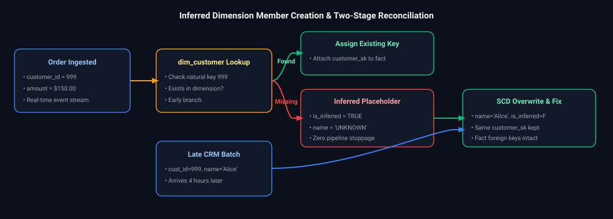

*D2 Source: [`06_inferred_dimension_member_resolution_pipeline.d2`](assets/03_data_modeling_and_lakehouse_storage_faq/06_inferred_dimension_member_resolution_pipeline.d2)*

#### SQL Implementation
```sql
-- Step 1: Default Sentinel Records in Dimension (Built during table init)
INSERT INTO dim_customer (customer_sk, customer_id, customer_name, is_inferred)
VALUES 
    (-1, 'N/A', 'NOT APPLICABLE', FALSE),
    (-2, 'CORRUPT', 'CORRUPT DATA', FALSE);

-- Step 2: Inferred Member Creation during Fact ETL
INSERT INTO dim_customer (customer_sk, customer_id, customer_name, is_inferred, effective_start_date, effective_end_date, is_current)
SELECT 
    ABS(HASHTEXT(stg.customer_id)) AS customer_sk,
    stg.customer_id,
    'INFERRED_PENDING_REGISTRATION' AS customer_name,
    TRUE AS is_inferred,
    CURRENT_DATE,
    '9999-12-31',
    TRUE
FROM staging_orders stg
LEFT JOIN dim_customer dim ON stg.customer_id = dim.customer_id
WHERE dim.customer_id IS NULL;
```

---

# 9. Global Multi-Currency Sales Modeling & Daily Exchange Rates

---

### Q13. [Medium] Multi-Currency Sales Fact Modeling & Daily Exchange Rate Joins
**Difficulty:** [Medium]
**Topic Covered:** FX Triangulation, Daily Exchange Rates & Weekend Interval Filling  
**Question:** How do you handle currency conversion in a global sales model with daily rates?

#### Architectural Design Considerations
1. **Transaction Currency vs Corporate Reporting Currency:** Never store only converted currencies. Always preserve the raw transactional amount in its local originating currency alongside the converted reporting amount.
2. **Exchange Rate Timing:** Retail sales convert at the exact transaction date's spot rate. General Ledger balances often convert at month-end closing rates.
3. **Missing Rates (Weekends & Bank Holidays):** FX markets close on weekends. Pipelines must implement forward-fill logic to apply Friday's closing rate to Saturday and Sunday sales.

#### Recommended Fact Table Structure
```sql
CREATE TABLE fact_global_sales (
    sales_id VARCHAR(64) PRIMARY KEY,
    date_sk INT NOT NULL,
    transaction_currency VARCHAR(3) NOT NULL, -- e.g., 'EUR', 'GBP', 'JPY'
    reporting_currency VARCHAR(3) NOT NULL,   -- e.g., 'USD'
    
    -- Local Original Currency Metrics
    local_sales_amount NUMERIC(15, 2) NOT NULL,
    
    -- Exchange Rate Applied
    applied_daily_exchange_rate NUMERIC(12, 6) NOT NULL,
    
    -- Standardized Corporate Reporting Metrics
    usd_sales_amount NUMERIC(15, 2) NOT NULL -- local_sales_amount * applied_daily_exchange_rate
);
```

#### Production Query: Joining Sales with Daily FX Rates (Handling Missing Weekends)
```sql
WITH daily_fx_with_forward_fill AS (
    SELECT 
        rate_date,
        currency_code,
        exchange_rate_to_usd,
        -- Forward fill rate across non-trading days
        COALESCE(
            exchange_rate_to_usd,
            LAST_VALUE(exchange_rate_to_usd IGNORE NULLS) OVER (
                PARTITION BY currency_code 
                ORDER BY rate_date 
                ROWS BETWEEN UNBOUNDED PRECEDING AND CURRENT ROW
            )
        ) AS filled_fx_rate
    FROM dim_exchange_rates
)
SELECT 
    s.sales_id,
    s.order_date,
    s.local_amount,
    s.currency_code,
    fx.filled_fx_rate AS fx_rate_used,
    ROUND(s.local_amount * fx.filled_fx_rate, 2) AS normalized_usd_amount
FROM staging_sales s
JOIN daily_fx_with_forward_fill fx 
    ON s.order_date = fx.rate_date 
   AND s.currency_code = fx.currency_code;
```

---

# 10. Large-Scale User Watch-History & Telemetry Data Modeling

---

### Q14. [Medium] Global User Watch-History Data Model at Scale
**Difficulty:** [Medium]
**Topic Covered:** Global Scale Event Sizing, User Sharding, Fact-Dimension Normalization  
**Question:** Design a data model for storing user watch-history at scale for global users, and explain your choice of schema design.

#### Definition & Core Concepts
Global video streaming platforms (e.g. Netflix, YouTube) serve 100M+ concurrent users streaming billions of hours daily. Storing this requires:
1. **Fact Table (`fact_watch_events`):** Captures high-frequency playback heartbeats (every 10s) and completion milestones (25%, 50%, 75%, 100%).
2. **Aggregated Summary Fact (`fact_user_daily_watch_summary`):** Pre-materialized daily rollups per `(user_id, show_id, date)` to accelerate user history APIs.
3. **Partitioning & Clustering:** Hash partition on `user_id` (for fast point-lookups) and range partition on `date` (for chronological pruning).

#### Visual Flow
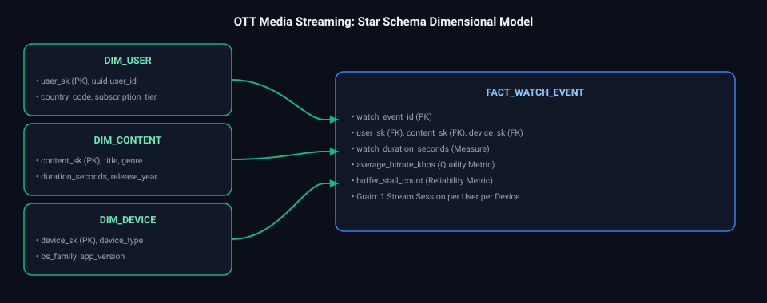

*D2 Source: [`07_ott_media_streaming_dimensional_er_model.d2`](assets/03_data_modeling_and_lakehouse_storage_faq/07_ott_media_streaming_dimensional_er_model.d2)*

#### Production DDL Implementation
```sql
-- High-Volume Event Table (Delta Lake / Parquet)
CREATE TABLE fact_watch_events (
    event_id STRING NOT NULL,
    user_id STRING NOT NULL,
    content_id STRING NOT NULL,
    device_type STRING NOT NULL,
    playback_position_seconds INT NOT NULL,
    duration_watched_seconds INT NOT NULL,
    completion_percentage DECIMAL(5, 2),
    event_timestamp TIMESTAMP NOT NULL,
    date DATE GENERATED ALWAYS AS (CAST(event_timestamp AS DATE))
)
USING DELTA
PARTITIONED BY (date)
CLUSTER BY (user_id, content_id);
```
- **Time Complexity:** $O(1)$ append on writes; $O(\log N)$ file pruning on user queries via Liquid Clustering.
- **Space Complexity:** Columnar Parquet with dictionary encoding on `device_type` and run-length encoding on `completion_percentage`.

#### Engineering Implications & Production Pitfalls
1. **Raw Heartbeat Retention Trap:** Storing 10-second heartbeats in perpetuity explodes storage costs to petabytes within months. Enforce a **lifecycle tiering policy**: roll raw heartbeats into daily session summaries after 30 days and transition raw Bronze data to Cold / Archive storage.
2. **Interview Talking Point:** For user-facing features like "Continue Watching", analytical data lakes have too much read latency ($>500\text{ ms}$). The latest playback position must be dual-written to an operational in-memory key-value store (Redis / Cassandra) with $<15\text{ ms}$ read SLA.

---

### Q15. [Easy] High-Throughput Log Data Modeling: Fast Writes vs Fast Reads
**Difficulty:** [Easy]
**Topic Covered:** LSM Trees vs B-Trees, Columnar Append-Only Topologies  
**Question:** How would you design a data model for storing large-scale logs that need fast write speed and moderately fast reads?

#### Definition & Core Concepts
Logging architectures (security audits, clickstreams, distributed traces) ingest gigabytes per second.
- **Fast Write Architecture:** Append-only ingestion into flat Parquet files. Zero primary key index constraints, zero unique index checks, and zero foreign key verifications on ingestion.
- **Fast Read Architecture:** Columnar compression, physical folder partitioning on `date` and `hour` (`date=YYYY-MM-DD/hour=HH/`), and metadata statistics (min/max dictionaries per Parquet file) to skip non-matching chunks during queries.

#### Visual Flow
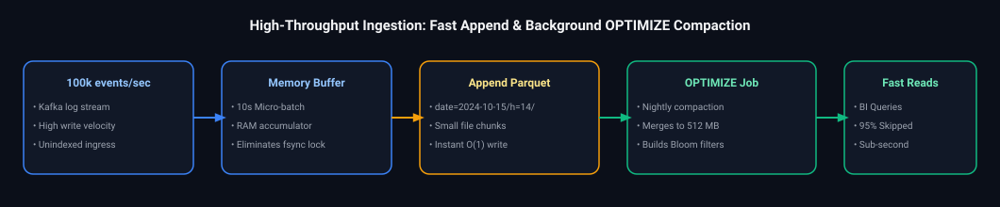

*D2 Source: [`08_high_throughput_log_append_compaction_pipeline.d2`](assets/03_data_modeling_and_lakehouse_storage_faq/08_high_throughput_log_append_compaction_pipeline.d2)*

#### Production DDL Implementation
```sql
CREATE TABLE app_telemetry_logs (
    log_id STRING NOT NULL,
    service_name STRING NOT NULL,
    log_level STRING NOT NULL, -- INFO, WARN, ERROR
    trace_id STRING,
    payload_json STRING,       -- Unparsed raw payload for zero-overhead writes
    log_timestamp TIMESTAMP NOT NULL,
    date DATE GENERATED ALWAYS AS (CAST(log_timestamp AS DATE)),
    hour INT GENERATED ALWAYS AS (EXTRACT(HOUR FROM log_timestamp))
)
USING DELTA
PARTITIONED BY (date, hour);
```
- **Time Complexity:** $O(1)$ sequential append write; $O(M)$ read where $M$ is pruned files.
- **Space Complexity:** $5\times$ to $10\times$ compression ratio via Snappy/ZSTD over columnar storage.

#### Engineering Implications & Production Pitfalls
1. **JSON String vs Shredded Columns:** Storing `payload_json` as a raw string provides lightning-fast writes, but querying nested fields requires scanning and parsing the entire string. In Gold/Silver layers, use scheduled batch jobs to shred common JSON keys into first-class physical columns.
2. **Interview Talking Point:** In ClickHouse or Elasticsearch, log models use Sparse Indexing and inverted indexes; in Lakehouses, Delta Lake uses file-level data skipping (Min/Max values and Bloom Filters) to achieve similar scan pruning without write indexing costs.

---

# 11. Schema Evolution & Versioned Warehouse Schemas Across Multiple Teams

---

### Q16. [Medium] Managing Schema Evolution & Versioning Across Multiple Analytics Teams
**Difficulty:** [Medium]
*(Grouped together: Handling schema evolution, backward incompatibility, and downstream dependency protection)*  
**Topic Covered:** Schema Evolution Governance, Semantic Layer Versioning, Expand/Contract  
**Questions Covered:**
- How would you manage schema evolution in a data warehouse used by multiple analytics teams?
- Design a versioned schema system for your data warehouse to handle backward-incompatible changes.
- A producer team is pushing a schema change that will break your downstream pipeline. How do you manage this schema evolution without causing failure?

#### Definition & Core Concepts
In an enterprise data platform with dozens of downstream analytical teams, a producer altering column names (`user_id` $\to$ `account_uuid`) or narrowing types (`BIGINT` $\to$ `INT`) breaks production dashboards.
To guarantee zero-downtime evolution:
1. **Enforce Central Schema Registry:** Use Avro/Protobuf registries (Confluent / AWS Glue) with `BACKWARD_TRANSITIVE` compatibility rules.
2. **Versioned View Abstraction:** Downstream analytics never query raw tables directly; they query versioned semantic views (`v1.orders`, `v2.orders`).
3. **Rescued Data Quarantine:** Catch unexpected producer columns in `_rescued_data` to prevent pipeline failures.

#### Visual Flow
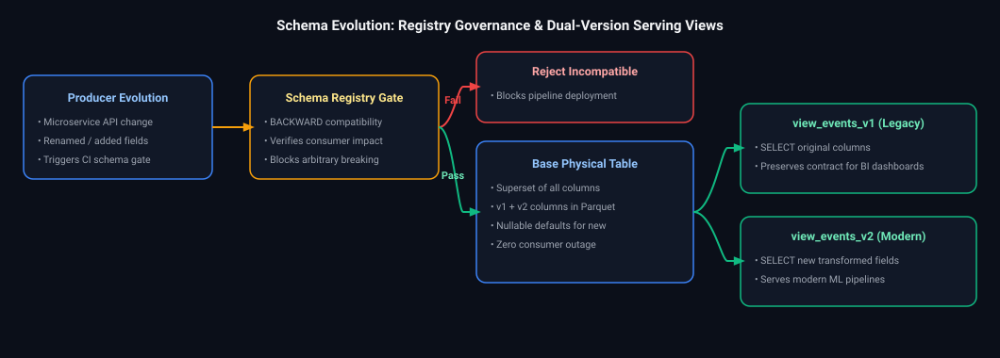

*D2 Source: [`09_schema_evolution_dual_version_lakehouse_pattern.d2`](assets/03_data_modeling_and_lakehouse_storage_faq/09_schema_evolution_dual_version_lakehouse_pattern.d2)*

#### Production Implementation / Code Solution
```sql
-- Step 1: Base Physical Table with additive schema evolution enabled
ALTER TABLE core.orders SET TBLPROPERTIES ('delta.autoOptimize.autoCompact' = 'true');

-- Step 2: Semantic View Version 1 (Preserves legacy column names)
CREATE OR REPLACE VIEW reporting_v1.orders AS
SELECT 
    order_id,
    COALESCE(account_uuid, legacy_customer_id) AS customer_id,
    order_amount,
    order_timestamp
FROM core.orders;

-- Step 3: Semantic View Version 2 (Exposes modern unified contract)
CREATE OR REPLACE VIEW reporting_v2.orders AS
SELECT 
    order_id,
    account_uuid,
    order_amount,
    currency_code,
    order_timestamp
FROM core.orders;
```
- **Time Complexity:** $O(1)$ metadata view resolution.
- **Space Complexity:** Zero additional storage bytes (virtual views).

#### Engineering Implications & Production Pitfalls
1. **Unannounced Producer Column Renames:** If a producer drops `price` and adds `unit_cost` without warning, pipelines fail. Using Delta Auto Loader with `cloudFiles.schemaEvolutionMode = "addNewColumns"` prevents pipeline crashes by capturing `unit_cost` as an additive column while retaining `price` as `NULL`.
2. **Interview Talking Point:** Announce a strict **Deprecation SLA** (e.g., 90 days). Deprecated views log querying users via audit system tables (`system.access.audit`), allowing automated Slack notifications to teams still querying `v1` views.

---

# 12. Data Governance, Audit Lineage & OLTP-to-OLAP Consistency

---

### Q17. [Medium] Enterprise Data Governance, Lineage & Consistency Guarantees
**Difficulty:** [Medium]
*(Grouped together: Audit frameworks, data consistency, ACID properties, and warehouse taxonomy)*  
**Topic Covered:** Audit Lineage Graphs, CDC Two-Phase Reconciliation, ACID Properties  
**Questions Covered:**
- How would you design an audit framework to track data lineage and transformations?
- What steps would you take to guarantee data consistency between a production OLTP database and an analytical data warehouse?
- Explain ACID properties and why they are important in financial data processing.
- Explain the differences between Data Lake, Data Warehouse, and Data Mart.

#### Definition & Core Concepts
Enterprise data governance requires verifiable auditability and data consistency:
1. **Data Lineage:** Tracking the origin and transformation steps of every metric from source API/OLTP to final executive KPI using OpenLineage / Unity Catalog.
2. **OLTP-to-OLAP Consistency:** Mitigating replication lag and ensuring financial balance equality ($\sum \text{OLTP Balance} == \sum \text{Warehouse Balance}$).
3. **ACID Properties in Financial Processing:**
   - **Atomicity:** All debits and credits commit together or fail completely.
   - **Consistency:** Ledger balance invariants remain strictly valid.
   - **Isolation:** Concurrent balance deductions cannot read uncommitted transactions.
   - **Durability:** Committed financial transactions survive infrastructure crashes.

#### Visual Flow
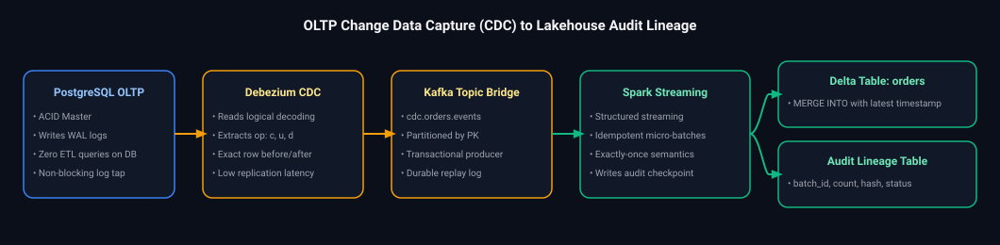

*D2 Source: [`10_oltp_cdc_debezium_to_lakehouse_audit_lineage.d2`](assets/03_data_modeling_and_lakehouse_storage_faq/10_oltp_cdc_debezium_to_lakehouse_audit_lineage.d2)*

#### Production Implementation: Automated Audit & Lineage Tracking Table
```sql
CREATE TABLE audit.pipeline_execution_lineage (
    execution_id STRING NOT NULL,
    pipeline_name STRING NOT NULL,
    source_system STRING NOT NULL,
    target_table STRING NOT NULL,
    records_read BIGINT,
    records_inserted BIGINT,
    records_updated BIGINT,
    records_rejected BIGINT,
    source_checksum_hash STRING,
    target_checksum_hash STRING,
    execution_start_time TIMESTAMP,
    execution_end_time TIMESTAMP,
    execution_status STRING,
    CONSTRAINT pk_audit PRIMARY KEY (execution_id)
)
USING DELTA;
```

#### Warehouse Taxonomy Comparison Matrix
| Architectural Layer | Data Lake | Data Warehouse | Data Mart |
| :--- | :--- | :--- | :--- |
| **Primary Scope** | Enterprise-wide raw & processed data. | Enterprise-wide conformed dimensional models. | Department-specific analytical subset (e.g. Marketing Mart). |
| **Schema Style** | Schema-on-Read (Structured, Unstructured). | Schema-on-Write (Kimball Star / Snowflake). | Highly aggregated Star Schemas / OBT. |
| **Target Users** | Data Engineers, ML Engineers, Data Scientists. | BI Analysts, Analytics Engineers. | Business Domain Analysts, Financial Controllers. |

#### Engineering Implications & Production Pitfalls
1. **Replication Lag Phantom Balances:** Analytical queries querying warehouses mid-replication observe partial transaction states. Always enforce **Snapshot Isolation** and report off immutable daily batch checkpoints for statutory audits.
2. **Interview Talking Point:** Under BCBS 239 regulations, banks must be able to reproduce exact historical balance calculations as they appeared on any given date. Bitemporal tables and Delta Lake Time Travel (`RESTORE AS OF`) provide mathematical proof of ledger state.

---

# 13. Data Lakehouse Security, Data Privacy & PII Protection

---

### Q18. [Medium] Securing Sensitive Customer Data, PII & Enforcing Row-Level Access Controls
**Difficulty:** [Medium]
*(Grouped together: Securing sensitive customer data, lakehouse PII architecture, dynamic masking, and row-level security)*  
**Topic Covered:** Lakehouse Security, Unity Catalog Governance, Dynamic Data Masking, Row-Level Filters & Cryptographic Tokenization  
**Questions Covered:**
- How would you secure sensitive customer data in a data lake environment?
- How do you enforce data privacy and row-level access controls in a modern data lake / Lakehouse architecture?
- How do you design a system to secure PII (Personally Identifiable Information) within a data lake while still allowing for authorized analytical access?

#### Definition & Core Concepts
Modern enterprise data lakehouses store petabytes of sensitive customer records (e.g., credit card numbers, national identifiers, email addresses, phone numbers). Securing sensitive customer data while enabling authorized analytical querying requires a defense-in-depth architecture across four foundational pillars:
1. **Decoupled Compute & Storage Credential Isolation:** Direct cloud storage keys/IAM roles are restricted strictly to the data management catalog (e.g., Databricks Unity Catalog, AWS Lake Formation, Snowflake Storage Integrations). End users and analysts never receive raw read keys to underlying cloud storage buckets (S3/ADLS/GCS).
2. **Column-Level Dynamic Data Masking (DDM):** Sensitive PII columns are dynamically transformed at query runtime. Unauthorized roles see redacted or one-way salted hashes (`sha256(email)` or `***-**-6789`), while authorized compliance officers view the plaintext.
3. **Row-Level Security (RLS) Predicate Filters:** Queries automatically append dynamic tenant or regional filtering predicates (`WHERE country = current_user_country()`), preventing unauthorized cross-jurisdiction data leaks without maintaining duplicate tables.
4. **Tokenization / Format-Preserving Encryption (FPE) & Cryptographic Shredding:** Replaces PII with non-sensitive surrogate tokens at ingestion. Under GDPR/CCPA "Right to be Forgotten", destroying the customer's encryption key mathematically renders historical backup lake files irreversibly shredded without running massive rewrite jobs.

#### Visual Flow
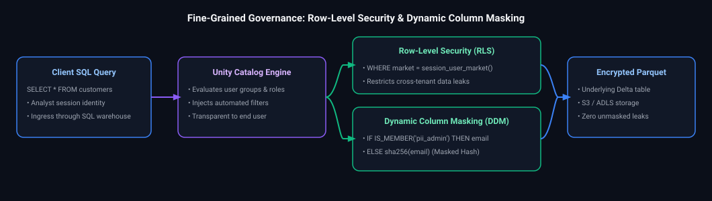

*D2 Source: [`11_unity_catalog_row_level_security_column_masking.d2`](assets/03_data_modeling_and_lakehouse_storage_faq/11_unity_catalog_row_level_security_column_masking.d2)*

#### Production Implementation: Unity Catalog Dynamic Masking & Row-Filter SQL
```sql
-- Step 1: Define Column Masking UDF for PII Email Redaction
CREATE OR REPLACE FUNCTION governance.mask_customer_email(email STRING)
RETURN CASE 
    WHEN IS_ACCOUNT_GROUP_MEMBER('compliance_pii_readers') THEN email
    ELSE CONCAT(SUBSTRING(email, 1, 2), '****@', SPLIT(email, '@')[1])
END;

-- Step 2: Define Row-Level Filter UDF for Regional Tenant Isolation
CREATE OR REPLACE FUNCTION governance.filter_market_jurisdiction(market STRING)
RETURN CASE
    WHEN IS_ACCOUNT_GROUP_MEMBER('global_executives') THEN TRUE
    ELSE market = CURRENT_USER() -- Or map via session entitlement table
END;

-- Step 3: Create Secure Production Lakehouse Table with Attached Policies
CREATE TABLE gold.customers (
    customer_id BIGINT NOT NULL,
    customer_name STRING,
    market STRING,
    email STRING MASK governance.mask_customer_email,
    ssn_last4 STRING,
    created_at TIMESTAMP
)
USING DELTA
ROW FILTER governance.filter_market_jurisdiction ON (market);

-- Step 4: Analytical Query Execution
-- For standard analysts: Only sees their assigned market, emails are masked as 'jo****@domain.com'
-- For compliance officers: Full rows across all markets with cleartext email
SELECT customer_id, customer_name, market, email 
FROM gold.customers;
```
- **Time Complexity:** $O(1)$ scalar evaluation overhead per returned record in query plan projection.
- **Space Complexity:** $O(1)$ memory overhead; evaluated during streaming vectorized Parquet decoding.

#### Engineering Implications & Production Pitfalls
1. **The Join Key Leak Pitfall:** Masking a column with salt or hashes (e.g. `sha256(email)`) preserves equality for joins, enabling downstream data correlation without exposing identity. However, dictionary attacks can reverse unsalted hashes of small key spaces (e.g., zip codes, phone numbers). Always incorporate a high-entropy secret salt rotated via KMS.
2. **Metadata & Parquet Footers:** Column masking in the catalog prevents query-level access, but if an engineer has direct cloud bucket read permissions (`s3:GetObject` or `Storage Blob Data Reader`), they can bypass the SQL engine and read raw Parquet column chunks directly. **Zero direct storage access** must be strictly enforced via IAM service principals.

---

# 14. Multi-Dimensional Aggregations & High-Scale Table Operations

---

### Q19. [Medium] Dimensional Data Modeling for Multi-Level Sales (Product, Vendor, Location)
**Difficulty:** [Medium]
**Topic Covered:** Star Schema Design, Periodic Snapshots, Hierarchy Flattening & Kimball Principles  
**Question:** Design a dimensional data model to support analytical reporting for yearly and monthly sales by product, vendor, and geographic location.

#### Definition & Core Concepts
High-volume retail requires balancing fine-grained transactional analysis with fast executive reporting.
- **Grain:** One row per product, per vendor, per fulfillment location, per month.
- **Schema Selection:** Star Schema with a **Periodic Snapshot Fact Table** (`fact_monthly_sales_snapshot`) joined to conforming dimension tables: `dim_date`, `dim_product`, `dim_vendor`, and `dim_location`.

#### Visual Flow
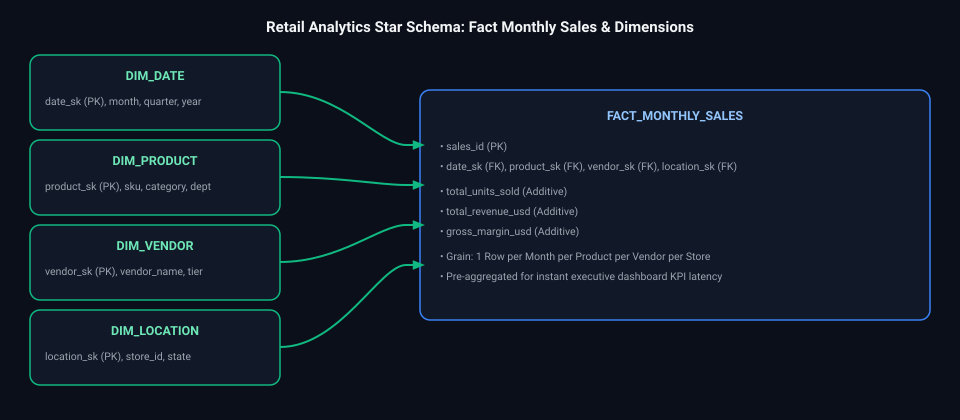

*D2 Source: [`12_retail_analytics_star_schema_er_model.d2`](assets/03_data_modeling_and_lakehouse_storage_faq/12_retail_analytics_star_schema_er_model.d2)*

#### Production DDL & Query Implementation
```sql
-- DDL for Aggregate Snapshot Fact Table
CREATE TABLE gold.fact_monthly_sales_snapshot (
    month_key INT NOT NULL,              -- YYYYMM integer key
    product_sk INT NOT NULL,
    vendor_sk INT NOT NULL,
    location_sk INT NOT NULL,
    total_units_sold BIGINT NOT NULL,
    gross_sales_amount DECIMAL(18, 2) NOT NULL,
    total_cost_amount DECIMAL(18, 2) NOT NULL,
    net_profit_margin DECIMAL(18, 2) NOT NULL,
    PRIMARY KEY (month_key, product_sk, vendor_sk, location_sk)
) USING DELTA
CLUSTER BY (month_key, vendor_sk);

-- Rollup Query by Product, Vendor, and Geographic Location
SELECT 
    d.year,
    d.month_name,
    v.vendor_name,
    p.category_name,
    l.country,
    l.state,
    SUM(f.gross_sales_amount) AS total_revenue,
    SUM(f.net_profit_margin) AS total_profit
FROM gold.fact_monthly_sales_snapshot f
JOIN gold.dim_date d ON f.month_key = d.month_key
JOIN gold.dim_vendor v ON f.vendor_sk = v.vendor_sk
JOIN gold.dim_product p ON f.product_sk = p.product_sk
JOIN gold.dim_location l ON f.location_sk = l.location_sk
WHERE d.year = 2025
GROUP BY d.year, d.month_name, v.vendor_name, p.category_name, l.country, l.state;
```

---

### Q20. [Medium] Managing and Querying Billion-Row Tables in Analytical Warehouses
**Difficulty:** [Medium]
**Topic Covered:** Extreme Scale Table Management, Partition Pruning, Z-Ordering & Compaction  
**Question:** How would you work with a table containing 1 billion rows in a cloud data warehouse/lakehouse?

#### Architecture & Optimization Playbook
Managing a 1-billion-row dataset requires defense-in-depth across storage layout, metadata pruning, and query routing:

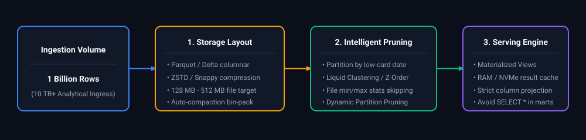

*D2 Source: [`13_large_scale_analytical_table_query_optimization.d2`](assets/03_data_modeling_and_lakehouse_storage_faq/13_large_scale_analytical_table_query_optimization.d2)*

#### Production Action Checklist
1. **Partition Pruning:** Enforce coarse partition boundaries (e.g., `date(event_timestamp)`). A billion rows across 3 years is $\sim 1\text{M}$ rows/day—ideal for partition pruning.
2. **Clustering & Data Skipping:** Use **Liquid Clustering** (`CLUSTER BY (tenant_id, user_id)`) or Z-Ordering to cluster files multidimensionally. This populates Min/Max zone maps, allowing query engines to skip 95%+ of files during point lookups.
3. **Avoid Full Table Scans:** Prohibit queries without partition filters via governance rules. Enforce materialized aggregate rollups for dashboard consumers.
4. **Maintenance Automation:** Run automated compaction (`OPTIMIZE`) and purge deleted tombstones (`VACUUM`) on schedule to eliminate small file syndrome and metadata bloat.

---

### Q21. [Hard] Enterprise Cloud Storage Cost Optimization in Data Lakes & Warehouses
**Difficulty:** [Hard]
**Topic Covered:** FinOps, Lifecycle Management, Delta VACUUM & Compression Codecs  
**Question:** How do you save storage costs in a petabyte-scale cloud data lakehouse?

#### Cost Reduction Pillars
1. **Delta Lake VACUUM & Retention Tuning:** Delta Lake maintains historical file versions for Time Travel. Unregulated retention can cause storage to swell 5x to 10x beyond active table size.
   ```sql
   -- Reduce historical retention from default 30 days to 7 days for staging tables
   SET spark.databricks.delta.vacuum.parallelDelete.enabled = true;
   VACUUM delta.`/mnt/lake/bronze/events` RETAIN 168 HOURS; -- 7 days
   ```
2. **Cloud Storage Lifecycle Tiering (Hot $\to$ Cool $\to$ Cold $\to$ Archive):** In Azure ADLS Gen2 or AWS S3, configure lifecycle rules to transition bronze raw archives older than 90 days to Archive/Glacier storage (\$0.00099/GB/month vs \$0.018/GB/month, a **94% cost reduction**).
3. **Advanced Columnar Compression:** Migrate legacy uncompressed JSON/CSV to Parquet with **Zstandard (ZSTD)** or Snappy compression codecs, reducing storage footprint by 75-85%.
4. **Column Dropping & Ephemeral Scratch Scrubbing:** Eliminate multi-megabyte unparsed string payloads in silver/gold layers. Automatically delete temporary scratch directories after ETL jobs complete.

---

# 15. Next-Generation Analytical Storage & Concurrency Architecture

---

### Q22. [Easy] Microsoft Fabric Lakehouse vs Fabric Warehouse: Architectural Comparison
**Difficulty:** [Easy]
**Topic Covered:** SaaS Data Platforms, OneLake, Direct Lake Mode, T-SQL vs Spark  
**Question:** What is the difference between a Fabric Lakehouse and a Fabric Warehouse? When would you choose each?

#### Comparison Matrix

| Dimension | Fabric Lakehouse | Fabric Warehouse |
| :--- | :--- | :--- |
| **Primary Focus** | Code-first data engineering & data science. | SQL-first enterprise relational data warehousing. |
| **Compute Engines** | Apache Spark (PySpark, Scala, Spark SQL, R). | Distributed Synapse T-SQL MPP Query Engine. |
| **Storage Structure** | Unstructured `Files/` + Structured `Tables/` (Delta Parquet). | Strictly Structured `Tables/` (Managed Delta Parquet only). |
| **Transactions** | Single-table Delta ACID transactions. | **Cross-table multi-statement ACID transactions** with full rollback. |
| **Schema Governance** | Schema-on-read + Delta schema evolution (`mergeSchema`). | Schema-on-write with strict ANSI SQL constraints. |
| **Power BI Serving** | **Direct Lake mode** (in-memory columnar cache) + SQL endpoint. | **Direct Lake mode** + DirectQuery + Import. |

#### Architectural Decision Rule
- **Use Fabric Lakehouse when:** Ingesting raw streaming feeds, logs, semi-structured JSON/APIs, or when transformations require PySpark and machine learning libraries.
- **Use Fabric Warehouse when:** Migrating legacy SQL Server/Synapse MPP stored procedures, building enterprise dimensional star schemas, or requiring strict multi-table relational transaction integrity.

---

### Q23. [Medium] End-to-End Database Design: Movie Ticket Booking Platform
**Difficulty:** [Medium]
**Topic Covered:** Relational Modeling, High-Concurrency Race Conditions, Seat Locking  
**Question:** Design a database schema for an online movie ticket booking platform (e.g. BookMyShow). Explain table relationships, assumptions, and how you prevent double-booking.

#### Relational Architecture & Assumptions
- **Theaters & Screens:** A theater has multiple auditoriums; each auditorium has a fixed seat map with categories (Standard, Premium, Recliner).
- **Showtimes:** A movie is scheduled on an auditorium for a specific datetime.
- **Seat States:** `AVAILABLE` $\to$ `LOCKED` (10-minute payment hold) $\to$ `BOOKED`.

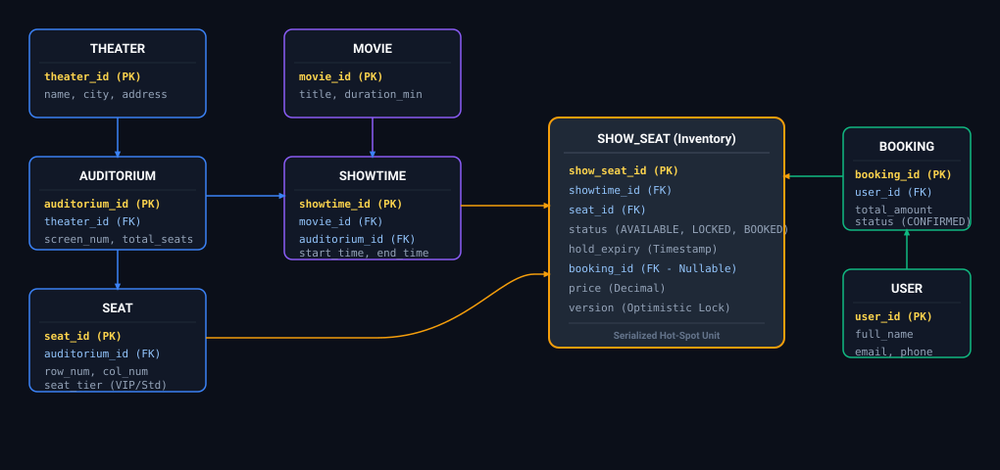

*D2 Source: [`14_movie_ticket_booking_system_er_model.d2`](assets/03_data_modeling_and_lakehouse_storage_faq/14_movie_ticket_booking_system_er_model.d2)*

#### Preventing Double-Booking via Optimistic Locking
```sql
-- Atomic lock acquisition during checkout seat selection
UPDATE show_seats
SET 
    status = 'LOCKED',
    hold_expiry = NOW() + INTERVAL '10 MINUTE',
    booking_id = :user_booking_id,
    version = version + 1
WHERE show_seat_id = :seat_id
  AND (
      status = 'AVAILABLE' 
      OR (status = 'LOCKED' AND hold_expiry < NOW())
  )
  AND version = :read_version;
-- If affected rows == 0: Seat was locked by another user! Abort and notify customer.
```

---

### Q24. [Medium] Schema Evolution & Safe Data Model Migration in Active Pipelines
**Difficulty:** [Medium]
**Topic Covered:** Non-Destructive Migrations, Expand/Contract Pattern, View Virtualization  
**Question:** You are tasked with implementing a significant change to an existing data model in an active production pipeline. How do you approach this safely without breaking downstream analytics?

#### The Expand/Contract Migration Methodology
Never apply in-place destructive DDL (`ALTER TABLE ... DROP COLUMN` or changing column data types) on active data pipelines:

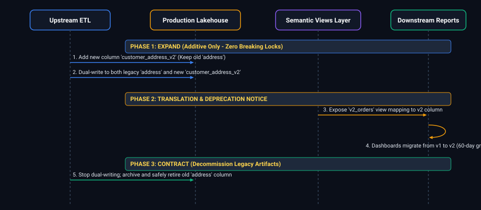

*D2 Source: [`15_blue_green_lakehouse_table_zero_downtime_swap.d2`](assets/03_data_modeling_and_lakehouse_storage_faq/15_blue_green_lakehouse_table_zero_downtime_swap.d2)*

#### Production Playbook Rules
1. **Additive-Only Changes:** Add new columns as optional/nullable. Let upstream pipelines populate new fields while legacy columns remain functional.
2. **View Virtualization Layer:** Never allow BI tools to query physical tables directly. Query through semantic views (`v1_orders`, `v2_orders`). Upgrading a view contract is seamless and non-breaking.
3. **Dual-Writing & Backfilling:** Run parallel backfill jobs to populate historical data for the new schema before promoting downstream reports.
4. **Automated Schema Evolution Guards:** In Spark/Delta pipelines, use `.option("mergeSchema", "true")` for additive changes, but enforce strict data contracts via Great Expectations or Delta Expectations to prevent silent corruptions.

---

# 16. Physical Table Life Cycles, Payment Schemas & Data Discrepancy Diagnostics

---

### Q25. [Easy] Transient Tables vs Temporary Tables in Enterprise Warehouses
**Difficulty:** [Easy]
**Topic Covered:** Physical Table Lifecycles, Session Scoping, Fail-Safe & Storage Costs  
**Question:** Describe the differences between transient tables and temporary tables in modern cloud data warehouses (e.g., Snowflake, BigQuery, Databricks). When would you choose one over the other in production ETL pipelines?

#### Definition & Core Concepts
Cloud data warehouses manage table durability, session binding, and disaster recovery through distinct table types:
1. **Temporary Tables (`CREATE TEMPORARY TABLE`):**
   - **Lifecycle:** Bound strictly to the user connection / session that created them. Dropped automatically when the session terminates or cluster restarts.
   - **Isolation:** Completely invisible to other concurrent sessions, avoiding naming collisions in parallel pipelines.
   - **Disaster Recovery:** Zero Fail-Safe, 0–1 day Time Travel.
   - **Use Case:** Intermediate ETL transformation staging, scratchpad joins, and session-scoped aggregations.
2. **Transient Tables (`CREATE TRANSIENT TABLE`):**
   - **Lifecycle:** Persistent across sessions until explicitly dropped (`DROP TABLE`). Visible to all authenticated users with grants.
   - **Disaster Recovery:** Supports Time Travel (up to 1 day in Snowflake), but **NO Fail-Safe period** (the secondary 7-day disaster recovery tier maintained by cloud storage).
   - **Cost Profile:** Substantially cheaper storage than permanent tables because no multi-terabyte 7-day Fail-Safe snapshots are maintained.
   - **Use Case:** Daily ETL staging tables, ODS (Operational Data Stores), and intermediate medallion tables that can be easily recreated from source in the event of an outage.

#### Visual Flow
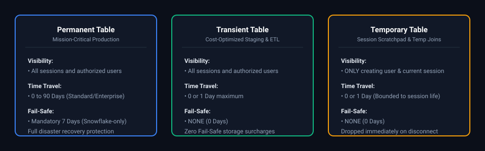

*D2 Source: [`16_snowflake_table_types_permanent_transient_temporary.d2`](assets/03_data_modeling_and_lakehouse_storage_faq/16_snowflake_table_types_permanent_transient_temporary.d2)*

#### Production Implementation / Code Solution
```sql
-- Pattern 1: Session-scoped temporary table for ephemeral ELT deduplication
CREATE OR REPLACE TEMPORARY TABLE staging_orders_session_scratch AS
SELECT 
    order_id,
    customer_id,
    amount,
    order_timestamp,
    ROW_NUMBER() OVER(PARTITION BY order_id ORDER BY order_timestamp DESC) as rn
FROM raw_orders_stream
WHERE order_date = CURRENT_DATE();

-- Pattern 2: Multi-step ETL persistent transient table for cross-task Airflow pipelines
CREATE OR REPLACE TRANSIENT TABLE raw_ods.stg_orders_transient (
    order_id VARCHAR(64) NOT NULL,
    customer_id VARCHAR(64) NOT NULL,
    amount DECIMAL(18, 4),
    order_timestamp TIMESTAMP_NTZ,
    ingestion_batch_id VARCHAR(128)
)
DATA_RETENTION_TIME_IN_DAYS = 1; -- 1 Day Time Travel, 0 Days Fail-Safe

-- Atomic merge from transient staging into production permanent warehouse table
MERGE INTO analytics_gold.fact_orders tgt
USING (SELECT * FROM raw_ods.stg_orders_transient WHERE ingestion_batch_id = 'BATCH_20241017') src
ON tgt.order_id = src.order_id
WHEN MATCHED THEN 
    UPDATE SET tgt.amount = src.amount, tgt.updated_at = CURRENT_TIMESTAMP()
WHEN NOT MATCHED THEN 
    INSERT (order_id, customer_id, amount, created_at)
    VALUES (src.order_id, src.customer_id, src.amount, src.order_timestamp);
```
- **Time Complexity:** $O(1)$ DDL allocation overhead. Data ingestion into transient tables mirrors permanent table throughput without Fail-Safe snapshotting.
- **Space Complexity:** Saves up to 40%–60% of storage cost compared to permanent tables with heavy churn (eliminating 7-day Fail-Safe history).

#### Engineering Implications & Production Pitfalls
1. **The Fail-Safe Cost Trap on Large Churning Tables:** If you truncate and reload a 10 TB permanent table daily, Snowflake retains 10 TB in Time Travel plus 70 TB in 7-day Fail-Safe! The storage bill explodes. Switching daily staging tables to `TRANSIENT` saves tens of thousands of dollars monthly.
2. **Session Disconnection in Microservice Orchestration:** If using ADF, Airflow, or dbt where each task opens an independent connection or executes across separate worker nodes, a `TEMPORARY TABLE` created in Task 1 will **not exist in Task 2**. For multi-activity DAGs, always use `TRANSIENT` tables scoped with a unique pipeline execution run ID.

#### Core Curriculum Cross-Reference
*Deep-dive theoretical reference: See [06. Data Architecture & Modeling: Storage Formats & Physical Design](../03_data_modeling_and_lakehouse_storage.md#110-architecture-showdown-inmon-vs-kimball-vs-data-vault-20)*

---

### Q26. [Medium] Swipe Payment API Relational Schema & Idempotent Ledger Design
**Difficulty:** [Medium]
**Topic Covered:** Financial Ledger Modeling, Idempotency Keys, Double-Entry Bookkeeping & POS States  
**Question:** Explain how you would model a card-present “swipe payment” API in a relational database. Detail the tables, constraints, transaction lifecycle, and double-entry ledger design.

#### Definition & Core Concepts
Modeling card-present (Point of Sale / POS) payments requires zero loss tolerance, strict idempotency, auditability, and double-entry accounting invariants:
1. **Authorization vs. Capture:** In swipe transactions, an **Authorization** places an immediate hold on the customer's credit limit; **Capture/Settlement** clears the funds days later. These are distinct state changes and must not overwrite historical states.
2. **Idempotency Keys:** Network retries from POS terminals must never double-charge. A unique, client-generated `idempotency_key` guarantees that repeated requests return the original authorization response without creating a duplicate debit.
3. **Double-Entry Bookkeeping:** Money cannot be created or destroyed. Every transaction must consist of balanced debits and credits across financial accounts:
   $$\sum \text{Debits} = \sum \text{Credits}$$

#### Visual Flow
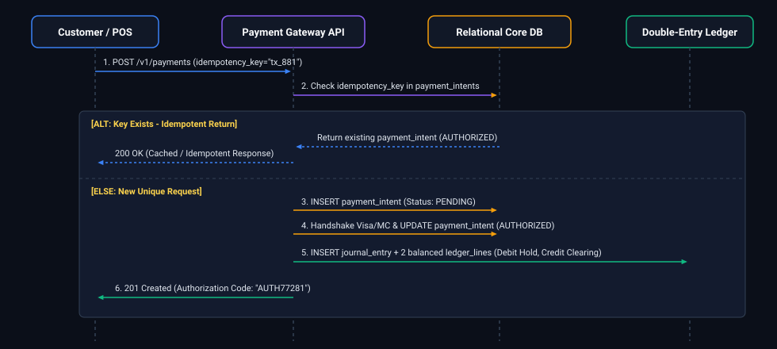

*D2 Source: [`17_double_entry_ledger_payment_idempotency_flow.d2`](assets/03_data_modeling_and_lakehouse_storage_faq/17_double_entry_ledger_payment_idempotency_flow.d2)*

#### Production Implementation / Code Solution
```sql
-- 1. Payment Intents Table: Enforces terminal idempotency and POS hardware audit
CREATE TABLE payment_intents (
    intent_id UUID PRIMARY KEY DEFAULT gen_random_uuid(),
    idempotency_key VARCHAR(128) NOT NULL UNIQUE,  -- Prevents duplicate terminal charges
    terminal_id VARCHAR(64) NOT NULL,
    merchant_id VARCHAR(64) NOT NULL,
    card_token VARCHAR(128) NOT NULL,              -- Tokenized PAN (Strict PCI-DSS compliance)
    amount DECIMAL(18, 4) NOT NULL CHECK (amount > 0),
    currency_code CHAR(3) NOT NULL,
    status VARCHAR(32) NOT NULL CHECK (status IN ('PENDING', 'AUTHORIZED', 'CAPTURED', 'VOIDED', 'FAILED')),
    auth_code VARCHAR(32),
    created_at TIMESTAMP WITH TIME ZONE DEFAULT CURRENT_TIMESTAMP,
    updated_at TIMESTAMP WITH TIME ZONE DEFAULT CURRENT_TIMESTAMP
);

-- 2. Financial Accounts Table (Customer, Merchant Escrow, Interchange Clearing)
CREATE TABLE ledger_accounts (
    account_id UUID PRIMARY KEY DEFAULT gen_random_uuid(),
    account_name VARCHAR(128) NOT NULL,
    account_type VARCHAR(32) NOT NULL CHECK (account_type IN ('ASSET', 'LIABILITY', 'EQUITY', 'REVENUE', 'EXPENSE')),
    currency_code CHAR(3) NOT NULL,
    is_active BOOLEAN DEFAULT TRUE
);

-- 3. Double-Entry Journal Entries (Transaction Header)
CREATE TABLE journal_entries (
    entry_id UUID PRIMARY KEY DEFAULT gen_random_uuid(),
    intent_id UUID NOT NULL REFERENCES payment_intents(intent_id),
    posted_at TIMESTAMP WITH TIME ZONE DEFAULT CURRENT_TIMESTAMP,
    description VARCHAR(255) NOT NULL
);

-- 4. Balanced Ledger Postings (Lines must sum to zero)
CREATE TABLE ledger_postings (
    posting_id UUID PRIMARY KEY DEFAULT gen_random_uuid(),
    entry_id UUID NOT NULL REFERENCES journal_entries(entry_id),
    account_id UUID NOT NULL REFERENCES ledger_accounts(account_id),
    -- Positive for Debit, Negative for Credit (or explicit debit/credit columns)
    amount DECIMAL(18, 4) NOT NULL,
    created_at TIMESTAMP WITH TIME ZONE DEFAULT CURRENT_TIMESTAMP
);

-- Defensive Check: Verify zero-sum invariant across every journal entry
CREATE OR REPLACE FUNCTION verify_journal_balance() 
RETURNS TRIGGER AS $$
DECLARE
    entry_sum DECIMAL(18, 4);
BEGIN
    SELECT COALESCE(SUM(amount), 0) INTO entry_sum
    FROM ledger_postings
    WHERE entry_id = NEW.entry_id;

    -- Enforce zero-sum invariant
    IF entry_sum <> 0 THEN
        RAISE EXCEPTION 'Double-entry violation: Journal entry % debits and credits do not balance (sum = %)', NEW.entry_id, entry_sum;
    END IF;
    RETURN NEW;
END;
$$ LANGUAGE plpgsql;
```
- **Time Complexity:** $O(1)$ indexed lookup on `idempotency_key` via B-Tree index; $O(1)$ transaction commit across normalized tables.
- **Space Complexity:** $O(T)$ where $T$ is the number of financial transactions (roughly $1\text{ KB}$ per transaction across audit tables).

#### Engineering Implications & Production Pitfalls
1. **PCI-DSS Compliance Invariant:** Never store raw Primary Account Numbers (PAN), CVVs, or unencrypted magnetic stripe track data in relational tables. Store only PCI-tokenized references (`card_token`) provided by the certified payment HSM/vault.
2. **Distributed Transaction Contention:** High-volume merchants process hundreds of swipes per second. Updating an account balance column directly (`UPDATE accounts SET balance = balance + amount`) creates massive row-level write lock contention (`RowExclusiveLock`). Always record ledger postings as immutable append-only events, computing balance on-the-fly or via periodic asynchronous snapshotting.

#### Core Curriculum Cross-Reference
*Deep-dive theoretical reference: See [06. Data Architecture & Modeling: Relational Normalization & Event Ledgers](../03_data_modeling_and_lakehouse_storage.md#03-data-architecture-dimensional-modeling--storage-formats-master-production-guide)*

---

### Q27. [Medium] University Relational Database Schema Design (Colleges, Students, Professors)
**Difficulty:** [Medium]
**Topic Covered:** 3NF Normalization, Composite Primary Keys, Foreign Keys & Cardinality Constraints  
**Question:** Design an optimal, normalized relational database schema for a university system encompassing colleges, departments, students, professors, and course enrollments.

#### Definition & Core Concepts
A university system models complex many-to-many ($M:N$) relationships, hierarchical department ownership, and temporal enrollment states.
To achieve Third Normal Form (3NF) without data redundancy:
1. **Hierarchy:** A College owns multiple Departments ($1:N$). A Department employs multiple Professors ($1:N$).
2. **Courses & Offerings:** A Course is a catalog template ($1:N$ to Sections/Offerings). A specific Section is taught by a Professor in a given semester ($1:N$).
3. **Enrollments:** A Student enrolls in multiple Course Sections, and each Section contains multiple Students ($M:N$). This requires a bridge/junction table (`enrollments`) with a composite key or unique constraint on `(student_id, section_id)`.

#### Visual Flow
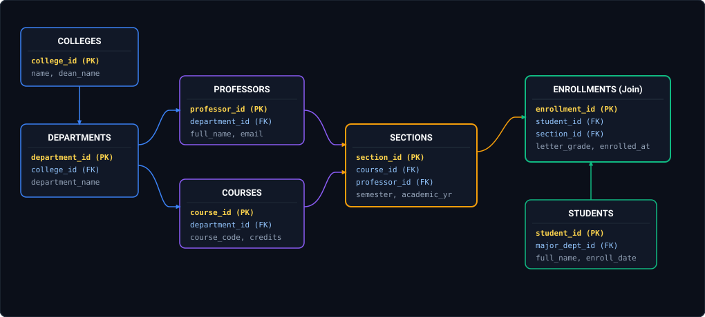

*D2 Source: [`18_university_course_registration_er_model.d2`](assets/03_data_modeling_and_lakehouse_storage_faq/18_university_course_registration_er_model.d2)*

#### Production Implementation / Code Solution
```sql
-- 1. Colleges Dimension
CREATE TABLE colleges (
    college_id UUID PRIMARY KEY DEFAULT gen_random_uuid(),
    college_name VARCHAR(128) NOT NULL UNIQUE,
    campus_location VARCHAR(128) NOT NULL,
    created_at TIMESTAMP WITH TIME ZONE DEFAULT CURRENT_TIMESTAMP
);

-- 2. Academic Departments
CREATE TABLE departments (
    department_id UUID PRIMARY KEY DEFAULT gen_random_uuid(),
    college_id UUID NOT NULL REFERENCES colleges(college_id) ON DELETE RESTRICT,
    department_name VARCHAR(128) NOT NULL,
    department_code VARCHAR(10) NOT NULL UNIQUE, -- e.g., 'CS', 'EE', 'MATH'
    created_at TIMESTAMP WITH TIME ZONE DEFAULT CURRENT_TIMESTAMP
);

-- 3. Faculty / Professors
CREATE TABLE professors (
    professor_id UUID PRIMARY KEY DEFAULT gen_random_uuid(),
    department_id UUID NOT NULL REFERENCES departments(department_id),
    full_name VARCHAR(128) NOT NULL,
    email VARCHAR(255) NOT NULL UNIQUE,
    tenure_status VARCHAR(32) NOT NULL CHECK (tenure_status IN ('TENURED', 'TENURE_TRACK', 'ADJUNCT', 'VISITING')),
    hire_date DATE NOT NULL
);

-- 4. Course Catalog (Template)
CREATE TABLE courses (
    course_id UUID PRIMARY KEY DEFAULT gen_random_uuid(),
    department_id UUID NOT NULL REFERENCES departments(department_id),
    course_code VARCHAR(16) NOT NULL UNIQUE, -- e.g., 'CS-401'
    title VARCHAR(255) NOT NULL,
    credit_hours SMALLINT NOT NULL CHECK (credit_hours BETWEEN 1 AND 6)
);

-- 5. Course Sections (Specific semester offering taught by a faculty member)
CREATE TABLE course_sections (
    section_id UUID PRIMARY KEY DEFAULT gen_random_uuid(),
    course_id UUID NOT NULL REFERENCES courses(course_id) ON DELETE RESTRICT,
    professor_id UUID NOT NULL REFERENCES professors(professor_id),
    semester VARCHAR(16) NOT NULL CHECK (semester IN ('FALL', 'SPRING', 'SUMMER', 'WINTER')),
    academic_year SMALLINT NOT NULL CHECK (academic_year >= 2000),
    max_capacity SMALLINT NOT NULL DEFAULT 40,
    CONSTRAINT uq_course_section_semester UNIQUE (course_id, section_id, semester, academic_year)
);

-- 6. Students
CREATE TABLE students (
    student_id UUID PRIMARY KEY DEFAULT gen_random_uuid(),
    major_department_id UUID REFERENCES departments(department_id),
    full_name VARCHAR(128) NOT NULL,
    email VARCHAR(255) NOT NULL UNIQUE,
    enrollment_date DATE NOT NULL,
    academic_standing VARCHAR(32) DEFAULT 'ACTIVE'
);

-- 7. Bridge/Junction: Student Course Enrollments
CREATE TABLE enrollments (
    enrollment_id UUID PRIMARY KEY DEFAULT gen_random_uuid(),
    student_id UUID NOT NULL REFERENCES students(student_id) ON DELETE CASCADE,
    section_id UUID NOT NULL REFERENCES course_sections(section_id) ON DELETE RESTRICT,
    letter_grade CHAR(2) CHECK (letter_grade IN ('A+', 'A', 'B', 'C', 'D', 'F', 'W', 'IP')),
    enrolled_at TIMESTAMP WITH TIME ZONE DEFAULT CURRENT_TIMESTAMP,
    -- Prevent duplicate registration by the same student in the same section
    CONSTRAINT uq_student_section UNIQUE (student_id, section_id)
);
```
- **Time Complexity:** $O(1)$ lookups via primary and foreign key indexes (`B-Tree`).
- **Space Complexity:** $O(S + E)$ where $S$ is students and $E$ is enrollments.

#### Engineering Implications & Production Pitfalls
1. **Cascading Delete Hazards (`ON DELETE CASCADE`):** Applying `ON DELETE CASCADE` on `departments` or `courses` risks accidentally wiping out hundreds of historical course transcripts when a department reorganizes. In academic and financial systems, always use `ON DELETE RESTRICT` on master dimensions and implement soft deletion (`is_deleted = TRUE`).
2. **Surrogate Keys vs Composite Keys:** While `(student_id, section_id)` uniquely identifies an enrollment, using a surrogate `enrollment_id UUID PRIMARY KEY` with a `UNIQUE (student_id, section_id)` constraint simplifies downstream foreign key relationships (e.g. `assignment_submissions` linking to `enrollment_id`).

#### Core Curriculum Cross-Reference
*Deep-dive theoretical reference: See [06. Data Architecture & Modeling: Relational Foundations & Normal Forms](../03_data_modeling_and_lakehouse_storage.md#03-data-architecture-dimensional-modeling--storage-formats-master-production-guide)*

---

### Q28. [Medium] High-Velocity Web Traffic Event Log Schema (Clicks/Swipes)
**Difficulty:** [Medium]
**Topic Covered:** Telemetry Schemas, Partitioning Strategies, Columnar Encoding & Write Scalability  
**Question:** Design an optimal schema to store high-velocity event logs (such as clicks, swipes, and impressions) for a web platform generating 50,000 events per second.

#### Definition & Core Concepts
High-velocity web traffic ($50,000\text{ events/sec} \approx 4.32\text{ billion events/day}$) breaks standard row-oriented relational databases (e.g. Postgres) due to WAL saturation, page lock contention, and index maintenance overhead.
The optimal architectural design employs:
1. **Append-Only Columnar Storage:** Use Parquet / Delta Lake / ClickHouse / Snowflake rather than row tables.
2. **Coarse-Grained Temporal Partitioning:** Partition by `event_date` (`year/month/day`) to ensure each partition folder contains hundreds of megabytes (avoiding the small file problem).
3. **Clustering / Liquid Clustering Keys:** Order rows within files by `(event_type, tenant_id, session_id)` to enable file pruning and min/max metadata skipping.
4. **Semi-Structured Payload Isolation:** Extract top-level query filters (`event_type`, `user_id`, `device_os`, `url_path`) as typed columns, leaving dynamic event-specific attributes inside a compressed `JSON` / `VARIANT` column.

#### Visual Flow
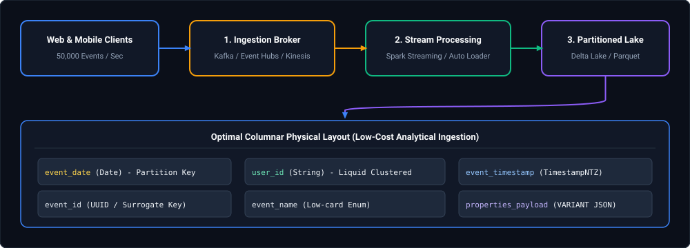

*D2 Source: [`19_high_throughput_event_stream_columnar_storage.d2`](assets/03_data_modeling_and_lakehouse_storage_faq/19_high_throughput_event_stream_columnar_storage.d2)*

#### Production Implementation / Code Solution
```sql
-- Delta Lake / Databricks SQL Table Definition for High-Velocity Telemetry
CREATE OR REPLACE TABLE telemetry_silver.user_interaction_events (
    event_id STRING NOT NULL,
    event_timestamp TIMESTAMP NOT NULL,
    event_date DATE NOT NULL GENERATED ALWAYS AS (CAST(event_timestamp AS DATE)),
    event_name STRING NOT NULL,          -- e.g. 'ui_button_click', 'feed_swipe_left'
    user_id STRING,                      -- Nullable for unauthenticated visitors
    session_id STRING NOT NULL,
    client_ip STRING,
    device_os STRING,                   -- 'iOS', 'Android', 'Windows', 'MacOS'
    app_version STRING,
    page_url STRING,
    -- Flexible payload for event-specific attributes (JSON dictionary)
    event_payload VARIANT,
    -- Pipeline ingestion metadata
    ingestion_timestamp TIMESTAMP DEFAULT CURRENT_TIMESTAMP()
)
USING DELTA
PARTITIONED BY (event_date)
CLUSTER BY (event_name, user_id, session_id); -- Delta Liquid Clustering for query pruning

-- Querying the optimized event log with sub-second response times
SELECT 
    event_name,
    device_os,
    COUNT(*) as total_interactions,
    COUNT(DISTINCT user_id) as unique_users,
    -- Extracting nested JSON payload attributes efficiently
    AVG(CAST(event_payload:swipe_velocity_px AS DOUBLE)) as avg_swipe_velocity
FROM telemetry_silver.user_interaction_events
WHERE event_date = CURRENT_DATE()
  AND event_name = 'feed_swipe_left'
GROUP BY event_name, device_os;
```
- **Time Complexity:** Ingestion runs at $O(1)$ append; analytical queries achieve $O(\log F)$ partition and metadata pruning where $F$ is file count.
- **Space Complexity:** Columnar Snappy/ZSTD compression reduces raw JSON footprint by $80\%\text{--}90\%$ ($50\text{k events/sec}$ compresses from $4.3\text{ TB/day}$ to $\approx 500\text{ GB/day}$).

#### Engineering Implications & Production Pitfalls
1. **The Over-Partitioning Disaster:** Never partition by `event_timestamp` down to the hour or minute (e.g. `/year/month/day/hour/minute`). This generates millions of tiny 5KB files, overwhelming the cloud storage object catalog and killing Spark driver memory. Partition by `event_date` only, and cluster by user/session.
2. **Schema Drift in JSON Payloads:** Mobile app updates frequently add or rename payload fields. Storing dynamic attributes in a typed `VARIANT` column allows schema evolution without requiring `ALTER TABLE ADD COLUMN` operations that risk breaking downstream analytical ingestion.

#### Core Curriculum Cross-Reference
*Deep-dive theoretical reference: See [07. File Formats and Storage: Parquet, ORC, Delta & Columnar Compression](../03_data_modeling_and_lakehouse_storage.md#4-first-principles-serialization-deserialization--storage-mechanics)*

---

### Q29. [Hard] Data Integrity Discrepancy Between Data Warehouse and Source Post-Incremental Load
**Difficulty:** [Hard]
**Topic Covered:** Data Reconciliation, Watermarking Skew, Soft Deletes & Uncommitted Transaction Anomalies  
**Question:** After completing an incremental ETL load, the Data Warehouse and the source transactional system report different aggregate values (e.g., total daily revenue or active order counts). How could this discrepancy occur, and how do you systematically diagnose and fix it?

#### Definition & Core Concepts
Data reconciliation discrepancies between source OLTP databases and target OLAP warehouses are among the most critical production incidents in data engineering. They typically stem from 4 underlying mechanical root causes:
1. **The Late-Arriving Update / In-Flight Transaction Phenomenon:**
   The extraction query uses `WHERE updated_at >= $last_watermark`. If a long-running source transaction began at `10:00:00` with an `updated_at` of `10:00:00`, but did not commit until `10:05:01`, an incremental extraction running at `10:05:00` misses that row forever because the watermark advances past `10:05:00`.
2. **Hard Deletes in Source Without CDC:**
   Source applications executing `DELETE FROM orders WHERE order_id = 99` leave no audit trail. An incremental append or merge will never see the deletion, causing the Data Warehouse to retain phantom records and over-report revenue.
3. **Timezone & Daylight Savings Offsets:**
   The source database stores timestamps in local time (e.g., `EST`) while the warehouse converts or defaults to `UTC`, causing boundary sales to shift across date partitions.
4. **Non-Deterministic Pipeline Joins:**
   Joining against an unversioned dimensional table during extraction captures dimensional attributes that changed mid-flight, causing metric divergence.

#### Visual Flow
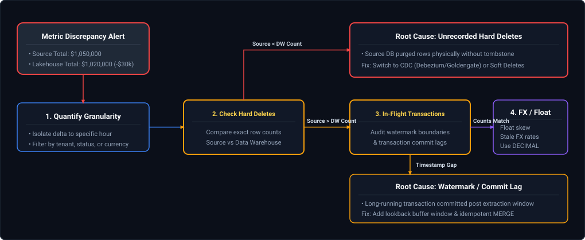

*D2 Source: [`20_data_warehouse_metric_discrepancy_triage_flow.d2`](assets/03_data_modeling_and_lakehouse_storage_faq/20_data_warehouse_metric_discrepancy_triage_flow.d2)*

#### Production Implementation / Diagnostic Playbook
```sql
-- Step 1: Run bi-directional hash-diff reconciliation between source slice and warehouse
-- (Executed via federated query or staged source snapshot)
WITH source_slice AS (
    SELECT 
        order_id,
        order_amount,
        status,
        updated_at,
        MD5(CONCAT(order_id, '|', order_amount::TEXT, '|', status)) AS src_hash
    FROM source_db.orders
    WHERE updated_at >= '2024-10-16 00:00:00' AND updated_at < '2024-10-17 00:00:00'
),
warehouse_slice AS (
    SELECT 
        order_id,
        order_amount,
        status,
        updated_at,
        MD5(CONCAT(order_id, '|', order_amount::TEXT, '|', status)) AS dw_hash
    FROM analytics_gold.fact_orders
    WHERE order_date = '2024-10-16'
)
SELECT 
    COALESCE(s.order_id, w.order_id) AS order_id,
    s.order_amount AS source_amount,
    w.order_amount AS warehouse_amount,
    s.status AS source_status,
    w.status AS warehouse_status,
    CASE 
        WHEN s.order_id IS NULL THEN 'PHANTOM_RECORD_IN_DW (Likely Hard Deleted in Source)'
        WHEN w.order_id IS NULL THEN 'MISSING_FROM_DW (In-Flight Transaction or Watermark Skip)'
        WHEN s.src_hash <> w.dw_hash THEN 'VALUE_MISMATCH (Partial Mutation or Float Precision)'
    END AS discrepancy_root_cause
FROM source_slice s
FULL OUTER JOIN warehouse_slice w ON s.order_id = w.order_id
WHERE s.src_hash IS NULL OR w.dw_hash IS NULL OR s.src_hash <> w.dw_hash;

-- Step 2: Fix for Watermark Slippage: Implement Overlapping Watermark Window in ETL
-- Extract with a 15-minute lookback buffer to catch committed in-flight transactions
-- and rely on idempotent MERGE to eliminate duplicates
SELECT * FROM source_orders
WHERE updated_at >= (CAST(:last_watermark AS TIMESTAMP) - INTERVAL '15 minutes')
  AND updated_at < :current_run_timestamp;
```
- **Time Complexity:** $O(S + W)$ hash-join reconciliation across source and target partition slices.
- **Space Complexity:** $O(S + W)$ memory footprint in reconciliation jobs.

#### Engineering Implications & Production Pitfalls
1. **The Dangerous Watermark Exact Match:** A naive incremental pattern runs `WHERE updated_at > :prev_max_watermark`. Never use exact boundary matching without a safety overlap. A 10-to-30 minute lookback window combined with an idempotent `MERGE INTO ... WHEN MATCHED THEN UPDATE` eliminates in-flight transaction dropouts completely.
2. **Log-Based CDC as the Definitive Solution:** Incremental loads based on query timestamps (`updated_at`) are inherently fragile because they cannot track hard deletes or schema drops. Mission-critical platforms must deploy log-based Change Data Capture (Debezium, Fivetran, Qlik) that parses the database WAL / transaction log directly.

#### Core Curriculum Cross-Reference
*Deep-dive theoretical reference: See [14. Data Governance, Security, and Observability: Data Quality & Anomaly Detection](../09_unity_catalog_and_data_governance.md#5-the-5-pillars-of-data-observability)*

---

### Q30. [Easy] Fact Table Grain vs. Aggregation Level: Dimensional Design Principles & Multi-Grain Traps
**Difficulty:** [Easy]
**Topic Covered:** Kimball Dimensional Modeling, Fact Table Grain Declaration & Fan-Out Prevention  
**Question:** *What is the difference between the grain of a fact table and its aggregation level? Why is declaring the grain the most critical step in data warehouse design?*

#### Architectural Definition & Core Distinctions
In Ralph Kimball's dimensional modeling methodology, **Step 2** (immediately following business process selection) is **Declaring the Grain**:
- **Fact Table Grain (The Atomic Unit of Measurement):** The fundamental, indivisible business event represented by a single physical row in the fact table. It answers: *"What does one row represent?"*
  - *Example:* "One row represents one line item on a customer POS grocery checkout receipt."
  - The grain is the operational contract of the table. Once declared, no column can be added that contradicts this grain.
- **Aggregation Level (The Summarized Perspective):** A roll-up or summary calculation performed across one or more dimensional hierarchies above the atomic grain.
  - *Example:* "Total sales revenue rolled up by Store, Category, and Calendar Month."

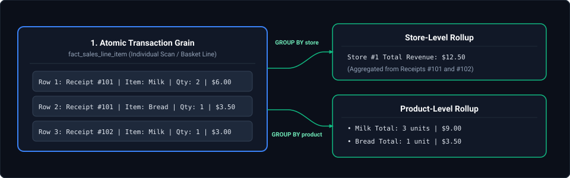

*D2 Source: [`21_atomic_transaction_grain_vs_aggregation_rollups.d2`](assets/03_data_modeling_and_lakehouse_storage_faq/21_atomic_transaction_grain_vs_aggregation_rollups.d2)*

#### The Lethal Multi-Grain Join Trap (Metric Duplication Hazard)
A catastrophic data engineering antipattern is joining facts of different grains in a single query:
- `fact_order_header` (Grain: 1 row per Order, e.g. `shipping_fee = $15.00`)
- `fact_order_line_item` (Grain: 1 row per Line Item in Order, e.g. 5 items)
- **The Bug:** Joining `order_header` to `order_line_item` and executing `SUM(shipping_fee)` multiplies the shipping fee by 5! ($15 \times 5 = \$75.00$).
- **Rule of Thumb:** Never mix grains in a single fact table. Retain atomic transaction-level grain for analytical maximum flexibility, and pre-aggregate periodic snapshots into dedicated summary marts.

---

### Q31. [Medium] Designing an Enterprise Calendar / Date Dimension with Fiscal Offsets, ISO Weeks & Holiday Calendars
**Difficulty:** [Medium]
**Topic Covered:** Kimball Conformed Dimensions, Calendar & Fiscal Hierarchies, Non-Additive Time Navigation  
**Question:** *How would you build a production-grade calendar dimension supporting fiscal years, working days, and holidays?*

#### Architectural Blueprint
A calendar dimension (`dim_date`) is the universal spine connecting disparate business processes across sales, finance, marketing, and operations. Unlike standard SQL date math, `dim_date` precomputes business-critical attributes that cannot be determined mathematically (e.g. federal bank holidays, corporate fiscal year offsets, trading days).

```sql
CREATE TABLE dim_date (
    date_key                INTEGER PRIMARY KEY, -- YYYYMMDD surrogate (e.g. 20261021)
    calendar_date           DATE NOT NULL,
    day_name                VARCHAR(9) NOT NULL, -- 'Wednesday'
    day_of_week             SMALLINT NOT NULL,   -- 1 = Sunday, 7 = Saturday
    day_of_month            SMALLINT NOT NULL,   -- 1 to 31
    day_of_year             SMALLINT NOT NULL,   -- 1 to 366
    week_of_year_iso        SMALLINT NOT NULL,   -- ISO 8601 week (1 to 53)
    month_number            SMALLINT NOT NULL,   -- 1 to 12
    month_name              VARCHAR(9) NOT NULL, -- 'October'
    month_year              VARCHAR(7) NOT NULL, -- '2026-10'
    calendar_quarter        SMALLINT NOT NULL,   -- 1 to 4
    calendar_year           SMALLINT NOT NULL,   -- 2026
    fiscal_year             SMALLINT NOT NULL,   -- 2027 (e.g. if fiscal year starts Nov 1)
    fiscal_quarter          SMALLINT NOT NULL,   -- 1 to 4
    fiscal_period           SMALLINT NOT NULL,   -- 1 to 12
    is_weekend              BOOLEAN NOT NULL,    -- TRUE if Saturday/Sunday
    is_bank_holiday         BOOLEAN NOT NULL,    -- Fed/Bank holiday flag
    is_trading_day          BOOLEAN NOT NULL,    -- NYSE / LSE market open flag
    relative_day_offset     INTEGER NOT NULL,    -- 0 = Today, -1 = Yesterday, 1 = Tomorrow
    relative_month_offset   INTEGER NOT NULL     -- 0 = Current month, -1 = Last month
);
```

#### Production PySpark Generator Script
```python
from pyspark.sql import SparkSession
from pyspark.sql.functions import (
    col, expr, date_format, dayofweek, dayofmonth, dayofyear, 
    weekofyear, month, year, when, lit
)

def generate_enterprise_date_dimension(spark: SparkSession, start_date: str, end_date: str):
    # Generate continuous sequence of dates
    df = spark.sql(f"""
        SELECT explode(sequence(to_date('{start_date}'), to_date('{end_date}'), interval 1 day)) AS calendar_date
    """)
    
    dim_date = (
        df.withColumn("date_key", date_format(col("calendar_date"), "yyyyMMdd").cast("int"))
          .withColumn("day_name", date_format(col("calendar_date"), "EEEE"))
          .withColumn("day_of_week", dayofweek(col("calendar_date")))
          .withColumn("day_of_month", dayofmonth(col("calendar_date")))
          .withColumn("day_of_year", dayofyear(col("calendar_date")))
          .withColumn("week_of_year_iso", weekofyear(col("calendar_date")))
          .withColumn("month_number", month(col("calendar_date")))
          .withColumn("month_name", date_format(col("calendar_date"), "MMMM"))
          .withColumn("calendar_year", year(col("calendar_date")))
          # Weekend Flag
          .withColumn("is_weekend", col("day_of_week").isin([1, 7]))
          # Example Fiscal Year Offset (Fiscal Year starts October 1)
          .withColumn("fiscal_year", when(col("month_number") >= 10, col("calendar_year") + 1).otherwise(col("calendar_year")))
          .withColumn("fiscal_quarter", when(col("month_number") >= 10, col("month_number") - 9)
                                        .otherwise(col("month_number") + 3))
    )
    return dim_date
```

---

### Q32. [Medium] Incremental Restatement of Historical Aggregates under Late-Arriving & Corrected Ledger Records
**Difficulty:** [Medium]
**Topic Covered:** Late-Arriving Data, Historical Ledger Restatements & Idempotent Delta Partition Overwrites  
**Question:** *Transactions from 3 months ago are retroactively adjusted or refunded today. How do you incrementally recalculate monthly aggregates without running a full recomputation of the entire warehouse?*

#### Architectural Overview
When retroactively adjusted transactions (e.g. chargebacks, court-ordered adjustments, or late partner uploads) arrive, rebuilding a 10-year data warehouse from scratch costs tens of thousands of dollars in cloud compute. 
Instead, production lakehouses employ **Partition-Scoped Change Capture & Targeted Restatement**:

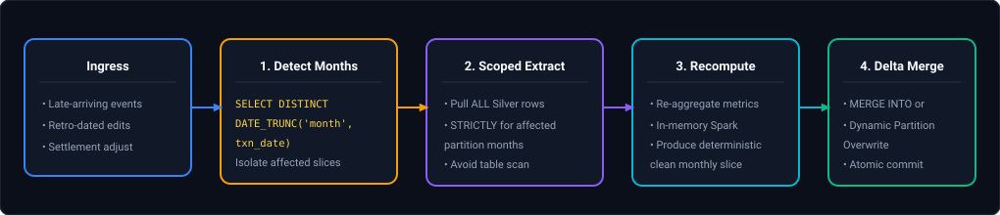

*D2 Source: [`22_late_arriving_data_monthly_recomputation_merge.d2`](assets/03_data_modeling_and_lakehouse_storage_faq/22_late_arriving_data_monthly_recomputation_merge.d2)*

#### Production Delta Lake Implementation
```sql
-- Step 1: Ingest batch and identify distinct affected historical calendar months
CREATE OR REPLACE TEMPORARY VIEW affected_partitions AS
SELECT DISTINCT 
    DATE_TRUNC('month', transaction_date) AS affected_month,
    store_id
FROM incoming_corrected_batch;

-- Step 2: Recompute aggregates strictly for the intersection of affected months & stores
CREATE OR REPLACE TEMPORARY VIEW recomputed_aggregates AS
SELECT 
    DATE_TRUNC('month', s.transaction_date) AS report_month,
    s.store_id,
    SUM(s.gross_amount) AS total_gross_revenue,
    SUM(s.refund_amount) AS total_refunds,
    SUM(s.net_amount) AS total_net_revenue,
    COUNT(s.transaction_id) AS total_transaction_count,
    CURRENT_TIMESTAMP() AS last_restated_at
FROM silver_transactions s
INNER JOIN affected_partitions a 
    ON DATE_TRUNC('month', s.transaction_date) = a.affected_month
   AND s.store_id = a.store_id
GROUP BY DATE_TRUNC('month', s.transaction_date), s.store_id;

-- Step 3: Perform targeted idempotent MERGE strictly against target summary table
MERGE INTO gold_monthly_store_summary target
USING recomputed_aggregates source
ON target.report_month = source.report_month 
AND target.store_id = source.store_id
WHEN MATCHED THEN UPDATE SET *
WHEN NOT MATCHED THEN INSERT *;
```
- **Time Complexity:** $O(K)$ where $K$ is the volume of data strictly inside the touched monthly partitions, eliminating 99% of recomputation costs.

---

### Q33. [Medium] Designing Gold-Layer Tables for Governed Self-Service BI Without Duplicate Business Logic
**Difficulty:** [Medium]
**Topic Covered:** Lakehouse Gold Layer, Semantic Modeling, Single Version of the Truth & Conformed Marts  
**Question:** *How would you design Gold-layer tables that support self-service BI without duplicating business logic across reports?*

#### The Semantic Fragmentation Antipattern
In poorly governed organizations, Finance, Marketing, and Operations each write custom SQL reports over raw tables:
- Marketing defines *"Active Customer"* as: `last_login_date >= NOW() - 30 days`.
- Finance defines *"Active Customer"* as: `total_paid_invoices >= 1 in current fiscal year`.
- Result: Executive leadership receives contradictory revenue and churn totals from different dashboards.

#### The 3-Tier Gold Architecture
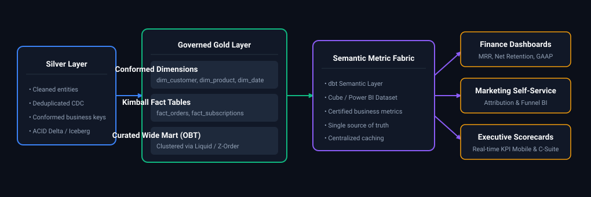

*D2 Source: [`23_governed_gold_layer_semantic_metric_fabric.d2`](assets/03_data_modeling_and_lakehouse_storage_faq/23_governed_gold_layer_semantic_metric_fabric.d2)*

#### Production Engineering Rules for Gold-Layer Self-Service:
1. **Conformed Dimensions as the Canonical Backbone:**
   - A single customer table (`dim_customer`) and date table (`dim_date`) must be shared across all business units.
2. **Standardize Calculated Columns in the Lakehouse (Not in BI DAX / Tableau formulas):**
   - Push core metrics into physical Gold tables: `gross_margin_usd`, `is_churned`, `net_mrr`. Doing calculations in Power BI DAX creates fragmented, un-reproducible silos that crash dashboard reload times.
3. **One Big Table (OBT) with Liquid Clustering for Self-Service:**
   - Business analysts struggle with 6-way SQL joins. Provide pre-joined, denormalized wide tables (OBT) in the Gold layer.
   - Use **Liquid Clustering** or **Delta Z-ORDER** on the most commonly filtered attributes (`CLUSTER BY (country, customer_tier, date_key)`). Queries achieve sub-second response times without requiring analysts to manage foreign keys.

#### Core Curriculum Cross-Reference
*Deep-dive theoretical reference: See [03. Data Modeling & Lakehouse Storage: Kimball Dimensional Modeling](../03_data_modeling_and_lakehouse_storage.md#23-olap-dimensional-modeling-fundamentals-kimball-4-step-process)*

---

### Q34. [Medium] Food Delivery & Ride-Sharing Dimensional Architecture (Dynamic Fees, Settlements & Status Timestamps)
**Difficulty:** [Medium]
**Topic Covered:** Accumulating Snapshot Facts, Transaction Facts, Dynamic Surcharges & Multi-Party Financial Settlement  
**Question:** *Design an end-to-end dimensional data warehouse schema (Fact and Dimension tables) for a high-scale food delivery and ride-sharing platform (e.g. DoorDash, Uber) capable of efficiently querying dynamic delivery surcharges, merchant payout settlements, and order lifecycle latency across millions of daily rides.*

#### Definition & Core Concepts
High-velocity two-sided and three-sided marketplace platforms (Customer $\leftrightarrow$ Driver/Dasher $\leftrightarrow$ Merchant) exhibit two distinct analytical query patterns that cannot be cleanly modeled within a single fact table:
1. **Lifecycle Duration & Pipeline Bottleneck Analysis:** Questions like *"What was the p95 pickup delay between order placement and driver arrival in Manhattan on rainy Friday evenings?"* requires tracking multiple sequential state transition timestamps for a single order.
2. **Multi-Party Financial Ledger Reconciliation:** Questions like *"Reconcile gross consumer charges against driver compensation, dynamic surge payouts, platform commission, and weekly merchant escrow disbursements"* requires immutable accounting transaction grain.

To support both with optimal performance, we deploy a **Hybrid Fact Architecture**:
- **Accumulating Snapshot Fact (`fact_delivery_lifecycle`):** Exactly **one row per order**, with dedicated timestamp columns representing milestones across the delivery funnel (`placed_at`, `accepted_at`, `assigned_at`, `picked_up_at`, `delivered_at`). As milestones are reached, the row is updated via Delta Lake / Snowflake `MERGE`. Pre-calculates duration lags (`prep_duration_seconds`, `transit_duration_seconds`).
- **Atomic Financial Transaction Fact (`fact_order_financials`):** Exactly **one row per order** capturing the complete multi-party monetary breakdown: consumer payment, dynamic surge multiplier fee, platform commission, merchant payout, dasher base pay, and tips.
- **Periodic Snapshot Fact (`fact_merchant_payout_settlement`):** Exactly **one row per merchant per payout cycle** capturing gross receipts, commission deductions, customer dispute clawbacks, and net bank ACH wire amounts.

#### Visual Flow: Dimensional Topology (Entity-Relationship Diagram)
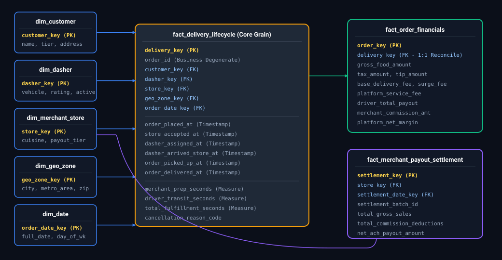

*D2 Source: [`24_food_delivery_platform_multi_fact_er_model.d2`](assets/03_data_modeling_and_lakehouse_storage_faq/24_food_delivery_platform_multi_fact_er_model.d2)*

#### Production DDL & Delta Lake / Snowflake Table Definitions
```sql
-- 1. Accumulating Snapshot Fact Table: Order Milestone Funnel
CREATE TABLE gold.fact_delivery_lifecycle (
    delivery_key                BIGINT GENERATED ALWAYS AS IDENTITY,
    order_id                    STRING NOT NULL,
    customer_key                BIGINT NOT NULL,
    dasher_key                  BIGINT,
    store_key                   BIGINT NOT NULL,
    geo_zone_key                BIGINT NOT NULL,
    order_date_key              INT NOT NULL,
    -- Milestone Lifecycle Timestamps
    order_placed_at             TIMESTAMP NOT NULL,
    store_accepted_at           TIMESTAMP,
    dasher_assigned_at          TIMESTAMP,
    dasher_arrived_store_at     TIMESTAMP,
    order_picked_up_at          TIMESTAMP,
    order_delivered_at          TIMESTAMP,
    order_cancelled_at          TIMESTAMP,
    current_status              STRING NOT NULL,  -- PLACED, PREPARING, IN_TRANSIT, DELIVERED, CANCELLED
    cancellation_reason_code    STRING,
    -- Pre-calculated Analytics Lags (Seconds)
    merchant_prep_seconds       INT,
    driver_transit_seconds      INT,
    total_fulfillment_seconds   INT
)
USING DELTA
CLUSTER BY (order_date_key, geo_zone_key, store_key);

-- 2. Transaction Financial Fact Table: Multi-Party Revenue & Payout Split
CREATE TABLE gold.fact_order_financials (
    order_financial_key         BIGINT GENERATED ALWAYS AS IDENTITY,
    order_id                    STRING NOT NULL,
    delivery_key                BIGINT NOT NULL,
    order_date_key              INT NOT NULL,
    -- Consumer Charges
    gross_food_amount           DECIMAL(12, 2) NOT NULL,
    tax_amount                  DECIMAL(12, 2) NOT NULL,
    base_delivery_fee           DECIMAL(10, 2) NOT NULL,
    dynamic_surge_fee           DECIMAL(10, 2) NOT NULL,
    platform_service_fee        DECIMAL(10, 2) NOT NULL,
    driver_tip_amount           DECIMAL(10, 2) NOT NULL,
    total_consumer_paid         DECIMAL(12, 2) NOT NULL,
    -- Platform & Merchant Economics
    merchant_commission_rate    DECIMAL(5, 4) NOT NULL, -- e.g. 0.2000 (20%)
    merchant_commission_amount  DECIMAL(12, 2) NOT NULL,
    net_merchant_receivable     DECIMAL(12, 2) NOT NULL, -- gross_food - commission
    -- Driver Economics
    driver_base_earnings        DECIMAL(10, 2) NOT NULL,
    total_driver_payout         DECIMAL(10, 2) NOT NULL, -- driver_base + surge_split + tip
    -- Platform Net Margin
    platform_net_margin         DECIMAL(12, 2) NOT NULL  -- total_consumer_paid - net_merchant - total_driver - tax
)
USING DELTA
CLUSTER BY (order_date_key, order_id);

-- 3. Merchant Dimension (SCD Type 2)
CREATE TABLE gold.dim_merchant_store (
    store_key                   BIGINT GENERATED ALWAYS AS IDENTITY,
    merchant_store_id           STRING NOT NULL,
    merchant_brand_name         STRING NOT NULL,
    store_branch_name           STRING NOT NULL,
    cuisine_category            STRING NOT NULL,
    street_address              STRING NOT NULL,
    h3_geo_index_res8           STRING NOT NULL, -- Spatial index for proximity queries
    commission_rate_tier        STRING NOT NULL,
    is_active                   BOOLEAN NOT NULL,
    valid_from                  TIMESTAMP NOT NULL,
    valid_to                    TIMESTAMP,
    is_current                  BOOLEAN NOT NULL
)
USING DELTA
CLUSTER BY (is_current, merchant_store_id);
```

#### Production Query: Dynamic Surge and Delivery Latency Analytics
```sql
-- Calculate hourly surge fee revenue, average driver transit lag, and delivery success rate
SELECT 
    f.order_date_key,
    DATE_TRUNC('hour', l.order_placed_at) AS order_hour,
    z.zone_name,
    COUNT(l.delivery_key) AS total_orders,
    ROUND(AVG(f.dynamic_surge_fee), 2) AS avg_surge_fee,
    ROUND(SUM(f.dynamic_surge_fee), 2) AS total_surge_revenue,
    ROUND(AVG(l.merchant_prep_seconds) / 60.0, 1) AS avg_merchant_prep_minutes,
    ROUND(AVG(l.driver_transit_seconds) / 60.0, 1) AS avg_transit_minutes,
    ROUND(COUNT(l.order_delivered_at)::NUMERIC / NULLIF(COUNT(l.delivery_key), 0) * 100, 2) AS fulfillment_rate_pct
FROM gold.fact_delivery_lifecycle l
JOIN gold.fact_order_financials f 
    ON l.order_id = f.order_id
JOIN gold.dim_geo_zone z 
    ON l.geo_zone_key = z.geo_zone_key
WHERE l.order_placed_at >= CURRENT_DATE - INTERVAL '30 DAYS'
GROUP BY 1, 2, 3
ORDER BY order_date_key DESC, order_hour DESC, total_surge_revenue DESC;
```

#### Complexity Analysis
- **Query Performance:** $O(\log P + K)$ where $P$ is total partitions scanned. Clustering on `(order_date_key, geo_zone_key)` enables partition and data-skipping pruning: scanning 30 days of queries on Manhattan reads $<1\%$ of total storage blocks.
- **Write Amplification in Accumulating Snapshots:** An accumulating snapshot row experiences 4 to 6 updates as an order progresses from `PLACED` to `DELIVERED`. In cloud object storage (Delta Lake / Parquet), updating a row rewrites the underlying Parquet file.
  - *Mitigation:* Enable **Deletion Vectors** (`delta.enableDeletionVectors = true`). Updates write a lightweight deletion bitmap rather than re-writing the entire 200MB Parquet data file, reducing write amplification by up to 90%!

#### Engineering Implications & Production Pitfalls
1. **The Multi-Currency & Cross-Day Payout Dilemma:**
   - Orders placed on Friday evening may not be delivered until Saturday midnight, while merchant bank ACH transfers settle on Tuesday. Decoupling `fact_order_financials` (daily transaction grain) from `fact_merchant_payout_settlement` (periodic weekly snapshot) prevents retroactive adjustments from corrupting historical order financials.
2. **Spatial Indexing for Geofences:**
   - Storing raw latitude/longitude coordinates leads to slow polygon bounding-box joins (`ST_Contains`). Pre-computing **Uber H3 hexagonal hierarchical spatial indexes** (Resolution 8 $\approx 460\text{m}$ edge length) as strings in `dim_merchant_store` and `dim_geo_zone` converts expensive spatial geometry calculations into fast integer/string hash equality joins (`m.h3_geo_index_res8 = z.h3_geo_index_res8`).

#### Core Curriculum Cross-Reference
*Deep-dive theoretical reference: See [03. Data Modeling & Lakehouse Storage: Kimball Dimensional Modeling](../03_data_modeling_and_lakehouse_storage.md#23-olap-dimensional-modeling-fundamentals-kimball-4-step-process)*
---

### Q35. [Medium] Multi-Year Transaction Data Retention, Cold Storage Tiering & Compliant Archival
**Difficulty:** [Medium]  
**Topic Covered:** Data Retention Policies, Cloud Object Lifecycle Management (Hot/Cool/Archive), Partition Deletion  
**Question:** *How do you architect data retention and archival policies for multi-year financial transaction tables to maintain blazing query performance on active data while complying with multi-year statutory retention at minimal storage cost?*

#### Definition & Core Concepts
Financial institutions face a dual requirement: active operational dashboards require $<2\text{s}$ query response times on the most recent 12 to 24 months of data, while banking regulators (e.g. SEC, FINRA, GDPR, RBI) mandate 7 to 10 years of statutory data retention:
1. **Tiered Lakehouse Partitioning:**
   - Partition core transaction tables by `year` and `month` (e.g., `/transactions/year=2026/month=10/`).
   - Maintain the active 24-month working set in high-performance **Hot Tier** object storage (ADLS Gen2 Hot / S3 Standard) with Delta Lake Liquid Clustering or Z-Ordering on `(account_id, transaction_timestamp)`.
2. **Automated Lifecycle Storage Tiering:**
   - Configure Cloud Object Storage Lifecycle Management Rules:
     - After **24 months (730 days)**: Transition older partition blobs to **Cool / Infrequent Access (IA)** tier (50% storage cost reduction).
     - After **36 months (1095 days)**: Transition historical partition files to **Archive / Glacier Flexible Deep Archive** tier (90% cost reduction).
3. **Table Partition Decoupling & Virtual Views:**
   - To prevent queries without date filters from incurring severe archive rehydration penalties ($> 12\text{ hours}$ thaw delay and high retrieval fees), decouple active data from archive storage.
   - Maintain `gold.fact_transactions_active` pointing strictly to the 24-month Hot storage.
   - Maintain `archive.fact_transactions_historical` pointing to cold storage tiers, accessible only via audited compliance extract pipelines.

#### Visual Architectural Lifecycle Flow
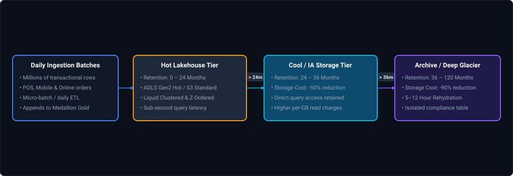

*D2 Source: [`25_multi_year_transaction_storage_lifecycle_tiering.d2`](assets/03_data_modeling_and_lakehouse_storage_faq/25_multi_year_transaction_storage_lifecycle_tiering.d2)*

#### Production Implementation / Azure Blob Lifecycle Policy (JSON)
```json
{
  "rules": [
    {
      "enabled": true,
      "name": "financial-data-retention-tiering",
      "type": "Lifecycle",
      "definition": {
        "filters": {
          "blobTypes": ["blockBlob"],
          "prefixMatch": ["lakehouse/gold/fact_transactions/"]
        },
        "actions": {
          "baseBlob": {
            "tierToCool": { "daysAfterModificationGreaterThan": 730 },
            "tierToArchive": { "daysAfterModificationGreaterThan": 1095 },
            "delete": { "daysAfterModificationGreaterThan": 3650 }
          }
        }
      }
    }
  ]
}
```

```python
# Automated Partition Purge / Export Runbook in Databricks
def archive_and_purge_expired_partitions(spark, retention_cutoff_date: str):
    """
    Exports expired partitions to regulatory compliance archive before dropping from the active Delta table.
    """
    cutoff_year, cutoff_month = retention_cutoff_date.split("-")[:2]
    
    # 1. Export partition to cold regulatory storage bucket
    (
        spark.table("gold.fact_transactions")
        .filter(f"year < '{cutoff_year}'")
        .write
        .mode("append")
        .parquet(f"abfss://regulatory-archive@coldstorage.dfs.core.windows.net/transactions_archive/")
    )
    
    # 2. Drop expired partition from active Delta table metadata
    spark.sql(f"DELETE FROM gold.fact_transactions WHERE year < '{cutoff_year}'")
    
    # 3. Clean physical files via VACUUM after retention period expires
    spark.sql("VACUUM gold.fact_transactions RETAIN 168 HOURS")
    print(f"Purged and archived active partitions older than {cutoff_year}")
```

#### Complexity & FinOps Impact
- **FinOps Reduction:** Storing $500\text{ TB}$ of historical transaction data in AWS S3 Standard costs $\approx \$11{,}500/\text{month}$. Transitioning historical partitions older than 3 years to Glacier Deep Archive shrinks storage spend to $\approx \$500/\text{month}$ (a $95.6\%$ ongoing cost reduction).
- **Query Performance:** Reducing the active table size from 10 years to 2 years shrinks the metadata file list and file skipping footprint by $80\%$, keeping BI dashboard partition pruning sub-second.

#### Core Curriculum Cross-Reference
*Deep-dive theoretical reference: See [03. Data Modeling & Lakehouse Storage: Storage Lifecycle Management](../03_data_modeling_and_lakehouse_storage.md#73-storage-lifecycle-management-policies--worm-compliance)*

---

### Q36. [Medium] Micro-Partitions and Clustering Keys in Cloud Warehouses & Lakehouses: Query Acceleration vs Reclustering Cost Governance
**Difficulty:** [Medium]  
**Topic Covered:** Micro-Partitioning, Clustering Keys, Metadata Pruning, Clustering Depth & FinOps Cost Governance  
**Question:** *How do micro-partitions and clustering keys improve query performance in modern cloud data warehouses and lakehouses (such as Snowflake and Databricks Liquid Clustering)? How does the engine prune data, and when is clustering worth the ongoing background compute cost?*

#### Definition & Core Concepts
Modern cloud data warehouses (Snowflake, BigQuery) and transactional lakehouses (Databricks with Liquid Clustering) replace rigid Hive-style folder partitioning (`/year=2026/month=10/`) with **Micro-Partitions & Dynamic Clustering**:
1. **Micro-Partition Anatomy:**
   - Physical contiguous columnar blocks containing between $50\text{ MB}$ and $500\text{ MB}$ of uncompressed data (typically compressed down to $16\text{ MB}$).
   - **Immutable:** Once written to cloud object storage (S3, ADLS, GCS), micro-partitions are never modified in-place; mutations generate new micro-partitions via copy-on-write or merge-on-read.
   - **Central Metadata Header:** The engine's cloud services tier automatically extracts and indexes summary statistics for every column within each micro-partition: minimum value, maximum value, null count, and distinct value count.
2. **Metadata-Driven Query Pruning:**
   - When a query contains a predicate like `WHERE order_date >= '2026-10-01' AND tenant_id = 'T100'`, the query coordinator evaluates the predicate against the micro-partition min/max metadata **without opening or scanning the physical storage files**.
   - If a micro-partition's range for `order_date` is `['2026-09-01', '2026-09-30']`, the file is pruned immediately, reducing scanned bytes by $95\%\text{--}99\%$.
3. **Clustering Keys & Clustering Depth:**
   - A **Clustering Key** is a designated set of columns (e.g., `(event_date, customer_id)`) used to physically co-locate related records into the same micro-partitions.
   - **Clustering Depth:** Measures the average overlap among micro-partitions for the clustering key. A low clustering depth ($1\text{--}2$) indicates that micro-partitions have disjoint ranges, yielding maximum query pruning. A high clustering depth ($>20$) indicates heavily overlapping ranges, requiring the engine to scan many partitions for a single point query.

#### Visual Architectural Flow
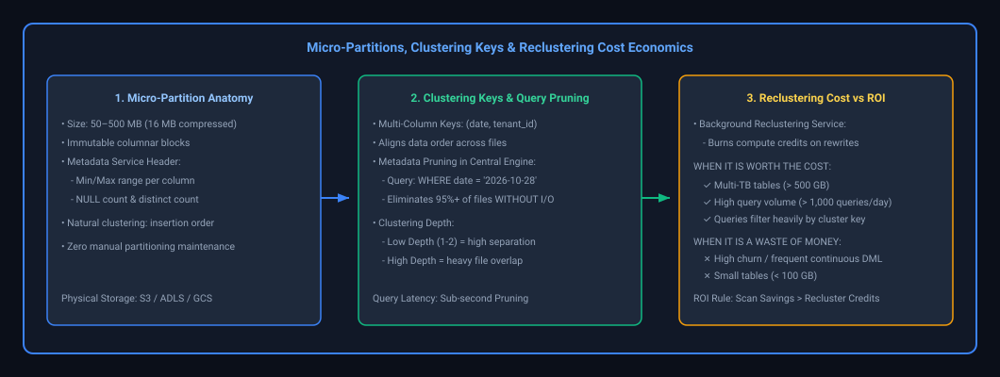

*D2 Source: [`26_micro_partitions_clustering_keys_pruning_economics.d2`](assets/03_data_modeling_and_lakehouse_storage_faq/26_micro_partitions_clustering_keys_pruning_economics.d2)*

#### Production DDL & Diagnostic Inspection Queries

```sql
-- ============================================================================
-- Snowflake DDL: Defining an Explicit Multi-Column Clustering Key
-- ============================================================================
CREATE OR REPLACE TABLE gold.fact_orders (
    order_id        STRING,
    customer_id     STRING,
    order_date      DATE,
    store_id        INT,
    total_amount    DECIMAL(18, 2),
    created_at      TIMESTAMP_NTZ
)
-- Order by date first (coarse filter), then customer_id (fine filter)
CLUSTER BY (order_date, customer_id);

-- ============================================================================
-- Snowflake Diagnostic: Inspecting Clustering Health & Depth Overlap
-- ============================================================================
SELECT SYSTEM$CLUSTERING_INFORMATION('gold.fact_orders', '(order_date, customer_id)');

-- Output JSON:
-- {
--   "cluster_by_keys" : "LINEAR(order_date, customer_id)",
--   "total_partition_count" : 12450,
--   "total_constant_partition_count" : 11800,  -- Partitions with zero overlap (Optimal)
--   "average_overlaps" : 1.12,                  -- Excellent (< 2.0 indicates pristine health)
--   "average_depth" : 1.45,
--   "partition_depth_histogram" : { "0001" : 11800, "0002" : 650 }
-- }

-- ============================================================================
-- Databricks Delta Lake DDL: Liquid Clustering (Alternative to Z-ORDER)
-- ============================================================================
CREATE OR REPLACE TABLE gold.fact_clickstream (
    event_id    STRING,
    user_id     STRING,
    event_date  DATE,
    platform    STRING
)
USING DELTA
CLUSTER BY (event_date, user_id);

-- Trigger incremental background clustering optimization
OPTIMIZE gold.fact_clickstream;
```

#### FinOps & Economics: When is Clustering Worth the Cost?

Automatic reclustering operates as a background cloud service that continuously consumes compute credits (dollars) to sort and rewrite fragmented micro-partitions.

```
Break-Even Rule:
Monthly Cloud Compute Savings (Pruned Scans) > Monthly Background Reclustering Credit Cost
```

| Operational Scenario | Reclustering Evaluation | Architectural Recommendation |
| :--- | :--- | :--- |
| **Multi-Terabyte Fact Tables ($> 500\text{ GB}$ to Petabytes)** | **High ROI (Worth the Cost)** | Daily analytical queries and BI dashboards filter by date and tenant. Pruning $95\%$ of partitions saves tens of thousands in warehouse compute. |
| **High Query Frequency ($> 1{,}000\text{ queries/day}$)** | **High ROI (Worth the Cost)** | Query latency drops from 45 seconds to 800 milliseconds. The cumulative scan compute savings far exceed background maintenance. |
| **High DML Churn / Frequent Micro-Batch Streaming** | **Negative ROI (AVOID Explicit Clustering)** | Ingesting streaming records every minute forces the automatic reclustering engine to constantly rewrite files, burning thousands of credits in runaway maintenance. |
| **Small Tables ($< 100\text{ GB}$)** | **Waste of Money** | Full table scans on modern MPP engines take only a few seconds. The cost to maintain clustering keys exceeds any latency gains. |
| **High-Cardinality Unique Keys (`UUID`, `timestamp_ms`)** | **Architectural Anti-Pattern** | Causes every record to map to a distinct range. Clustering depth remains high and reclustering is computationally impossible to converge. |

#### Core Curriculum Cross-Reference
*Deep-dive theoretical reference: See [03. Data Modeling & Lakehouse Storage: Storage Optimization & Liquid Clustering](../03_data_modeling_and_lakehouse_storage.md#76-bucketing-vs-z-ordering-vs-liquid-clustering)*


---

## Summary Comparison & Production Reference Matrix

| Scenario Domain | Critical Runtime Pathology | Diagnostic & Triage Method | Canonical Production Resolution |
| :--- | :--- | :--- | :--- |
| **OLTP vs OLAP Architecture & Normalization vs Denormalization** | High-throughput invariants & concurrency boundaries | Metric instrumentation & trace profiling | Defensive validation & graceful degradation |
| **Data Lake vs Data Warehouse vs Data Lakehouse** | High-throughput invariants & concurrency boundaries | Metric instrumentation & trace profiling | Defensive validation & graceful degradation |
| **Dimensional Modeling Foundations: Star vs Snowflake Schemas** | High-throughput invariants & concurrency boundaries | Metric instrumentation & trace profiling | Defensive validation & graceful degradation |
| **Row-Oriented vs Columnar Storage & Physical Optimization** | High-throughput invariants & concurrency boundaries | Metric instrumentation & trace profiling | Defensive validation & graceful degradation |
| **Domain Data Model Design: Vendor Payment System** | High-throughput invariants & concurrency boundaries | Metric instrumentation & trace profiling | Defensive validation & graceful degradation |
| **Domain Data Model Design: Lending Book Architecture** | High-throughput invariants & concurrency boundaries | Metric instrumentation & trace profiling | Defensive validation & graceful degradation |

---

## References & Further Reading

- [The Data Warehouse Toolkit: The Definitive Guide to Dimensional Modeling (Ralph Kimball, Margy Ross)](https://www.kimballgroup.com/data-warehouse-toolkit/) — The seminal authority on star schema, snowflake schema, and slowly changing dimensions.
- [Building the Data Warehouse (W. H. Inmon)](https://www.wiley.com/en-us/Building+the+Data+Warehouse%2C+4th+Edition-p-9780764599446) — The foundational text on enterprise normalized data warehouse architecture.
- [Building a Scalable Data Warehouse with Data Vault 2.0 (Dan Linstedt, Michael Olschimke)](https://www.sciencedirect.com/book/9780128025109/building-a-scalable-data-warehouse-with-data-vault-20) — The authoritative guide to Hubs, Links, Satellites, and hash key architectures.
- [Designing Data-Intensive Applications (Martin Kleppmann)](https://dataintensive.net/) — Data models, query languages, storage engine architectures, and distributed transactions.
- [Delta Lake: High-Performance ACID Table Storage over Cloud Object Stores (Armbrust et al., VLDB 2020)](https://www.vldb.org/pvldb/vol13/p3411-armbrust.pdf) — Architectural principles behind transactional lakehouses.
- [Databricks Documentation: Liquid Clustering & Data Modeling Guidance](https://docs.databricks.com/en/delta/clustering.html) — Modern multi-dimensional clustering in production lakehouses.
