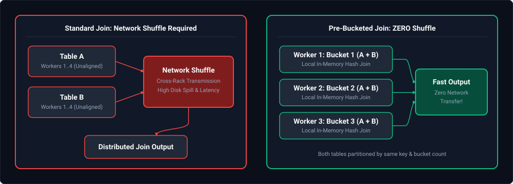
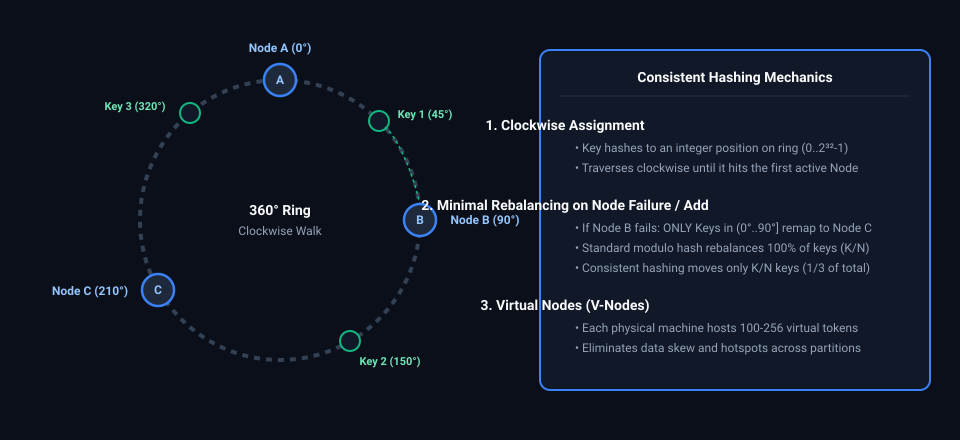
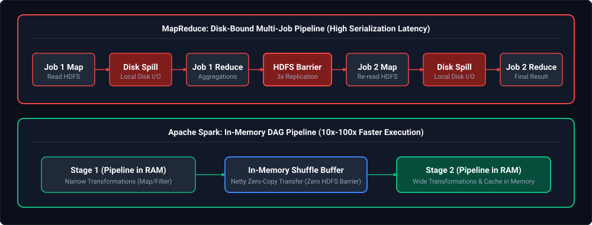
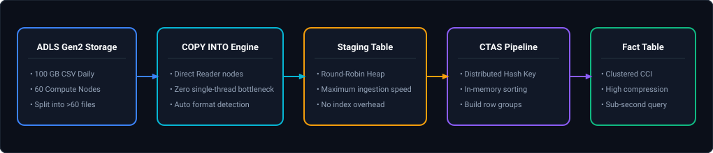
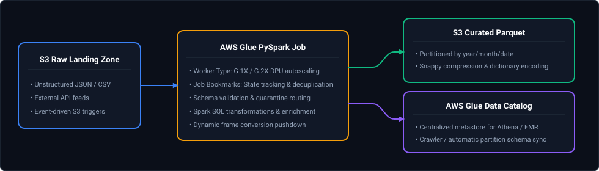
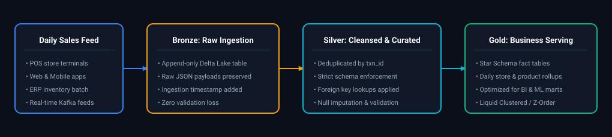
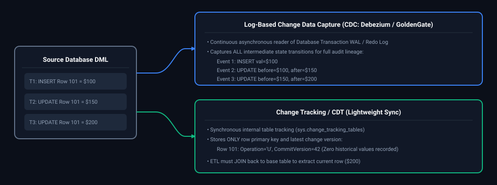
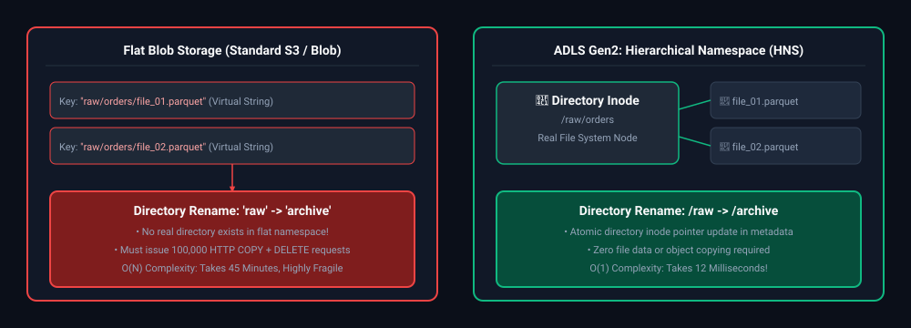
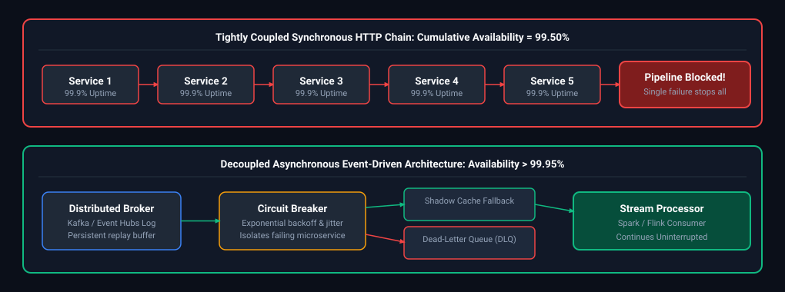
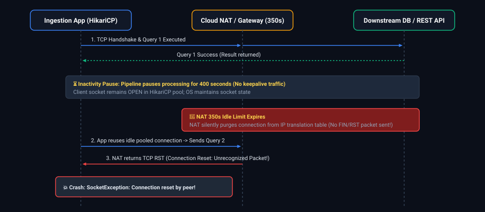

# 04. Cloud & Distributed Systems: Interview Questions & Deep-Dive Solutions

A comprehensive, production-grade guide answering Cloud and Distributed Systems interview scenarios for Data Engineers. Covers distributed data partitioning, consistent hashing, Hadoop/MapReduce internals vs Spark, Hive metastore storage, Azure Synapse Analytics, AWS Glue, Athena vs Redshift, multi-cloud networking, and cost optimization.

---

## Table of Contents & Question Mapping

1. **Distributed Data Organization: Partitioning vs Sharding vs Bucketing**
   - [Q1. Distributed Data Organization: Partitioning vs Sharding vs Bucketing](#q1-easy-distributed-data-organization-partitioning-vs-sharding-vs-bucketing)
2. **Consistent Hashing & Distributed Ring Topology**
   - [Q2. Consistent Hashing & Distributed Ring Topology](#q2-medium-consistent-hashing--distributed-ring-topology)
3. **Hadoop Ecosystem Internals vs Apache Spark**
   - [Q3. Hadoop Ecosystem Core Components & MapReduce vs Spark Architecture](#q3-easy-hadoop-ecosystem-core-components--mapreduce-vs-spark-architecture)
   - [Q4. RecordReader and Combiner Internal Mechanics](#q4-medium-recordreader-and-combiner-internal-mechanics)
4. **Hive Metastore Architecture: Managed vs External Tables**
   - [Q5. Hive Metastore Architecture: Managed vs External Tables](#q5-easy-hive-metastore-architecture-managed-vs-external-tables)
5. **Azure Synapse Analytics: Dedicated vs Serverless SQL Pools**
   - [Q6. Azure Synapse Analytics: Dedicated vs Serverless SQL Pools](#q6-easy-azure-synapse-analytics-dedicated-vs-serverless-sql-pools)
   - [Q7. Ingesting & Transforming 100GB of CSV Files Daily in Synapse](#q7-medium-ingesting--transforming-100gb-of-csv-files-daily-in-synapse)
   - [Q8. Hybrid ADF Ingestion Pipeline: On-Prem SQL to ADLS to Synapse](#q8-medium-hybrid-adf-ingestion-pipeline-on-prem-sql-to-adls-to-synapse)
6. **Cloud CDC Strategies & Azure Cost Optimization**
   - [Q9. Cloud Change Data Capture (CDC) Strategies in Azure](#q9-medium-cloud-change-data-capture-cdc-strategies-in-azure)
   - [Q10. Cost-Efficient Pipeline Architecture (ADF + Databricks + ADLS)](#q10-medium-cost-efficient-pipeline-architecture-adf--databricks--adls)
7. **Multi-Cloud Architecture: AWS & Azure Secure Federation**
   - [Q11. Multi-Cloud Architecture: AWS & Azure Secure Federation](#q11-medium-multi-cloud-architecture-aws--azure-secure-federation)
8. **AWS Big Data Stack: Glue ETL, Athena, Redshift & Lambda Layers**
   - [Q12. End-to-End AWS Glue PySpark ETL Pipeline](#q12-medium-end-to-end-aws-glue-pyspark-etl-pipeline)
   - [Q13. Amazon Athena vs Amazon Redshift & Distribution Styles](#q13-easy-amazon-athena-vs-amazon-redshift--distribution-styles)
   - [Q14. Packaging Custom Dependencies in AWS Lambda Layers](#q14-medium-packaging-custom-dependencies-in-aws-lambda-layers)
9. **Distributed Streaming Engines: Kafka vs Kinesis vs Pub/Sub**
   - [Q15. Distributed Streaming Decision Matrix: Kafka vs Kinesis vs Pub/Sub](#q15-easy-distributed-streaming-decision-matrix-kafka-vs-kinesis-vs-pubsub)
10. **Lakehouse Medallion Architecture for Daily Sales**
    - [Q16. Lakehouse Medallion Architecture for Daily Sales Ingestion](#q16-medium-lakehouse-medallion-architecture-for-daily-sales-ingestion)
11. **Change Tracking, Storage Hierarchies & Network Reliability**
    - [Q17. Change Data Capture (CDC) vs Change Data Tracking (CDT) Internals](#q17-hard-change-data-capture-cdc-vs-change-data-tracking-cdt-internals)
    - [Q18. Data Lake Storage vs Raw Blob Storage Architectural Evaluation](#q18-easy-data-lake-storage-vs-raw-blob-storage-architectural-evaluation)
    - [Q19. Compound Upstream SLA Availability & Distributed System Reliability Analysis](#q19-medium-compound-upstream-sla-availability--distributed-system-reliability-analysis)
    - [Q20. Intermittent "Connection Reset" (`ECONNRESET`) on Idle API Connections](#q20-medium-intermittent-connection-reset-econnreset-on-idle-api-connections)
---

# 1. Distributed Data Organization: Partitioning vs Sharding vs Bucketing

---

### Q1. [Easy] Distributed Data Organization: Partitioning vs Sharding vs Bucketing
**Difficulty:** [Easy]
**Topic Covered:** Physical Data Distribution & Join Optimization  
**Question:** Partitioning Strategies, Data Sharding, and Bucketing (which improves join performance better and why).

#### Definitions & Conceptual Distinctions
- **Partitioning:** Splitting a table into coarse-grained directory subfolders based on low-cardinality values (e.g., `year=2024/month=10/`). Used for coarse-grained folder pruning during query scans.
- **Sharding:** Horizontal horizontal partitioning of data across distinct physical database servers/nodes, often using consistent hashing. Each shard acts as an independent database instance.
- **Bucketing (Clustering):** Hash-partitioning rows into a fixed number of physical files ($K$ buckets) based on the hash of a high-cardinality key (e.g., `hash(user_id) % 32`).

#### Which Improves Join Performance Better and Why?
**Bucketing improves join performance significantly better than partitioning.**

##### The Mechanism: Eliminating Distributed Network Shuffles
In distributed systems (Spark, Hive, Presto), a join between two massive tables typically requires a **Shuffle Sort-Merge Join**, which moves petabytes of data across the network switches to align matching keys onto the same worker nodes.

When two tables are **pre-bucketed on the join key with identical (or multiple) bucket counts**, the distributed engine performs a **Bucket-Map-Join (Sort-Merge Join without Shuffle)**:
1. Bucket $i$ of Table A is guaranteed to only match Bucket $i$ of Table B.
2. Spark executes the join **locally on worker nodes without any network data transfer**.
3. Partitioning only prunes file scans; it does not align keys across worker nodes, meaning partition-filtered tables still incur a 100% network shuffle during joins.



*D2 Source: [`01_distributed_join_shuffle_vs_bucketed_zero_shuffle.d2`](assets/04_database_internals_and_distributed_systems_faq/01_distributed_join_shuffle_vs_bucketed_zero_shuffle.d2)*

---

# 2. Consistent Hashing & Distributed Ring Topology

---

### Q2. [Medium] Consistent Hashing & Distributed Ring Topology
**Difficulty:** [Medium]
**Topic Covered:** Distributed Hash Rings, Virtual Nodes & Rebalancing  
**Question:** Consistent Hashing

#### Problem with Traditional Modulo Hashing
In traditional distributed caching and sharding:
$$\text{Node} = \text{hash}(\text{key}) \pmod N$$
When the cluster scales from $N$ to $N+1$ (or a node crashes to $N-1$), almost **100% of keys are re-mapped to different nodes**. This causes catastrophic cache stampedes and massive data re-balancing across the cluster.

#### Consistent Hashing Mechanics
Consistent Hashing maps both **nodes (servers)** and **keys** to points on a 360-degree circular ring (the hash continuum, typically $0$ to $2^{32}-1$).
1. A key is assigned to the **first server encountered by moving clockwise** along the ring.
2. **Adding a node:** Only keys located between the new node and its counter-clockwise neighbor are moved. All other nodes remain untouched ($O(K/N)$ keys remapped).
3. **Removing a node:** Only keys previously belonging to that node move to the next clockwise node.



*D2 Source: [`02_consistent_hashing_ring_node_key_distribution.d2`](assets/04_database_internals_and_distributed_systems_faq/02_consistent_hashing_ring_node_key_distribution.d2)*

#### The Role of Virtual Nodes (V-Nodes)
- **Problem:** With few physical nodes, keys distribute unevenly across the ring (hotspots).
- **Solution:** Each physical machine is mapped to hundreds of **virtual positions** on the ring (e.g., `NodeA_v1`, `NodeA_v2`, `NodeA_v3`). This guarantees statistically uniform data distribution across all physical hardware.

---

# 3. Hadoop Ecosystem Internals vs Apache Spark

---

### Q3. [Easy] Hadoop Ecosystem Core Components & MapReduce vs Spark Architecture
**Difficulty:** [Easy]
**Topic Covered:** Distributed Compute Lifecycle & In-Memory RDD Advantages  
**Question:** What are the core Hadoop components and their responsibilities, and what limitations of MapReduce did Spark address?

#### Core Hadoop Components
1. **HDFS (Hadoop Distributed File System):** Distributed storage layer.
   - **NameNode:** Master node managing metadata, namespace tree, and block locations.
   - **DataNode:** Worker nodes storing actual data blocks (default 128 MB blocks with 3x replication).
2. **YARN (Yet Another Resource Negotiator):** Cluster resource scheduler.
   - **ResourceManager:** Cluster-wide resource arbitrator (allocates CPU/RAM).
   - **NodeManager:** Agent running on each worker monitoring container resources.
3. **MapReduce:** Batch processing engine executing Map and Reduce phases.

---

### Q4. [Medium] RecordReader and Combiner Internal Mechanics
**Difficulty:** [Medium]
**Topic Covered:** MapReduce InputFormat Serialization & Map-Side Pre-Aggregation  
**Question:** What is a RecordReader and Combiner?

#### RecordReader and Combiner Defined
- **RecordReader:** Component that breaks an `InputSplit` into discrete `<Key, Value>` pairs for consumption by the Mapper (e.g., `LineRecordReader` emits `<ByteOffset, LineText>`).
- **Combiner (Mini-Reducer):** Map-side pre-aggregation optimization. Executes locally on the mapper's output in-memory buffer before data is written to disk or sent over the network shuffle.
  - *Example:* For word count, instead of sending `("spark", 1)` 1,000 times across the network, the Combiner aggregates locally to `("spark", 1000)` and sends a single record over the network.

#### Limitations of MapReduce Addressed by Spark


*D2 Source: [`03_mapreduce_disk_spill_vs_spark_in_memory_dag.d2`](assets/04_database_internals_and_distributed_systems_faq/03_mapreduce_disk_spill_vs_spark_in_memory_dag.d2)*

| Dimension | Hadoop MapReduce | Apache Spark |
| :--- | :--- | :--- |
| **Execution Medium** | Writes every intermediate stage output to physical disk (HDFS). | In-memory pipelined processing via Resilient Distributed Datasets (RDDs). |
| **Iterative ML / Loops**| Severely inefficient; must re-read from disk on every iteration. | $10\times$ to $100\times$ faster; caches datasets directly in executor memory. |
| **DAG Scheduling** | Fixed 2-stage execution: Map $\to$ Reduce. | Arbitrary Direct Acyclic Graphs (DAGs) optimized by Catalyst and Tungsten. |

---

# 4. Hive Metastore Architecture: Managed vs External Tables

---

### Q5. [Easy] Hive Metastore Architecture: Managed vs External Tables
**Difficulty:** [Easy]
**Topic Covered:** Catalog Metadata Ownership & Data Deletion Semantics  
**Question:** What is the difference between Hive external and managed tables?

#### Managed (Internal) vs External Tables
| Feature | Managed Table (`CREATE TABLE`) | External Table (`CREATE EXTERNAL TABLE`) |
| :--- | :--- | :--- |
| **Data Ownership** | Hive / Metastore owns both the table metadata and physical data files. | Metastore owns only metadata. The underlying data is owned by external systems. |
| **Default Storage** | Warehouse directory (e.g., `/user/hive/warehouse/table_name`). | Custom specified location (e.g., `s3://my-bucket/path/` or `abfss://...`). |
| **DROP TABLE Behavior** | **Permanently deletes BOTH metadata AND physical underlying data files.** | **Deletes ONLY metadata.** Physical data files on S3/ADLS remain 100% intact. |
| **Recommended Use** | Temporary scratch tables or isolated single-application workloads. | Enterprise production data lakes where multiple tools (Spark, Presto, ADF) access data. |

```sql
-- Production DDL: Safe External Table Creation
CREATE EXTERNAL TABLE curated_customers (
    customer_id STRING,
    customer_name STRING,
    spend DOUBLE
)
STORED AS PARQUET
LOCATION 'abfss://curated@datalakeprod.dfs.core.windows.net/customers/';
```

---

# 5. Azure Synapse Analytics: Dedicated vs Serverless SQL Pools

---

### Q6. [Easy] Azure Synapse Analytics: Dedicated vs Serverless SQL Pools
**Difficulty:** [Easy]
**Topic Covered:** Provisioned MPP vs On-Demand Ad-Hoc Compute Models  
**Question:** What are the key differences between Dedicated SQL Pool and Serverless SQL Pool in Synapse?

#### Dedicated SQL Pool vs Serverless SQL Pool
| Dimension | Dedicated SQL Pool (formerly Azure SQL DW) | Serverless SQL Pool |
| :--- | :--- | :--- |
| **Architecture** | Provisioned Massively Parallel Processing (MPP) cluster (60 distributions). | On-demand distributed query processing engine. |
| **Billing Model** | Fixed hourly cost based on DWUs (Data Warehouse Units: DW100c to DW30000c). | Pay-per-query based on TB of data processed (\$5 per TB scanned). |
| **Storage** | Persisted managed columnar tables inside the pool storage. | Queries raw data directly in ADLS Gen2 (Parquet, Delta, CSV) without loading. |
| **Best For** | Enterprise data warehousing, sub-second reporting, heavy updates/deletes. | Ad-hoc data lake exploration, logical views over Bronze/Silver, low TCO. |

---

### Q7. [Medium] Ingesting & Transforming 100GB of CSV Files Daily in Synapse
**Difficulty:** [Medium]
**Topic Covered:** High-Scale Staging via PolyBase / COPY INTO & Hash Distribution  
**Question:** You are asked to ingest and transform 100GB of CSV files daily in Synapse. What is your approach?

#### Ingesting & Transforming 100GB CSV Files Daily in Synapse (Q6)


*D2 Source: [`04_azure_synapse_parallel_csv_ingestion_pipeline.d2`](assets/04_database_internals_and_distributed_systems_faq/04_azure_synapse_parallel_csv_ingestion_pipeline.d2)*

1. **Ingest via `COPY INTO`:** Never use row-by-row `INSERT`. Use `COPY INTO` with parallel file splits.
2. **Staging Table Design:** Create a staging table with **Round-Robin** distribution and Heap storage to maximize write throughput.
3. **Transform using CTAS (Create Table As Select):** Transform raw data into a **Clustered Columnstore Index (CCI)** table with **Hash Distribution** on the high-cardinality join key (e.g., `customer_id`).

```sql
-- Step 1: Staging table (Round-Robin distribution for max write speed)
CREATE TABLE stage_daily_sales (
    order_id VARCHAR(50),
    customer_id INT,
    amount DECIMAL(18, 2),
    order_date DATE
)
WITH (
    DISTRIBUTION = ROUND_ROBIN,
    HEAP
);

-- Step 2: High-speed parallel ingestion
COPY INTO stage_daily_sales
FROM 'https://myaccount.dfs.core.windows.net/raw/sales/2024/*.csv'
WITH (
    FILE_TYPE = 'CSV',
    CREDENTIAL = (IDENTITY = 'Storage Account Key', SECRET = '...'),
    FIELDTERMINATOR = ',',
    ROWTERMINATOR = '0x0A',
    FIRSTROW = 2
);

-- Step 3: Transform to Production Fact Table (Hash Distributed on join key)
CREATE TABLE fact_sales
WITH (
    DISTRIBUTION = HASH(customer_id),
    CLUSTERED COLUMNSTORE INDEX
)
AS
SELECT order_id, customer_id, amount, order_date
FROM stage_daily_sales;
```

---

### Q8. [Medium] Hybrid ADF Ingestion Pipeline: On-Prem SQL to ADLS to Synapse
**Difficulty:** [Medium]
**Topic Covered:** Self-Hosted Integration Runtime & Staged PolyBase Loads  
**Question:** How would you design an ADF pipeline to move data from multiple on-prem SQL databases to Azure Data Lake and then load into Synapse Analytics?

#### ADF Pipeline: On-Prem SQL $\to$ ADLS $\to$ Synapse (Q7)
1. **Self-Hosted Integration Runtime (SHIR):** Deployed on an on-prem VM inside the corporate firewall to establish secure outbound connectivity.
2. **Metadata-Driven Lookup & ForEach:** An ADF Lookup activity reads database table names from a metadata control table. A ForEach activity iterates in parallel.
3. **Copy Activity (Staging in ADLS):** Copies tables from on-prem SQL to ADLS Gen2 raw zone in Parquet format.
4. **Synapse Ingestion Activity:** Executes a Synapse stored procedure or `COPY INTO` command to load staging Parquet data into Synapse Dedicated SQL Pool.

---

# 6. Cloud CDC Strategies & Azure Cost Optimization

---

### Q9. [Medium] Cloud Change Data Capture (CDC) Strategies in Azure
**Difficulty:** [Medium]
**Topic Covered:** Watermarking, Azure SQL CDC, Event Hubs & Delta Lake CDF  
**Question:** Explain your approach for incremental and CDC (Change Data Capture) data loading in Azure.

#### Incremental and CDC Strategies in Azure (Q8)
1. **Native Azure SQL CDC:** Enable SQL Server CDC to capture row-level changes into `cdc.fn_cdc_get_net_changes` tables. ADF natively reads SQL CDC deltas via the Copy Activity.
2. **High-Watermark Ingestion:** For systems without CDC, track a numeric timestamp column (`updated_at` or `rowversion`) stored in an ADF control table:
   ```sql
   SELECT * FROM source_table 
   WHERE updated_at > @LastWatermark AND updated_at <= @CurrentWatermark;
   ```
3. **Delta Lake Change Data Feed (CDF):** Within Databricks, enable CDF to downstream tables to capture row-level `_change_type` (`insert`, `update_preimage`, `update_postimage`, `delete`).

---

### Q10. [Medium] Cost-Efficient Pipeline Architecture (ADF + Databricks + ADLS)
**Difficulty:** [Medium]
**Topic Covered:** Spot Instances, Single-Node Clusters & Lifecycle Policies  
**Question:** How would you design a cost-efficient pipeline in Azure using adf, databricks, and adls?

#### Azure Cloud Architecture Cost Optimization Matrix

| Component / Service | Cost Optimization Lever | Technical Mechanism & Configuration | Estimated Cost Savings | Production Boundary / Operational Trade-off |
| :--- | :--- | :--- | :--- | :--- |
| **Azure Data Factory (ADF)** | **Bypass Mapping Data Flows** | Replace expensive managed Spark Data Flows with lightweight native **Copy Activity** (binary/metadata orchestration) or serverless Azure Functions. | **60% – 85%** on pipeline orchestration compute | Complex row transformations must be offloaded to downstream Databricks / Spark jobs. |
| **Azure Databricks** | **Automated Job Clusters** | Run scheduled pipelines exclusively on automated **Job Clusters** instead of All-Purpose interactive clusters. | **~65% reduction** in Databricks Unit (DBU) hourly rates | Job clusters incur 3–5 min initial VM provisioning cold-start latency; unsuitable for ad-hoc user BI. |
| **Azure Databricks** | **Spot / Low-Priority Worker VMs** | Configure Databricks cluster worker nodes to use Azure Spot VMs while maintaining an on-demand driver. | **60% – 80%** on underlying Azure VM infrastructure | Node evictions can trigger task retries; enable Delta Lake transaction checkpoints for resilience. |
| **Azure Databricks** | **Aggressive Auto-Termination** | Enforce aggressive cluster auto-termination policies (10–15 min idle timeout) via Cluster Policies. | **Eliminates 100%** of idle cluster resource waste | Subsequent ad-hoc queries will wait for cluster restart cold starts. |
| **Azure Data Lake Storage (ADLS)** | **Storage Lifecycle Tiering** | Implement blob lifecycle management rules: transition raw Bronze blobs from Hot to Cool after 30 days, and Archive after 90 days. | **50% – 80%** on multi-terabyte persistent storage | Accessing archived data requires asynchronous rehydration (hours); unsuitable for interactive queries. |

---

# 7. Multi-Cloud Architecture: AWS & Azure Secure Federation

---

### Q11. [Medium] Multi-Cloud Architecture: AWS & Azure Secure Federation
**Difficulty:** [Medium]
**Topic Covered:** OIDC Cross-Cloud Trust, Parquet Compression & Egress Mitigation  
**Question:** Suppose your pipeline needs to run across AWS and Azure together (multi-cloud). How would you design secure and cost-effective data access?

#### Secure Identity Federation (Zero Long-Lived Credentials)
Never store AWS Access Keys inside Azure or vice versa.
- **OIDC / Workload Identity Federation:** Configure Azure Managed Identity as a trusted Identity Provider inside AWS IAM via OpenID Connect (OIDC).
- The Azure pipeline requests a short-lived token from Microsoft Entra ID and assumes an AWS IAM role with fine-grained S3 permissions.

#### Minimizing Cross-Cloud Egress Costs
Egress charges between cloud providers cost \$0.08–\$0.09 per GB.
1. **Local Compute & Push-Down:** Never transfer raw uncompressed CSV/JSON data across clouds. Run compute locally in AWS to compress, filter, and convert data into **Snappy/ZSTD Parquet** before transferring.
2. **Batch Consolidations:** Transfer once daily or micro-batch to prevent connection overhead.
3. **Cloud Interconnect:** For massive terabyte/petabyte continuous flows, use a dedicated cross-cloud interconnect (e.g., Megaport or Equinix Fabric) to reduce egress transit rates.

---

# 8. AWS Big Data Stack: Glue ETL, Athena, Redshift & Lambda Layers

---

### Q12. [Medium] End-to-End AWS Glue PySpark ETL Pipeline
**Difficulty:** [Medium]
**Topic Covered:** DynamicFrames, AWS Glue Catalog & Job Bookmarks  
**Question:** Explain an end-to-end AWS Glue ETL pipeline you have worked on (validation & cleaning using PySpark in Glue).

#### AWS Glue PySpark ETL Pipeline Architecture (Q13)


*D2 Source: [`05_aws_glue_serverless_etl_pipeline_architecture.d2`](assets/04_database_internals_and_distributed_systems_faq/05_aws_glue_serverless_etl_pipeline_architecture.d2)*

```python
import sys
from awsglue.transforms import *
from awsglue.utils import getResolvedOptions
from pyspark.context import SparkContext
from awsglue.context import GlueContext
from awsglue.job import Job
from pyspark.sql import functions as F

args = getResolvedOptions(sys.argv, ['JOB_NAME'])
sc = SparkContext()
glueContext = GlueContext(sc)
spark = glueContext.spark_session
job = Job(glueContext)
job.init(args['JOB_NAME'], args)

# Read using Job Bookmarks to prevent re-processing existing files
datasource = glueContext.create_dynamic_frame.from_options(
    connection_type="s3",
    connection_options={"paths": ["s3://landing-bucket/orders/"], "recurse": True},
    format="json",
    transformation_ctx="datasource_orders"
)

df = datasource.toDF()

# Validation & Cleaning
cleaned_df = (
    df.filter(F.col("order_id").isNotNull())
      .filter(F.col("order_amount") > 0)
      .withColumn("order_date", F.to_date(F.col("timestamp")))
      .dropDuplicates(["order_id"])
)

# Write to Curated Zone partitioned by date in Parquet
cleaned_df.write.mode("append").partitionBy("order_date").parquet("s3://curated-bucket/orders/")
job.commit()
```

---

### Q13. [Easy] Amazon Athena vs Amazon Redshift & Distribution Styles
**Difficulty:** [Easy]
**Topic Covered:** Serverless Presto Queries vs Provisioned Warehouses (KEY, EVEN, ALL)  
**Question:** Athena vs Redshift — where have you used them, and what are the different Redshift distribution styles?

#### Athena vs Redshift & Redshift Distribution Styles (Q14)
- **Athena:** Serverless Trino engine. Ideal for ad-hoc querying of S3 data lake files. Zero cluster maintenance; pay \$5/TB scanned.
- **Redshift:** Dedicated MPP data warehouse. Ideal for high-concurrency BI dashboards and sub-second analytical reporting.

##### Redshift Distribution Styles
- **`AUTO`:** Redshift automatically manages distribution (starts with `ALL`, transitions to `EVEN` as table grows).
- **`EVEN`:** Rows are distributed across cluster slices using Round-Robin. Best for staging tables or tables without obvious join keys.
- **`KEY`:** Rows are distributed based on values in a single column. All matching keys reside on the same slice. **Best for large fact tables joined with massive dimension tables.**
- **`ALL`:** A full copy of the entire table is duplicated onto every node slice. **Best for small, slowly changing dimension tables (< 3 million rows)**; eliminates all join shuffles.

---

### Q14. [Medium] Packaging Custom Dependencies in AWS Lambda Layers
**Difficulty:** [Medium]
**Topic Covered:** Linux Wheel Compilation, Docker-Based Packaging & Layer Linking  
**Question:** Your Python Lambda needs a library that isn't available in the default runtime. How would you deploy it? (packaging dependencies/Lambda Layers, handling psycopg2/pandas).

#### Deploying Non-Default Python Libraries in AWS Lambda (Q15)
AWS Lambda provides a minimal standard execution environment. To deploy external libraries like `pandas` or compiled C-extensions like `psycopg2`:

##### Strategy: AWS Lambda Layers
1. **The Architecture:** Lambda layers extract heavy shared code and binary dependencies from the function zip package.
2. **Handling Compiled C-Extensions (`psycopg2` / `numpy`):** Standard `pip install psycopg2` on macOS compiles binaries for Darwin OS, which fail on Lambda's Amazon Linux runtime.
3. **The Solution:** Build the layer inside an Amazon Linux Docker container or use pre-compiled Wheels:
   ```bash
   # Build layer using Docker aligned with Lambda Amazon Linux runtime
   docker run -v "$PWD":/var/task "public.ecr.aws/sam/build-python3.11" /bin/sh -c "\
       pip install psycopg2-binary pandas -t python/lib/python3.11/site-packages/; \
       zip -r lambda_layer.zip python"
   
   # Publish to AWS
   aws lambda publish-layer-version \
       --layer-name postgres-pandas-layer \
       --zip-file fileb://lambda_layer.zip \
       --compatible-runtimes python3.11
   ```

---

# 9. Distributed Streaming Engines: Kafka vs Kinesis vs Pub/Sub

---

### Q15. [Easy] Distributed Streaming Decision Matrix: Kafka vs Kinesis vs Pub/Sub
**Difficulty:** [Easy]
**Topic Covered:** Message Log Architecture, Partition Scaling & Multi-Tenant Brokering  
**Question:** Kafka Overview and how to decide between using Kafka, Kinesis, or Pub/Sub for streaming ingestion.

#### Architectural Decision Matrix
| Feature | Apache Kafka (Self-Hosted / MSK / Confluent) | AWS Kinesis Data Streams | GCP Pub/Sub |
| :--- | :--- | :--- | :--- |
| **Model** | Distributed commit log (Partition-based pull). | Distributed commit log (Shard-based pull). | Serverless message broker (Topic/Subscription push/pull). |
| **Ordering** | Strict total order guaranteed **within a partition**. | Strict total order guaranteed **within a shard**. | Global ordering via Ordering Keys; otherwise unordered. |
| **Replayability** |  Offset replay for arbitrary retention duration (days/months). |  Replay by sequence number (up to 365 days). |  Seek to timestamp (retains acknowledged messages up to 7 days). |
| **Scaling** | Partition count fixed at creation; manual repartitioning. | Shard scaling (or on-demand auto-sharding). | **Fully serverless auto-scaling** without capacity planning. |
| **Ecosystem** | Multi-cloud, on-premises, enterprise hybrid. | AWS native integration (Lambda, Firehose, S3). | Google Cloud native (Dataflow, BigQuery). |

---

# 10. Lakehouse Medallion Architecture for Daily Sales

---

### Q16. [Medium] Lakehouse Medallion Architecture for Daily Sales Ingestion
**Difficulty:** [Medium]
**Topic Covered:** Multi-Hop Architecture, Append-Only Bronze, Cleaned Silver & Aggregated Gold  
**Question:** Explain how you would build a Medallion Architecture (Bronze-Silver-Gold) in Databricks / Data Lakehouse to process daily sales data.

#### Architectural Blueprint: Multi-Hop Medallion Pipeline


*D2 Source: [`06_lakehouse_medallion_sales_ingestion_pipeline.d2`](assets/04_database_internals_and_distributed_systems_faq/06_lakehouse_medallion_sales_ingestion_pipeline.d2)*

#### Production PySpark Implementation
```python
from pyspark.sql import functions as F
from delta.tables import DeltaTable

# 1. Bronze Layer: Ingest Raw Daily Sales (Append-only)
raw_sales_df = (
    spark.read.format("json")
    .load("abfss://raw@datalake.dfs.core.windows.net/sales/2024-10-05/")
    .withColumn("ingestion_timestamp", F.current_timestamp())
    .withColumn("source_file", F.input_file_name())
)
raw_sales_df.write.format("delta").mode("append").saveAsTable("bronze.raw_sales")

# 2. Silver Layer: Cleanse, Validate & Deduplicate
silver_staged = (
    spark.table("bronze.raw_sales")
    .filter(F.col("order_id").isNotNull())
    .filter(F.col("amount") >= 0)
    .withColumn("order_date", F.to_date(F.col("order_time")))
    .dropDuplicates(["order_id"])
)

# Merge idempotently into Silver Delta table
silver_table = DeltaTable.forName(spark, "silver.cleansed_sales")
silver_table.alias("tgt").merge(
    silver_staged.alias("src"),
    "tgt.order_id = src.order_id"
).whenMatchedUpdateAll(
).whenNotMatchedInsertAll(
).execute()

# 3. Gold Layer: Pre-aggregated Business Metrics
gold_daily_summary = (
    spark.table("silver.cleansed_sales")
    .groupBy("order_date", "store_id", "category")
    .agg(
        F.sum("amount").alias("total_daily_revenue"),
        F.count("order_id").alias("total_transactions"),
        F.avg("amount").alias("average_basket_size")
    )
)
gold_daily_summary.write.format("delta").mode("overwrite").saveAsTable("gold.daily_store_sales_summary")
```

---

# 11. Change Tracking, Storage Hierarchies & Network Reliability

---

### Q17. [Hard] Change Data Capture (CDC) vs Change Data Tracking (CDT) Internals
**Difficulty:** [Hard]
**Topic Covered:** Transaction Log Extraction, Change Data Tracking & Replication Architecture  
**Question:** What is the difference between Change Data Capture (CDC) and Change Data Tracking (CDT)? When should a data architect choose log-based CDC over SQL Server Change Tracking?

#### Definition & Core Concepts
Both Change Data Capture (CDC) and Change Data Tracking (CDT) capture relational mutations to feed downstream analytical pipelines, but their underlying engine mechanics, storage overhead, and captured metadata differ fundamentally:
1. **Change Data Capture (CDC):**
   - **Mechanism:** Asynchronously reads the database transaction log (Write-Ahead Log / WAL in Postgres, Transaction Log in SQL Server, Binary Log in MySQL).
   - **Captured Data:** Full historical stream of every intermediate DML state (`INSERT`, `UPDATE` before-and-after values, `DELETE`), including exact transaction commit timestamps and LSNs (Log Sequence Numbers).
   - **Storage Overhead:** Substantial storage in change tables within the source database.
   - **Use Case:** Event-driven streaming, audit compliance, financial ledger synchronization, and real-time Kafka event generation.
2. **Change Data Tracking / Change Tracking (CDT):**
   - **Mechanism:** Synchronously logs only that a row was mutated in an internal system table using primary key tracking.
   - **Captured Data:** Records only the mutated Primary Key, the operation type (`I`, `U`, `D`), and the transaction commit version. It does **not** store intermediate state changes or column-level before/after historical values.
   - **Storage Overhead:** Extremely lightweight (minimal storage overhead compared to CDC).
   - **Use Case:** Periodic batch ETL micro-batches where only the latest state of mutated records is extracted via an inner join back to the base table.

#### Visual Flow


*D2 Source: [`07_cdc_transaction_log_vs_change_tracking_cdt.d2`](assets/04_database_internals_and_distributed_systems_faq/07_cdc_transaction_log_vs_change_tracking_cdt.d2)*

#### Production Implementation / Code Solution
```sql
-- Pattern A: Inspecting SQL Server Change Tracking (CDT) in an Incremental ADF Pipeline
-- Returns only the Primary Key and operation type; joins back to base table for latest state
DECLARE @last_sync_version BIGINT = 120450;

SELECT 
    ct.order_id,
    ct.SYS_CHANGE_OPERATION,
    ct.SYS_CHANGE_VERSION,
    o.customer_id,
    o.order_amount,
    o.status,
    o.updated_at
FROM CHANGETABLE(CHANGES dbo.orders, @last_sync_version) AS ct
LEFT OUTER JOIN dbo.orders AS o ON ct.order_id = o.order_id
ORDER BY ct.SYS_CHANGE_VERSION;

-- Pattern B: Debezium Log-Based CDC JSON Payload (Kafka Event Stream)
-- Captures complete before & after state payloads for downstream event streaming
/*
{
  "before": {"order_id": "101", "amount": 150.00, "status": "PENDING"},
  "after":  {"order_id": "101", "amount": 200.00, "status": "COMPLETED"},
  "source": {"version": "2.4.0", "connector": "postgresql", "ts_ms": 1729209600000},
  "op": "u",
  "ts_ms": 1729209600015
}
*/
```
- **Time Complexity:** CDT query runs at $O(C)$ where $C$ is mutated rows; Log-based CDC runs in $O(1)$ stream consumption from Kafka topics.
- **Space Complexity:** CDT adds $<2\%$ storage overhead to the source engine; CDC change tables can consume $20\%\text{--}50\%$ additional database disk space if retention is not strictly pruned.

#### Engineering Implications & Production Pitfalls
1. **The CDT Intermediate Mutation Blindspot:** If an order transitions `PENDING` $\to$ `PROCESSING` $\to$ `CANCELLED` within a 15-minute batch window, Change Tracking (CDT) only captures the final `CANCELLED` state. Analytics pipelines tracking conversion drop-off rates will completely miss the `PROCESSING` transition. For full state-machine auditing, CDC is mandatory.
2. **Log Truncation Contention in CDC:** In high-write databases, if the CDC capture reader falls behind (e.g., Kafka connect agent crashes), the database engine cannot truncate its transaction log / WAL. The disk fills to 100%, causing the primary relational database to freeze and reject all writes.

#### Core Curriculum Cross-Reference
*Deep-dive theoretical reference: See [10. Data Pipeline Design & Ingestion: CDC Architectures](../08_etl_pipelines_orchestration_and_data_quality.md#5-change-data-capture-cdc-patterns)*

---

### Q18. [Easy] Data Lake Storage vs Raw Blob Storage Architectural Evaluation
**Difficulty:** [Easy]
**Topic Covered:** Object Storage vs Hierarchical Namespace, POSIX Permissions & Lakehouse Performance  
**Question:** Compare Data Lake Storage (e.g., Azure Data Lake Storage Gen2 / AWS S3 with Lake Formation) versus traditional raw Blob/Object Storage. When would you use one over the other in big data engineering?

#### Definition & Core Concepts
While both services store unstructured and columnar objects in the cloud at low cost, their file system paradigms and execution mechanics differ dramatically:
1. **Traditional Flat Object / Blob Storage (Azure Blob, Standard S3):**
   - **Namespace:** Flat namespace. Folders are merely virtual prefixes encoded into object keys (`bronze/2024/orders.parquet`).
   - **Directory Renaming:** Renaming a folder containing 50,000 files requires **50,000 individual copy operations followed by 50,000 delete operations** ($O(N)$ network requests).
   - **Access Control:** Bucket-level IAM or coarse object prefix policies.
2. **Data Lake Storage (ADLS Gen2 / S3 Express OneZone):**
   - **Namespace:** True **Hierarchical Namespace (HNS)**. Directories exist as native first-class file system objects.
   - **Atomic Directory Operations:** Renaming or moving a directory is an instantaneous **$O(1)$ atomic metadata pointer swap**, regardless of whether the folder contains 1 file or 10,000,000 files.
   - **Fine-Grained Security:** POSIX-compliant Access Control Lists (ACLs) mapped to Azure Active Directory / Entra ID users, groups, and service principals.

#### Visual Flow


*D2 Source: [`08_flat_blob_storage_vs_hierarchical_namespace_hns.d2`](assets/04_database_internals_and_distributed_systems_faq/08_flat_blob_storage_vs_hierarchical_namespace_hns.d2)*

#### Production Comparison Matrix
| Architectural Feature | Flat Object / Blob Storage | Data Lake Storage (ADLS Gen2 / HNS) |
| :--- | :--- | :--- |
| **Namespace Topology** | Flat key-value store with delimiter `/` | True hierarchical directory tree |
| **Directory Rename / Move** | $O(N)$ HTTP Copy & Delete (Slow, non-atomic) | $O(1)$ Atomic metadata rename (Sub-second) |
| **Spark Driver Overhead** | High (Driver enumerates all files via LIST) | Low (Directory tree traversal in single RPC) |
| **Access Control (ACLs)** | IAM policies / Container SAS tokens | Fine-grained POSIX ACLs (`rwxr-x---`) per folder/file |
| **Analytics Engine Driver** | Standard WASB / S3A connector | ABFS (Azure Blob File System) driver / S3 Express |
| **Optimal Use Cases** | Static website assets, backups, media archives | Spark, Databricks, Synapse, Presto Lakehouse tables |

#### Production Implementation / Code Solution
```python
# Connecting directly to ADLS Gen2 Hierarchical Namespace using PySpark ABFS driver
from pyspark.sql import SparkSession

spark = (
    SparkSession.builder
    .appName("ADLSGen2_HNS_Production_Ingestion")
    .config("fs.azure.account.auth.type.<storage_acc>.dfs.core.windows.net", "OAuth")
    .config("fs.azure.account.oauth.provider.type.<storage_acc>.dfs.core.windows.net", 
            "org.apache.hadoop.fs.azurebfs.oauth2.ClientCredsTokenProvider")
    .config("fs.azure.account.oauth2.client.id.<storage_acc>.dfs.core.windows.net", "<client_id>")
    .config("fs.azure.account.oauth2.client.secret.<storage_acc>.dfs.core.windows.net", "<secret>")
    .config("fs.azure.account.oauth2.client.endpoint.<storage_acc>.dfs.core.windows.net", 
            "https://login.microsoftonline.com/<tenant_id>/oauth2/token")
    .getOrCreate()
)

# Atomic partition staging and instantaneous metadata commit
adls_path = "abfss://lakehouse@<storage_acc>.dfs.core.windows.net/silver/sales_orders"
df = spark.read.parquet(adls_path)

# Atomic overwrite leverages HNS O(1) directory swap internally
df.write.format("delta").mode("overwrite").save(adls_path)
```
- **Time Complexity:** $O(1)$ atomic directory operations in ADLS Gen2 vs $O(N)$ in standard flat blob storage.
- **Space Complexity:** Equivalent physical storage footprint.

#### Engineering Implications & Production Pitfalls
1. **The Spark Job Commit Failure on Flat Blob:** In Spark 2.x/3.x, writing to a flat blob store using standard Hadoop FileOutputCommitter creates temporary folders (`_temporary/0/task_xyz`) and moves files to the final directory upon completion. On flat blob storage, moving 10,000 files issues 10,000 copy calls, adding hours to job runtime or failing mid-commit with network timeouts. ADLS Gen2 HNS makes this commit instantaneous and failure-safe.
2. **Cost Nuance:** While storage costs per GB are identical, ADLS Gen2 has slightly higher read/write transaction fees. However, the dramatic reduction in transactions needed for directory listings and renames renders ADLS Gen2 significantly cheaper for big data workloads.

#### Core Curriculum Cross-Reference
*Deep-dive theoretical reference: See [07. File Formats and Storage: Cloud Object Stores & Storage Mechanics](../03_data_modeling_and_lakehouse_storage.md#71-storage-taxonomy-object-storage-vs-block-storage-vs-file-storage)*

---

### Q19. [Medium] Compound Upstream SLA Availability & Distributed System Reliability Analysis
**Difficulty:** [Medium]
**Topic Covered:** Reliability Mathematics, Compound SLA Calculations, Cascading Failures & Decoupling  
**Question:** Your data pipeline depends sequentially on 5 upstream microservices, each offering a 99.9% uptime SLA. What does that mean mathematically for your end-to-end pipeline availability? How do you re-architect the pipeline to maintain a 99.95% SLA?

#### Definition & Core Concepts
In distributed systems, the availability of a sequential, tightly-coupled chain of $N$ independent services follows the **multiplicative probability rule**:
$$A_{\text{system}} = \prod_{i=1}^{N} A_i$$
For 5 services, each with $A = 99.9\% = 0.999$:
$$A_{\text{system}} = (0.999)^5 \approx 0.99501 \implies 99.50\% \text{ Availability}$$
- A $99.9\%$ SLA permits $\approx 8.76 \text{ hours}$ of downtime per year.
- A $99.50\%$ compound SLA degrades allowable downtime to **$\approx 43.8$ hours per year** (a 5x increase in downtime!).
If the pipeline is synchronously coupled via REST APIs or synchronous RPCs, the pipeline can **never** exceed the availability of its single weakest link.
To achieve a **$99.95\%$ SLA** despite $99.9\%$ dependencies, the architecture must transition from synchronous coupling to **asynchronous, resilient decoupling**.

#### Visual Flow


*D2 Source: [`09_synchronous_cascade_failure_vs_resilient_circuit_breaker.d2`](assets/04_database_internals_and_distributed_systems_faq/09_synchronous_cascade_failure_vs_resilient_circuit_breaker.d2)*

#### Production Architectural Playbook to Exceed 99.95% SLA
1. **Asynchronous Buffer Queues (Event Buffering):** Replace direct REST calls with durable message brokers (Kafka / SQS / Event Hubs). If an upstream service crashes for 2 hours, incoming data buffers in the queue, allowing the pipeline to catch up seamlessly once the service recovers without losing records.
2. **Circuit Breakers with Stale Fallback Caches:** If Service 3 (e.g. Currency Exchange Rate API) is down, trip a Circuit Breaker (Netflix Hystrix / Resilience4j pattern) and fall back to the most recent cached snapshot (`T-1` exchange rates), flagging records with an audit tag `exchange_rate_estimated = TRUE`.
3. **Dead-Letter Queues (DLQ) & Quarantine Tables:** Never halt an entire pipeline for 1,000,000 customers because 5 upstream records fail validation. Quarantine invalid records to a DLQ and allow the remaining 99.99% of data to flow to production dashboards.

#### Core Curriculum Cross-Reference
*Deep-dive theoretical reference: See [05. Distributed Systems and APIs: Fault Tolerance & Resilient Networking](../04_database_internals_and_distributed_systems.md#71-rest-vs-graphql-vs-grpc-wire-protocols--benchmarks)*

---

### Q20. [Medium] Intermittent "Connection Reset" (`ECONNRESET`) on Idle API Connections
**Difficulty:** [Medium]
**Topic Covered:** TCP Sockets, Stateful Firewall Timeouts, Connection Pooling & Keepalive Invariants  
**Question:** A downstream ingestion worker periodically crashes with `java.net.SocketException: Connection reset` (or `ECONNRESET`), typically on the first HTTP/JDBC request executed after an idle window. What infrastructure or connection pooling mechanism causes this, and how do you resolve it?

#### Definition & Core Concepts
In cloud environments (Azure, AWS, GCP), virtual networks route traffic through stateful gateways: **NAT Gateways, Azure Load Balancers, AWS Network Load Balancers (NLB), or stateful corporate firewalls**.
Under the hood:
1. **Stateful NAT Idle Timeout:** NAT Gateways track active TCP connections using an internal translation table. To prevent memory exhaustion from abandoned connections, they enforce an **Idle Connection Timeout** (e.g., standard Azure Load Balancers and AWS NAT Gateways enforce a strict **350-second / 4-minute idle timeout**).
2. **Silent Connection Eviction:** If an application connection pool holds an open TCP socket without transmitting packets for $>350$ seconds, the NAT Gateway silently drops the connection entry from its state table **without sending a TCP FIN or RST packet to either endpoint**.
3. **The `ECONNRESET` Collision:** The application believes the socket is still open. When the worker attempts to send a query down the socket, the NAT gateway receives packets for an untracked session, cannot route them, and replies with a TCP `RST` (Reset) packet, triggering `Connection reset by peer`.

#### Visual Flow


*D2 Source: [`10_cloud_nat_idle_timeout_tcp_reset_drop.d2`](assets/04_database_internals_and_distributed_systems_faq/10_cloud_nat_idle_timeout_tcp_reset_drop.d2)*

#### Production Implementation / Diagnostic Playbook
```python
# 1. Python Requests / Urllib3: Configure HTTP Connection Pool with Aggressive TCP Keepalives
import socket
from urllib3.connection import HTTPConnection
from requests.adapters import HTTPAdapter
from requests import Session

class TCPKeepAliveAdapter(HTTPAdapter):
    """Configures low-level TCP socket keepalive probes to prevent NAT firewall dropouts."""
    def init_poolmanager(self, *args, **kwargs):
        # Override socket options for pool creation
        extra_socket_options = kwargs.get("socket_options", []) + [
            (socket.SOL_SOCKET, socket.SO_KEEPALIVE, 1),
            # Send keepalive probe after 60 seconds of idle time (well below 350s NAT limit)
            (socket.IPPROTO_TCP, socket.TCP_KEEPIDLE, 60),
            # Resend probe every 10 seconds if unanswered
            (socket.IPPROTO_TCP, socket.TCP_KEEPINTVL, 10),
            # Terminate connection after 3 failed probes
            (socket.IPPROTO_TCP, socket.TCP_KEEPCNT, 3),
        ]
        kwargs["socket_options"] = extra_socket_options
        super().init_poolmanager(*args, **kwargs)

# 2. JDBC Connection Pool (HikariCP / Databricks): Enforce Keepalive and Connection Validation
# In hikari.properties or JDBC URL:
# testOnBorrow = true
# validationQuery = "SELECT 1"
# maxLifetime = 300000        # 5 minutes (Evict connections before 350s NAT timeout)
# idleTimeout = 120000        # 2 minutes
# keepaliveTime = 60000       # Ping database every 60 seconds to keep NAT table alive
```
- **Time Complexity:** $O(1)$ socket level probe validation.
- **Space Complexity:** $O(1)$ memory footprint per pooled socket.

#### Engineering Implications & Production Pitfalls
1. **The `maxLifetime` Rule:** Always configure connection pool `maxLifetime` to be at least 30–60 seconds **shorter** than the cloud infrastructure's idle timeout. If the NAT gateway times out at 350 seconds, set connection pool `maxLifetime = 300` seconds (5 minutes). The pool will gracefully close and re-establish the socket before the firewall kills it.
2. **`testOnBorrow` Performance Nuance:** Enabling `testOnBorrow=true` executes a lightweight ping (`SELECT 1`) every time a worker borrows a connection. While eliminating `Connection reset` errors, it adds network latency. Setting `keepaliveTime = 60000` is preferable because keepalives run asynchronously in the background without blocking the query path.

#### Core Curriculum Cross-Reference
*Deep-dive theoretical reference: See [05. Distributed Systems and APIs: Socket Lifecycle & Connection Pooling](../04_database_internals_and_distributed_systems.md#71-rest-vs-graphql-vs-grpc-wire-protocols--benchmarks)*

---

## Summary Comparison & Production Reference Matrix

| Scenario Domain | Critical Runtime Pathology | Diagnostic & Triage Method | Canonical Production Resolution |
| :--- | :--- | :--- | :--- |
| **Distributed Data Organization: Partitioning vs Sharding vs Bucketing** | High-throughput invariants & concurrency boundaries | Metric instrumentation & trace profiling | Defensive validation & graceful degradation |
| **Consistent Hashing & Distributed Ring Topology** | High-throughput invariants & concurrency boundaries | Metric instrumentation & trace profiling | Defensive validation & graceful degradation |
| **Hadoop Ecosystem Internals vs Apache Spark** | High-throughput invariants & concurrency boundaries | Metric instrumentation & trace profiling | Defensive validation & graceful degradation |
| **Hive Metastore Architecture: Managed vs External Tables** | High-throughput invariants & concurrency boundaries | Metric instrumentation & trace profiling | Defensive validation & graceful degradation |
| **Azure Synapse Analytics: Dedicated vs Serverless SQL Pools** | High-throughput invariants & concurrency boundaries | Metric instrumentation & trace profiling | Defensive validation & graceful degradation |
| **Cloud CDC Strategies & Azure Cost Optimization** | High-throughput invariants & concurrency boundaries | Metric instrumentation & trace profiling | Defensive validation & graceful degradation |

---

## References & Further Reading

- [Database Internals: A Deep Dive into How Distributed Data Systems Work (Alex Petrov)](https://www.databass.dev/) — Comprehensive reference for B+ Trees, LSM Trees, buffer pools, and concurrency control.
- [The Internals of PostgreSQL (Hironobu Suzuki)](https://www.interdb.jp/pg/) — Deep architectural analysis of PostgreSQL process architecture, buffer manager, MVCC, and vacuuming.
- [Architecture of a Database System (Joseph M. Hellerstein, Michael Stonebraker, James Hamilton)](https://dsf.berkeley.edu/papers/fntdb07-architecture.pdf) — Foundations of relational database design and transaction managers.
- [Designing Data-Intensive Applications (Martin Kleppmann)](https://dataintensive.net/) — Storage engines, transaction isolation anomalies, and replication mechanics.
- [PostgreSQL Documentation: Routine Vacuuming & Index Types](https://www.postgresql.org/docs/current/routine-vacuuming.html) — Official operations runbook for database maintenance.
- [Designing Data-Intensive Applications (Martin Kleppmann)](https://dataintensive.net/)
