# 06. Databricks & Delta Lake: Interview Questions & Deep-Dive Solutions

A comprehensive, production-grade guide answering Databricks and Delta Lake interview scenarios for Data Engineers. Covers ACID transaction internals, Delta transaction logs, incremental loading, SCD Type 1 & 2, OPTIMIZE and Z-ORDER mechanics, VACUUM, Time Travel disaster recovery, Optimistic Concurrency Control (OCC), Change Data Feed (CDF), and cluster performance debugging.

---

## Table of Contents & Question Mapping

1. **Delta Lake Architecture & ACID Transaction Internals**
   - [Q1. Delta Lake Architecture & ACID Transaction Internals](#q1-hard-delta-lake-architecture--acid-transaction-internals)
2. **Incremental Loading, MERGE Semantics & Multiple-Match Trap**
   - [Q2. When to Use MERGE vs INSERT](#q2-easy-when-to-use-merge-vs-insert)
   - [Q3. Incremental Loading Architecture & CDC Ingestion](#q3-medium-incremental-loading-architecture--cdc-ingestion)
   - [Q4. The Multiple-Match MERGE Trap & Resolution](#q4-medium-the-multiple-match-merge-trap--resolution)
3. **Slowly Changing Dimensions (SCD 1 & 2) in Delta Lake**
   - [Q5. Slowly Changing Dimensions (SCD Types 1 & 2) in Delta Lake](#q5-medium-slowly-changing-dimensions-scd-types-1--2-in-delta-lake)
4. **Physical Table Maintenance: OPTIMIZE, Z-ORDER & VACUUM**
   - [Q6. Physical Table Maintenance: OPTIMIZE, Z-ORDER & VACUUM](#q6-medium-physical-table-maintenance-optimize-z-order--vacuum)
   - [Q7. Optimizing Multi-TB Tables with Frequent Mutations & Small Files](#q7-medium-optimizing-multi-tb-tables-with-frequent-mutations--small-files)
   - [Q8. Millions of Small Files in ADLS: Root Causes & Resolution in Databricks](#q8-hard-millions-of-small-files-in-adls-root-causes--resolution-in-databricks)
   - [Q9. Partitioning Strategy & Liquid Clustering in Azure Databricks](#q9-expert-partitioning-strategy--liquid-clustering-in-azure-databricks)
5. **Time Travel, Disaster Recovery & Deployment Rollbacks**
   - [Q10. Recovering Deleted or Overwritten Delta Data via Time Travel](#q10-medium-recovering-deleted-or-overwritten-delta-data-via-time-travel)
   - [Q11. Automated Rollback Strategy for Failed Deployments](#q11-medium-automated-rollback-strategy-for-failed-deployments)
6. **Databricks Cluster Architecture & 3x Slowdown Diagnostics**
   - [Q12. Job Clusters vs All-Purpose Clusters](#q12-easy-job-clusters-vs-all-purpose-clusters)
   - [Q13. Root-Cause Analysis for 3x Production Job Slowdowns](#q13-medium-root-cause-analysis-for-3x-production-job-slowdowns)
7. **Partial Failure Restartability & Billion-Record Architecture**
   - [Q14. Restarting Failed Jobs Without Reprocessing from Scratch](#q14-medium-restarting-failed-jobs-without-reprocessing-from-scratch)
   - [Q15. Designing Databricks Solutions for Billions of Records](#q15-medium-designing-databricks-solutions-for-billions-of-records)
8. **Data Quality Constraints, Schema Governance & Concurrency**
   - [Q16. Enforcing Data Quality Constraints in Delta Lake](#q16-medium-enforcing-data-quality-constraints-in-delta-lake)
   - [Q17. Schema Enforcement vs Schema Evolution](#q17-easy-schema-enforcement-vs-schema-evolution)
   - [Q18. Delta Lake Change Data Feed (CDF) Implementation](#q18-medium-delta-lake-change-data-feed-cdf-implementation)
   - [Q19. Concurrent Writes & Optimistic Concurrency Control (OCC)](#q19-medium-concurrent-writes--optimistic-concurrency-control-occ)
9. **Production Table Health Monitoring & Governance**
   - [Q20. Monitoring and Maintaining Delta Tables in Production](#q20-medium-monitoring-and-maintaining-delta-tables-in-production)
10. **Enterprise Platform Engineering: Multi-Tenancy, CI/CD & Secret Security**
    - [Q21. Designing a Multi-Tenant Lakehouse Platform on Databricks](#q21-medium-designing-a-multi-tenant-lakehouse-platform-on-databricks)
    - [Q22. Enterprise CI/CD for Databricks Asset Bundles (DABs) & Repos](#q22-medium-enterprise-cicd-for-databricks-asset-bundles-dabs--repos)
    - [Q23. Databricks Secret Scopes & Azure Key Vault Integration](#q23-medium-databricks-secret-scopes--azure-key-vault-integration)
    - [Q24. Multi-Terabyte Table Performance Optimization Strategy](#q24-hard-multi-terabyte-table-performance-optimization-strategy)
11. **Modern Lakehouse Ingestion & Infrastructure as Code**
    - [Q25. Databricks Lakeflow Architecture & Databricks Asset Bundles (DABs)](#q25-medium-databricks-lakeflow-architecture--databricks-asset-bundles-dabs)
    - [Q26. Catalog Table Referencing vs Direct File Path Ingestion in Delta Lake](#q26-easy-catalog-table-referencing-vs-direct-file-path-ingestion-in-delta-lake)
12. **Migration Reconciliation, Dashboard Tuning & Parquet Snapshots**
    - [Q27. Source-to-Target Data Validation Framework for Delta Lake Migrations](#q27-medium-source-to-target-data-validation-framework-for-delta-lake-migrations)
    - [Q28. Diagnosing and Tuning Gold-Layer Delta Table Dashboard Performance](#q28-hard-diagnosing-and-tuning-gold-layer-delta-table-dashboard-performance)
    - [Q29. Manual Versioning & Snapshots in Parquet vs Delta ACID Transaction Logs](#q29-easy-manual-versioning--snapshots-in-parquet-vs-delta-acid-transaction-logs)
13. **Medallion Data Reconciliation & Programmatic Notebook Orchestration**
    - [Q30. Tracing Record Discrepancies Across Bronze, Silver, and Gold Tables](#q30-medium-tracing-record-discrepancies-across-bronze-silver-and-gold-tables)
    - [Q31. Executing Databricks Notebooks Programmatically: dbutils.notebook.run vs Databricks Workflows](#q31-easy-executing-databricks-notebooks-programmatically-dbutilsnotebookrun-vs-databricks-workflows)
14. **Delta Lake Transaction Log Invariants, Concurrency & Schema Evolution**
    - [Q32. Manual File Deletion & Delta Transaction Log Divergence (FileNotFoundException & FSCK Repair)](#q32-medium-manual-file-deletion--delta-transaction-log-divergence-filenotfoundexception--fsck-repair)
    - [Q33. Delta Lake Concurrent Write Conflicts & Safe Optimistic Retry Protocols](#q33-medium-delta-lake-concurrent-write-conflicts--safe-optimistic-retry-protocols)
    - [Q34. Time Travel Recovery vs VACUUM Retention Divergence (Metadata vs Physical Retention)](#q34-easy-time-travel-recovery-vs-vacuum-retention-divergence-metadata-vs-physical-retention)
    - [Q35. Production Schema Validation & Type Widening Recovery (Integer to String & Quarantine)](#q35-medium-production-schema-validation--type-widening-recovery-integer-to-string)
    - [Q36. Delta Lake MERGE Schema Evolution: autoMerge vs mergeSchema Trap](#q36-medium-delta-lake-merge-schema-evolution-automerge-vs-mergeschema-trap)
    - [Q37. Databricks Disk Cache (Delta Cache) vs Spark Memory CACHE & PERSIST](#q37-medium-databricks-disk-cache-delta-cache-vs-spark-memory-cache--persist)
15. **Databricks Photon Acceleration, Cluster Sizing & Enterprise Production Operations**
    - [Q38. Databricks Photon Acceleration: Workload Qualification & Execution Mechanics](#q38-medium-databricks-photon-acceleration-workload-qualification--execution-mechanics)
    - [Q39. Sizing Databricks Clusters & Autoscaling Bounds for Highly Variable Workloads](#q39-medium-sizing-databricks-clusters--autoscaling-bounds-for-highly-variable-workloads)
    - [Q40. Interactive Notebook Succeeds but Scheduled Job Fails: Root Cause Investigation](#q40-medium-interactive-notebook-succeeds-but-scheduled-job-fails-root-cause-investigation)
    - [Q41. Packaging & Versioning PySpark Transformations into Reusable Enterprise Libraries](#q41-medium-packaging--versioning-pyspark-transformations-into-reusable-enterprise-libraries)
    - [Q42. Detecting & Diagnosing Performance Regressions After Databricks Runtime (DBR) Upgrades](#q42-hard-detecting--diagnosing-performance-regressions-after-databricks-runtime-dbr-upgrades)
    - [Q43. Resolving Databricks Git Merge Conflicts & Enterprise Promotion Pipeline (Dev → UAT → Production)](#q43-medium-resolving-databricks-git-merge-conflicts--enterprise-promotion-pipeline-dev--uat--production)
---

# 1. Delta Lake Architecture & ACID Transaction Internals

---

### Q1. [Hard] Delta Lake Architecture & ACID Transaction Internals
**Difficulty:** [Hard]
*(Grouped together: Delta Lake core architecture, Parquet/transaction log underpinnings, reliability advantages, and lakehouse problem solving)*  
**Topic Covered:** Open-Source Storage Layer, Parquet Formats & JSON Transaction Logs  
**Questions Covered:**
- What is Delta Lake, and what are its advantages?
- Explain the architecture of Delta Lake and how it solves data lake reliability challenges.
- What is Delta Lake and what problems does it solve?

#### Core Definition & The Problems Solved
**Delta Lake** is an open-source storage framework that brings **ACID transactions**, data versioning, schema enforcement, and unified streaming/batch processing to Apache Spark and Cloud Object Storage (S3, ADLS, GCS).

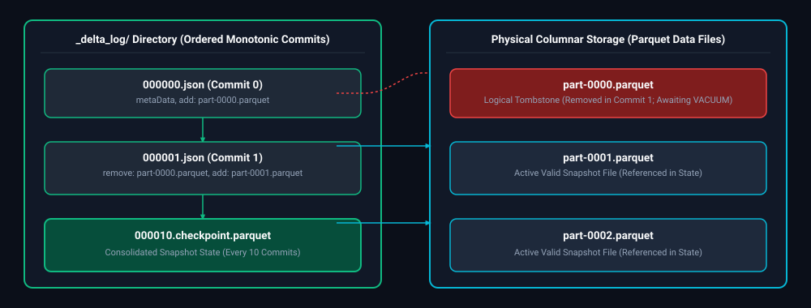

*D2 Source: [`01_delta_lake_storage_architecture_commit_log.d2`](assets/06_databricks_and_delta_lake_faq/01_delta_lake_storage_architecture_commit_log.d2)*

#### Vanilla Parquet Limitations vs. Delta Lake ACID Solutions

| Vanilla Parquet Failure Mode | Delta Lake ACID Architecture Solution | Underlying Storage Mechanism |
| :--- | :--- | :--- |
| **Partial Write Failures / Orphans** | **Atomic All-or-Nothing Commits** | Parquet files written by failed tasks are never appended to `_delta_log/*.json`; readers ignore uncommitted files. |
| **Inconsistent Concurrent Reads** | **Snapshot Isolation (MVCC)** | Readers read table state as of a specific commit; writers generate new versions without locking readers. |
| **Schema Drift & Silent Corruption** | **Schema Enforcement & Evolution** | Incoming DataFrame schema is strictly validated against table metadata; mismatches throw `AnalysisException` unless `mergeSchema=true`. |
| **Costly Deletes & Updates** | **Row-Level ACID MERGE / Tombstones** | Rewrites only affected files; records atomic `remove` and `add` actions in the commit log without rewriting untouched partitions. |

#### Under the Hood: Delta Transaction Log (`_delta_log`)
Delta Lake stores raw data as standard compressed Apache Parquet files, but wraps them with an ordered directory of JSON commit files called the **Delta Transaction Log** (`_delta_log/`):
- Every transaction writes a new monotonic commit file: `000000.json`, `000001.json`, `000002.json`.
- At every 10 commits, Delta writes a consolidated **Checkpoint Parquet file** (e.g., `000010.checkpoint.parquet`) caching the entire table state.
- Readers read the latest checkpoint and replay subsequent JSON commits to construct an exact, consistent snapshot of valid data files, ignoring uncommitted or aborted writes.

---

# 2. Incremental Loading, MERGE Semantics & Multiple-Match Trap

---

### Q2. [Easy] When to Use MERGE vs INSERT
**Difficulty:** [Easy]
**Topic Covered:** Conditional Mutation Semantics vs Append-Only Ingestion  
**Question:** When would you use MERGE instead of INSERT?

#### When to Use MERGE vs INSERT (Q3)
- **`INSERT`:** Append-only data streams (e.g., clickstreams, immutable server logs, raw bronze events). Extremely fast because it does not inspect existing data.
- **`MERGE`:** Mutable entity datasets (e.g., Customer Master, Order Statuses). Performs an atomic Upsert: updates existing matching records while inserting new records.

---

### Q3. [Medium] Incremental Loading Architecture & CDC Ingestion
**Difficulty:** [Medium]
**Topic Covered:** Daily High-Watermark Offsets, Change Data Feed & Target Upserts  
**Questions Covered:**
- **Q1**: How would you implement an incremental load using Delta Lake?
- **Q2**: You need to load only changed records from a source into a Delta table every day. How would you design the incremental load?

#### Incremental Load Design Architecture (Q1, Q2)
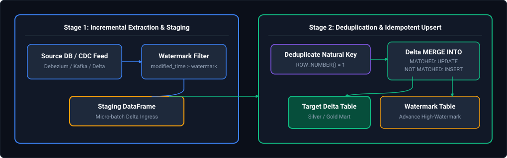

*D2 Source: [`02_incremental_cdc_watermark_merge_pipeline.d2`](assets/06_databricks_and_delta_lake_faq/02_incremental_cdc_watermark_merge_pipeline.d2)*

---

### Q4. [Medium] The Multiple-Match MERGE Trap & Resolution
**Difficulty:** [Medium]
**Topic Covered:** Non-Deterministic Mutations & Source Pre-Deduplication  
**Question:** What happens when multiple records match the same MERGE condition?

#### The Multiple-Match MERGE Trap (Q5)
##### What Happens?
If the incoming source dataset contains **duplicate rows for the same join key**, Spark fails with a fatal error:
```
DeltaAnalysisException: Cannot perform MERGE as multiple source rows matched the same target row.
Please ensure that the source data has no duplicates on the merge condition.
```
Delta Lake enforces strict relational consistency: it cannot determine *which* of the conflicting incoming values should overwrite the target row.

##### Production Defensive Resolution
Always deduplicate the incoming source batch on the join key (retaining the latest timestamp) before triggering the `MERGE`:
```python
from delta.tables import DeltaTable
from pyspark.sql import Window, functions as F

target_table = DeltaTable.forName(spark, "silver.customers")

# 1. Deduplicate source records prior to merge
window_spec = Window.partitionBy("customer_id").orderBy(F.col("updated_at").desc())
clean_source_df = (
    incoming_updates_df
    .withColumn("rn", F.row_number().over(window_spec))
    .filter("rn = 1")
    .drop("rn")
)

# 2. Safe MERGE execution
target_table.alias("target").merge(
    clean_source_df.alias("source"),
    "target.customer_id = source.customer_id"
).whenMatchedUpdate(
    condition="source.updated_at > target.updated_at",
    set={
        "name": "source.name",
        "email": "source.email",
        "updated_at": "source.updated_at"
    }
).whenNotMatchedInsertAll().execute()
```

---

# 3. Slowly Changing Dimensions (SCD 1 & 2) in Delta Lake

---

### Q5. [Medium] Slowly Changing Dimensions (SCD Types 1 & 2) in Delta Lake
**Difficulty:** [Medium]
*(Grouped together: Dimension mutation patterns, in-place overwrites, and historical audit tracking)*  
**Topic Covered:** Historical Record Tracking & 2-Stage Staging MERGE Architecture  
**Questions Covered:**
- How would you implement Slowly Changing Dimensions (SCD Type 2) using Delta Lake?
- How would you implement SCD Type 1 and Type 2 using Delta Lake?

#### SCD Type 1 (In-Place Overwrite)
```sql
MERGE INTO dim_customer AS tgt
USING staging_customer AS src
ON tgt.customer_id = src.customer_id
WHEN MATCHED THEN
    UPDATE SET tgt.address = src.address, tgt.phone = src.phone, tgt.updated_at = src.updated_at
WHEN NOT MATCHED THEN
    INSERT (customer_id, address, phone, created_at, updated_at)
    VALUES (src.customer_id, src.address, src.phone, src.created_at, src.updated_at);
```

#### SCD Type 2 (Historical Audit Trail)
In Delta Lake, SCD Type 2 is implemented via a **two-pass merge**:
1. Close out the existing current record by updating `is_current = false` and `end_date = src.effective_date`.
2. Insert a new record with `is_current = true`, `start_date = src.effective_date`, and `end_date = '9999-12-31'`.

---

# 4. Physical Table Maintenance: OPTIMIZE, Z-ORDER & VACUUM

---

### Q6. [Medium] Physical Table Maintenance: OPTIMIZE, Z-ORDER & VACUUM
**Difficulty:** [Medium]
*(Grouped together: Delta Lake file compaction, multidimensional clustering, and tombstone purging)*  
**Topic Covered:** File Compaction, Multidimensional Clustering & Tombstone Purging  
**Questions Covered:**
- Explain the purpose of the OPTIMIZE and VACUUM commands in Delta Lake.
- When would you use OPTIMIZE, Z-ORDER, and VACUUM?

#### Deep-Dive Maintenance Matrix
| Operation | Physical Mechanism | Impact on Query Performance | When to Run |
| :--- | :--- | :--- | :--- |
| **`OPTIMIZE`** | Bin-packs thousands of small Parquet files into uniform 1 GB files. | Eliminates filesystem metadata overhead; speeds up scans by $5\times$ to $20\times$. | Daily/weekly or after large ingestion batches. |
| **`Z-ORDER BY (col)`** | Multi-dimensional space-filling curve clustering. Colocates related column data in the same files. | Maximizes **Data Skipping via Min/Max Zone Maps**. Allows queries filtering on clustered columns to skip 90%+ of files. | After `OPTIMIZE` on high-cardinality query filter columns. |
| **`VACUUM`** | Deletes tombstoned physical Parquet files older than the retention threshold (default 7 days). | Frees petabytes of cloud storage; cleans up stale metadata. | Scheduled weekly maintenance (never set retention to 0 hours in production!). |

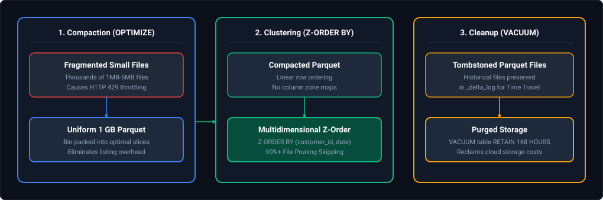

*D2 Source: [`03_delta_table_optimize_zorder_vacuum_lifecycle.d2`](assets/06_databricks_and_delta_lake_faq/03_delta_table_optimize_zorder_vacuum_lifecycle.d2)*

---

### Q7. [Medium] Optimizing Multi-TB Tables with Frequent Mutations & Small Files
**Difficulty:** [Medium]
**Topic Covered:** Deletion Vectors, Target File Sizing & Automated Maintenance  
**Questions Covered:**
- **Q13**: A Delta table has grown to several TB and queries are becoming slow. How would you optimize it?
- **Q15**: A Delta table has frequent UPDATE and DELETE operations and is becoming slow. How would you optimize the table?
- **Q19**: A Delta table contains thousands of small files and query performance has degraded. How would you optimize it?

#### Production Maintenance Script for Multi-TB Slow Tables (Q13, Q15)
Tables experiencing heavy row-level updates accumulate millions of tombstoned obsolete Parquet files.
```sql
-- Step 1: Compact small files and apply Z-Ordering
OPTIMIZE silver.orders
Z-ORDER BY (customer_id, order_date);

-- Step 2: Purge obsolete tombstoned files older than 7 days
VACUUM silver.orders RETAIN 168 HOURS; -- 7 days

-- Step 3: Compute detailed table statistics for Catalyst
ANALYZE TABLE silver.orders COMPUTE STATISTICS FOR ALL COLUMNS;
```

---

### Q8. [Hard] Millions of Small Files in ADLS: Root Causes & Resolution in Databricks
**Difficulty:** [Hard]
**Topic Covered:** ADLS Gen2 Metadata Bottlenecks, Rate Throttling, Auto Loader, CONVERT TO DELTA & Compaction  
**Question:** Your ADLS folder contains millions of small files. What problems can this cause in Databricks, and how would you solve them?

#### Definition & Core Concepts
When an ADLS Gen2 folder accumulates millions of small files (e.g. <10 MB from IoT streams or un-compacted batch writes), processing within Databricks degrades severely:
1. **ADLS Gen2 Storage Driver Throttling (HTTP 429):** ADLS limits metadata operations (`ListBlobs`, `GetFileStatus`) to a fixed rate per storage account. Recursive path globbing causes repeated API calls, resulting in `StorageException: Server busy (429)`.
2. **Driver JVM Heap Exhaustion (OOM):** The Spark driver must fetch metadata (file paths, block locations, lengths) for every single file before distributing tasks. For 10 million files, this metadata requires several gigabytes of JVM heap, triggering driver OutOfMemoryError.
3. **Task Scheduling Overhead Dwarfs Compute:** Default input partition sizing (`spark.sql.files.maxPartitionBytes = 128MB`) assigns each small file to an individual task. Generating and dispatching millions of tasks creates massive RPC overhead in the scheduler where scheduling latency (50–100ms per task) far exceeds execution time (1–2ms).
4. **Storage Space Amplification & Footer Overhead:** Parquet file footers, metadata dictionaries, and compression headers occupy a disproportionate percentage of total bytes in tiny files.

#### Visual Flow
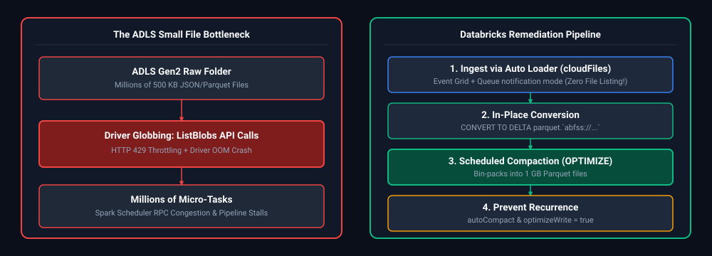

*D2 Source: [`04_adls_small_file_bottleneck_auto_loader_remediation.d2`](assets/06_databricks_and_delta_lake_faq/04_adls_small_file_bottleneck_auto_loader_remediation.d2)*

#### Production Implementation / Code Solution
```python
from pyspark.sql import SparkSession

spark = SparkSession.builder.appName("ADLSSmallFileResolution").getOrCreate()

# -------------------------------------------------------------------------
# Phase 1: Ingest Ongoing Streams Without Directory Listing (Auto Loader)
# -------------------------------------------------------------------------
# Uses Azure Event Grid + Storage Queue notifications instead of recursive scanning
raw_stream_df = (
    spark.readStream
    .format("cloudFiles")
    .option("cloudFiles.format", "parquet")
    .option("cloudFiles.useNotifications", "true")  # Bypasses ADLS ListBlobs
    .option("cloudFiles.schemaLocation", "abfss://checkpoints@datalakeprod.dfs.core.windows.net/orders_schema")
    .load("abfss://raw@datalakeprod.dfs.core.windows.net/incoming_orders/")
)

# -------------------------------------------------------------------------
# Phase 2: In-Place Conversion of Existing Historical Raw Parquet Files
# -------------------------------------------------------------------------
# Indexes existing physical files into Delta log without data movement
spark.sql("""
    CONVERT TO DELTA parquet.`abfss://raw@datalakeprod.dfs.core.windows.net/historical_landing/`
    NO CHECKPOINTS;
""")

# -------------------------------------------------------------------------
# Phase 3: Bin-Pack Small Files into Uniform 1 GB Parquet Files
# -------------------------------------------------------------------------
# Set target file size to 1 GB (1,073,741,824 bytes)
spark.sql("ALTER TABLE bronze.orders SET TBLPROPERTIES ('delta.targetFileSize' = '1073741824');")
spark.sql("OPTIMIZE bronze.orders;")

# -------------------------------------------------------------------------
# Phase 4: Configure Write-Time Auto-Compaction to Prevent Recurrence
# -------------------------------------------------------------------------
spark.conf.set("spark.databricks.delta.optimizeWrite.enabled", "true")
spark.conf.set("spark.databricks.delta.autoCompact.enabled", "true")
```
- **Time Complexity:** $O(N)$ one-time bin-pack rewrite; $O(1)$ event-driven arrival latency for ongoing stream.
- **Space Complexity:** $O(1)$ stream state memory.

#### Engineering Implications & Production Pitfalls
1. **The Dangerous `VACUUM RETAIN 0 HOURS` Trap:** When dealing with millions of small files, engineers frequently attempt to run `VACUUM table RETAIN 0 HOURS;` immediately after `OPTIMIZE` to reclaim disk space. This breaks active concurrent reader snapshots with `FileNotFoundException` and requires overriding safety checks (`SET spark.databricks.delta.vacuum.parallelDelete.enabled = true`). Never drop retention below 168 hours (7 days) without offline downtime.
2. **Interview Talking Point:** Emphasize that Databricks Auto Loader (`cloudFiles`) solves the cloud listing scalability limit at ingestion by delegating discovery to Azure Event Grid webhooks and Queue Storage, reducing ingestion latency from hours to seconds.

---

### Q9. [Expert] Partitioning Strategy & Liquid Clustering in Azure Databricks
**Difficulty:** [Expert]
**Topic Covered:** Partition Column Selection, High vs Low Cardinality, Liquid Clustering vs Hive Partitioning  
**Question:** Explain partitioning in Azure Databricks. How do you decide the appropriate partition column?

#### Definition & Core Concepts
Partitioning physically separates a table's data into separate directories based on column values. In modern Azure Databricks, choosing a partitioning strategy requires evaluating data volume, query patterns, and architectural evolution:

1. **Volume Heuristic (The 1 GB Rule):**
   - A partition should contain **at least 1 GB of compressed data**.
   - If a table has only 50 GB total data, creating 365 daily partitions produces ~140 MB per partition, leading directly to the small file problem. Do not partition tables under 500 GB–1 TB.
2. **Cardinality Selection:**
   - **Good Candidates:** Low-to-medium cardinality columns (between 10 and 1,000 distinct values, e.g. `order_date`, `region_code`, `business_unit`).
   - **Severe Anti-Patterns:** High-cardinality columns (e.g. `customer_id`, `device_id`, `timestamp` with millions of unique values creates millions of directories), or boolean/binary columns (`is_active` creates severe data skew into 2 gigantic directories).
3. **Query Filter Alignment:**
   - Partitioning is only valuable if downstream queries consistently filter on that column in their `WHERE` predicates, allowing the Catalyst optimizer to perform **Static and Dynamic Partition Pruning**.
4. **Modern Paradigm Shift: Liquid Clustering (`CLUSTER BY`):**
   - Available in Databricks Runtime 13.3+ (Delta 3.0+), **Liquid Clustering** obsoletes rigid Hive-style directory partitioning.
   - Liquid Clustering clusters data dynamically inside Delta files using a multidimensional space-filling Hilbert curve without creating physical directory hierarchies.
   - Allows clustering on high-cardinality columns (`customer_id`), prevents partition skew, allows redefining clustering keys (`ALTER TABLE ... CLUSTER BY ...`) without full table rewrites, and enables incremental clustering during normal writes.

#### Visual Flow
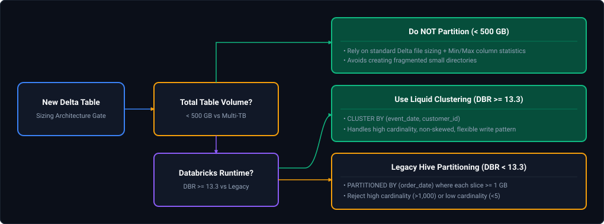

*D2 Source: [`05_delta_table_partitioning_vs_liquid_clustering_decision_tree.d2`](assets/06_databricks_and_delta_lake_faq/05_delta_table_partitioning_vs_liquid_clustering_decision_tree.d2)*

#### Production Implementation / Code Solution
```sql
-- Pattern 1: Legacy Hive-Style Partitioning (For DBR < 13.3 or External Hive Metastore compatibility)
-- Only use when daily partitions contain >= 1 GB of Parquet data
CREATE TABLE silver.retail_orders (
    order_id STRING,
    customer_id STRING,
    store_id STRING,
    order_amount DECIMAL(10, 2),
    order_date DATE
)
USING DELTA
PARTITIONED BY (order_date)
LOCATION 'abfss://silver@datalakeprod.dfs.core.windows.net/retail_orders';

-- Pattern 2: Modern Production Standard — Liquid Clustering (Databricks Runtime 13.3+)
-- Replaces PARTITIONED BY + Z-ORDER BY; handles both date and high-cardinality customer_id
CREATE TABLE silver.modern_retail_orders (
    order_id STRING,
    customer_id STRING,
    store_id STRING,
    order_amount DECIMAL(10, 2),
    order_date DATE
)
USING DELTA
CLUSTER BY (order_date, customer_id);

-- Evolving clustering keys without rewriting historical table data:
ALTER TABLE silver.modern_retail_orders CLUSTER BY (order_date, store_id);

-- Run incremental clustering
OPTIMIZE silver.modern_retail_orders;
```
- **Time Complexity:** $O(\log N)$ file pruning for filtered queries.
- **Space Complexity:** $O(1)$ file directory metadata overhead.

#### Engineering Implications & Production Pitfalls
1. **The Over-Partitioning Trap:** Partitioning by `year/month/day/hour` on low-throughput pipelines produces hundreds of thousands of directories containing 50 KB files. Directory traversal in ADLS requires sequential metadata calls, creating catastrophic latency. Always aggregate to `date` or `year_month`, or adopt Liquid Clustering.
2. **Interview Talking Point:** In interviews, highlight that Databricks officially recommends **Liquid Clustering** for all new Delta tables starting with DBR 13.3. It decouples physical data layout from rigid directory paths, completely eliminating the painful migration cost of changing partition columns later.

---

# 5. Time Travel, Disaster Recovery & Deployment Rollbacks

---

### Q10. [Medium] Recovering Deleted or Overwritten Delta Data via Time Travel
**Difficulty:** [Medium]
*(Grouped together: Delta Lake time travel, table versioning, and disaster recovery rollback)*  
**Topic Covered:** Timestamp & Version Time Travel Restoration  
**Questions Covered:**
- What are Delta Lake Time Travel and Versioning, and when would you use them?
- How would you recover accidentally deleted, overwritten, or modified Delta data (e.g. last 3 days)?

#### Time Travel Mechanics
Because Delta Lake's transaction log never deletes old files until `VACUUM` runs, the table preserves a complete historical timeline.

#### Recovering Accidentally Deleted Data (Q6)
```sql
-- Step 1: Inspect transaction history to identify the bad commit
DESCRIBE HISTORY silver.customers;

-- Step 2: Query the exact state from 3 days ago or specific version
SELECT * FROM silver.customers TIMESTAMP AS OF '2024-10-02 12:00:00';
SELECT * FROM silver.customers VERSION AS OF 142;

-- Step 3: Instant Disaster Recovery: Rollback the table state in 1 second!
RESTORE TABLE silver.customers TO TIMESTAMP AS OF '2024-10-02 12:00:00';
```

---

### Q11. [Medium] Automated Rollback Strategy for Failed Deployments
**Difficulty:** [Medium]
**Topic Covered:** Atomic Commit Rollbacks & Production Table Restoration  
**Question:** How would you implement a rollback strategy for a failed Delta Lake deployment?

#### Automated Rollback Strategy for Failed Deployments (Q16)
1. **Pre-Deployment Anchor:** Capture the latest Delta commit version prior to running pipeline transformations:
   ```python
   pre_deploy_version = spark.sql("DESCRIBE HISTORY gold.finance").select("version").first()[0]
   ```
2. **Automated Assertion Gate:** Execute automated data quality tests against the new data (e.g., Great Expectations / Soda).
3. **Automated Rollback Hook:** If validation tests fail:
   ```python
   try:
       run_pipeline_transformation()
       validate_data_quality()
   except DataQualityFailure:
       spark.sql(f"RESTORE TABLE gold.finance TO VERSION AS OF {pre_deploy_version}")
       alert_oncall_engineer("Pipeline failed validation; rolled back automatically.")
   ```

---

# 6. Databricks Cluster Architecture & 3x Slowdown Diagnostics

---

### Q12. [Easy] Job Clusters vs All-Purpose Clusters
**Difficulty:** [Easy]
**Topic Covered:** Ephemeral Isolated Clusters vs Shared Interactive Workspaces  
**Question:** When would you use a Job Cluster vs an All-Purpose Cluster?

#### Job Cluster vs All-Purpose Cluster Comparison (Q12)
| Dimension | All-Purpose Cluster | Job Cluster (Automated) |
| :--- | :--- | :--- |
| **Purpose** | Interactive ad-hoc analysis, exploratory notebook development. | Automated production workflows (scheduled ADF/Airflow tasks). |
| **Lifecycle** | Remains active until manually stopped or auto-termination timer fires. | Spawns automatically when job starts; terminates immediately when job finishes. |
| **Cost (DBUs)** | Standard DBU rate (**$3\times$ to $4\times$ more expensive**). | Discounted Automated DBU rate (**60–75% cheaper**). |
| **State Isolation** | Shared across developers; risk of state corruption and memory leaks. | Dedicated, clean isolated JVM environment per job execution. |

---

### Q13. [Medium] Root-Cause Analysis for 3x Production Job Slowdowns
**Difficulty:** [Medium]
**Topic Covered:** Production Cluster Contention, Spark UI Bottleneck Isolation & Data Drift  
**Questions Covered:**
- **Q8**: A Databricks job suddenly starts taking 3× longer than usual. What would you investigate?
- **Q9**: You notice a DataBricks job that runs fine in dev but takes 3× longer in production — how do you debug this?

#### Systematic Root-Cause Analysis: 3x Slowdown in Production (Q8, Q9)
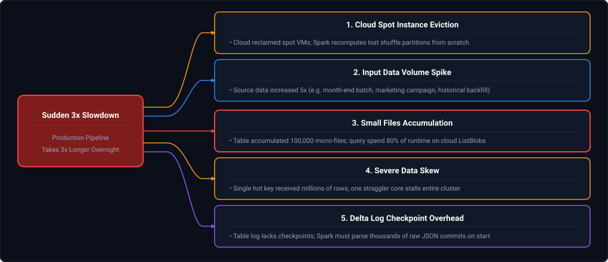

*D2 Source: [`06_databricks_production_slowdown_root_causes.d2`](assets/06_databricks_and_delta_lake_faq/06_databricks_production_slowdown_root_causes.d2)*

---

# 7. Partial Failure Restartability & Billion-Record Architecture

---

### Q14. [Medium] Restarting Failed Jobs Without Reprocessing from Scratch
**Difficulty:** [Medium]
**Topic Covered:** Checkpoint Directories, Idempotent Partitions & Atomic Batch Tracking  
**Question:** A production job fails after processing 80% of the data. How would you restart it without processing everything again?

#### Restarting Without Reprocessing from Scratch (Q10)
1. **Partition-Level Granularity:** Design the ingestion to process and commit at partitioned boundaries (e.g., date-by-date or file-by-file micro-batches).
2. **Delta Lake Idempotent MERGE:** Because `MERGE` is idempotent, re-running the job over the full batch updates already-processed records safely without creating duplicates.
3. **High-Watermark Staging:** Write processed records to a temporary staging Delta table with partition flags. Downstream consumers read only marked batches.

---

### Q15. [Medium] Designing Databricks Solutions for Billions of Records
**Difficulty:** [Medium]
**Topic Covered:** High-Scale Data Modeling, Auto Loader, Liquid Clustering & Photon Engine  
**Question:** How would you design a Databricks solution for billions of records?

#### Designing for Billions of Records (Q11)
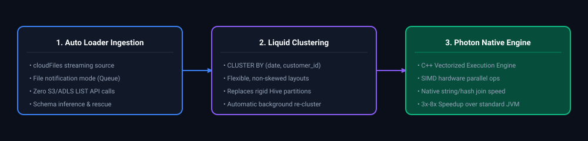

*D2 Source: [`07_auto_loader_liquid_clustering_photon_architecture.d2`](assets/06_databricks_and_delta_lake_faq/07_auto_loader_liquid_clustering_photon_architecture.d2)*

---

# 8. Data Quality Constraints, Schema Governance & Concurrency

---

### Q16. [Medium] Enforcing Data Quality Constraints in Delta Lake
**Difficulty:** [Medium]
**Topic Covered:** CHECK Constraints, NOT NULL Enforcement & Quarantine Logic  
**Question:** How would you implement data quality checks before writing data into a Delta table?

#### Data Quality Constraints in Delta Lake (Q14)
Delta Lake supports database-level constraints that reject invalid writes atomically:
```sql
-- Enforce non-null and value bounds
ALTER TABLE silver.orders ADD CONSTRAINT check_valid_amount CHECK (order_amount > 0);
ALTER TABLE silver.orders ADD CONSTRAINT check_valid_date CHECK (order_date >= '2020-01-01');
```

---

### Q17. [Easy] Schema Enforcement vs Schema Evolution
**Difficulty:** [Easy]
**Topic Covered:** AnalysisException Protection vs mergeSchema Options  
**Question:** A source schema changes unexpectedly during a Delta load. How would you handle schema enforcement versus schema evolution?

#### Schema Enforcement vs Schema Evolution (Q21)
- **Schema Enforcement (Default):** Rejects any write containing columns not present in the target Delta table. Prevents silent table corruption.
- **Schema Evolution (`mergeSchema`):** Automatically adds new columns to the target schema when present in the incoming DataFrame:
```python
df_with_new_col.write.format("delta") \
    .mode("append") \
    .option("mergeSchema", "true") \
    .saveAsTable("silver.customers")
```

---

### Q18. [Medium] Delta Lake Change Data Feed (CDF) Implementation
**Difficulty:** [Medium]
**Topic Covered:** Row-Level Change Auditing, _change_type & Downstream Propagation  
**Question:** How would you use Delta Lake Change Data Feed (CDF) to capture INSERT, UPDATE, and DELETE changes?

#### Change Data Feed (CDF) Implementation (Q20)
CDF enables capturing row-level row modifications:
```sql
-- 1. Enable CDF on the table
ALTER TABLE silver.customers SET TBLPROPERTIES (delta.enableChangeDataFeed = true);

-- 2. Query change feed between versions
SELECT customer_id, name, _change_type, _commit_version, _commit_timestamp
FROM table_changes('silver.customers', 2, 5);
-- Output _change_type: 'insert', 'update_preimage', 'update_postimage', 'delete'
```

---

### Q19. [Medium] Concurrent Writes & Optimistic Concurrency Control (OCC)
**Difficulty:** [Medium]
**Topic Covered:** ConcurrentAppendException, Mutually Exclusive Partition Predicates  
**Question:** How would you handle concurrent writes to the same Delta table?

#### Concurrent Writes & Optimistic Concurrency Control (OCC) (Q17)
Delta Lake uses **Optimistic Concurrency Control (OCC)**:
1. Two transactions read the table snapshot simultaneously.
2. The first transaction commits successfully.
3. The second transaction verifies if files it modified were touched by the first. If mutually exclusive partitions/files were touched, both succeed. If the exact same files were touched, a `ConcurrentAppendException` is thrown.
4. **Resolution:** Partition table logically or isolate batch updates by partition keys so concurrent writers touch distinct directories.

---

# 9. Production Table Health Monitoring & Governance

---

### Q20. [Medium] Monitoring and Maintaining Delta Tables in Production
**Difficulty:** [Medium]
**Topic Covered:** DESCRIBE DETAIL/HISTORY, Automated Databricks Workflows & Telemetry  
**Question:** How would you monitor and maintain Delta tables in a production environment?

#### Production Maintenance Blueprint
1. **Automated Weekly Maintenance Job:**
   - Execute `OPTIMIZE` followed by `VACUUM` every Sunday morning.
2. **Metadata Inspection:**
   ```sql
   DESCRIBE DETAIL silver.orders; -- Inspects numFiles, sizeInBytes, partitionColumns
   DESCRIBE HISTORY silver.orders; -- Inspects operations, user identity, execution metrics
   ```
3. **Databricks Lakehouse Monitoring & System Tables:**
   - Query `system.billing.usage` to audit cluster costs.
   - Query `system.access.audit` to detect unauthorized data access.

---

# 10. Enterprise Platform Engineering: Multi-Tenancy, CI/CD & Secret Security

---

### Q21. [Medium] Designing a Multi-Tenant Lakehouse Platform on Databricks
**Difficulty:** [Medium]
**Topic Covered:** Multi-Tenant Isolation, Unity Catalog Catalogs, Cluster Policies & Cost Allocation  
**Question:** How would you design a multi-tenant data platform using Databricks?

#### The 4-Pillar Multi-Tenant Lakehouse Architecture
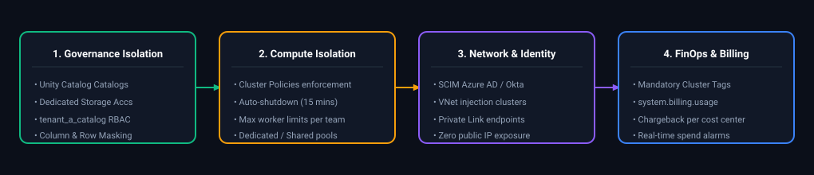

*D2 Source: [`08_enterprise_multi_tenant_databricks_lakehouse.d2`](assets/06_databricks_and_delta_lake_faq/08_enterprise_multi_tenant_databricks_lakehouse.d2)*

#### Layer Breakdown:
1. **Catalog Isolation:** Each tenant is provisioned with their own Unity Catalog (`catalog_tenant_a`), mapped to a dedicated cloud storage container with tenant-isolated IAM credentials. Tenant A cannot see or query Tenant B's catalog.
2. **Compute Isolation & Cluster Policies:**
   - Enforce Cluster Policies so tenants can only spin up approved VM types and cannot disable auto-termination.
   - Use **Shared Access Mode** clusters with user isolation for interactive queries, or isolated **Single User / Job Clusters** for heavy production workloads.
3. **FinOps & Cost Allocation:**
   - Every compute resource is tagged automatically via policy: `tenant_id: marketing`, `environment: prod`.
   - Query Databricks system billing tables (`system.billing.usage`) to calculate daily chargebacks per tenant down to the exact dollar.

---

### Q22. [Medium] Enterprise CI/CD for Databricks Asset Bundles (DABs) & Repos
**Difficulty:** [Medium]
**Topic Covered:** Databricks Asset Bundles (DABs), Git Workflows, Multi-Environment Deployment  
**Question:** How would you implement CI/CD for Databricks notebooks, workflows, and data pipelines?

#### Modern Best Practice: Databricks Asset Bundles (DABs)
Legacy approaches relied on fragile REST API scripts or UI syncs. The modern production standard is **Databricks Asset Bundles (DABs)**:
- Code, workflows, Delta Live Tables (DLT) pipelines, and cluster configurations are declared as Infrastructure-as-Code (IaC) in a `databricks.yml` project file.
- Tracked in Git and deployed deterministically across `dev`, `staging`, and `prod` targets.

#### Production CI/CD Lifecycle Blueprint
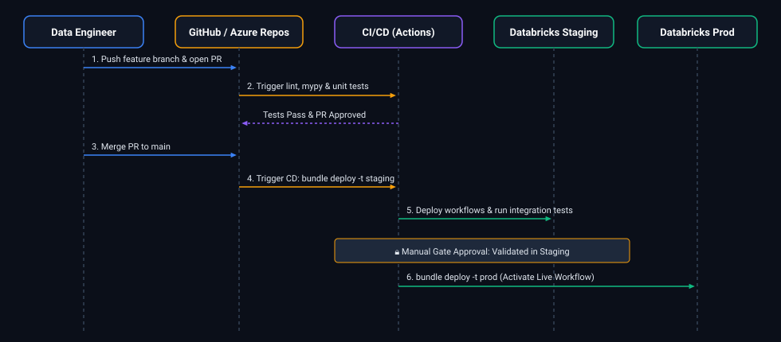

*D2 Source: [`09_databricks_asset_bundles_cicd_deployment_sequence.d2`](assets/06_databricks_and_delta_lake_faq/09_databricks_asset_bundles_cicd_deployment_sequence.d2)*

#### Production `databricks.yml` Bundle Specification
```yaml
bundle:
  name: revenue_analytics_pipeline

targets:
  dev:
    workspace:
      host: https://adb-dev.azuredatabricks.net
    mode: development

  prod:
    workspace:
      host: https://adb-prod.azuredatabricks.net
    mode: production
    run_as:
      service_principal_name: 00000000-0000-0000-0000-000000000000

resources:
  jobs:
    nightly_revenue_job:
      name: "[${bundle.target}] Nightly Revenue Processing"
      tasks:
        - task_key: run_dbt_transformations
          job_cluster_key: job_cluster
          notebook_task:
            notebook_path: ./src/revenue_dbt.py
      job_clusters:
        - job_cluster_key: job_cluster
          new_cluster:
            spark_version: 14.3.x-scala2.12
            node_type_id: Standard_D8s_v5
            num_workers: 4
```

---

### Q23. [Medium] Databricks Secret Scopes & Azure Key Vault Integration
**Difficulty:** [Medium]
**Topic Covered:** Credential Isolation, Azure Key Vault Backed Scopes & Secrets API  
**Question:** How do you secure secrets and credentials in Azure Databricks without exposing them in code?

#### Core Security Principle
**Zero Plaintext Secrets:** Connection strings, database passwords, and API tokens must **never** be hardcoded in notebooks, configuration files, or Git repositories.

#### Two Types of Secret Scopes:
1. **Azure Key Vault-Backed Scope (Enterprise Standard):**
   - Secrets reside in Azure Key Vault.
   - When a notebook reads the secret, Databricks authenticates via Azure AD managed identity, retrieves the value in memory, and immediately redacts it from output logs (`[REDACTED]`).
2. **Databricks-Backed Scope:**
   - Secrets encrypted and stored in the Databricks control plane database.

#### Production Implementation
```bash
# 1. Create Azure Key Vault-backed Scope via Databricks CLI
databricks secrets create-scope \
  --scope akv-finance-scope \
  --scope-backend-type AZURE_KEYVAULT \
  --resource-id "/subscriptions/.../vaults/kv-finance-prod" \
  --dns-name "https://kv-finance-prod.vault.azure.net/"
```

```python
# 2. In PySpark Notebook: Access secret securely
db_password = dbutils.secrets.get(scope="akv-finance-scope", key="postgres-db-password")
db_user = dbutils.secrets.get(scope="akv-finance-scope", key="postgres-db-user")

# Even if a malicious user prints it, Databricks redacts the value:
print(db_password) # Prints: [REDACTED]
```

---

### Q24. [Hard] Multi-Terabyte Table Performance Optimization Strategy
**Difficulty:** [Hard]
**Topic Covered:** Liquid Clustering vs Z-Order, Predictive I/O & File Size Tuning  
**Question:** A Delta table has grown to several terabytes, and query performance has degraded significantly. How would you optimize it?

#### The 5-Step Optimization Playbook:
1. **Migrate from Z-Ordering to Delta Liquid Clustering:**
   - Legacy Z-Ordering (`OPTIMIZE z USING (col1, col2)`) requires costly full-table rewrites and degrades as data grows beyond 5 TB.
   - **Liquid Clustering** dynamically adjusts layout incrementally with every write without requiring full-table compaction:
     ```sql
     -- Enable Liquid Clustering on high-cardinality query keys
     ALTER TABLE transactions CLUSTER BY (customer_id, transaction_date);
     OPTIMIZE transactions;
     ```
2. **Tune Target File Size to Avoid Small File Inflation:**
   - For multi-terabyte tables, default 128 MB files cause excessive metadata overhead. Increase target file size to 512 MB or 1 GB:
     ```sql
     ALTER TABLE transactions SET TBLPROPERTIES (
       'delta.targetFileSize' = '1073741824' -- 1 GB file size target
     );
     ```
3. **Automate Bin-Packing and Garbage Collection:**
   - Run nightly `OPTIMIZE` to combine small files.
   - Schedule weekly `VACUUM transactions RETAIN 168 HOURS` (7 days) to purge deleted Parquet snapshots from disk.
4. **Enable Predictive I/O & Deletion Vectors:**
   - Deletion vectors write lightweight bitmaps of deleted rows instead of rewriting the entire 1 GB Parquet file on `UPDATE`/`DELETE`:
     ```sql
     ALTER TABLE transactions SET TBLPROPERTIES (
       'delta.enableDeletionVectors' = true
     );
     ```

---

# 11. Modern Lakehouse Ingestion & Infrastructure as Code

---

### Q25. [Medium] Databricks Lakeflow Architecture & Databricks Asset Bundles (DABs)
**Difficulty:** [Medium]
**Topic Covered:** Declarative Ingestion, Lakeflow Connect, Lakeflow Pipelines & DABs CI/CD  
**Question:** Explain Lakeflow and Databricks Asset Bundles (DABs). How do they modernize lakehouse data engineering and operational workflows?

#### Definition & Core Concepts
1. **Databricks Lakeflow:** A unified serverless data engineering solution combining:
   - **Lakeflow Connect:** Native, serverless connectors for transactional databases (PostgreSQL, MySQL, SQL Server, Oracle) and SaaS apps (Salesforce, Workday) with sub-minute log-based CDC into Unity Catalog.
   - **Lakeflow Pipelines:** The declarative evolution of Delta Live Tables (DLT) providing automatic incremental computation, schema evolution, and data quality enforcement.
   - **Lakeflow Jobs:** Serverless orchestration with automated failure triage, lineage tracking, and SLA alerts.
2. **Databricks Asset Bundles (DABs):** The Infrastructure-as-Code (IaC) standard for packaging, testing, and deploying lakehouse projects (Jobs, DLT pipelines, ML models, notebooks) across multi-stage environments (`dev`, `staging`, `prod`) using declarative YAML.

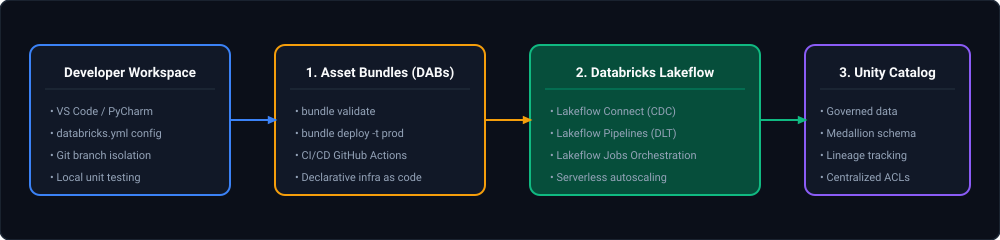

*D2 Source: [`10_databricks_dabs_lakeflow_unity_catalog_pipeline.d2`](assets/06_databricks_and_delta_lake_faq/10_databricks_dabs_lakeflow_unity_catalog_pipeline.d2)*

#### Production Implementation (`databricks.yml`)
```yaml
bundle:
  name: enterprise_lakeflow_pipeline

include:
  - resources/*.yml

targets:
  dev:
    mode: development
    default: true
    workspace:
      host: https://adb-dev.azuredatabricks.net

  prod:
    mode: production
    workspace:
      host: https://adb-prod.azuredatabricks.net
      root_path: /Shared/.bundles/${bundle.name}
    run_as:
      service_principal_name: 00000000-0000-0000-0000-000000000000
```

---

### Q26. [Easy] Catalog Table Referencing vs Direct File Path Ingestion in Delta Lake
**Difficulty:** [Easy]
**Topic Covered:** Unity Catalog Table Virtualization vs Legacy DBFS File Path Reading  
**Question:** What is the difference between reading a Delta table from the catalog (`spark.read.table("catalog.schema.table")`) and loading it from a direct storage path (`spark.read.format("delta").load("path")`)?

#### Architectural Comparison Matrix

| Architectural Dimension | Catalog Referencing (`spark.read.table`) | Direct File Path (`spark.read.format("delta").load`) |
| :--- | :--- | :--- |
| **Governance & Security** | Centrally managed by **Unity Catalog**. Enforces Dynamic Row Filters, Column Masking, and RBAC grants. | **Zero catalog governance**. Requires direct cloud storage read permissions (`Storage Blob Data Reader` / `s3:GetObject`). |
| **Physical Path Decoupling** | **Complete Abstraction**. If the underlying storage bucket changes or data is migrated, queries do not break. | **Hard-Coded Fragility**. Renaming or migrating cloud containers breaks all downstream pipelines and notebooks. |
| **Data Lineage** | Automatically captured in **Unity Catalog System Tables** (`system.access.table_lineage`). | Lineage tracking is lost or reduced to raw ephemeral file paths. |
| **Performance & Caching** | Utilizes Unity Catalog metastore statistics, table constraints, and metadata caching. | Requires inspecting raw cloud storage `_delta_log/` directly, increasing storage API call latency. |

#### Production Implementation
```python
# Anti-Pattern: Direct file path loading (Bypasses Unity Catalog governance & leaks storage paths)
raw_df = spark.read.format("delta").load("abfss://silver@storageaccount.dfs.core.windows.net/orders")

# Production Standard: 3-Level Namespace referencing via Unity Catalog
governed_df = spark.read.table("prod_catalog.finance.orders")
```

---

# 12. Migration Reconciliation, Dashboard Tuning & Parquet Snapshots

---

### Q27. [Medium] Source-to-Target Data Validation Framework for Delta Lake Migrations
**Difficulty:** [Medium]
**Topic Covered:** Data Reconciliation, Cryptographic Checksumming & Dual-Run Auditing  
**Question:** How would you validate source and target data during a large-scale migration to Delta Lake?

#### Comprehensive 4-Pillar Validation Framework
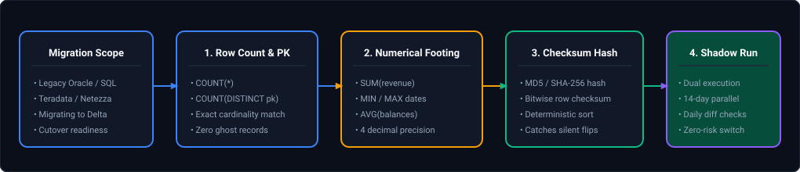

*D2 Source: [`11_legacy_database_to_delta_lake_reconciliation_framework.d2`](assets/06_databricks_and_delta_lake_faq/11_legacy_database_to_delta_lake_reconciliation_framework.d2)*

#### Production PySpark Checksum Validation
```python
from pyspark.sql import functions as F

def reconcile_source_and_delta(source_df, delta_df, primary_key: str):
    """
    Computes cryptographic checksum hashes across all row attributes 
    to guarantee bit-for-bit data parity between source and migrated Delta table.
    """
    # Exclude technical audit columns added during Delta ingestion
    common_cols = [c for c in source_df.columns if c in delta_df.columns and not c.startswith("_")]

    # Compute row-level SHA-256 hash across concatenated sorted column values
    hash_expr = F.sha2(F.concat_ws("||", *[F.coalesce(F.col(c).cast("string"), F.lit("###NULL###")) for c in sorted(common_cols)]), 256)

    source_hashed = source_df.select(F.col(primary_key), hash_expr.alias("source_row_hash"))
    delta_hashed = delta_df.select(F.col(primary_key), hash_expr.alias("delta_row_hash"))

    # Join on primary key and isolate mismatches
    discrepancies = (
        source_hashed.join(delta_hashed, on=primary_key, how="full_outer")
        .filter((F.col("source_row_hash") != F.col("delta_row_hash")) | F.col("source_row_hash").isNull() | F.col("delta_row_hash").isNull())
    )

    mismatch_count = discrepancies.count()
    if mismatch_count > 0:
        raise ValueError(f"MIGRATION VALIDATION FAILED: {mismatch_count} mismatched or missing rows detected!")
    print("SUCCESS: 100% row-for-row bit parity confirmed across source and target Delta table.")
```

---

### Q28. [Hard] Diagnosing and Tuning Gold-Layer Delta Table Dashboard Performance
**Difficulty:** [Hard]
**Topic Covered:** BI Latency RCA, Liquid Clustering, Deletion Vectors & Materialized Views  
**Question:** Your Gold-layer Delta table feeds critical business dashboards. Processing time has increased significantly, and business users are complaining. How would you identify the bottleneck and improve performance?

#### Root-Cause Diagnostic Workflow
1. **Analyze Query Execution Plans via Spark UI / Query History:**
   - Check **Files Read vs Files Pruned**. If queries read 50,000 files to return 1,000 rows, data skipping has failed.
   - Check **Deletion Vector Overhead:** If the table has thousands of updates, queries must read base Parquet files AND parse deletion vectors in memory.
2. **Apply Multi-Dimensional Liquid Clustering:**
   - Migrate from rigid partition folders or Z-Ordering to **Liquid Clustering** on the most frequent dashboard filter/group-by predicates (e.g. `CLUSTER BY (tenant_id, order_date, region)`).
3. **Execute File Compaction (`OPTIMIZE`):**
   - Consolidate millions of small 1MB files into uniform 128MB to 512MB columnar files:
     ```sql
     OPTIMIZE gold.executive_metrics;
     ```
4. **Purge Deletion Vectors via Full Table Rewrite:**
   - If updates exceed 20% of rows, trigger full rewrite to bake deleted rows out of the physical Parquet files:
     ```sql
     OPTIMIZE gold.executive_metrics FULL;
     ```
5. **Implement Materialized Views on Databricks SQL:**
   - For recurring complex aggregations (`SUM(revenue) GROUP BY month, vendor`), define a **Materialized View** that incrementally refreshes, delivering sub-second BI dashboard response times.

---

### Q29. [Easy] Manual Versioning & Snapshots in Parquet vs Delta ACID Transaction Logs
**Difficulty:** [Easy]
**Topic Covered:** Parquet Partitioning Limitations, Delta Transaction Log & Time Travel  
**Question:** How would you manually add versioning to Parquet or Delta files in PySpark? What are the limitations compared to native Delta Lake time travel?

#### Manual Parquet Versioning Pattern
Before ACID table formats existed, data engineers implemented versioning manually by embedding version numbers or timestamps into storage directory paths:
```python
from datetime import datetime

# Pattern: Partitioning by explicit version directory
snapshot_timestamp = datetime.utcnow().strftime("%Y%m%d_%H%M%S")
output_path = f"/mnt/lake/orders_archive/version_{snapshot_timestamp}/"

df.write.parquet(output_path)
```

#### Why Manual Parquet Versioning Fails in Enterprise Production:
1. **Zero Atomic Guarantees:** Writing to a folder is not atomic. If a cluster node fails halfway through the write, consumers reading the directory encounter corrupt partial datasets.
2. **Exponential Storage Bloat:** Every snapshot duplicates 100% of the entire table, even if only 10 rows changed.
3. **Native Delta Lake Solution:** Delta Lake uses copy-on-write Parquet files tracked by an atomic JSON transaction log (`_delta_log/`). Only modified files are rewritten, providing full point-in-time **Time Travel** (`AS OF version` or `AS OF timestamp`) without redundant whole-dataset cloning:
   ```sql
   -- Native Delta Time Travel (Instant, zero-copy, fully atomic)
   SELECT * FROM gold.orders TIMESTAMP AS OF '2025-01-01 00:00:00';
   SELECT * FROM gold.orders VERSION AS OF 42;
   ```

---

# 13. Medallion Data Reconciliation & Programmatic Notebook Orchestration

---

### Q30. [Medium] Tracing Record Discrepancies Across Bronze, Silver, and Gold Tables
**Difficulty:** [Medium]
**Topic Covered:** Medallion Audit Lineage, Row Attrition Tracking, Quarantine Tables & Delta Time Travel  
**Question:** A downstream Gold reporting table contains fewer records than expected. How would you systematically trace the discrepancy and locate missing records across Bronze, Silver, and Gold layers in Databricks Delta Lake?

#### Definition & Core Concepts
In the Medallion Architecture, data flows sequentially through Bronze (raw append), Silver (cleaned/deduplicated), and Gold (business aggregates). When Gold reports record loss, the discrepancy stems from one of 4 attrition gates:
1. **Bronze Ingestion Drop:** File discovery mode in Auto Loader missed files due to misconfigured path globbing or poisoned files dumped into `_rescued_data`.
2. **Silver Cleansing / Quarantine Rejection:** Data quality rules (`CHECK (email IS NOT NULL AND amount > 0)`) filtered invalid records into a Dead-Letter Queue (DLQ) or quarantine table.
3. **Inner Join Attrition:** Joining Silver transactions with an incomplete dimension (e.g., newly introduced `store_id` not yet present in `dim_store`) silently drops matching fact rows.
4. **Gold Aggregation Grouping / Having:** Aggregations with `HAVING count(*) >= threshold` or date window boundaries excluding edge records.
Delta Lake provides native audit primitives to trace this pipeline deterministically: `DESCRIBE HISTORY`, table tags, and Time Travel.

#### Visual Flow
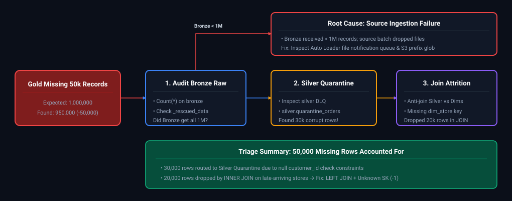

*D2 Source: [`12_data_loss_triage_bronze_quarantine_join_attrition.d2`](assets/06_databricks_and_delta_lake_faq/12_data_loss_triage_bronze_quarantine_join_attrition.d2)*

#### Production Implementation / Diagnostic Playbook
```sql
-- Step 1: Inspect Delta Transaction History to verify commit metrics
DESCRIBE HISTORY bronze.orders;
DESCRIBE HISTORY silver.orders;
DESCRIBE HISTORY gold.daily_sales_summary;

-- Step 2: Check for records quarantined due to schema or null violations in Silver
SELECT error_reason, COUNT(*) as dropped_count
FROM silver.orders_quarantine
WHERE ingestion_date = CURRENT_DATE()
GROUP BY error_reason;

-- Step 3: Anti-Join Audit: Detect records dropped due to missing dimensional foreign keys
SELECT 
    COUNT(*) AS dropped_fact_records,
    COUNT(DISTINCT s.store_id) AS missing_store_keys
FROM silver.orders s
LEFT ANTI JOIN gold.dim_store d ON s.store_id = d.store_id
WHERE s.order_date = CURRENT_DATE();

-- Step 4: Time Travel Reconciliation: Compare Gold table metrics before and after the batch run
SELECT 'Version_41' AS snapshot, COUNT(*) AS row_cnt, SUM(revenue) AS total_rev 
FROM gold.daily_sales_summary VERSION AS OF 41
UNION ALL
SELECT 'Version_42' AS snapshot, COUNT(*) AS row_cnt, SUM(revenue) AS total_rev 
FROM gold.daily_sales_summary VERSION AS OF 42;
```
- **Time Complexity:** $O(B + S + G)$ distributed hash scans across medallion layers.
- **Space Complexity:** $O(1)$ Delta log metadata lookup.

#### Engineering Implications & Production Pitfalls
1. **The Dangerous Silent Inner Join:** In dimensional warehousing, never use raw `INNER JOIN` against slowly changing or late-arriving dimensions! If a transaction references a newly opened store not yet synchronized to `dim_store`, an inner join drops the fact record silently with zero errors. Always use an `OUTER JOIN` and assign unmatched records to an **Inferred Member (`store_key = -1, "Unknown Store"`)**.
2. **Delta History Retention:** By default, Delta Lake preserves transaction log history for 30 days (`delta.logRetentionDuration = 'interval 30 days'`). Never run `VACUUM RETAIN 0 HOURS` in production, as it destroys historical Parquet files and eliminates the ability to Time Travel and trace discrepancy regressions.

#### Core Curriculum Cross-Reference
*Deep-dive theoretical reference: See [09. Databricks & Delta Lake: Transaction Logs & Time Travel](../06_databricks_and_delta_lake.md#8-delta-lake-fundamentals--log-internals)*

---

### Q31. [Easy] Executing Databricks Notebooks Programmatically: dbutils.notebook.run vs Databricks Workflows
**Difficulty:** [Easy]
**Topic Covered:** Notebook Orchestration, Parameter Passing, Multi-Task Workflows & Concurrency Limits  
**Question:** How would you execute one notebook from another in Databricks? Compare `dbutils.notebook.run()` versus Databricks Multi-Task Workflows for production ETL orchestration.

#### Definition & Core Concepts
In Databricks, orchestrating modular processing steps across notebooks is achieved through two distinct execution paradigms:
1. **`dbutils.notebook.run(path, timeout_seconds, arguments)`:**
   - **Execution Model:** Synchronous programmatic invocation executed within the calling notebook's JVM context or ephemeral child session.
   - **Parameter Passing:** Passes widget arguments as a dictionary; captures return value via `dbutils.notebook.exit("result_json")`.
   - **Concurrency & Cost:** All sub-notebooks execute sequentially on the same active interactive/job cluster unless explicitly parallelized via Python `ThreadPoolExecutor`.
   - **Limitation:** Inability to visualize complex multi-branch DAG dependencies; cluster failures crash the entire orchestration tree.
2. **Databricks Workflows (Multi-Task Jobs):**
   - **Execution Model:** Declarative, cloud-native orchestration managed by Databricks control plane.
   - **Concurrency & Cost:** Tasks can run concurrently across independent, task-specialized ephemeral Job Clusters (e.g., GPU cluster for ML task, high-memory cluster for ETL task), reducing cloud compute costs by up to 50%.
   - **Enterprise Features:** Native visual DAG editor, conditional task branching (`if/else`, `RunIf`), retries, repair-and-run, and lineage observability.

#### Visual Flow
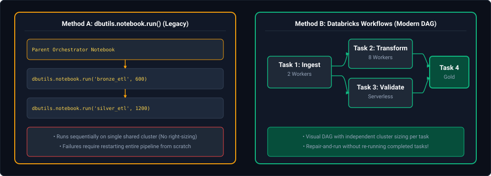

*D2 Source: [`13_dbutils_notebook_run_vs_databricks_workflows_dag.d2`](assets/06_databricks_and_delta_lake_faq/13_dbutils_notebook_run_vs_databricks_workflows_dag.d2)*

#### Production Implementation / Code Solution
```python
# Calling Sub-Notebooks Programmatically with Error Handling and Concurrency
import json
from concurrent.futures import ThreadPoolExecutor

def run_child_notebook(table_name: str) -> dict:
    """Executes a child notebook with parameters and handles return payloads."""
    try:
        response_str = dbutils.notebook.run(
            path="/Shared/ETL/transform_table",
            timeout_seconds=900,
            arguments={"target_table": table_name, "batch_id": "BATCH_20241017"}
        )
        return json.loads(response_str)
    except Exception as e:
        return {"status": "FAILED", "table": table_name, "error": str(e)}

# Parallel execution of 3 independent dimension notebooks
tables = ["dim_customer", "dim_store", "dim_promotion"]
with ThreadPoolExecutor(max_workers=3) as executor:
    results = list(executor.map(run_child_notebook, tables))

print("Execution Results:", results)

# Inside the Child Notebook: Return metadata cleanly upon completion
# output_payload = json.dumps({"status": "SUCCESS", "records_processed": 145000})
# dbutils.notebook.exit(output_payload)
```
- **Time Complexity:** $O(N)$ sequential or $O(N/P)$ parallel invocation where $P$ is worker threads.
- **Space Complexity:** $O(1)$ memory on parent driver.

#### Engineering Implications & Production Pitfalls
1. **The Silent Driver Hang:** `dbutils.notebook.run()` is blocking. If a child notebook enters an infinite loop or hangs on a database lock, the parent driver hangs until `timeout_seconds` is reached. Always specify an explicit non-zero timeout (default is 0 = infinite wait!).
2. **Production Mandate:** In enterprise environments, never use `dbutils.notebook.run()` as your primary scheduler. Use Databricks Asset Bundles (DABs) to define declarative Databricks Workflows in YAML and version them in Git.

#### Core Curriculum Cross-Reference
*Deep-dive theoretical reference: See [09. Databricks & Delta Lake: Databricks Asset Bundles & Workflows](../06_databricks_and_delta_lake.md#43-databricks-asset-bundles-dabs)*

---

# 14. Delta Lake Transaction Log Invariants, Concurrency & Schema Evolution

---

### Q32. [Medium] Manual File Deletion & Delta Transaction Log Divergence (FileNotFoundException & FSCK Repair)
**Difficulty:** [Medium]
**Topic Covered:** ACID Transaction Log Invariants, Single Source of Truth, Corrupted Table Repair  
**Question:** *A Delta table contains Parquet data files and a `_delta_log/` transaction journal. An engineer manually deletes a Parquet data file from cloud object storage (S3/ADLS/GCS) without updating the Delta log. Why does the Delta table still reference that file, why do queries fail with `FileNotFoundException`, and how do you repair the table?*

#### Definition & Core Concepts
In traditional Apache Hive external tables, query engines query cloud storage by executing expensive `LIST` directory operations (`ls s3://bucket/table/`).
In contrast, **Delta Lake never lists physical storage directories during query execution**:
1. **The Transaction Log is the Single Source of Truth:** The `_delta_log/*.json` commit commits and checkpoints contain the exact, authoritative list of active Parquet files (`"add"` actions) that constitute the table state.
2. **Metadata-Storage Divergence:** When a Parquet file is manually deleted via cloud consoles or CLI tools (`aws s3 rm`, `az storage blob delete`), the transaction log has no knowledge of the physical deletion.
3. **Execution Failure:** When a query executes, the driver constructs the file scan list from the transaction log. Spark tasks attempt to open the missing file's S3/ADLS byte blocks, resulting in an immediate hard failure: `java.io.FileNotFoundException: File does not exist`.

#### Visual Flow: The Storage-Log Divergence Pathology
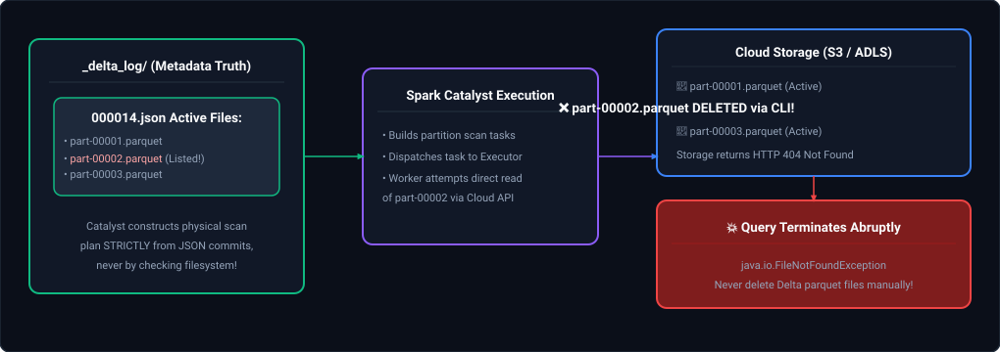

*D2 Source: [`14_delta_lake_manual_parquet_deletion_filenotfound_failure.d2`](assets/06_databricks_and_delta_lake_faq/14_delta_lake_manual_parquet_deletion_filenotfound_failure.d2)*

#### Production Diagnostic & Remediation Runbook

##### Step 1: Emergency Temporary Query Bypass (Unblock Downstream Consumers)
If downstream business reporting is blocked while investigation is underway, instruct the Spark reader to ignore missing files:
```python
# Unblocks reading by skipping missing physical files during table scan
spark.conf.set("spark.sql.files.ignoreMissingFiles", "true")
df = spark.read.format("delta").table("gold.fact_orders")
```
*(Warning: This is an emergency measure only; skipped files mean data contained in `part-00002.parquet` will be omitted from query results).*

##### Step 2: Diagnostic Verification
Check table integrity and identify corrupted file paths using `FSCK`:
```sql
-- DRY RUN reports missing files referenced in metadata without mutating state
FSCK REPAIR TABLE gold.fact_orders DRY RUN;
```

##### Step 3: Canonical Remediation (Re-writing the State Journal)
Because Delta Lake's transaction log cannot be manually edited without breaking cryptographic checksums (`000014.checkpoint.parquet`), repair the table by reading valid records and rewriting the state cleanly:
```python
# Read all surviving data (with ignoreMissingFiles enabled) and overwrite table state
spark.conf.set("spark.sql.files.ignoreMissingFiles", "true")
valid_data_df = spark.read.format("delta").table("gold.fact_orders")

# Atomic transaction overwrites transaction log, purging missing file references
valid_data_df.write \
    .format("delta") \
    .mode("overwrite") \
    .option("overwriteSchema", "true") \
    .saveAsTable("gold.fact_orders")

# Reset configuration safeguard
spark.conf.set("spark.sql.files.ignoreMissingFiles", "false")
```

#### Engineering Implications & Production Pitfalls
1. **Never Perform Direct Cloud Storage Mutations on Lakehouse Tables:**
   - Enforce IAM and Azure RBAC policies: Engineers and automated service principals must **never have `DeleteObject` permissions** directly on Delta storage buckets. All deletions must occur via SQL `DELETE FROM table WHERE ...` or `VACUUM`, which atomically record tombstone `"remove"` actions in the transaction log.
2. **`VACUUM` Safety Thresholds:**
   - Always retain the default 7-day threshold (`delta.deletedFileRetentionDuration = "interval 7 days"`). Running aggressive `VACUUM ... RETAIN 0 HOURS` while long-running streaming queries or analytical readers are active triggers `FileNotFoundException` on running jobs.

#### Core Curriculum Cross-Reference
*Deep-dive theoretical reference: See [06. Databricks & Delta Lake: Transaction Log Mechanics & Storage Layout](../06_databricks_and_delta_lake.md#8-delta-lake-fundamentals--log-internals)*

---

### Q33. [Medium] Delta Lake Concurrent Write Conflicts & Safe Optimistic Retry Protocols
**Difficulty:** [Medium]
**Topic Covered:** Optimistic Concurrency Control (OCC), File-Level Write Conflicts, Deletion Vectors  
**Question:** *Two automated jobs concurrently update different business keys (e.g. Job A updates `merchant_id = 'M100'`, Job B updates `merchant_id = 'M200'`) in the same Delta table. Job B fails with `DeltaConcurrentModificationException`. Why can concurrent-write conflicts occur even when updating completely different keys, and how do you design safe, idempotent retry protocols?*

#### Definition & Core Concepts
Delta Lake implements **Optimistic Concurrency Control (OCC)** to manage concurrent read and write operations without heavy table-level locking.
However, OCC in Delta Lake operates at **Parquet file granularity**, not individual row granularity:
1. **The Shared File Pathology:** If records for `merchant_id = 'M100'` and `merchant_id = 'M200'` happen to reside in the **same physical Parquet file** (e.g. `part-00005.parquet`), both Job A and Job B read version $V_0$ of `part-00005.parquet`.
2. **Commit Race:** Job A finishes its update first, rewrites `part-00005.parquet`, and commits version $V_1$.
3. **Conflict Detection:** Job B attempts to commit version $V_2$. Delta's OCC checks whether the files Job B modified have changed since version $V_0$. Because `part-00005.parquet` was already rewritten and committed by Job A, Job B's transaction fails with `ConcurrentAppendException` or `ConcurrentTransactionException` to prevent lost updates!

#### Visual Flow: The Shared Parquet File Concurrency Collision
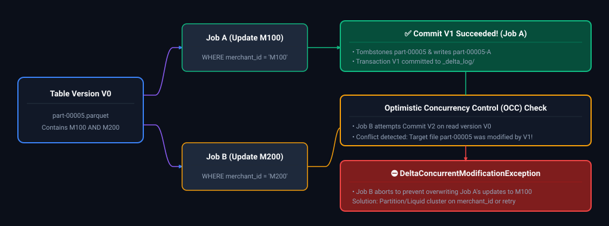

*D2 Source: [`15_delta_lake_concurrent_update_occ_conflict_exception.d2`](assets/06_databricks_and_delta_lake_faq/15_delta_lake_concurrent_update_occ_conflict_exception.d2)*

#### Production Resolution Strategy: 3 Architectural Defenses

##### 1. Enable Deletion Vectors (Row-Level Soft Deletes)
By default, an `UPDATE` or `DELETE` rewrites the entire Parquet file. Enabling **Deletion Vectors** instructs Delta to write a lightweight bitmap file recording deleted rows, completely decoupling updates from file rewrites:
```sql
-- Enables row-level concurrency; jobs modifying different rows in the same file do NOT conflict!
ALTER TABLE gold.fact_orders 
SET TBLPROPERTIES (
    'delta.enableDeletionVectors' = true,
    'delta.rowLevelConcurrency' = true
);
```

##### 2. Physical Partitioning / Liquid Clustering on the Update Key
If concurrent jobs update distinct categories or merchants, partition or cluster the table by that update key (`CLUSTER BY (merchant_id)`). This guarantees records for `M100` and `M200` are written into completely separate physical files, eliminating file-level overlap entirely.

##### 3. Automated Idempotent Exponential Backoff Retry Pattern
```python
import time
import random
from delta.exceptions import ConcurrentAppendException, ConcurrentTransactionException

def execute_merge_with_retry(spark_session, merge_sql: str, max_retries: int = 5):
    """
    Executes a Delta MERGE with randomized exponential backoff (full jitter)
    to safely resolve concurrent modification conflicts.
    """
    base_delay_seconds = 2.0

    for attempt in range(1, max_retries + 1):
        try:
            spark_session.sql(merge_sql)
            return {"status": "SUCCESS", "attempts": attempt}
        except Exception as e:
            # Check for Delta concurrent modification exceptions
            if "ConcurrentModificationException" in str(type(e)) or "DeltaConcurrentModificationException" in str(e):
                if attempt == max_retries:
                    raise RuntimeError(f"Exceeded max retries ({max_retries}) due to concurrent write conflicts.") from e
                
                # Exponential backoff with Full Jitter: Sleep = rand(0, base * 2^attempt)
                sleep_duration = random.uniform(0, base_delay_seconds * (2 ** (attempt - 1)))
                time.sleep(sleep_duration)
            else:
                # Fatal non-concurrency exception: rethrow immediately
                raise e
```

#### Core Curriculum Cross-Reference
*Deep-dive theoretical reference: See [06. Databricks & Delta Lake: ACID Transactions & Concurrency Control](../06_databricks_and_delta_lake.md#84-acid-transactions--optimistic-concurrency-control-occ)*

---

### Q34. [Easy] Time Travel Recovery vs VACUUM Retention Divergence (Metadata vs Physical Retention)
**Difficulty:** [Easy]
**Topic Covered:** Time Travel, `RESTORE TABLE`, `_delta_log` Compaction vs Physical Tombstone VACUUM  
**Question:** *A Delta table has 90 days of transaction commit history recorded in its `_delta_log/`. However, when a developer attempts to restore data from a version created 60 days ago (`RESTORE TABLE ... VERSION AS OF 120`), the query fails with `FileNotFoundException`. How do transaction-log retention and deleted-data-file retention differ, and how do you configure them to guarantee disaster recovery SLAs?*

#### Definition & Core Concepts
Disaster recovery in Delta Lake relies on the interaction between two independent retention parameters:
1. **Metadata Transaction Log Retention (`delta.logRetentionDuration`):**
   - Controls how long the JSON commit files (`000001.json`, `000002.json`) and checkpoint summaries are preserved before being compacted and deleted (default: **30 days**).
2. **Physical Deleted File Retention (`delta.deletedFileRetentionDuration`):**
   - When a row is updated or deleted, the old Parquet file is marked as a tombstone (`"remove"` action).
   - The old file remains on physical storage to support **Time Travel**.
   - When `VACUUM` runs, it physically purges files whose tombstone age exceeds `delta.deletedFileRetentionDuration` (default: **7 days**).

#### The Root Cause of the 60-Day Failure:
- Even if `delta.logRetentionDuration` is configured to 90 days, if automated `VACUUM` executed anytime within the past 60 days using the default 7-day physical file retention threshold, **the underlying Parquet data files were permanently erased from cloud object storage**!
- The transaction log still contains the historical metadata describing the version 60 days ago, but the physical data files required to materialize that version no longer exist on disk.

#### Visual Flow: Metadata vs. Physical Storage Retention Mismatch
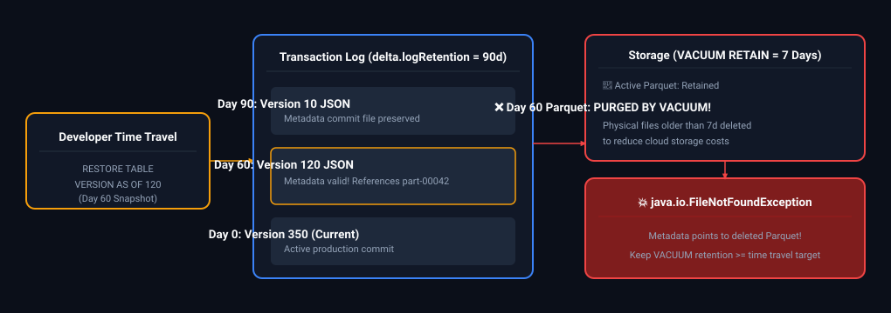

*D2 Source: [`16_delta_log_retention_vs_vacuum_retention_mismatch.d2`](assets/06_databricks_and_delta_lake_faq/16_delta_log_retention_vs_vacuum_retention_mismatch.d2)*

#### Production Table Configuration for Enterprise Disaster Recovery
To guarantee point-in-time recovery for regulatory compliance (e.g. 90-day restatements in financial institutions):
```sql
-- Step 1: Align physical file retention with business disaster recovery SLA
ALTER TABLE gold.fact_orders 
SET TBLPROPERTIES (
    'delta.logRetentionDuration' = 'interval 90 days',
    'delta.deletedFileRetentionDuration' = 'interval 90 days'
);

-- Step 2: Enforce VACUUM compliance
-- VACUUM will now safely preserve all physical tombstone files up to 90 days old
VACUUM gold.fact_orders RETAIN 2160 HOURS; -- 90 days * 24 hours = 2160 hours
```

#### Engineering Implications & Production Pitfalls
1. **Storage Cost Trade-Offs (FinOps):**
   - Retaining 90 days of deleted Parquet files in a high-churn table (e.g. 5TB daily ingestion with continuous updates) multiplies physical storage footprint by $10\times$ to $20\times$. For non-financial tables, keep `deletedFileRetentionDuration` at **7 to 14 days** and rely on Delta **Deep Clones** or cloud storage object versioning for long-term disaster recovery.

#### Core Curriculum Cross-Reference
*Deep-dive theoretical reference: See [06. Databricks & Delta Lake: Physical Table Maintenance, VACUUM & Time Travel](../06_databricks_and_delta_lake.md#95-auto-compaction--optimized-writes)*

---

### Q35. [Medium] Production Schema Validation & Type Widening Recovery (Integer to String)
**Difficulty:** [Medium]
**Topic Covered:** Schema Enforcement, Type Widening, Incompatible Schema Evolution & Quarantine  
**Question:** *An upstream operational database changes a column (e.g. `customer_zip`) from integer to string to accommodate leading zeros and international alphanumeric postal codes, and introduces two new columns. If your ingestion pipeline runs with Delta Lake default settings, what happens? How do you architect schema validation, automated type widening, and recovery without silent data corruption?*

#### Definition & Core Concepts
By default, Delta Lake enforces strict **Schema Validation (Schema on Write)**:
1. **Schema Enforcement Default:** If an incoming DataFrame has columns not present in the target Delta table, or if a column's data type mismatches, the write operation is immediately rejected: `AnalysisException: A schema mismatch detected when writing to the Delta table`.
2. **Type Widening vs Type Incompatibility:**
   - Delta Lake natively supports automated **Type Widening** for safe scalar promotions: `ByteType` $\to$ `ShortType` $\to$ `IntegerType` $\to$ `LongType`.
   - However, converting from `IntegerType` to `StringType` is **not an automatic type widening promotion** because downcasting from string to int in downstream consumer queries causes parse exceptions or query failures.
3. **The Silent Corruption Trap (`mergeSchema = true`):** Setting `.option("mergeSchema", "true")` automatically appends new columns, but will **fail or create duplicate unioned columns** if data types conflict!

#### Visual Flow: Automated Schema Evolution & Quarantine Architecture
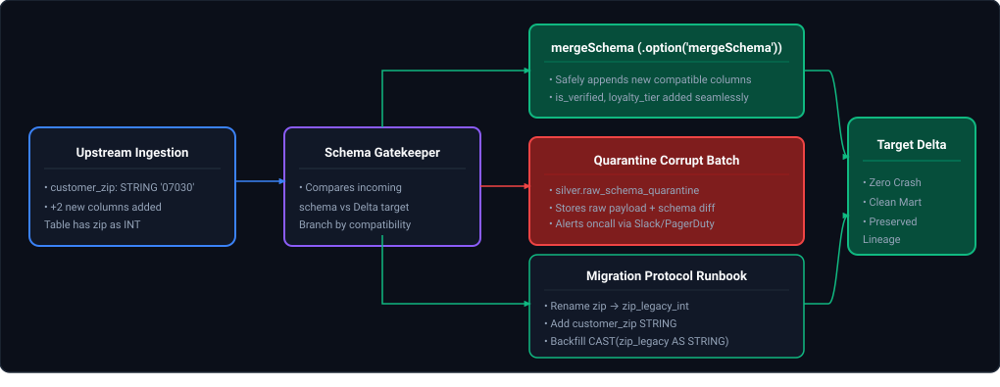

*D2 Source: [`17_schema_evolution_type_conflict_quarantine_runbook.d2`](assets/06_databricks_and_delta_lake_faq/17_schema_evolution_type_conflict_quarantine_runbook.d2)*

#### Production Python Implementation: Schema Validation & Migration Runbook
```python
from pyspark.sql import SparkSession
from pyspark.sql import functions as F
from delta.tables import DeltaTable

def ingest_with_schema_governance(spark: SparkSession, incoming_df, target_table_name: str):
    """
    Safely evolves new columns while protecting against incompatible type mutations.
    """
    target_table = DeltaTable.forName(spark, target_table_name)
    target_schema = target_table.toDF().schema
    incoming_schema = incoming_df.schema

    # 1. Compare schemas: Detect type conflicts
    type_conflicts = []
    target_fields = {f.name.lower(): f.dataType for f in target_schema}

    for in_field in incoming_schema:
        name = in_field.name.lower()
        if name in target_fields:
            if target_fields[name] != in_field.dataType:
                type_conflicts.append((name, str(target_fields[name]), str(in_field.dataType)))

    # 2. If incompatible type changes exist (e.g. Integer -> String), quarantine batch
    if type_conflicts:
        quarantine_table = f"{target_table_name}_quarantine"
        print(f"⚠️ Type conflict detected: {type_conflicts}. Routing batch to {quarantine_table}")
        
        # Add metadata audit stamp
        quarantined_payload = incoming_df.withColumn("quarantine_reason", F.lit(str(type_conflicts))) \
                                         .withColumn("quarantined_at", F.current_timestamp())
        quarantined_payload.write.format("delta").mode("append").saveAsTable(quarantine_table)
        return {"status": "QUARANTINED", "conflicts": type_conflicts}

    # 3. If safe (only new columns added), write with schema merging
    incoming_df.write \
        .format("delta") \
        .mode("append") \
        .option("mergeSchema", "true") \
        .saveAsTable(target_table_name)

    return {"status": "SUCCESS"}

# --- SQL Migration Protocol: Promoting Integer to String in Production ---
# If customer_zip must legitimately transition from INT to STRING:
"""
-- Step 1: Add new string column
ALTER TABLE gold.dim_customer ADD COLUMN customer_zip_str STRING;

-- Step 2: Backfill string column from historical integer data (format with leading zeros)
UPDATE gold.dim_customer 
SET customer_zip_str = LPAD(CAST(customer_zip AS STRING), 5, '0')
WHERE customer_zip IS NOT NULL;

-- Step 3: Switch view or application logic to read customer_zip_str
"""
```

#### Complexity Analysis
- **Schema Validation Overhead:** $O(C)$ where $C$ is the number of schema columns (typically $<100$ fields). Schema comparison executes on the Spark driver in $<5\text{ms}$ prior to dispatching distributed tasks, eliminating wasteful executor work on doomed batches.

#### Core Curriculum Cross-Reference
*Deep-dive theoretical reference: See [06. Databricks & Delta Lake: Schema Evolution & Enforcement Mechanics](../06_databricks_and_delta_lake.md#85-schema-enforcement)*
---

### Q36. [Medium] Delta Lake MERGE Schema Evolution: autoMerge vs mergeSchema Trap
**Difficulty:** [Medium]  
**Topic Covered:** Delta Lake MERGE Operations, `spark.databricks.delta.schema.autoMerge.enabled`, Schema Evolution during Upserts  
**Question:** *How does schema evolution work during Delta Lake MERGE (UPSERT) operations, and why does `.option("mergeSchema", "true")` fail to evolve the schema on MERGE statements?*

#### Definition & Core Concepts
A common production trap occurs when data engineers attempt to apply `.option("mergeSchema", "true")` to a Delta Lake `MERGE` operation. 
1. **The Write vs. Merge Dichotomy:** `.option("mergeSchema", "true")` is an option scoped exclusively to DataFrame append/overwrite writes (`DataFrameWriter.save()`). In contrast, `MERGE INTO` is a declarative SQL/DeltaTable API statement governed by session-level transaction log protocols. Passing `.option("mergeSchema", "true")` before `.merge()` is silently ignored or throws an `AnalysisException: Cannot resolve column in target table`.
2. **Session-Level AutoMerge Protocol:** To allow Delta Lake `MERGE` operations to dynamically add columns present in the source dataset but absent in the target table, you must enable the Spark session configuration:
   ```python
   spark.conf.set("spark.databricks.delta.schema.autoMerge.enabled", "true")
   ```
3. **Evolution Invariants during MERGE:**
   - Any column present in `source` but not in `target` is appended to the target Delta schema as a nullable column.
   - For `WHEN MATCHED THEN UPDATE SET *`, new source columns update target attributes.
   - For `WHEN NOT MATCHED THEN INSERT *`, new source columns are inserted with their source values. Historical non-matching rows in the target table receive `NULL` for the new column.
   - Incompatible type changes (e.g. `STRING` to `INT`) are strictly rejected even with `autoMerge` enabled to prevent silent data corruption.

#### Visual Architectural Flow
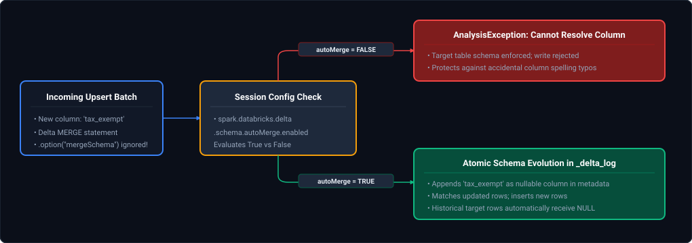

*D2 Source: [`18_delta_merge_automerge_evolution_flow.d2`](assets/06_databricks_and_delta_lake_faq/18_delta_merge_automerge_evolution_flow.d2)*

#### Production Implementation / Code Solution
```python
from delta.tables import DeltaTable
from pyspark.sql import SparkSession
from pyspark.sql.functions import current_timestamp

spark = SparkSession.builder.getOrCreate()

def execute_resilient_delta_merge(target_table_name: str, updates_df):
    """
    Executes a production Delta Lake MERGE with dynamic schema evolution safeguards.
    """
    # 1. Enable autoMerge at the Spark session level
    spark.conf.set("spark.databricks.delta.schema.autoMerge.enabled", "true")
    
    target_delta = DeltaTable.forName(spark, target_table_name)
    
    # 2. Add system audit timestamp to incoming updates
    staged_updates = updates_df.withColumn("ingestion_timestamp", current_timestamp())
    
    # 3. Execute MERGE operation with automatic column addition
    (
        target_delta.alias("target")
        .merge(
            source=staged_updates.alias("source"),
            condition="target.customer_id = source.customer_id"
        )
        .whenMatchedUpdateAll()
        .whenNotMatchedInsertAll()
        .execute()
    )
    
    # 4. Reset configuration to avoid unintentional global schema bleeding
    spark.conf.set("spark.databricks.delta.schema.autoMerge.enabled", "false")
```

#### Complexity Analysis
- **Time Complexity:** $O(M + N)$ where $N$ is the target partition file size and $M$ is the incoming batch size. The schema diff calculation takes $O(C)$ driver time ($C < 100$ columns) which is $< 10\text{ms}$.
- **Space Complexity:** $O(1)$ auxiliary storage. Delta adds a new metadata action in the JSON commit without rewriting historical Parquet data files.

#### Engineering Implications & Production Pitfalls
- **Accidental Schema Explosion:** If upstream developers send typos (e.g., `cust_email` instead of `customer_email`), `autoMerge` will permanently add the typo column to the Delta table. In gold-layer marts, always disable `autoMerge` and enforce strict schema contracts.
- **Nested Struct Evolution Limitations:** Pre-Delta 2.2 versions cannot automatically evolve deeply nested struct fields within arrays during a MERGE; top-level column evolution is standard.

#### Core Curriculum Cross-Reference
*Deep-dive theoretical reference: See [06. Databricks & Delta Lake: Schema Evolution (`mergeSchema` & `autoMerge`)](../06_databricks_and_delta_lake.md#86-schema-evolution-mergeschema--automerge)*

---

### Q37. [Medium] Databricks Disk Cache (Delta Cache) vs Spark Memory CACHE & PERSIST
**Difficulty:** [Medium]  
**Topic Covered:** Databricks Disk Cache (Delta Cache), Spark `cache()`, `persist()` StorageLevels, NVMe SSD Architecture  
**Question:** *What is the difference between CACHE, PERSIST, and DELTA CACHE (Databricks Disk Cache) in Databricks, and when should you use each?*

#### Definition & Core Concepts
Modern Databricks execution distinguishes between standard Apache Spark in-memory caching and native Databricks local hardware caching:
1. **Spark `cache()`:** A shortcut for `persist(StorageLevel.MEMORY_AND_DISK)`. It stores deserialized Java objects in the Spark JVM executor heap. If memory saturates, blocks spill to local disk in a serialized format.
2. **Spark `persist(level)`:** Allows configurable storage levels (`MEMORY_ONLY`, `MEMORY_ONLY_SER`, `MEMORY_AND_DISK`, `OFF_HEAP`). JVM heap caching incurs severe Java Garbage Collection (GC) pressure when caching billions of rows.
3. **Databricks Disk Cache (formerly Delta Cache):** Completely bypasses the JVM heap. It caches remote Parquet/Delta data blocks directly onto high-speed local NVMe SSDs in an uncompressed, decoded CPU-friendly format.
   - Fully automatic and transparent: Queries hitting the same Delta files automatically read from local NVMe drives.
   - Zero JVM GC overhead: Does not compete with Spark execution memory for joins and aggregations.
   - Eviction: Managed by local LRU (Least Recently Used) cache algorithms.

#### Visual Architectural Flow
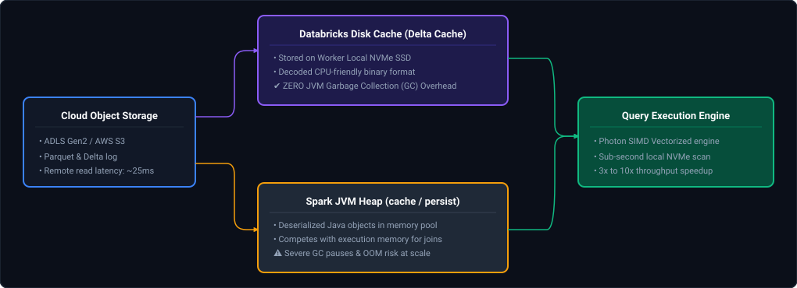

*D2 Source: [`19_databricks_disk_cache_vs_spark_jvm_heap.d2`](assets/06_databricks_and_delta_lake_faq/19_databricks_disk_cache_vs_spark_jvm_heap.d2)*

#### Production Implementation / Code Solution
```python
# 1. Checking and configuring Databricks Disk Cache
# Disk cache is enabled by default on cache-accelerated worker types (e.g. Standard_L8s_v3 on Azure)
spark.conf.set("spark.databricks.io.cache.enabled", "true")
spark.conf.set("spark.databricks.io.cache.maxDiskUsage", "50g")

# 2. Forcing Databricks Disk Cache Pre-warming for interactive BI/Dashboards
# Bypasses JVM, pulls remote files to local NVMe SSD:
spark.sql("CACHE SELECT * FROM gold.fact_financial_transactions WHERE transaction_date >= '2026-01-01'")

# 3. Standard Spark DataFrame Cache (Use sparingly for iterative ML or complex computed DataFrames)
df_transformed = spark.table("silver.events").filter("event_type = 'CHECKOUT'").groupBy("user_id").count()
df_transformed.cache()  # Resides in JVM heap/storage
df_transformed.count()  # Materialize cache

# Always release JVM cache when finished!
df_transformed.unpersist()
```

#### Complexity Analysis & Comparison Matrix
| Dimension | Spark `cache()` | Spark `persist(SER)` | Databricks Disk Cache (Delta Cache) |
| :--- | :--- | :--- | :--- |
| **Location** | JVM Heap / Spill to Disk | JVM Heap (Serialized) | Local Worker NVMe SSDs |
| **Garbage Collection** | Severe impact on GC pauses | Moderate GC impact | **Zero GC impact** |
| **Data Scope** | In-memory computed DataFrames | In-memory computed DataFrames | Underlying Parquet/Delta table files |
| **Performance Gain** | Instant for intermediate DAG nodes | High for small DAG stages | 3–10x faster scan & filter operations |
| **Eviction** | LRU within JVM memory pool | LRU within JVM memory pool | Automatic LRU on local NVMe disk |

#### Engineering Implications & Production Pitfalls
- **The "Over-Caching" Anti-Pattern:** Developers calling `.cache()` on raw Delta tables waste valuable JVM heap memory needed for shuffle joins, triggering `OutOfMemoryError: Java heap space`. For Delta tables, **never call `.cache()`**; let the Databricks Disk Cache handle physical scans automatically.
- **Node Eviction in Autoscaling Clusters:** When a worker is scaled down by autoscaling, its local NVMe Disk Cache is dropped. Place heavy analytical queries on fixed worker pools or ensure queries tolerate cache misses.

#### Core Curriculum Cross-Reference
*Deep-dive theoretical reference: See [06. Databricks & Delta Lake: Databricks Compute Architecture](../06_databricks_and_delta_lake.md#2-databricks-compute-architecture)*

---

### Q38. [Medium] Databricks Photon Acceleration: Workload Qualification & Execution Mechanics
**Difficulty:** [Medium]  
**Topic Covered:** Databricks Photon Native Vectorized C++ Engine vs Classic DBR JVM Execution  
**Question:** *How do you determine whether a production workload will benefit from Photon acceleration, and what workloads see zero or negative gain?*

#### Definition & Core Concepts
**Photon** is Databricks' high-performance vectorized query engine written from the ground up in native C++ to execute Spark SQL queries directly on modern hardware architectures:
1. **Vectorized Instruction Execution:** Processes data in batches of 1024 columnar tuples using SIMD (Single Instruction, Multiple Data) CPU registers rather than the classic JVM row-by-row Volcano iterator model.
2. **Elimination of JVM Bottlenecks:** Bypasses Java bytecode compilation, JVM object boxing/unboxing overhead, and garbage collection stalls.
3. **Photon Qualification Criteria (High Benefit):**
   - Workloads dominated by **aggregations (`groupBy`), hash joins, filtering, and sorting** on large Delta/Parquet tables.
   - High-throughput SQL queries in Databricks SQL Warehouses.
   - Low data shuffle queries where CPU instruction cycles (not network I/O) are the bottleneck.
4. **Zero or Negative Gain Workloads (Do Not Enable Photon):**
   - **Python UDFs and Pandas UDFs:** Photon cannot vectorize custom Python code; execution falls back to JVM-to-Python IPC, incurring overhead.
   - **RDD APIs:** Photon only operates on Spark SQL DataFrames and Datasets.
   - **Network/I/O Bound Workloads:** Slower cloud object storage reads or single-threaded JDBC reads gain zero benefit from faster CPU vectorization.
   - **Small Datasets (< 10 GB):** The startup overhead of Photon C++ runtime and higher DBU cost multiplier outweigh sub-second gains.

#### Visual Architectural Flow
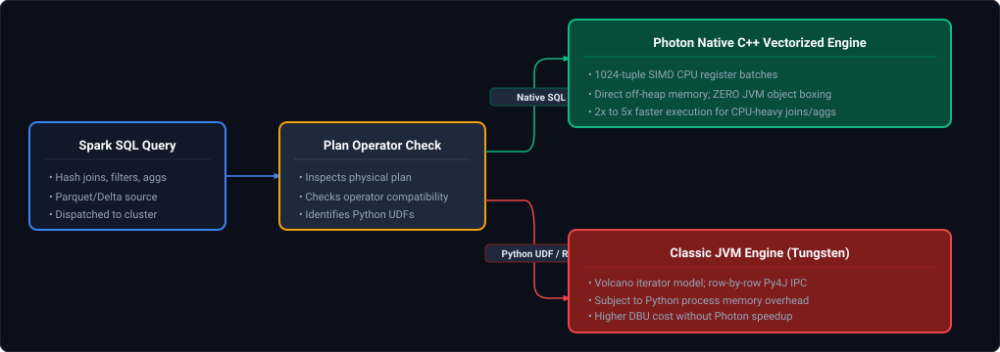

*D2 Source: [`20_photon_simd_vectorized_engine_routing.d2`](assets/06_databricks_and_delta_lake_faq/20_photon_simd_vectorized_engine_routing.d2)*

#### Production Implementation / Diagnostic Check
```python
# Checking if Photon is active in a SparkSession
is_photon_enabled = spark.conf.get("spark.databricks.clusterUsageTags.sparkVersion", "").find("photon") != -1
print(f"Photon Runtime Active: {is_photon_enabled}")

# Inspecting Spark Explain Plan for Photon Operators:
# In the explain output, Photon operators are prefixed with 'Photon':
# e.g., PhotonScan, PhotonGroupingAgg, PhotonHashJoin
df = spark.table("gold.fact_sales").groupBy("region").sum("revenue")
df.explain()

# If the physical plan shows:
# PhotonGroupingAgg(keys=[region#10], functions=[sum(revenue#12)])
# -> Workload is 100% running in hardware-vectorized C++
```

#### Complexity & FinOps Analysis
- **Execution Speedup:** 2x to 5x faster CPU execution for supported SQL operations.
- **Cost Trade-off:** Photon clusters consume a higher Databricks Unit (DBU) rate (typically $pprox 1.5	ext{x}$ to $2	ext{x}$ DBU multiplier). If a job runs $3	ext{x}$ faster with a $1.8	ext{x}$ DBU rate, the net cloud and Databricks spend decreases by $40\%$.

#### Core Curriculum Cross-Reference
*Deep-dive theoretical reference: See [06. Databricks & Delta Lake: Photon Vectorized Execution Engine](../06_databricks_and_delta_lake.md#210-photon-vectorized-execution-engine)*

---

### Q39. [Medium] Sizing Databricks Clusters & Autoscaling Bounds for Highly Variable Workloads
**Difficulty:** [Medium]  
**Topic Covered:** Cluster Sizing Heuristics, Executor Memory & Core Boundaries, Spot vs On-Demand Pools  
**Question:** *How do you calculate optimal cluster sizing, driver/executor specs, and autoscaling boundaries for unpredictable, spiky data volumes?*

#### Definition & Core Concepts
Under-provisioned clusters fail with OOM errors; over-provisioned clusters waste millions in compute spend. Production cluster sizing follows strict mathematical boundaries:
1. **The Core Allocation Rule:** Allocate **4 to 5 cores per executor JVM**. Fewer than 4 cores reduces multi-threading parallelism; more than 5 cores triggers severe JVM Garbage Collection pauses.
2. **Executor RAM Rule:** Size executor memory between **28 GB and 32 GB**. Exceeding 32 GB requires JVM Compressed Ordinary Object Pointers (`CompressedOops`) to disable, increasing memory footprint by 20–30%.
3. **Driver Sizing:** For standard pipelines, driver RAM should match single executor RAM. If performing heavy broadcast joins (`autoBroadcastJoinThreshold > 100MB`) or driver aggregations, scale the driver to $2	ext{x}$ to $4	ext{x}$ the worker size.
4. **Optimized Autoscaling Bounds:**
   - Set Minimum Workers based on baseline SLA requirements (e.g. 2 nodes).
   - Set Maximum Workers based on maximum peak burst capacity (e.g. 16 nodes).
   - Autoscaling decisions in Databricks evaluate Spark stage task queue depth every 30–60 seconds.

#### Visual Architectural Sizing Matrix
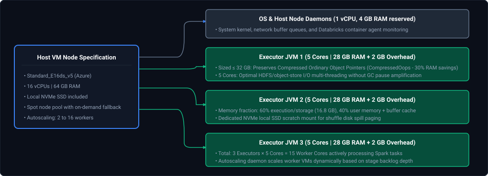

*D2 Source: [`21_databricks_cluster_sizing_executor_allocation.d2`](assets/06_databricks_and_delta_lake_faq/21_databricks_cluster_sizing_executor_allocation.d2)*

#### Production Cluster Configuration Recipe (JSON)
```json
{
  "cluster_name": "prod-etl-autoscale-pool",
  "spark_version": "14.3.x-scala2.12",
  "node_type_id": "Standard_E16ds_v5",
  "driver_node_type_id": "Standard_E16ds_v5",
  "autoscale": {
    "min_workers": 2,
    "max_workers": 16
  },
  "azure_attributes": {
    "first_on_demand": 1,
    "availability": "SPOT_WITH_FALLBACK_AZURE",
    "spot_bid_max_price": -1
  },
  "spark_conf": {
    "spark.speculation": "true",
    "spark.sql.adaptive.enabled": "true",
    "spark.sql.adaptive.coalescePartitions.enabled": "true",
    "spark.databricks.cluster.profile": "serverless"
  },
  "autotermination_minutes": 20
}
```

#### Engineering Implications & Production Pitfalls
- **Spot Instance Eviction Storms:** Never run drivers on spot instances. In production, driver loss aborts the entire job. Use `first_on_demand: 1` so the driver is guaranteed stable compute.
- **Autoscaling Lag on Short Batches:** Autoscaling takes 2–4 minutes to spin up cloud VMs. If a batch job completes in 5 minutes, autoscaling adds zero performance value because workers arrive after the shuffle completes. Use Single-Node or fixed-size pools for micro-batch ETL.

#### Core Curriculum Cross-Reference
*Deep-dive theoretical reference: See [06. Databricks & Delta Lake: Driver and Worker Node Sizing](../06_databricks_and_delta_lake.md#27-driver-and-worker-node-sizing)*

---

### Q40. [Medium] Interactive Notebook Succeeds but Scheduled Job Fails: Root Cause Investigation
**Difficulty:** [Medium]  
**Topic Covered:** Interactive vs Job Compute, Service Principal IAM, Ephemeral Cluster Libraries & Scopes  
**Question:** *A Databricks notebook runs flawlessly when tested interactively by an engineer, but immediately fails when triggered as a scheduled Databricks Workflow job. How do you triage dependencies, identity, and environment configurations?*

#### Definition & Core Concepts
This ubiquitous failure stems from runtime environment isolation between **Interactive All-Purpose Clusters** and **Ephemeral Job Clusters**:
1. **Identity & Security Principal Divergence:**
   - Interactive execution runs under the developer's personal user identity (`user@company.com`) leveraging their personal OAuth token and Unity Catalog workspace permissions.
   - Scheduled Databricks Workflow jobs run under a **Service Principal (SPN)** or system automation identity. If the Service Principal lacks `USAGE` or `SELECT` on the catalog/schema, or lacks cloud storage `Storage Blob Data Contributor` IAM roles, the job fails immediately with `AccessDeniedException` or `TABLE_OR_VIEW_NOT_FOUND`.
2. **Library & Dependency Scoping:**
   - In interactive notebooks, developers frequently run `%pip install` in a transient cell, or rely on libraries pre-installed on the shared all-purpose cluster.
   - An ephemeral job cluster launches with a vanilla Databricks Runtime image. If dependencies are not formally registered in the job task spec, the job fails with `ModuleNotFoundError`.
3. **Environment Variable & Secret Scope Isolation:**
   - Secrets mapped to personal tokens or local notebook widgets (`dbutils.widgets.get()`) fail if default parameter values are omitted in the job task parameters.

#### Visual Troubleshooting Runbook
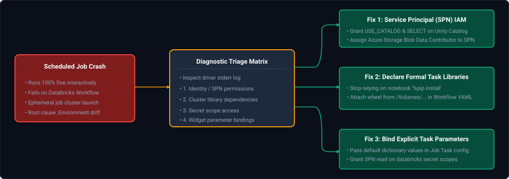

*D2 Source: [`22_scheduled_job_spn_isolation_triage.d2`](assets/06_databricks_and_delta_lake_faq/22_scheduled_job_spn_isolation_triage.d2)*

#### Production Resolution Runbook
```bash
# Step 1: Verify and assign permissions to the Service Principal in Unity Catalog
databricks grants update catalog gold_catalog   --json '{"changes": [{"principal": "spn-data-engineering-prod", "add": ["USE_CATALOG", "USE_SCHEMA", "SELECT"]}]}'

# Step 2: Ensure task defines explicit library dependencies in workflow yaml:
# (Databricks Asset Bundle task snippet)
new_cluster:
  spark_version: "14.3.x-scala2.12"
  node_type_id: "Standard_D8s_v5"
libraries:
  - pypi:
      package: "pydantic>=2.0.0"
  - whl: "/Volumes/dev_catalog/staging_volume/libraries/corp_transforms-1.2.0-py3-none-any.whl"
```

#### Engineering Implications & Production Pitfalls
- **Hardcoded Personal User Folders:** Interactive developers often reference code or configurations stored in `/Workspace/Users/developer@company.com/`. When run as an SPN, that workspace folder is inaccessible. Always store production artifacts in `/Workspace/Shared/` or root Git Repos.

#### Core Curriculum Cross-Reference
*Deep-dive theoretical reference: See [06. Databricks & Delta Lake: Databricks Workflows & Multi-Task Jobs](../06_databricks_and_delta_lake.md#31-databricks-workflows--multi-task-jobs)*

---

### Q41. [Medium] Packaging & Versioning PySpark Transformations into Reusable Enterprise Libraries
**Difficulty:** [Medium]  
**Topic Covered:** Python Wheels (`.whl`), Databricks Asset Bundles (DABs), CI/CD Artifact Management, Cluster Libraries  
**Question:** *How do you package shared enterprise PySpark transformations into a versioned, testable library and distribute it across production clusters and workflows?*

#### Definition & Core Concepts
Copy-pasting functions across Databricks notebooks creates technical debt, breaking changes, and untracked logic drift. Enterprise data engineering structures common transformations as standard Python packages:
1. **Packaging Standard:** Package transformations as a standard **Python Wheel (`.whl`)** with typed interfaces, unit tests using `chispa` or `pytest-spark`, and semantic versioning (`MAJOR.MINOR.PATCH`).
2. **Storage in Unity Catalog Volumes:** Upload versioned wheel files to an immutable, governed Unity Catalog Volume (e.g. `/Volumes/prod_catalog/shared_tools/wheels/`).
3. **Distribution via Databricks Asset Bundles (DABs):** Pin the exact library version in the task specification of Databricks Workflows, guaranteeing idempotent reproduction across dev, staging, and production environments.

#### Visual CI/CD Release Flow
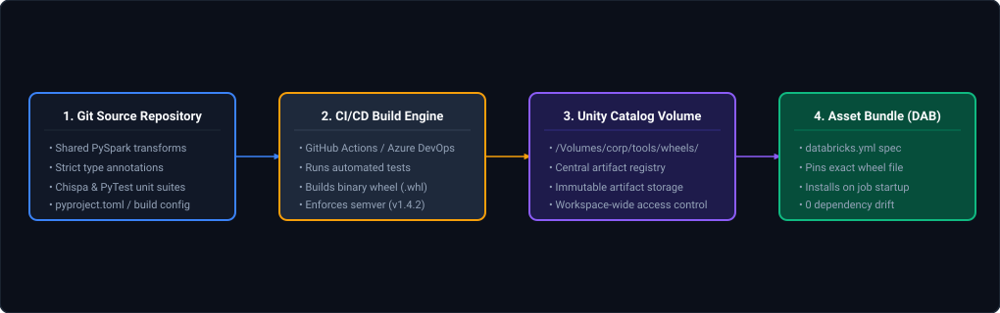

*D2 Source: [`23_pyspark_wheel_packaging_ci_cd_deployment.d2`](assets/06_databricks_and_delta_lake_faq/23_pyspark_wheel_packaging_ci_cd_deployment.d2)*

#### Production Implementation / Package Structure
```python
# Directory layout:
# corp_transforms/
# ├── pyproject.toml
# ├── src/
# │   └── corp_transforms/
# │       ├── __init__.py
# │       └── cleansing.py
# └── tests/
#     └── test_cleansing.py

# src/corp_transforms/cleansing.py
from pyspark.sql import DataFrame
from pyspark.sql.functions import col, trim, lower, regexp_replace

def sanitize_customer_identifiers(df: DataFrame, email_col: str, phone_col: str) -> DataFrame:
    """Standardizes email and phone format across enterprise datasets."""
    return df.withColumn(
        email_col, lower(trim(col(email_col)))
    ).withColumn(
        phone_col, regexp_replace(col(phone_col), r"[^0-9]", "")
    )
```

```yaml
# databricks.yml (Databricks Asset Bundle Configuration)
bundle:
  name: corporate_pipeline_bundle

targets:
  prod:
    workspace:
      host: https://adb-123456789.azuredatabricks.net
    resources:
      jobs:
        customer_ingest_job:
          name: "[PROD] Customer Ingestion Pipeline"
          tasks:
            - task_key: clean_and_load
              spark_python_task:
                python_file: "src/entrypoint.py"
              libraries:
                - whl: "/Volumes/corp_catalog/tools/wheels/corp_transforms-1.4.2-py3-none-any.whl"
```

#### Complexity Analysis
- **Installation Overhead:** $< 2	ext{ seconds}$ per executor at cluster launch via pip cache.
- **Dependency Drift:** Pinning wheels eliminates non-deterministic library resolution failures (`pip resolution-impossible`).

#### Core Curriculum Cross-Reference
*Deep-dive theoretical reference: See [06. Databricks & Delta Lake: Databricks Asset Bundles (DABs)](../06_databricks_and_delta_lake.md#43-databricks-asset-bundles-dabs)*

---

### Q42. [Hard] Detecting & Diagnosing Performance Regressions After Databricks Runtime (DBR) Upgrades
**Difficulty:** [Hard]  
**Topic Covered:** DBR Version Upgrades, Catalyst Plan Regressions, Canary Validation & Spark Metric Diffs  
**Question:** *How do you systematically detect and diagnose subtle performance or cost regressions after upgrading a production Databricks cluster to a newer Databricks Runtime (DBR) version?*

#### Definition & Core Concepts
Upgrading major Databricks Runtime versions (e.g. DBR 13.3 LTS to DBR 14.3 LTS / Spark 3.4 to 3.5) delivers security patches and optimizations, but can occasionally trigger performance regressions due to:
1. **Catalyst Rule Changes:** Adaptive Query Execution (AQE) heuristics or cost-based optimizer estimates may flip a join from Broadcast Hash Join back to Sort-Merge Join.
2. **Shuffle Partition Auto-Coalescing Drift:** Target shuffle partition size heuristics (`spark.sql.adaptive.advisoryPartitionSizeInBytes`) may calculate suboptimal partition numbers for skewed keys.
3. **Photon Operator Fallbacks:** New Spark SQL expressions or modified null-handling logic may temporarily fall back from native Photon C++ to classic JVM execution.
4. **Cloud Object Store Protocol Changes:** Changes in Azure Blob File System (ABFS) driver or AWS S3 SDK drivers can impact parallel directory listing latency.

#### Visual Canary Regression Testing Architecture
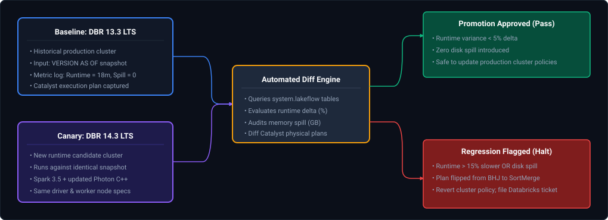

*D2 Source: [`24_dbr_upgrade_canary_regression_testing.d2`](assets/06_databricks_and_delta_lake_faq/24_dbr_upgrade_canary_regression_testing.d2)*

#### Production Diagnostic Runbook
```python
def extract_spark_run_metrics(spark_session, run_id: str) -> dict:
    """
    Extracts system-level diagnostic metrics from the Databricks System Tables
    (system.lakeflow.jobs or system.compute.clusters) to isolate regressions.
    """
    metrics_query = f"""
    SELECT 
        job_id,
        run_id,
        spark_version,
        execution_duration_seconds,
        read_bytes,
        written_bytes,
        spilled_bytes,
        total_dbus_consumed
    FROM system.lakeflow.job_run_timeline
    WHERE run_id = '{run_id}'
    """
    return spark_session.sql(metrics_query).toPandas().to_dict(orient="records")[0]

def compare_canary_runs(baseline_metrics: dict, canary_metrics: dict):
    duration_delta = (canary_metrics['execution_duration_seconds'] - baseline_metrics['execution_duration_seconds']) / baseline_metrics['execution_duration_seconds']
    spill_delta = canary_metrics['spilled_bytes'] - baseline_metrics['spilled_bytes']
    
    print(f"--- DBR Upgrade Triage Report ---")
    print(f"Runtime Delta: {duration_delta * 100:.2f}%")
    print(f"Disk Spill Delta: {spill_delta / (1024**3):.2f} GB")
    
    if duration_delta > 0.15 or spill_delta > 0:
        raise ValueError("CRITICAL REGRESSION: Canary failed performance SLA threshold! Halt DBR promotion.")
```

#### Engineering Implications & Production Pitfalls
- **System Table Observability:** Never rely on manual clock watching. Leverage Databricks `system.lakeflow` and `system.billing` tables to capture automated p95 execution time trends before upgrading production cluster policies.
- **Canary Partition Isolation:** Always run DBR canaries against time-travel snapshots (`VERSION AS OF`) of historical datasets to ensure identical input row cardinality and eliminate data volume skew as a confounding variable.

#### Core Curriculum Cross-Reference
*Deep-dive theoretical reference: See [06. Databricks & Delta Lake: Databricks Compute Architecture](../06_databricks_and_delta_lake.md#2-databricks-compute-architecture)*

---

### Q43. [Medium] Resolving Databricks Git Merge Conflicts & Enterprise Promotion Pipeline (Dev → UAT → Production)
**Difficulty:** [Medium]  
**Topic Covered:** Git Folders (Repos), Merge Conflict Resolution, Databricks Asset Bundles (DABs), Multi-Environment CI/CD & Service Principals  
**Question:** *Two developers modify the same Databricks notebook or deployment configuration simultaneously. How do you resolve the Git merge conflict, prevent notebook JSON corruption, and safely promote the validated changes through Dev → UAT → Production environments?*

#### Definition & Core Concepts
Collaborative development in Databricks presents unique version control challenges because interactive notebooks historically stored cell outputs and execution metadata in complex JSON structures:
1. **The Notebook Merge Conflict Dilemma:**
   - Standard Jupyter notebooks (`.ipynb`) store execution counts, timestamps, and rich MIME outputs alongside source code. When two developers edit an `.ipynb`, Git flags hundreds of non-code JSON conflicts that cannot be cleanly resolved via standard 3-way merge tools.
   - **Modern Resolution:** Store notebooks as **Python source files (`.py`)** with `# COMMAND ----------` cell delimiters (Databricks native format). This transforms notebook files into standard text source files, enabling clean, line-by-line Git diffing and standard conflict resolution.
2. **Conflict Resolution Runbook:**
   - When a conflict occurs in Databricks Git Folders (Repos), pull changes using Git CLI rebase (`git pull --rebase origin main`), resolve code conflicts in an external IDE (VS Code) or the Databricks Git UI conflict editor, run unit tests locally, and push the cleanly rebased feature branch.
3. **Multi-Environment Promotion (Dev $\to$ UAT $\to$ Production):**
   - **Infrastructure as Code (IaC):** Workflows, Delta Live Tables (DLT) pipelines, clusters, and schemas are defined declaratively in `databricks.yml` via **Databricks Asset Bundles (DABs)**.
   - **Environment Isolation:** Dev, UAT, and Production reside in isolated cloud workspaces or isolated Unity Catalog catalogs (`dev_*`, `uat_*`, `prod_*`).
   - **Service Principal Identity:** Production deployments are strictly executed by an automated CI/CD pipeline authenticated via an **Azure Service Principal / AWS IAM Role**, eliminating developer personal access tokens (PATs).

#### Visual Architectural Flow
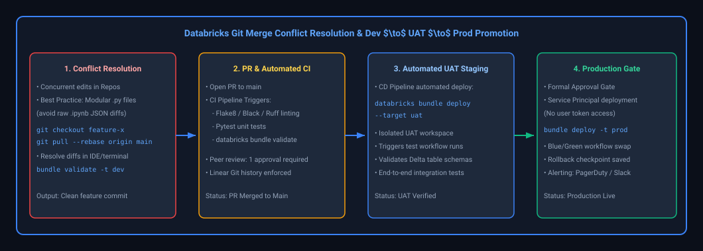

*D2 Source: [`25_databricks_git_merge_conflict_promotion_pipeline.d2`](assets/06_databricks_and_delta_lake_faq/25_databricks_git_merge_conflict_promotion_pipeline.d2)*

#### Production Configuration: Multi-Target `databricks.yml` (DABs)

```yaml
bundle:
  name: revenue_analytics_platform

targets:
  dev:
    default: true
    workspace:
      host: https://adb-dev.azuredatabricks.net
    mode: development

  uat:
    workspace:
      host: https://adb-uat.azuredatabricks.net
    mode: staging
    variables:
      catalog_name: uat_catalog
      cluster_node_type: Standard_D4ds_v5
      min_workers: 1
      max_workers: 4

  prod:
    workspace:
      host: https://adb-prod.azuredatabricks.net
    mode: production
    run_as:
      service_principal_name: 00000000-0000-0000-0000-000000000000
    variables:
      catalog_name: prod_catalog
      cluster_node_type: Standard_D8ds_v5
      min_workers: 2
      max_workers: 16

resources:
  jobs:
    daily_revenue_aggregation:
      name: "[${bundle.target}] Daily Revenue ETL"
      tasks:
        - task_key: run_etl_pipeline
          notebook_task:
            notebook_path: ../src/notebooks/daily_revenue_etl.py
            base_parameters:
              catalog: ${var.catalog_name}
```

#### Production GitHub Actions Promotion Workflow (`.github/workflows/deploy.yml`)

```yaml
name: Databricks CI/CD Promotion Pipeline

on:
  pull_request:
    branches: [main]
  push:
    branches: [main]
  release:
    types: [published]

jobs:
  # ---------------------------------------------------------------------------
  # Step 1: CI Linting, Testing & DAB Validation (Runs on every PR)
  # ---------------------------------------------------------------------------
  validate-and-test:
    runs-on: ubuntu-latest
    steps:
      - uses: actions/checkout@v4
      - name: Set up Python
        uses: actions/setup-python@v5
        with:
          python-version: "3.10"

      - name: Install Dependencies
        run: |
          pip install ruff pytest databricks-cli
          curl -fsSL https://raw.githubusercontent.com/databricks/setup-cli/main/install.sh | sh

      - name: Lint Source Code & Validate Unit Tests
        run: |
          ruff check src/
          pytest tests/unit/

      - name: Validate Databricks Asset Bundle Syntax
        env:
          DATABRICKS_HOST: ${{ secrets.DEV_DATABRICKS_HOST }}
          DATABRICKS_TOKEN: ${{ secrets.DEV_DATABRICKS_TOKEN }}
        run: |
          databricks bundle validate -t dev

  # ---------------------------------------------------------------------------
  # Step 2: Automated Deployment to UAT (Triggers on Merge to Main)
  # ---------------------------------------------------------------------------
  deploy-uat:
    needs: validate-and-test
    if: github.ref == 'refs/heads/main' && github.event_name == 'push'
    runs-on: ubuntu-latest
    steps:
      - uses: actions/checkout@v4
      - name: Install Databricks CLI
        run: curl -fsSL https://raw.githubusercontent.com/databricks/setup-cli/main/install.sh | sh

      - name: Deploy to UAT Workspace
        env:
          DATABRICKS_HOST: ${{ secrets.UAT_DATABRICKS_HOST }}
          DATABRICKS_CLIENT_ID: ${{ secrets.UAT_SPN_CLIENT_ID }}
          DATABRICKS_CLIENT_SECRET: ${{ secrets.UAT_SPN_CLIENT_SECRET }}
        run: |
          databricks bundle deploy -t uat
          # Execute automated smoke test suite on UAT environment
          databricks bundle run -t uat daily_revenue_aggregation

  # ---------------------------------------------------------------------------
  # Step 3: Production Release (Triggered on Published Release with Approval Gate)
  # ---------------------------------------------------------------------------
  deploy-prod:
    needs: validate-and-test
    if: github.event_name == 'release'
    runs-on: ubuntu-latest
    environment: production  # Requires manual reviewer approval in GitHub Settings
    steps:
      - uses: actions/checkout@v4
      - name: Install Databricks CLI
        run: curl -fsSL https://raw.githubusercontent.com/databricks/setup-cli/main/install.sh | sh

      - name: Deploy to Production Workspace via Enterprise Service Principal
        env:
          DATABRICKS_HOST: ${{ secrets.PROD_DATABRICKS_HOST }}
          DATABRICKS_CLIENT_ID: ${{ secrets.PROD_SPN_CLIENT_ID }}
          DATABRICKS_CLIENT_SECRET: ${{ secrets.PROD_SPN_CLIENT_SECRET }}
        run: |
          databricks bundle deploy -t prod
```

#### Engineering Implications & Production Pitfalls
- **The Personal Access Token (PAT) Security Risk:** Never use individual engineer PATs in CI/CD pipelines. When an employee departs, their PAT is revoked, instantly crippling production scheduled workflows. Modern enterprise Databricks requires OAuth M2M (Machine-to-Machine) authentication backed by an enterprise Service Principal (`run_as.service_principal_name`).
- **Cluster Sizing Divergence Across Environments:** Avoid running development jobs on multi-node multi-GPU production clusters. Databricks Asset Bundles support variable interpolation (`${var.cluster_node_type}`), allowing single-node small VMs for `dev` and autoscaling multi-worker clusters for `prod`.

#### Core Curriculum Cross-Reference
*Deep-dive theoretical reference: See [06. Databricks & Delta Lake: Databricks Asset Bundles & CI/CD](../06_databricks_and_delta_lake.md#43-databricks-asset-bundles-dabs)*


---

## Summary Comparison & Production Reference Matrix

| Scenario Domain | Critical Runtime Pathology | Diagnostic & Triage Method | Canonical Production Resolution |
| :--- | :--- | :--- | :--- |
| **Delta Lake Architecture & ACID Transaction Internals** | High-throughput invariants & concurrency boundaries | Metric instrumentation & trace profiling | Defensive validation & graceful degradation |
| **Incremental Loading, MERGE Semantics & Multiple-Match Trap** | High-throughput invariants & concurrency boundaries | Metric instrumentation & trace profiling | Defensive validation & graceful degradation |
| **Slowly Changing Dimensions (SCD 1 & 2) in Delta Lake** | High-throughput invariants & concurrency boundaries | Metric instrumentation & trace profiling | Defensive validation & graceful degradation |
| **Physical Table Maintenance: OPTIMIZE, Z-ORDER & VACUUM** | High-throughput invariants & concurrency boundaries | Metric instrumentation & trace profiling | Defensive validation & graceful degradation |
| **Time Travel, Disaster Recovery & Deployment Rollbacks** | High-throughput invariants & concurrency boundaries | Metric instrumentation & trace profiling | Defensive validation & graceful degradation |
| **Databricks Cluster Architecture & 3x Slowdown Diagnostics** | High-throughput invariants & concurrency boundaries | Metric instrumentation & trace profiling | Defensive validation & graceful degradation |

---

## References & Further Reading

- [Delta Lake: High-Performance ACID Table Storage over Cloud Object Stores (Armbrust et al., VLDB 2020)](https://www.vldb.org/pvldb/vol13/p3411-armbrust.pdf) — Architectural principles behind the Delta transaction log and ACID guarantees.
- [Databricks Documentation: Liquid Clustering Architecture & Guidance](https://docs.databricks.com/en/delta/clustering.html) — Next-generation multi-dimensional layout and incremental clustering.
- [Databricks Documentation: Deletion Vectors Optimization](https://docs.databricks.com/en/delta/deletion-vectors.html) — Mechanics of soft-delete bitmaps and write amplification mitigation.
- [Unity Catalog Architectural Guide (Databricks)](https://docs.databricks.com/en/data-governance/unity-catalog/index.html) — Unified governance, fine-grained access control, and data lineage across clouds.
- [UniForm (Universal Format): Read Delta Lake with Iceberg and Hudi Clients](https://docs.databricks.com/en/delta/uniform.html) — Multi-format metadata translation and lakehouse interoperability.
- [Delta Sharing: An Open Protocol for Secure Data Sharing](https://delta.io/sharing/) — Zero-copy, cross-cloud, cross-platform enterprise data exchange specification.
