# 08. Azure Data Factory (ADF) & ETL Pipelines: Interview Questions & Deep-Dive Solutions

A comprehensive, production-grade guide answering Azure Data Factory (ADF), ETL pipeline design, orchestration, and enterprise integration interview scenarios. Covers metadata-driven ingestion, dynamic Databricks parameter passing, activity dependency branching, self-hosted vs Azure IR, pipeline idempotency, checkpoint restarts, dbt transformation architecture, data quality frameworks, and unstructured file ingestion.

---

## Table of Contents & Question Mapping

1. **Core ETL Architecture: Idempotency, Checkpointing & Deduplication**
   - [Q1. End-to-End Batch Data Pipeline Architecture](#q1-medium-end-to-end-batch-data-pipeline-architecture)
   - [Q2. Pipeline Idempotency & Re-execution Safety](#q2-medium-pipeline-idempotency--re-execution-safety)
   - [Q3. Deduplicating Duplicate Source Files Idempotently](#q3-medium-deduplicating-duplicate-source-files-idempotently)
   - [Q4. Designing Restartability via Checkpointing](#q4-medium-designing-restartability-via-checkpointing)
2. **Metadata-Driven Ingestion in ADF & Dynamic Databricks Invocation**
   - [Q5. Metadata-Driven Ingestion Architecture](#q5-medium-metadata-driven-ingestion-architecture)
   - [Q6. Dynamic Databricks Invocation & Parameter Passing](#q6-medium-dynamic-databricks-invocation--parameter-passing)
3. **ADF Resilience Engineering: Dependency Branching, Retries & Error Bubbling**
   - [Q7. Activity Dependency Branching Rules & Retry Handling](#q7-medium-activity-dependency-branching-rules--retry-handling)
   - [Q8. Capturing Databricks Notebook Errors in ADF & Alerting](#q8-medium-capturing-databricks-notebook-errors-in-adf--alerting)
   - [Q9. Deleting Files Across Multiple Containers Daily](#q9-medium-deleting-files-across-multiple-containers-daily)
4. **ADF Operational Diagnostics & Integration Runtimes**
   - [Q10. Azure Integration Runtime (IR) vs Self-Hosted IR (SHIR)](#q10-easy-azure-integration-runtime-ir-vs-self-hosted-ir-shir)
   - [Q11. Copy Activity Performance Bottlenecks & Failure Isolation](#q11-hard-copy-activity-performance-bottlenecks--failure-isolation)
   - [Q12. Pipeline Stuck in Queued State: Top 3 Checks](#q12-medium-pipeline-stuck-in-queued-state-top-3-checks)
5. **Transformation Engines: dbt Framework & Pipeline Audit Trails**
   - [Q13. The dbt Transformation Framework & ELT Benefits](#q13-medium-the-dbt-transformation-framework--elt-benefits)
   - [Q14. Dimension Audit Columns, Late-Arriving Data & Schema Evolution](#q14-medium-dimension-audit-columns-late-arriving-data--schema-evolution)
6. **Data Quality Gates, SLA Observability & Secret Management**
   - [Q15. The 5 Essential Data Quality Gates & SLA Observability](#q15-medium-the-5-essential-data-quality-gates--sla-observability)
   - [Q16. Enterprise Secret Management in Production Pipelines](#q16-medium-enterprise-secret-management-in-production-pipelines)
7. **Unstructured Data Pipeline Design: Ingesting PDFs & Images**
   - [Q17. Unstructured Data Pipeline Design: Ingesting PDFs & Images](#q17-medium-unstructured-data-pipeline-design-ingesting-pdfs--images)
8. **Incident Diagnostics & Systematic RCA: 3x-6x Pipeline Slowdowns**
   - [Q18. Systematic RCA Playbook: Daily Job Exploding from 30m to 3h with Zero Failures](#q18-hard-systematic-rca-playbook-daily-job-exploding-from-30m-to-3h-with-zero-failures)
   - [Q19. Weekend Metric Drift RCA: Delivery Times Spiking by 8 Minutes](#q19-hard-weekend-metric-drift-rca-delivery-times-spiking-by-8-minutes)
9. **Pipeline Self-Defense: Protecting Pipelines from Degrading Downstream APIs**
   - [Q20. The 3 Core Controls: Circuit Breakers, Token-Bucket Rate Limiters & Dead-Letter Backoff](#q20-hard-the-3-core-controls-circuit-breakers-token-bucket-rate-limiters--dead-letter-backoff)
10. **Orchestrator Concurrency & Multi-Worker Race Conditions**
    - [Q21. Airflow Multi-Worker Duplicate Execution Prevention & Distributed Locks](#q21-hard-airflow-multi-worker-duplicate-execution-prevention--distributed-locks)
    - [Q22. Silent Data Loss: Pipeline Succeeds in ADF but Target Table Has Incomplete Data](#q22-hard-silent-data-loss-pipeline-succeeds-in-adf-but-target-table-has-incomplete-data)
11. **Incremental Ingestion Mechanics & 1,000 File Processing in ADF**
    - [Q23. High-Watermark Incremental Load from Azure SQL to ADLS via LastModifiedDate](#q23-hard-high-watermark-incremental-load-from-azure-sql-to-adls-via-lastmodifieddate)
    - [Q24. Processing 1,000 Asynchronously Arriving Files in ADLS Gen2 with ADF](#q24-medium-processing-1000-asynchronously-arriving-files-in-adls-gen2-with-adf)
12. **Production Schema Migrations & Disaster Incident Containment**
    - [Q25. Zero-Downtime Warehouse Column Renaming: Expand/Contract Migration Strategy](#q25-expert-zero-downtime-warehouse-column-renaming-expandcontract-migration-strategy)
    - [Q26. Immediate Triage & Long-Term Containment of Production Duplicate Data](#q26-hard-immediate-triage--long-term-containment-of-production-duplicate-data)
    - [Q27. Peak Business Hour Critical Pipeline Failure: The Severity-1 Action Runbook](#q27-medium-peak-business-hour-critical-pipeline-failure-the-severity-1-action-runbook)
    - [Q28. Large-Scale Production ETL Case Study: Cost & Performance Optimization](#q28-hard-large-scale-production-etl-case-study-cost--performance-optimization)
13. **Enterprise CDC, Unity Catalog Governance & Partition Mechanics**
    - [Q29. Log-Based Change Data Capture (CDC) in Large-Scale Pipelines](#q29-medium-log-based-change-data-capture-cdc-in-large-scale-pipelines)
    - [Q30. Enterprise Data Governance & Access Control Using Unity Catalog](#q30-medium-enterprise-data-governance--access-control-using-unity-catalog)
    - [Q31. Repartition vs Coalesce in ETL Pipelines](#q31-easy-repartition-vs-coalesce-in-etl-pipelines)
14. **Advanced ADF Orchestration, Duplicate Prevention & Multi-Source Synapse Ingestion**
    - [Q32. Accidental Duplicate Triggering: Root Cause Analysis, Mitigation & Idempotency](#q32-hard-accidental-duplicate-triggering-root-cause-analysis-mitigation--idempotency)
    - [Q33. Incremental Loading Without Timestamps: Change Tracking & Hash Diffing](#q33-medium-incremental-loading-without-timestamps-change-tracking--hash-diffing)
    - [Q34. Resilient Sub-Task Retry Logic Without Full Pipeline Reprocessing](#q34-medium-resilient-sub-task-retry-logic-without-full-pipeline-reprocessing)
    - [Q35. Slowly Changing Dimensions (SCD Type 2) in ADF Mapping Data Flows](#q35-medium-slowly-changing-dimensions-scd-type-2-in-adf-mapping-data-flows)
    - [Q36. Multi-Database On-Prem SQL Ingestion to ADLS Gen2 & Azure Synapse Analytics](#q36-medium-multi-database-on-prem-sql-ingestion-to-adls-gen2--azure-synapse-analytics)
15. **Airflow Task Execution, Upstream SLA Cascades & Production Reliability Triage**
    - [Q37. Making ETL Pipelines Idempotent After Partial Failures and Airflow Retries](#q37-medium-making-etl-pipelines-idempotent-after-partial-failures-and-airflow-retries)
    - [Q38. Strict Airflow Task Sequential Execution & Failure Handling (`T1 >> T2 >> T3`)](#q38-medium-strict-airflow-task-sequential-execution--failure-handling-t1--t2--t3)
    - [Q39. Upstream Dependency Cascade & Critical Path Delay Propagation](#q39-medium-upstream-dependency-cascade--critical-path-delay-propagation)
    - [Q40. Reusable Metadata-Driven ETL Framework with Multi-Source Ingestion & Dynamic Validation](#q40-medium-reusable-metadata-driven-etl-framework-with-multi-source-ingestion--dynamic-validation)
    - [Q41. Relational Source (PostgreSQL) 90% CPU Spike During Ingestion: Diagnostic Playbook](#q41-hard-relational-source-postgresql-90-cpu-spike-during-ingestion-diagnostic-playbook)
    - [Q42. Production Deployment Failure Rate Spike: Rollback vs Fix-Forward Decision Matrix](#q42-easy-production-deployment-failure-rate-spike-rollback-vs-fix-forward-decision-matrix)
16. **Enterprise Azure Data Factory (ADF) Triage, Ingestion Scale & Database Outage Recovery**
    - [Q43. Azure Data Factory (ADF) Latency Triage Runbook (20 Min to 2 Hours)](#q43-hard-azure-data-factory-adf-latency-triage-runbook-20-min-to-2-hours)
    - [Q44. Incremental ADLS Gen2 Ingestion Across 12,000+ Files Without Directory Scan Bottlenecks](#q44-hard-incremental-adls-gen2-ingestion-across-12000-files-without-directory-scan-bottlenecks)
    - [Q45. Multi-Trigger Concurrency & Idempotency Safeguards in ADF](#q45-medium-multi-trigger-concurrency--idempotency-safeguards-in-adf)
    - [Q46. Dynamic Metadata-Driven ADF Ingestion Framework for 500+ Enterprise Tables](#q46-medium-dynamic-metadata-driven-adf-ingestion-framework-for-500-enterprise-tables)
    - [Q47. Upstream Database Outage Recovery & Safe Pipeline Replay (Azure SQL Down)](#q47-medium-upstream-database-outage-recovery--safe-pipeline-replay-azure-sql-down)
    - [Q48. Zero-Downtime Data Pipeline Deployment & Instant Rollback Strategies](#q48-expert-zero-downtime-data-pipeline-deployment--instant-rollback-strategies)
---

# 1. Core ETL Architecture: Idempotency, Checkpointing & Deduplication

---

### Q1. [Medium] End-to-End Batch Data Pipeline Architecture
**Difficulty:** [Medium]
**Topic Covered:** End-to-End Batch Architecture, Modular Stages & Operational Trade-offs  
**Questions Covered:**
- **ETL Q1**: End-to-End Design of Data Pipelines (Trade-offs, Scaling, Challenges & Handling).
- **ETL Q2**: Designing a batch data pipeline.

---

### Q2. [Medium] Pipeline Idempotency & Re-execution Safety
**Difficulty:** [Medium]
*(Grouped together: Pipeline idempotency, safe replayability, and disaster re-run protection)*  
**Topic Covered:** Re-run Safety, Deterministic Overwrites & Upsert Idempotency  
**Questions Covered:**
- Explain idempotency in data pipelines. Give an example of a real scenario where lack of idempotency caused a pipeline failure.
- What is idempotency in a data pipeline and why does it matter for reruns?
- How would you make a data pipeline idempotent?

#### What is Idempotency and Why Does it Matter? (ETL Q8, Q9)
A data pipeline is **idempotent** if running it multiple times with the exact same input produces the **exact same final state**, with zero duplicate records and zero unintended side effects.
$$f(f(x)) = f(x)$$
- **Why it matters:** If a nightly pipeline fails at 90% completion and an on-call engineer triggers a re-run, a non-idempotent pipeline (`INSERT INTO`) duplicates existing rows, corrupting financial reporting.

#### How to Make Pipelines Idempotent: 3 Production Patterns
1. **Atomic Partition Overwrites:** Overwrite the target partition rather than appending:
   ```sql
   INSERT OVERWRITE TABLE fact_sales PARTITION (order_date = '2024-10-05')
   SELECT ... FROM staging_sales;
   ```
2. **Delta Lake / SQL MERGE:** Atomic Upsert on Natural Business Keys.
3. **Atomic Staging Table Swaps:** Load into `#staging_table`, then perform an atomic rename or partition switch.

---

### Q3. [Medium] Deduplicating Duplicate Source Files Idempotently
**Difficulty:** [Medium]
*(Grouped together: Handling source system glitch duplicates and identical file re-transmissions)*  
**Topic Covered:** File Fingerprinting, SHA-256 Hashes & Atomic Upserts  
**Questions Covered:**
- A source system sends duplicate transactions due to a technical glitch. How would you prevent duplicate records from impacting downstream systems?
- Scenario: A source sends the same file twice on some days. How do you dedupe idempotently at load time?

#### Deduplicating Duplicate Source Files Idempotently (ETL Q5)
When external vendors accidentally send the identical file twice on the same day:
1. Compute the **SHA-256 / MD5 Checksum** of the incoming file at landing.
2. Query the pipeline metadata control table:
   - If the checksum already exists for that partition date, log a warning and **skip processing**.
   - If the checksum is new, record it in the metadata control table and proceed.

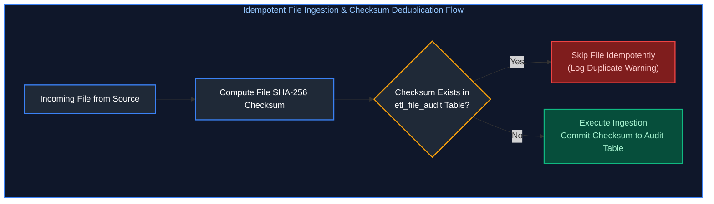

---

### Q4. [Medium] Designing Restartability via Checkpointing
**Difficulty:** [Medium]
**Topic Covered:** Staged State Markers, Step-Level Checkpointing & Automated Recovery  
**Question:** Scenario: A nightly load must be restartable from the point of failure. How do you design checkpointing?

#### Designing Restartability via Checkpointing (ETL Q3)
To ensure a 10-step nightly load restarts from the exact step that failed:
- Store pipeline state in an **Audit Control Table**:
  ```sql
  CREATE TABLE etl_pipeline_checkpoint (
      batch_id VARCHAR(64),
      pipeline_name VARCHAR(100),
      step_name VARCHAR(100),
      status VARCHAR(20), -- 'PENDING', 'IN_PROGRESS', 'SUCCESS', 'FAILED'
      start_time TIMESTAMP,
      end_time TIMESTAMP,
      PRIMARY KEY (batch_id, step_name)
  );
  ```
- Before executing Step $K$, the orchestrator checks `SELECT status FROM etl_pipeline_checkpoint WHERE batch_id = @id AND step_name = 'StepK'`. If status is `SUCCESS`, it skips directly to Step $K+1$.

---

# 2. Metadata-Driven Ingestion in ADF & Dynamic Databricks Invocation

---

### Q5. [Medium] Metadata-Driven Ingestion Architecture
**Difficulty:** [Medium]
**Topic Covered:** Control Tables, Lookup Activities & Dynamic ForEach Parallelism  
**Questions Covered:**
- **ADF Q6**: How would you design a metadata-driven pipeline instead of creating separate pipelines for every table (e.g. 100+ tables)?
- **ADF Q13**: How can you dynamically copy multiple tables from an on-prem SQL Server to Azure Data Lake using ADF?

#### Metadata-Driven Ingestion Architecture (ADF Q6, Q13)
Instead of building 100 individual ADF pipelines for 100 tables, build **ONE generic pipeline** driven by a SQL Control Table.

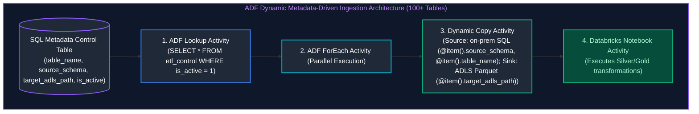

---

### Q6. [Medium] Dynamic Databricks Invocation & Parameter Passing
**Difficulty:** [Medium]
**Topic Covered:** Base Parameters, `dbutils.widgets`, Pipeline Expression Language & Dynamic Content  
**Questions Covered:**
- **ADF Q1**: How would you design an ADF pipeline that triggers Databricks notebooks dynamically?
- **ADF Q4**: How would you pass parameters from ADF to Databricks?
- **ADF Q5**: You need to pass table name, load type, source path, and execution date from ADF to Databricks. How would you design the parameter flow?
- **ADF Q15**: How do you handle parameterization and dynamic content in ADF pipelines for reusability?

#### Parameter Flow: ADF to Databricks Notebook (ADF Q1, Q4, Q5)

##### Step 1: Configure Base Parameters in ADF Databricks Notebook Activity
Inside the ADF Databricks Activity settings under **Base Parameters**:
- `p_table_name`: `@item().table_name`
- `p_load_type`: `@item().load_type`
- `p_source_path`: `@concat('abfss://raw@datalake.dfs.core.windows.net/', item().target_path)`
- `p_execution_date`: `@formatDateTime(pipeline().TriggerTime, 'yyyy-MM-dd')`

##### Step 2: Access Parameters in the Databricks PySpark Notebook
```python
# Extract parameters passed from ADF widgets
table_name = dbutils.widgets.get("p_table_name")
load_type = dbutils.widgets.get("p_load_type")
source_path = dbutils.widgets.get("p_source_path")
execution_date = dbutils.widgets.get("p_execution_date")

print(f"Executing {load_type} ingestion for {table_name} from {source_path} on {execution_date}")

# Dynamic PySpark Processing Logic
raw_df = spark.read.parquet(source_path)
raw_df.write.format("delta").mode("append").saveAsTable(f"bronze.{table_name}")
```

---

# 3. ADF Resilience Engineering: Dependency Branching, Retries & Error Bubbling

---

### Q7. [Medium] Activity Dependency Branching Rules & Retry Handling
**Difficulty:** [Medium]
**Topic Covered:** `UponCompletion`, `UponFailure`, Exponential Backoffs & Fault Tolerant Iteration  
**Questions Covered:**
- **ADF Q2**: If one activity fails in a pipeline containing 20 activities, how would you continue processing the remaining activities?
- **ADF Q3**: How would you implement retry and failure handling in ADF?

#### Activity Dependency Branching Rules (ADF Q2, Q3)
ADF supports four conditional activity dependencies:
1. **Upon Success (Green):** Dependent activity runs only if predecessor succeeds.
2. **Upon Failure (Red):** Runs only if predecessor fails (used for failure alerting/logging).
3. **Upon Completion (Blue):** Runs regardless of whether predecessor succeeded or failed.
4. **Upon Skip (Gray):** Runs if predecessor was skipped.

##### Continuing When 1 of 20 Activities Fails (ADF Q2)
- Connect downstream activities using **Upon Completion** dependencies.
- Alternatively, wrap independent activities inside a **ForEach Activity** with `isSequential: false`. An individual iteration failure does not abort other iterations.

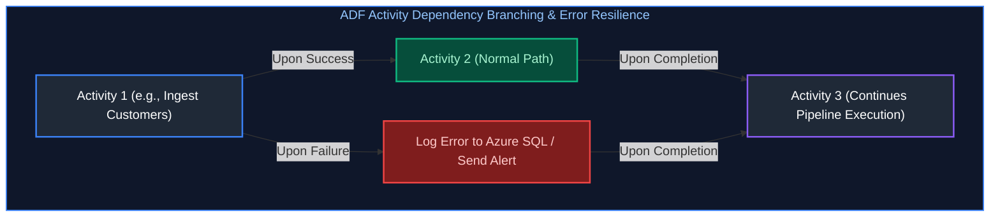

---

### Q8. [Medium] Capturing Databricks Notebook Errors in ADF & Alerting
**Difficulty:** [Medium]
**Topic Covered:** `dbutils.notebook.exit()`, Custom Error Bubbling & Automated Teams/Slack Alerts  
**Questions Covered:**
- **ADF Q11/Q12**: ADF successfully triggers a Databricks notebook, but the notebook fails. How would you capture the error and make the ADF pipeline fail correctly?
- **ADF Q16**: Describe how you implement error handling, alerting, and monitoring in ADF.

#### Capturing Databricks Notebook Errors in ADF (ADF Q12)
If a notebook contains an unhandled exception, Databricks reports an error status, and the ADF notebook activity fails automatically.
However, if Python code catches the exception with `try...except`, ADF sees the notebook as successful!
- **How to properly bubble the error to ADF:**
```python
import sys

try:
    process_data()
except Exception as e:
    # Option A: Re-raise the exception so Databricks exits with code 1
    raise e
    
    # Option B: Explicitly exit with error JSON string
    # dbutils.notebook.exit(json.dumps({"status": "FAILED", "error": str(e)}))
```

---

### Q9. [Medium] Deleting Files Across Multiple Containers Daily
**Difficulty:** [Medium]
**Topic Covered:** Multi-Container Metadata Enumeration & Child Pipeline Invocation  
**Question:** You need to delete files from multiple containers daily before writing new data. ADF doesn't support wildcards across containers in one delete activity. How would you design this?

#### Deleting Files Across Multiple Containers Daily (ADF Q14)
Because a single Delete Activity cannot span multiple storage containers:
1. Define a pipeline array parameter: `["bronze-landing", "staging-temp", "quarantine"]`.
2. Use an **ADF ForEach Activity** iterating through the array.
3. Inside the ForEach loop, invoke a parameterized **Delete Activity** with container set to `@item()`.

---

# 4. ADF Operational Diagnostics & Integration Runtimes

---

### Q10. [Easy] Azure Integration Runtime (IR) vs Self-Hosted IR (SHIR)
**Difficulty:** [Easy]
**Topic Covered:** Cloud Serverless Compute vs On-Premises Private Gateway Nodes  
**Question:** What is the difference between an Azure Integration Runtime (IR) and a Self-Hosted IR?

#### Azure IR vs Self-Hosted Integration Runtime (SHIR) (ADF Q17)
| Dimension | Azure Integration Runtime (Azure IR) | Self-Hosted Integration Runtime (SHIR) |
| :--- | :--- | :--- |
| **Infrastructure** | Fully managed serverless compute hosted in Azure cloud. | Customer-managed VM installed on-prem or in a private cloud VNet. |
| **Network Reach** | Public cloud endpoints and Azure PaaS services. | Connects to private on-premises databases (SQL Server, Oracle) behind firewalls. |
| **Maintenance** | Zero OS patching or maintenance required. | Requires manual OS updates, VM monitoring, and HA node clustering. |

---

### Q11. [Hard] Copy Activity Performance Bottlenecks & Failure Isolation
**Difficulty:** [Hard]
*(Grouped together: ADF pipeline monitoring, performance troubleshooting, DIU tuning, and failure isolation)*  
**Topic Covered:** DIU Sizing, Degree of Copy Parallelism, Network Throttling & Silent Row Drops  
**Questions Covered:**
- How do you monitor and troubleshoot Azure Data Factory pipelines?
- An ADF Copy Activity suddenly becomes very slow. What would you investigate?
- An ADF pipeline fails randomly. How would you determine whether the problem is with ADF, the source, or the target?
- A pipeline succeeds, but the target table contains incomplete or 0 records. How would you troubleshoot it?

#### Copy Activity Performance Bottlenecks (ADF Q10)
Inspect the **Copy Activity Execution Details** window:
1. **Network Throttling:** Check throughput (MB/s). Increase **Data Integration Units (DIUs)** (from default 4 to 32).
2. **Degree of Copy Parallelism:** Increase parallel threads reading source data.
3. **Source Database Reads:** Check if the source database is throttling queries due to CPU/Memory saturation.
4. **Staging Storage:** Enable Staging in Blob/ADLS to optimize ingestion into Synapse PolyBase/COPY INTO.

---

### Q12. [Medium] Pipeline Stuck in Queued State: Top 3 Checks
**Difficulty:** [Medium]
**Topic Covered:** Concurrent Pipeline Limits, SHIR Node Resource Saturation & Spark Cluster Warmup  
**Question:** Your pipeline is stuck in a Queued state. What are the top 3 things you would check?

#### Pipeline Stuck in "Queued" State: Top 3 Checks (ETL Q14)
1. **ADF Pipeline Concurrency Limit:** The maximum concurrent pipeline runs limit has been reached for the factory.
2. **Self-Hosted IR Saturated or Offline:** The SHIR node has 0 available concurrent job slots (CPU/RAM exhausted) or the SHIR service lost heartbeat.
3. **Target Data Store Throttling:** Target database (e.g., Azure SQL DW or Databricks cluster) is pausing, auto-scaling, or rejecting connections.

---

# 5. Transformation Engines: dbt Framework & Pipeline Audit Trails

---

### Q13. [Medium] The dbt Transformation Framework & ELT Benefits
**Difficulty:** [Medium]
**Topic Covered:** SQL Compilation, Jinja Templating, DAG Dependencies & In-Warehouse Pushdown  
**Question:** What is dbt, and what problem does it solve in the transformation layer?

#### What is dbt and What Problems Does it Solve? (ETL Q4)
**dbt (data build tool)** is an open-source transformation framework that enables data engineers to write modular SQL `SELECT` models while automating:
- **Dependency DAG Graph:** Resolves model execution order automatically using the `{{ ref('model_name') }}` macro.
- **Built-in Testing:** Validates data quality (`unique`, `not_null`, `relationships`) out-of-the-box.
- **Materialization Abstraction:** Switches a model between a `view`, `table`, or `incremental` table simply by changing a configuration header!

---

### Q14. [Medium] Dimension Audit Columns, Late-Arriving Data & Schema Evolution
**Difficulty:** [Medium]
*(Grouped together: Dimension audit metadata, late-arriving records, and schema evolution handling)*  
**Topic Covered:** Ingestion Metadata Columns, SCD Type 2 Auditability & Schema Evolution Strategies  
**Questions Covered:**
- Describe how you handle schema evolution in a production pipeline. What happens if a producer adds a new column unexpectedly?
- How do you handle schema evolution in data pipelines (like Avro, Parquet, or JSON)?
- How would you implement audit columns and change tracking in a dimension load?
- How do you handle duplicate records and late-arriving data in ETL pipelines?

#### Audit Columns Implementation in Dimension Loads (ETL Q7)
Every enterprise dimension and fact table should include mandatory audit columns:
```sql
ALTER TABLE dim_customers ADD COLUMNS (
    etl_batch_id VARCHAR(64),      -- Maps to pipeline execution run ID
    etl_created_at TIMESTAMP,      -- Insertion timestamp
    etl_updated_at TIMESTAMP,      -- Last update timestamp
    etl_source_file VARCHAR(255),  -- Originating storage filename
    etl_hash_diff VARCHAR(64)      -- MD5 hash of monitored attributes for change detection
);
```

---

# 6. Data Quality Gates, SLA Observability & Secret Management

---

### Q15. [Medium] The 5 Essential Data Quality Gates & SLA Observability
**Difficulty:** [Medium]
*(Grouped together: Enterprise data quality frameworks, freshness/uniqueness/drift monitoring, and batch + streaming quality observability)*  
**Topic Covered:** Pre-Ingestion & Post-Ingestion Quality Assertions, Freshness SLAs & Circuit Breakers  
**Questions Covered:**
- How do you ensure data quality and monitor pipelines in a streaming + batch architecture (including drift, late data, duplicate handling)?
- How would you design a data quality framework that checks freshness, uniqueness, null-rates, and drift?
- What are common data quality checks you implement in pipelines?
- How do you monitor pipeline SLAs and alert on data-freshness breaches?
- How do you ensure pipeline reliability and monitoring in production?

#### The 5 Essential Data Quality Gates (ETL Q12)
1. **Uniqueness:** Primary keys must contain zero duplicate values.
2. **Completeness:** Mandatory columns (`customer_id`, `transaction_date`) must be $0\%$ NULL.
3. **Referential Integrity:** Foreign keys in fact tables must resolve to valid surrogate keys in dimension tables.
4. **Domain / Range Validity:** Numeric metrics must fall within expected boundaries (e.g., `amount >= 0`, `age BETWEEN 18 AND 120`).
5. **Volume Anomaly Detection:** Compares daily row volume against 7-day moving averages (flags alert if volume drops by $>30\%$).

---

### Q16. [Medium] Enterprise Secret Management in Production Pipelines
**Difficulty:** [Medium]
**Topic Covered:** Azure Key Vault, Managed Identities, Scope Permissions & Zero-PlainText Secrets  
**Question:** How do you manage secrets securely in a production pipeline?

#### Enterprise Secret Management (ETL Q15)
- Never store connection strings or passwords in code or pipeline JSON.
- **Azure Key Vault Integration:** Use **Azure System-Assigned Managed Identity** on Azure Data Factory and Databricks.
- ADF connects to Azure Key Vault via Linked Service, fetching database passwords dynamically at runtime.

---

# 7. Unstructured Data Pipeline Design: Ingesting PDFs & Images

---

### Q17. [Medium] Unstructured Data Pipeline Design: Ingesting PDFs & Images
**Difficulty:** [Medium]
**Topic Covered:** Binary Storage, OCR Extraction, Vector Embeddings & Lakehouse Cataloging  
**Question:** If you are asked to ingest PDF and image files into your pipeline and make them queryable, how would you design it?

#### End-to-End Architectural Blueprint
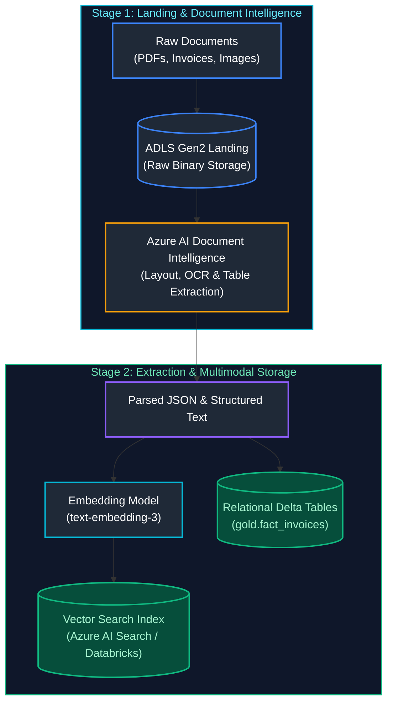

#### Step-by-Step Processing Pipeline
1. **Storage Landing:** Stream raw PDF/TIFF files into ADLS Gen2 raw container.
2. **OCR & Document Extraction:** A Databricks job or Azure Function sends documents to **Azure AI Document Intelligence** (Form Recognizer).
   - Extracts structured key-value pairs (Invoice Number, Total Due, Vendor Name).
   - Extracts tabular invoice line items into relational rows.
3. **Structured Lakehouse Storage:** Extracted tabular data is written to a **Delta Lake table** (`gold.vendor_invoices`) for SQL and BI querying.
4. **Vector Embeddings for Semantic Search:** Full text is chunked, converted to dense vector embeddings, and indexed in **Azure AI Search** or Databricks Vector Search for LLM-powered RAG querying.

---

# 8. Incident Diagnostics & Systematic RCA: 3x-6x Pipeline Slowdowns

---

### Q18. [Hard] Systematic RCA Playbook: Daily Job Exploding from 30m to 3h with Zero Failures
**Difficulty:** [Hard]
*(Grouped together: Systematic RCA for sudden 3x to 6x pipeline execution slowdowns across daily/nightly/monthly batch runs)*  
**Topic Covered:** Root-Cause Analysis (RCA), Gantt Tree Diagnostics, Silent Degradation  
**Questions Covered:**
- A nightly job that used to finish in 45 minutes suddenly takes 3 hours — outline your approach to root-cause analysis.
- Your daily ETL pipeline suddenly takes 3 hours instead of 30 minutes. No task failure appears in Airflow. Where do you investigate first?
- A monthly data load that normally takes 2 hours suddenly takes 8 hours. How would you analyze the bottleneck?
- A daily batch job that normally takes 2 hours is now taking 6 hours. How do you identify the root cause?

#### The 5-Step Systematic RCA Diagnostic Tree
```mermaid
flowchart TD
    S1["Step 1: Orchestrator Gantt Chart (Airflow / ADF)<br/>Which exact task consumed the extra 2.5 hours?"] --> S2{"Is it Ingestion, Transformation, or Target Load?"}
    
    S2 -->|Ingestion / Source| C1["Check Source System & Network<br/>(Source DB connection pool throttling?, Table lock / block by long-running OLTP transaction?, Network throughput / VPN gateway saturation?)"]
    S2 -->|Transformation (Spark)| C2["Check Spark Web UI<br/>(Stage breakdown: Was it 1 straggler task (Data Skew)?, Input Volume: Did input data jump 10x (Spike/Replay)?, Spill (Disk): Did executors spill memory to disk?)"]
    S2 -->|Target Load / Merge| C3["Check Target Table State<br/>(Target table fragmentation (millions of small files)?, Target locks or concurrency conflicts (OCC retries)?, Delta Lake missing OPTIMIZE / Z-ORDER?)"]

    style S1 fill:#1f2937,stroke:#3b82f6,stroke-width:2px,color:#fff
    style S2 fill:#1f2937,stroke:#f59e0b,stroke-width:2px,color:#fff
    style C1 fill:#7f1d1d,stroke:#ef4444,stroke-width:2px,color:#fca5a5
    style C2 fill:#064e3b,stroke:#10b981,stroke-width:2px,color:#a7f3d0
    style C3 fill:#1f2937,stroke:#8b5cf6,stroke-width:2px,color:#c084fc
```

#### Diagnostic Step-by-Step Runbook:
1. **Identify the Culprit Task:** Open Airflow Gantt view or ADF Monitoring. Compare the duration of every task against the 7-day baseline average. 95% of slowdowns isolate to a single task.
2. **Inspect Data Volume ($V_{in}$):** Check row count and byte size of incoming data. Did an upstream producer perform a backfill, dump historical records, or trigger duplicate events?
3. **Inspect Cluster Resource Contention:** Check cloud provider metrics. Did cloud Spot VMs get evicted, forcing executors to run on fallback compute with degraded I/O?
4. **Inspect Spark Shuffle & Task Distribution:** Open the Spark UI for the stage. If the 75th percentile task time is 2 minutes but the Max task time is 2.5 hours, **data skew** is confirmed.
5. **Inspect Target Lock Contention:** If the pipeline uses `MERGE`, check if another concurrent pipeline was updating the same target table partitions, causing Optimistic Concurrency Control (OCC) retry loops.

---

### Q19. [Hard] Weekend Metric Drift RCA: Delivery Times Spiking by 8 Minutes
**Difficulty:** [Hard]
**Topic Covered:** Metric Drift Diagnostics, Dimensional Slicing & Operational Bottlenecks  
**Question:** The average order delivery time increased by 8 minutes on weekends only. How do you find the root cause?

#### Dimensional Decomposition Framework
Total Delivery Time is a composite metric:
$$\text{Total Delivery Time} = T_{\text{kitchen\_prep}} + T_{\text{driver\_assignment}} + T_{\text{driver\_to\_restaurant}} + T_{\text{transit\_to\_customer}}$$

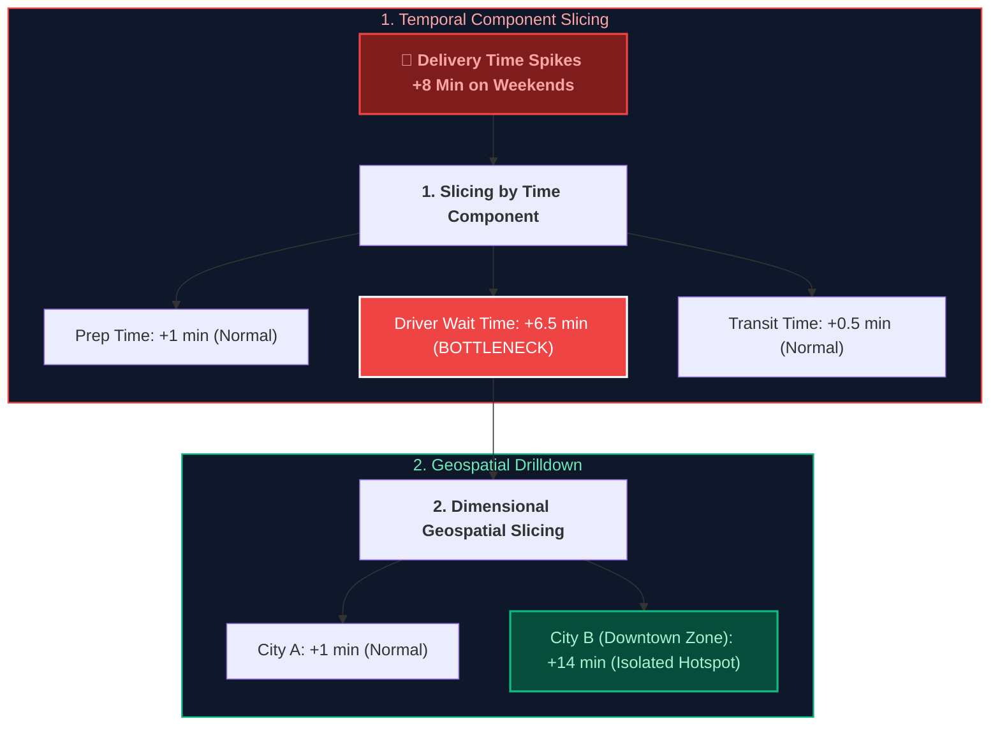

#### Investigation Steps:
1. **Deconstruct the Funnel:** Break delivery time into discrete timestamp intervals: Order Placed $\to$ Kitchen Accepted $\to$ Food Prepared $\to$ Driver Assigned $\to$ Driver Arrived $\to$ Delivered.
2. **Segment by City, Zone, and Restaurant Tier:** Slicing by geographic zone reveals if the spike is localized to high-density nightlife areas or city-wide.
3. **Correlate with Driver Supply vs Demand Ratio:** Calculate the ratio of active delivery partners to incoming orders. If demand jumps 300% on Saturday evenings while driver logins drop by 20%, driver dispatch queues stall, adding 6–8 minutes before a driver accepts the order.

---

# 9. Pipeline Self-Defense: Protecting Pipelines from Degrading Downstream APIs

---

### Q20. [Hard] The 3 Core Controls: Circuit Breakers, Token-Bucket Rate Limiters & Dead-Letter Backoff
**Difficulty:** [Hard]
*(Grouped together: Downstream API backpressure, rate limiters, circuit breakers, and dead-letter queues)*  
**Topic Covered:** Downstream API Degradation, Pipeline Fault-Tolerance & Backpressure Protection  
**Questions Covered:**
- A downstream API used by your ETL pipeline slows to 10 seconds per request and blocks the entire workflow. What three controls should protect the pipeline?
- A downstream REST API used by your ETL pipeline slows to 10 seconds per request and blocks the entire workflow. What three controls should protect the pipeline?

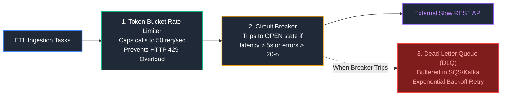

#### The 3 Architectural Controls:
1. **Circuit Breaker Pattern:**
   - If downstream API calls exceed a 2-second timeout or fail > 20% of the time over a 1-minute window, the circuit breaker **trips to OPEN**.
   - Subsequent pipeline tasks fail fast immediately without waiting 10 seconds per call, preventing thread exhaustion.
2. **Token-Bucket Rate Limiting with Connection Pooling:**
   - Enforce an asynchronous client-side rate limiter (e.g. 50 requests/sec maximum) with a bounded HTTP connection pool. This guarantees the ETL cannot overwhelm the downstream API or exhaust its own local network sockets (`TIME_WAIT` socket exhaustion).
3. **Dead-Letter Queue (DLQ) with Exponential Backoff:**
   - Instead of blocking the ETL pipeline synchronously, route timed-out payloads into an asynchronous retry queue (e.g., Azure Service Bus / AWS SQS / Kafka).
   - An isolated consumer retries failed calls using jittered exponential backoff ($2^n + \text{jitter}$), allowing the main ETL pipeline to finish on time.

---

# 10. Orchestrator Concurrency & Multi-Worker Race Conditions

---

### Q21. [Hard] Airflow Multi-Worker Duplicate Execution Prevention & Distributed Locks
**Difficulty:** [Hard]
**Topic Covered:** Multi-Worker Race Conditions, Airflow Pools, Distributed Locking  
**Question:** Your Airflow DAG runs on 3 workers and triggers the same load multiple times. How would you prevent duplicate processing?

#### Why Duplicate Processing Occurs
In distributed orchestrators (CeleryExecutor / KubernetesExecutor), duplicate execution happens when:
1. `max_active_runs` is not set, and a delayed backfill schedules multiple concurrent DAG runs for the same dataset.
2. Two workers pick up identical task instances due to Celery task visibility timeout expirations (`visibility_timeout` shorter than task execution time).

#### 3 Production Defenses:
1. **Strict DAG Run & Concurrency Constraints:**
   ```python
   dag = DAG(
       dag_id="financial_settlement_etl",
       max_active_runs=1,             # Only 1 execution active globally
       max_active_tasks=1,            # Prevents duplicate task parallelism
       concurrency=1,
       catchup=False
   )
   ```
2. **Airflow Task Pools:** Assign the task to an Airflow Pool with `slots = 1`. Even across 10 workers, only 1 task slot can ever execute concurrently.
3. **Distributed Mutual Exclusion Locks (Redis / Database Advisory Locks):**
   Prior to mutating target tables, acquire an atomic distributed lock:
   ```python
   import redis
   r = redis.Redis(host='redis-lock.internal', port=6379)
   
   # Acquire distributed lock with 30-minute auto-expiry
   lock_acquired = r.set("lock:finance_settlement_job", "worker_1", nx=True, ex=1800)
   if not lock_acquired:
       raise RuntimeError("Another worker is currently executing this load! Aborting duplicate run.")
   ```

---

### Q22. [Hard] Silent Data Loss: Pipeline Succeeds in ADF but Target Table Has Incomplete Data
**Difficulty:** [Hard]
**Topic Covered:** ADF Copy Activity Diagnostics, Fault Tolerance Traps & Silent Drops  
**Question:** A pipeline succeeds in ADF, but the target table contains incomplete data. How would you troubleshoot the issue?

#### Root Causes of "Silent Success":
1. **Fault Tolerance Enabled with Row Skipping:**
   In ADF Copy Activity, if `Enable fault tolerance` is checked and configured to `Skip incompatible rows`, ADF silently skips malformed rows, logs them to a storage account, and marks the pipeline run as **Succeeded**!
2. **Incorrect High-Watermark Query Boundary:**
   If the source delta query is `WHERE LastModifiedDate > @OldWatermark AND LastModifiedDate < @NewWatermark` (using `<` instead of `<=`), rows modified at the exact boundary microsecond are dropped forever.
3. **Overwriting Target Partition with Partial Batch:**
   If a pipeline partition overwrite (`INSERT OVERWRITE` / dynamic partition replacement) runs against a source file that only contained 20% of the daily transactions, it wipes the entire existing partition and replaces it with the partial 20%.

#### Troubleshooting Runbook:
- Inspect ADF Copy Activity run output: verify `rowsRead` vs `rowsCopied` vs `rowsSkipped`.
- Inspect the fault tolerance error logging directory in ADLS to review skipped payload rows.
- Verify watermark range queries for timestamp off-by-one boundary leaks.

---

# 11. Incremental Ingestion Mechanics & 1,000 File Processing in ADF

---

### Q23. [Hard] High-Watermark Incremental Load from Azure SQL to ADLS via LastModifiedDate
**Difficulty:** [Hard]
*(Grouped together: High-watermark incremental extracts and Azure Data Factory incremental loading patterns)*  
**Topic Covered:** Watermark Metadata Tracking, Parameterized Copy & Atomic Watermark Updates  
**Questions Covered:**
- How would you implement an incremental load from Azure SQL to ADLS when there is a LastModifiedDate column?
- How do you implement incremental loading in Azure Data Factory?

#### End-to-End ADF Pipeline Control Flow
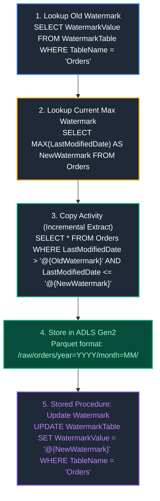

#### Production Hardening Rule:
Notice the query boundary: `LastModifiedDate > @OldWatermark AND LastModifiedDate <= @NewWatermark`.
- Always store `@NewWatermark` **before** executing the extract.
- Only update the `WatermarkTable` **after** the Copy Activity finishes successfully. If the Copy Activity fails, the watermark remains unchanged, ensuring deterministic replayability.

---

### Q24. [Medium] Processing 1,000 Asynchronously Arriving Files in ADLS Gen2 with ADF
**Difficulty:** [Medium]
*(Grouped together: Event-driven file ingestion and high-concurrency tumbling window batching)*  
**Topic Covered:** Event-Driven Ingestion, Batching vs Streaming, Storage Event Triggers  
**Questions Covered:**
- How would you design an ADF pipeline to process 1,000 files arriving at different times in ADLS Gen2?
- How would you design an ADF pipeline to process 1,000 files arriving at unpredictable times throughout the day in ADLS Gen2?

#### Architectural Options:
1. **Storage Event Trigger (Event-Driven - Recommended for Low Latency):**
   - Configure an ADF **Storage Event Trigger** listening to `Microsoft.Storage.BlobCreated` events in ADLS Gen2.
   - Every file arrival automatically triggers an ADF pipeline run, passing `@triggerBody().folderPath` and `@triggerBody().fileName` dynamically into Copy/Databricks parameters.
2. **Tumbling Window Micro-Batching (Recommended for High Throughput):**
   - If 1,000 files arrive in bursts, triggering 1,000 individual ADF pipeline runs incurs queue latency and API throttling limits.
   - Use a **Tumbling Window Trigger (every 15 minutes)**:
     - Run a `Get Metadata` activity with `Child Items` to retrieve all new files.
     - Pass the array into a `ForEach` activity with concurrency set to 20–50 to load files in parallel.
3. **Databricks Auto Loader (`cloudFiles` - The Modern Lakehouse Alternative):**
   - Bypass ADF ForEach loops completely. Point a single Databricks Auto Loader streaming job at the storage container. Auto Loader automatically buffers file discovery via Azure Event Grid and ingests files continuously with zero pipeline management.

---

# 12. Production Schema Migrations & Disaster Incident Containment

---

### Q25. [Expert] Zero-Downtime Warehouse Column Renaming: Expand/Contract Migration Strategy
**Difficulty:** [Expert]
**Topic Covered:** Non-Breaking Schema Evolution, Expand/Contract Pattern, View Abstraction  
**Question:** Rename a critical warehouse column used by multiple downstream pipelines with zero downtime. Walk through the migration strategy.

#### The Expand / Contract Migration Pattern
Directly executing `ALTER TABLE orders RENAME COLUMN customer_id TO client_uuid;` instantly breaks every downstream BI dashboard, ETL pipeline, and SQL query querying that table.

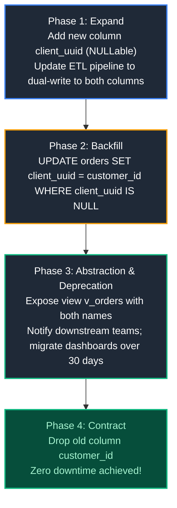

---

### Q26. [Hard] Immediate Triage & Long-Term Containment of Production Duplicate Data
**Difficulty:** [Hard]
*(Grouped together: Hourly pipeline duplicate triage, production duplicate containment, and incident response)*  
**Topic Covered:** Incident Containment, Data Quarantine, Delta Time Travel, Root Cause Prevention  
**Questions Covered:**
- You have a pipeline that runs every hour, but the downstream table shows duplicate records. Walk through your debugging approach step by step.
- You discover duplicate records in a critical production dataset. What is your immediate incident response plan, and what long-term strategy prevents recurrence?

#### Phase 1: Immediate Triage (Stop the Bleeding within 15 Minutes)
1. **Pause Downstream Consumption:** Immediately pause downstream ETL jobs and set analytical views to maintenance mode or lock downstream cache to prevent corrupt reports from reaching executives.
2. **Isolate Affected Time Window:** Run diagnostic queries to find when duplicates began (`SELECT MIN(ingestion_time) FROM table GROUP BY pk HAVING COUNT(*) > 1`).
3. **Fast Rollback via Delta Time Travel:** If running Delta Lake, restore the table to the last known healthy version prior to corruption:
   ```sql
   RESTORE TABLE gold_transactions TO VERSION AS OF 142;
   ```

#### Phase 2: Long-Term Architectural Prevention
1. **Idempotent Merge Pipelines:** Replace all `APPEND` ingestion logic with deterministic `MERGE INTO` matching on business keys.
2. **Automated Data Quality CI Gates:** Integrate Great Expectations, Soda, or dbt tests (`unique`, `not_null`) as blocking steps before publishing to Gold layer.

---

### Q27. [Medium] Peak Business Hour Critical Pipeline Failure: The Severity-1 Action Runbook
**Difficulty:** [Medium]
**Topic Covered:** Sev-1 Incident Management, Communication Protocols, Safe Backfills  
**Question:** What is your emergency action plan if a critical data pipeline fails during peak business hours?

1. **Acknowledge & Declare Incident (T+0 to T+5 min):** Declare Sev-1 incident, spin up an Incident War Room, and assign roles: Incident Commander, Tech Lead, Communications Lead.
2. **Mitigate User Impact (T+5 to T+15 min):** Redirect user queries to read-replicas or switch reporting dashboards to yesterday's snapshot.
3. **Triage Logs & Isolate Root Cause (T+15 to T+45 min):** Check recent code deployments, upstream schema changes, or infrastructure resource quotas.
4. **Deploy Fix or Rollback:** Roll back bad release via Git or restore storage snapshot via Time Travel.
5. **Post-Mortem & Blameless RCA:** Publish comprehensive Root Cause Analysis document detailing Timeline, Root Cause, Impacted Systems, and Action Items to prevent recurrence.

---

### Q28. [Hard] Large-Scale Production ETL Case Study: Cost & Performance Optimization
**Difficulty:** [Hard]
**Topic Covered:** Enterprise Architecture Storytelling (STAR Method), Cloud FinOps  
**Question:** Describe a large-scale ETL you worked on and explain how you improved performance or reduced cost.

#### The Production STAR Blueprint
- **Situation:** An enterprise e-commerce platform processed 15 TB of daily clickstream and transaction data. The nightly batch pipeline took **6.5 hours** to execute, frequently breaching the 7:00 AM SLA and costing **\$22,000/month** in cloud compute.
- **Task:** Re-architect the data pipeline to execute in under **1.5 hours** (75% latency reduction) and reduce cloud compute spend by at least **40%**.
- **Action (3 Core Technical Changes):**
  1. *From Full-Table Scans to Incremental CDC:* Replaced full table snapshots with Delta Lake Change Data Feed (CDF), processing only net-new mutations ($\approx 80\text{ GB/day}$).
  2. *Optimized Shuffle & AQE:* Replaced default 2000 shuffle partitions with Adaptive Query Execution (`spark.sql.adaptive.coalescePartitions.enabled`), automatically reducing small file shuffle overhead.
  3. *Migrated from PySpark Python UDFs to Vectorized Native Functions:* Rewrote string and regex parsing UDFs using native Spark SQL functions, eliminating JVM-to-Python serialization overhead.
- **Result:**
  - Pipeline duration dropped from **6.5 hours to 38 minutes** (90% performance boost).
  - Monthly cluster compute cost fell from **\$22,000 to \$8,500/month** (61% cost reduction).
  - SLA adherence improved to 99.98% over the next 12 months.

---

# 13. Enterprise CDC, Unity Catalog Governance & Partition Mechanics

---

### Q29. [Medium] Log-Based Change Data Capture (CDC) in Large-Scale Pipelines
**Difficulty:** [Medium]
**Topic Covered:** Transaction Log Ingestion, Debezium, Kafka Connect, Delta MERGE & CDF  
**Question:** How would you implement Change Data Capture (CDC) in a large-scale data pipeline?

#### Definition & Core Concepts
Traditional batch CDC queries databases via polling (`WHERE updated_at > last_watermark`). At high scale, this inflicts severe CPU overhead, misses hard deletes, and misses intermediate in-flight state mutations.
**Log-Based CDC** reads database transaction logs (PostgreSQL WAL, MySQL Binlog, Oracle Redo Log) directly without querying relational execution engines:
1. **Zero Database Performance Impact:** Log extraction is decoupled from OLTP query execution engines.
2. **Complete Mutation Fidelity:** Captures every single `INSERT`, `UPDATE` (with before and after image), and `DELETE` event.
3. **Sub-Second Streaming Replication:** Streams database changes immediately into Kafka topics for real-time downstream lakehouse upserts.

#### Visual Flow
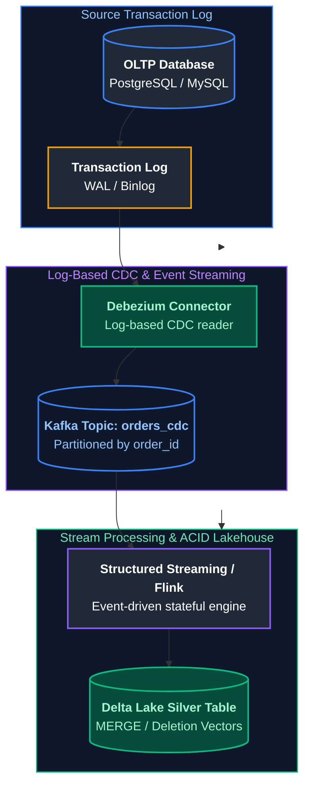

#### Production Implementation / Code Solution
```python
from pyspark.sql import SparkSession
from pyspark.sql import functions as F
from pyspark.sql.window import Window
from delta.tables import DeltaTable

spark = SparkSession.builder.appName("LargeScaleCDC").getOrCreate()

# 1. Consume CDC Stream from Kafka
cdc_raw_stream = (
    spark.readStream
    .format("kafka")
    .option("kafka.bootstrap.servers", "kafka:9092")
    .option("subscribe", "dbserver1.inventory.orders")
    .option("startingOffsets", "latest")
    .load()
)

# 2. Idempotent Upsert into Delta Lake via foreachBatch
def upsert_cdc_microbatch(microbatch_df, batch_id):
    # Deduplicate within the micro-batch to retain the latest operation per order_id
    dedup_window = Window.partitionBy("order_id").orderBy(F.col("cdc_timestamp").desc())
    latest_mutations = (
        microbatch_df
        .withColumn("rn", F.row_number().over(dedup_window))
        .filter(F.col("rn") == 1)
        .drop("rn")
    )

    delta_target = DeltaTable.forName(spark, "silver.orders")
    (
        delta_target.alias("tgt")
        .merge(
            latest_mutations.alias("src"),
            "tgt.order_id = src.order_id"
        )
        .whenMatchedDelete(condition="src.operation = 'd'")
        .whenMatchedUpdateAll(condition="src.operation = 'u'")
        .whenNotMatchedInsertAll(condition="src.operation IN ('c', 'u')")
        .execute()
    )

query = (
    cdc_parsed_df.writeStream
    .format("delta")
    .foreachBatch(upsert_cdc_microbatch)
    .option("checkpointLocation", "abfss://checkpoints@lake.dfs.core.windows.net/orders_cdc")
    .start()
)
```
- **Time Complexity:** $O(M)$ per micro-batch upsert where $M$ is mutated rows.
- **Space Complexity:** $O(M)$ in-memory micro-batch frame.

#### Engineering Implications & Production Pitfalls
1. **Out-of-Order CDC Events:** If network delays cause an `UPDATE` event to arrive after a subsequent `UPDATE`, using arrival order corrupts data. Always enforce tie-breaking on the source database logical commit timestamp or log sequence number (`lsn` / `ts_ms`).
2. **Interview Talking Point:** In technical interviews, highlight that Debezium + Kafka + Delta Lake provides a completely decoupled CDC pipeline that scales independently of the source OLTP database, with Deletion Vectors minimizing rewrite overhead for deletes.

---

### Q30. [Medium] Enterprise Data Governance & Access Control Using Unity Catalog
**Difficulty:** [Medium]
**Topic Covered:** 3-Level Namespace, Dynamic Row Filters, Column Masking, Data Lineage  
**Question:** How would you design and enforce data governance using Unity Catalog?

#### Definition & Core Concepts
Unity Catalog is Databricks’ centralized governance layer for all data, AI models, notebooks, and files across multi-cloud lakehouse environments.
Key pillars:
1. **3-Level Namespace Architecture:** `catalog.schema.table` replaces legacy two-level database/table models, providing logical segregation (e.g. `prod_us.finance.general_ledger`).
2. **Attribute-Based Access Control (ABAC) & Identity Federation:** Centrally manages permissions across all Databricks workspaces via SCIM integration with Azure AD / Okta.
3. **Dynamic Row Filters & Column Masks:** Enforces column-level data masking (e.g. masking SSN/Credit Card digits) and row-level segregation (e.g. filtering rows by user's assigned sales region) transparently at query runtime without maintaining duplicate views.
4. **Automated End-to-End Lineage:** Captures column-level lineage automatically across SQL, PySpark, notebooks, workflows, and dashboards without manual tagging.

#### Visual Flow
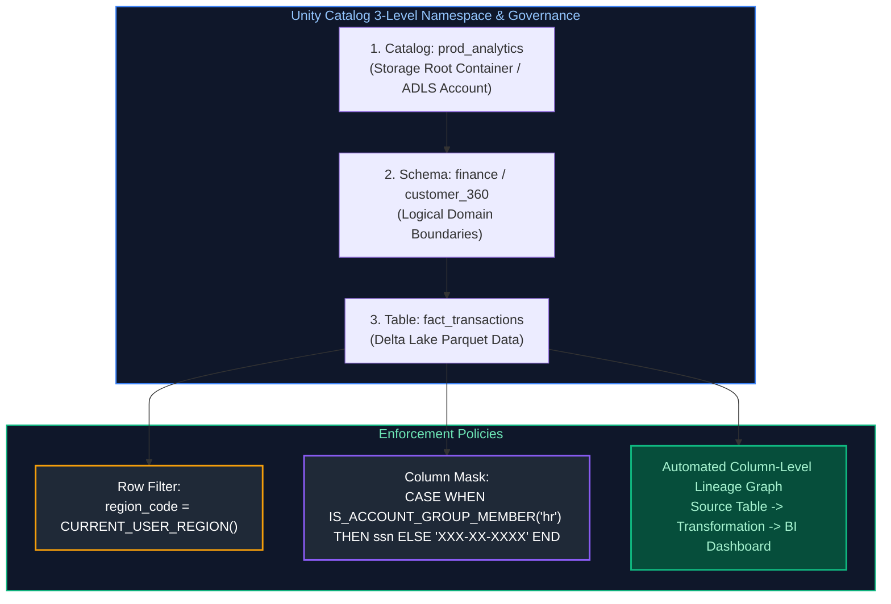

#### Production Implementation / Code Solution
```sql
-- 1. Create a Dynamic Column Mask Function for PII Protection
CREATE OR REPLACE FUNCTION mask_email(email STRING)
RETURN CASE 
    WHEN IS_ACCOUNT_GROUP_MEMBER('compliance_officers') THEN email
    ELSE CONCAT(SUBSTRING(email, 1, 2), '***@', SPLIT(email, '@')[1])
END;

-- Apply the Column Mask directly to the Table Schema
ALTER TABLE prod_analytics.customers.dim_users 
ALTER COLUMN email SET MASK mask_email;

-- 2. Create a Dynamic Row Filter Function for Multi-Tenant Regional Isolation
CREATE OR REPLACE FUNCTION filter_by_sales_region(region_code STRING)
RETURN (
    IS_ACCOUNT_GROUP_MEMBER('executive_leadership') OR
    region_code = (
        SELECT user_region 
        FROM prod_analytics.admin.user_region_map 
        WHERE user_email = CURRENT_USER()
    )
);

-- Apply the Row Filter directly to the Orders Table
ALTER TABLE prod_analytics.sales.fact_orders 
SET ROW FILTER filter_by_sales_region ON (region_code);
```
- **Time Complexity:** $O(1)$ rule compilation in Catalyst optimizer plan; sub-millisecond predicate injection.
- **Space Complexity:** Zero storage overhead (no secondary views or materialized filtered tables).

#### Engineering Implications & Production Pitfalls
1. **The Proliferation of Filter Views Anti-Pattern:** Before Unity Catalog, data engineers maintained 50 separate views (`v_orders_emea`, `v_orders_apac`, `v_orders_masked`) with duplicated ETL pipelines. Unity Catalog row filters and column masks consolidate all access control into a single table with zero view sprawl.
2. **Interview Talking Point:** Highlight that Unity Catalog enforces security at the engine level for SQL, Python, R, and Scala identically, eliminating security bypasses that occur when users run raw PySpark DataFrame APIs.

---

### Q31. [Easy] Repartition vs Coalesce in ETL Pipelines
**Difficulty:** [Easy]
**Topic Covered:** Physical Partition Sizing, Shuffle I/O vs Merge, Small File Mitigation  
**Question:** Explain Repartition vs Coalesce and their use cases.

#### Comparison Matrix: Repartition vs Coalesce in Production ETL
| Feature | `repartition(n)` | `coalesce(n)` |
| :--- | :--- | :--- |
| **Physical Mechanism** | Performs a full network shuffle across all executors. | Merges adjacent partitions on the same executor without network shuffle. |
| **Partition Movement** | Can **increase or decrease** partition count. | Can **only decrease** partition count. |
| **Data Distribution** | Uniform distribution (round-robin or hash-based); cures skew. | Uneven distribution; can preserve or worsen existing data skew. |
| **Computational Cost** | Heavy I/O; writes shuffle files to disk and transfers over network. | Minimal I/O; local executor partition coalescence. |
| **Primary ETL Use Case** | Eliminating data skew before expensive joins or wide aggregations. | Compacting output partitions right before writing to storage to prevent small files. |

```python
# Optimal Production Pattern:
# Use repartition to balance skewed keys before join:
skew_free_df = orders_df.repartition(200, "customer_id")

# Use coalesce to reduce file count right before writing final Parquet output:
# Avoids creating 200 tiny files if filtered result is only 50 MB
final_output_df.coalesce(2).write.format("parquet").save("abfss://...")
```

---

# 14. Advanced ADF Orchestration, Duplicate Prevention & Multi-Source Synapse Ingestion

---

### Q32. [Hard] Accidental Duplicate Triggering: Root Cause Analysis, Mitigation & Idempotency
**Difficulty:** [Hard]
**Topic Covered:** Pipeline Concurrency, Trigger Guards, Idempotent MERGE & Remediation  
**Question:** A user accidentally triggered the same ADF pipeline twice concurrently, resulting in duplicate records in the target table. How would you resolve this issue immediately and architecturally prevent it from ever happening again?

#### Incident Response & Immediate Remediation
1. **Quarantine & Identify Duplicates:**
   - Execute window deduplication targeting the duplicate pipeline batch ID:
     ```sql
     -- Remove duplicates preserving the earliest insertion
     DELETE FROM target_table
     WHERE (order_id, ingested_at) IN (
         SELECT order_id, ingested_at
         FROM (
             SELECT order_id, ingested_at,
                    ROW_NUMBER() OVER (PARTITION BY order_id ORDER BY ingested_at ASC) AS rn
             FROM target_table
         ) sub
         WHERE rn > 1
     );
     ```

#### Architectural Root Causes & Prevention Framework
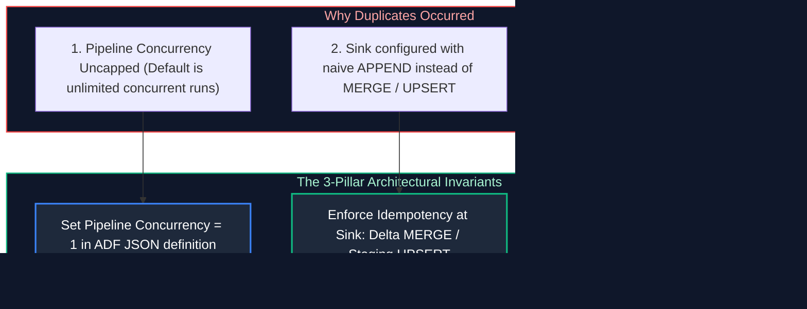

1. **Pipeline Concurrency Limit (`concurrency = 1`):** In ADF pipeline settings, set **Concurrency to 1**. Subsequent triggers are queued sequentially rather than executing in parallel.
2. **Sink Idempotency Guarantee:** Never write raw batch outputs directly via `INSERT INTO` or append mode. Always load into a temporary staging table and execute an idempotent `MERGE` on natural keys (`target.id = stage.id`).

---

### Q33. [Medium] Incremental Loading Without Timestamps: Change Tracking & Hash Diffing
**Difficulty:** [Medium]
**Topic Covered:** Watermark Alternatives, SQL Change Tracking, Binary Hash Comparison  
**Question:** How would you design and implement incremental loading in ADF when the source table has no reliable last-modified timestamp or audit columns?

#### The 3 Incremental Ingestion Strategies Without Timestamps

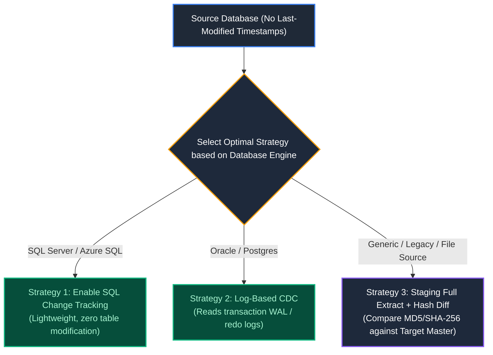

#### Production Implementation: SQL Server Change Tracking Pattern
```sql
-- Step 1: Enable Change Tracking on Database and Target Source Table
ALTER DATABASE RetailDB SET CHANGE_TRACKING = ON (CHANGE_RETENTION = 2 DAYS, AUTO_CLEANUP = ON);
ALTER TABLE Orders ENABLE CHANGE_TRACKING WITH (TRACK_COLUMNS_UPDATED = ON);

-- Step 2: ADF Lookup Activity queries previous synchronized version from metadata table
-- Step 3: ADF Copy Activity extracts only mutated rows using CHANGETABLE function
SELECT 
    o.OrderID,
    o.CustomerID,
    o.TotalAmount,
    ct.SYS_CHANGE_OPERATION AS ChangeType,
    ct.SYS_CHANGE_VERSION AS ChangeVersion
FROM CHANGETABLE(CHANGES Orders, :LastSyncVersion) AS ct
LEFT JOIN Orders o ON ct.OrderID = o.OrderID;

-- Step 4: After sink commit, advance watermark to CHANGE_TRACKING_CURRENT_VERSION()
```

---

### Q34. [Medium] Resilient Sub-Task Retry Logic Without Full Pipeline Reprocessing
**Difficulty:** [Medium]
**Topic Covered:** Restartability, Checkpoint Control Tables & Micro-Task Status Tracking  
**Question:** In a pipeline processing 50 tables or 100 partitions, a failure occurs at table 48. How would you design retry logic to resume from table 48 without reprocessing tables 1 through 47?

#### Architectural Mechanics: State-Driven Control Table Pattern
```sql
-- Checkpoint state tracking table in Azure SQL / Control Database
CREATE TABLE etl_control.pipeline_task_checkpoint (
    pipeline_run_id VARCHAR(100) NOT NULL,
    batch_date DATE NOT NULL,
    task_name VARCHAR(100) NOT NULL,     -- Table name or partition identifier
    task_status VARCHAR(20) NOT NULL,    -- 'PENDING', 'IN_PROGRESS', 'COMPLETED', 'FAILED'
    retry_attempt_count INT DEFAULT 0,
    last_error_message VARCHAR(MAX),
    updated_at TIMESTAMP DEFAULT CURRENT_TIMESTAMP,
    PRIMARY KEY (pipeline_run_id, task_name)
);
```

#### ADF Pipeline Control Flow:
1. **Lookup Activity (Filter Incomplete Tasks):**
   ```sql
   SELECT task_name, task_params
   FROM etl_control.pipeline_task_checkpoint
   WHERE batch_date = CURRENT_DATE 
     AND task_status != 'COMPLETED';
   ```
2. **ForEach Activity (Parallel Execution over Filtered Tasks):**
   - ForEach iterates *only* over items where `task_status` is not `COMPLETED`.
   - Update state to `IN_PROGRESS` $\to$ Execute Copy/Databricks Activity $\to$ Update state to `COMPLETED`.
   - On Failure: Catch block updates state to `FAILED`, increments `retry_attempt_count`, and alerts.
3. **Automatic Resumption:** Re-triggering the pipeline naturally skips tables 1-47 because their status is `COMPLETED`, resuming table 48 directly.

---

### Q35. [Medium] Slowly Changing Dimensions (SCD Type 2) in ADF Mapping Data Flows
**Difficulty:** [Medium]
**Topic Covered:** Mapping Data Flows, Alter Row Transformations, Surrogate Keys & SCD2  
**Question:** How would you design and implement Slowly Changing Dimensions Type 2 (SCD2) using Azure Data Factory Mapping Data Flows?

#### Mapping Data Flow Design Graph
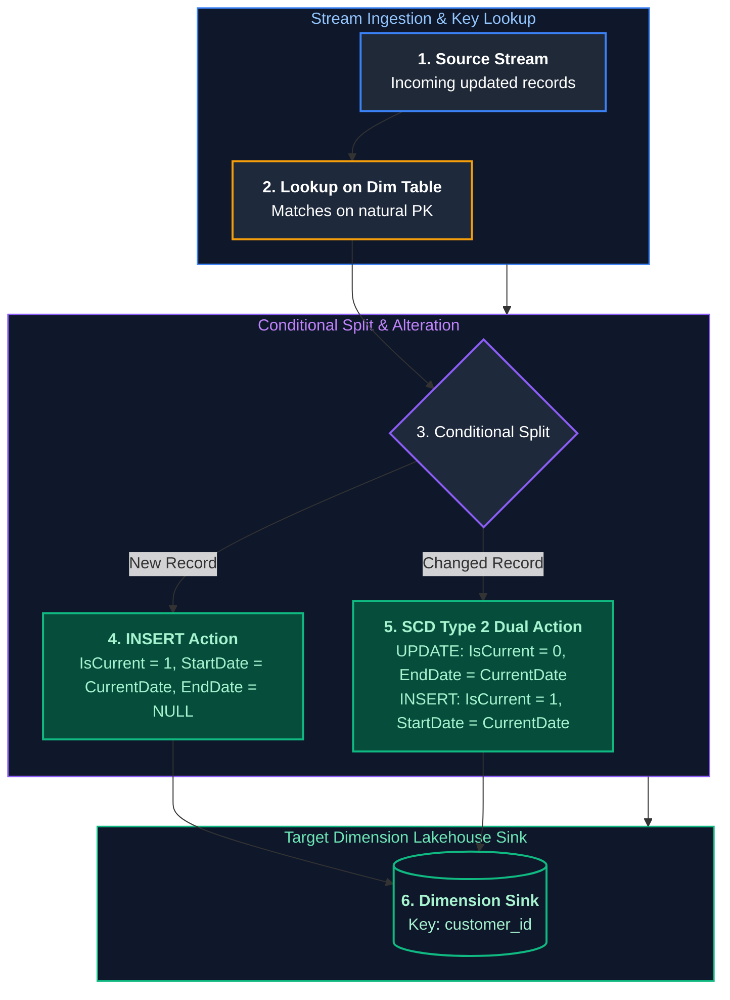

#### Step-by-Step Data Flow Configuration:
1. **Source:** Ingests updated customer records. Add Derived Column: `incoming_hash = md5(name + address + phone)`.
2. **Lookup:** Joins incoming records to `dim_customer` on `customer_id` where `dim_customer.is_current == true`.
3. **Conditional Split:**
   - `isNew`: `isNull(dim_customer_id)`
   - `isChanged`: `not(isNull(dim_customer_id)) && incoming_hash != dim_customer_hash`
4. **Alter Row Transformations:**
   - For `isNew`: Apply `insertIf(true)`.
   - For `isChanged`: Duplicate stream into two branches:
     - Branch A (Expiring Old Version): `updateIf(true)` setting `is_current = false` and `end_date = currentDate()`.
     - Branch B (Creating New Version): `insertIf(true)` setting `is_current = true`, `start_date = currentDate()`, `end_date = null()`, and generating new surrogate key via `surrogateKey()`.
5. **Sink:** Direct to Azure SQL / Synapse / Delta Lake target.

---

### Q36. [Medium] Multi-Database On-Prem SQL Ingestion to ADLS Gen2 & Azure Synapse Analytics
**Difficulty:** [Medium]
**Topic Covered:** Self-Hosted IR (SHIR), Hybrid Networking, Staged PolyBase & Synapse Sinks  
**Question:** How would you design an ADF pipeline to ingest data from multiple on-premises SQL databases into Azure Data Lake Gen2 and load it into Azure Synapse Analytics?

#### Hybrid Architecture Blueprint
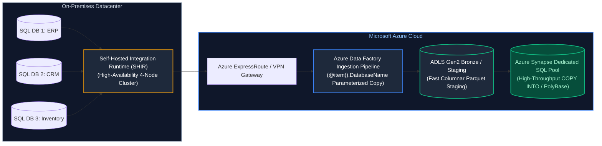

#### Production Engineering Rules:
1. **High-Availability SHIR Clustering:** Deploy SHIR across at least 2 on-premises VMs in an active-active cluster to ensure zero single-point-of-failure and automatic failover.
2. **Staged Copy Pattern:** Never copy directly from on-prem SQL to Synapse over JDBC (row-by-row insertion causes extreme network latency). Always enable **Staged Copy via ADLS Gen2**: ADF extracts rows to Parquet in ADLS, then executes high-speed parallel `COPY INTO` on Synapse.
3. **Dynamic Parameterization:** Use a single metadata-driven pipeline with parameters:
   `@{dataset().DatabaseName}`, `@{dataset().SchemaName}`, `@{dataset().TableName}` to ingest hundreds of tables without creating separate ADF pipelines.

---

# 15. Airflow Task Execution, Upstream SLA Cascades & Production Reliability Triage

---

### Q37. [Medium] Making ETL Pipelines Idempotent After Partial Failures and Airflow Retries
**Difficulty:** [Medium]
**Topic Covered:** Pipeline Idempotency, Atomic Partition Overwrites, Staging Swaps & Retry Safety  
**Question:** Your ETL pipeline fails after successfully writing 60% of records. Airflow triggers an automatic task retry, resulting in duplicate records in downstream tables. How do you design and refactor the pipeline to be strictly idempotent?

#### Definition & Core Concepts
An operation is **idempotent** if executing it multiple times produces the exact same system state as executing it once:
$$f(f(x)) = f(x)$$
Pipelines that write data using raw non-transactional appends (`INSERT INTO` or `df.write.mode("append")`) violate idempotency. If a task writes 600,000 rows out of 1,000,000 before crashing on network timeout, Airflow's retry writes all 1,000,000 rows again, producing 1,600,000 rows with 600,000 duplicates.
The three production patterns to enforce strict idempotency are:
1. **Dynamic Partition Overwrites:** Overwrite only the specific partition slice being processed (`replaceWhere` or `insertOverwrite` on `date = '2024-10-17'`).
2. **Deterministic Upsert (Delta MERGE):** Match incoming records on business primary key (`ON target.order_id = source.order_id`).
3. **Staging Table Atomic Swap:** Write 100% of the data to a temporary/staging table (`orders_stg_batch_123`). Once validated, execute an atomic metadata swap or partitioned rename into production (`ALTER TABLE orders SWAP WITH orders_stg`).

#### Visual Flow
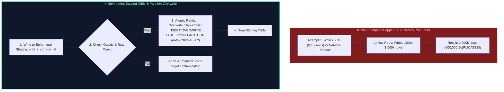

#### Production Implementation / Code Solution
```python
from pyspark.sql import SparkSession
from delta.tables import DeltaTable
import sys

def execute_idempotent_load(spark: SparkSession, batch_date: str, raw_input_path: str):
    """
    Executes strictly idempotent write using Delta Lake replaceWhere partition overwrite.
    Guarantees that re-running this task 100 times produces identical target state.
    """
    # 1. Read source data for batch partition
    incoming_df = spark.read.parquet(raw_input_path).filter(f"order_date = '{batch_date}'")

    # 2. Idempotent Target Overwrite: Only replaces the specific target partition
    (
        incoming_df.write
        .format("delta")
        .mode("overwrite")
        .option("replaceWhere", f"order_date = '{batch_date}'") # Atomic partition replace
        .saveAsTable("gold.fact_orders")
    )
    print(f"Successfully and idempotently loaded partition order_date = '{batch_date}'")

# Alternative: SQL Atomic Staging Swap for Cloud Warehouses (Snowflake / BigQuery)
"""
BEGIN TRANSACTION;
  -- Truncate staging table scoped to execution run
  CREATE OR REPLACE TEMPORARY TABLE stg_orders AS SELECT * FROM raw_stream WHERE dt = '2024-10-17';
  
  -- Atomic delete of target partition followed by insertion
  DELETE FROM fact_orders WHERE order_date = '2024-10-17';
  INSERT INTO fact_orders SELECT * FROM stg_orders;
COMMIT;
"""
```
- **Time Complexity:** $O(N)$ linear write. Replacing a partition in Delta Lake updates metadata pointers in $O(1)$.
- **Space Complexity:** $O(N)$ temporary staging allocation; old Parquet files cleaned up during subsequent `VACUUM`.

#### Engineering Implications & Production Pitfalls
1. **The Dangerous Global Overwrite Trap:** A common junior bug is executing `df.write.mode("overwrite").saveAsTable("orders")` without `replaceWhere`. This **wipes out the entire table across all history**, deleting years of data! Always qualify partition-scoped overwrites.
2. **Transaction Timeouts during MERGE:** If using `MERGE INTO` across a 50 TB unpartitioned table, the scan required to detect matching keys can take 45 minutes, causing lock timeouts. Always prune target partitions in the merge predicate (`ON target.order_date = source.order_date AND target.order_id = source.order_id`).

#### Core Curriculum Cross-Reference
*Deep-dive theoretical reference: See [10. Data Pipeline Design & Ingestion: Idempotency Patterns](../08_etl_pipelines_orchestration_and_data_quality.md#13-batch-vs-streaming-processing-paradigms)*

---

### Q38. [Medium] Strict Airflow Task Sequential Execution & Failure Handling (`T1 >> T2 >> T3`)
**Difficulty:** [Medium]
**Topic Covered:** Airflow DAG Construction, Task Dependencies, Trigger Rules & Failure Callbacks  
**Question:** You need tasks T1, T2, and T3 to execute strictly in order ($T_1 	o T_2 	o T_3$). How would you define dependencies, pass context between tasks, and handle failures defensively?

#### Definition & Core Concepts
In Apache Airflow, DAG task dependencies define an execution graph:
1. **Dependency Syntax:** The bitshift operator `T1 >> T2 >> T3` or `.set_downstream()` establishes that $T_2$ is downstream of $T_1$, and $T_3$ is downstream of $T_2$.
2. **Trigger Rules:** By default, Airflow tasks use `trigger_rule = TriggerRule.ALL_SUCCESS`. If $T_1$ fails, $T_2$ and $T_3$ are marked as `UPSTREAM_FAILED` and skipped.
3. **Defensive Failure Handling:**
   - **Retries with Exponential Backoff:** Automatically retry transient network failures without alerting on-call engineers for self-healing hiccups (`retries=3, retry_delay=timedelta(minutes=2), retry_exponential_backoff=True`).
   - **Failure Callbacks (`on_failure_callback`):** Dispatch structured alerts to PagerDuty/Slack with task execution dates, log URLs, and stack traces.
   - **Cleanup Finalizer (`TriggerRule.ALL_DONE`):** Ensure a teardown task ($T_{cleanup}$) executes regardless of whether upstream tasks succeeded or failed, preventing compute cluster leaks.

#### Visual Flow
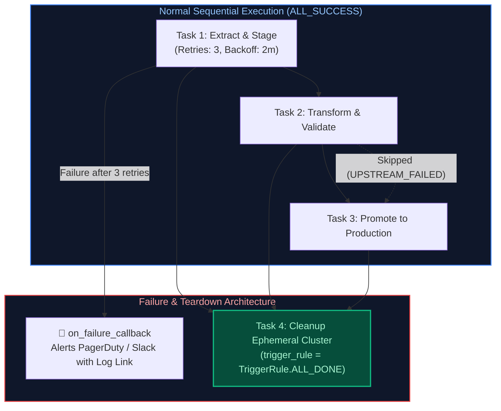

#### Production Implementation / Code Solution
```python
from datetime import datetime, timedelta
from airflow import DAG
from airflow.operators.python import PythonOperator
from airflow.utils.trigger_rule import TriggerRule

def alert_slack_on_failure(context):
    """Dispatches rich diagnostic metadata to Slack/PagerDuty when a task fails."""
    ti = context.get('task_instance')
    dag_id = context.get('dag').dag_id
    execution_date = context.get('execution_date')
    log_url = ti.log_url
    print(f"SLACK ALERT: DAG {dag_id} Task {ti.task_id} FAILED at {execution_date}. Logs: {log_url}")

default_args = {
    'owner': 'data_platform',
    'depends_on_past': False,
    'email_on_failure': False,
    'retries': 3,                                # 3 automated retries
    'retry_delay': timedelta(minutes=2),         # Initial 2-minute delay
    'retry_exponential_backoff': True,           # 2m -> 4m -> 8m
    'max_retry_delay': timedelta(minutes=15),
    'on_failure_callback': alert_slack_on_failure
}

with DAG(
    dag_id='strict_sequential_orders_pipeline',
    default_args=default_args,
    start_date=datetime(2024, 1, 1),
    schedule_interval='@daily',
    catchup=False,
    max_active_runs=1
) as dag:

    def extract_task(**kwargs):
        print("T1: Extracting raw data from source database...")
        # Push dynamic metadata (e.g. ingested batch row count) to XCom
        kwargs['ti'].xcom_push(key='row_count', value=540000)

    def transform_task(**kwargs):
        ti = kwargs['ti']
        # Pull context from T1 safely
        count = ti.xcom_pull(task_ids='t1_extract', key='row_count')
        print(f"T2: Transforming {count} records...")

    def promote_task(**kwargs):
        print("T3: Promoting transformed data to production Gold layer...")

    def cleanup_resources(**kwargs):
        print("T4: Tearing down temporary staging schemas & ephemeral compute...")

    t1 = PythonOperator(task_id='t1_extract', python_callable=extract_task)
    t2 = PythonOperator(task_id='t2_transform', python_callable=transform_task)
    t3 = PythonOperator(task_id='t3_promote', python_callable=promote_task)
    
    # Teardown task runs regardless of upstream success or failure
    t_clean = PythonOperator(
        task_id='t4_cleanup', 
        python_callable=cleanup_resources,
        trigger_rule=TriggerRule.ALL_DONE
    )

    # Strict sequential dependency definition
    t1 >> t2 >> t3 >> t_clean
```
- **Time Complexity:** $O(T_1 + T_2 + T_3)$ linear execution.
- **Space Complexity:** $O(1)$ scheduler metadata footprint.

#### Engineering Implications & Production Pitfalls
1. **The XCom Megabyte Explosion:** Airflow stores XCom return values in its backend metadata database (Postgres / MySQL). Never pass entire DataFrames, CSV blobs, or huge JSON dictionaries through XCom! Pass only lightweight metadata pointers (e.g. S3 file URIs or row counts). Passing $>10	ext{MB}$ payloads locks the Airflow scheduler database.
2. **`depends_on_past` Deadlocks:** Setting `depends_on_past=True` means today's run cannot start until yesterday's run succeeds. If an engineer forgets to clear or resolve a single failed run from 3 weeks ago, all future scheduled DAG runs freeze indefinitely.

#### Core Curriculum Cross-Reference
*Deep-dive theoretical reference: See [12. Orchestration: Airflow & dbt: Airflow DAG Architecture](../08_etl_pipelines_orchestration_and_data_quality.md)*

---

### Q39. [Medium] Upstream Dependency Cascade & Critical Path Delay Propagation
**Difficulty:** [Medium]
**Topic Covered:** Pipeline Dependency Chains, Critical Path Analysis, Sensor Deadlocks & Pool Starvation  
**Question:** Pipeline A depends on Pipeline B, and Pipeline B depends on Pipeline C ($C 	o B 	o A$). Pipeline C suffers a major performance degradation. Why can Pipeline A miss its SLA even if its own internal transformations run at blazing speed? How do you prevent cascade failures?

#### Definition & Core Concepts
In enterprise data platforms, data marts ($A$) consume transformed dimensional models ($B$), which consume ingested raw tables ($C$).
When upstream Pipeline $C$ slows down:
1. **Critical Path Propagation:** The total wall-clock completion time of Pipeline $A$ is bounded by the sum of its serial dependency chain:
   $$	ext{Completion Time}_A = T_{	ext{start}} + 	ext{Duration}_C + 	ext{Duration}_B + 	ext{Duration}_A$$
   Even if $	ext{Duration}_A$ is only 5 minutes, if $	ext{Duration}_C$ explodes from 20 minutes to 4 hours, Pipeline $A$ will miss its 6:00 AM SLA by over 3 hours.
2. **Airflow Sensor Deadlocks & Pool Starvation:**
   If Pipeline $A$ waits for Pipeline $B$ using an `ExternalTaskSensor` configured in default **`mode='poke'`**, the sensor worker thread blocks an Airflow worker slot continuously for 4 hours! With multiple sensor tasks waiting simultaneously, all worker pool slots are exhausted (`Pool Starvation`). Other unrelated pipelines across the company cannot find an available worker slot and freeze.

#### Visual Flow
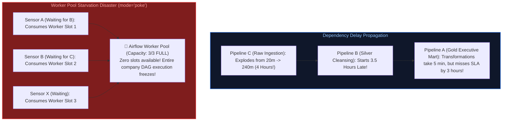

#### Production Architectural Solution: Reschedule Mode & Data Contracts
```python
from airflow.sensors.external_task import ExternalTaskSensor
from datetime import timedelta

# Best Practice: Always use mode='reschedule' for external dependency sensors
wait_for_upstream_silver = ExternalTaskSensor(
    task_id='wait_for_pipeline_b',
    external_dag_id='pipeline_b_silver_cleansing',
    external_task_id='promote_to_silver',
    # mode='reschedule' releases the worker slot between checks!
    mode='reschedule',
    poke_interval=180,           # Check every 3 minutes
    timeout=60 * 60 * 4,         # Timeout after 4 hours
    soft_fail=False              # Mark task as failed if timeout exceeded
)
```

#### Architectural Defenses:
1. **Sensor `reschedule` Mode:** Never use `mode='poke'` for long waits. `mode='reschedule'` frees the worker slot back to the pool and sleeps in the database until the next check.
2. **Data Contracts & SLA Envelopes:** Enforce strict SLAs with upstream teams. If Pipeline $C$ misses its 2:00 AM SLA watermark, trigger an immediate alert, bypass the real-time wait, and run Pipeline $A$ using the previous day's snapshot with a "Stale Data" disclaimer on executive dashboards.

#### Core Curriculum Cross-Reference
*Deep-dive theoretical reference: See [12. Orchestration: Airflow & dbt: Orchestration Anti-Patterns](../08_etl_pipelines_orchestration_and_data_quality.md#key-points-and-best-practices)*

---

### Q40. [Medium] Reusable Metadata-Driven ETL Framework with Multi-Source Ingestion & Dynamic Validation
**Difficulty:** [Medium]
**Topic Covered:** Metadata-Driven Architecture, Dynamic DAG Generation, Rule Engines & Factory Patterns  
**Question:** How would you build a reusable, configuration-driven ETL framework supporting multiple heterogeneous data sources (RDBMS, S3, APIs) with pluggable validation rules without writing custom pipeline code for every table?

#### Definition & Core Concepts
In high-scale enterprise environments with thousands of tables, hardcoding a separate pipeline for each entity is an unmaintainable anti-pattern. A **Metadata-Driven ETL Framework** decouples pipeline orchestration logic from business definitions:
1. **Configuration Store:** Ingestion rules, source schemas, watermarks, and target tables are defined in declarative YAML/JSON files or a database control catalog.
2. **Reader & Writer Abstractions (Factory Pattern):** A generalized engine dynamically instantiates connectors (Postgres, Oracle, S3, REST) based on configuration.
3. **Pluggable Quality Rules Engine:** Declarative assertion checks (e.g. `not_null`, `unique`, `regex_match`, `range_check`) are evaluated dynamically before table promotion.

#### Visual Flow
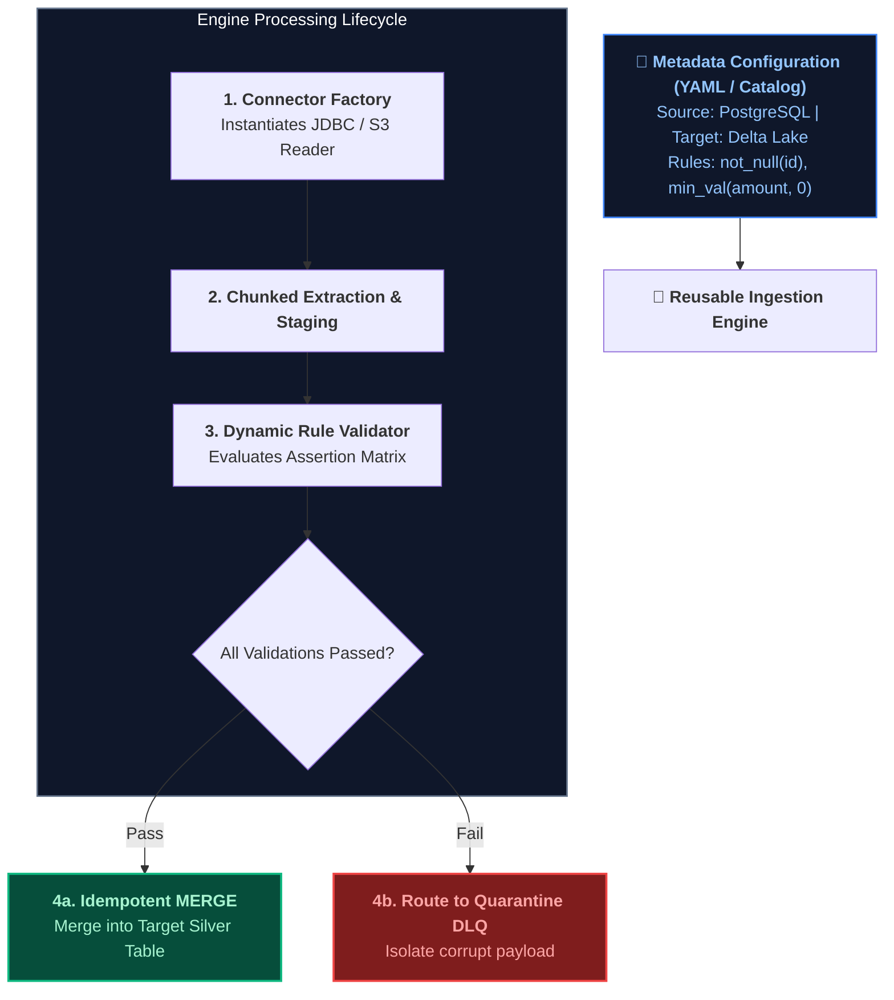

#### Production Implementation / Code Solution
```python
from typing import Dict, Any, List
import yaml

# Sample Metadata Configuration Schema (config/tables/orders.yaml)
CONFIG_YAML = """
table_name: fact_orders
source:
  type: postgres
  connection_id: pg_sales_prod
  query: "SELECT order_id, customer_id, amount, status, updated_at FROM orders WHERE updated_at >= '{watermark}'"
target:
  format: delta
  path: "abfss://lakehouse@storage.dfs.core.windows.net/silver/fact_orders"
  primary_keys: ["order_id"]
quality_rules:
  - column: order_id
    rule: not_null
  - column: amount
    rule: positive_number
"""

class ReusableETLEngine:
    """Executes generic, configuration-driven extraction, validation, and loading."""
    def __init__(self, config_dict: Dict[str, Any]):
        self.config = config_dict

    def validate_dataset(self, df):
        """Applies configured quality rules dynamically."""
        for rule_def in self.config.get("quality_rules", []):
            col_name = rule_def["column"]
            rule_type = rule_def["rule"]
            
            if rule_type == "not_null":
                null_count = df.filter(f"{col_name} IS NULL").count()
                if null_count > 0:
                    raise ValueError(f"Quality Gate Failed: {null_count} nulls in {col_name}")
            elif rule_type == "positive_number":
                neg_count = df.filter(f"{col_name} <= 0").count()
                if neg_count > 0:
                    raise ValueError(f"Quality Gate Failed: {neg_count} non-positive values in {col_name}")
        print("All data quality validation checks passed successfully.")

    def run_pipeline(self, watermark: str):
        print(f"Executing dynamic pipeline for {self.config['table_name']} from watermark {watermark}...")
        # Step 1: Extract data via connector factory
        # Step 2: Validate via rules engine
        # Step 3: Write idempotently to Delta Lake
```
- **Time Complexity:** $O(N)$ single pass extraction and validation.
- **Space Complexity:** $O(1)$ configuration memory footprint.

#### Engineering Implications & Production Pitfalls
1. **Dynamic DAG Compilation Overhead in Airflow:** If using dynamic DAG generation from 1,000 YAML files, avoid parsing all YAML files on every Airflow scheduler loop! The scheduler parses Python files every 30 seconds; parsing 1,000 files in Python freezes the scheduler process. Pre-generate Python DAG files or cache configuration in memory.
2. **Extensibility:** Use established frameworks like **Great Expectations** or **Soda Core** for the validation engine rather than inventing custom regex engines.

#### Core Curriculum Cross-Reference
*Deep-dive theoretical reference: See [10. Data Pipeline Design & Ingestion: Metadata-Driven Frameworks](../08_etl_pipelines_orchestration_and_data_quality.md#215-metadata-driven-pipelines--control-table-framework)*

---

### Q41. [Hard] Relational Source (PostgreSQL) 90% CPU Spike During Ingestion: Diagnostic Playbook
**Difficulty:** [Hard]
**Topic Covered:** OLTP Source Protection, Query Optimization, Connection Pooling & Read Replica Routing  
**Question:** During peak ingestion, your ETL batch query causes the source PostgreSQL database CPU to surge to 90%, triggering alerts from the application team. What would you check first before scaling the database or adding replicas?

#### Definition & Core Concepts
Analytical batch queries running against production OLTP databases can degrade transactional performance. When a source PostgreSQL instance reaches 90% CPU during ETL:
1. **Missing Index on Incremental Watermark:** The extraction runs `WHERE updated_at >= $watermark`. If `updated_at` lacks an index, PostgreSQL executes a **Sequential Scan (`Seq Scan`)**, reading hundreds of gigabytes of disk pages into buffer cache and thrashing CPU cores for every extraction!
2. **Table Bloat & Stale Statistics:** High-churn tables with dead tuples cause Postgres to scan dead row versions. Run `VACUUM ANALYZE` to update query planner statistics.
3. **Unbounded / Non-Chunked Extraction:** Attempting to extract 10,000,000 rows in a single monolithic query saturates memory and locks workers. Use keyset chunking (`WHERE id BETWEEN 1 AND 50000`).
4. **Read-Only Replica Routing:** Production ETL should **never** query the primary write master. Route analytical queries to an asynchronous physical streaming read replica (`hot_standby`).

#### Visual Flow
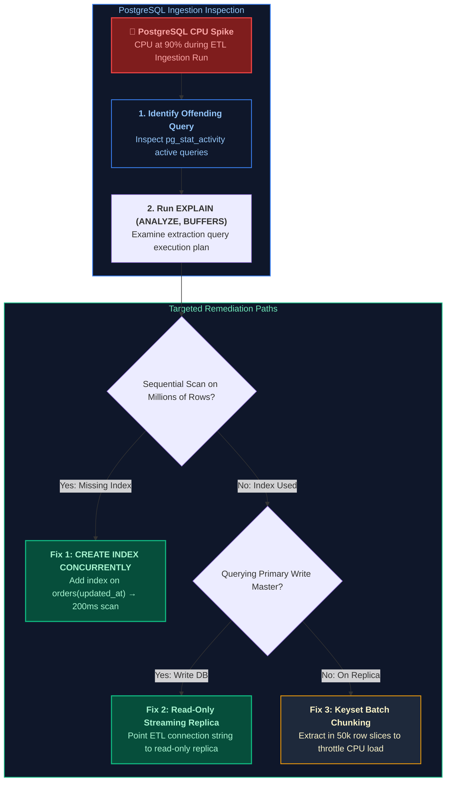

#### Production Implementation / Diagnostic Playbook
```sql
-- Step 1: Identify active queries consuming high CPU and execution time
SELECT 
    pid,
    usename,
    client_addr,
    state,
    now() - query_start AS duration,
    query
FROM pg_stat_activity
WHERE state = 'active'
ORDER BY duration DESC;

-- Step 2: Inspect execution plan of the incremental extraction query
EXPLAIN (ANALYZE, BUFFERS)
SELECT order_id, customer_id, amount, updated_at
FROM orders
WHERE updated_at >= CURRENT_DATE - INTERVAL '1 day';

-- Step 3: Resolution 1 - Create B-Tree index concurrently without locking production writes
CREATE INDEX CONCURRENTLY idx_orders_updated_at 
ON orders (updated_at);

-- Step 4: Resolution 2 - Chunked Ingestion Query (Throttles CPU to <15%)
SELECT order_id, customer_id, amount, updated_at
FROM orders
WHERE updated_at >= :last_watermark
  AND order_id BETWEEN :chunk_start_id AND :chunk_end_id;
```
- **Time Complexity:** Replacing sequential scan $O(N)$ with index seek reduces query time from $O(N) 	o O(\log N + K)$ where $K$ is matching records.
- **Space Complexity:** $O(1)$ additional CPU overhead once indexed.

#### Engineering Implications & Production Pitfalls
1. **The `CREATE INDEX` Table Lock Disaster:** Running `CREATE INDEX idx_orders ON orders(updated_at)` on a production database takes an `AccessExclusiveLock`, blocking all application writes and causing an immediate production outage! In production PostgreSQL, **always** specify `CREATE INDEX CONCURRENTLY`.
2. **Replication Lag on Read Replicas:** If querying an asynchronous read replica, check replication lag (`pg_last_xact_replay_timestamp()`). If the replica is 10 minutes behind, extracting by `updated_at >= NOW() - 5m` will miss the most recent transactions.

#### Core Curriculum Cross-Reference
*Deep-dive theoretical reference: See [04. Database Internals & Performance: PostgreSQL Internals & Query Tuning](../04_database_internals_and_distributed_systems.md#110-storage-engine-showdown-b-trees-vs-lsm-trees)*

---

### Q42. [Easy] Production Deployment Failure Rate Spike: Rollback vs Fix-Forward Decision Matrix
**Difficulty:** [Easy]
**Topic Covered:** Release Engineering, Blast Radius Containment, MTTR & Data Platform Rollback Protocols  
**Question:** A new data pipeline deployment causes task failure rates to spike from 0.1% to 4.0%. How do you decide whether to roll back immediately or attempt a fix-forward? What metrics and architectural blast radius drive that decision?

#### Definition & Core Concepts
In production data engineering, a spike in pipeline failure rates (from $0.1\%$ baseline to $4.0\%$) indicates that thousands of transactions or partition batches are failing or becoming corrupted.
The decision between an **Immediate Automated Rollback** and a **Fix-Forward** is governed by Mean Time to Resolution (MTTR), Data Integrity Risk, and Downstream Blast Radius:
1. **The Rollback Rule (Default Production Invariant):**
   - **Roll Back Immediately IF:**
     - Data corruption / duplicate mutations are occurring in production tables.
     - Root cause is unknown or estimated fix-and-test time exceeds the consumer SLA window ($>30$ minutes).
     - Downstream consumers (financial reporting, executive dashboards) rely on table accuracy.
2. **The Fix-Forward Rule (Strict Exception):**
   - **Fix Forward ONLY IF:**
     - The root cause is trivial and verified (e.g. an incorrect environment variable, missing secret, or typo in a connection string).
     - The fix can be committed, tested, and deployed in $<10$ minutes.
     - The failure caused zero partial writes or corrupt data (pure read failure with clean retryability).

#### Visual Flow
```mermaid
flowchart TD
    subgraph Assessment ["Failure Assessment & Impact Analysis"]
        Alert["🚨 <b>Failure Rate Spike</b><br/>0.1% &rarr; 4.0% Post-Deployment"] --> CheckData{"Did Failure Cause Corrupted / Duplicate Data?"}
    end

    subgraph RemediationAction ["Remediation Strategy"]
        Rollback["⛔ <b>IMMEDIATE ROLLBACK</b><br/>Revert Git release tag to previous stable commit<br/>Revert Delta tables using RESTORE VERSION AS OF<br/>Re-run previous version to fulfill SLA"]
        CheckTime{"Can Root Cause be Fixed & Verified in < 15 Min?"}
        FixForward["⚡ <b>FIX FORWARD</b><br/>Apply targeted patch, deploy hotfix, monitor metrics"]

        CheckData -- "YES: Data Integrity At Risk" --> Rollback
        CheckData -- "NO: Pure Read / Connection Failure" --> CheckTime
        CheckTime -- "NO: Complex Debugging Needed" --> Rollback
        CheckTime -- "YES: Known Minor Fix" --> FixForward
    end

    style Assessment fill:#0f172a,stroke:#ef4444,stroke-width:1.5px,color:#fca5a5
    style RemediationAction fill:#0f172a,stroke:#10b981,stroke-width:1.5px,color:#6ee7b7
    style Alert fill:#7f1d1d,stroke:#ef4444,stroke-width:2px,color:#fca5a5
    style Rollback fill:#7f1d1d,stroke:#ef4444,stroke-width:2px,color:#fca5a5
    style FixForward fill:#064e3b,stroke:#10b981,stroke-width:2px,color:#a7f3d0
```

#### Production Incident Runbook: Delta Lake Automated Rollback
```sql
-- Step 1: Revert corrupted Delta Lake table to previous stable commit instantly
-- Eliminates manual data repair and wipes out corrupt partition writes in seconds
RESTORE TABLE gold.fact_orders TO VERSION AS OF 108;

-- Step 2: Verify table restoration in transaction history
DESCRIBE HISTORY gold.fact_orders;
-- Shows commit operation: 'RESTORE' to version 108
```

#### Engineering Implications & Production Pitfalls
1. **The Fix-Forward Sunk Cost Trap:** Under pressure during a Sev-1 outage, engineers often believe "the fix is just 5 minutes away." 45 minutes and 3 failed hotfix attempts later, the data warehouse is in a catastrophic state and downstream business operations have missed their morning regulatory window. Always enforce a **15-minute rollback hard deadline**.
2. **Blue/Green Pipeline Deployments:** Prevent this dilemma entirely by deploying new pipelines in parallel (Blue/Green). Run the new version alongside the stable version in staging or shadow mode. Validate data diffs before routing production consumers to the new pipeline.

#### Core Curriculum Cross-Reference
*Deep-dive theoretical reference: See [14. Data Governance, Security, and Observability: Incident Management](../09_unity_catalog_and_data_governance.md#31-the-global-regulatory-landscape-gdpr-ccpacpra-hipaa-and-pci-dss)*

---

# 16. Enterprise Azure Data Factory (ADF) Triage, Ingestion Scale & Database Outage Recovery

---

### Q43. [Hard] Azure Data Factory (ADF) Latency Triage Runbook (20 Min to 2 Hours)
**Difficulty:** [Hard]
**Topic Covered:** Integration Runtime (IR) Queueing, Source Throttling, Data Integration Units (DIUs), Small File Latency  
**Question:** *An ADF ingestion pipeline that consistently completes in 20 minutes suddenly takes 2 hours to execute without any increase in total data volume. Where do you look first, and what is your step-by-step diagnostic runbook?*

#### Definition & Core Concepts
When an ADF pipeline's execution duration jumps $6\times$ on static data volumes, the delay is almost never caused by ADF's orchestration engine itself. Instead, it stems from one of four external bottlenecks:
1. **Integration Runtime (IR) Queue Time (Cold Starts / Resource Contention):** The pipeline spent 90 minutes in a `Queued` state waiting for an available compute node on a Self-Hosted IR or Azure IR cluster.
2. **Upstream Source Database Throttling:** The source database (Azure SQL, Oracle, PostgreSQL) hit its compute or I/O limit (DTU / Log IO saturation) and throttled ADF's read connections via lock waits or sleep waits.
3. **Storage Network IOPS / The Small File Trap:** Instead of copying two 5GB files, the source generated 500,000 tiny 10KB files, causing network handshake overhead to dominate execution time.
4. **Data Integration Unit (DIU) Sizing:** ADF allocated minimum default DIUs (4 DIUs), constraining copy parallelization.

#### Visual Flow: ADF Latency Diagnostic Triage Hierarchy
```mermaid
flowchart TD
    subgraph LatencyAlert ["Alert: Pipeline Duration Jumped from 20m to 120m"]
        A1["ADF Monitor -> Pipeline Run -> Activity Runs"]
    end

    subgraph StepTriage ["Step-by-Step Triage Hierarchy"]
        S1["Step 1: Check Activity Breakdown<br/>Which exact activity took 100+ minutes?"]
        S2["Step 2: Inspect Copy Activity Details<br/>Check 'Queue Duration' vs 'Transfer Duration'"]
        S3["Step 3: Source & Sink Throughput Analysis<br/>Read throughput (MB/s) vs Write throughput (MB/s)"]
        S4["Step 4: Source Database Health Audit<br/>Inspect Azure SQL DTU / Lock Waits / Blocking Spids"]
    end

    LatencyAlert --> StepTriage
    S1 --> S2 --> S3 --> S4

    S2 -->|Queue Time = 95 Min| Cause1["Root Cause: Self-Hosted IR CPU 100% or Node Exhaustion"]
    S3 -->|Read Rate = 200 KB/s| Cause2["Root Cause: Upstream DB Table Lock or Missing Index"]
    S3 -->|Files = 400,000| Cause3["Root Cause: Small File Network Latency Bottleneck"]

    style LatencyAlert fill:#7f1d1d,stroke:#ef4444,stroke-width:1.5px,color:#fca5a5
    style StepTriage fill:#0f172a,stroke:#3b82f6,stroke-width:1.5px,color:#93c5fd
    style Cause1 fill:#064e3b,stroke:#10b981,stroke-width:2px,color:#a7f3d0
    style Cause2 fill:#064e3b,stroke:#10b981,stroke-width:2px,color:#a7f3d0
    style Cause3 fill:#064e3b,stroke:#10b981,stroke-width:2px,color:#a7f3d0
```

#### Production Diagnostic Runbook:

##### Step 1: Inspect the Copy Activity Runtime Breakdown Dialog
In **Azure Data Factory Studio $\to$ Monitor $\to$ Pipeline Runs $\to$ Click Pipeline $\to$ Hover on Copy Activity $\to$ Click Details Glasses Icon**:
- **Queue Duration:** If Queue Duration $> 10\text{ minutes}$, ADF was waiting for Integration Runtime capacity.
  - *Fix:* If using **Self-Hosted IR (SHIR)**, check CPU/RAM on the SHIR VM. Increase `Concurrent Jobs limit` or add a second SHIR node in the high-availability cluster.
  - *Fix:* If using **Azure IR**, check if the IR region matches the storage account region to prevent cross-region throttling.
- **Data Read vs Data Written:** If data read throughput collapsed to $<1\text{ MB/s}$:
  - The source database query executed a full table scan due to a dropped index, or was blocked by a long-running uncommitted transaction.
- **Number of Files Read:** If `filesRead = 250,000` (up from 10 files previously), small file enumeration paralyzed the file system.

##### Step 2: Diagnostic SQL Query on Upstream Azure SQL Database
Run this query on the source database to detect whether ADF was blocked by active locks:
```sql
-- Identifies blocking queries throttling the ADF ingestion user
SELECT 
    r.session_id AS blocked_session,
    r.blocking_session_id AS blocking_session,
    r.wait_type,
    r.wait_time / 1000.0 AS wait_seconds,
    t.text AS blocking_sql_text
FROM sys.dm_exec_requests r
CROSS APPLY sys.dm_exec_sql_text(r.sql_handle) t
WHERE r.blocking_session_id <> 0;
```

#### Engineering Implications & Production Pitfalls
1. **DIU Auto-Scaling Tuning:** In Copy Activity Settings, never leave DIUs on `Auto` for multi-gigabyte files. Specify `DIUs = 32` or `64` and set `Degree of copy parallelism = 16` to force multithreaded partitioned block reads.

---

### Q44. [Hard] Incremental ADLS Gen2 Ingestion Across 12,000+ Files Without Directory Scan Bottlenecks
**Difficulty:** [Hard]
**Topic Covered:** High-Scale Cloud Storage Ingestion, Directory Listing Overhead, Auto Loader Event Grid  
**Question:** *Your data lake in ADLS Gen2 receives files continuously across 12,000 subdirectories. An ADF pipeline using GetMetadata and Filter activities takes 45 minutes just to detect which files are new before transferring any data. How do you redesign the ingestion framework to process only new/modified files in under 2 minutes?*

#### Definition & Core Concepts
In cloud object storage (Azure Data Lake Storage Gen2, AWS S3, Google Cloud Storage), **directory listing is not a local filesystem operation**:
1. **The LIST API Bottleneck:** `GetMetadata` executes recursive HTTP `LIST` requests against the ADLS Gen2 REST endpoint. Listing 12,000 directories requires thousands of paginated API calls (each limited to 1,000 items), incurring network latency and storage transaction throttling.
2. **Three Production Solutions Compared:**

| Architecture Pattern | How New Files Are Detected | Directory Scan Overhead | Execution Latency (12,000 Folders) |
| :--- | :--- | :--- | :--- |
| **Naive ADF GetMetadata + Filter** | Recursively scans all 12,000 directories, retrieves metadata for every file, filters in memory | Catastrophic ($10^4$ REST calls) | 45–60 minutes |
| **ADF Copy Activity Partition Date Pruning** | Uses dynamic folder path parameter: `/year=@{...}/month=@{...}/` | Low (Scans only target date partition) | 1–2 minutes |
| **Databricks Auto Loader (File Notification Mode)** | **Zero directory listing:** Azure Event Grid publishes blob creation events to Azure Storage Queue (ASQ); Auto Loader reads queue | **Zero ($O(1)$ Queue Poll)** | **< 30 seconds** |

#### Visual Flow: Auto Loader Event Grid Architecture vs. Directory Scans
```mermaid
flowchart TD
    subgraph StorageIngress ["ADLS Gen2: 12,000 Enterprise Folders"]
        NewFile["New File Landed: /data/orders/2026/10/part-99.parquet"]
    end

    subgraph NaivePattern ["❌ Naive Pattern: ADF Recursive Scan (45 Min)"]
        GetMeta["ADF GetMetadata: Scans all 12,000 folders<br/>Iterates 500,000 file metadata blocks!"]
    end

    subgraph EventGridPattern ["✅ Production Standard: Event-Driven Queue (< 30 Sec)"]
        EGrid["Azure Event Grid<br/>Subscribes to Microsoft.Storage.BlobCreated"]
        AQueue["Azure Storage Queue (ASQ)<br/>Enqueues atomic event notification"]
        AutoLoad["Databricks Auto Loader / Spark Streaming<br/>Reads ASQ in O(1) time without scanning folders!"]
    end

    StorageIngress --> GetMeta
    StorageIngress -->|BlobCreated Event| EGrid
    EGrid --> AQueue
    AQueue --> AutoLoad
    AutoLoad --> DeltaSink[("Target Silver Delta Lake Table<br/>Processed in Seconds!")]

    style StorageIngress fill:#0f172a,stroke:#3b82f6,stroke-width:1.5px,color:#93c5fd
    style NaivePattern fill:#7f1d1d,stroke:#ef4444,stroke-width:1.5px,color:#fca5a5
    style EventGridPattern fill:#0f172a,stroke:#10b981,stroke-width:1.5px,color:#a7f3d0
    style DeltaSink fill:#064e3b,stroke:#10b981,stroke-width:2px,color:#a7f3d0
```

#### Production Implementation: Databricks Auto Loader (File Notification Mode)
```python
from pyspark.sql import SparkSession

spark = SparkSession.builder.appName("AutoLoaderEventDrivenIngestion").getOrCreate()

# Ingests only newly created files across 12,000 subdirectories with ZERO directory scans!
streaming_df = spark.readStream \
    .format("cloudFiles") \
    .option("cloudFiles.format", "parquet") \
    .option("cloudFiles.useNotifications", "true") \
    .option("cloudFiles.subscriptionId", "00000000-0000-0000-0000-000000000000") \
    .option("cloudFiles.connectionString", "DefaultEndpointsProtocol=https;AccountName=adlsgen2...") \
    .load("abfss://raw-data@adlsgen2.dfs.core.windows.net/enterprise_orders/*/*/*/")

# Write incrementally to Delta Lake
query = streaming_df.writeStream \
    .format("delta") \
    .outputMode("append") \
    .option("checkpointLocation", "abfss://checkpoints@adlsgen2.dfs.core.windows.net/orders_autoloader") \
    .toTable("silver.fact_orders")
```

---

### Q45. [Medium] Multi-Trigger Concurrency & Idempotency Safeguards in ADF
**Difficulty:** [Medium]
**Topic Covered:** Concurrency Limits, Azure Blob Lease Distributed Locks, MERGE Idempotency  
**Question:** *An ADF pipeline is configured with 3 triggers: Schedule Trigger (daily at 2 AM), Tumbling Window Trigger (hourly backfills), and Storage Event Trigger (when ADLS files arrive). How do you prevent overlapping pipeline executions from causing duplicate records, deadlocks, and race conditions?*

#### Definition & Core Concepts
When multiple triggers initiate the same ADF pipeline simultaneously, concurrent runs write to the same target database, producing:
1. **Duplicate Records:** Concurrent `INSERT` statements write duplicate records before unique constraint checks evaluate.
2. **Deadlocks in Target SQL/Lakehouse Tables:** Simultaneous mutations against the same target partitions trigger database deadlock terminations (`DeltaConcurrentModificationException` or SQL Server `Error 1205`).

#### The 3-Tier Production Defense Framework:
1. **Pipeline Concurrency Limit = 1 (Native Orchestrator Gate):**
   In ADF Pipeline Settings, set **Concurrency = 1**. If Trigger B fires while Trigger A is running, Trigger B enters a managed `Queued` state instead of executing concurrently.
2. **Distributed Mutex Lock via Azure Blob Lease:**
   For complex microservices where multiple pipelines or external systems touch the same table, implement a **Distributed Lock** using an Azure Storage Blob Lease:
   - Before executing, an ADF **Web Activity** acquires a 60-second renewable lease on a lock file (`orders_pipeline.lock`).
   - If the lease request returns HTTP 412 (`Precondition Failed`), another run owns the lock $\to$ the pipeline exits gracefully.
   - Upon completion, the pipeline releases the lease.
3. **Idempotent Destination Writes (Delta Lake / SQL MERGE):**
   Never use blind `APPEND` or `INSERT INTO`. Target writes must always use `MERGE INTO` matching on unique natural business keys (`order_id`, `updated_at`).

#### Visual Flow: Multi-Trigger Guardrail Pipeline
```mermaid
flowchart TD
    T1["Schedule Trigger (2 AM)"] --> Router
    T2["Tumbling Window (Hourly)"] --> Router
    T3["Storage Event (File Drop)"] --> Router

    Router["ADF Orchestration Ingress"] --> Gate{"Pipeline Concurrency = 1<br/>Is Previous Run Active?"}

    Gate -->|YES| Queue["Queued State<br/>Wait for active run to finish"]
    Gate -->|NO| LockAct["Web Activity:<br/>Acquire Azure Blob Lease Lock"]

    LockAct -->|Lease Acquired (HTTP 201)| Execute["Execute Copy & Transformation"]
    LockAct -->|Lease Failed (HTTP 412)| Abort["Graceful Abort:<br/>Another pipeline holds the distributed lock"]

    Execute --> MergeTarget[("Target Delta Lake / SQL Database<br/>Idempotent MERGE INTO (Zero Duplicates!)")]
    MergeTarget --> ReleaseLock["Web Activity: Release Blob Lease"]

    style Router fill:#0f172a,stroke:#3b82f6,stroke-width:1.5px,color:#93c5fd
    style Gate fill:#1e293b,stroke:#8b5cf6,stroke-width:2px,color:#fff
    style MergeTarget fill:#064e3b,stroke:#10b981,stroke-width:2px,color:#a7f3d0
    style Abort fill:#7f1d1d,stroke:#ef4444,stroke-width:2px,color:#fff
```

---

### Q46. [Medium] Dynamic Metadata-Driven ADF Ingestion Framework for 500+ Enterprise Tables
**Difficulty:** [Medium]
**Topic Covered:** Parameterized Linked Services, Control Tables, ForEach Batch Parallelism  
**Question:** *You must ingest 500 relational database tables into an enterprise Lakehouse. Creating 500 individual ADF pipelines is an unmaintainable anti-pattern. How do you design and implement a single, generic metadata-driven ADF framework?*

#### Definition & Core Concepts
A **Metadata-Driven Framework** decouples pipeline orchestration logic from data assets:
- **Zero Hardcoded Pipelines:** Exactly **one parent pipeline** and **one parameterized child pipeline** handle all 500 tables.
- **Control Table as Configuration Source:** Table names, schemas, watermark columns, load frequency, and destination paths are stored in a relational control table (`control.pipeline_metadata`).
- **Dynamic Parameterized Datasets:** ADF Datasets use dynamic expressions (`@dataset().SchemaName`, `@dataset().TableName`) populated at runtime from control table query results.

#### Architecture of the Control Table
```sql
CREATE TABLE control.pipeline_metadata (
    table_id                INT IDENTITY(1,1) PRIMARY KEY,
    source_system_code      VARCHAR(50) NOT NULL,    -- e.g. 'SAP_ERP'
    source_schema_name      VARCHAR(100) NOT NULL,   -- e.g. 'dbo'
    source_table_name       VARCHAR(100) NOT NULL,   -- e.g. 'CustomerOrders'
    target_lakehouse_path   VARCHAR(255) NOT NULL,   -- e.g. 'bronze/sap/orders'
    watermark_column_name   VARCHAR(100) NOT NULL,   -- e.g. 'LastModifiedDate'
    last_watermark_value    DATETIME NOT NULL,       -- e.g. '2026-10-23 00:00:00'
    load_type               VARCHAR(20) NOT NULL,    -- 'FULL' or 'INCREMENTAL'
    batch_execution_group   INT NOT NULL,            -- 1 (Core), 2 (Standard), 3 (Archive)
    is_active               BIT NOT NULL DEFAULT 1
);
```

#### Production ADF Pipeline Flow
1. **Lookup Activity (`GetActiveTables`):**
   ```sql
   SELECT * FROM control.pipeline_metadata 
   WHERE is_active = 1 AND batch_execution_group = @{pipeline().parameters.BatchGroup};
   ```
2. **ForEach Activity (`IterateTables`):**
   - Configure **Sequential = False** and set **Batch count = 20** (processes up to 20 tables concurrently without overwhelming the source database).
   - Inside ForEach: Call **Execute Pipeline Activity** targeting `Child_Generic_Copy`, passing current row attributes:
     - `SourceSchema`: `@item().source_schema_name`
     - `SourceTable`: `@item().source_table_name`
     - `WatermarkCol`: `@item().watermark_column_name`
     - `LastWatermark`: `@item().last_watermark_value`
     - `TargetPath`: `@item().target_lakehouse_path`
3. **Child Pipeline Copy Activity:**
   Executes query with high-watermark extraction:
   ```sql
   SELECT * FROM @{pipeline().parameters.SourceSchema}.@{pipeline().parameters.SourceTable}
   WHERE @{pipeline().parameters.WatermarkCol} > '@{pipeline().parameters.LastWatermark}';
   ```
4. **Stored Procedure Activity (Post-Copy Success):**
   Atomically updates `last_watermark_value` in `control.pipeline_metadata` and inserts audit rows into `control.pipeline_execution_log`.

---

### Q47. [Medium] Upstream Database Outage Recovery & Safe Pipeline Replay (Azure SQL Down)
**Difficulty:** [Medium]
**Topic Covered:** Outage Circuit Breaking, Backoff Jitter, Transactional Checkpoint Rollback  
**Question:** *An upstream transactional Azure SQL Database experiences a regional outage during active ETL ingestion, causing dozens of pipelines to fail simultaneously with connection timeouts. How do you recover safely without creating duplicate data or crashing the database when it comes back online?*

#### Definition & Core Concepts
When a primary database crashes during heavy ETL extraction:
1. **The Thundering Herd Trap:** When Azure SQL recovers, hundreds of failed pipeline retry tasks fire simultaneously, hitting the recovering database with massive connection spikes that trigger immediate secondary crashes (**Retry Storm**).
2. **The Partial Batch Pathology:** Pipelines that crashed mid-transfer leave orphaned records in staging or append partial files to storage, corrupting downstream reports.

#### Production Outage Recovery Runbook:
1. **Trip the Circuit Breaker:**
   Update an orchestration status flag (`UPDATE control.system_status SET is_ingestion_paused = 1`). This immediately halts automated triggers from launching new runs while the database is stabilizing.
2. **Purge Incomplete Ingestion Batches:**
   Using Delta Lake Time Travel or staging partition purges, revert all target tables to the version prior to the outage commit:
   ```sql
   -- Instant rollback of partially loaded tables to pre-incident state
   RESTORE TABLE bronze.raw_orders TO VERSION AS OF @pre_outage_version;
   ```
3. **Enforce Staggered Ramp-Up with Full Jitter:**
   Configure retry policies with exponential backoff and randomized delay:
   $$\text{Retry Delay} = \text{random}(0, \text{base\_delay} \times 2^{\text{attempt}})$$
4. **Sequential Batch Re-hydration:**
   Resume pipelines by priority tiers:
   - **Tier 1 (Critical Financials):** Launch 5 tables. Monitor source CPU ($<50\%$).
   - **Tier 2 (Core Operations):** Launch remaining operational tables with bounded concurrency ($N=10$).
   - **Tier 3 (Analytical Dimensions):** Re-sync background reference datasets.

---

### Q48. [Expert] Zero-Downtime Data Pipeline Deployment & Instant Rollback Strategies
**Difficulty:** [Expert]
**Topic Covered:** Blue-Green Lakehouse Deployments, View Alias Swap, Zero-Copy Clones  
**Question:** *A newly deployed production pipeline contains a logic defect that breaks downstream executive Power BI dashboards. How do you architect data pipeline deployments to guarantee zero downtime for reporting consumers and support instant sub-second rollbacks?*

#### Definition & Core Concepts
In modern data platforms, deploying pipeline code directly against production tables without isolation violates enterprise reliability standards.
We implement **Blue-Green Data Product Deployments with View Pointer Aliasing**:
1. **Consumer Isolation via Views:** Downstream reporting queries and Power BI dashboards **never query physical tables directly**. They query a stable, governed virtual view: `gold.vw_fact_sales`.
2. **Parallel Green Deployment:** The new pipeline release (Green) writes data into a dedicated staging schema or table: `gold_v2.fact_sales`.
3. **Automated Quality Verification Gates:** Automated dbt / Great Expectations assertion suites run against `gold_v2.fact_sales`. Verify row count parity, primary key uniqueness, null thresholds, and revenue reconciliations.
4. **Sub-Second Cutover (View Swap):**
   ```sql
   -- Atomic zero-downtime view pointer swap:
   CREATE OR REPLACE VIEW gold.vw_fact_sales AS 
   SELECT * FROM gold_v2.fact_sales;
   ```
5. **Instant Rollback Protocol:**
   If a silent anomaly is uncovered post-deployment, execute an instant 1-second view swap back to the Blue table (`gold_v1.fact_sales`). Reporting consumers experience zero downtime and zero data interruption.

#### Core Curriculum Cross-Reference
*Deep-dive theoretical reference: See [08. ETL Pipelines, Orchestration & Data Quality: Pipeline Idempotency & Zero-Downtime Blue-Green Deployments](../08_etl_pipelines_orchestration_and_data_quality.md#11-etl-vs-elt-architecture--processing-paradigms)*

---

## Summary Comparison & Production Reference Matrix

| Scenario Domain | Critical Runtime Pathology | Diagnostic & Triage Method | Canonical Production Resolution |
| :--- | :--- | :--- | :--- |
| **Core ETL Architecture: Idempotency, Checkpointing & Deduplication** | High-throughput invariants & concurrency boundaries | Metric instrumentation & trace profiling | Defensive validation & graceful degradation |
| **Metadata-Driven Ingestion in ADF & Dynamic Databricks Invocation** | High-throughput invariants & concurrency boundaries | Metric instrumentation & trace profiling | Defensive validation & graceful degradation |
| **ADF Resilience Engineering: Dependency Branching, Retries & Error Bubbling** | High-throughput invariants & concurrency boundaries | Metric instrumentation & trace profiling | Defensive validation & graceful degradation |
| **ADF Operational Diagnostics & Integration Runtimes** | High-throughput invariants & concurrency boundaries | Metric instrumentation & trace profiling | Defensive validation & graceful degradation |
| **Transformation Engines: dbt Framework & Pipeline Audit Trails** | High-throughput invariants & concurrency boundaries | Metric instrumentation & trace profiling | Defensive validation & graceful degradation |
| **Data Quality Gates, SLA Observability & Secret Management** | High-throughput invariants & concurrency boundaries | Metric instrumentation & trace profiling | Defensive validation & graceful degradation |

---

## References & Further Reading

- [Designing Data-Intensive Applications (Martin Kleppmann)](https://dataintensive.net/)
- [Debezium Official Architecture Guide](https://debezium.io/documentation/reference/stable/architecture.html)
- [Databricks Documentation: What is Auto Loader?](https://docs.databricks.com/en/ingestion/auto-loader/index.html)
- [Snowflake Documentation: Introduction to Snowpipe](https://docs.snowflake.com/en/user-guide/data-load-snowpipe-intro)
- [Google Cloud Documentation: Loading Data into BigQuery](https://cloud.google.com/bigquery/docs/loading-data)
- [Apache Spark Structured Streaming Programming Guide](https://spark.apache.org/docs/latest/structured-streaming-programming-guide.html)
