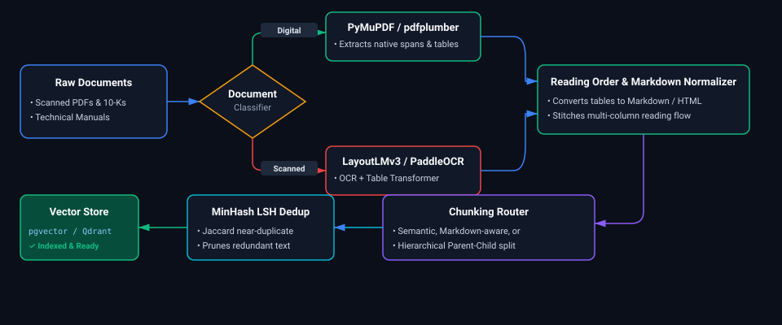
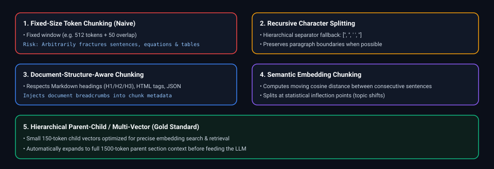
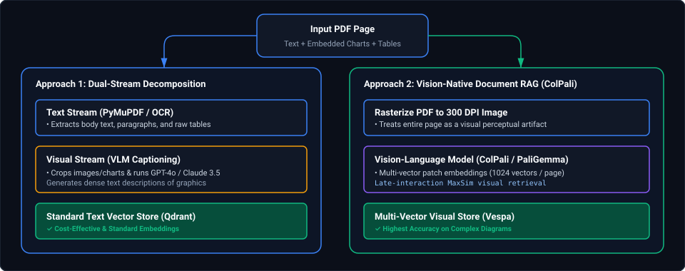

# 10. Document Processing & Data Preparation for AI: Interview FAQs & Scenarios

A comprehensive guide to real-world interview scenarios and production failure post-mortems covering document ingestion, PDF table parsing, chunking degradation, token limits, and deduplication.

---

## Architectural Overview: Multi-Modal Document Ingestion & Chunking Pipeline



*D2 Source: [`01_multimodal_document_ingestion_chunking_pipeline.d2`](assets/10_document_processing_and_data_preparation_for_ai_faq/01_multimodal_document_ingestion_chunking_pipeline.d2)*

---

## Table of Contents & Scenario Mapping

1. **Document Layout Analysis & Table Extraction**
   - [Scenario 1: Preserving Table Structure and Reading Order in Scanned Financial PDFs](#scenario-1-medium-preserving-table-structure-and-reading-order-in-scanned-financial-pdfs)
   - [Scenario 2: Overcoming Chunk Boundary Splitting in Legal Contracts](#scenario-2-medium-overcoming-chunk-boundary-splitting-in-legal-contracts)
   - [Scenario 3: Chunking Strategies for RAG: How to Choose the Optimal Strategy](#scenario-3-medium-chunking-strategies-for-rag-how-to-choose-the-optimal-strategy)
2. **Multimodal Extraction & Unstructured Document Parsing**
   - [Scenario 4: Processing PDFs Containing Both Text and Images in Multimodal RAG](#scenario-4-medium-processing-pdfs-containing-both-text-and-images-in-multimodal-rag)
   - [Scenario 5: End-to-End Extraction Pipeline for Complex Unstructured PDF Documents](#scenario-5-medium-end-to-end-extraction-pipeline-for-complex-unstructured-pdf-documents)

---

# 1. Document Layout Analysis & Table Extraction

---

### Scenario 1: [Medium] Preserving Table Structure and Reading Order in Scanned Financial PDFs
**Difficulty:** [Medium]
**Question**: When ingesting 100-page quarterly SEC 10-K filings into a RAG pipeline, simple text extraction merges multi-column paragraphs and turns income statement tables into scrambled strings. How do you design an ingestion pipeline that preserves numerical tabular relationships and hierarchical context?

**Solution**:
1. **Hybrid Layout Engine**: Use a document layout analysis model (e.g., LayoutLMv3 or Microsoft Table Transformer) to detect bounding boxes for headings, text columns, and tables.
2. **HTML / Markdown Table Serialization**: Convert detected tables into structured HTML (`<table>...</table>`) or Markdown representations with explicit column headers replicated across split rows.
3. **Breadcrumb Header Injection**: Extract document structural headings (H1/H2/H3) and prepend a breadcrumb path (e.g., `[Q3 2024 > Consolidated Statements of Operations > Operating Expenses]`) to every extracted text and table chunk. This ensures the embedding model captures the entity and financial timeframe even if the table body contains only raw numbers.

---

### Scenario 2: [Medium] Overcoming Chunk Boundary Splitting in Legal Contracts
**Difficulty:** [Medium]
**Question**: An enterprise contract analysis tool is failing to retrieve indemnification clauses because the definition of "Indemnified Liabilities" is defined on page 14, but the actual obligation is stated on page 15, resulting in two separate chunks that both miss the full semantic meaning. How do you fix this?

**Solution**:
1. **Parent-Document (Hierarchical) Retrieval**: Create small child chunks (e.g., 200 tokens) for dense vector search, but link each child chunk back to its parent section (e.g., 1,500 tokens) in a document store (e.g., Redis or PostgreSQL JSONB). When a child chunk matches a user query, return the entire parent section to the LLM context window.
2. **Contextual Document Summarization (Anthropic Contextual Retrieval)**: Before vectorizing, pass each chunk to a lightweight LLM alongside the full document to prepend a 50-word clarifying prefix: *"This chunk discusses indemnification obligations under Section 12.2 of the Enterprise Master Services Agreement with ACME Corp..."*
3. **Semantic Overlap & Windowing**: Implement a sliding token window with 20% overlap, ensuring transition sentences exist in both adjacent chunks.

---

### Scenario 3: [Medium] Chunking Strategies for RAG: How to Choose the Optimal Strategy
**Difficulty:** [Medium]
**Question**: What are the different chunking strategies used in RAG (fixed-size, recursive character, document-structure-based, semantic, hierarchical), and how would you choose one for a production enterprise dataset?

#### Technical Breakdown of the 5 Core Chunking Paradigms



*D2 Source: [`02_five_core_chunking_paradigms.d2`](assets/10_document_processing_and_data_preparation_for_ai_faq/02_five_core_chunking_paradigms.d2)*

1. **Fixed-Size Token Chunking:**
   - **How it Works:** Slices raw token streams into arbitrary blocks (e.g., 512 tokens with 50-token overlap).
   - **Flaw:** High risk of splitting sentences mid-clause or separating table rows from headers. Naive baseline only.
2. **Recursive Character Text Splitting (LangChain / LlamaIndex):**
   - **How it Works:** Attempts to split text using a hierarchy of natural boundaries: paragraphs (`\n\n`), then lines (`\n`), then spaces (` `), and finally raw characters.
   - **Best Use Case:** General unstructured articles, blog posts, and books where paragraphs represent coherent ideas.
3. **Document-Structure / Markdown-Aware Chunking:**
   - **How it Works:** Parses document markdown or HTML syntax, creating chunk boundaries strictly at H1, H2, and H3 header tags. Injects the complete heading breadcrumb path into the chunk header.
   - **Best Use Case:** Technical documentation, API references, Wikipedia articles, and enterprise wikis.
4. **Semantic Chunking (Cosine Distance Inflection):**
   - **How it Works:** Splits document into individual sentences, generates embeddings for each sentence, and computes cosine similarity between consecutive sentences $S_i$ and $S_{i+1}$. When cosine similarity drops below a percentile threshold (e.g. 95th percentile distance), a topic shift is detected, and a chunk boundary is placed.
   - **Best Use Case:** Long transcripts, podcasts, and unstructured conversational dialogues lacking explicit markdown headings.
5. **Hierarchical / Parent-Child Chunking (The Enterprise Gold Standard):**
   - **How it Works:** Generates small 150-to-200 token child chunks for high-precision vector search, while preserving the parent 1,500-token section in a key-value store. The LLM receives the parent document for generation.
   - **Best Use Case:** Legal contracts, compliance policies, and dense financial filings where localized semantic search must be accompanied by broad conversational context.

#### Decision Framework Matrix:
| Document Domain | Optimal Strategy | Target Chunk Size | Overlap | Justification |
| :--- | :--- | :---: | :---: | :--- |
| **Legal Agreements & MSAs** | Hierarchical Parent-Child | Child: 150 tokens<br/>Parent: 1,500 tokens | 20% | Clauses reference definitions 10 pages apart; small chunks match query, parent provides full legal envelope. |
| **Technical Manuals & APIs** | Markdown / Structure-Aware | 400–800 tokens | 10% | Code snippets and parameters must remain co-located with their H2/H3 API endpoint headers. |
| **Customer Support Chats** | Semantic Chunking | Dynamic (100–500 tokens) | 0% | Natural speech shifts rapidly between topics without formatting; split on semantic inflection points. |
| **General Web & News Corpus** | Recursive Character | 512 tokens | 15% | Balances computational throughput with paragraph preservation. |

---

# 2. Multimodal Extraction & Unstructured Document Parsing

---

### Scenario 4: [Medium] Processing PDFs Containing Both Text and Images in Multimodal RAG
**Difficulty:** [Medium]
**Question**: How would you process PDFs containing both rich text, embedded architecture diagrams, charts, and tables in a RAG pipeline? Walk through both classical OCR pipelines and modern Vision-Language Model (VLM) architectures.

#### Architectural Overview: The 2 Competing Production Paradigms



*D2 Source: [`03_dual_stream_decomposition_vs_vision_native_colpali.d2`](assets/10_document_processing_and_data_preparation_for_ai_faq/03_dual_stream_decomposition_vs_vision_native_colpali.d2)*

#### Approach 1: Dual-Stream Decomposition & VLM Figure Captioning (Production Workhorse)
1. **Layout Decomposition:** Pass each PDF page through a layout model (e.g. `unstructured` or `MinerU`). Detect bounding boxes categorized as `text`, `table`, or `figure`.
2. **Text Processing:** Extract digital text and serialize tables into Markdown.
3. **Image Captioning via Vision-Language Model:** For every detected `figure` bounding box, crop the image and pass it to a lightweight VLM (e.g., `gpt-4o-mini`, `claude-3-5-haiku`, or local `Qwen2-VL-7B`) with a structured extraction prompt:
   ```text
   Analyze this technical diagram or chart. Return:
   1. Diagram Type (Flowchart, Architecture, Bar Chart, Line Graph).
   2. Key Entities and Relationships.
   3. Numerical values, axes, and legends.
   4. A dense 100-word searchable summary.
   ```
4. **Vector Embedding:** Embed the VLM-generated image description using standard text embedding models (e.g. `text-embedding-3-large`). Store the cropped image in Cloud Object Storage (S3 / GCS).
5. **Multimodal LLM Synthesis:** When the user query matches the image chunk, retrieve both the text chunk and the original cropped image PNG, passing the image directly to the final multimodal LLM context window.

#### Approach 2: Vision-Native Late-Interaction RAG (ColPali Architecture)
- **The Breakthrough:** Traditional OCR fails on non-standard fonts, vertical text, flowcharts, and chemical formulas. **ColPali** (built on PaliGemma) treats entire document pages as images, bypassing OCR completely.
- **Mechanics:** The model projects image patches into 128-dimensional multi-vector embeddings. Text queries match directly against visual patches using late-interaction MaxSim operations.
- **Trade-off:** High VRAM footprint for vector indexing, but zero information loss from OCR errors or layout fragmentation.

---

### Scenario 5: [Medium] End-to-End Extraction Pipeline for Complex Unstructured PDF Documents
**Difficulty:** [Medium]
**Question**: How would you extract and process information from highly complex, unstructured PDF documents (e.g., multi-column academic papers, insurance claims with handwritten notes, and scanned legal briefs)? Walk through your step-by-step ingestion runbook.

#### Production Ingestion Runbook

##### Step 1: Pre-Flight Inspection & Format Triage
- Run `pdfminer.high_level.extract_text()` or `PyMuPDF (fitz)` on page 1:
  - If text layer exists and character count $> 100$: Classify as **Native Digital PDF**. Use fast direct text stream extraction.
  - If text layer is empty or contains garbage encoding: Classify as **Scanned Raster PDF**. Route through high-resolution OCR preprocessing.

##### Step 2: Image Normalization & De-Skewing (For Scanned PDFs)
- Convert PDF pages to 300 DPI lossless PNG images.
- Apply **OpenCV Computer Vision Transformations**:
  - Auto-orientation detection and deskewing using Hough Line Transform (`cv2.HoughLinesP`).
  - Adaptive thresholding (`cv2.adaptiveThreshold`) to remove background shadows, coffee stains, and bleed-through artifacts from double-sided scans.

##### Step 3: Layout Analysis & Reading Order Reconstruction
- Standard text extractors read bounding boxes by raw Y-coordinate. On a 2-column academic paper, this reads line 1 of column 1 followed by line 1 of column 2, creating unreadable gibberish.
- **Solution:** Use **LayoutLMv3** or **PaddleOCR** layout analysis:
  1. Detect column bounding boxes (`Column_Left`, `Column_Right`).
  2. Order text stream: Sort elements by `Column_Left` top-to-bottom, then `Column_Right` top-to-bottom.
  3. Detect and remove repeating running headers, footers, and page numbers to prevent embedding pollution.

##### Step 4: Table Extraction & Structural Serialization
- Never extract tables as raw text spaces!
- Use **Microsoft Table Transformer (TATR)** or **pdfplumber table extraction**:
  - Extract grid lines, merged cells, and headers.
  - Serialize output to GitHub-Flavored Markdown tables (`| Header 1 | Header 2 |`) or HTML table tags.
  - Replicate multi-tier headers into every cell for hierarchical accounting tables.

##### Step 5: Semantic Chunking & Quality Gatekeeper
- Reject empty chunks, repetitive watermarks (*"CONFIDENTIAL"*), and OCR noise (chunks where non-ASCII characters exceed 20%).
- Attach immutable document metadata: `doc_id`, `filename`, `source_url`, `page_number`, `bounding_box_coordinates`, `section_breadcrumb`, and `extraction_timestamp`.

---

## Summary Comparison & Production Reference Matrix

| Document Extraction Pathology | Root Cause & Failure Mode | Diagnostic Indicator | Canonical Production Resolution |
| :--- | :--- | :--- | :--- |
| **Scrambled Column Text** | Reading multi-column layouts horizontally by Y-coordinate | Unintelligible interleaved sentences in retrieved context | Bounding-box layout analysis (LayoutLMv3 / PaddleOCR) to segment columns |
| **Lost Table Semantics** | Treating tables as whitespace-separated plain text | LLM hallucinates numbers or associates values with wrong headers | Table Transformer / pdfplumber serialization to Markdown/HTML |
| **Chunk Boundary Fragmentation** | Definition and obligation split across 512-token boundary | Model returns *"Clause not found"* despite being present in document | Hierarchical Parent-Child chunking or Anthropic Contextual Retrieval |
| **OCR Failure on Infographics** | Standard OCR engines ignoring non-text diagrams | Low recall on technical architecture or financial chart queries | Dual-stream extraction with VLM image captioning or ColPali visual embeddings |
| **Stale Policy Citations** | Document updates uploaded without retiring prior versions | Model quotes expired compliance policies | Strict document lifecycle metadata filtering (`expiration_date > NOW()`) |

---

## References & Further Reading

- [ColPali: Efficient Document Retrieval with Vision Language Models (Faysse et al., 2024)](https://arxiv.org/abs/2407.01449) — Breakthrough research on end-to-end visual document retrieval.
- [LayoutLMv3: Pre-training for Document AI with Multimodal Productivity (Huang et al., 2022)](https://arxiv.org/abs/2204.08387) — Standard architecture for layout and table detection.
- [Anthropic: Introducing Contextual Retrieval](https://www.anthropic.com/news/contextual-retrieval) — Prepending context-aware document summaries to prevent chunk fragmentation.
- [Ragas: Automated Evaluation of Retrieval Augmented Generation (Es et al., 2023)](https://arxiv.org/abs/2309.15217) — Evaluation metrics for faithfulness, answer relevance, and context precision.
- [Companion Module: Document Processing & AI Data Preparation Pipelines](../10_document_processing_and_data_preparation_for_ai.md) — Layout parsing, recursive chunking, and MinHash LSH deduplication.
