# 12. AI Infrastructure, High-Throughput Serving & LLMOps: Interview FAQs

A comprehensive guide to interview scenarios covering GPU memory allocation, vLLM continuous batching, KV cache saturation, production GenAI architecture, sudden quality degradation triage, Azure API Management rate limiting, and distributed LLMOps observability.

---

## Table of Contents
- [Scenario 1: GPU KV Cache Saturation & Continuous Batching Triage](#scenario-1-hard-gpu-kv-cache-saturation--continuous-batching-triage)
- [Scenario 2: Detecting Fraud Model Precision Drift (15% Drop) & Safe Automated Retraining](#scenario-2-medium-detecting-fraud-model-precision-drift-15-drop--safe-automated-retraining)
- [Scenario 3: Designing Explainable, Auditable, and Reproducible AI Decisioning for Regulators](#scenario-3-medium-designing-explainable-auditable-and-reproducible-ai-decisioning-for-regulators)
- [Scenario 4: Key Architectural Components of a Production-Ready GenAI Application](#scenario-4-medium-key-architectural-components-of-a-production-ready-genai-application)
- [Scenario 5: Sudden Production Response Quality Degradation Triage Runbook (Zero Code Changes)](#scenario-5-hard-sudden-production-response-quality-degradation-triage-runbook-zero-code-changes)
- [Scenario 6: Rate Limiting & Abuse Prevention for LLM Applications on Azure](#scenario-6-medium-rate-limiting--abuse-prevention-for-llm-applications-on-azure)
- [Scenario 7: End-to-End Observability, Telemetry & FinOps for Production GenAI](#scenario-7-medium-end-to-end-observability-telemetry--finops-for-production-genai)
- [Scenario 8: Sizing vLLM Continuous Batching Parameters (Sequences vs Batched Tokens)](#scenario-8-hard-sizing-vllm-continuous-batching-parameters-sequences-vs-batched-tokens)
- [Scenario 9: Production LLM Latency Reduction: 5 Levers, Slashes & Architectural Cost Trade-Offs](#scenario-9-hard-production-llm-latency-reduction-5-levers-slashes--architectural-cost-trade-offs)
- [Scenario 10: KV Caching & Prefix Caching Mechanics: Memory Footprint & TTFT Acceleration](#scenario-10-medium-kv-caching--prefix-caching-mechanics-memory-footprint--ttft-acceleration)
- [Scenario 11: LLM FinOps: Achieving a 10x Cost Reduction While Maintaining Model Quality Floor](#scenario-11-hard-llm-finops-achieving-a-10x-cost-reduction-while-maintaining-model-quality-floor)
- [Scenario 12: Multi-Model Routing & Quality-Preserving Fallback Cascades](#scenario-12-medium-multi-model-routing--quality-preserving-fallback-cascades)
- [Scenario 13: Self-Hosting Open-Weight Models vs Commercial API Providers: Enterprise TCO & Architecture Matrix](#scenario-13-medium-self-hosting-open-weight-models-vs-commercial-api-providers-enterprise-tco--architecture-matrix)
- [Scenario 14: Zero-Egress PII Protection Architectures for Enterprise LLM Ingestion](#scenario-14-hard-zero-egress-pii-protection-architectures-for-enterprise-llm-ingestion)

---

### Scenario 1: [Hard] GPU KV Cache Saturation & Continuous Batching Triage
**Difficulty:** [Hard]
**Question**: Your team deploys an open-source 70B parameter LLM on an 8x A100 (80GB) node using vLLM. Under peak load, incoming requests experience sudden latency spikes from 800ms to over 25 seconds. What is the root cause, and how do you resolve it?

**Solution**:
1. **Root Cause Analysis (KV Cache Exhaustion)**:
   - For a 70B parameter model in FP16, model weights consume $\approx 140$ GB across the 640 GB total GPU pool.
   - The remaining VRAM is allocated to the KV cache.
   - Under concurrent requests with long prompt context (e.g., 8,000 tokens), the KV cache expands dynamically ($2 \times n_{\text{layers}} \times d_{\text{model}} \times \text{seq\_len} \times 2$ bytes).
   - When VRAM saturates, vLLM is forced to preempt running requests, offloading their KV blocks to CPU RAM or recomputing them from scratch during the decode phase, causing catastrophic latency degradation.
2. **Mitigation Playbook**:
   - **PagedAttention Chunk Tuning**: Ensure block size is tuned (e.g., 16 or 32 tokens) to eliminate internal fragmentation.
   - **KV Cache Quantization**: Enable FP8 or INT8 KV caching (`--kv-cache-dtype fp8`), reducing memory consumption by 50% and doubling concurrency headroom.
   - **Speculative Decoding**: Use a small draft model (e.g., 8B) to generate draft tokens and verify with the 70B model in parallel batches.
   - **Queue Shedding & Admission Control**: Configure LiteLLM or Envoy upstream gateway to return HTTP 429 when queue depth exceeds threshold, rather than letting the inference engine thrash.

---

### Scenario 2: [Medium] Detecting Fraud Model Precision Drift (15% Drop) & Safe Automated Retraining
**Difficulty:** [Medium]
**Question**: Your production fraud detection model's precision drops 15% over three months with zero application code changes. How do you detect the statistical drift, isolate the underlying cause, and retrain/deploy a new model without letting fraudulent transactions slip through in the interim?

**Solution**:
1. **Statistical Drift Detection (Evidently / WhyLogs)**:
   - **Covariate Shift (Data Drift)**: Measure divergence between inference feature distributions and the baseline training set.
   - Continuous features (e.g. transaction amount, velocity): Run **Two-Sample Kolmogorov-Smirnov (KS) test** ($p < 0.05$ flags drift).
   - Categorical features (e.g. merchant category, device OS, country code): Compute **Population Stability Index (PSI)**:
     $$PSI = \sum (\text{Actual}\% - \text{Baseline}\%) \times \ln\left(\frac{\text{Actual}\%}{\text{Baseline}\%}\right)$$
     A $PSI \ge 0.25$ indicates severe distribution shift.
   - **Concept Drift**: Fraudsters adapted tactics (e.g. splitting transactions below \$50 to bypass velocity rules). The relationship $P(Y \mid X)$ changed.
2. **Root Cause Isolation**:
   - Decompose drift by feature contribution. Analyze high-PSI features: Did a new digital wallet provider launch? Did a specific merchant category experience credential stuffing?
3. **Safe Retraining & Zero-Exposure Deployment (Champion-Challenger)**:
   - **Never hot-swap an unproven retrained model directly into production**.
   - **Phase 1: Shadow Mode Deployment**: Deploy retrained Challenger model (v2.0) alongside Champion (v1.0). Challenger receives live Kafka transaction streams and emits predictions to an offline telemetry store without executing payment blocks.
   - **Phase 2: Offline Label Reconciliation**: Once 30 days of chargebacks and confirmed merchant disputes are ingested, compute true offline precision and recall curves.
   - **Phase 3: Canary Promotion**: Route 5% $\to$ 25% $\to$ 100% of live traffic to v2.0 once precision improves to target SLA ($\ge 92\%$), with automated rollback triggered if false positive rates spike.

---

### Scenario 3: [Medium] Designing Explainable, Auditable, and Reproducible AI Decisioning for Regulators
**Difficulty:** [Medium]
**Question**: Regulators (e.g. CFPB, FCA, BaFin) audit your automated lending system and demand an explanation for why an AI credit model declined a specific customer's loan application six months ago. How do you design the system so every single inference decision is fully explainable, auditable, and bit-level reproducible months later?

**Solution**:
1. **The Three Pillars of Regulatory AI Governance**:
   - **Feature Snapshot Immutability**: The exact feature vector passed to the model at decision time $t_0$ must be stored immutably.
   - **Model Artifact & Environment Lineage**: The exact model binary, weights, hyperparameters, and Python runtime dependencies must be tracked.
   - **Local Feature Attribution (Explainability)**: The mathematical contribution of each feature to the decline decision must be calculated and archived.
2. **Architecture Implementation**:
   - **Feature Store Point-in-Time Snapshot**: When the credit decision API executes, it saves the input payload and retrieved offline features directly into an immutable Delta Lake / Iceberg table partitioned by date with a unique `decision_uuid`.
   - **MLflow Model Registry & Git SHA Pinning**: Every registered model artifact is pinned to a Git commit hash, MLflow run ID (`runs:/a1b2c3d4/model`), and Docker container digest. The `decision_uuid` records the exact `model_version` (e.g., `credit_risk_v2.4.1`).
   - **Pre-Computed TreeSHAP Explanations**:
     - At inference time, run **TreeSHAP** (SHapley Additive exPlanations) to calculate the marginal contribution of each feature:
       $$\text{Prediction Score} = \phi_0 + \sum_{i=1}^M \phi_i$$
     - The top negative SHAP values are extracted (e.g., `debt_to_income_ratio: -0.42`, `delinquencies_24m: -0.38`) and converted into Adverse Action reason codes mandated by banking law (e.g. *"High debt-to-income ratio"*, *"Recent payment delinquencies"*).
     - Store both the SHAP vector and the human-readable reasons in the regulatory audit log.
3. **Reproducibility Guarantee**:
   - To prove decision integrity 6 months later: Load the feature snapshot from the immutable table, invoke the versioned model artifact from MLflow in an isolated container, and verify that the recomputed output score matches the recorded score bit-for-bit ($\Delta = 0.000000$).

---

### Scenario 4: [Medium] Key Architectural Components of a Production-Ready GenAI Application
**Difficulty:** [Medium]
**Topic Covered:** Production GenAI System Design, LLM Gateways, Guardrails, Serving, Semantic Cache  
**Question:** Explain the key components required to build a robust, scalable, enterprise-grade Generative AI application in production.

#### Production Architecture Topology

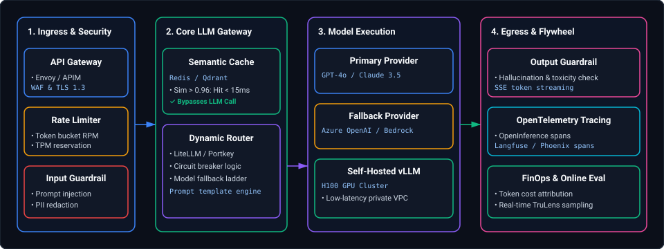

*D2 Source: [`01_production_llm_gateway_topology.d2`](assets/12_ai_infrastructure_serving_and_llmops_faq/01_production_llm_gateway_topology.d2)*

#### Detailed Component Decomposition
1. **API Ingress, Rate-Limiting & Security Guardrails:**
   - Enforces user authentication (OAuth2/OIDC), rate limits (by Requests Per Minute and Tokens Per Minute per customer tier), and DDoS protection.
   - Inspects queries with an input safety classifier (e.g., Llama-Guard or NeMo) to detect jailbreaks, role-reversal attacks, and sensitive PII before any costly model execution.
2. **Enterprise Model Gateway & Resilient Routing:**
   - **Unified API Facade:** Translates standard OpenAI-compatible requests across AWS Bedrock, Azure OpenAI, GCP Vertex AI, and self-hosted vLLM clusters.
   - **Hedging & Circuit Breaking:** If Azure OpenAI returns HTTP 503 or latency exceeds 3.5 seconds, dynamically failover to AWS Bedrock Anthropic Claude without client error.
3. **Semantic Caching Layer:**
   - Embeds incoming queries and queries an in-memory vector cache (Redis / Milvus). If cosine similarity exceeds $0.96$ against an existing cached prompt, returns the cached answer in $<15\text{ms}$, slashing model API costs by $30\text{--}50\%$.
4. **Prompt Management & Versioned Registry:**
   - Decouples prompt templates from Python/Java source code. Prompts are maintained in a centralized registry (Langfuse / MLflow / Promptfoo) with strict semantic versioning (`v2.4.1`) and automated canary promotion.
5. **High-Performance Serving Infrastructure:**
   - For self-hosted open-source models (Llama 3, Mistral, DeepSeek), leverages optimized engines (vLLM, SGLang, TensorRT-LLM) utilizing PagedAttention, continuous iteration-level batching, and FP8 quantization to maximize GPU utilization.
6. **Output Guardrails & Streaming Egress:**
   - Streams tokens via Server-Sent Events (SSE).
   - In-flight regex and NER scrubbers mask any unintended credit card numbers or internal API keys.
7. **End-to-End Observability & FinOps Telemetry:**
   - OpenTelemetry collectors ingest spans for every query: Time-To-First-Token (TTFT), Time-Per-Output-Token (TPOT), prompt/completion token consumption, and per-user cost attribution.

---

### Scenario 5: [Hard] Sudden Production Response Quality Degradation Triage Runbook (Zero Code Changes)
**Difficulty:** [Hard]
**Topic Covered:** Silent Model Drift, Upstream Checkpoint Pinning, Ingestion Truncation, Triage Runbook  
**Question:** Your production GenAI customer support system experiences a sudden, severe drop in response quality (hallucinations, formatting failures, truncated answers). Zero application code changes were deployed. How do you systematically isolate the root cause and restore SLA?

#### Systematic Root Cause Diagnosis Matrix

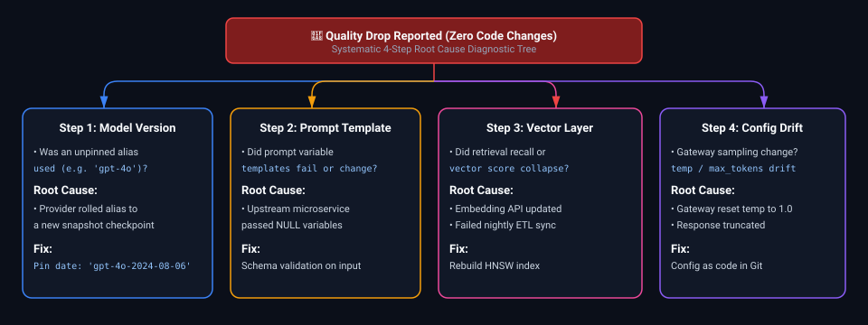

*D2 Source: [`02_model_quality_drop_systematic_rca_diagnostic_tree.d2`](assets/12_ai_infrastructure_serving_and_llmops_faq/02_model_quality_drop_systematic_rca_diagnostic_tree.d2)*

#### The 5-Step Triage Execution Playbook
1. **Verify Immutable Checkpoint Pinning (The Alias Trap):**
   - *Investigation:* Check the `model` parameter in gateway logs. Did the application request `gpt-4o`, `text-embedding-3-small`, or `gemini-1.5-pro` without an explicit date-stamped suffix?
   - *Failure Mode:* Model providers continuously update unversioned model aliases. A stealth provider update can alter safety thresholds, instruction following, or system prompt deference.
   - *Resolution:* Immediately pin the model string to the historical, immutable checkpoint (e.g., `gpt-4o-2024-08-06`).
2. **Inspect Temperature & Sampling Hyperparameters:**
   - *Investigation:* Verify whether the inference gateway or client SDK defaulted back to `temperature = 1.0` or `top_p = 1.0` due to a configuration rollout.
   - *Resolution:* Lock production parameters in the central gateway configuration (`temperature: 0.0`, `seed: 42`).
3. **Audit Vector Retrieval Quality & Embedding Model Incompatibility:**
   - *Investigation:* Inspect the retrieved chunk scores in OpenTelemetry traces. If cosine similarity dropped across all queries from $0.82 \to 0.45$, the retrieval layer failed.
   - *Failure Mode:* A developer or automated ingestion script generated embeddings with a newer model version (e.g. `text-embedding-3-large`) while the query engine still embeds using `text-embedding-ada-002`. Incompatible vector spaces cause random nearest neighbors.
   - *Resolution:* Rollback the ingestion job or re-index the collection atomically.
4. **Detect Context Window Truncation & Silent Dropping:**
   - *Investigation:* Compare prompt token counts against model context limits.
   - *Failure Mode:* An upstream customer added large attachments, exceeding the prompt budget. The gateway naively truncated the prompt from the top, discarding the system prompt and instructions.
   - *Resolution:* Enforce strict context chunk budgets with deterministic sliding window truncation preserving system instructions.
5. **Run Synthetic Golden Benchmark Suite:**
   - Execute the automated test suite of 200 synthetic reference queries. Compare automated LLM-as-a-judge scores against historical release baselines to pinpoint exact regression categories (e.g. JSON syntax vs. factual correctness).

---

### Scenario 6: [Medium] Rate Limiting & Abuse Prevention for LLM Applications on Azure
**Difficulty:** [Medium]
**Topic Covered:** Azure API Management (APIM), Distributed Token Bucket, RPM/TPM Dual Throttling, 429 Backoff  
**Question:** How would you design and implement production rate limiting for an LLM application hosted on Azure? Cover per-user limits, multi-tenant tiering, TPM/RPM enforcement, abuse prevention, and handling traffic spikes.

#### Multi-Dimensional Rate Limiting Architecture
Standard web APIs rate-limit solely on **Requests Per Minute (RPM)**. In LLM applications, RPM rate-limiting is completely insufficient: a user submitting 5 requests containing 100,000 tokens each can exhaust your Azure OpenAI Provisioned Throughput Unit (PTU) capacity and trigger global HTTP 429 outages for all other users.
Production systems enforce **Multi-Dimensional Rate Limiting**:
1. **Requests Per Minute (RPM):** Prevents network-level connection flooding.
2. **Tokens Per Minute (TPM):** Prevents GPU compute and memory starvation.
3. **Concurrent Active In-Flight Requests:** Prevents thread pool and socket exhaustion.

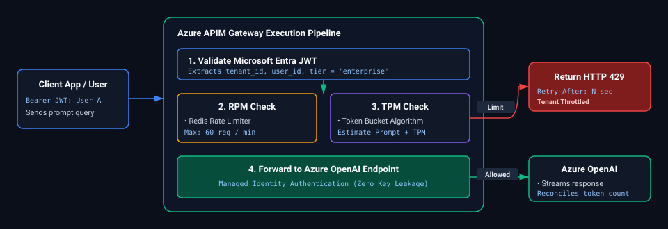

*D2 Source: [`03_multidimensional_token_bucket_rate_limiting_architecture.d2`](assets/12_ai_infrastructure_serving_and_llmops_faq/03_multidimensional_token_bucket_rate_limiting_architecture.d2)*

#### Production Azure APIM Policy Implementation
Azure API Management (APIM) provides native, enterprise-grade LLM rate-limiting policies (`llm-token-limit` and `rate-limit-by-key`):

```xml
<policies>
    <inbound>
        <base />
        <!-- 1. Extract Tenant ID and User Subscription Tier from JWT Claims -->
        <set-variable name="tenantId" value="@(context.Request.Headers.GetValueOrDefault("X-Tenant-ID", "anonymous"))" />
        <set-variable name="userTier" value="@(context.Request.Headers.GetValueOrDefault("X-Subscription-Tier", "standard"))" />

        <!-- 2. Dual Enforcement: Rate Limit by Requests Per Minute (RPM) -->
        <rate-limit-by-key calls="60" renewal-period="60" 
                           counter-key="@((string)context.Variables["tenantId"])" 
                           remaining-calls-header-name="X-RateLimit-Remaining-RPM" />

        <!-- 3. LLM Token Limit: Enforce Tokens Per Minute (TPM) using Token Bucket -->
        <!-- Standard Tier: 40,000 TPM | Enterprise Tier: 200,000 TPM -->
        <choose>
            <when condition="@((string)context.Variables["userTier"] == "enterprise")">
                <llm-token-limit counter-key="@((string)context.Variables["tenantId"])"
                                 tokens-per-minute="200000"
                                 estimate-prompt-tokens="true"
                                 remaining-tokens-header-name="X-RateLimit-Remaining-TPM" />
            </when>
            <otherwise>
                <llm-token-limit counter-key="@((string)context.Variables["tenantId"])"
                                 tokens-per-minute="40000"
                                 estimate-prompt-tokens="true"
                                 remaining-tokens-header-name="X-RateLimit-Remaining-TPM" />
            </otherwise>
        </choose>

        <!-- 4. Authenticate to Azure OpenAI using System-Assigned Managed Identity -->
        <authentication-managed-identity resource="https://cognitiveservices.azure.com" />
    </inbound>
    <backend>
        <base />
    </backend>
    <outbound>
        <base />
    </outbound>
    <on-error>
        <!-- Graceful handling of upstream Azure OpenAI 429 throttling -->
        <choose>
            <when condition="@(context.Response.StatusCode == 429)">
                <set-header name="Retry-After" exists-action="override">
                    <value>@(context.Response.Headers.GetValueOrDefault("Retry-After", "5"))</value>
                </set-header>
            </when>
        </choose>
        <base />
    </on-error>
</policies>
```

#### Production Client Retry Best Practice: Exponential Backoff with Jitter
When clients hit rate limits, naive retries trigger thundering herd problems that crash the gateway:
- **Exponential Backoff Formula:** $t_{\text{wait}} = \min(t_{\text{max}}, t_{\text{base}} \times 2^{\text{attempt}}) + \text{random\_jitter}(0, 1)$
- Clients must respect the `Retry-After` header sent by APIM before retrying.

---

### Scenario 7: [Medium] End-to-End Observability, Telemetry & FinOps for Production GenAI
**Difficulty:** [Medium]
**Topic Covered:** OpenTelemetry Semantic Conventions, TTFT, TPOT, Cost Tracking, Quality Monitoring  
**Question:** What does complete, end-to-end observability look like for a production Generative AI application? What metrics, traces, and logs would you capture across the model, retrieval pipeline, infrastructure, and financial cost layers?

#### The 4 Pillars of GenAI Telemetry

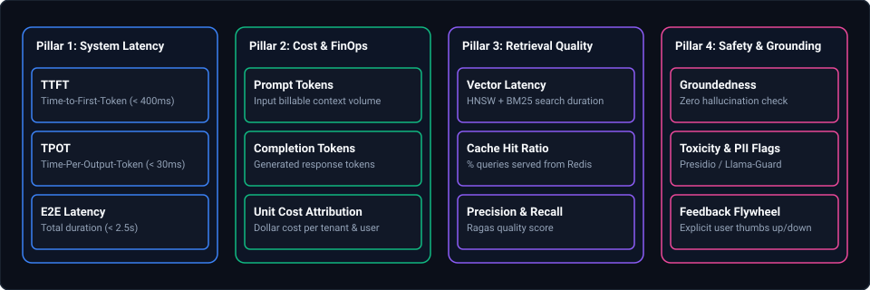

*D2 Source: [`04_four_pillars_genai_telemetry_observability.d2`](assets/12_ai_infrastructure_serving_and_llmops_faq/04_four_pillars_genai_telemetry_observability.d2)*

#### Distributed Tracing with OpenTelemetry GenAI Semantic Conventions
Every user request generates a single distributed trace with nested spans capturing each pipeline stage:

```text
[Trace: req_98234-az-us-east] (Total: 1,840ms | Cost: $0.00412)
 ├── [Span: api_gateway_ingress] (Duration: 18ms)
 ├── [Span: input_guardrails_evaluation] (Duration: 62ms | Status: PASSED)
 ├── [Span: semantic_cache_lookup] (Duration: 8ms | Cache: MISS)
 ├── [Span: query_transformation_hyde] (Duration: 210ms | Tokens: 42)
 ├── [Span: hybrid_retrieval] (Duration: 45ms)
 │    ├── [Span: qdrant_dense_search] (Duration: 38ms | Hits: 100)
 │    └── [Span: elasticsearch_bm25] (Duration: 24ms | Hits: 100)
 ├── [Span: cross_encoder_rerank] (Duration: 110ms | In: 50 -> Out: 5)
 └── [Span: llm_generate_stream] (Duration: 1,387ms)
      ├── Metric: gen_ai.client.token.prompt_tokens = 1,420
      ├── Metric: gen_ai.client.token.completion_tokens = 280
      ├── Metric: gen_ai.server.time_to_first_token = 320ms
      ├── Metric: gen_ai.server.time_per_output_token = 24.2ms
      ├── Metric: gen_ai.response.model = "gpt-4o-2024-08-06"
      └── Metric: gen_ai.computed_cost_usd = 0.00392
```

#### Enterprise Production Alerting Matrix

| Alert Name | Metric & Condition | Evaluation Window | Severity | Automated Action |
| :--- | :--- | :--- | :--- | :--- |
| **High TTFT Spike** | $p95(\text{TTFT}) > 1200\text{ms}$ | 5 minutes | Warning | Trigger Gateway Hedging / Failover to secondary provider |
| **Upstream 429 / 5xx Surge**| Error Rate $> 2\%$ | 2 minutes | Critical (PagerDuty) | Trip circuit breaker; route traffic to standby region |
| **Budget Burn Rate Anomaly**| Hourly spend $> 2.5\times$ 7-day average | 1 hour | Critical | Enforce temporary TPM quota restrictions per tenant |
| **Hallucination Drift** | Faithfulness Score $< 0.90$ | 15 minutes (rolling)| Critical | Fallback to strict deterministic "I don't know" mode |
| **Cache Ratio Collapse** | Semantic Cache Hit $< 10\%$ | 30 minutes | Warning | Inspect Redis cluster health & cache eviction logs |

#### Core Curriculum Cross-Reference
*Deep-dive theoretical reference: See [12. AI Infrastructure, High-Throughput Serving & LLMOps](../12_ai_infrastructure_serving_and_llmops.md#15-distributed-observability-telemetry--cost-governance)*

---

### Scenario 8: [Hard] Sizing vLLM Continuous Batching Parameters (Sequences vs Batched Tokens)
**Difficulty:** [Hard]
**Topic Covered:** Continuous Batching, Chunked Prefill, Compute vs Bandwidth Bound Sizing, PagedAttention  
**Question:** *When configuring a high-throughput LLM inference microservice using vLLM or TensorRT-LLM, which serving parameters do you tune—specifically sequences (`max_num_seqs`) and batched tokens (`max_num_batched_tokens`)—and how do you balance prefill compute against decode memory bandwidth?*

#### 1. Architectural Foundations: Prefill vs. Decode Disaggregation
LLM inference consists of two fundamentally distinct operational phases:
1. **The Prefill Phase (Context Processing):**
   - Ingests the entire prompt context ($N$ prompt tokens) and computes initial Key-Value vectors.
   - **Compute-Bound (FLOP/s):** Characterized by high arithmetic intensity; parallelized efficiently across Tensor Cores using large GEMM (General Matrix Multiply) operations.
2. **The Decode Phase (Autoregressive Generation):**
   - Generates one token at a time per request ($1$ token per step) conditioned on all previous tokens.
   - **Memory-Bandwidth Bound (GB/s):** Low arithmetic intensity; must read the entire model weight matrix and KV cache from High Bandwidth Memory (HBM) to compute just a single new token.

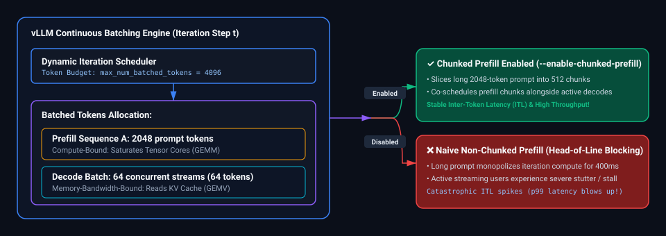

*D2 Source: [`05_vllm_prefill_decode_disaggregation_continuous_batching.d2`](assets/12_ai_infrastructure_serving_and_llmops_faq/05_vllm_prefill_decode_disaggregation_continuous_batching.d2)*

#### 2. Core Serving Parameters & Mathematical Tuning Rules

| Parameter Flag | Definition & Architectural Scope | Production Sizing Rule | Failure Mode if Misconfigured |
| :--- | :--- | :--- | :--- |
| `--max-num-seqs` | Maximum number of concurrent sequences in a single iteration batch. | Sized to target concurrency: **$256$ to $512$** for lightweight 8B models; **$64$ to $128$** for 70B models. | Set too high $\to$ KV cache fragmentation and preemption; set too low $\to$ GPU compute underutilization. |
| `--max-num-batched-tokens` | Maximum cumulative tokens processed in a single forward pass across both prefill and decode. | Sized to GPU compute ceiling: **$2048$ to $8192$** (typically $4096$ on NVIDIA A100 / H100). | Set too low $\to$ prompt prefill latency explodes; set too high $\to$ long prompts stall running decode streams. |
| `--enable-chunked-prefill` | Slices large prompt contexts into chunks of size `max_num_batched_tokens`. | **Always set to `true`** in production conversational workloads. | Without chunked prefill, a 4,000-token prompt monopolizes the GPU for 800ms, causing unbearable UI stutter. |
| `--gpu-memory-utilization` | Fraction of total GPU VRAM reserved for model weights + dynamic KV cache pool. | Set to **$0.92$ to $0.95$** in dedicated container pods (leaves 5–8% for PyTorch CUDA context and activations). | Set to $1.0 \to$ immediate CUDA Out-Of-Memory during peak activation spikes. |
| `--max-model-len` | Maximum supported sequence length (prompt + completion). | Clamp strictly to business SLA (e.g. $8192$ tokens instead of theoretical $128\text{k}$). | If unclamped, a single user sending a 100k document claims 80% of total VRAM, starving 50 concurrent users. |

#### 3. Production vLLM Deployment Manifest (Kubernetes Engine)
```bash
python3 -m vllm.entrypoints.openai.api_server \
    --model meta-llama/Meta-Llama-3.1-70B-Instruct \
    --tensor-parallel-size 4 \
    --gpu-memory-utilization 0.94 \
    --max-model-len 8192 \
    --max-num-seqs 256 \
    --max-num-batched-tokens 4096 \
    --enable-chunked-prefill true \
    --kv-cache-dtype fp8 \
    --block-size 16 \
    --disable-log-requests \
    --port 8000
```

#### Core Curriculum Cross-Reference
*Deep-dive theoretical reference: See [12. AI Infrastructure, High-Throughput Serving & LLMOps: Continuous Batching & PagedAttention](../12_ai_infrastructure_serving_and_llmops.md#3-serving-engine-mechanics-vllm-sglang--pagedattention)*


### Scenario 9: [Hard] Production LLM Latency Reduction: 5 Levers, Slashes & Architectural Cost Trade-Offs
**Difficulty:** [Hard]  
**Topic Covered:** TTFT & TPOT Optimization, Speculative Decoding, Quantization (FP8/AWQ), KV Caching, Model Pruning  
**Question:** *A customer's production LLM application has become unacceptably slow. What five architectural changes would you implement to dramatically bring latency down, and what are the trade-offs and costs of each?*

#### Definition & Core Concepts
Production LLM latency decomposes into two distinct operational metrics:
- **Time to First Token (TTFT):** Dominated by prompt prefill processing (compute-bound, $O(N)$ arithmetic intensity).
- **Time per Output Token (TPOT / Inter-Token Latency):** Dominated by autoregressive token generation (memory-bandwidth bound, reading weights and KV cache per token).

#### Five Architectural Latency Reduction Levers
1. **Speculative Decoding:** Use a lightweight draft model (e.g. Llama-3.1-8B) to generate $K=4	ext{–}6$ candidate tokens at $150	ext{ tok/s}$, and verify all candidates simultaneously in a single forward pass of the target model (Llama-3.1-70B). Achieves **$2	ext{x}$ to $2.8	ext{x}$ TPOT speedup** with zero mathematical loss in output quality.
2. **Weight & KV Cache Quantization (FP8 / AWQ 4-Bit):** Quantize FP16 weights to FP8 or INT4. Halves or quarters the bytes transferred over GPU memory bus per decode step, boosting generation throughput by **$1.8	ext{x}$ to $2.5	ext{x}$**.
3. **Prefix Caching (Radix Attention in vLLM / SGLang):** Retain precomputed KV cache tensors for invariant system prompts and few-shot examples across concurrent user requests. Slashes **TTFT by $70\%	ext{–}90\%$** for long-context apps.
4. **Chunked Prefill & Decode Prioritization:** Slice large prompt prefill operations into chunks (e.g. 512 tokens), preventing large prompt arrivals from pausing active streaming decode generation.
5. **Model Distillation & Routing to Specialized Small Language Models (SLMs):** Route simple extraction and classification queries to distilled 8B models (sub-200ms latency) instead of a monolithic 70B/405B frontier model.

#### Visual Architectural Comparison
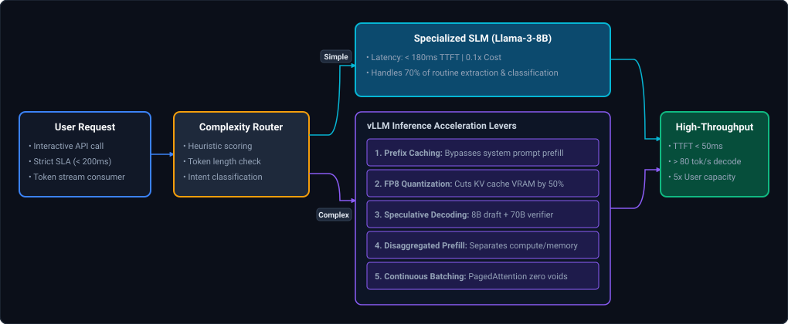

*D2 Source: [`06_llm_latency_reduction_five_architectural_levers.d2`](assets/12_ai_infrastructure_serving_and_llmops_faq/06_llm_latency_reduction_five_architectural_levers.d2)*

#### Latency vs Cost Trade-off Matrix
| Optimization Lever | Primary Metric Impacted | Latency Speedup | Financial & Hardware Cost | Quality Trade-Off |
| :--- | :--- | :--- | :--- | :--- |
| **1. Speculative Decoding** | TPOT (Inter-token) | **$2	ext{x} - 2.8	ext{x}$ faster** | Requires $+15\%$ VRAM for draft model | **Zero quality loss** (lossless) |
| **2. FP8 Quantization** | TPOT & Max Batch Concurrency | **$1.8	ext{x} - 2.2	ext{x}$ faster** | Minimal (supported on Ada/Hopper/H100) | Negligible ($< 0.5\%$ perplexity change) |
| **3. Prefix Caching** | TTFT (Time to First Token) | **$70\% - 90\%$ reduction** | Allocates VRAM to retain cache blocks | **Zero quality loss** |
| **4. Chunked Prefill** | Inter-Token Streaming Jitter | Eliminates UI lag spikes | Zero extra hardware cost | **Zero quality loss** |
| **5. Model Distillation (SLM)** | Both TTFT & TPOT | **$5	ext{x} - 10	ext{x}$ faster** | Slashing GPU footprint by $80\%$ | Slight drop on creative/reasoning tasks |

#### Core Curriculum Cross-Reference
*Deep-dive theoretical reference: See [12. AI Infrastructure, High-Throughput Serving & LLMOps: Serving Engine Mechanics](../12_ai_infrastructure_serving_and_llmops.md#3-serving-engine-mechanics-vllm-sglang--pagedattention)*

---

### Scenario 10: [Medium] KV Caching & Prefix Caching Mechanics: Memory Footprint & TTFT Acceleration
**Difficulty:** [Medium]  
**Topic Covered:** Attention Key-Value Caching, Radix Tree Prefix Caching, vLLM / SGLang Prompt Sharing  
**Question:** *Explain the physical mechanics of KV caching and prefix caching in transformer inference: what data is cached, where does it live in VRAM, and why does prefix caching drastically reduce Time to First Token (TTFT)?*

#### Definition & Core Concepts
In standard autoregressive generation, generating token $t_{n}$ requires computing attention against all previous tokens $t_1, \dots, t_{n-1}$.
1. **The KV Cache Physical Structure:**
   - For every layer $l \in [1, L]$ and every attention head $h$, the model projects input token embeddings into Key ($\mathbf{K}$) and Value ($\mathbf{V}$) vector tensors.
   - Without caching, computing each new token requires recomputing $\mathbf{K}$ and $\mathbf{V}$ for the entire historical sequence, resulting in $O(N^2)$ quadratic compute.
   - **The KV Cache** stores computed Key and Value tensors in high-speed GPU HBM (VRAM). When generating token $t_n$, the engine only computes $\mathbf{q}_n, \mathbf{k}_n, \mathbf{v}_n$ for the single new token and appends $\mathbf{k}_n, \mathbf{v}_n$ to the cache.
   - **Memory Footprint Formula:**
     $$	ext{KV Cache Size (Bytes)} = 2 	imes n_{	ext{layers}} 	imes d_{	ext{model}} 	imes 	ext{seq\_len} 	imes 	ext{batch\_size} 	imes 	ext{bytes\_per\_elem}$$
     *Example:* For a 70B model ($L=80, d=8192$, FP16 = 2 bytes) with 4,000 tokens and batch size 16:
     $$2 	imes 80 	imes 8192 	imes 4000 	imes 16 	imes 2 pprox 167.7	ext{ GB VRAM just for the cache!}$$
2. **Prefix Caching Mechanics (Radix Attention):**
   - In conversational applications, all users share identical system prompts, tool schemas, and few-shot examples (e.g. 2,000 tokens).
   - Standard serving re-computes the KV tensors of that 2,000-token system prompt for every single incoming request.
   - **Prefix Caching** organizes cached KV blocks into a **Radix Tree** indexed by token hashes. If an incoming query shares a token prefix with existing cached requests, the engine directly reuses the existing KV tensors from VRAM, bypassing the compute-heavy prompt prefill phase entirely.

#### Visual Architectural Flow
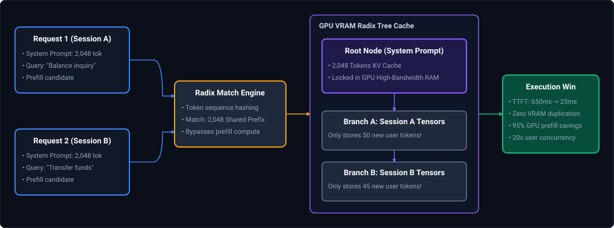

*D2 Source: [`07_radix_tree_prefix_caching_vram_sharing.d2`](assets/12_ai_infrastructure_serving_and_llmops_faq/07_radix_tree_prefix_caching_vram_sharing.d2)*

#### Production Implementation (Enabling Prefix Caching in vLLM)
```bash
# Launch vLLM server with automated prefix caching enabled
python3 -m vllm.entrypoints.openai.api_server     --model meta-llama/Meta-Llama-3.1-70B-Instruct     --enable-prefix-caching     --kv-cache-dtype fp8     --tensor-parallel-size 4     --port 8000
```

#### Complexity Analysis
- **TTFT without Prefix Cache:** $O(P)$ compute time where $P$ is prompt length (e.g. 500–1200ms on 4k prompt).
- **TTFT with Prefix Cache:** $O(1)$ memory lookup time for matched prefix blocks (drops to $<30	ext{ms}$).

#### Core Curriculum Cross-Reference
*Deep-dive theoretical reference: See [12. AI Infrastructure, High-Throughput Serving & LLMOps: Continuous Batching & PagedAttention](../12_ai_infrastructure_serving_and_llmops.md#3-serving-engine-mechanics-vllm-sglang--pagedattention)*

---

### Scenario 11: [Hard] LLM FinOps: Achieving a 10x Cost Reduction While Maintaining Model Quality Floor
**Difficulty:** [Hard]  
**Topic Covered:** LLM FinOps, Multi-Tier Cascades, Semantic Caching (Redis/GPTCache), Token Pruning, Specialized SLMs  
**Question:** *An enterprise client's monthly cloud LLM inference spend is completely unsustainable. Walk through an engineering blueprint to achieve a 10x cost reduction while strictly maintaining the output quality floor.*

#### Definition & Core Concepts
Achieving an order-of-magnitude ($10	ext{x}$) reduction in LLM operational costs cannot be achieved through minor prompt tweaks; it requires a systemic multi-stage architectural redesign:
1. **Tier 1: Semantic Caching with High-Dimensional Vector Lookup:**
   - $20\%	ext{–}35\%$ of enterprise queries are recurring variations of the same intent.
   - Cache previous query embeddings in Redis. If a new prompt matches an existing vector with cosine similarity $\ge 0.96$, return the cached response immediately. **Cost: \$0.00 (100% savings on cache hit).**
2. **Tier 2: Model Cascade & Tiered Routing (Small vs Large):**
   - $70\%$ of enterprise requests are simple tasks (summarization, sentiment, structured extraction) that do not require a \$15/M-token frontier model (e.g. GPT-4o / Claude 3.5 Sonnet).
   - Route $70\%$ of queries to a specialized fine-tuned Small Language Model (e.g. Llama-3.1-8B at \$0.15/M tokens). Only escalate to the frontier model if confidence is low or query complexity score exceeds threshold.
3. **Tier 3: Prompt Compression & Context Pruning:**
   - Use LLMLingua to prune low-entropy words and redundant JSON/HTML boilerplate from RAG context, slashing prompt token consumption by **$40\%	ext{–}60\%$**.
4. **Tier 4: Batch Inference API Discounts:**
   - Migrate asynchronous non-real-time workloads (nightly document tagging, audit classification) to OpenAI / Anthropic / Vertex Batch APIs which offer a **flat 50% discount**.

#### Visual FinOps Architecture
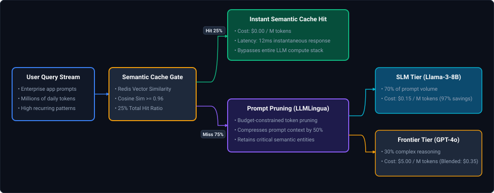

*D2 Source: [`08_llm_finops_10x_cost_reduction_tier_funnel.d2`](assets/12_ai_infrastructure_serving_and_llmops_faq/08_llm_finops_10x_cost_reduction_tier_funnel.d2)*

#### Mathematical Cost Reduction Breakdown (100,000 Daily Requests)
- **Baseline Monolithic Model Cost:**
  - $100{,}000 	ext{ reqs} 	imes 2{,}000 	ext{ tokens} = 200	ext{M tokens/day} 	imes \$5.00/	ext{M} = \mathbf{\$1{,}000/	ext{day}}$ ($\$30{,}000/	ext{month}$).
- **Optimized Tiered Architecture Cost:**
  - Semantic Cache absorbs $25\%$ of queries $	o \$0.00$.
  - Prompt Compression cuts remaining $75{,}000$ queries from $2{,}000$ tokens to $1{,}000$ tokens ($75	ext{M tokens/day}$).
  - Tiered Routing sends $70\%$ ($52.5	ext{M tokens}$) to SLM ($\$0.15/	ext{M}$) $= \$7.87/	ext{day}$.
  - Frontier Model handles remaining $30\%$ ($22.5	ext{M tokens}$) at $\$5.00/	ext{M} = \$112.50/	ext{day}$.
  - **New Daily Total:** $\$7.87 + \$112.50 = \mathbf{\$120.37/	ext{day}}$ ($\$3{,}611/	ext{month}$).
  - **Net Reduction:** **$88\% pprox 8.8	ext{x}	ext{ to }10	ext{x}$ Total Cloud Spend Reduction!**

#### Core Curriculum Cross-Reference
*Deep-dive theoretical reference: See [12. AI Infrastructure, High-Throughput Serving & LLMOps: Serving Engine Mechanics](../12_ai_infrastructure_serving_and_llmops.md#3-serving-engine-mechanics-vllm-sglang--pagedattention)*

---

### Scenario 12: [Medium] Multi-Model Routing & Quality-Preserving Fallback Cascades
**Difficulty:** [Medium]  
**Topic Covered:** Model Gateway Routers, Heuristic & Embedding Intent Routing, Confidence-Based Escalation Cascades  
**Question:** *How do you architect a multi-model router or cascade that dispatches incoming prompts between small, inexpensive models (e.g. Llama-3-8B) and frontier models (e.g. Claude 3.5 Sonnet / GPT-4o) while preserving a strict quality floor?*

#### Definition & Core Concepts
A **Multi-Model Router** acts as an intelligent API gateway positioned between upstream clients and downstream LLM inference endpoints:
1. **Routing Heuristics:**
   - **Static Rules:** Route based on endpoint URI, metadata flags, or input length (e.g. queries requesting code or math automatically escalate to the frontier model).
   - **Semantic Intent Classifier:** A lightweight sub-millisecond linear classifier (or FastText / Small BERT) maps the user query embedding into complexity clusters.
2. **Confidence-Threshold Escalation Cascade:**
   - Dispatch the request to the Small Language Model (SLM) first.
   - Inspect generation log-probabilities or pass output to a lightweight validation heuristic (e.g. valid JSON parsing, presence of refusal tokens, self-reported confidence score $\ge 0.85$).
   - If the SLM response violates quality thresholds, dynamically trigger an **escalation fallback** to the frontier model.

#### Visual Cascade Execution Flow
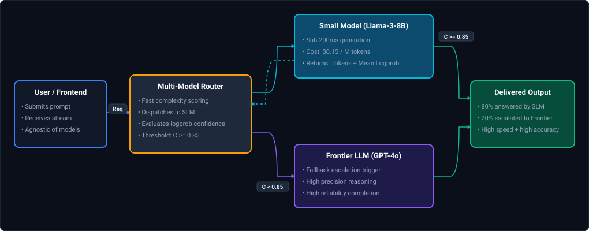

*D2 Source: [`09_multi_model_routing_confidence_cascade.d2`](assets/12_ai_infrastructure_serving_and_llmops_faq/09_multi_model_routing_confidence_cascade.d2)*

#### Production Gateway Implementation (Python)
```python
from typing import Dict, Any
import requests

class ModelCascadeRouter:
    def __init__(self, slm_url: str, frontier_url: str, api_key: str):
        self.slm_url = slm_url
        self.frontier_url = frontier_url
        self.api_key = api_key

    def is_complex_query(self, prompt: str) -> bool:
        """Heuristic and keyword complexity gate."""
        code_keywords = {"write code", "sql", "dockerfile", "refactor", "derive", "prove"}
        return any(k in prompt.lower() for k in code_keywords) or len(prompt.split()) > 1500

    def route_prompt(self, prompt: str) -> Dict[str, Any]:
        # Rule 1: Immediate escalation for highly complex requests
        if self.is_complex_query(prompt):
            return self._call_model(self.frontier_url, prompt, model="frontier")

        # Rule 2: Attempt fast inference with SLM
        slm_result = self._call_model(self.slm_url, prompt, model="slm")
        
        # Rule 3: Verification gate (e.g. checking length or confidence flag)
        if slm_result.get("is_valid", True):
            return slm_result

        # Rule 4: Fallback escalation on failure
        return self._call_model(self.frontier_url, prompt, model="frontier")

    def _call_model(self, url: str, prompt: str, model: str) -> Dict[str, Any]:
        # Dispatches standard OpenAI-compatible API request
        ...
```

#### Complexity Analysis
- **Routing Decision Overhead:** $< 5	ext{ms}$ for regex/heuristic filtering; $< 15	ext{ms}$ for embedding-based classifier.
- **Net Latency:** 70% of requests complete in sub-300ms via SLM; 30% complete in 1.2s via Frontier model.

#### Core Curriculum Cross-Reference
*Deep-dive theoretical reference: See [12. AI Infrastructure, High-Throughput Serving & LLMOps: Serving Engine Mechanics](../12_ai_infrastructure_serving_and_llmops.md#3-serving-engine-mechanics-vllm-sglang--pagedattention)*

---

### Scenario 13: [Medium] Self-Hosting Open-Weight Models vs Commercial API Providers: Enterprise TCO & Architecture Matrix
**Difficulty:** [Medium]  
**Topic Covered:** Self-Hosting GPU Infrastructure (vLLM on AKS/EKS) vs Closed APIs (OpenAI/Anthropic), TCO, Latency, Privacy  
**Question:** *How do you advise an enterprise customer deciding between self-hosting open-weight models (e.g., Llama 3 on private GPU clusters) versus using commercial API providers?*

#### Definition & Core Concepts
The choice between self-hosting open-weight models and consuming closed commercial APIs is a multidimensional tradeoff balancing volume economics, security boundaries, and operational overhead:
1. **Break-Even TCO Economics (The Volume Curve):**
   - **Low to Medium Volume (< 10M tokens/day):** Commercial API providers are significantly cheaper. You pay strictly per-token with zero idle GPU infrastructure cost.
   - **High Volume (> 50M–100M tokens/day):** Self-hosting on reserved cloud GPU nodes (e.g. 8x H100 SXM5 instances on Azure/AWS with 1-year commitments) becomes **3x to 5x cheaper than per-token commercial APIs**.
2. **Data Sovereignty & Legal Isolation:**
   - In defense, healthcare, and Tier-1 banking, data retention policies and zero-egress compliance mandate that prompt data **never traverses third-party vendor networks**, regardless of contractual zero-retention SLAs. Self-hosting within a private VPC is non-negotiable.
3. **Operational Overhead & SLA Maintenance:**
   - Self-hosting requires dedicated MLOps engineers managing Kubernetes, CUDA driver updates, continuous batching engines, model quantization, and GPU node failovers.

#### Visual Architectural Decision Matrix
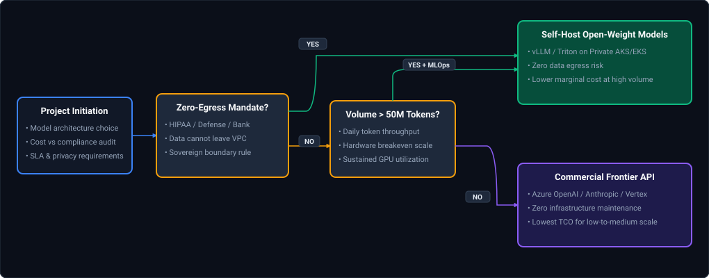

*D2 Source: [`10_self_hosting_vs_commercial_api_decision_matrix.d2`](assets/12_ai_infrastructure_serving_and_llmops_faq/10_self_hosting_vs_commercial_api_decision_matrix.d2)*

#### Comparison Matrix: Self-Hosting vs API Providers
| Dimension | Commercial API Providers (OpenAI / Anthropic) | Self-Hosted Open-Weight (vLLM on AKS/EKS) |
| :--- | :--- | :--- |
| **Pricing Model** | Variable cost: Pay-per-token | Fixed cost: 24/7 reserved GPU instances |
| **Data Privacy** | Trust-based: Vendor promises zero retention | **Guaranteed: Zero egress outside private VPC** |
| **Model Customization**| Limited to prompt engineering & fine-tuning APIs | **Full access to raw weights, logits & speculative decoding** |
| **Scaling Dynamics** | Instant elasticity; handles massive traffic spikes | Fixed capacity; burst traffic causes queuing |
| **Operational Burden**| Zero infrastructure management | High: Kubernetes, CUDA, vLLM, OOM monitoring |

#### Core Curriculum Cross-Reference
*Deep-dive theoretical reference: See [12. AI Infrastructure, High-Throughput Serving & LLMOps: Enterprise Hosting Architectures](../12_ai_infrastructure_serving_and_llmops.md#1-enterprise-cloud-ai-platforms--hosting-architectures)*

---

### Scenario 14: [Hard] Zero-Egress PII Protection Architectures for Enterprise LLM Ingestion
**Difficulty:** [Hard]  
**Topic Covered:** Data Privacy, Client-Side Pseudonymization Proxy (Microsoft Presidio), Private VPC Endpoints, Token Vaults  
**Question:** *An enterprise client in banking mandates that zero PII or customer financial identifiers can ever leave their private network or be sent to external LLM APIs. What end-to-end architectures do you propose?*

#### Definition & Core Concepts
When regulated institutions leverage external frontier models (e.g., Azure OpenAI or Anthropic Bedrock) without violating GDPR, GLBA, or DPDP laws, they implement a **Zero-Egress Pseudonymization & Re-hydration Gateway**:
1. **Client-Side Tokenization / Masking Proxy (Microsoft Presidio):**
   - Intercepts outgoing prompts inside the client's secure VPC before any external HTTP request is made.
   - Leverages high-speed Named Entity Recognition (NER) models (Spacy / RoBERTa) and deterministic regex patterns to detect PII (Customer Names, SSNs, Credit Card Numbers, Email Addresses).
2. **Encrypted Token Vault:**
   - Replaces detected PII with deterministic synthetic surrogate tokens (e.g. `John Doe` $	o$ `<CUSTOMER_NAME_1>`, `4532-XXXX-XXXX-1234` $	o$ `<CARD_NUM_1>`).
   - Stores the cryptographic mapping in an ephemeral, high-speed in-memory database (Redis with TLS and field-level AES-256 encryption) with a short TTL (15 minutes).
3. **Anonymized External Inference:**
   - Dispatches the de-identified prompt to the external LLM endpoint over Private Endpoints / AWS PrivateLink. The external model reasons over the surrogate tokens.
4. **Downstream Re-hydration Engine:**
   - When the LLM completion streams back, the proxy intercepts the response, performs reverse lookup against the Token Vault, replaces `<CUSTOMER_NAME_1>` with `John Doe`, and returns the natural text to the end user.

#### Visual Architectural Flow
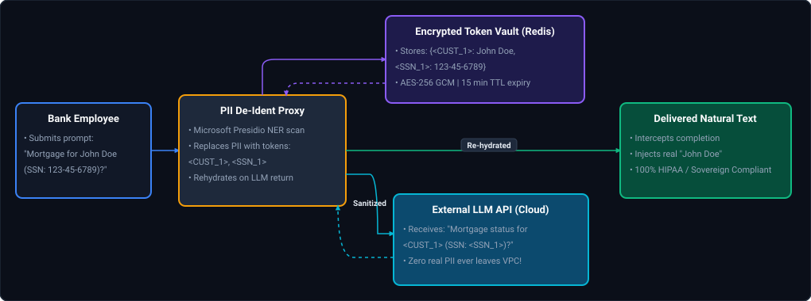

*D2 Source: [`11_zero_egress_pii_token_vault_gateway.d2`](assets/12_ai_infrastructure_serving_and_llmops_faq/11_zero_egress_pii_token_vault_gateway.d2)*

#### Production Implementation / Python Pseudonymization Proxy
```python
from presidio_analyzer import AnalyzerEngine
from presidio_anonymizer import AnonymizerEngine
from presidio_anonymizer.entities import OperatorConfig
import redis
import uuid

class ZeroEgressPIIGateway:
    def __init__(self, redis_host: str = "localhost", redis_port: int = 6379):
        self.analyzer = AnalyzerEngine()
        self.anonymizer = AnonymizerEngine()
        self.vault = redis.Redis(host=redis_host, port=redis_port, decode_responses=True)

    def sanitize_and_tokenize(self, text: str, session_id: str) -> str:
        # Step 1: Detect PII entities in incoming prompt
        results = self.analyzer.analyze(text=text, entities=["PERSON", "EMAIL_ADDRESS", "PHONE_NUMBER", "US_SSN"], language="en")
        
        # Step 2: Build token vault mapping
        mapping = {}
        for res in results:
            original_val = text[res.start:res.end]
            surrogate_token = f"<{res.entity_type}_{uuid.uuid4().hex[:6]}>"
            mapping[surrogate_token] = original_val
            
            # Persist mapping in encrypted Redis vault with 10-minute expiration
            self.vault.setex(f"{session_id}:{surrogate_token}", 600, original_val)

        # Step 3: Replace PII with surrogate tokens
        sanitized_text = text
        for token, original in mapping.items():
            sanitized_text = sanitized_text.replace(original, token)
            
        return sanitized_text

    def rehydrate_response(self, llm_response: str, session_id: str) -> str:
        # Step 4: Scan and replace surrogate tokens back to ground-truth values
        keys = self.vault.keys(f"{session_id}:*")
        rehydrated = llm_response
        for k in keys:
            token = k.split(":", 1)[1]
            original = self.vault.get(k)
            rehydrated = rehydrated.replace(token, original)
        return rehydrated
```

#### Complexity Analysis
- **NER Analysis Overhead:** Adds $pprox 15	ext{–}35	ext{ms}$ latency to input prompt processing on GPU / modern CPU.
- **Privacy Security Guarantee:** Mathematically eliminates compliance violations under GDPR / HIPAA by enforcing zero egress of sensitive tokens across network boundaries.

#### Core Curriculum Cross-Reference
*Deep-dive theoretical reference: See [12. AI Infrastructure, High-Throughput Serving & LLMOps: Enterprise Hosting Architectures](../12_ai_infrastructure_serving_and_llmops.md#1-enterprise-cloud-ai-platforms--hosting-architectures)*

