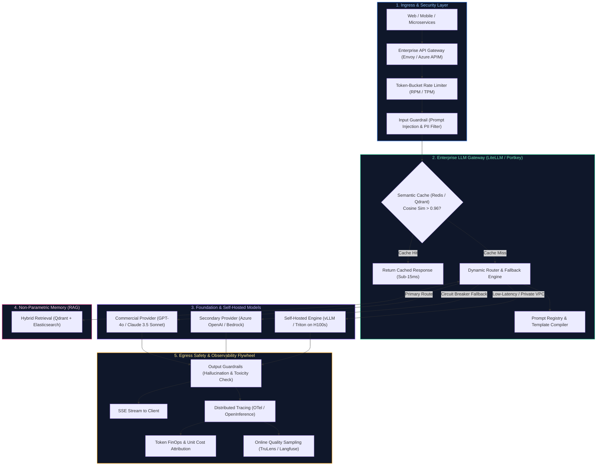
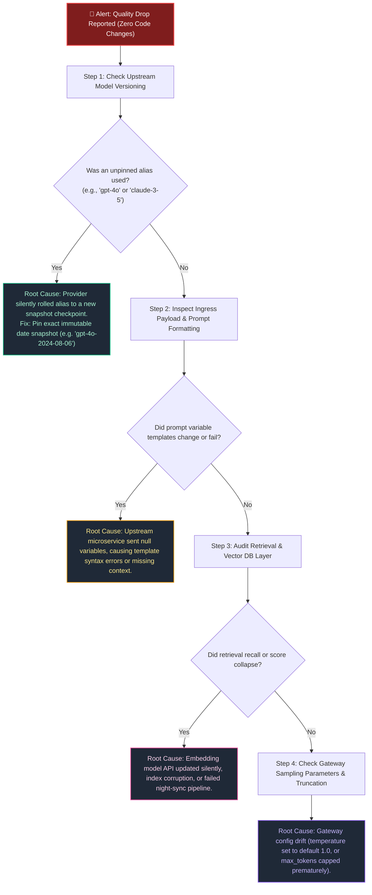
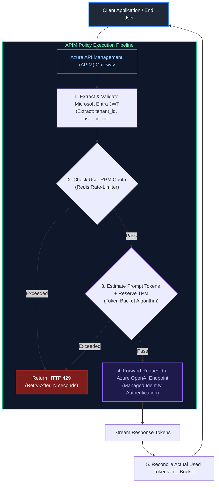
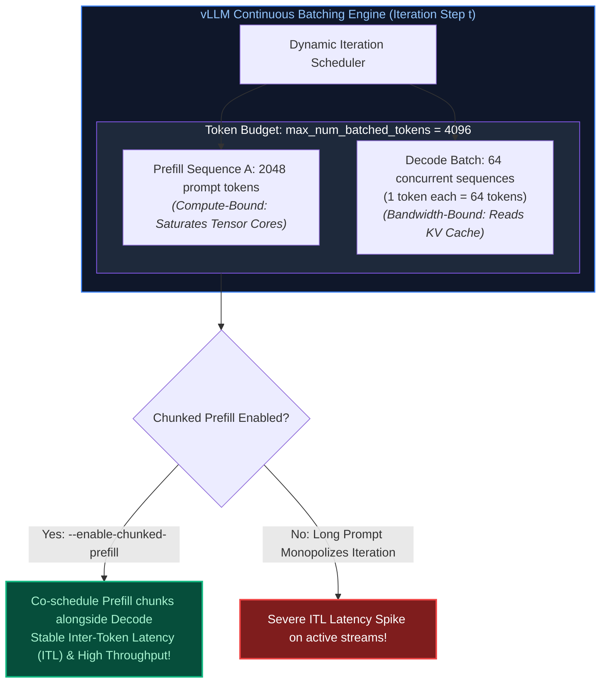

# 12. AI Infrastructure, High-Throughput Serving & LLMOps: Interview FAQs

A comprehensive guide to interview scenarios covering GPU memory allocation, vLLM continuous batching, KV cache saturation, production GenAI architecture, sudden quality degradation triage, Azure API Management rate limiting, and distributed LLMOps observability.

---

## Table of Contents
- [Scenario 1: GPU KV Cache Saturation & Continuous Batching Triage](#scenario-1-hard-gpu-kv-cache-saturation--continuous-batching-triage)
- [Scenario 2: Detecting Fraud Model Precision Drift (15% Drop) & Safe Automated Retraining](#scenario-2-medium-detecting-fraud-model-precision-drift-15-drop--safe-automated-retraining)
- [Scenario 3: Designing Explainable, Auditable, and Reproducible AI Decisioning for Regulators](#scenario-3-medium-designing-explainable-auditable-and-reproducible-ai-decisioning-for-regulators)
- [Scenario 4: Key Architectural Components of a Production-Ready GenAI Application](#scenario-4-medium-key-architectural-components-of-a-production-ready-genai-application)
- [Scenario 5: Sudden Production Response Quality Degradation Triage Runbook (Zero Code Changes)](#scenario-5-hard-sudden-production-response-quality-degradation-triage-runbook-zero-code-changes)
- [Scenario 6: Rate Limiting & Abuse Prevention for LLM Applications on Azure](#scenario-6-medium-rate-limiting--abuse-prevention-for-llm-applications-on-azure)
- [Scenario 7: End-to-End Observability, Telemetry & FinOps for Production GenAI](#scenario-7-medium-end-to-end-observability-telemetry--finops-for-production-genai)
- [Scenario 8: Sizing vLLM Continuous Batching Parameters (Sequences vs Batched Tokens)](#scenario-8-hard-sizing-vllm-continuous-batching-parameters-sequences-vs-batched-tokens)

---

### Scenario 1: [Hard] GPU KV Cache Saturation & Continuous Batching Triage
**Difficulty:** [Hard]
**Question**: Your team deploys an open-source 70B parameter LLM on an 8x A100 (80GB) node using vLLM. Under peak load, incoming requests experience sudden latency spikes from 800ms to over 25 seconds. What is the root cause, and how do you resolve it?

**Solution**:
1. **Root Cause Analysis (KV Cache Exhaustion)**:
   - For a 70B parameter model in FP16, model weights consume $\approx 140$ GB across the 640 GB total GPU pool.
   - The remaining VRAM is allocated to the KV cache.
   - Under concurrent requests with long prompt context (e.g., 8,000 tokens), the KV cache expands dynamically ($2 \times n_{\text{layers}} \times d_{\text{model}} \times \text{seq\_len} \times 2$ bytes).
   - When VRAM saturates, vLLM is forced to preempt running requests, offloading their KV blocks to CPU RAM or recomputing them from scratch during the decode phase, causing catastrophic latency degradation.
2. **Mitigation Playbook**:
   - **PagedAttention Chunk Tuning**: Ensure block size is tuned (e.g., 16 or 32 tokens) to eliminate internal fragmentation.
   - **KV Cache Quantization**: Enable FP8 or INT8 KV caching (`--kv-cache-dtype fp8`), reducing memory consumption by 50% and doubling concurrency headroom.
   - **Speculative Decoding**: Use a small draft model (e.g., 8B) to generate draft tokens and verify with the 70B model in parallel batches.
   - **Queue Shedding & Admission Control**: Configure LiteLLM or Envoy upstream gateway to return HTTP 429 when queue depth exceeds threshold, rather than letting the inference engine thrash.

---

### Scenario 2: [Medium] Detecting Fraud Model Precision Drift (15% Drop) & Safe Automated Retraining
**Difficulty:** [Medium]
**Question**: Your production fraud detection model's precision drops 15% over three months with zero application code changes. How do you detect the statistical drift, isolate the underlying cause, and retrain/deploy a new model without letting fraudulent transactions slip through in the interim?

**Solution**:
1. **Statistical Drift Detection (Evidently / WhyLogs)**:
   - **Covariate Shift (Data Drift)**: Measure divergence between inference feature distributions and the baseline training set.
   - Continuous features (e.g. transaction amount, velocity): Run **Two-Sample Kolmogorov-Smirnov (KS) test** ($p < 0.05$ flags drift).
   - Categorical features (e.g. merchant category, device OS, country code): Compute **Population Stability Index (PSI)**:
     $$PSI = \sum (\text{Actual}\% - \text{Baseline}\%) \times \ln\left(\frac{\text{Actual}\%}{\text{Baseline}\%}\right)$$
     A $PSI \ge 0.25$ indicates severe distribution shift.
   - **Concept Drift**: Fraudsters adapted tactics (e.g. splitting transactions below \$50 to bypass velocity rules). The relationship $P(Y \mid X)$ changed.
2. **Root Cause Isolation**:
   - Decompose drift by feature contribution. Analyze high-PSI features: Did a new digital wallet provider launch? Did a specific merchant category experience credential stuffing?
3. **Safe Retraining & Zero-Exposure Deployment (Champion-Challenger)**:
   - **Never hot-swap an unproven retrained model directly into production**.
   - **Phase 1: Shadow Mode Deployment**: Deploy retrained Challenger model (v2.0) alongside Champion (v1.0). Challenger receives live Kafka transaction streams and emits predictions to an offline telemetry store without executing payment blocks.
   - **Phase 2: Offline Label Reconciliation**: Once 30 days of chargebacks and confirmed merchant disputes are ingested, compute true offline precision and recall curves.
   - **Phase 3: Canary Promotion**: Route 5% $\to$ 25% $\to$ 100% of live traffic to v2.0 once precision improves to target SLA ($\ge 92\%$), with automated rollback triggered if false positive rates spike.

---

### Scenario 3: [Medium] Designing Explainable, Auditable, and Reproducible AI Decisioning for Regulators
**Difficulty:** [Medium]
**Question**: Regulators (e.g. CFPB, FCA, BaFin) audit your automated lending system and demand an explanation for why an AI credit model declined a specific customer's loan application six months ago. How do you design the system so every single inference decision is fully explainable, auditable, and bit-level reproducible months later?

**Solution**:
1. **The Three Pillars of Regulatory AI Governance**:
   - **Feature Snapshot Immutability**: The exact feature vector passed to the model at decision time $t_0$ must be stored immutably.
   - **Model Artifact & Environment Lineage**: The exact model binary, weights, hyperparameters, and Python runtime dependencies must be tracked.
   - **Local Feature Attribution (Explainability)**: The mathematical contribution of each feature to the decline decision must be calculated and archived.
2. **Architecture Implementation**:
   - **Feature Store Point-in-Time Snapshot**: When the credit decision API executes, it saves the input payload and retrieved offline features directly into an immutable Delta Lake / Iceberg table partitioned by date with a unique `decision_uuid`.
   - **MLflow Model Registry & Git SHA Pinning**: Every registered model artifact is pinned to a Git commit hash, MLflow run ID (`runs:/a1b2c3d4/model`), and Docker container digest. The `decision_uuid` records the exact `model_version` (e.g., `credit_risk_v2.4.1`).
   - **Pre-Computed TreeSHAP Explanations**:
     - At inference time, run **TreeSHAP** (SHapley Additive exPlanations) to calculate the marginal contribution of each feature:
       $$\text{Prediction Score} = \phi_0 + \sum_{i=1}^M \phi_i$$
     - The top negative SHAP values are extracted (e.g., `debt_to_income_ratio: -0.42`, `delinquencies_24m: -0.38`) and converted into Adverse Action reason codes mandated by banking law (e.g. *"High debt-to-income ratio"*, *"Recent payment delinquencies"*).
     - Store both the SHAP vector and the human-readable reasons in the regulatory audit log.
3. **Reproducibility Guarantee**:
   - To prove decision integrity 6 months later: Load the feature snapshot from the immutable table, invoke the versioned model artifact from MLflow in an isolated container, and verify that the recomputed output score matches the recorded score bit-for-bit ($\Delta = 0.000000$).

---

### Scenario 4: [Medium] Key Architectural Components of a Production-Ready GenAI Application
**Difficulty:** [Medium]
**Topic Covered:** Production GenAI System Design, LLM Gateways, Guardrails, Serving, Semantic Cache  
**Question:** Explain the key components required to build a robust, scalable, enterprise-grade Generative AI application in production.

#### Production Architecture Topology



#### Detailed Component Decomposition
1. **API Ingress, Rate-Limiting & Security Guardrails:**
   - Enforces user authentication (OAuth2/OIDC), rate limits (by Requests Per Minute and Tokens Per Minute per customer tier), and DDoS protection.
   - Inspects queries with an input safety classifier (e.g., Llama-Guard or NeMo) to detect jailbreaks, role-reversal attacks, and sensitive PII before any costly model execution.
2. **Enterprise Model Gateway & Resilient Routing:**
   - **Unified API Facade:** Translates standard OpenAI-compatible requests across AWS Bedrock, Azure OpenAI, GCP Vertex AI, and self-hosted vLLM clusters.
   - **Hedging & Circuit Breaking:** If Azure OpenAI returns HTTP 503 or latency exceeds 3.5 seconds, dynamically failover to AWS Bedrock Anthropic Claude without client error.
3. **Semantic Caching Layer:**
   - Embeds incoming queries and queries an in-memory vector cache (Redis / Milvus). If cosine similarity exceeds $0.96$ against an existing cached prompt, returns the cached answer in $<15\text{ms}$, slashing model API costs by $30\text{--}50\%$.
4. **Prompt Management & Versioned Registry:**
   - Decouples prompt templates from Python/Java source code. Prompts are maintained in a centralized registry (Langfuse / MLflow / Promptfoo) with strict semantic versioning (`v2.4.1`) and automated canary promotion.
5. **High-Performance Serving Infrastructure:**
   - For self-hosted open-source models (Llama 3, Mistral, DeepSeek), leverages optimized engines (vLLM, SGLang, TensorRT-LLM) utilizing PagedAttention, continuous iteration-level batching, and FP8 quantization to maximize GPU utilization.
6. **Output Guardrails & Streaming Egress:**
   - Streams tokens via Server-Sent Events (SSE).
   - In-flight regex and NER scrubbers mask any unintended credit card numbers or internal API keys.
7. **End-to-End Observability & FinOps Telemetry:**
   - OpenTelemetry collectors ingest spans for every query: Time-To-First-Token (TTFT), Time-Per-Output-Token (TPOT), prompt/completion token consumption, and per-user cost attribution.

---

### Scenario 5: [Hard] Sudden Production Response Quality Degradation Triage Runbook (Zero Code Changes)
**Difficulty:** [Hard]
**Topic Covered:** Silent Model Drift, Upstream Checkpoint Pinning, Ingestion Truncation, Triage Runbook  
**Question:** Your production GenAI customer support system experiences a sudden, severe drop in response quality (hallucinations, formatting failures, truncated answers). Zero application code changes were deployed. How do you systematically isolate the root cause and restore SLA?

#### Systematic Root Cause Diagnosis Matrix



#### The 5-Step Triage Execution Playbook
1. **Verify Immutable Checkpoint Pinning (The Alias Trap):**
   - *Investigation:* Check the `model` parameter in gateway logs. Did the application request `gpt-4o`, `text-embedding-3-small`, or `gemini-1.5-pro` without an explicit date-stamped suffix?
   - *Failure Mode:* Model providers continuously update unversioned model aliases. A stealth provider update can alter safety thresholds, instruction following, or system prompt deference.
   - *Resolution:* Immediately pin the model string to the historical, immutable checkpoint (e.g., `gpt-4o-2024-08-06`).
2. **Inspect Temperature & Sampling Hyperparameters:**
   - *Investigation:* Verify whether the inference gateway or client SDK defaulted back to `temperature = 1.0` or `top_p = 1.0` due to a configuration rollout.
   - *Resolution:* Lock production parameters in the central gateway configuration (`temperature: 0.0`, `seed: 42`).
3. **Audit Vector Retrieval Quality & Embedding Model Incompatibility:**
   - *Investigation:* Inspect the retrieved chunk scores in OpenTelemetry traces. If cosine similarity dropped across all queries from $0.82 \to 0.45$, the retrieval layer failed.
   - *Failure Mode:* A developer or automated ingestion script generated embeddings with a newer model version (e.g. `text-embedding-3-large`) while the query engine still embeds using `text-embedding-ada-002`. Incompatible vector spaces cause random nearest neighbors.
   - *Resolution:* Rollback the ingestion job or re-index the collection atomically.
4. **Detect Context Window Truncation & Silent Dropping:**
   - *Investigation:* Compare prompt token counts against model context limits.
   - *Failure Mode:* An upstream customer added large attachments, exceeding the prompt budget. The gateway naively truncated the prompt from the top, discarding the system prompt and instructions.
   - *Resolution:* Enforce strict context chunk budgets with deterministic sliding window truncation preserving system instructions.
5. **Run Synthetic Golden Benchmark Suite:**
   - Execute the automated test suite of 200 synthetic reference queries. Compare automated LLM-as-a-judge scores against historical release baselines to pinpoint exact regression categories (e.g. JSON syntax vs. factual correctness).

---

### Scenario 6: [Medium] Rate Limiting & Abuse Prevention for LLM Applications on Azure
**Difficulty:** [Medium]
**Topic Covered:** Azure API Management (APIM), Distributed Token Bucket, RPM/TPM Dual Throttling, 429 Backoff  
**Question:** How would you design and implement production rate limiting for an LLM application hosted on Azure? Cover per-user limits, multi-tenant tiering, TPM/RPM enforcement, abuse prevention, and handling traffic spikes.

#### Multi-Dimensional Rate Limiting Architecture
Standard web APIs rate-limit solely on **Requests Per Minute (RPM)**. In LLM applications, RPM rate-limiting is completely insufficient: a user submitting 5 requests containing 100,000 tokens each can exhaust your Azure OpenAI Provisioned Throughput Unit (PTU) capacity and trigger global HTTP 429 outages for all other users.
Production systems enforce **Multi-Dimensional Rate Limiting**:
1. **Requests Per Minute (RPM):** Prevents network-level connection flooding.
2. **Tokens Per Minute (TPM):** Prevents GPU compute and memory starvation.
3. **Concurrent Active In-Flight Requests:** Prevents thread pool and socket exhaustion.



#### Production Azure APIM Policy Implementation
Azure API Management (APIM) provides native, enterprise-grade LLM rate-limiting policies (`llm-token-limit` and `rate-limit-by-key`):

```xml
<policies>
    <inbound>
        <base />
        <!-- 1. Extract Tenant ID and User Subscription Tier from JWT Claims -->
        <set-variable name="tenantId" value="@(context.Request.Headers.GetValueOrDefault("X-Tenant-ID", "anonymous"))" />
        <set-variable name="userTier" value="@(context.Request.Headers.GetValueOrDefault("X-Subscription-Tier", "standard"))" />

        <!-- 2. Dual Enforcement: Rate Limit by Requests Per Minute (RPM) -->
        <rate-limit-by-key calls="60" renewal-period="60" 
                           counter-key="@((string)context.Variables["tenantId"])" 
                           remaining-calls-header-name="X-RateLimit-Remaining-RPM" />

        <!-- 3. LLM Token Limit: Enforce Tokens Per Minute (TPM) using Token Bucket -->
        <!-- Standard Tier: 40,000 TPM | Enterprise Tier: 200,000 TPM -->
        <choose>
            <when condition="@((string)context.Variables["userTier"] == "enterprise")">
                <llm-token-limit counter-key="@((string)context.Variables["tenantId"])"
                                 tokens-per-minute="200000"
                                 estimate-prompt-tokens="true"
                                 remaining-tokens-header-name="X-RateLimit-Remaining-TPM" />
            </when>
            <otherwise>
                <llm-token-limit counter-key="@((string)context.Variables["tenantId"])"
                                 tokens-per-minute="40000"
                                 estimate-prompt-tokens="true"
                                 remaining-tokens-header-name="X-RateLimit-Remaining-TPM" />
            </otherwise>
        </choose>

        <!-- 4. Authenticate to Azure OpenAI using System-Assigned Managed Identity -->
        <authentication-managed-identity resource="https://cognitiveservices.azure.com" />
    </inbound>
    <backend>
        <base />
    </backend>
    <outbound>
        <base />
    </outbound>
    <on-error>
        <!-- Graceful handling of upstream Azure OpenAI 429 throttling -->
        <choose>
            <when condition="@(context.Response.StatusCode == 429)">
                <set-header name="Retry-After" exists-action="override">
                    <value>@(context.Response.Headers.GetValueOrDefault("Retry-After", "5"))</value>
                </set-header>
            </when>
        </choose>
        <base />
    </on-error>
</policies>
```

#### Production Client Retry Best Practice: Exponential Backoff with Jitter
When clients hit rate limits, naive retries trigger thundering herd problems that crash the gateway:
- **Exponential Backoff Formula:** $t_{\text{wait}} = \min(t_{\text{max}}, t_{\text{base}} \times 2^{\text{attempt}}) + \text{random\_jitter}(0, 1)$
- Clients must respect the `Retry-After` header sent by APIM before retrying.

---

### Scenario 7: [Medium] End-to-End Observability, Telemetry & FinOps for Production GenAI
**Difficulty:** [Medium]
**Topic Covered:** OpenTelemetry Semantic Conventions, TTFT, TPOT, Cost Tracking, Quality Monitoring  
**Question:** What does complete, end-to-end observability look like for a production Generative AI application? What metrics, traces, and logs would you capture across the model, retrieval pipeline, infrastructure, and financial cost layers?

#### The 4 Pillars of GenAI Telemetry

```mermaid
flowchart TD
    subgraph P1 ["Pillar 1: System Latency & Performance"]
        direction TB
        L1["<b>TTFT (Time-to-First-Token)</b><br/>User perception of responsiveness<br/>Target: < 400ms"]
        L2["<b>TPOT (Time-Per-Output-Token)</b><br/>Streaming decode speed<br/>Target: < 30ms/token"]
        L3["<b>E2E Latency</b><br/>Total pipeline duration<br/>Target: < 2.5s"]
    end

    subgraph P2 ["Pillar 2: Cost Governance & FinOps"]
        direction TB
        C1["<b>Prompt Token Count</b><br/>Input billable tokens"]
        C2["<b>Completion Token Count</b><br/>Output billable tokens"]
        C3["<b>Cost Attribution</b><br/>Dollar cost per user, tenant & feature"]
    end

    subgraph P3 ["Pillar 3: Retrieval & Pipeline Quality"]
        direction TB
        Q1["<b>Vector Retrieval Latency</b><br/>HNSW & BM25 search duration"]
        Q2["<b>Semantic Cache Hit Ratio</b><br/>% queries served from Redis cache"]
        Q3["<b>Context Precision & Recall</b><br/>Quality of retrieved chunks"]
    end

    subgraph P4 ["Pillar 4: Safety & Faithfulness"]
        direction TB
        S1["<b>Groundedness Score</b><br/>Zero hallucination verification"]
        S2["<b>Toxicity & PII Flags</b><br/>Sensitive content containment"]
        S3["<b>User Feedback Flywheel</b><br/>Explicit thumbs up / thumbs down"]
    end

    style P1 fill:#0f172a,stroke:#3b82f6,stroke-width:1.5px,color:#93c5fd
    style P2 fill:#0f172a,stroke:#10b981,stroke-width:1.5px,color:#6ee7b7
    style P3 fill:#0f172a,stroke:#8b5cf6,stroke-width:1.5px,color:#c4b5fd
    style P4 fill:#0f172a,stroke:#ec4899,stroke-width:1.5px,color:#fbcfe8
```



#### Distributed Tracing with OpenTelemetry GenAI Semantic Conventions
Every user request generates a single distributed trace with nested spans capturing each pipeline stage:

```text
[Trace: req_98234-az-us-east] (Total: 1,840ms | Cost: $0.00412)
 ├── [Span: api_gateway_ingress] (Duration: 18ms)
 ├── [Span: input_guardrails_evaluation] (Duration: 62ms | Status: PASSED)
 ├── [Span: semantic_cache_lookup] (Duration: 8ms | Cache: MISS)
 ├── [Span: query_transformation_hyde] (Duration: 210ms | Tokens: 42)
 ├── [Span: hybrid_retrieval] (Duration: 45ms)
 │    ├── [Span: qdrant_dense_search] (Duration: 38ms | Hits: 100)
 │    └── [Span: elasticsearch_bm25] (Duration: 24ms | Hits: 100)
 ├── [Span: cross_encoder_rerank] (Duration: 110ms | In: 50 -> Out: 5)
 └── [Span: llm_generate_stream] (Duration: 1,387ms)
      ├── Metric: gen_ai.client.token.prompt_tokens = 1,420
      ├── Metric: gen_ai.client.token.completion_tokens = 280
      ├── Metric: gen_ai.server.time_to_first_token = 320ms
      ├── Metric: gen_ai.server.time_per_output_token = 24.2ms
      ├── Metric: gen_ai.response.model = "gpt-4o-2024-08-06"
      └── Metric: gen_ai.computed_cost_usd = 0.00392
```

#### Enterprise Production Alerting Matrix

| Alert Name | Metric & Condition | Evaluation Window | Severity | Automated Action |
| :--- | :--- | :--- | :--- | :--- |
| **High TTFT Spike** | $p95(\text{TTFT}) > 1200\text{ms}$ | 5 minutes | Warning | Trigger Gateway Hedging / Failover to secondary provider |
| **Upstream 429 / 5xx Surge**| Error Rate $> 2\%$ | 2 minutes | Critical (PagerDuty) | Trip circuit breaker; route traffic to standby region |
| **Budget Burn Rate Anomaly**| Hourly spend $> 2.5\times$ 7-day average | 1 hour | Critical | Enforce temporary TPM quota restrictions per tenant |
| **Hallucination Drift** | Faithfulness Score $< 0.90$ | 15 minutes (rolling)| Critical | Fallback to strict deterministic "I don't know" mode |
| **Cache Ratio Collapse** | Semantic Cache Hit $< 10\%$ | 30 minutes | Warning | Inspect Redis cluster health & cache eviction logs |

#### Core Curriculum Cross-Reference
*Deep-dive theoretical reference: See [12. AI Infrastructure, High-Throughput Serving & LLMOps](../12_ai_infrastructure_serving_and_llmops.md#15-distributed-observability-telemetry--cost-governance)*

---

### Scenario 8: [Hard] Sizing vLLM Continuous Batching Parameters (Sequences vs Batched Tokens)
**Difficulty:** [Hard]
**Topic Covered:** Continuous Batching, Chunked Prefill, Compute vs Bandwidth Bound Sizing, PagedAttention  
**Question:** *When configuring a high-throughput LLM inference microservice using vLLM or TensorRT-LLM, which serving parameters do you tune—specifically sequences (`max_num_seqs`) and batched tokens (`max_num_batched_tokens`)—and how do you balance prefill compute against decode memory bandwidth?*

#### 1. Architectural Foundations: Prefill vs. Decode Disaggregation
LLM inference consists of two fundamentally distinct operational phases:
1. **The Prefill Phase (Context Processing):**
   - Ingests the entire prompt context ($N$ prompt tokens) and computes initial Key-Value vectors.
   - **Compute-Bound (FLOP/s):** Characterized by high arithmetic intensity; parallelized efficiently across Tensor Cores using large GEMM (General Matrix Multiply) operations.
2. **The Decode Phase (Autoregressive Generation):**
   - Generates one token at a time per request ($1$ token per step) conditioned on all previous tokens.
   - **Memory-Bandwidth Bound (GB/s):** Low arithmetic intensity; must read the entire model weight matrix and KV cache from High Bandwidth Memory (HBM) to compute just a single new token.



#### 2. Core Serving Parameters & Mathematical Tuning Rules

| Parameter Flag | Definition & Architectural Scope | Production Sizing Rule | Failure Mode if Misconfigured |
| :--- | :--- | :--- | :--- |
| `--max-num-seqs` | Maximum number of concurrent sequences in a single iteration batch. | Sized to target concurrency: **$256$ to $512$** for lightweight 8B models; **$64$ to $128$** for 70B models. | Set too high $\to$ KV cache fragmentation and preemption; set too low $\to$ GPU compute underutilization. |
| `--max-num-batched-tokens` | Maximum cumulative tokens processed in a single forward pass across both prefill and decode. | Sized to GPU compute ceiling: **$2048$ to $8192$** (typically $4096$ on NVIDIA A100 / H100). | Set too low $\to$ prompt prefill latency explodes; set too high $\to$ long prompts stall running decode streams. |
| `--enable-chunked-prefill` | Slices large prompt contexts into chunks of size `max_num_batched_tokens`. | **Always set to `true`** in production conversational workloads. | Without chunked prefill, a 4,000-token prompt monopolizes the GPU for 800ms, causing unbearable UI stutter. |
| `--gpu-memory-utilization` | Fraction of total GPU VRAM reserved for model weights + dynamic KV cache pool. | Set to **$0.92$ to $0.95$** in dedicated container pods (leaves 5–8% for PyTorch CUDA context and activations). | Set to $1.0 \to$ immediate CUDA Out-Of-Memory during peak activation spikes. |
| `--max-model-len` | Maximum supported sequence length (prompt + completion). | Clamp strictly to business SLA (e.g. $8192$ tokens instead of theoretical $128\text{k}$). | If unclamped, a single user sending a 100k document claims 80% of total VRAM, starving 50 concurrent users. |

#### 3. Production vLLM Deployment Manifest (Kubernetes Engine)
```bash
python3 -m vllm.entrypoints.openai.api_server \
    --model meta-llama/Meta-Llama-3.1-70B-Instruct \
    --tensor-parallel-size 4 \
    --gpu-memory-utilization 0.94 \
    --max-model-len 8192 \
    --max-num-seqs 256 \
    --max-num-batched-tokens 4096 \
    --enable-chunked-prefill true \
    --kv-cache-dtype fp8 \
    --block-size 16 \
    --disable-log-requests \
    --port 8000
```

#### Core Curriculum Cross-Reference
*Deep-dive theoretical reference: See [12. AI Infrastructure, High-Throughput Serving & LLMOps: Continuous Batching & PagedAttention](../12_ai_infrastructure_serving_and_llmops.md#3-serving-engine-mechanics-vllm-sglang--pagedattention)*
