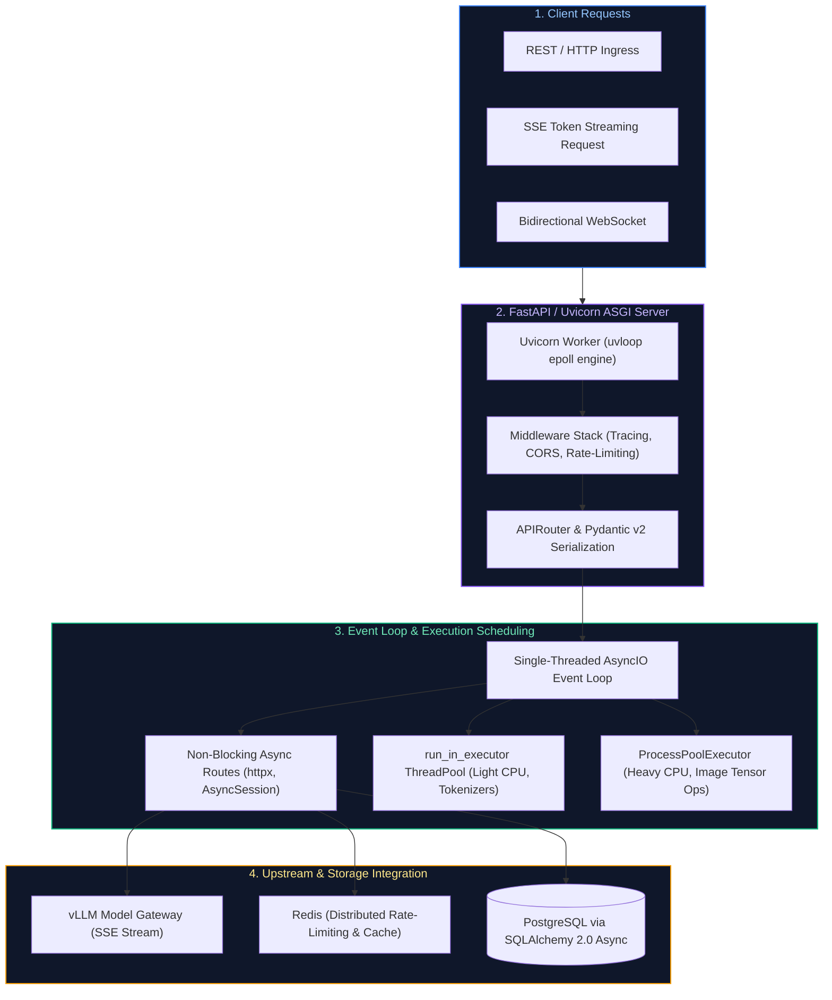

# 13. Python Backend & API Development for AI: Interview FAQs & Playbooks

A comprehensive, production-grade guide to real-world interview scenarios and engineering solutions covering FastAPI async runtime, event loop starvation, Server-Sent Events (SSE) LLM token streaming, WebSockets, Pydantic v2 serialization, connection pooling, and distributed rate limiting.

---

## Architectural Overview: High-Concurrency Async ASGI Runtime for AI Services



---

## Table of Contents & Question Directory

### 1. AsyncIO Event Loop Mechanics & Concurrency
- [Q1. **`[Hard]`** Preventing Event Loop Starvation in FastAPI AI Gateways](#q1-hard-preventing-event-loop-starvation-in-fastapi-ai-gateways)
- [Q2. **`[Medium]`** High-Throughput Server-Sent Events (SSE) Token Streaming for LLMs](#q2-medium-high-throughput-server-sent-events-sse-token-streaming-for-llms)
- [Q3. **`[Medium]`** Bidirectional WebSockets for Real-Time AI Agent Voice & Streaming Workflows](#q3-medium-bidirectional-websockets-for-real-time-ai-agent-voice--streaming-workflows)

### 2. FastAPI Architecture, Pydantic & Lifespan
- [Q4. **`[Easy]`** Pydantic v2 Custom Validators, Serialization & Performance Optimization](#q4-easy-pydantic-v2-custom-validators-serialization--performance-optimization)
- [Q5. **`[Easy]`** Application Lifespan Events (`@asynccontextmanager`) & Connection Pool Warmup](#q5-easy-application-lifespan-events-asynccontextmanager--connection-pool-warmup)
- [Q6. **`[Medium]`** Asynchronous Dependency Injection with Resource Cleanup (`yield`)](#q6-medium-asynchronous-dependency-injection-with-resource-cleanup-yield)

### 3. Networking, Connection Pooling & Security
- [Q7. **`[Hard]`** Managing HTTP Connection Pools with `httpx.AsyncClient` & Preventing Socket Leaks](#q7-hard-managing-http-connection-pools-with-httpxasyncclient--preventing-socket-leaks)
- [Q8. **`[Medium]`** Asynchronous Background Tasks vs Celery Distributed Task Queues](#q8-medium-asynchronous-background-tasks-vs-celery-distributed-task-queues)
- [Q9. **`[Medium]`** ASGI Middleware Execution Order, Timing & CORS Security](#q9-medium-asgi-middleware-execution-order-timing--cors-security)
- [Q10. **`[Medium]`** Structured JSON Logging with OpenTelemetry Trace & Span Context Injection](#q10-medium-structured-json-logging-with-opentelemetry-trace--span-context-injection)
- [Q11. **`[Hard]`** Distributed Rate Limiting via Redis Token Bucket in FastAPI](#q11-hard-distributed-rate-limiting-via-redis-token-bucket-in-fastapi)

### 4. High-Load Scaling, Resiliency & Testing
- [Q12. **`[Hard]`** Handling Large File Streaming Uploads Without Memory Exhaustion](#q12-hard-handling-large-file-streaming-uploads-without-memory-exhaustion)
- [Q13. **`[Hard]`** Offloading Heavy CPU-Bound ML Inference via `ProcessPoolExecutor`](#q13-hard-offloading-heavy-cpu-bound-ml-inference-via-processpoolexecutor)
- [Q14. **`[Medium]`** Graceful Shutdown Handling in Kubernetes: SIGTERM, In-Flight Requests & Drain](#q14-medium-graceful-shutdown-handling-in-kubernetes-sigterm-in-flight-requests--drain)
- [Q15. **`[Medium]`** Testing Asynchronous FastAPI Endpoints with `pytest-asyncio` & `httpx`](#q15-medium-testing-asynchronous-fastapi-endpoints-with-pytest-asyncio--httpx)

---

## 1. AsyncIO Event Loop Mechanics & Concurrency

### Q1. [Hard] Preventing Event Loop Starvation in FastAPI AI Gateways
**Difficulty:** [Hard]  
**Topic Covered:** AsyncIO Event Loop, Blocking I/O, CPU Offloading, Starvation Triage  
**Question:** In a FastAPI service exposing `/predict`, you perform token counting via `tiktoken`, text embedding, and streaming LLM generation. Under load, the entire service hangs, and Kubernetes health probes (`/healthz`) fail. Why is the event loop hanging, and how do you fix it?

#### Root Cause Analysis
FastAPI routes defined with `async def` execute directly on the single-threaded `asyncio` event loop. When synchronous, CPU-intensive operations (such as `tiktoken.encode()`, PyTorch model inference, or synchronous libraries like `requests.get()`) are executed inside an `async def` route, the Python thread is hijacked. The event loop cannot tick, cannot schedule pending tasks, and cannot process incoming TCP handshakes—including K8s `/healthz` heartbeat probes—leading to container restarts.

#### Architectural Resolution
1. **Thread Pool Offloading for Lightweight CPU Work:** Use `asyncio.to_thread()` or `loop.run_in_executor()` to dispatch synchronous tokenizers to a bounded thread pool:
   ```python
   import asyncio
   tokens = await asyncio.to_thread(tokenizer.encode, text)
   ```
2. **Asynchronous HTTP Clients:** Replace `requests` with `httpx.AsyncClient` across all model inference calls.
3. **Dedicated Process Pools for Heavy Tensors:** Offload deep neural network inference to a separate process via `ProcessPoolExecutor` to bypass the GIL entirely.

*Deep-dive theoretical reference: See [Module 13: Python Backend & API Development](../13_python_backend_and_api_development.md#1-concurrency-models-preemptive-threads-vs-multiprocessing-vs-asyncio)*

---

### Q2. [Medium] High-Throughput Server-Sent Events (SSE) Token Streaming for LLMs
**Difficulty:** [Medium]  
**Topic Covered:** Server-Sent Events (SSE), StreamingResponse, Async Generators, Backpressure  
**Question:** How do you implement real-time token streaming from an LLM serving backend (e.g. vLLM) to client web frontends using FastAPI and Server-Sent Events (SSE)?

```python
from fastapi import FastAPI
from fastapi.responses import StreamingResponse
import httpx
import json

app = FastAPI()

async def stream_openai_tokens(prompt: str):
    async with httpx.AsyncClient(timeout=60.0) as client:
        async with client.stream(
            "POST",
            "http://vllm-service:8000/v1/completions",
            json={"prompt": prompt, "stream": True, "max_tokens": 512}
        ) as response:
            async for line in response.aiter_lines():
                if line.startswith("data: "):
                    payload = line[6:].strip()
                    if payload == "[DONE]":
                        break
                    data = json.loads(payload)
                    token = data["choices"][0]["text"]
                    yield f"data: {json.dumps({"token": token})}\n\n"

@app.post("/generate/stream")
async def generate_stream(prompt: str):
    return StreamingResponse(
        stream_openai_tokens(prompt),
        media_type="text/event-stream",
        headers={"Cache-Control": "no-cache", "Connection": "keep-alive"}
    )
```

*Deep-dive theoretical reference: See [Module 13: Python Backend & API Development](../13_python_backend_and_api_development.md#20-real-time-communication-websockets--server-sent-events-sse)*

---

### Q3. [Medium] Bidirectional WebSockets for Real-Time AI Agent Voice & Streaming Workflows
**Difficulty:** [Medium]  
**Topic Covered:** WebSockets, Full-Duplex Streaming, Connection Management, Heartbeats  
**Question:** When is WebSocket communication superior to Server-Sent Events (SSE) in AI applications, and how do you manage connection lifecycles safely in FastAPI?

- **SSE vs WebSockets:** SSE is unidirectional (Server $\\to$ Client) over standard HTTP/1.1 or HTTP/2. Ideal for text token generation. WebSockets provide full-duplex, bidirectional communication over a single TCP connection. Mandatory for interactive voice agents (client streams microphone audio chunks while server streams audio bytes and barge-in interruption signals simultaneously).
- **Implementation Pattern:**
  ```python
  from fastapi import WebSocket, WebSocketDisconnect

  @app.websocket("/ws/agent")
  async def websocket_agent_endpoint(websocket: WebSocket):
      await websocket.accept()
      try:
          while True:
              client_chunk = await websocket.receive_bytes()
              # Process incoming audio or message
              processed_response = await agent_audio_loop(client_chunk)
              await websocket.send_bytes(processed_response)
      except WebSocketDisconnect:
          # Clean up active resources
          pass
  ```

*Deep-dive theoretical reference: See [Module 13: Python Backend & API Development](../13_python_backend_and_api_development.md#20-real-time-communication-websockets--server-sent-events-sse)*

---

## 2. FastAPI Architecture, Pydantic & Lifespan

### Q4. [Easy] Pydantic v2 Custom Validators, Serialization & Performance Optimization
**Difficulty:** [Easy]  
**Topic Covered:** Pydantic v2, Rust Core (`pydantic-core`), `@field_validator`, Serialization  
**Question:** What major performance improvements were introduced in Pydantic v2, and how do you write custom field validators and model serializers?

- **Pydantic v2 Internals:** Rebuilt on a high-performance Rust core (`pydantic-core`). Validation and serialization are 5x to 20x faster than v1, critical when serializing large arrays of vector search embeddings.
- **Field Validation:**
  ```python
  from pydantic import BaseModel, field_validator

  class IngestionRequest(BaseModel):
      doc_id: str
      chunk_size: int

      @field_validator("chunk_size")
      @classmethod
      def validate_chunk_size(cls, v: int) -> int:
          if v < 64 or v > 4096:
              raise ValueError("chunk_size must be between 64 and 4096 tokens")
          return v
  ```

*Deep-dive theoretical reference: See [Module 13: Python Backend & API Development](../13_python_backend_and_api_development.md#11-fastapi-framework-internals--the-starlette-engine)*

---

### Q5. [Easy] Application Lifespan Events (`@asynccontextmanager`) & Connection Pool Warmup
**Difficulty:** [Easy]  
**Topic Covered:** Lifespan Management, Connection Pooling, Startup/Shutdown Hooks  
**Question:** How does FastAPI handle application startup and graceful shutdown in modern versions, and why is this critical for database and model client warmups?

```python
from contextlib import asynccontextmanager
from fastapi import FastAPI
import httpx

state = {}

@asynccontextmanager
async def lifespan(app: FastAPI):
    # STARTUP: Initialize shared connection pools
    state["http_client"] = httpx.AsyncClient(limits=httpx.Limits(max_connections=100))
    yield
    # SHUTDOWN: Close sockets cleanly
    await state["http_client"].aclose()

app = FastAPI(lifespan=lifespan)
```

*Deep-dive theoretical reference: See [Module 13: Python Backend & API Development](../13_python_backend_and_api_development.md#11-fastapi-framework-internals--the-starlette-engine)*

---

### Q6. [Medium] Asynchronous Dependency Injection with Resource Cleanup (`yield`)
**Difficulty:** [Medium]  
**Topic Covered:** FastAPI Dependencies, Generator Yield, Transaction Scoping  
**Question:** How does FastAPI ensure database connections or distributed locks are released even if a route raises an unhandled exception?

- By utilizing Python async generators (`yield`) inside `Depends()`, FastAPI executes the code prior to `yield` before the route runs, injects the resource into the route parameters, and guarantees execution of the post-`yield` block inside an implicit `finally:` block when the request finishes or raises an exception:
  ```python
  from fastapi import Depends
  from sqlalchemy.ext.asyncio import AsyncSession

  async def get_db_session():
      async with async_session_factory() as session:
          try:
              yield session
              await session.commit()
          except Exception:
              await session.rollback()
              raise
  ```

*Deep-dive theoretical reference: See [Module 13: Python Backend & API Development](../13_python_backend_and_api_development.md#11-fastapi-framework-internals--the-starlette-engine)*

---

## 3. Networking, Connection Pooling & Security

### Q7. [Hard] Managing HTTP Connection Pools with `httpx.AsyncClient` & Preventing Socket Leaks
**Difficulty:** [Hard]  
**Topic Covered:** Socket Exhaustion, TCP TIME_WAIT, Connection Pooling, httpx  
**Question:** In an AI agent gateway making 500 requests/sec to OpenAI or embedding APIs, why does creating `async with httpx.AsyncClient()` inside each request route cause production crashes?

#### The Socket Exhaustion Pathology
Creating an `httpx.AsyncClient()` per request forces the OS to allocate a new ephemeral socket and perform a complete TLS 1.3 handshake on every invocation. When the client closes, the socket enters the `TIME_WAIT` state for 60 seconds. Under 500 req/sec, the server exhausts all available ephemeral ports (~65,000), throwing `OSError: [Errno 99] Cannot assign requested address`.

#### Resolution
Instantiate a single global or lifespan-scoped `httpx.AsyncClient` with bounded connection limits:
```python
limits = httpx.Limits(max_keepalive_connections=50, max_connections=200)
client = httpx.AsyncClient(limits=limits, timeout=30.0)
```

*Deep-dive theoretical reference: See [Module 13: Python Backend & API Development](../13_python_backend_and_api_development.md#18-high-performance-asynchronous-http-with-httpx)*

---

### Q8. [Medium] Asynchronous Background Tasks vs Celery Distributed Task Queues
**Difficulty:** [Medium]  
**Topic Covered:** FastAPI BackgroundTasks vs Celery, Out-of-Process Isolation, Crash Resilience  
**Question:** When should you use FastAPI`s built-in `BackgroundTasks` versus an external distributed queue like Celery or RQ?

| Architectural Dimension | FastAPI `BackgroundTasks` | Celery / RabbitMQ / Redis |
| :--- | :--- | :--- |
| **Execution Environment** | In-process, on same ASGI worker thread/loop | External worker processes on dedicated cluster |
| **Crash Survivability** | Low: If worker pod restarts, task is permanently lost | High: Tasks persisted in broker with ACK verification |
| **Resource Isolation** | Memory/CPU shared with live API requests | Complete hardware isolation |
| **Optimal Use Case** | Ephemeral, non-critical actions (sending email, logging) | Long-running ETL, PDF OCR parsing, fine-tuning jobs |

*Deep-dive theoretical reference: See [Module 13: Python Backend & API Development](../13_python_backend_and_api_development.md#11-fastapi-framework-internals--the-starlette-engine)*

---

### Q9. [Medium] ASGI Middleware Execution Order, Timing & CORS Security
**Difficulty:** [Medium]  
**Topic Covered:** ASGI Middleware, Onion Layer Architecture, Execution Timing  
**Question:** Explain how ASGI middleware operates in FastAPI. What is the execution order when multiple middlewares (CORS, Auth, Tracing) are registered?

- **The Onion Layer Pattern:** Middleware executes in reverse order of registration during the request phase, and forward order during the response phase:
  ```text
  Client Request -> [Middleware 1 (Outer)] -> [Middleware 2 (Inner)] -> Route Handler
  Client Response <- [Middleware 1 (Outer)] <- [Middleware 2 (Inner)] <- Route Handler
  ```
- Any middleware that inspects or consumes the request body must buffer the stream to avoid downstream route parsing failures.

*Deep-dive theoretical reference: See [Module 13: Python Backend & API Development](../13_python_backend_and_api_development.md#11-fastapi-framework-internals--the-starlette-engine)*

---

### Q10. [Medium] Structured JSON Logging with OpenTelemetry Trace & Span Context Injection
**Difficulty:** [Medium]  
**Topic Covered:** Structured Logging, OpenTelemetry, Trace Context Injection, Correlation IDs  
**Question:** How do you configure structured JSON logging in FastAPI such that log messages automatically include `trace_id` and `span_id` for distributed observability?

```python
import logging
import json
from opentelemetry import trace

class JsonTraceFormatter(logging.Formatter):
    def format(self, record: logging.LogRecord) -> str:
        span = trace.get_current_span()
        ctx = span.get_span_context()
        log_entry = {
            "timestamp": record.created,
            "level": record.levelname,
            "message": record.getMessage(),
            "logger": record.name,
            "trace_id": format(ctx.trace_id, "032x") if ctx.is_valid else None,
            "span_id": format(ctx.span_id, "016x") if ctx.is_valid else None,
        }
        return json.dumps(log_entry)
```

*Deep-dive theoretical reference: See [Module 13: Python Backend & API Development](../13_python_backend_and_api_development.md#11-fastapi-framework-internals--the-starlette-engine)*

---

### Q11. [Hard] Distributed Rate Limiting via Redis Token Bucket in FastAPI
**Difficulty:** [Hard]  
**Topic Covered:** Rate Limiting, Token Bucket, Redis Lua Scripting, Throttling  
**Question:** How do you implement atomic distributed rate limiting across multiple scaled FastAPI container instances using Redis without race conditions?

#### Redis Lua Script (Atomic Token Bucket)
Standard Redis `GET` followed by `SET` suffers from race conditions under high concurrency. An atomic Lua script executes in a single Redis transaction:
```lua
local key = KEYS[1]
local limit = tonumber(ARGV[1])
local current = tonumber(redis.call(get, key) or 0)

if current + 1 > limit then
    return 0 -- Throttled
else
    redis.call(incrby, key, 1)
    if current == 0 then
        redis.call(expire, key, 60) -- 1 minute window
    end
    return 1 -- Allowed
end
```

*Deep-dive theoretical reference: See [Module 13: Python Backend & API Development](../13_python_backend_and_api_development.md#18-high-performance-asynchronous-http-with-httpx)*

---

## 4. High-Load Scaling, Resiliency & Testing

### Q12. [Hard] Handling Large File Streaming Uploads Without Memory Exhaustion
**Difficulty:** [Hard]  
**Topic Covered:** Chunked Uploads, SpooledTemporaryFile, Disk Spilling, Memory Safety  
**Question:** A user uploads a 5GB video or dataset file to FastAPI. How do you process and persist this upload without loading the entire 5GB into RAM?

- **Using `UploadFile` vs `bytes`:** Using `file: bytes` forces FastAPI to read the entire payload into RAM. Using `file: UploadFile` leverages Python`s `SpooledTemporaryFile`: files under 1MB remain in memory, while larger payloads automatically spill to disk in chunks:
  ```python
  import aiofiles
  from fastapi import UploadFile, File

  @app.post("/upload")
  async def upload_large_file(file: UploadFile = File(...)):
      async with aiofiles.open(f"/storage/{file.filename}", "wb") as out_file:
          while chunk := await file.read(1024 * 1024): # 1MB chunks
              await out_file.write(chunk)
      return {"status": "success"}
  ```

*Deep-dive theoretical reference: See [Module 13: Python Backend & API Development](../13_python_backend_and_api_development.md#11-fastapi-framework-internals--the-starlette-engine)*

---

### Q13. [Hard] Offloading Heavy CPU-Bound ML Inference via `ProcessPoolExecutor`
**Difficulty:** [Hard]  
**Topic Covered:** Multiprocessing, ProcessPoolExecutor, GIL Bypass, Worker Sizing  
**Question:** If your FastAPI service runs local image preprocessing or heavy feature engineering, why does `run_in_executor(None, ...)` fail under multi-core CPUs, and how does `ProcessPoolExecutor` resolve it?

- **GIL Constraints:** Standard `run_in_executor(None)` uses a `ThreadPoolExecutor`. In CPython, Python bytecode execution is bounded by the Global Interpreter Lock (GIL). Running heavy numerical operations on multiple threads simply causes lock contention on a single core.
- **ProcessPoolExecutor:** Spawns separate OS processes with independent Python interpreters and memory spaces, achieving true 100% multi-core CPU utilization across all available cores.

*Deep-dive theoretical reference: See [Module 13: Python Backend & API Development](../13_python_backend_and_api_development.md#1-concurrency-models-preemptive-threads-vs-multiprocessing-vs-asyncio)*

---

### Q14. [Medium] Graceful Shutdown Handling in Kubernetes: SIGTERM, In-Flight Requests & Drain
**Difficulty:** [Medium]  
**Topic Covered:** Kubernetes Pod Lifecycle, SIGTERM, Connection Draining, Grace Period  
**Question:** When Kubernetes terminates a FastAPI pod during a deployment, in-flight LLM streaming requests are abruptly aborted. How do you configure graceful termination?

1. **Uvicorn Graceful Termination:** Uvicorn natively listens for `SIGTERM` and stops accepting new connections while waiting for active requests to complete up to `--timeout-graceful-shutdown 30`.
2. **Kubernetes `preStop` Hook:** Kubernetes removes the pod from the service endpoint asynchronously. Adding a `preStop` sleep hook allows iptables rules to propagate before Uvicorn initiates shutdown:
   ```yaml
   lifecycle:
     preStop:
       exec:
         command: ["/bin/sh", "-c", "sleep 5"]
   ```

*Deep-dive theoretical reference: See [Module 13: Python Backend & API Development](../13_python_backend_and_api_development.md#11-fastapi-framework-internals--the-starlette-engine)*

---

### Q15. [Medium] Testing Asynchronous FastAPI Endpoints with `pytest-asyncio` & `httpx`
**Difficulty:** [Medium]  
**Topic Covered:** Async Testing, pytest-asyncio, Lifespan Fixtures, Mocking  
**Question:** How do you test asynchronous FastAPI endpoints that use database sessions and SSE streaming using `pytest-asyncio`?

```python
import pytest
from httpx import AsyncClient, ASGITransport
from my_app.main import app

@pytest.mark.asyncio
async def test_streaming_endpoint():
    transport = ASGITransport(app=app)
    async with AsyncClient(transport=transport, base_url="http://test") as client:
        response = await client.post("/generate/stream", json={"prompt": "Hello"})
        assert response.status_code == 200
        assert "text/event-stream" in response.headers["content-type"]
```

*Deep-dive theoretical reference: See [Module 13: Python Backend & API Development](../13_python_backend_and_api_development.md#11-fastapi-framework-internals--the-starlette-engine)*
