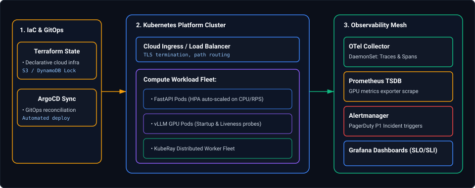
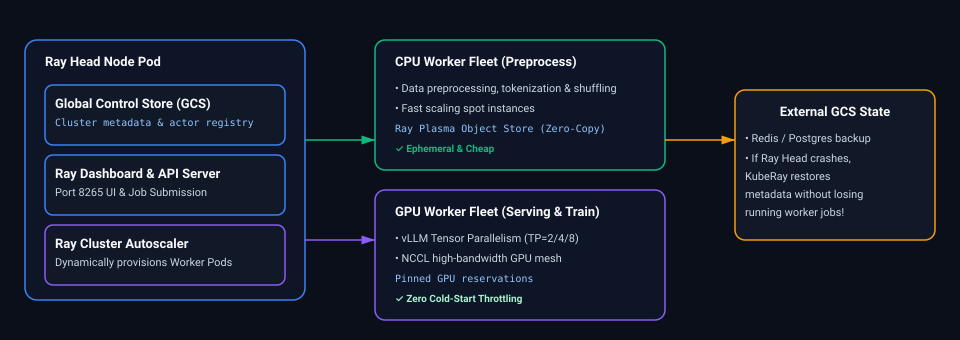
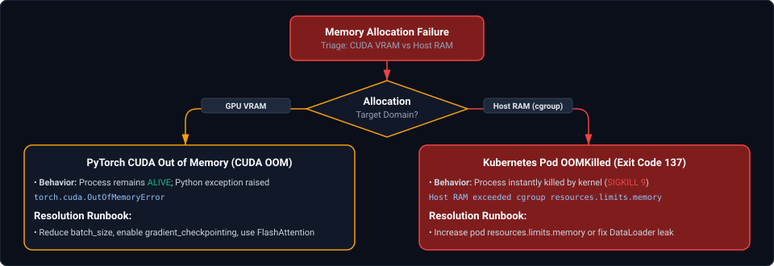

# 15. Cloud Infrastructure, Containers & Observability: Interview FAQs & Playbooks

A comprehensive, production-grade guide to real-world interview scenarios covering multi-stage Docker packaging, Kubernetes probes for AI/LLM serving, Horizontal Pod Autoscaling (HPA) on custom GPU metrics, Spark on Kubernetes, KubeRay operator mechanics, OpenTelemetry distributed tracing, and Prometheus alerting.

---

## Architectural Overview: Cloud-Native Infrastructure & Telemetry Plane



*D2 Source: [`01_cloud_native_kubernetes_infrastructure_telemetry_mesh.d2`](assets/15_cloud_infrastructure_containers_and_observability_faq/01_cloud_native_kubernetes_infrastructure_telemetry_mesh.d2)*

---

## Table of Contents & Question Directory

### 1. Containerization & Kubernetes for AI/Data
- [Q1. **`[Medium]`** Multi-Stage Docker Builds & Layer Caching Optimization for Python Data/AI Apps](#q1-medium-multi-stage-docker-builds--layer-caching-optimization-for-python-dataai-apps)
- [Q2. **`[Medium]`** Kubernetes Startup, Liveness & Readiness Probes for Heavy ML / LLM Serving Pods](#q2-medium-kubernetes-startup-liveness--readiness-probes-for-heavy-ml--llm-serving-pods)
- [Q3. **`[Hard]`** Horizontal Pod Autoscaling (HPA) Using Custom Prometheus GPU Metrics & Queue Depth](#q3-hard-horizontal-pod-autoscaling-hpa-using-custom-prometheus-gpu-metrics--queue-depth)
- [Q8. **`[Hard]`** Triaging Kubernetes Pod `OOMKilled` (Exit Code 137) vs PyTorch `CUDA Out of Memory`](#q8-hard-triaging-kubernetes-pod-oomkilled-exit-code-137-vs-pytorch-cuda-out-of-memory)
- [Q10. **`[Hard]`** Kubernetes Zero-Trust NetworkPolicies & Pod-to-Pod Communication Isolation](#q10-hard-kubernetes-zero-trust-networkpolicies--pod-to-pod-communication-isolation)

### 2. Distributed Compute Platforms (Spark on K8s & Ray)
- [Q4. **`[Hard]`** Apache Spark on Kubernetes vs Dataproc/EMR: Architecture, Shuffling & Cost Trade-offs](#q4-hard-apache-spark-on-kubernetes-vs-dataprocmr-architecture-shuffling--cost-trade-offs)
- [Q5. **`[Hard]`** KubeRay Operator Architecture: Head Node vs Worker Pod Scaling & Fault Tolerance](#q5-hard-kuberay-operator-architecture-head-node-vs-worker-pod-scaling--fault-tolerance)
- [Q11. **`[Medium]`** Graceful Termination of Streaming Consumers (Kafka) During Kubernetes Rolling Updates](#q11-medium-graceful-termination-of-streaming-consumers-kafka-during-kubernetes-rolling-updates)

### 3. Distributed Observability & Infrastructure as Code
- [Q6. **`[Medium]`** OpenTelemetry Distributed Tracing: Auto-Instrumentation vs Manual Span Creation in Python](#q6-medium-opentelemetry-distributed-tracing-auto-instrumentation-vs-manual-span-creation-in-python)
- [Q7. **`[Medium]`** Prometheus Telemetry: Counter vs Gauge vs Histogram vs Summary Ergonomics](#q7-medium-prometheus-telemetry-counter-vs-gauge-vs-histogram-vs-summary-ergonomics)
- [Q9. **`[Medium]`** Terraform Infrastructure as Code: Remote State Locking, Drift Detection & Modules](#q9-medium-terraform-infrastructure-as-code-remote-state-locking-drift-detection--modules)
- [Q12. **`[Medium]`** Distributed Log Aggregation: FluentBit, Loki & Elasticsearch at Petabyte Scale](#q12-medium-distributed-log-aggregation-fluentbit-loki--elasticsearch-at-petabyte-scale)

---

## 1. Containerization & Kubernetes for AI/Data

### Q1. [Medium] Multi-Stage Docker Builds & Layer Caching Optimization for Python Data/AI Apps
**Difficulty:** [Medium]  
**Topic Covered:** Docker, Multi-Stage Builds, Distroless, Layer Caching, Image Size  
**Question:** A simple Python container image containing PyTorch, CUDA, and FastAPI weighs 14GB, causing 8-minute Kubernetes pod pull times during autoscaling. How do you optimize Docker build layers and cache strategies to reduce image size and startup latency?

#### Multi-Stage Dockerfile Blueprint
```dockerfile
# Stage 1: Build stage with compiler tools
FROM python:3.11-slim AS builder
WORKDIR /app
RUN apt-get update && apt-get install -y --no-install-recommends gcc build-essential
COPY requirements.txt .
RUN pip install --no-cache-dir --user -r requirements.txt

# Stage 2: Minimal runtime stage
FROM python:3.11-slim
WORKDIR /app
# Copy only installed user site-packages from builder
COPY --from=builder /root/.local /root/.local
COPY . /app
ENV PATH=/root/.local/bin:$PATH
ENV PYTHONUNBUFFERED=1

USER 1001
EXPOSE 8000
CMD ["uvicorn", "main:app", "--host", "0.0.0.0", "--port", "8000"]
```
- **Layer Caching Rule:** Place slow-changing layers (`requirements.txt` and `pip install`) *before* copying application code (`COPY . /app`). Changing a line of code will invalidate only the final layer, reducing CI build times from 10 minutes to 3 seconds.

*Deep-dive theoretical reference: See [Module 15: Cloud Infrastructure, Containers & Observability](../15_cloud_infrastructure_containers_and_observability.md#1-the-kubernetes-paradigm--the-port-authority-analogy)*

---

### Q2. [Medium] Kubernetes Startup, Liveness & Readiness Probes for Heavy ML / LLM Serving Pods
**Difficulty:** [Medium]  
**Topic Covered:** Kubernetes Probes, StartupProbes, Pod Lifecycle, Model Weight Loading  
**Question:** A 13B parameter LLM pod takes 3.5 minutes to download model weights from S3 and load them into GPU VRAM. Standard Kubernetes liveness probes keep killing and restarting the pod after 30 seconds. How do you configure probes correctly?

#### The 3-Tier Probe Architecture
1. **`startupProbe`:** Protects slow-starting containers. Disables liveness and readiness checks until the startup probe succeeds. Gives the container up to 5 minutes ($30 \times 10\text{s}$) to load weights into VRAM before any failure is declared:
   ```yaml
   startupProbe:
     httpGet:
       path: /health/ready
       port: 8000
     failureThreshold: 30
     periodSeconds: 10
   ```
2. **`readinessProbe`:** Dictates whether the pod receives incoming user traffic from the Service load balancer. If the vLLM KV cache becomes saturated, readiness probe returns 503, temporarily removing the pod from traffic rotation without terminating it.
3. **`livenessProbe`:** Catches deadlocks or unrecoverable freezes. Restarts the pod only if the event loop is permanently hung.

*Deep-dive theoretical reference: See [Module 15: Cloud Infrastructure, Containers & Observability](../15_cloud_infrastructure_containers_and_observability.md#3-pod-lifecycle-two-phase-scheduling--advanced-placement)*

---

### Q3. [Hard] Horizontal Pod Autoscaling (HPA) Using Custom Prometheus GPU Metrics & Queue Depth
**Difficulty:** [Hard]  
**Topic Covered:** HPA v2, Prometheus Adapter, Custom Metrics API, GPU Duty Cycle  
**Question:** Why does standard CPU/Memory HPA fail for AI inference serving (vLLM / Triton), and how do you configure HPA v2 using custom Prometheus metrics like GPU Duty Cycle and Pending Request Queue Depth?

- **Why CPU Fails for GPUs:** Modern AI inference executes on GPUs. The host CPU usage remains low ($<15\%$) while the GPU VRAM and tensor cores are running at 100% capacity. Standard CPU-based HPA never scales up!
- **Prometheus Adapter HPA Configuration:**
  ```yaml
  apiVersion: autoscaling/v2
  kind: HorizontalPodAutoscaler
  metadata:
    name: vllm-inference-hpa
  spec:
    scaleTargetRef:
      apiVersion: apps/v1
      kind: Deployment
      name: vllm-serving
    minReplicas: 2
    maxReplicas: 10
    metrics:
    - type: External
      external:
        metric:
          name: vllm_num_requests_waiting
        target:
          type: Value
          averageValue: "5"
  ```
- If average waiting queue depth across serving pods exceeds 5, HPA provisions additional GPU pods.

*Deep-dive theoretical reference: See [Module 15: Cloud Infrastructure, Containers & Observability](../15_cloud_infrastructure_containers_and_observability.md#3-pod-lifecycle-two-phase-scheduling--advanced-placement)*

---

## 2. Distributed Compute Platforms (Spark on K8s & Ray)

### Q4. [Hard] Apache Spark on Kubernetes vs Dataproc/EMR: Architecture, Shuffling & Cost Trade-offs
**Difficulty:** [Hard]  
**Topic Covered:** Spark on K8s, Driver/Executor Pods, Shuffle Data Loss, Dynamic Allocation  
**Question:** Compare running Apache Spark natively on Kubernetes (via Spark Operator) versus managed clusters (Dataproc / EMR). What are the main challenges regarding dynamic allocation and shuffle file tracking on K8s?

- **Architecture:** The Spark Driver runs as a Kubernetes pod, talking directly to the Kubernetes API server to dynamically create and delete Executor pods on demand.
- **The Shuffle File Barrier:** In YARN or managed Dataproc, an External Shuffle Service (ESS) runs on worker nodes to persist and serve intermediate shuffle files even if executors are terminated. In standard Kubernetes, if an executor pod is preempted or terminated, its ephemeral node storage is wiped, losing all shuffle data and forcing costly stage retries.
- **Modern Resolution:** Use **Push-Based Shuffle** (Spark 3.2+) or leverage remote shuffle storage (e.g., Apache Uniffle / Celeborn) to decouple shuffle data from executor pod lifecycles.

*Deep-dive theoretical reference: See [Module 15: Cloud Infrastructure, Containers & Observability](../15_cloud_infrastructure_containers_and_observability.md#3-pod-lifecycle-two-phase-scheduling--advanced-placement)*

---

### Q5. [Hard] KubeRay Operator Architecture: Head Node vs Worker Pod Scaling & Fault Tolerance
**Difficulty:** [Hard]  
**Topic Covered:** Ray, KubeRay, GCS (Global Control Store), Worker Groups, Autoscaling  
**Question:** Explain the architecture of Ray on Kubernetes using the KubeRay Operator. How does the Head Node coordinate with Worker Pods, and what happens if the Head Node crashes?



*D2 Source: [`02_kuberay_operator_head_node_worker_scaling_architecture.d2`](assets/15_cloud_infrastructure_containers_and_observability_faq/02_kuberay_operator_head_node_worker_scaling_architecture.d2)*
- **Global Control Store (GCS):** The Ray Head node maintains cluster metadata (actor locations, object store directory) in GCS.
- **Fault Tolerance:** If external Redis storage is configured for GCS, a crashed Head Pod can be recreated by Kubernetes and seamlessly restore cluster state without terminating in-flight worker tasks.

*Deep-dive theoretical reference: See [Module 15: Cloud Infrastructure, Containers & Observability](../15_cloud_infrastructure_containers_and_observability.md#3-pod-lifecycle-two-phase-scheduling--advanced-placement)*

---

### Q6. [Medium] OpenTelemetry Distributed Tracing: Auto-Instrumentation vs Manual Span Creation in Python
**Difficulty:** [Medium]  
**Topic Covered:** OpenTelemetry, W3C TraceContext, Spans, OTLP Exporter  
**Question:** How does OpenTelemetry propagate distributed context across HTTP boundaries (W3C `traceparent` headers), and when should you prefer manual span creation over auto-instrumentation?

- **Context Propagation:** The client injects an HTTP header: `traceparent: 00-4bf92f3577b34da6a3ce929d0e0e4736-00f067aa0ba902b7-01`. Downstream FastAPI services extract this header, adopting the parent `trace_id` and creating child spans.
- **Manual Spans:** Auto-instrumentation handles raw HTTP routes and SQL queries, but lacks visibility into custom AI logic (chunking algorithms, reranking stages, LLM token budget calculations):
  ```python
  from opentelemetry import trace
  tracer = trace.get_tracer("rag.pipeline")

  with tracer.start_as_current_span("hybrid_search_rerank") as span:
      span.set_attribute("candidates.count", len(candidates))
      ranked_results = cross_encoder.predict(candidates)
  ```

*Deep-dive theoretical reference: See [Module 15: Cloud Infrastructure, Containers & Observability](../15_cloud_infrastructure_containers_and_observability.md#13-prometheus-tsdb-storage-architecture--promql-mastery)*

---

### Q7. [Medium] Prometheus Telemetry: Counter vs Gauge vs Histogram vs Summary Ergonomics
**Difficulty:** [Medium]  
**Topic Covered:** Prometheus Metric Types, Bucket Sizing, Histograms vs Summaries  
**Question:** Explain the differences between Prometheus Counter, Gauge, Histogram, and Summary metrics. Why should you never calculate percentiles ($p99$) by averaging Summary values across pods?

| Metric Type | Behavior | Example Use Case |
| :--- | :--- | :--- |
| **Counter** | Monotonically increasing cumulative metric; resets to 0 only on process restart | `http_requests_total`, `tokens_consumed_total` |
| **Gauge** | Value that goes up and down arbitrarily | `gpu_vram_used_bytes`, `active_websocket_connections` |
| **Histogram** | Samples observations and counts them in configurable buckets (`le`) | `request_duration_seconds_bucket` (Calculates global $p95$/$p99$ across cluster via `histogram_quantile()`) |
| **Summary** | Computes sliding-window percentiles directly on the client pod | Client-side latency metrics |

- **Why Summaries Cannot be Aggregated:** A Summary computes a quantile (e.g. $\phi=0.99$) locally on Pod 1 and locally on Pod 2. Mathematically, the average of two percentiles is **not** the percentile of the combined dataset. Histograms must be used for cluster-wide percentiles!

*Deep-dive theoretical reference: See [Module 15: Cloud Infrastructure, Containers & Observability](../15_cloud_infrastructure_containers_and_observability.md#13-prometheus-tsdb-storage-architecture--promql-mastery)*

---

### Q8. [Hard] Triaging Kubernetes Pod `OOMKilled` (Exit Code 137) vs PyTorch `CUDA Out of Memory`
**Difficulty:** [Hard]  
**Topic Covered:** OOMKilled (137), CUDA OOM, PyTorch Allocator, cgroups Limits  
**Question:** In a model training/serving cluster, what is the precise operational difference between an application crash displaying `torch.cuda.OutOfMemoryError` versus a pod terminating with Kubernetes `Exit Code 137 (OOMKilled)`?



*D2 Source: [`03_kubernetes_pod_oomkilled_vs_pytorch_cuda_oom_triage.d2`](assets/15_cloud_infrastructure_containers_and_observability_faq/03_kubernetes_pod_oomkilled_vs_pytorch_cuda_oom_triage.d2)*
- **CUDA OOM:** The PyTorch CUDA caching allocator fails to allocate VRAM on the physical GPU. The Python process remains alive; an exception is thrown that can be caught in code.
- **Exit Code 137 (`OOMKilled`):** Host physical RAM (or container memory cgroup limit) was exceeded. The Linux kernel OOM-killer immediately sends `SIGKILL` ($128 + 9 = 137$) to the container process. The process terminates instantly with zero stack trace.

*Deep-dive theoretical reference: See [Module 15: Cloud Infrastructure, Containers & Observability](../15_cloud_infrastructure_containers_and_observability.md#3-pod-lifecycle-two-phase-scheduling--advanced-placement)*

---

### Q9. [Medium] Terraform Infrastructure as Code: Remote State Locking, Drift Detection & Modules
**Difficulty:** [Medium]  
**Topic Covered:** Terraform, State Locking, S3/DynamoDB, Drift Triage, Modular IaC  
**Question:** How does Terraform prevent concurrent execution corruption on cloud resources using state locking, and how do you detect and remediate infrastructure drift?

- **State Locking:** When running `terraform apply`, Terraform acquires a distributed lock in a dedicated backend (AWS DynamoDB table or Azure Blob lease). Any concurrent developer or CI pipeline attempting to execute `terraform apply` is blocked with `Error: Error acquiring the state lock`, preventing race conditions and corrupted `.tfstate` files.
- **Drift Detection:** `terraform plan -refresh-only` queries real-world cloud APIs (AWS/Azure/GCP), compares observed reality against the state file, and highlights drift caused by manual console modifications without applying mutations.

*Deep-dive theoretical reference: See [Module 15: Cloud Infrastructure, Containers & Observability](../15_cloud_infrastructure_containers_and_observability.md#8-gitops-continuous-delivery-with-argo-cd)*

---

### Q10. [Hard] Kubernetes Zero-Trust NetworkPolicies & Pod-to-Pod Communication Isolation
**Difficulty:** [Hard]  
**Topic Covered:** NetworkPolicy, CNI (Calico/Cilium), Zero-Trust, Pod Isolation  
**Question:** By default in Kubernetes, all pods can communicate with all other pods across all namespaces. How do you implement a Zero-Trust NetworkPolicy allowing only API gateway pods to access the vLLM serving cluster on port 8000?

```yaml
apiVersion: networking.k8s.io/v1
kind: NetworkPolicy
metadata:
  name: isolate-vllm-serving
  namespace: ai-workloads
spec:
  podSelector:
    matchLabels:
      app: vllm-serving
  policyTypes:
  - Ingress
  ingress:
  - from:
    - namespaceSelector:
        matchLabels:
          kubernetes.io/metadata.name: api-gateway
      podSelector:
        matchLabels:
          app: fastapi-gateway
    ports:
    - protocol: TCP
      port: 8000
```
- Completely blocks access from unauthorized pods (e.g. compromised batch worker pods) to the LLM model endpoints.

*Deep-dive theoretical reference: See [Module 15: Cloud Infrastructure, Containers & Observability](../15_cloud_infrastructure_containers_and_observability.md#3-pod-lifecycle-two-phase-scheduling--advanced-placement)*

---

### Q11. [Medium] Graceful Termination of Streaming Consumers (Kafka) During Kubernetes Rolling Updates
**Difficulty:** [Medium]  
**Topic Covered:** Kafka Consumer, Rebalance Storms, SIGTERM, Offset Commit  
**Question:** When deploying a new version of a Kafka consumer pod fleet on Kubernetes, how do you prevent consumer group rebalance storms and duplicate event processing?

- **The Problem:** If Kubernetes abruptly kills consumer pods, Kafka waits for `session.timeout.ms` before detecting node death, triggering multiple cascading consumer group rebalances across the cluster.
- **Resolution:**
  1. Catch `SIGTERM` in the consumer application.
  2. Stop polling (`consumer.wakeup()`).
  3. Commit current offsets synchronously (`consumer.commitSync()`).
  4. Explicitly close the consumer (`consumer.close()`), which immediately notifies the Kafka group coordinator to reassign partitions cleanly without waiting for timeouts.

*Deep-dive theoretical reference: See [Module 15: Cloud Infrastructure, Containers & Observability](../15_cloud_infrastructure_containers_and_observability.md#3-pod-lifecycle-two-phase-scheduling--advanced-placement)*

---

### Q12. [Medium] Distributed Log Aggregation: FluentBit, Loki & Elasticsearch at Petabyte Scale
**Difficulty:** [Medium]  
**Topic Covered:** Log Shipping, FluentBit DaemonSet, Grafana Loki vs Elasticsearch, Log Churn  
**Question:** At high log volumes (10TB/day), why does Elasticsearch indexing cost skyrocket compared to Grafana Loki, and how do you design log pipelines with FluentBit?

- **Elasticsearch vs Loki:** Elasticsearch builds a full-text inverted index for every single word in every log message, consuming massive CPU and disk space. **Grafana Loki** indexes *only metadata labels* (pod name, namespace, container) and compresses the raw log text stream into chunks (similar to Prometheus), reducing storage and indexing costs by up to 80%.
- **FluentBit DaemonSet:** Deployed on each Kubernetes node, reading container log files directly from `/var/log/pods/`, parsing JSON metadata, filtering noise, and shipping compressed chunks directly to Loki or S3.

*Deep-dive theoretical reference: See [Module 15: Cloud Infrastructure, Containers & Observability](../15_cloud_infrastructure_containers_and_observability.md#13-prometheus-tsdb-storage-architecture--promql-mastery)*
