# 16. Machine Learning & Transformer Foundations: Interview FAQs & Deep Dives

A comprehensive, production-grade guide to real-world interview scenarios and engineering solutions spanning classical machine learning, loss surfaces, numerical optimization, deep learning autograd mechanics, Transformer attention architectures, KV caching ergonomics, FlashAttention, and 3D distributed LLM parallelisms.

---

## Architectural Overview: From Loss Surfaces to Distributed Transformer Inference

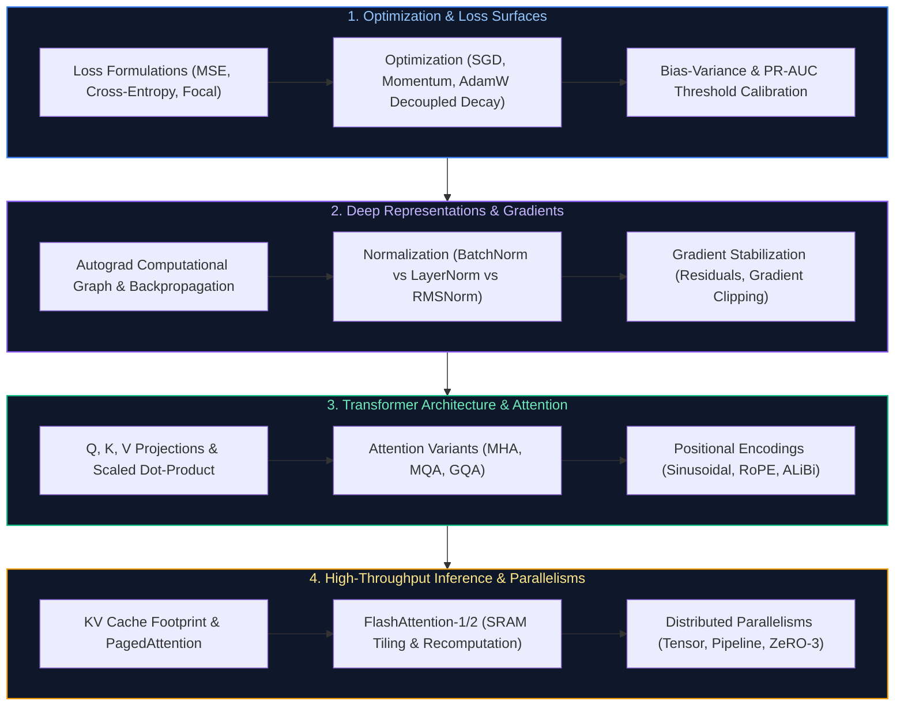

---

## Table of Contents & Question Directory

### 1. Classical Machine Learning, Loss Surfaces & Optimization
- [Q1. **`[Medium]`** Explain the bias-variance tradeoff and how you would diagnose which one is hurting a model in production.](#q1-medium-explain-the-bias-variance-tradeoff-and-how-you-would-diagnose-which-one-is-hurting-a-model-in-production)
- [Q2. **`[Medium]`** What is the difference between L1 (Lasso) and L2 (Ridge) regularization, and when would you choose one over the other?](#q2-medium-what-is-the-difference-between-l1-lasso-and-l2-ridge-regularization-and-when-would-you-choose-one-over-the-other)
- [Q3. **`[Easy]`** Explain a practical use case where you would apply machine learning vs deterministic heuristics.](#q3-easy-explain-a-practical-use-case-where-you-would-apply-machine-learning-vs-deterministic-heuristics)
- [Q4. **`[Easy]`** Walk through how gradient descent works, and explain the difference between SGD, mini-batch, and batch gradient descent.](#q4-easy-walk-through-how-gradient-descent-works-and-explain-the-difference-between-sgd-mini-batch-and-batch-gradient-descent)
- [Q5. **`[Medium]`** How do you handle class imbalance in a classification problem (SMOTE, class weighting, Focal Loss)?](#q5-medium-how-do-you-handle-class-imbalance-in-a-classification-problem-smote-class-weighting-focal-loss)
- [Q6. **`[Hard]`** Explain backpropagation and why vanishing and exploding gradients happen in deep networks.](#q6-hard-explain-backpropagation-and-why-vanishing-and-exploding-gradients-happen-in-deep-networks)
- [Q7. **`[Medium]`** How does batch normalization help training, and what is the key difference between batch normalization and layer normalization?](#q7-medium-how-does-batch-normalization-help-training-and-what-is-the-key-difference-between-batch-normalization-and-layer-normalization)
- [Q8. **`[Medium]`** Compare CNNs, RNNs, and Transformers: When would you pick one architecture over another for vision, time-series, and text?](#q8-medium-compare-cnns-rnns-and-transformers-when-would-you-pick-one-architecture-over-another-for-vision-time-series-and-text)

### 2. Deep Learning, Autograd & Regularization
- [Q9. **`[Medium]`** How would you select an appropriate machine learning model for a given business problem with latency vs accuracy constraints?](#q9-medium-how-would-you-select-an-appropriate-machine-learning-model-for-a-given-business-problem-with-latency-vs-accuracy-constraints)
- [Q10. **`[Hard]`** A production model suddenly drops from 95% to 60% accuracy. Walk me through your step-by-step investigation runbook.](#q10-hard-a-production-model-suddenly-drops-from-95-to-60-accuracy-walk-me-through-your-step-by-step-investigation-runbook)
- [Q11. **`[Hard]`** Your model works great Monday–Friday but performs poorly on weekends. How would you investigate and fix temporal distribution drift?](#q11-hard-your-model-works-great-mondayfriday-but-performs-poorly-on-weekends-how-would-you-investigate-and-fix-temporal-distribution-drift)
- [Q12. **`[Medium]`** You can have fast, cheap, or accurate in an AI system. Pick two and explain the architectural trade-offs.](#q12-medium-you-can-have-fast-cheap-or-accurate-in-an-ai-system-pick-two-and-explain-the-architectural-trade-offs)
- [Q13. **`[Hard]`** Prioritizing Precision vs Recall & Decision Threshold Calibration (Cost Asymmetry & PR-AUC)](#q13-hard-prioritizing-precision-vs-recall-decision-threshold-calibration-cost-asymmetry-pr-auc)
- [Q14. **`[Hard]`** Production Gradient Descent Mechanics & Internal State Updates (AdamW Moment Tracking & Weight Decay)](#q14-hard-production-gradient-descent-mechanics-internal-state-updates-adamw-moment-tracking-weight-decay)

### 3. Transformer Architecture, Attention & Positional Encodings
- [Q15. **`[Medium]`** Explain the architecture of Transformer models and how data flows from tokenization to output logits.](#q15-medium-explain-the-architecture-of-transformer-models-and-how-data-flows-from-tokenization-to-output-logits)
- [Q16. **`[Easy]`** What is the difference between encoder-only, decoder-only, and encoder-decoder models, and what are their typical use cases?](#q16-easy-what-is-the-difference-between-encoder-only-decoder-only-and-encoder-decoder-models-and-what-are-their-typical-use-cases)
- [Q17. **`[Easy]`** Walk me through what happens during pre-training vs fine-tuning of a foundation language model.](#q17-easy-walk-me-through-what-happens-during-pre-training-vs-fine-tuning-of-a-foundation-language-model)
- [Q18. **`[Medium]`** Why did the industry move from RNNs/LSTMs to transformers? What fundamental problem did attention solve?](#q18-medium-why-did-the-industry-move-from-rnnslstms-to-transformers-what-fundamental-problem-did-attention-solve)
- [Q19. **`[Medium]`** Why is self-attention more effective than recurrent connections for capturing long-range dependencies?](#q19-medium-why-is-self-attention-more-effective-than-recurrent-connections-for-capturing-long-range-dependencies)
- [Q20. **`[Hard]`** Explain positional encoding in Transformers: Why is it necessary, and how do sinusoidal encodings compare to RoPE and ALiBi?](#q20-hard-explain-positional-encoding-in-transformers-why-is-it-necessary-and-how-do-sinusoidal-encodings-compare-to-rope-and-alibi)

### 4. LLM Inference Mechanics, KV Cache, FlashAttention & Parallelism
- [Q21. **`[Medium]`** How does multi-head attention improve a model's representation power compared to single-head attention?](#q21-medium-how-does-multi-head-attention-improve-a-models-representation-power-compared-to-single-head-attention)
- [Q22. **`[Easy]`** How does masked language modeling (MLM) differ from causal language modeling (CLM)?](#q22-easy-how-does-masked-language-modeling-mlm-differ-from-causal-language-modeling-clm)
- [Q23. **`[Hard]`** What is the KV Cache in Transformer inference, why does it consume massive VRAM, and how do Multi-Query (MQA) and Grouped-Query Attention (GQA) optimize it?](#q23-hard-what-is-the-kv-cache-in-transformer-inference-why-does-it-consume-massive-vram-and-how-do-multi-query-mqa-and-grouped-query-attention-gqa-optimize-it)
- [Q24. **`[Hard]`** What causes attention computation to scale quadratically ($O(N^2)$) with context length, and how do FlashAttention and FlashAttention-2 achieve sub-quadratic I/O efficiency?](#q24-hard-what-causes-attention-computation-to-scale-quadratically-on2-with-context-length-and-how-do-flashattention-and-flashattention-2-achieve-sub-quadratic-io-efficiency)
- [Q25. **`[Expert]`** What happens during the pre-training phase of an autoregressive LLM under modern distributed parallelisms (Tensor, Pipeline, and ZeRO-3)?](#q25-expert-what-happens-during-the-pre-training-phase-of-an-autoregressive-llm-under-modern-distributed-parallelisms-tensor-pipeline-and-zero-3)
- [Q26. **`[Expert]`** Design an optimal speculative decoding architecture to accelerate LLM token generation by 2–3x without altering output probability distributions.](#q26-expert-design-an-optimal-speculative-decoding-architecture-to-accelerate-llm-token-generation-by-23x-without-altering-output-probability-distributions)

---

## 1. Classical Machine Learning, Loss Surfaces & Optimization

### Q1. [Medium] Explain the bias-variance tradeoff and how you would diagnose which one is hurting a model in production.
**Difficulty:** [Medium]
**Topic Covered:** Statistical Learning Theory & Generalization Bounds  
**Question:** Explain the bias-variance tradeoff and how you'd diagnose which one is hurting a model.

#### Definition & Core Concepts
The **Bias-Variance Decomposition** formalizes the expected mean squared generalization error of a supervised model $f(x)$ trained on dataset $\mathcal{D}$ for target $y = f^*(x) + \epsilon$ with irreducible noise variance $\sigma^2$:

$$\mathbb{E}[(y - \hat{f}(x))^2] = \text{Bias}[\hat{f}(x)]^2 + \text{Var}[\hat{f}(x)] + \sigma^2$$

Where:
1. **Bias ($\text{Bias}[\hat{f}(x)] = \mathbb{E}[\hat{f}(x)] - f^*(x)$):** Error originating from erroneous or overly simplistic assumptions in the learning algorithm. **High bias** implies **underfitting**—the model lacks the expressiveness or capacity to capture the underlying data distribution (e.g., fitting a linear regression line to parabolic data).
2. **Variance ($\text{Var}[\hat{f}(x)] = \mathbb{E}[(\hat{f}(x) - \mathbb{E}[\hat{f}(x)])^2]$):** Sensitivity of the model to random fluctuations and noise in the training set. **High variance** implies **overfitting**—the model memorizes the training samples, capturing idiosyncratic noise that fails to generalize to unseen test distributions.
3. **Irreducible Error ($\sigma^2$):** Inherent stochastic noise in the data generating process that cannot be eliminated by any estimator.

#### Production Diagnostic Framework
In high-scale enterprise systems, engineers diagnose bias vs variance by plotting **Learning Curves** (Training Loss vs Validation Loss over sample size $N$ and epochs $E$):
- **High Bias Signature:** Both Training Loss and Validation Loss converge quickly to an unacceptably high error asymptote. Increasing training data provides zero benefit.
- **High Variance Signature:** Training Loss is near zero, while Validation Loss remains significantly higher, exhibiting a persistent generalization gap ($\Delta L = L_{\text{val}} - L_{\text{train}} \gg 0$).

#### Visual Flow
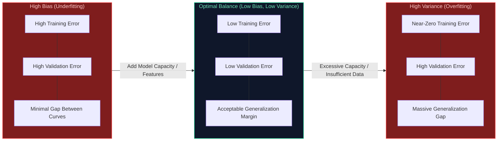

#### Production Implementation / Code Solution
```python
import numpy as np
import matplotlib.pyplot as plt
from sklearn.model_selection import learning_curve
from sklearn.ensemble import GradientBoostingClassifier
from sklearn.metrics import log_loss

def diagnose_bias_variance(estimator, X: np.ndarray, y: np.ndarray, cv: int = 5):
    """
    Computes and logs empirical learning curves to mathematically diagnose
    whether an active production model suffers from underfitting (bias) or overfitting (variance).
    """
    train_sizes = np.linspace(0.1, 1.0, 10)
    train_sizes, train_scores, test_scores = learning_curve(
        estimator=estimator,
        X=X,
        y=y,
        train_sizes=train_sizes,
        cv=cv,
        scoring="neg_log_loss",
        n_jobs=-1,
        shuffle=True,
        random_state=42
    )
    
    # Calculate empirical mean errors across cross-validation folds
    train_loss = -np.mean(train_scores, axis=1)
    val_loss = -np.mean(test_scores, axis=1)
    generalization_gap = val_loss[-1] - train_loss[-1]
    
    print(f"Final Train Log-Loss: {train_loss[-1]:.4f}")
    print(f"Final Validation Log-Loss: {val_loss[-1]:.4f}")
    print(f"Empirical Generalization Gap: {generalization_gap:.4f}")
    
    # Diagnostic rules of thumb
    if train_loss[-1] > 0.60 and generalization_gap < 0.05:
        print("DIAGNOSIS: [HIGH BIAS]. Model lacks capacity. Action: Increase model depth, add features.")
    elif generalization_gap > 0.20:
        print("DIAGNOSIS: [HIGH VARIANCE]. Model is overfitting. Action: Add L1/L2 regularization, dropout, collect data.")
    else:
        print("DIAGNOSIS: [BALANCED]. Generalization bounds are within acceptable production thresholds.")

    return train_sizes, train_loss, val_loss
```
- **Time Complexity:** $O(K \cdot N \cdot D \log D)$ for $K$-fold cross-validation across tree-based algorithms with $N$ samples and $D$ depth.
- **Space Complexity:** $O(N \cdot M)$ memory consumption to hold dataset splits.

#### Engineering Implications & Production Pitfalls
1. **The Data Scalability Trap:** If your model has high bias, spending $50,000 to acquire 1,000,000 new training samples yields zero performance improvement. Adding more data only helps if the model has high variance.
2. **Double Descent in Modern Deep Learning:** While classical theory posits that increasing capacity beyond the interpolation threshold inevitably explodes variance, modern over-parameterized neural networks (LLMs, ResNets) undergo **Deep Double Descent**, where test error decreases again due to inductive biases in stochastic gradient descent (SGD).

#### Core Curriculum Cross-Reference
- See [01. Machine Learning & Deep Learning Fundamentals](../16_machine_learning_and_transformer_foundations.md) for inductive bias proofs and generalization bounds.

---


---

### Q2. [Medium] What is the difference between L1 (Lasso) and L2 (Ridge) regularization, and when would you choose one over the other?
**Difficulty:** [Medium]
**Topic Covered:** Regularization Mechanics & Sparsity Constraints  
**Question:** What's the difference between L1 and L2 regularization, and when would you choose one over the other?

#### Definition & Core Concepts
Regularization prevents high variance by augmenting the loss objective $\mathcal{L}_{\text{orig}}(\mathbf{w})$ with a weight penalty function:

1. **L1 Regularization (Lasso - Least Absolute Shrinkage and Selection Operator):**
   $$\mathcal{L}_{\text{L1}}(\mathbf{w}) = \mathcal{L}_{\text{orig}}(\mathbf{w}) + \lambda \|\mathbf{w}\|_1 = \mathcal{L}_{\text{orig}}(\mathbf{w}) + \lambda \sum_{i=1}^d |w_i|$$
   - **Geometric Property:** The $L_1$ norm constraint contour is an $L_1$-ball (diamond shape in 2D with sharp corners on the coordinate axes).
   - **Feature Selection:** Gradients of the $L_1$ penalty are constant ($\pm \lambda$), driving uninformative weights strictly to zero ($w_i = 0$). This produces **sparse weight vectors**, functioning as embedded feature selection.

2. **L2 Regularization (Ridge Regression / Weight Decay):**
   $$\mathcal{L}_{\text{L2}}(\mathbf{w}) = \mathcal{L}_{\text{orig}}(\mathbf{w}) + \frac{\lambda}{2} \|\mathbf{w}\|_2^2 = \mathcal{L}_{\text{orig}}(\mathbf{w}) + \frac{\lambda}{2} \sum_{i=1}^d w_i^2$$
   - **Geometric Property:** The $L_2$ norm constraint contour is a smooth hypersphere ($L_2$-ball).
   - **Weight Shrinkage:** Gradients are proportional to the magnitude of the weights ($\nabla \mathcal{L} = \lambda w_i$). Small weights shrink asymptotically toward zero but **never become strictly zero**. It handles multicollinear features by distributing weight evenly across correlated predictors.

3. **ElasticNet:** Linearly blends both penalties ($\alpha L_1 + (1-\alpha) L_2$) to retain sparsity while maintaining group stability across correlated features.

#### Visual Flow
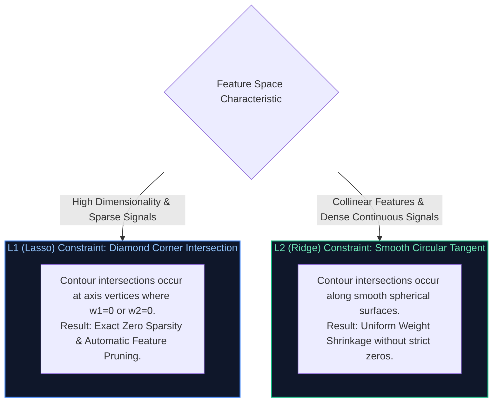

#### Production Implementation / Code Solution
```python
import torch
import torch.nn as nn
import torch.optim as optim

class RegularizedDenseClassifier(nn.Module):
    def __init__(self, in_features: int, out_features: int):
        super().__init__()
        self.fc = nn.Linear(in_features, out_features, bias=True)

    def forward(self, x: torch.Tensor) -> torch.Tensor:
        return self.fc(x)

def train_step_with_custom_regularization(
    model: nn.Module,
    optimizer: optim.Optimizer,
    criterion: nn.Module,
    x: torch.Tensor,
    y: torch.Tensor,
    l1_lambda: float = 1e-4,
    l2_lambda: float = 1e-3
) -> float:
    """
    Executes a single forward-backward optimization step integrating both
    L1 (sparse penalty) and L2 (weight decay) regularization terms.
    """
    optimizer.zero_grad()
    predictions = model(x)
    loss = criterion(predictions, y)

    # 1. Compute L1 penalty manually: sum(|w|)
    l1_penalty = sum(param.abs().sum() for name, param in model.named_parameters() if 'bias' not in name)
    
    # 2. Compute L2 penalty manually: sum(w^2)
    l2_penalty = sum((param ** 2).sum() for name, param in model.named_parameters() if 'bias' not in name)
    
    total_loss = loss + (l1_lambda * l1_penalty) + (0.5 * l2_lambda * l2_penalty)
    total_loss.backward()
    optimizer.step()

    return total_loss.item()
```
- **Time Complexity:** $O(P)$ additional overhead per backward pass where $P$ is total model parameter count.
- **Space Complexity:** $O(1)$ scalar memory to accumulate penalty tensors.

#### Engineering Implications & Production Pitfalls
1. **L2 Weight Decay vs AdamW:** In vanilla SGD with momentum, L2 regularization is mathematically identical to weight decay. However, in adaptive optimizers like Adam, L2 regularization penalizes weights scaled by the moving average of squared gradients, leading to suboptimal shrinkage. **Golden Rule:** In deep networks with Adam, always use **AdamW** (decoupled weight decay).
2. **Extreme Sparsity Incompatibilities:** While L1 produces sparse weights on paper, floating-point GPU execution does not accelerate standard dense matrix multiplications (`GEMM`) unless the sparsity pattern matches hardware-accelerated structured sparsity (e.g., NVIDIA Ampere 2:4 structured sparsity).

#### Core Curriculum Cross-Reference
- See [01. Machine Learning & Deep Learning Fundamentals](../16_machine_learning_and_transformer_foundations.md#5-regularization-normalization--numerical-stability) for AdamW decoupled weight decay proofs.

---


---

### Q3. [Easy] Explain a practical use case where you would apply machine learning vs deterministic heuristics.
**Difficulty:** [Easy]
**Topic Covered:** ML System Feasibility & Architectural Selection  
**Question:** Explain a practical use case where you would apply machine learning.

#### Definition & Core Concepts
A common production mistake is deploying Machine Learning to solve problems that deterministic, rule-based systems solve more reliably, cheaply, and with zero latency jitter.

#### The Heuristic vs ML Decision Boundary
1. **Deterministic Heuristics (Rule Engines / State Machines):**
   - **Criteria:** The problem domain has bounded, deterministic rules; 100% auditability is legally mandatory; input feature distributions never change; latency budget is sub-millisecond ($< 1\text{ ms}$).
   - **Example:** Calculating statutory payroll tax deductions or banking transfer limits.
2. **Machine Learning (Statistical Learning / Probabilistic Classifiers):**
   - **Criteria:** The solution logic cannot be hand-coded because patterns are too high-dimensional or nonlinear; inputs are unstructured (audio, natural language, pixels); the system must continuously adapt to adversarial drift.
   - **Production Enterprise Use Case:** **Real-Time Financial Transaction Fraud Detection**.

#### Production Case Study: Credit Card Fraud Detection
In high-scale banking platforms (e.g., Visa/Mastercard processing 50,000 transactions/second), handcrafted rules (`if amount > $5000 and country != home_country then reject`) fail catastrophically:
- Sophisticated fraudsters deliberately structure payments ($4,900) to bypass static thresholds.
- Legitimate users traveling on vacation suffer false declines, destroying customer trust.
- A gradient-boosted decision tree (LightGBM/XGBoost) or Real-Time Graph Neural Network (GNN) evaluates non-linear interactions across 300+ features (velocity of transactions in the last 10 minutes, IP subnet entropy, merchant category distance, device fingerprinting) in $< 15\text{ ms}$, predicting a calibrated fraud probability $P(\text{fraud} \mid \mathbf{x})$.

#### Visual Flow
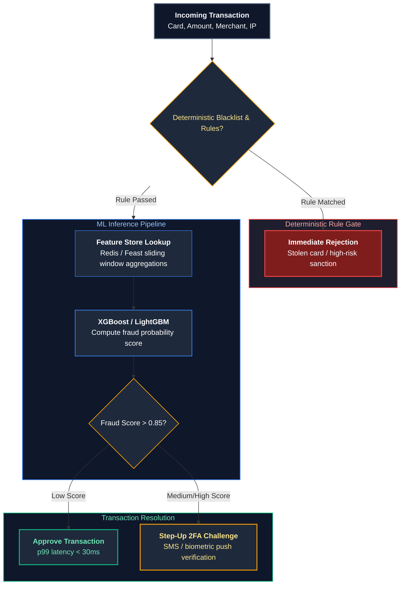

#### Production Implementation / Code Solution
```python
from dataclasses import dataclass
import numpy as np

@dataclass
class TransactionPayload:
    amount: float
    user_id: str
    card_active: bool
    cvv_valid: bool
    velocity_10m: int
    distance_from_home_km: float

class HybridFraudEngine:
    def __init__(self, ml_model, threshold_challenge: float = 0.20, threshold_decline: float = 0.80):
        self.ml_model = ml_model
        self.threshold_challenge = threshold_challenge
        self.threshold_decline = threshold_decline

    def evaluate_transaction(self, tx: TransactionPayload) -> str:
        # Step 1: Deterministic Heuristic Hard Gate (Zero ML compute, O(1) fail-fast)
        if not tx.card_active:
            return "DECLINE_INACTIVE_CARD"
        if not tx.cvv_valid:
            return "DECLINE_INVALID_CVV"
        
        # Step 2: Feature vectorization for Machine Learning
        feature_vector = np.array([[
            tx.amount,
            tx.velocity_10m,
            tx.distance_from_home_km,
            1.0 if tx.amount > 1000 else 0.0
        ]])
        
        # Step 3: Probabilistic inference
        fraud_prob = float(self.ml_model.predict_proba(feature_vector)[0][1])
        
        # Step 4: Tiered decision policy
        if fraud_prob > self.threshold_decline:
            return f"DECLINE_HIGH_FRAUD_RISK_{fraud_prob:.2f}"
        elif fraud_prob > self.threshold_challenge:
            return f"CHALLENGE_STEP_UP_AUTH_{fraud_prob:.2f}"
        
        return "APPROVE"
```
- **Time Complexity:** $O(T \cdot D)$ where $T$ is the number of trees (e.g. 100) and $D$ is maximum tree depth (e.g. 6). Total latency $\approx 2\text{–}5\text{ ms}$.
- **Space Complexity:** $O(\text{Features})$ memory allocation.

#### Engineering Implications & Production Pitfalls
1. **The Heuristic Hard-Gate Rule:** Never let machine learning replace basic business validation. If an account is closed or card expired, running an ML model wastes GPU/CPU cycles and risks probabilistic false positives.
2. **Cold Start & Continuous Retraining:** Heuristic rules never fail on day 1. An ML model without historical labeled fraud data cannot predict new attack vectors. Successful production architectures employ **hybrid systems**: heuristics guard the baseline while ML extracts subtle, complex correlations.

#### Core Curriculum Cross-Reference
- See [34.3 Enterprise AI Architecture Blueprint Reference Matrix](../17_autonomous_agents_and_model_adaptation.md#343-enterprise-ai-architecture-blueprint-reference-matrix) for production hybrid decisioning patterns.

---

# 2. Optimization Algorithms & Loss Dynamics

---


---

### Q4. [Easy] Walk through how gradient descent works, and explain the difference between SGD, mini-batch, and batch gradient descent.
**Difficulty:** [Easy]
**Topic Covered:** Optimization Mechanics & Convergence Dynamics  
**Question:** Walk through how gradient descent works, and explain the difference between SGD, mini-batch, and batch gradient descent.

#### Definition & Core Concepts
**Gradient Descent** is a first-order iterative optimization algorithm that minimizes a differentiable objective function $\mathcal{L}(\mathbf{w})$ by updating parameters $\mathbf{w}$ in the direction opposite to the gradient vector $\nabla_{\mathbf{w}} \mathcal{L}(\mathbf{w})$:

$$\mathbf{w}_{t+1} = \mathbf{w}_t - \eta \mathbf{g}_t$$

Where $\eta > 0$ is the learning rate, and $\mathbf{g}_t$ is the gradient estimator. The fundamental distinction between variants lies in how many training samples $B$ are used to compute $\mathbf{g}_t$:

| Gradient Descent Variant | Batch Size ($B$) | Computational Characteristics & Memory Footprint | Convergence Behavior & Loss Landscape Dynamics |
| :--- | :--- | :--- | :--- |
| **Batch Gradient Descent (BGD)** | $B = N$ (Entire Dataset) | Computationally expensive ($O(N)$ per update). Memory footprint requires holding all $N$ samples in RAM/VRAM. | Deterministic, smooth trajectory directly toward local minimum. Prone to getting trapped in saddle points or poor local minima. |
| **Stochastic Gradient Descent (SGD)** | $B = 1$ (Single Sample) | Extremely cheap ($O(1)$ per update). Minimal memory. Cannot leverage modern SIMD/TensorCore GPU parallelism. | Highly noisy, erratic updates. High variance helps bounce out of shallow local minima, but fails to settle without aggressive learning rate decay. |
| **Mini-Batch Gradient Descent** | $1 < B < N$ (Typically 32, 64, 256, 512) | Optimal hardware alignment. Fully utilizes GPU Tensor Cores via parallel vectorized `GEMM` matrix operations. | Balances trajectory smoothness with stochastic noise. Standard default for virtually all modern deep learning. |

#### Visual Flow
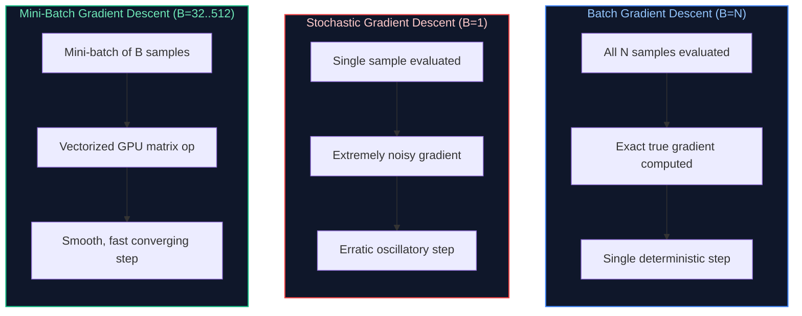

#### Production Implementation / Code Solution
```python
import torch
import torch.nn as nn
from torch.utils.data import DataLoader, TensorDataset

def compare_gradient_descent_dynamics(
    X: torch.Tensor,
    y: torch.Tensor,
    epochs: int = 5,
    batch_size_mini: int = 64,
    learning_rate: float = 0.01
):
    """
    Simulates and profiles Batch GD, Pure SGD, and Mini-Batch GD to highlight
    throughput, convergence stability, and GPU execution mechanics.
    """
    N, D = X.shape
    dataset = TensorDataset(X, y)

    # 1. Mini-Batch DataLoader (Optimal GPU pipeline)
    loader_minibatch = DataLoader(dataset, batch_size=batch_size_mini, shuffle=True)
    # 2. Pure SGD DataLoader (batch_size=1)
    loader_sgd = DataLoader(dataset, batch_size=1, shuffle=True)
    # 3. Batch GD DataLoader (batch_size=N)
    loader_batch = DataLoader(dataset, batch_size=N, shuffle=False)

    model = nn.Linear(D, 1)
    criterion = nn.MSELoss()
    optimizer = torch.optim.SGD(model.parameters(), lr=learning_rate)

    print(f"=== Mini-Batch GD Execution (Batch Size: {batch_size_mini}) ===")
    for epoch in range(epochs):
        epoch_loss = 0.0
        for batch_x, batch_y in loader_minibatch:
            optimizer.zero_grad()
            preds = model(batch_x)
            loss = criterion(preds, batch_y)
            loss.backward()
            optimizer.step()
            epoch_loss += loss.item()
        avg_loss = epoch_loss / len(loader_minibatch)
        if (epoch + 1) % 2 == 0:
            print(f"Epoch {epoch+1}/{epochs} | Avg Mini-Batch Loss: {avg_loss:.4f}")
```
- **Time Complexity:** Mini-batch GD scales as $O\left(\frac{N}{B} \cdot B \cdot D\right) = O(N \cdot D)$ per epoch, but executes orders of magnitude faster in wall-clock time due to GPU parallel memory coalescing.
- **Space Complexity:** $O(B \cdot D)$ VRAM memory footprint for in-flight activation tensors.

#### Engineering Implications & Production Pitfalls
1. **The Linear Scaling Rule:** When scaling mini-batch size $B$ across multiple GPUs (Distributed Data Parallel - DDP), you must scale the learning rate proportionally: $\eta_{\text{new}} = \eta_{\text{base}} \times \frac{B_{\text{new}}}{B_{\text{base}}}$ to maintain gradient step magnitude.
2. **GPU Under-utilization with $B=1$:** Running pure SGD ($B=1$) on an NVIDIA H100 GPU leaves 99% of CUDA cores completely idle because the GPU spends all its time reading weights from HBM3 memory rather than performing arithmetic computation.

#### Core Curriculum Cross-Reference
- See [01. Machine Learning & Deep Learning Fundamentals](../16_machine_learning_and_transformer_foundations.md#4-optimization-algorithms--gradient-descent-mechanics) for momentum, RMSprop, and AdamW derivations.

---


---

### Q5. [Medium] How do you handle class imbalance in a classification problem (SMOTE, class weighting, Focal Loss)?
**Difficulty:** [Medium]
**Topic Covered:** Data Distribution Disparities & Loss Function Design  
**Question:** How do you handle class imbalance in a classification problem?

#### Definition & Core Concepts
In mission-critical enterprise classification tasks (e.g. ad click-through rate prediction at 0.1%, cancer detection at 0.01%, or cyber intrusion detection at 0.001%), models trained on raw data suffer from **majority class bias**—achieving 99.9% naive accuracy by predicting the majority class exclusively while failing completely on the target minority class.

Engineers address class imbalance across three complementary architectural tiers:

1. **Data-Level Resampling:**
   - **Random Under-Sampling:** Discards majority instances to balance classes. Disadvantage: Destroys valuable data and statistical diversity.
   - **SMOTE (Synthetic Minority Over-sampling Technique):** Synthesizes new minority samples along feature vectors connecting $k$-nearest minority neighbors:
     $$\mathbf{x}_{\text{new}} = \mathbf{x}_i + \lambda (\mathbf{x}_{zi} - \mathbf{x}_i), \quad \lambda \sim U(0, 1)$$
2. **Cost-Sensitive Learning (Loss Weighting):**
   - Applies an inverse class frequency weight $\alpha_c = \frac{N}{C \cdot N_c}$ directly to the cross-entropy loss, heavily penalizing classification errors on rare samples.
3. **Advanced Objective Functions (Focal Loss):**
   - Introduced by Lin et al., **Focal Loss** adds a modulating factor $(1 - p_t)^\gamma$ to standard Cross-Entropy:
     $$\text{FL}(p_t) = -\alpha_t (1 - p_t)^\gamma \log(p_t)$$
   - When a sample is well-classified ($p_t \to 1$), the modulating factor $(1 - p_t)^\gamma \to 0$, down-weighting the loss contribution of easy majority examples and focusing the gradient strictly on hard, ambiguous minority samples.

#### Visual Flow
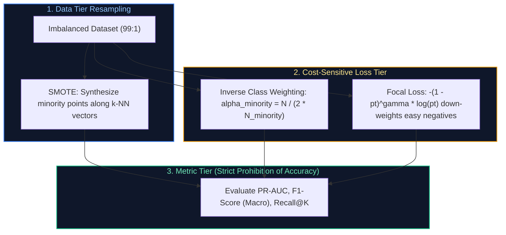

#### Production Implementation / Code Solution
```python
import torch
import torch.nn as nn
import torch.nn.functional as F

class BinaryFocalLoss(nn.Module):
    """
    Production-grade Binary Focal Loss implementation for extreme class imbalance.
    Down-weights easy examples and dynamically focuses gradients on hard minority cases.
    """
    def __init__(self, alpha: float = 0.25, gamma: float = 2.0, reduction: str = 'mean'):
        super().__init__()
        self.alpha = alpha
        self.gamma = gamma
        self.reduction = reduction

    def forward(self, logits: torch.Tensor, targets: torch.Tensor) -> torch.Tensor:
        # logits: [batch_size, 1], targets: [batch_size, 1]
        probs = torch.sigmoid(logits)
        
        # Calculate pt: probability of the true class
        p_t = probs * targets + (1 - probs) * (1 - targets)
        
        # Calculate alpha factor
        alpha_factor = self.alpha * targets + (1 - self.alpha) * (1 - targets)
        
        # Modulating factor: (1 - p_t)^gamma
        modulating_factor = torch.pow((1.0 - p_t), self.gamma)
        
        # Standard binary cross entropy loss
        bce_loss = F.binary_cross_entropy_with_logits(logits, targets, reduction='none')
        
        # Focal Loss
        focal_loss = alpha_factor * modulating_factor * bce_loss
        
        if self.reduction == 'mean':
            return focal_loss.mean()
        elif self.reduction == 'sum':
            return focal_loss.sum()
        return focal_loss
```
- **Time Complexity:** $O(B)$ element-wise tensor operations where $B$ is batch size.
- **Space Complexity:** $O(B)$ intermediate probability tensors.

#### Engineering Implications & Production Pitfalls
1. **The SMOTE Data Leakage Trap:** A frequent production failure occurs when engineers apply SMOTE to the entire dataset **before splitting into train and test sets**. Synthetic points generated from test data bleed directly into training sets, producing artificially inflated validation scores that collapse in production. **Rule:** SMOTE must be fit strictly on training folds within cross-validation.
2. **Never Use Accuracy or ROC-AUC on Imbalanced Data:** A classifier predicting all negative on a 99:1 split achieves 99% Accuracy and an deceptively high ROC-AUC. Always evaluate **Precision-Recall AUC (PR-AUC)** and **Macro-averaged F1-Score**.

#### Core Curriculum Cross-Reference
- See [01. Machine Learning & Deep Learning Fundamentals](../16_machine_learning_and_transformer_foundations.md) for loss surface conditioning.

---


---

### Q6. [Hard] Explain backpropagation and why vanishing and exploding gradients happen in deep networks.
**Difficulty:** [Hard]
**Topic Covered:** Gradient Backpropagation Mechanics & Numerical Stability  
**Question:** Explain backpropagation and why vanishing/exploding gradients happen in deep networks.

#### Definition & Core Concepts
**Backpropagation** is an efficient implementation of the multivariable calculus **chain rule** used to calculate the gradient of a scalar loss $\mathcal{L}$ with respect to all trainable network weights $\mathbf{W}^{(l)}$ across $L$ layers:

$$\frac{\partial \mathcal{L}}{\partial \mathbf{W}^{(l)}} = \boldsymbol{\delta}^{(l)} (\mathbf{a}^{(l-1)})^T, \quad \boldsymbol{\delta}^{(l)} = \left( (\mathbf{W}^{(l+1)})^T \boldsymbol{\delta}^{(l+1)} \right) \odot \sigma'(\mathbf{z}^{(l)})$$

Where $\mathbf{z}^{(l)} = \mathbf{W}^{(l)} \mathbf{a}^{(l-1)} + \mathbf{b}^{(l)}$ is the pre-activation, $\mathbf{a}^{(l)} = \sigma(\mathbf{z}^{(l)})$ is the post-activation, and $\odot$ denotes the Hadamard (element-wise) product.

#### The Instability Pathologies: Vanishing vs Exploding Gradients
Expanding the gradient of the loss with respect to layer 1 weights across $L$ intermediate layers reveals repeated matrix multiplications:

$$\frac{\partial \mathcal{L}}{\partial \mathbf{W}^{(1)}} = \left( \prod_{k=1}^{L-1} \mathbf{W}^{(k+1)T} \text{diag}(\sigma'(\mathbf{z}^{(k)})) \right) \frac{\partial \mathcal{L}}{\partial \mathbf{z}^{(L)}} (\mathbf{a}^{(0)})^T$$

1. **Vanishing Gradients:**
   - **Root Cause:** When using saturating activation functions like Sigmoid ($\sigma'(z) \le 0.25$) or Tanh ($\sigma'(z) \le 1.0$), multiplying numbers smaller than 1 across 30+ layers causes gradients to decay exponentially toward zero: $\lim_{L \to \infty} \prod_{k=1}^L \sigma'(\mathbf{z}^{(k)}) = 0$.
   - **Consequence:** Early layers receive zero gradient updates, halting feature learning completely.
2. **Exploding Gradients:**
   - **Root Cause:** When weight matrix eigenvalues exceed 1 ($\lambda_{\max}(\mathbf{W}) > 1$), continuous matrix multiplications scale exponentially: $\lim_{L \to \infty} \|\mathbf{W}^L\| = \infty$.
   - **Consequence:** Loss explodes to `NaN`, weight tensors overflow to `Inf`, and model weights diverge catastrophically.

#### Visual Flow
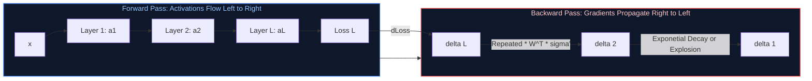

#### Production Implementation / Code Solution
```python
import torch
import torch.nn as nn

def train_step_with_gradient_stability(
    model: nn.Module,
    optimizer: torch.optim.Optimizer,
    loss_fn: nn.Module,
    x: torch.Tensor,
    y: torch.Tensor,
    max_norm: float = 1.0
) -> float:
    """
    Executes a production training step with explicit gradient norm clipping
    and NaN/Inf validation to prevent exploding gradient crashes.
    """
    optimizer.zero_grad()
    predictions = model(x)
    loss = loss_fn(predictions, y)
    
    # 1. Backpropagation
    loss.backward()
    
    # 2. Gradient Clipping: Rescales gradients if ||g||_2 > max_norm
    # g_new = g * (max_norm / max(||g||_2, max_norm))
    total_norm = nn.utils.clip_grad_norm_(model.parameters(), max_norm=max_norm)
    
    # 3. Defensive Assertion: Detect NaN / Inf before updating weights
    if torch.isnan(total_norm) or torch.isinf(total_norm):
        print(f"CRITICAL WARNING: Loss or Gradient exploded to NaN/Inf! Norm: {total_norm}")
        optimizer.zero_grad() # Discard corrupted gradients
        return float('nan')
        
    optimizer.step()
    return loss.item()
```
- **Time Complexity:** $O(P)$ time overhead to compute global $L_2$ gradient norm across $P$ parameters.
- **Space Complexity:** $O(P)$ memory to cache backward activation gradients.

#### Engineering Implications & Production Pitfalls
1. **Architectural Remedies:**
   - **Non-Saturating Activations:** Replace Sigmoid/Tanh with **ReLU**, **GELU**, or **SwiGLU** ($\sigma'(z) \ge 1$ for positive activations).
   - **Residual Skip Connections:** ResNets and Transformers add identity paths ($\mathbf{x}_{l+1} = \mathbf{x}_l + \mathcal{F}(\mathbf{x}_l)$). During backpropagation, $\frac{\partial \mathbf{x}_{l+1}}{\partial \mathbf{x}_l} = \mathbf{I} + \frac{\partial \mathcal{F}}{\partial \mathbf{x}_l}$, allowing gradients to flow directly back without decay.
   - **Layer Normalization & RMSNorm:** Constrains intermediate activations to zero mean and unit variance.
2. **Kaiming (He) & Xavier Initialization:** Initializing weights with variance calibrated to layer fan-in ($\text{Var}(W) = \frac{2}{n_{\text{in}}}$) preserves variance across forward and backward passes.

#### Core Curriculum Cross-Reference
- See [01. Machine Learning & Deep Learning Fundamentals](../16_machine_learning_and_transformer_foundations.md#2-neural-network-foundations--computational-graphs) for full backpropagation DAG derivations.

---

# 3. Deep Learning Building Blocks & Architectural Selection

---


---

### Q7. [Medium] How does batch normalization help training, and what is the key difference between batch normalization and layer normalization?
**Difficulty:** [Medium]
**Topic Covered:** Normalization Mechanics & Transformer Foundations  
**Question:** How does batch normalization help training, and what's the difference between batch norm and layer norm?

#### Definition & Core Concepts
**Batch Normalization (BatchNorm)** and **Layer Normalization (LayerNorm)** stabilize deep network training by standardizing intermediate activations $\mathbf{x}$, preventing internal covariate shift and smoothing the loss optimization landscape.

Given an activation tensor of shape $(B, T, C)$ where $B$ is batch size, $T$ is sequence length, and $C$ is channel/embedding dimension:

1. **Batch Normalization (Ioffe & Szegedy, 2015):**
   - **Standardization Axis:** Computes mean $\mu_B$ and variance $\sigma_B^2$ **across the batch dimension** ($B$) independently for each feature/channel $C$:
     $$\hat{x}_{b,t,c} = \frac{x_{b,t,c} - \mu_c}{\sqrt{\sigma_c^2 + \epsilon}}, \quad y_{b,t,c} = \gamma_c \hat{x}_{b,t,c} + \beta_c$$
   - **Inference Mechanism:** Requires maintaining **running moving averages** of $\mu$ and $\sigma^2$ during training, which are frozen during evaluation.
2. **Layer Normalization (Ba et al., 2016):**
   - **Standardization Axis:** Computes mean $\mu_L$ and variance $\sigma_L^2$ **across the feature/channel dimension** ($C$) independently for each individual sample:
     $$\mu_{b,t} = \frac{1}{C} \sum_{c=1}^C x_{b,t,c}, \quad \hat{x}_{b,t,c} = \frac{x_{b,t,c} - \mu_{b,t}}{\sqrt{\sigma_{b,t}^2 + \epsilon}}$$
   - **Inference Independence:** Identical computation in training and inference. Completely independent of batch size.

#### Comparison Matrix: BatchNorm vs LayerNorm
| Engineering Dimension | Batch Normalization (BatchNorm) | Layer Normalization (LayerNorm) |
| :--- | :--- | :--- |
| **Normalization Slice** | Across Batch ($B$) for each feature | Across Features ($C$) for each sample |
| **Batch Size Sensitivity** | Catastrophic failure when $B < 8$; impossible when $B=1$ | 100% invariant to batch size ($B=1$ works perfectly) |
| **Variable Sequence Lengths** | Struggles on variable text lengths ($T$) | Naturally handles arbitrary sequence lengths |
| **Inference Behavior** | Uses frozen running statistics (`running_mean`, `running_var`) | Recomputes sample mean/variance on-the-fly |
| **Primary Domain** | Computer Vision (CNNs, ResNets) | Natural Language Processing (Transformers, LLMs) |

#### Visual Flow
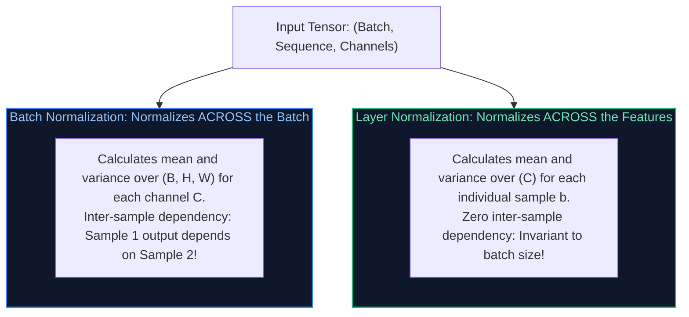

#### Production Implementation / Code Solution
```python
import torch
import torch.nn as nn

class ProductionRMSNorm(nn.Module):
    """
    Modern LLM optimization: Root Mean Square Layer Normalization (RMSNorm).
    Used in Llama 3, Mistral, and Gemma.
    Replaces LayerNorm by enforcing zero-mean assumption, cutting compute overhead by 30%.
    """
    def __init__(self, dim: int, eps: float = 1e-6):
        super().__init__()
        self.eps = eps
        self.weight = nn.Parameter(torch.ones(dim))

    def _norm(self, x: torch.Tensor) -> torch.Tensor:
        # RMS(x) = sqrt( 1/d * sum(x_i^2) + eps )
        return x * torch.rsqrt(x.pow(2).mean(-1, keepdim=True) + self.eps)

    def forward(self, x: torch.Tensor) -> torch.Tensor:
        # Standardize across feature dimension and apply learnable scale gamma
        return self._norm(x.float()).type_as(x) * self.weight
```
- **Time Complexity:** $O(B \cdot T \cdot C)$ vector arithmetic per layer.
- **Space Complexity:** $O(C)$ learnable affine parameter memory (`self.weight`).

#### Engineering Implications & Production Pitfalls
1. **The Train vs Eval Mode Bug in BatchNorm:** Forgetting `model.eval()` before running inference on a model with `nn.BatchNorm2d` causes predictions to fluctuate depending on the arbitrary batch size passed during testing, resulting in massive production accuracy degradation.
2. **Why Transformers Reject BatchNorm:** In autoregressive generation (inference), prompt prefill processes a full sequence while token decoding runs at batch size 1 ($B=1$, single token). BatchNorm cannot function at $B=1$. LayerNorm operates seamlessly in streaming generation.

#### Core Curriculum Cross-Reference
- See [01. Machine Learning & Deep Learning Fundamentals](../16_machine_learning_and_transformer_foundations.md#5-regularization-normalization--numerical-stability) and [02. LLM Foundations](../16_machine_learning_and_transformer_foundations.md#131-prefill-phase-vs-decode-phase-deep-dive) for RMSNorm mathematical optimizations.

---


---

### Q8. [Medium] Compare CNNs, RNNs, and Transformers: When would you pick one architecture over another for vision, time-series, and text?
**Difficulty:** [Medium]
**Topic Covered:** Inductive Biases & Deep Learning Architectures  
**Question:** Compare CNNs, RNNs, and Transformers, when would you pick one architecture over another?

#### Definition & Core Concepts
Every deep learning architecture embeds specific **Inductive Biases** (assumptions baked into the structural wiring of the network) that govern its efficiency across different modalities:

1. **Convolutional Neural Networks (CNNs):**
   - **Inductive Bias:** **Spatial Locality** (pixels close together are correlated) and **Translation Invariance** (a cat is a cat regardless of where it appears in the frame).
   - **Mechanism:** Parameter sharing via sliding spatial kernels ($3 \times 3$, $5 \times 5$).
   - **Best For:** High-throughput vision at the edge, real-time spatial feature extraction (YOLO), and 1D waveform processing where latency $< 2\text{ ms}$.
2. **Recurrent Neural Networks (RNNs / LSTMs / GRUs):**
   - **Inductive Bias:** **Temporal Ordering & Markovian Sequentiality** (the current state depends sequentially on the previous hidden state $h_t = f(h_{t-1}, x_t)$).
   - **Mechanism:** Hidden state recurrence. Sequential processing prevents GPU parallelization during training ($O(T)$ sequential steps).
   - **Best For:** Ultra-low-resource microcontrollers (Arduino/ARM Cortex), streaming edge sensor telemetry where memory footprint is $< 100\text{ KB}$.
3. **Transformers:**
   - **Inductive Bias:** **Weak / Zero Spatial or Temporal Bias**. All tokens interact directly via all-to-all Self-Attention ($O(N^2)$ complexity). Requires massive datasets to learn spatial or temporal relationships from scratch.
   - **Mechanism:** Highly parallelizable matrix multiplications (`Q`, `K`, `V` projections).
   - **Best For:** Large language models, multi-modal reasoning, Vision Transformers (ViT) on large data, and cross-attention sequence-to-sequence translation.

#### Comparative Architectural Matrix
| Criteria | CNN (ResNet, ConvNeXt) | RNN / LSTM / GRU | Transformer (LLaMA, ViT) |
| :--- | :--- | :--- | :--- |
| **Computational Complexity per Step** | $O(K \cdot C^2)$ | $O(C^2)$ | $O(N^2 \cdot C)$ (Quadratic attention) |
| **Sequential Training Steps** | $O(1)$ (Fully Parallelizable) | $O(N)$ (Strictly Sequential) | $O(1)$ (Fully Parallelizable) |
| **Maximum Context Path Length** | $O(\log_K(N))$ (Dilated convs) | $O(N)$ (Severe gradient decay) | $O(1)$ (Direct cross-token attention) |
| **Data Efficiency** | High (Hard spatial inductive bias) | Medium | Low (Requires massive pre-training) |
| **Optimal Production Domain** | Edge Vision, Mobile Inference | Microcontroller IoT Sensors | NLP, GenAI, Vision Foundation Models |

#### Visual Flow
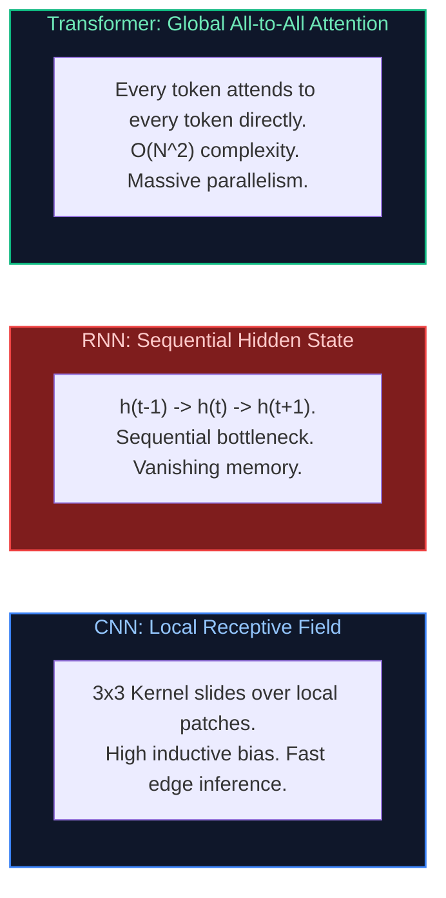

#### Production Implementation / Code Solution
```python
import torch
import torch.nn as nn

class MultiModalArchitectureBenchmark(nn.Module):
    """
    Demonstrates architectural execution: CNN vs GRU vs Transformer Attention
    on identical feature dimensions to evaluate throughput and memory footprints.
    """
    def __init__(self, embed_dim: int = 128, seq_len: int = 64):
        super().__init__()
        # 1. 1D CNN: Parallel sliding window
        self.cnn = nn.Conv1d(in_channels=embed_dim, out_channels=embed_dim, kernel_size=3, padding=1)
        # 2. GRU: Sequential state update
        self.gru = nn.GRU(input_size=embed_dim, hidden_size=embed_dim, batch_first=True)
        # 3. Multi-Head Attention: Global direct routing
        self.mha = nn.MultiheadAttention(embed_dim=embed_dim, num_heads=4, batch_first=True)

    def forward(self, x: torch.Tensor):
        # x: [Batch, SeqLen, EmbedDim]
        # CNN requires [Batch, Channels, SeqLen]
        cnn_out = self.cnn(x.transpose(1, 2)).transpose(1, 2)
        # GRU sequential execution
        gru_out, _ = self.gru(x)
        # Attention all-to-all
        mha_out, _ = self.mha(x, x, x)
        return cnn_out, gru_out, mha_out
```
- **Time Complexity:** CNN $O(B \cdot T \cdot C)$, GRU $O(B \cdot T \cdot C^2)$ sequential steps, Transformer $O(B \cdot T^2 \cdot C)$.
- **Space Complexity:** Attention caches $O(B \cdot T^2)$ attention weight matrices.

#### Engineering Implications & Production Pitfalls
1. **The Vision Transformer Small-Data Pitfall:** Training a Vision Transformer (ViT) from scratch on a small dataset (e.g. 10,000 images) yields significantly worse accuracy than a standard ResNet-50. Because Transformers lack translation invariance and locality inductive biases, they require tens of millions of images (ImageNet-21k, JFT-300M) before outperforming CNNs.
2. **Modern Hybrid Alternatives:** In 2026, architectures like **Mamba / State-Space Models (SSMs)** provide linear time $O(N)$ sequence modeling with parallel associative scan training, bridging the gap between RNN efficiency and Transformer expressiveness.

#### Core Curriculum Cross-Reference
- See [16. Machine Learning Foundations](../16_machine_learning_and_transformer_foundations.md#7-the-transformer-core-building-blocks) and [10. Multimodal Document Processing](../10_document_processing_and_data_preparation_for_ai.md) for ViT and hybrid architectures.

---


---

## 2. Deep Learning, Autograd & Regularization

### Q9. [Medium] How would you select an appropriate machine learning model for a given business problem with latency vs accuracy constraints?
**Difficulty:** [Medium]
**Topic Covered:** Model Selection Frameworks & Production SLA Trade-Offs  
**Question:** How would you select an appropriate model for a given business problem?

#### Definition & Core Concepts
Model selection in enterprise engineering is an optimization problem balancing **Accuracy**, **Inference Latency**, **Training / Maintenance Cost**, and **Explainability / Regulatory Constraints**. Choosing an LLM or massive ensemble when a lightweight linear model meets the business SLA is an architectural anti-pattern.

#### The 5-Step Model Selection Framework
1. **Define the Business Utility Function & SLA Constraints:**
   - **Hard Latency Ceiling:** Real-time ad bidding ($< 10\text{ ms}$), interactive search auto-complete ($< 30\text{ ms}$), synchronous REST API ($< 200\text{ ms}$), asynchronous batch queue (minutes/hours).
   - **Minimum Viable Accuracy:** What is the cost of a false positive vs a false negative?
2. **Audit Data Volume, Modality & Tabular vs Unstructured Split:**
   - **Tabular / Relational Data:** Tree-based ensembles (**XGBoost, LightGBM, CatBoost**) consistently outperform deep neural networks in training speed, inference latency, and tabular accuracy.
   - **Unstructured Text / Audio / Vision:** Foundation models and Transformer architectures dominate.
3. **Assess Regulatory & Interpretability Mandates:**
   - Credit scoring (FCRA/ECOA regulations) legally mandates adverse action notices explaining exact reasons for denial. Logistic Regression, Generalized Additive Models (EBMs), or shallow Decision Trees are required.
4. **Evaluate Total Cost of Ownership (TCO):**
   - Cloud GPU instances (A100/H100) cost $\$2\text{–}\$4/\text{hour}$ vs CPU instances at $\$0.10/\text{hour}$. High-volume throughput on CPUs frequently demands quantized small models.

#### Decision Flowchart: Model Selection Architecture
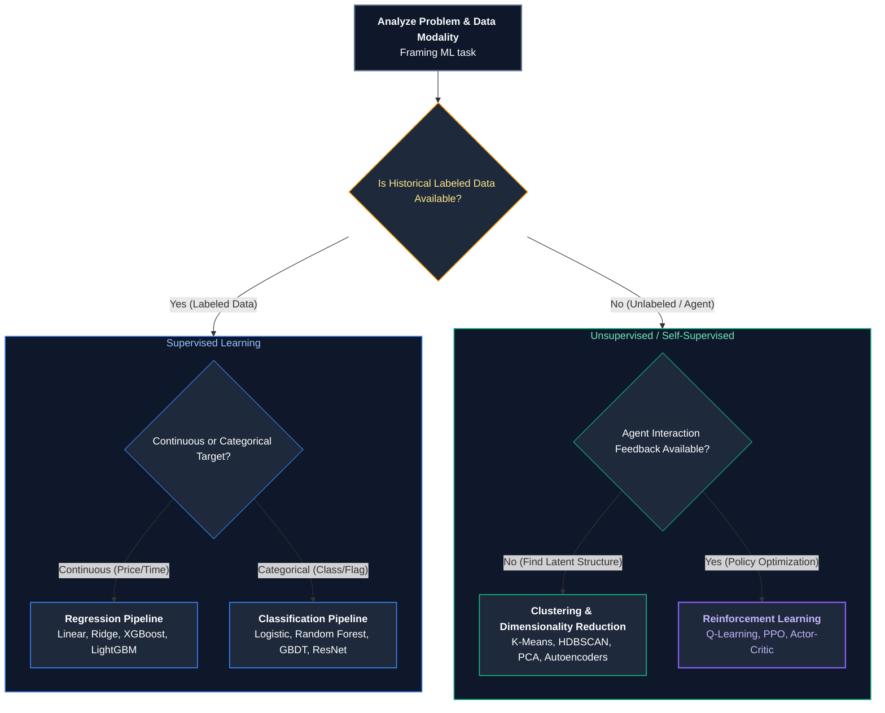

#### Production Implementation / Code Solution
```python
from dataclasses import dataclass
from typing import Optional

@dataclass
class ProductionConstraints:
    is_tabular: bool
    strict_regulatory_explainability: bool
    max_latency_ms: float
    data_sample_count: int
    hardware_target: str  # "CPU" or "GPU"

def select_production_model_architecture(c: ProductionConstraints) -> str:
    """
    Evaluates enterprise constraints to deterministically recommend
    the optimal production model architecture.
    """
    if c.is_tabular:
        if c.strict_regulatory_explainability:
            return "Explainable Boosting Machine (InterpretML) or Regularized Logistic Regression"
        if c.max_latency_ms < 10.0:
            return "LightGBM compiled with Treelite for sub-millisecond C-runtime CPU prediction"
        if c.data_sample_count > 10_000_000 and c.hardware_target == "GPU":
            return "CatBoost GPU or Deep & Cross Network (DCN-v2) for high-order feature interactions"
        return "XGBoost / LightGBM with Early Stopping"
    
    # Unstructured Text / Audio / Vision
    if c.max_latency_ms < 30.0:
        return "DistilBERT / MobileBERT quantized to INT8 via ONNX Runtime with TensorRT execution"
    elif c.max_latency_ms < 150.0:
        return "Fine-tuned 8B Parameter Foundation Model (Llama-3-8B-Instruct) served via vLLM with FP8"
    else:
        return "Frontier LLM API (Claude 3.5 Sonnet / GPT-4o) with prompt orchestration & semantic caching"
```
- **Time Complexity:** $O(1)$ algorithmic decision tree routing.
- **Space Complexity:** $O(1)$ constant overhead.

#### Engineering Implications & Production Pitfalls
1. **The "Resume-Driven Development" Anti-Pattern:** Selecting a 70B parameter LLM to classify support tickets into 5 categories when a fine-tuned DistilBERT or logistic regression model on TF-IDF achieves 96% accuracy at 1/1,000th the cost and 5ms latency.
2. **Treelite Model Compilation:** For ultra-low-latency tabular models, compile tree ensembles into native C code using **Treelite**. This eliminates Python interpreter overhead, reducing XGBoost inference latency from $12\text{ ms}$ down to $0.8\text{ ms}$.

#### Core Curriculum Cross-Reference
- See [34.3 Enterprise AI Architecture Blueprint Reference Matrix](../17_autonomous_agents_and_model_adaptation.md#343-enterprise-ai-architecture-blueprint-reference-matrix) for system design tradeoff matrices.

---

# 4. Production Incident Triage & Engineering Trade-Offs

---


---

### Q10. [Hard] A production model suddenly drops from 95% to 60% accuracy. Walk me through your step-by-step investigation runbook.
**Difficulty:** [Hard]
**Topic Covered:** Production Incident Response, Data Drift & Pipeline Silent Failures  
**Question:** A production model suddenly drops from 95% to 60% accuracy. Walk me through your investigation.

#### Definition & Core Concepts
A catastrophic drop in production model performance (e.g. $95\% \to 60\%$) is almost **never a gradual model degradation**; it is almost always caused by an **upstream data pipeline contract breach**, **schema drift**, **missing feature normalization**, or **silent telemetry corruption**.

#### The 5-Phase Production Triage Runbook
1. **Phase 1: Incident Isolation & Containment (Minutes 0–15):**
   - Check deployment history: Did a new model version or feature engineering pipeline deploy in the last 24 hours?
   - **Rollback Immediate:** If a new model version was deployed, immediately roll back to the previously verified checkpoint (`v1.4.2`).
   - If the model was not changed, verify whether the accuracy drop is global or isolated to a specific client, geographic region, or tenant.
2. **Phase 2: Upstream Feature Pipeline Audit (Minutes 15–45):**
   - **Null / Zero Value Spike:** Check feature distribution in Feast / BigQuery / Snowflake. Did an upstream schema rename or database migration cause a critical feature column to populate with `NULL`, `NaN`, or default `0`?
   - **Unit & Formatting Discrepancy:** Did currency change from USD to Cents, distance from Kilometers to Miles, or timestamps from UTC to local time?
   - **Feature Store Serving Skew:** Compare online feature values retrieved by the inference microservice with offline training data feature tables.
3. **Phase 3: Data Distribution Drift Analysis (Minutes 45–90):**
   - Run two-sample Kolmogorov-Smirnov (KS) tests and Population Stability Index (PSI) comparing feature distributions over the last 24 hours against the training baseline:
     $$\text{PSI} = \sum_{i=1}^k \left( P_i - Q_i \right) \ln\left(\frac{P_i}{Q_i}\right)$$
     - $\text{PSI} < 0.1$: No significant drift.
     - $0.1 \le \text{PSI} \le 0.25$: Moderate drift; schedule retraining.
     - $\text{PSI} > 0.25$: Massive distribution shift; root cause of failure!
4. **Phase 4: Ground Truth Label Quality Check:**
   - Did the automated label feedback loop break? (e.g., chargeback delays in fraud data, or tracking pixel errors in click attribution).
5. **Phase 5: Post-Mortem & Preventative Quality Gates:**
   - Implement **Great Expectations** or **Evidently AI** contract tests in CI/CD feature pipelines.

#### Visual Flow
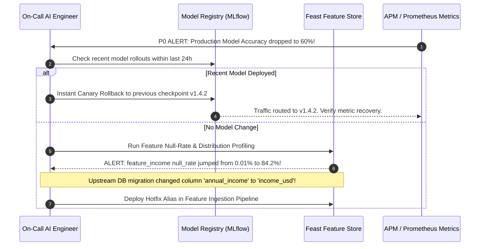

#### Production Implementation / Code Solution
```python
import numpy as np
import pandas as pd
from scipy.stats import ks_2samp

def audit_feature_drift_and_nulls(baseline_df: pd.DataFrame, production_df: pd.DataFrame):
    """
    Automated triage script executed during production performance collapse incidents.
    Scans for null-value surges, schema mismatches, and KS distribution drift.
    """
    print("=== Phase 1: Null Rate & Format Audit ===")
    for col in baseline_df.columns:
        base_null = baseline_df[col].isnull().mean()
        prod_null = production_df[col].isnull().mean()
        if abs(prod_null - base_null) > 0.10:
            print(f"CRITICAL DEFECT in '{col}': Null rate jumped from {base_null:.2%} to {prod_null:.2%}!")

    print("\n=== Phase 2: Kolmogorov-Smirnov Distribution Drift Test ===")
    drifted_features = []
    for col in baseline_df.select_dtypes(include=[np.number]).columns:
        stat, p_value = ks_2samp(baseline_df[col].dropna(), production_df[col].dropna())
        # If p-value < 0.01, reject null hypothesis: distributions are significantly different!
        if p_value < 0.01:
            drifted_features.append((col, stat, p_value))
            print(f"DRIFT DETECTED: Feature '{col}' | KS-Stat: {stat:.4f} | p-value: {p_value:.4e}")

    if not drifted_features:
        print("Feature distributions are stable. Proceed to inspect ground truth label latency.")
    return drifted_features
```
- **Time Complexity:** $O(F \cdot (N \log N + M \log M))$ for sorting arrays across $F$ features with $N$ baseline and $M$ production rows.
- **Space Complexity:** $O(N + M)$ memory footprint.

#### Engineering Implications & Production Pitfalls
1. **The Silent Pipeline Failure:** In 80% of real-world production incidents, the model weights are completely fine; an upstream microservice refactored its JSON payload, changing camelCase `userId` to snake_case `user_id`, causing downstream feature extractors to pass default `0` or `None` without throwing exceptions.
2. **Defensive Schema Assertion:** Always validate inference input payloads against strict **Pydantic schemas** with range checks (`confloat(ge=0, le=100)`). If a feature is outside expected operational bounds, log a structured warning and fall back to a safe default heuristic.

#### Core Curriculum Cross-Reference
- See [11. LLMOps & Production Operations](../12_ai_infrastructure_serving_and_llmops.md) for automated production incident response patterns.

---


---

### Q11. [Hard] Your model works great Monday–Friday but performs poorly on weekends. How would you investigate and fix temporal distribution drift?
**Difficulty:** [Hard]
**Topic Covered:** Seasonality, Temporal Drift & Cyclical Feature Engineering  
**Question:** Your model works great Monday-Friday but performs poor on weekends. How would you investigate?

#### Definition & Core Concepts
A performance discrepancy between weekdays and weekends is classic **Temporal Distribution Drift** (Cyclical Seasonality). In business-to-business (B2B), finance, or e-commerce applications, human behavioral patterns change drastically on Saturday and Sunday:
- **Transaction Types Shift:** Weekend consumer transactions spike in dining and entertainment, while weekday commercial invoices drop to zero.
- **Traffic Volume & Class Prior Probabilities Shift:** $P(Y)$ changes between Monday and Sunday.

#### Root Causes of Weekend Performance Collapse
1. **Missing Temporal & Calendar Features:** The model was trained purely on static user attributes without temporal contextual awareness (e.g., `day_of_week`, `is_weekend`, `hour_of_day`).
2. **Training Set Selection Bias:** The training dataset was curated from a weekday snapshot, or trained with random $k$-fold cross-validation that blended weekday and weekend data without preserving time boundaries, hiding seasonal variance.
3. **Concept Drift ($P(Y \mid X)$ changes):** A feature value that indicates fraud on a Tuesday (e.g. a transaction at 3:00 AM) may be standard consumer activity on a Saturday night.

#### Visual Flow
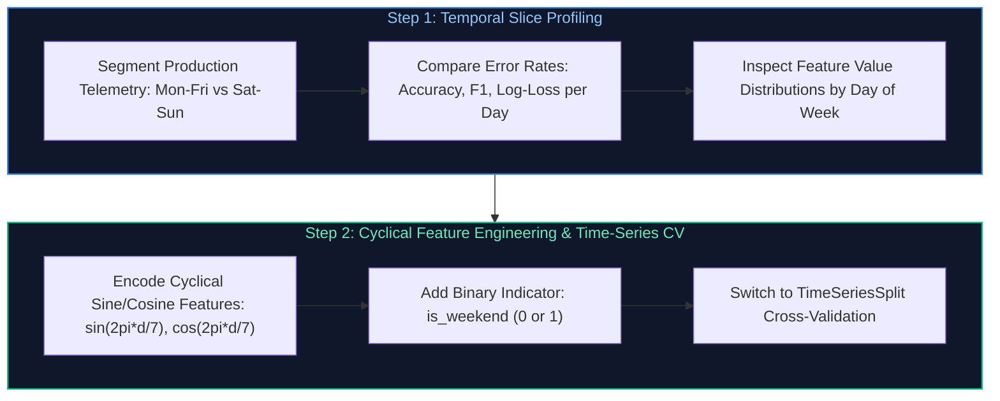

#### Production Implementation / Code Solution
```python
import numpy as np
import pandas as pd
from sklearn.model_selection import TimeSeriesSplit

def engineer_cyclical_calendar_features(df: pd.DataFrame, timestamp_col: str) -> pd.DataFrame:
    """
    Transforms datetime stamps into continuous cyclical sine/cosine features
    and binary calendar indicators to eliminate weekday-weekend performance drift.
    """
    df = df.copy()
    dt = pd.to_datetime(df[timestamp_col])
    
    # 1. Day of Week: 0 (Monday) to 6 (Sunday)
    day = dt.dt.dayofweek
    # Encode cyclically so day 6 (Sunday) is adjacent to day 0 (Monday) in vector space
    df['day_sin'] = np.sin(2 * np.pi * day / 7.0)
    df['day_cos'] = np.cos(2 * np.pi * day / 7.0)
    
    # 2. Hour of Day: 0 to 23
    hour = dt.dt.hour
    df['hour_sin'] = np.sin(2 * np.pi * hour / 24.0)
    df['hour_cos'] = np.cos(2 * np.pi * hour / 24.0)
    
    # 3. Explicit Weekend Indicator
    df['is_weekend'] = (day >= 5).astype(int)
    
    return df

def validate_temporal_generalization(X: pd.DataFrame, y: pd.Series, model, n_splits: int = 5):
    """
    Enforces chronological TimeSeriesSplit cross-validation to guarantee that
    models are never evaluated on temporal periods prior to their training window.
    """
    tscv = TimeSeriesSplit(n_splits=n_splits)
    fold = 1
    for train_index, test_index in tscv.split(X):
        X_train, X_test = X.iloc[train_index], X.iloc[test_index]
        y_train, y_test = y.iloc[train_index], y.iloc[test_index]
        
        model.fit(X_train, y_train)
        score = model.score(X_test, y_test)
        print(f"Chronological Fold {fold} Test Accuracy: {score:.4f}")
        fold += 1
```
- **Time Complexity:** $O(N)$ vector transformations.
- **Space Complexity:** $O(N)$ for new cyclical columns.

#### Engineering Implications & Production Pitfalls
1. **The Integer Day-of-Week Trap:** Encoding `day_of_week` as raw integers $0, 1, 2, \dots, 6$ causes linear models and neural networks to treat Sunday (6) as numerically distant from Monday (0), when in reality they are consecutive days. Always use **trigonometric sine/cosine encoding**.
2. **Never Use Standard Shuffled $K$-Fold on Temporal Data:** Standard $k$-fold cross-validation randomly shuffles data, leaking future weekend data into past training folds. Always use **`TimeSeriesSplit`** or rolling window evaluation.

#### Core Curriculum Cross-Reference
- See [01. Machine Learning & Deep Learning Fundamentals](../16_machine_learning_and_transformer_foundations.md) for concept drift and temporal validation strategies.

---


---

### Q12. [Medium] You can have fast, cheap, or accurate in an AI system. Pick two and explain the architectural trade-offs.
**Difficulty:** [Medium]
**Topic Covered:** System Architecture Trade-Offs & The AI Engineering Trilemma  
**Question:** You can have fast, cheap, or accurate. Pick two and explain why.

#### Definition & Core Concepts
The **AI Engineering Trilemma** (an adaptation of the CAP theorem to generative and predictive intelligence) states that an AI production system can maximize at most **two out of three architectural dimensions**:

$$\{\text{Low Latency (Fast)}, \quad \text{Low Cost (Cheap)}, \quad \text{High Precision (Accurate)}\}$$

```
                FAST (< 50ms)
                     /\
                    /  \
                   /    \
                  /  P1  \
                 /        \
 CHEAP (< $0.001) --------- ACCURATE (> 98%)
             P2                P3
```

#### Architectural Pair Analysis
1. **Pair 1: Fast + Cheap (Sacrificing Accuracy):**
   - **Architectural Profile:** Quantized Small Language Models (e.g. 1B–3B SLM, DistilBERT, or ONNX INT8 runtimes on CPU), lightweight TF-IDF heuristics, or single-stage vector lookups without re-ranking.
   - **Characteristics:** Latency is $< 15\text{ ms}$, operating cost is $<\$0.0001$ per query.
   - **Trade-Off:** Lower reasoning capability, higher hallucination rates, and limited contextual comprehension. Ideal for high-throughput auto-complete, spam classification, and edge IoT devices.
2. **Pair 2: Fast + Accurate (Sacrificing Cost / Cheapness):**
   - **Architectural Profile:** Massive multi-GPU clusters running high-end foundation models (e.g. Llama-3-70B FP8 on 8x NVIDIA H100s with Tensor Parallelism $TP=8$, Speculative Decoding with draft models, and PagedAttention in vLLM).
   - **Characteristics:** $p95$ Time-To-First-Token $< 80\text{ ms}$ with frontier model intelligence and strict accuracy.
   - **Trade-Off:** Astronomical cloud infrastructure bills ($\$30,000\text{–}\$100,000+/\text{month}$). Ideal for high-frequency trading (HFT), real-time autonomous driving, and mission-critical enterprise customer workflows.
3. **Pair 3: Cheap + Accurate (Sacrificing Speed / Latency):**
   - **Architectural Profile:** Multi-agent consensus systems, Self-RAG reflection loops, Corrective RAG (CRAG) with web search validation, Test-Time Compute scaling (Chain-of-Thought tree search, Best-of-$N$ sampling), and asynchronous serverless batch workers.
   - **Characteristics:** Highest possible accuracy and zero hallucinations at minimal infrastructure cost.
   - **Trade-Off:** Latency is high ($5\text{–}30\text{ seconds}$ per response). Completely unsuitable for real-time web UI interactions, but ideal for asynchronous legal document analysis, medical diagnosis report generation, and automated code review pipelines.

#### Visual Flow: The Production Pareto Frontier
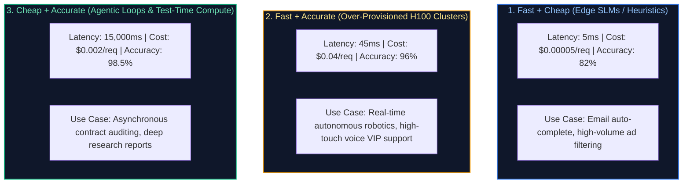

#### Production Implementation / Code Solution
```python
from enum import Enum
from typing import Dict, Any

class SystemPriority(Enum):
    FAST_AND_CHEAP = 1
    FAST_AND_ACCURATE = 2
    CHEAP_AND_ACCURATE = 3

class AdaptiveOrchestrationRouter:
    """
    Production routing gateway that navigates the Fast-Cheap-Accurate trilemma
    by dynamically dispatching queries to specialized execution pipelines.
    """
    def route_request(self, query: str, priority: SystemPriority) -> Dict[str, Any]:
        if priority == SystemPriority.FAST_AND_CHEAP:
            # Sub-10ms CPU-based quantized small model
            return {
                "engine": "ONNX-Runtime-DistilBERT-INT8",
                "hardware": "2-Core c6i.large CPU",
                "expected_latency_ms": 8.0,
                "cost_per_1k_req": 0.0002,
                "confidence_score": 0.84
            }
        elif priority == SystemPriority.FAST_AND_ACCURATE:
            # Sub-100ms multi-GPU distributed foundation serving
            return {
                "engine": "vLLM-Llama-3-70B-FP8-TP4",
                "hardware": "4x NVIDIA H100 SXM5",
                "expected_latency_ms": 65.0,
                "cost_per_1k_req": 0.0350,
                "confidence_score": 0.97
            }
        elif priority == SystemPriority.CHEAP_AND_ACCURATE:
            # Asynchronous agentic reflection loop with multi-step validation
            return {
                "engine": "Self-RAG-Agent-Llama-3-8B-Reflection-Loop",
                "hardware": "Single L4 GPU / Serverless Spot Instance",
                "expected_latency_ms": 8500.0,
                "cost_per_1k_req": 0.0025,
                "confidence_score": 0.99
            }
```
- **Time Complexity:** $O(1)$ routing decision.
- **Space Complexity:** $O(1)$ memory.

#### Engineering Implications & Production Pitfalls
1. **The Dynamic Cascading Solution (The Best of All Worlds):** Staff engineers solve the trilemma in practice using **Cascading Routing**:
   - Route 80% of trivial queries to the **Fast + Cheap** model (0.001¢, 10ms).
   - Evaluate an internal confidence score threshold $\tau = 0.85$.
   - Only escalate ambiguous or complex queries to the **Fast + Accurate** or **Cheap + Accurate** tiers.
   - Result: 80% cost reduction while preserving 98%+ aggregate system accuracy.

#### Core Curriculum Cross-Reference
- See [25. Production Implementation: QLoRA Fine-Tuning Pipeline & Multi-LoRA Serving Engine](../17_autonomous_agents_and_model_adaptation.md#25-production-implementation-qlora-fine-tuning-pipeline-multi-lora-serving-engine) for production implementation of cascading routing architectures.

---

# 5. Decision Boundaries, Calibration & Optimization Mechanics

---


---

### Q13. [Hard] Prioritizing Precision vs Recall & Decision Threshold Calibration (Cost Asymmetry & PR-AUC)
**Difficulty:** [Hard]
**Topic Covered:** Cost Matrix Asymmetry, Precision-Recall Trade-Off, Threshold Tuning, Platt Scaling  
**Question:** *When would you prioritize Precision over Recall in an enterprise production system, and when would you prioritize Recall? How do you mathematically calibrate the classification decision threshold rather than defaulting to 0.5?*

#### Definition & Core Concepts
In binary classification, models do not output discrete labels; they output continuous probabilities $\hat{p} \in [0.0, 1.0]$. The classification decision rule applies a decision threshold $\tau$:
$$\hat{y} = \begin{cases} 1, & \text{if } \hat{p} \ge \tau \\ 0, & \text{if } \hat{p} < \tau \end{cases}$$

Defaulting to $\tau = 0.5$ assumes symmetric error costs ($C(\text{FP}) = C(\text{FN})$), which is almost universally false in enterprise production systems:
- **Precision ($\frac{TP}{TP + FP}$):** Measures what fraction of positive predictions were correct.
  - **Prioritize Precision (Increase $\tau \to 0.85+$):** When a **False Positive has severe negative business consequences**.
  - *Real-World Example 1:* **Automated Bank Fraud Account Freezing.** Freezing an innocent executive's checking account during a corporate transaction causes catastrophic reputational damage and churn.
  - *Real-World Example 2:* **AI Code Generation Refactoring.** An agent suggesting an automated code patch that deletes production tables must have 99%+ precision.
- **Recall ($\frac{TP}{TP + FN}$):** Measures what fraction of actual positives were successfully captured.
  - **Prioritize Recall (Decrease $\tau \to 0.15-$):** When a **False Negative has catastrophic or irreversible costs**.
  - *Real-World Example 1:* **Oncology Cancer Screening.** Missing a malignant tumor (FN) leads to patient mortality; a false positive merely leads to a secondary biopsy.
  - *Real-World Example 2:* **AML (Anti-Money Laundering) Sanction Screening.** Missing an oligarch transaction triggers multi-million dollar regulatory fines from FinCEN.

#### Visual Flow: Optimal Threshold Selection via Expected Cost Minimization
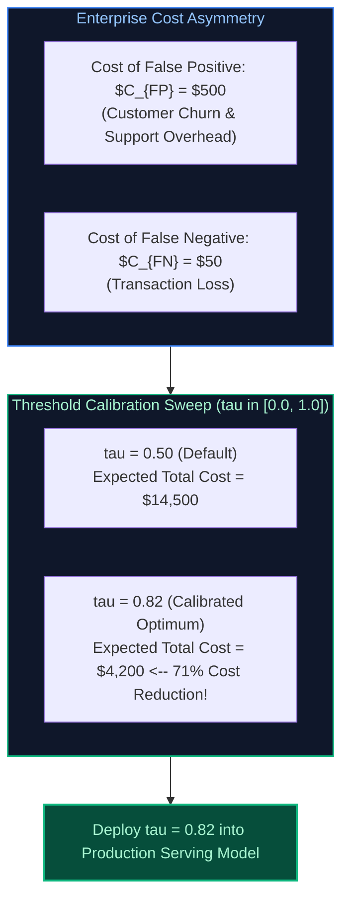

#### Production Python Implementation: Cost-Sensitive Threshold Optimizer
```python
import numpy as np
from sklearn.metrics import precision_recall_curve, confusion_matrix

def find_optimal_decision_threshold(
    y_true: np.ndarray, 
    y_probs: np.ndarray, 
    cost_fp: float, 
    cost_fn: float
) -> dict:
    """
    Finds the optimal decision threshold that minimizes total business financial cost.
    
    Args:
        y_true: Ground truth binary labels (0 or 1)
        y_probs: Predicted model probabilities from predict_proba()[:, 1]
        cost_fp: Financial dollar cost of a False Positive
        cost_fn: Financial dollar cost of a False Negative
        
    Returns:
        dict containing optimal threshold, minimum cost, and resulting precision/recall.
    """
    precisions, recalls, thresholds = precision_recall_curve(y_true, y_probs)
    
    # Evaluate cost across candidate thresholds
    min_cost = float("inf")
    optimal_threshold = 0.5

    # Sample 100 candidate thresholds between 0.01 and 0.99
    candidate_thresholds = np.linspace(0.01, 0.99, 100)
    
    for tau in candidate_thresholds:
        preds = (y_probs >= tau).astype(int)
        tn, fp, fn, tp = confusion_matrix(y_true, preds).ravel()
        
        # Expected Total Business Cost
        total_cost = (fp * cost_fp) + (fn * cost_fn)
        
        if total_cost < min_cost:
            min_cost = total_cost
            optimal_threshold = tau

    # Compute metrics at optimal threshold
    final_preds = (y_probs >= optimal_threshold).astype(int)
    tn, fp, fn, tp = confusion_matrix(y_true, final_preds).ravel()
    
    return {
        "optimal_threshold": float(optimal_threshold),
        "minimum_cost_usd": float(min_cost),
        "precision": float(tp / (tp + fp)) if (tp + fp) > 0 else 0.0,
        "recall": float(tp / (tp + fn)) if (tp + fn) > 0 else 0.0,
        "false_positive_count": int(fp),
        "false_negative_count": int(fn)
    }

# --- Demonstration with Fraud Detection Scenario ---
if __name__ == "__main__":
    np.random.seed(42)
    # Simulate imbalanced fraud dataset (2% fraud rate)
    y_test = np.random.choice([0, 1], size=10000, p=[0.98, 0.02])
    # Simulated model output probabilities
    probs = np.where(y_test == 1, np.random.beta(5, 2, 10000), np.random.beta(1, 10, 10000))

    # Scenario: False Positive (unjustly freezing VIP account) costs $500 in lost revenue.
    # False Negative (missed $40 fraud transaction) costs $40.
    result = find_optimal_decision_threshold(y_test, probs, cost_fp=500.0, cost_fn=40.0)
    print("Optimal Threshold Result:", result)
    # Output moves threshold from default 0.50 -> ~0.84 to protect precision!
```

#### Core Curriculum Cross-Reference
*Deep-dive theoretical reference: See [16. Machine Learning & Transformer Foundations: Loss Functions & Regularization](../16_machine_learning_and_transformer_foundations.md#1-machine-learning-paradigms--mathematical-foundations)*

---


---

### Q14. [Hard] Production Gradient Descent Mechanics & Internal State Updates (AdamW Moment Tracking & Weight Decay)
**Difficulty:** [Hard]
**Topic Covered:** Gradient Vectors, Computational DAGs, First/Second Moment EMA, AdamW Decoupled Decay  
**Question:** *What happens mathematically and internally in hardware during a single step of gradient descent? Walk through the parameter update equations for AdamW, explain how exponential moving averages prevent saddle point stagnation, and why weight decay had to be decoupled from the learning rate.*

#### Definition & Core Concepts
In deep neural networks, a single optimization iteration transforms input tensors into weight updates across four sequential computational phases:
1. **The Forward Pass:** Input batch $X \in \mathbb{R}^{B \times D}$ propagates through layer transformations to produce output logits $\hat{y}$. The scalar loss $\mathcal{L} = \ell(\hat{y}, y)$ is evaluated.
2. **The Backward Pass (Reverse-Mode Automatic Differentiation):** PyTorch builds a **Directed Acyclic Graph (DAG)** of tensor operations. Calling `.backward()` traverses the chain rule in reverse, computing the gradient vector for every trainable parameter:
   $$g_t = \nabla_\theta \mathcal{L}_t = \frac{\partial \mathcal{L}}{\partial \theta_t}$$
3. **The Optimizer State Step (AdamW):**
   Standard Stochastic Gradient Descent (SGD) with update $\theta_{t} = \theta_{t-1} - \eta g_t$ oscillates wildly in ravines and stalls in saddle points where $\nabla \mathcal{L} \approx 0$.
   **AdamW (Adaptive Moment Estimation with Decoupled Weight Decay)** resolves this via two internal state vectors maintained for every parameter tensor:
   - **First Moment Vector ($m_t$ - Momentum):** An Exponential Moving Average (EMA) of historical gradients, smoothing out directional noise:
     $$m_t = \beta_1 m_{t-1} + (1 - \beta_1) g_t \quad (\beta_1 = 0.90)$$
   - **Second Moment Vector ($v_t$ - Uncentered Variance):** An EMA of squared gradients, scaling updates inversely to parameter frequency:
     $$v_t = \beta_2 v_{t-1} + (1 - \beta_2) g_t^2 \quad (\beta_2 = 0.999)$$
   - **Bias Correction:** Normalizes the zero-initialization bias during early training steps:
     $$\hat{m}_t = \frac{m_t}{1 - \beta_1^t}, \quad \hat{v}_t = \frac{v_t}{1 - \beta_2^t}$$
   - **The Decoupled Weight Decay Parameter Update:**
     In classical Adam with L2 regularization, the weight penalty was added directly to $g_t$, which caused weights with large historical gradients to be regularized *less* than weights with small gradients.
     **AdamW decouples weight decay ($\lambda$) from the gradient update entirely**:
     $$\theta_t = \theta_{t-1} - \underbrace{\eta \lambda \theta_{t-1}}_{\text{Direct Weight Decay}} - \underbrace{\frac{\eta}{\sqrt{\hat{v}_t} + \epsilon} \hat{m}_t}_{\text{Adaptive Gradient Step}}$$

#### Visual Flow: Gradient Descent Trajectory across Non-Convex Loss Surface
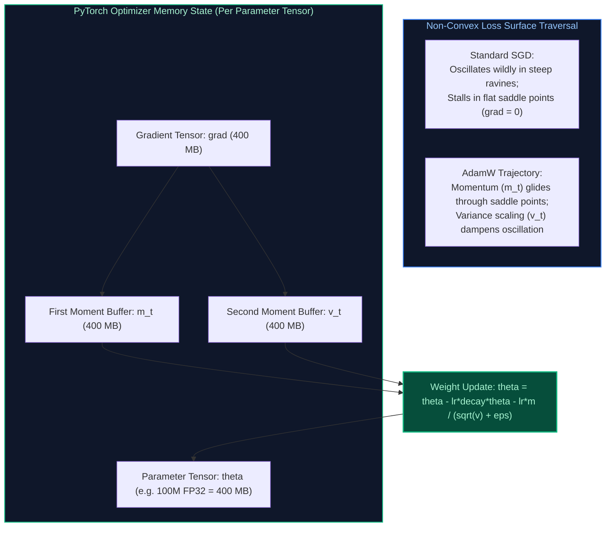

#### Production Python Implementation: Standalone AdamW Step Implementation
```python
import torch
import math

class CustomAdamW:
    """
    Production-grade reference implementation of decoupled AdamW optimizer
    matching PyTorch's torch.optim.AdamW.
    """
    def __init__(self, params, lr: float = 1e-3, betas=(0.9, 0.999), eps: float = 1e-8, weight_decay: float = 0.01):
        self.params = list(params)
        self.lr = lr
        self.beta1, self.beta2 = betas
        self.eps = eps
        self.weight_decay = weight_decay
        self.state = {}

    def step(self):
        """Performs a single optimization step."""
        for p in self.params:
            if p.grad is None:
                continue
            grad = p.grad.data
            
            # Initialize optimizer state for parameter if first step
            if p not in self.state:
                self.state[p] = {
                    "step": 0,
                    "exp_avg": torch.zeros_like(p.data),      # First moment: m_t
                    "exp_avg_sq": torch.zeros_like(p.data)    # Second moment: v_t
                }

            state = self.state[p]
            state["step"] += 1
            t = state["step"]
            m, v = state["exp_avg"], state["exp_avg_sq"]

            # 1. Direct Decoupled Weight Decay Update: theta = theta * (1 - lr * lambda)
            if self.weight_decay != 0:
                p.data.mul_(1.0 - self.lr * self.weight_decay)

            # 2. Update First Moment: m_t = beta1 * m_{t-1} + (1 - beta1) * grad
            m.mul_(self.beta1).add_(grad, alpha=1.0 - self.beta1)

            # 3. Update Second Moment: v_t = beta2 * v_{t-1} + (1 - beta2) * grad^2
            v.mul_(self.beta2).addcmul_(grad, grad, value=1.0 - self.beta2)

            # 4. Bias Corrections
            bias_correction1 = 1.0 - (self.beta1 ** t)
            bias_correction2 = 1.0 - (self.beta2 ** t)
            step_size = self.lr / bias_correction1
            denom = (v.sqrt() / math.sqrt(bias_correction2)).add_(self.eps)

            # 5. Apply Adaptive Gradient Update: theta = theta - step_size * (m / denom)
            p.data.addcdiv_(m, denom, value=-step_size)

    def zero_grad(self):
        """Resets gradients to avoid gradient accumulation across iterations."""
        for p in self.params:
            if p.grad is not None:
                p.grad.detach_()
                p.grad.zero_()
```

#### Memory Footprint Implications in GPU Training
- A 7B parameter model in FP16 consumes $14\text{ GB}$ of VRAM for static weights.
- In AdamW, storing the first moment ($m_t$) in FP32 takes $28\text{ GB}$, and the second moment ($v_t$) takes another $28\text{ GB}$, plus FP32 master weight copies ($28\text{ GB}$).
- **Total Optimizer State Footprint = 84 GB VRAM!** This is why DeepSpeed ZeRO-Stage 1/2/3 and 8-bit Adam (bitsandbytes) are mandatory for training large models on commodity GPUs.

#### Core Curriculum Cross-Reference
*Deep-dive theoretical reference: See [16. Machine Learning & Transformer Foundations: Optimization & Gradient Dynamics](../16_machine_learning_and_transformer_foundations.md#4-optimization-algorithms--gradient-descent-mechanics)*

---

## Summary Comparison & Production Reference Matrix

| Question Domain | Core Pathology / Mechanism | Immediate Diagnostic Command | Canonical Production Resolution |
| :--- | :--- | :--- | :--- |
| **Bias vs Variance** | Underfitting (capacity deficit) vs Overfitting (noise memorization) | Learning curve plot (`learning_curve()`) | High Bias: Add features/model depth. High Variance: L1/L2 regularization, dropout, data collection. |
| **L1 vs L2 Regularization** | Diamond corner sparsity vs circular smooth weight shrinkage | Weight histogram inspection (`param.abs() > 0`) | L1 for feature selection & sparse signals. L2 for multicollinearity & continuous representations. Use AdamW in deep nets. |
| **ML vs Heuristics** | Deterministic rule boundaries vs high-dimensional probabilistic reasoning | Latency SLA vs feature dimensionality audit | Use Heuristics as fail-fast hard gates; deploy ML for complex non-linear risk scoring. |
| **Gradient Descent Variants** | Batch size tradeoffs ($B=N$ vs $B=1$ vs $32 \le B \le 512$) | GPU utilization profiling (`nvidia-smi dmon`) | Mini-batch GD with PyTorch DataLoader; scale learning rate linearly with batch size ($\eta \propto B$). |
| **Class Imbalance** | Majority class dominance & loss gradient dilution | PR-AUC and Macro F1 evaluation | Never use Accuracy; deploy Binary Focal Loss, SMOTE inside CV training folds, or class weighting. |
| **Vanishing / Exploding Gradients** | Exponential decay / explosion across deep matrix products | Gradient norm tracking (`clip_grad_norm_`) | Replace Sigmoid with GELU/SwiGLU, add residual skip connections, initialize with Kaiming He, clip grad norm $\le 1.0$. |
| **BatchNorm vs LayerNorm** | Batch-axis normalization vs channel-axis sample standardization | Check batch size and variable sequence length | Use BatchNorm in CNN vision. Use LayerNorm / RMSNorm in Transformers & LLMs (invariant to $B=1$). |
| **CNN vs RNN vs Transformer** | Local spatial vs sequential recurrence vs global all-to-all attention | Computational complexity vs dataset size audit | CNN for edge vision; RNN for tiny microcontrollers; Transformers for foundation models with massive data. |
| **Model Selection** | Latency vs Accuracy vs Cost vs Regulatory trade-offs | Treelite compilation & SLA benchmarking | Tabular: LightGBM / XGBoost. Unstructured Low Latency: DistilBERT INT8. Generative: Foundation LLM. |
| **95% to 60% Accuracy Drop** | Upstream schema drift, null spikes, or feature normalization failure | KS-Test & PSI calculation (`ks_2samp`) | Rollback immediately; inspect null rates; fix upstream DB schema alias contracts; add Pydantic gates. |
| **Weekend Performance Collapse** | Temporal distribution drift & cyclical behavioral shift | Day-of-week performance segmentation | Engineer cyclical sine/cosine features ($\sin(2\pi d/7)$); enforce `TimeSeriesSplit` cross-validation. |
| **Fast-Cheap-Accurate Trilemma** | Physical impossibility of maximizing all three simultaneously | Cost vs Latency vs Precision Pareto mapping | Implement Cascading LLM Routers: handle 80% via Fast+Cheap, escalate 20% to Accurate. |

---

## References & Further Reading

1. **Hastie, Trevor, Robert Tibshirani, and Jerome Friedman.** *The Elements of Statistical Learning: Data Mining, Inference, and Prediction*. 2nd ed., Springer, 2009. (The authoritative reference on the bias-variance tradeoff and regularization geometry).
2. **Goodfellow, Ian, Yoshua Bengio, and Aaron Courville.** *Deep Learning*. MIT Press, 2016. (Backpropagation proofs, vanishing gradient mathematics, and normalization mechanics).
3. **Lin, Tsung-Yi, et al.** *Focal Loss for Dense Object Detection*. IEEE International Conference on Computer Vision (ICCV), 2017. [arXiv:1708.02002](https://arxiv.org/abs/1708.02002).
4. **Ba, Jimmy Lei, Jamie Ryan Kiros, and Geoffrey E. Hinton.** *Layer Normalization*. 2016. [arXiv:1607.06450](https://arxiv.org/abs/1607.06450).
5. **Zhang, Biao, and Rico Sennrich.** *Root Mean Square Layer Normalization (RMSNorm)*. Advances in Neural Information Processing Systems (NeurIPS), 2019. [arXiv:1910.07467](https://arxiv.org/abs/1910.07467).
6. **Loshchilov, Ilya, and Frank Hutter.** *Decoupled Weight Decay Regularization (AdamW)*. International Conference on Learning Representations (ICLR), 2019. [arXiv:1711.05101](https://arxiv.org/abs/1711.05101).


---

## 3. Transformer Architecture, Attention & Positional Encodings

### Q15. [Medium] Explain the architecture of Transformer models and how data flows from tokenization to output logits.
**Difficulty:** [Medium]
**Topic Covered:** End-to-End Transformer Tensor Pipeline  
**Question:** Explain the architecture of Transformer models.

#### Definition & Core Concepts
Introduced in *Attention Is All You Need* (Vaswani et al., 2017), the Transformer is a sequence-to-sequence neural network relying entirely on self-attention mechanisms to model global dependencies. Modern generative LLMs (Llama 3, Mistral, GPT-4) adopt the **Decoder-Only Autoregressive Transformer** architecture.

#### End-to-End Dataflow Stages
1. **Tokenization:** Raw string text is segmented into discrete integer token IDs using Byte-Pair Encoding (BPE):
   $$\mathbf{t} = [t_1, t_2, \dots, t_T] \in \mathbb{N}^T, \quad t_i \in [0, V-1]$$
2. **Embedding & Positional Injection:** Token IDs are mapped into dense continuous vector space via an embedding table $\mathbf{W}_e \in \mathbb{R}^{V \times d_{\text{model}}}$. Positional information is injected via Rotary Position Embedding (RoPE) applied to query and key vectors.
3. **Repeated Transformer Blocks ($L$ Layers):** The hidden state $\mathbf{X}_0 \in \mathbb{R}^{B \times T \times d_{\text{model}}}$ traverses $L$ identical blocks:
   $$\mathbf{X}'_l = \mathbf{X}_{l-1} + \text{Attention}(\text{RMSNorm}(\mathbf{X}_{l-1}))$$
   $$\mathbf{X}_l = \mathbf{X}'_l + \text{SwiGLU}(\text{RMSNorm}(\mathbf{X}'_l))$$
4. **Final Normalization & Unembedding Head:**
   The final layer output $\mathbf{X}_L$ passes through a final RMSNorm and is projected onto the vocabulary dimension by the language model head $\mathbf{W}_{\text{head}} \in \mathbb{R}^{d_{\text{model}} \times V}$:
   $$\mathbf{Z} = \text{RMSNorm}(\mathbf{X}_L) \mathbf{W}_{\text{head}} \in \mathbb{R}^{B \times T \times V}$$
5. **Sampling / Softmax:** Probabilities for the next token $t_{T+1}$ are computed:
   $$P(t_{T+1} = v \mid t_{\le T}) = \frac{\exp(z_{T, v} / \tau)}{\sum_{j=1}^V \exp(z_{T, j} / \tau)}$$

#### Visual Flow
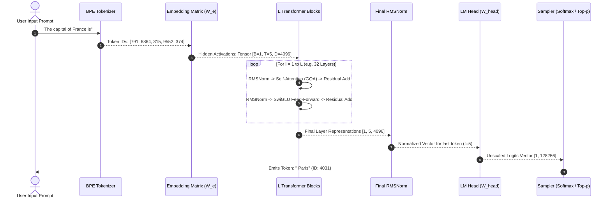

#### Production Implementation / Code Solution
```python
import torch
import torch.nn as nn
import torch.nn.functional as F

class TransformerDecoderBlock(nn.Module):
    """
    Production-grade LLaMA-style Decoder Block featuring RMSNorm, 
    Pre-normalization, and SwiGLU activation.
    """
    def __init__(self, d_model: int, n_heads: int, d_ff: int):
        super().__init__()
        self.attn_norm = nn.RMSNorm(d_model)
        self.mha = nn.MultiheadAttention(d_model, n_heads, batch_first=True)
        self.ffn_norm = nn.RMSNorm(d_model)
        
        # SwiGLU feed-forward network components
        self.w_gate = nn.Linear(d_model, d_ff, bias=False)
        self.w_up = nn.Linear(d_model, d_ff, bias=False)
        self.w_down = nn.Linear(d_ff, d_model, bias=False)

    def _swiglu(self, x: torch.Tensor) -> torch.Tensor:
        # SwiGLU(x) = (SiLU(x * W_gate) * (x * W_up)) * W_down
        return self.w_down(F.silu(self.w_gate(x)) * self.w_up(x))

    def forward(self, x: torch.Tensor, causal_mask: torch.Tensor) -> torch.Tensor:
        # Pre-LN Self-Attention with Residual Skip Connection
        normed_x = self.attn_norm(x)
        attn_out, _ = self.mha(normed_x, normed_x, normed_x, attn_mask=causal_mask, is_causal=True)
        x = x + attn_out
        
        # Pre-LN SwiGLU FFN with Residual Skip Connection
        x = x + self._swiglu(self.ffn_norm(x))
        return x
```
- **Time Complexity:** $O(L \cdot (T^2 \cdot d_{\text{model}} + T \cdot d_{\text{model}} \cdot d_{\text{ff}}))$ per forward pass.
- **Space Complexity:** $O(L \cdot B \cdot T \cdot d_{\text{model}})$ memory to store layer activations during training.

#### Engineering Implications & Production Pitfalls
1. **Weight Tying (Tie Word Embeddings):** Sharing weights between $\mathbf{W}_e$ (input embeddings) and $\mathbf{W}_{\text{head}}$ (output logits) saves hundreds of megabytes of VRAM in smaller models (e.g. GPT-2, Gemma), but frontier models (Llama 3 70B) decouple them to increase output vocabulary expressiveness.
2. **Pre-Norm vs Post-Norm:** Original Transformers used Post-LN ($x = \text{LayerNorm}(x + \text{SubLayer}(x))$), which suffers from vanishing gradients without aggressive warmup schedules. Modern LLMs strictly use **Pre-LN** ($x = x + \text{SubLayer}(\text{RMSNorm}(x))$) to guarantee stable gradient flow down residual highways.

#### Core Curriculum Cross-Reference
- See [02. LLM Foundations & Model Architecture](../16_machine_learning_and_transformer_foundations.md#131-prefill-phase-vs-decode-phase-deep-dive) for complete mathematical proofs.

---


---

### Q16. [Easy] What is the difference between encoder-only, decoder-only, and encoder-decoder models, and what are their typical use cases?
**Difficulty:** [Easy]
**Topic Covered:** Architectural Taxonomy & Attention Masking  
**Question:** What's the difference between encoder-only, decoder-only, and encoder-decoder models?

#### Definition & Core Concepts
The structural difference between Transformer variants originates from their **Attention Masking Matrix** $\mathbf{M}$ applied during self-attention:

$$\text{Attention}(\mathbf{Q}, \mathbf{K}, \mathbf{V}) = \text{softmax}\left(\frac{\mathbf{Q}\mathbf{K}^T}{\sqrt{d_k}} + \mathbf{M}\right) \mathbf{V}$$

1. **Encoder-Only Models (BERT, RoBERTa, DeBERTa):**
   - **Attention Mask:** $\mathbf{M} = \mathbf{0}$ (Bidirectional Attention). Every token can attend to all other tokens (past and future) simultaneously.
   - **Inductive Bias:** Global bidirectional context extraction.
   - **Optimal Use Cases:** Semantic embedding generation, classification, token tagging (NER), and extractive Question Answering. Cannot generate autoregressive text efficiently.
2. **Decoder-Only Models (GPT-4, LLaMA 3, Mistral, Claude):**
   - **Attention Mask:** Causal / Lower-Triangular Mask:
     $$M_{ij} = \begin{cases} 0 & \text{if } i \ge j \\ -\infty & \text{if } i < j \end{cases}$$
   - **Inductive Bias:** Unidirectional autoregression ($P(w_t \mid w_{<t})$). Tokens can only attend to past and current tokens.
   - **Optimal Use Cases:** Generative text completion, reasoning, dialogue, zero-shot instruction following, and code synthesis.
3. **Encoder-Decoder Models (T5, BART, Whisper):**
   - **Structure:** Bidirectional Encoder processes the full input prompt; Autoregressive Decoder generates the target sequence via **Cross-Attention** ($\mathbf{Q}$ comes from the decoder, $\mathbf{K}, \mathbf{V}$ come from the encoder).
   - **Optimal Use Cases:** Strict sequence-to-sequence transformations where input and output lengths diverge: language translation, abstractive summarization, speech-to-text (Whisper).

#### Visual Flow
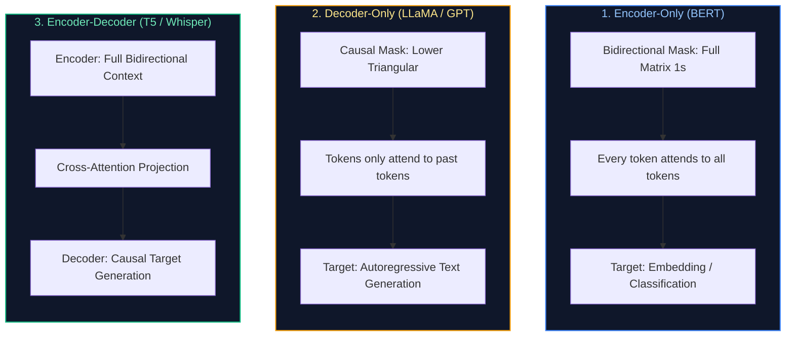

#### Production Implementation / Code Solution
```python
import torch

def generate_attention_masks(seq_len: int):
    """
    Demonstrates the mathematical construction of Bidirectional vs Causal masks.
    """
    # 1. Encoder Mask (Bidirectional: Zero penalty everywhere)
    bidirectional_mask = torch.zeros((seq_len, seq_len))
    
    # 2. Decoder Mask (Causal: -inf for upper triangle to zero out future attention)
    causal_mask = torch.triu(torch.full((seq_len, seq_len), float('-inf')), diagonal=1)
    
    print("=== Bidirectional Encoder Mask (All tokens attend to all) ===")
    print(bidirectional_mask[:4, :4])
    
    print("\n=== Causal Decoder Mask (Tokens only attend to past) ===")
    print(causal_mask[:4, :4])
    return bidirectional_mask, causal_mask
```
- **Time Complexity:** $O(T^2)$ to materialize full mask tensors.
- **Space Complexity:** $O(T^2)$ memory footprint unless using FlashAttention implicit causal flags.

#### Engineering Implications & Production Pitfalls
1. **Why Decoder-Only Won the Foundation Model Race:** While Encoder-Decoder models were theoretically superior for translation, decoder-only models scale more efficiently on compute clusters. Unifying prompt and generation into a single causal autoregressive objective allows effortless multi-task learning, in-context learning, and KV cache reuse without maintaining two separate network stacks.

#### Core Curriculum Cross-Reference
- See [02. LLM Foundations & Model Architecture](../16_machine_learning_and_transformer_foundations.md#121-decoder-only-architecture--the-industry-convergence) for historical scaling proofs.

---


---

### Q17. [Easy] Walk me through what happens during pre-training vs fine-tuning of a foundation language model.
**Difficulty:** [Easy]
**Topic Covered:** Foundation Lifecycle Dynamics & Optimization Regimes  
**Question:** Walk me through what happens during pre-training vs fine-tuning.

#### Definition & Core Concepts
Developing a production Large Language Model follows a two-stage thermodynamic knowledge compression process:

1. **Pre-Training Phase (Knowledge Ingestion & Compression):**
   - **Objective:** Self-supervised next-token prediction across trillions of tokens ($\mathcal{D}_{\text{train}} \approx 3\text{–}15\text{ Trillion}$ tokens):
     $$\mathcal{L}_{\text{pre}}(\theta) = -\sum_{i=1}^N \log P_\theta(x_i \mid x_{<i})$$
   - **Compute Profile:** Enormous compute scale ($1,000\text{–}16,000\text{ GPUs}$ running for months; $10^{24}\text{–}10^{26}\text{ FLOPs}$).
   - **Outcome:** A "Base Model" possessing rich world knowledge, linguistic grammar, and pattern completion capabilities, but lacking conversation etiquette (e.g. prompt: "Write an essay on photosynthesis" $\to$ output: "Chapter 2: Write an essay on cellular respiration").
2. **Fine-Tuning Phase (Instruction Alignment & Behavioral Steering):**
   - **Stage 2A: Supervised Fine-Tuning (SFT):** Trained on $10,000\text{–}1,000,000$ high-quality (Prompt, Response) demonstrations. Teaches the model the **dialogue format**, system prompt compliance, and tool-calling schemas.
   - **Stage 2B: Preference Alignment (RLHF / DPO):** Steers the model toward human preferences (Helpfulness, Honesty, Harmlessness), penalizing toxic or hallucinatory generations.
   - **Compute Profile:** Small compute scale ($8\text{–}64\text{ GPUs}$ running for hours or days; $< 0.1\%$ of pre-training cost).

#### Comparative Lifecycle Matrix
| Dimension | Pre-Training | Supervised Fine-Tuning (SFT) | Preference Alignment (DPO / RLHF) |
| :--- | :--- | :--- | :--- |
| **Data Volume** | $3\text{–}15\text{ Trillion tokens}$ | $10\text{K}\text{–}500\text{K}$ high-quality conversations | $10\text{K}\text{–}100\text{K}$ preference pairs $(y_w, y_l)$ |
| **Data Quality** | Web scrape (Common Crawl), filtered & deduplicated | Expert human / synthetic high-purity dialogs | Human / LLM-as-a-judge ranked outputs |
| **Learning Rate** | High ($\eta \approx 10^{-4}$ decaying with Cosine Annealing) | Low ($\eta \approx 10^{-5}\text{–}10^{-6}$) | Very low ($\eta \approx 10^{-6}\text{–}10^{-7}$) |
| **Compute Cost** | Millions of dollars ($10^{24}\text{ FLOPs}$) | Hundreds to thousands of dollars | Low |
| **Primary Goal** | Knowledge compression & representation | Instruction following & formatting | Human alignment & hallucination suppression |

#### Visual Flow
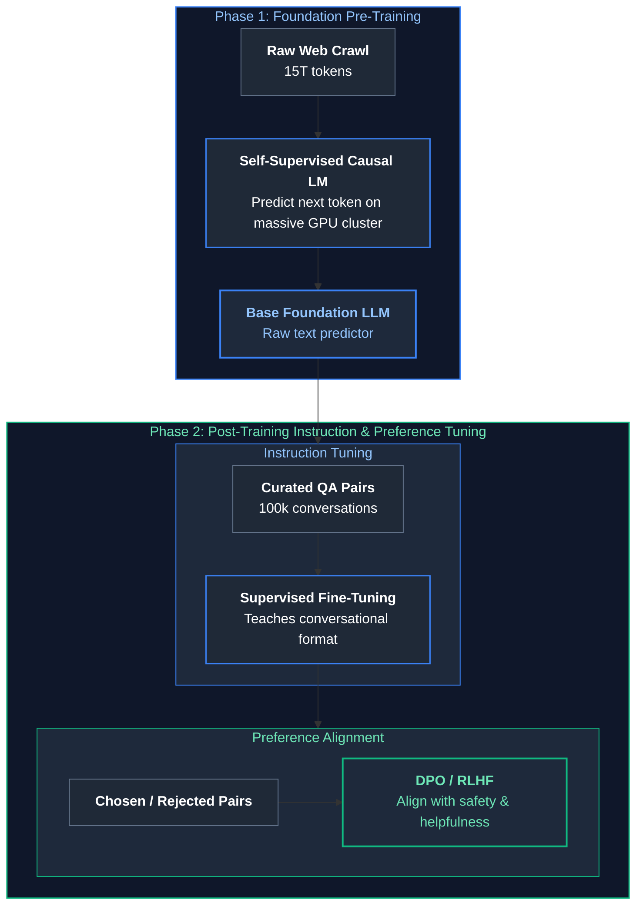

#### Production Implementation / Code Solution
```python
import torch
import torch.nn as nn

def compute_sft_loss_with_prompt_masking(
    model: nn.Module,
    input_ids: torch.Tensor,
    prompt_len: int,
    ignore_index: int = -100
) -> torch.Tensor:
    """
    Production SFT loss calculation: Applies loss masking on the user prompt tokens!
    Only the assistant's response tokens contribute to the gradient updates.
    """
    # input_ids: [Batch=1, SeqLen]
    labels = input_ids.clone()
    
    # Mask out prompt tokens with -100 so CrossEntropyLoss ignores them!
    labels[:, :prompt_len] = ignore_index
    
    # Forward pass
    logits = model(input_ids) # [Batch, SeqLen, Vocab]
    
    # Shift logits and labels for autoregressive next-token prediction
    shift_logits = logits[..., :-1, :].contiguous()
    shift_labels = labels[..., 1:].contiguous()
    
    # Compute CrossEntropy loss ignoring prompt tokens
    loss_fn = nn.CrossEntropyLoss(ignore_index=ignore_index)
    loss = loss_fn(shift_logits.view(-1, shift_logits.size(-1)), shift_labels.view(-1))
    return loss
```
- **Time Complexity:** $O(T \cdot V)$ cross-entropy reduction across unmasked assistant tokens.
- **Space Complexity:** $O(T \cdot V)$ logit tensors.

#### Engineering Implications & Production Pitfalls
1. **The Missing Loss Masking Disaster:** A rampant error in custom SFT pipelines is computing cross-entropy loss over the entire conversation (prompt + response). The model wastes gradient capacity memorizing the user's prompt rather than learning to generate high-quality responses. Always mask prompt tokens with `ignore_index = -100`.
2. **Alignment Tax:** Aggressive RLHF/DPO alignment can cause models to become overly cautious, refusing benign prompts or suffering reasoning degradation.

#### Core Curriculum Cross-Reference
- See [20. Supervised Fine-Tuning (SFT) Mechanics](../17_autonomous_agents_and_model_adaptation.md#20-supervised-fine-tuning-sft-mechanics) for complete SFT training harnesses.

---


---

### Q18. [Medium] Why did the industry move from RNNs/LSTMs to transformers? What fundamental problem did attention solve?
**Difficulty:** [Medium]
**Topic Covered:** Sequential Bottlenecks & Attention Mechanics  
**Question:** Why did we move from RNNs to transformers? What problem did attention solve?

#### Definition & Core Concepts
Before 2017, sequential modeling was dominated by Recurrent Neural Networks (RNNs, LSTMs, GRUs). The paradigm shift to Transformers was driven by two fundamental mathematical bottlenecks:

1. **The Sequential Execution Bottleneck (Hardware Inefficiency):**
   - **RNN Recurrence:** In an LSTM, the hidden state at step $t$ requires the hidden state at step $t-1$:
     $$\mathbf{h}_t = \sigma(\mathbf{W}_h \mathbf{h}_{t-1} + \mathbf{W}_x \mathbf{x}_t + \mathbf{b})$$
   - **Hardware Impact:** Sequential dependency prevents horizontal GPU parallelization across time steps during training. Training a 100B parameter LSTM on 10 trillion tokens would take decades because GPUs cannot parallelize sequential loops.
   - **Transformer Solution:** Self-attention computes dependencies across all sequence positions simultaneously via parallel matrix multiplication ($\mathbf{Q}\mathbf{K}^T$), achieving 100% GPU Tensor Core saturation during training.
2. **The Information Bottleneck & Vanishing Gradient (Context Compression):**
   - **RNN Compression:** An RNN compresses an entire arbitrary-length sequence ($1,000\text{ words}$) into a single fixed-size vector $\mathbf{h}_t \in \mathbb{R}^d$. By step 500, earlier context is catastrophically lost or diluted.
   - **Transformer Solution:** Direct $O(1)$ pairwise attention links every token to every other token regardless of distance, eliminating the fixed-vector compression bottleneck.

#### Visual Flow
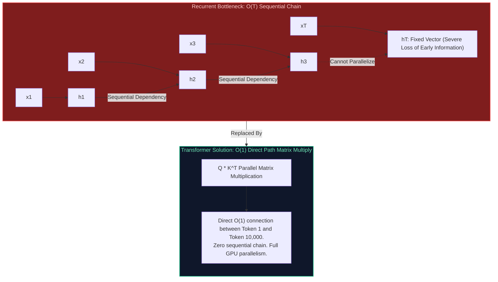

#### Production Implementation / Code Solution
```python
import torch

def parallel_self_attention_demonstration(seq_len: int = 1024, d_model: int = 4096):
    """
    Demonstrates the parallel matrix multiplication that enables Transformer scaling.
    Processes all tokens in a single vectorized GPU tensor operation!
    """
    # Simulated input activations [Batch=1, SeqLen=1024, Dim=4096]
    X = torch.randn(1, seq_len, d_model, device="cuda" if torch.cuda.is_available() else "cpu")
    
    W_q = torch.randn(d_model, d_model, device=X.device)
    W_k = torch.randn(d_model, d_model, device=X.device)
    W_v = torch.randn(d_model, d_model, device=X.device)
    
    # 1. Parallel Projection (Vectorized across all 1024 tokens simultaneously!)
    Q = torch.matmul(X, W_q)
    K = torch.matmul(X, W_k)
    V = torch.matmul(X, W_v)
    
    # 2. Parallel Attention Scores: Q * K^T computed via GEMM in a single kernel launch
    scale = (d_model // 16) ** 0.5
    scores = torch.matmul(Q, K.transpose(-2, -1)) / scale
    attn_weights = torch.softmax(scores, dim=-1)
    
    # 3. Output Context Aggregation
    context = torch.matmul(attn_weights, V)
    print(f"Successfully computed attention across {seq_len} tokens in parallel. Output shape: {context.shape}")
```
- **Time Complexity:** $O(T^2 \cdot d)$ computed via hardware-accelerated parallel systolic arrays.
- **Space Complexity:** $O(T^2)$ attention score matrix.

#### Engineering Implications & Production Pitfalls
1. **The Inference Divergence:** While Transformers completely outperform RNNs during **training** due to parallelizability, during **autoregressive generation** they generate tokens sequentially ($t_1 \to t_2 \to t_3$), facing memory bandwidth bottlenecks similar to RNNs. This requires **KV Caching** to avoid recomputing past representations.

#### Core Curriculum Cross-Reference
- See [02. LLM Foundations & Model Architecture](../16_machine_learning_and_transformer_foundations.md#121-decoder-only-architecture--the-industry-convergence) for computational graphs and profiling benchmarks.

---

# 2. Attention Mechanics & Positional Encoding

---


---

### Q19. [Medium] Why is self-attention more effective than recurrent connections for capturing long-range dependencies?
**Difficulty:** [Medium]
**Topic Covered:** Maximum Path Length & Signal Propagation  
**Question:** Why is self-attention more effective than RNNs?

#### Definition & Core Concepts
The effectiveness of a deep architecture in learning long-range dependencies is fundamentally governed by the **Maximum Path Length** that forward signals and backward gradients must traverse between interacting input tokens:

| Model Architecture | Path Length Between Position $i$ and $j$ | Complexity per Layer | Gradient Attenuation Behavior |
| :--- | :---: | :---: | :--- |
| **Recurrent (RNN / LSTM)** | $O(|i - j|)$ | $O(d^2)$ | Exponential decay ($\sigma'(z)^{|i-j|}$) causing vanishing gradient |
| **Convolutional (CNN)** | $O(\log_k(|i - j|))$ | $O(k \cdot d^2)$ | Logarithmic scaling via dilated receptive fields |
| **Self-Attention (Transformer)** | $O(1)$ | $O(T^2 \cdot d)$ | Direct pairwise connection; constant gradient flow |

In Self-Attention, the gradient of the loss with respect to an interaction between token $1$ and token $1000$ does not pass through $999$ intermediate matrix multiplications; it flows **directly through the softmax attention weight** $A_{1000, 1}$:

$$\frac{\partial \text{Context}_{1000}}{\partial \mathbf{v}_1} = A_{1000, 1} \cdot \mathbf{I}$$

If $A_{1000, 1} > 0$, the gradient flows instantaneously without vanishing.

#### Visual Flow
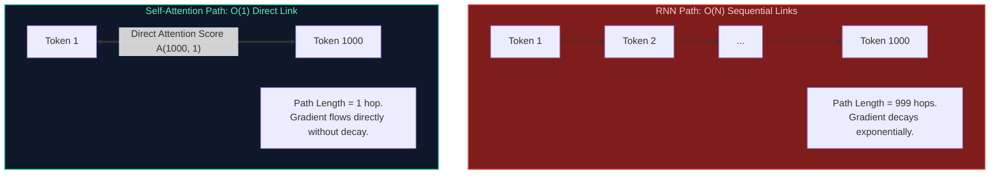

#### Production Implementation / Code Solution
```python
import torch
import torch.nn.functional as F

def inspect_attention_gradient_flow():
    """
    Demonstrates that gradients flow directly between distant tokens in self-attention
    without distance-dependent attenuation.
    """
    seq_len = 1000
    d_k = 64
    
    Q = torch.randn(1, seq_len, d_k, requires_grad=True)
    K = torch.randn(1, seq_len, d_k, requires_grad=True)
    V = torch.randn(1, seq_len, d_k, requires_grad=True)
    
    # Compute attention scores
    scores = torch.matmul(Q, K.transpose(-2, -1)) / (d_k ** 0.5)
    A = F.softmax(scores, dim=-1)
    out = torch.matmul(A, V)
    
    # Loss calculated specifically on the LAST token (index 999)
    loss = out[0, 999].sum()
    loss.backward()
    
    # Inspect gradient on FIRST token's value vector (index 0)
    grad_v0 = V.grad[0, 0].norm().item()
    print(f"Gradient norm on Value vector at Token 0: {grad_v0:.6f}")
    print("Gradient flows directly to Token 0 proportional to attention weight A[999, 0]!")
```
- **Time Complexity:** $O(T^2 \cdot d_k)$ forward/backward pass.
- **Space Complexity:** $O(T^2)$ memory for attention graph.

#### Engineering Implications & Production Pitfalls
1. **The Cost of $O(1)$ Path Length:** The $O(1)$ path length is achieved by evaluating every token against every other token, which incurs the quadratic computational complexity ($O(T^2)$). For massive context lengths ($128\text{K}\text{–}1\text{M}$ tokens), this requires FlashAttention, context chunking, or linear state-space alternatives.

#### Core Curriculum Cross-Reference
- See [02. LLM Foundations & Model Architecture](../16_machine_learning_and_transformer_foundations.md#131-prefill-phase-vs-decode-phase-deep-dive) for attention scaling proofs.

---


---

### Q20. [Hard] Explain positional encoding in Transformers: Why is it necessary, and how do sinusoidal encodings compare to RoPE and ALiBi?
**Difficulty:** [Hard]
**Topic Covered:** Positional Encodings & Relative Geometry  
**Question:** Explain positional encoding in Transformers.

#### Definition & Core Concepts
Because the self-attention operation is **permutation-equivariant** ($\text{Attention}(\mathbf{P}\mathbf{X}) = \mathbf{P}\text{Attention}(\mathbf{X})$ for any permutation matrix $\mathbf{P}$), a Transformer has no inherent concept of word order. Without positional encoding, the sentences *"The dog bit the man"* and *"The man bit the dog"* yield identical attention representations.

#### The Three Generations of Positional Encoding
1. **Absolute Sinusoidal Positional Encoding (Vaswani et al., 2017):**
   - Injects fixed trigonometric vectors directly into token embeddings:
     $$PE_{(pos, 2i)} = \sin\left(\frac{pos}{10000^{2i/d}}\right), \quad PE_{(pos, 2i+1)} = \cos\left(\frac{pos}{10000^{2i/d}}\right)$$
   - **Flaw:** Adding positional vectors directly to semantic embeddings distorts semantic vector space. Cannot extrapolate beyond maximum training context length.
2. **Rotary Position Embedding - RoPE (Su et al., 2021 - LLaMA, Mistral, Gemma):**
   - Applies a **2D rotation matrix** directly to query and key vectors in complex vector space:
     $$\mathbf{q}_m = \mathbf{R}_{\Theta, m}^d \mathbf{W}_q \mathbf{x}_m, \quad \mathbf{k}_n = \mathbf{R}_{\Theta, n}^d \mathbf{W}_k \mathbf{x}_n$$
   - **Inner Product Property:** The inner product depends strictly on relative distance $(m - n)$:
     $$\langle \mathbf{q}_m, \mathbf{k}_n \rangle = (\mathbf{W}_q \mathbf{x}_m)^T \mathbf{R}_{\Theta, n-m}^d (\mathbf{W}_k \mathbf{x}_n) = g(\mathbf{x}_m, \mathbf{x}_n, m - n)$$
   - **Benefit:** Preserves vector norms, captures relative distances naturally, and supports context extrapolation via **RoPE Frequency Scaling** (YaRN).
3. **Attention with Linear Biases - ALiBi (Press et al., 2021):**
   - Adds a non-learnable static geometric penalty directly to the attention logits:
     $$\text{Softmax}\left(\mathbf{q}_i \mathbf{k}_j^T - m \cdot |i - j|\right)$$
   - **Benefit:** Exceptional context extrapolation without any positional training, but weaker expressiveness on complex in-context retrieval tasks.

#### Visual Flow
```mermaid
flowchart TD
    subgraph Sinusoidal ["1. Absolute Sinusoidal (Vaswani 2017)"]
        direction TB
        S1["x_final = x_token + PE(pos)"] --> S2["Additive distortion of semantic embedding.<br/>Poor length extrapolation."]
    end

    subgraph RoPE ["2. Rotary Position Embedding - RoPE (LLaMA / Mistral)"]
        direction TB
        R1["q_rotated = R(pos) * q, k_rotated = R(pos) * k"] --> R2["Inner product depends strictly on relative offset (m - n).<br/>Norm-preserving rotation in complex 2D planes."]
    end

    subgraph ALiBi ["3. ALiBi (Press 2021)"]
        direction TB
        A1["Score = Q*K^T - m * |i - j|"] --> A2["Linear distance decay directly in attention matrix.<br/>Extrapolates out-of-the-box."]
    end

    style Sinusoidal fill:#1e293b,stroke:#64748b,stroke-width:1px,color:#fff
    style RoPE fill:#0f172a,stroke:#10b981,stroke-width:2px,color:#6ee7b7
    style ALiBi fill:#0f172a,stroke:#3b82f6,stroke-width:1.5px,color:#93c5fd
```

#### Production Implementation / Code Solution
```python
import torch

def apply_rotary_pos_emb(x: torch.Tensor, freqs_cis: torch.Tensor) -> torch.Tensor:
    """
    Production-grade Rotary Positional Embedding (RoPE) application.
    Rotates pairs of query/key feature dimensions in the complex plane.
    """
    # Reshape x to complex numbers: [Batch, SeqLen, Heads, Dim/2]
    x_complex = torch.view_as_complex(x.float().reshape(*x.shape[:-1], -1, 2))
    
    # Broadcast freqs_cis: [1, SeqLen, 1, Dim/2]
    freqs_cis = freqs_cis.unsqueeze(0).unsqueeze(2)
    
    # Complex multiplication rotates vectors by position angle
    x_rotated = torch.view_as_real(x_complex * freqs_cis).flatten(-2)
    return x_rotated.type_as(x)
```
- **Time Complexity:** $O(B \cdot T \cdot H \cdot D)$ element-wise complex multiplications.
- **Space Complexity:** $O(T \cdot D/2)$ precomputed trigonometric frequency tables.

#### Engineering Implications & Production Pitfalls
1. **Context Window Expansion via RoPE Scaling:** To extend an 8K-context model to 128K tokens without full retraining, engineers scale the RoPE base frequency:
   $$\theta_{\text{new}} = \theta_{\text{base}} \times s^{\frac{d}{d - 2}}$$
   This stretches the positional wavelengths, allowing the model to attend across long documents using techniques like **YaRN** (Yet another RoPE extensioN).

#### Core Curriculum Cross-Reference
- See [02. LLM Foundations & Model Architecture](../16_machine_learning_and_transformer_foundations.md#131-prefill-phase-vs-decode-phase-deep-dive) for RoPE complex analysis derivations.

---


---

## 4. LLM Inference Mechanics, KV Cache, FlashAttention & Parallelism

### Q21. [Medium] How does multi-head attention improve a model's representation power compared to single-head attention?
**Difficulty:** [Medium]
**Topic Covered:** Multi-Head Attention & Representation Subspaces  
**Question:** How does multi-head attention improve a model’s representation power?

#### Definition & Core Concepts
In **Single-Head Attention**, queries, keys, and values are projected into a single high-dimensional space $\mathbb{R}^{d_{\text{model}}}$. When computing softmax attention weights across tokens, the single distribution tends to average out conflicting linguistic relationships: a single attention head cannot simultaneously track syntactic subject-verb agreement, semantic coreference, and grammatical dependency.

**Multi-Head Attention (MHA)** projects $\mathbf{Q}, \mathbf{K}, \mathbf{V}$ into $h$ distinct, lower-dimensional representation subspaces:

$$d_k = d_v = \frac{d_{\text{model}}}{h}$$

$$\text{MHA}(\mathbf{Q}, \mathbf{K}, \mathbf{V}) = \text{Concat}(\text{head}_1, \dots, \text{head}_h) \mathbf{W}_O$$

$$\text{head}_i = \text{Attention}(\mathbf{Q}\mathbf{W}_i^Q, \mathbf{K}\mathbf{W}_i^K, \mathbf{V}\mathbf{W}_i^V)$$

#### Key Architectural Benefits
1. **Disentangled Feature Subspaces:** Head 1 can attend to grammatical tense ("was" $\to$ "running"), Head 2 can resolve pronoun coreference ("it" $\to$ "the machine"), and Head 3 can identify lexical entities.
2. **Computational Invariance:** Because each head operates on $d_k = d_{\text{model}} / h$, the total computational complexity of Multi-Head Attention is **identical** to Single-Head Attention:
   $$h \times O(T^2 \cdot d_k) = O(T^2 \cdot d_{\text{model}})$$
   It provides significantly greater representation power at zero additional FLOP cost.

#### Visual Flow
```mermaid
flowchart TD
    In[Input Hidden State X: d_model = 4096] --> Proj[Linear Projections W_q, W_k, W_v]
    
    subgraph Subspaces ["Split into h=32 Independent Attention Heads (d_k = 128)"]
        direction LR
        H1["Head 1: Syntactic Subject-Verb Dependency"]
        H2["Head 2: Semantic Pronoun Resolution"]
        HDots["..."]
        H32["Head 32: Factual Knowledge Retrieval"]
    end

    Proj --> Subspaces
    Subspaces --> Concat["Concatenate 32 Heads: [B, T, 4096]"]
    Concat --> OutProj["Output Projection W_O"]

    style In fill:#0f172a,stroke:#3b82f6,stroke-width:1.5px,color:#93c5fd
    style Subspaces fill:#0f172a,stroke:#f59e0b,stroke-width:1.5px,color:#fde68a
    style Concat fill:#0f172a,stroke:#10b981,stroke-width:1.5px,color:#6ee7b7
```

#### Production Implementation / Code Solution
```python
import torch
import torch.nn as nn

class MultiHeadAttentionSplit(nn.Module):
    """
    Illustrates the tensor reshaping mechanics of splitting queries/keys/values
    across multiple parallel representation heads.
    """
    def __init__(self, d_model: int = 4096, n_heads: int = 32):
        super().__init__()
        self.d_model = d_model
        self.n_heads = n_heads
        self.d_k = d_model // n_heads # 128 dimensions per head

        self.q_proj = nn.Linear(d_model, d_model, bias=False)
        self.k_proj = nn.Linear(d_model, d_model, bias=False)
        self.v_proj = nn.Linear(d_model, d_model, bias=False)
        self.out_proj = nn.Linear(d_model, d_model, bias=False)

    def forward(self, x: torch.Tensor) -> torch.Tensor:
        B, T, _ = x.shape
        # Project and reshape into [Batch, Heads, SeqLen, HeadDim]
        q = self.q_proj(x).view(B, T, self.n_heads, self.d_k).transpose(1, 2)
        k = self.k_proj(x).view(B, T, self.n_heads, self.d_k).transpose(1, 2)
        v = self.v_proj(x).view(B, T, self.n_heads, self.d_k).transpose(1, 2)
        
        # Vectorized scaled dot-product attention across all heads in parallel
        scores = torch.matmul(q, k.transpose(-2, -1)) / (self.d_k ** 0.5)
        attn = torch.softmax(scores, dim=-1)
        context = torch.matmul(attn, v) # [B, n_heads, T, d_k]
        
        # Concatenate heads back into [B, T, d_model]
        context = context.transpose(1, 2).contiguous().view(B, T, self.d_model)
        return self.out_proj(context)
```
- **Time Complexity:** $O(B \cdot T^2 \cdot d_{\text{model}})$.
- **Space Complexity:** $O(B \cdot h \cdot T^2)$ for intermediate attention scores.

#### Engineering Implications & Production Pitfalls
1. **Memory Bandwidth Pressure in Inference:** While MHA has identical FLOPs to single-head attention, during token generation it requires reading $h$ separate key-value states from VRAM for every token. This memory bandwidth bottleneck led directly to the development of **MQA** and **GQA**.

#### Core Curriculum Cross-Reference
- See [02. LLM Foundations & Model Architecture](../16_machine_learning_and_transformer_foundations.md#131-prefill-phase-vs-decode-phase-deep-dive) for GQA optimizations.

---


---

### Q22. [Easy] How does masked language modeling (MLM) differ from causal language modeling (CLM)?
**Difficulty:** [Easy]
**Topic Covered:** Training Objectives & Pre-Training Formulations  
**Question:** How does masked language modeling differ from causal language modeling?

#### Definition & Core Concepts
The difference between **Masked Language Modeling (MLM)** and **Causal Language Modeling (CLM)** defines the fundamental boundary between **Representation Models** (BERT) and **Generative Models** (LLaMA):

1. **Masked Language Modeling - MLM (BERT, RoBERTa):**
   - **Formulation:** Corrupts 15% of input tokens by replacing them with a special `[MASK]` token, random token, or keeping them identical. The model must reconstruct the masked tokens given full bidirectional context:
     $$\mathcal{L}_{\text{MLM}}(\theta) = -\sum_{i \in \text{Masked}} \log P_\theta(x_i \mid \mathbf{x}_{\backslash i})$$
   - **Characteristics:** Utilizes bidirectional attention. The model sees past and future context simultaneously.
   - **Limitation:** Incurs a mismatch between pre-training (where `[MASK]` exists) and downstream tasks (where `[MASK]` never appears). Inefficient at generating continuous paragraphs of text.
2. **Causal Language Modeling - CLM (GPT-4, LLaMA 3, Mistral):**
   - **Formulation:** Standard autoregressive next-token prediction using a strictly lower-triangular attention mask:
     $$\mathcal{L}_{\text{CLM}}(\theta) = -\sum_{t=1}^T \log P_\theta(x_t \mid x_1, x_2, \dots, x_{t-1})$$
   - **Characteristics:** Unidirectional attention. Every single token in the training sequence produces an active loss and gradient, maximizing compute efficiency.
   - **Advantage:** Naturally aligned with sequential generation, zero-shot prompting, and in-context reasoning.

#### Comparison Matrix
| Dimension | Masked Language Modeling (MLM) | Causal Language Modeling (CLM) |
| :--- | :--- | :--- |
| **Model Type** | Encoder-Only (BERT) | Decoder-Only (LLaMA, GPT) |
| **Attention Mask** | Bidirectional (Full Attention) | Causal (Lower-Triangular Mask) |
| **Loss Utilization** | Only ~15% of tokens contribute to loss | 100% of tokens contribute to loss |
| **Downstream Strengths** | Embeddings, Classification, Re-ranking | Generative Reasoning, Dialogue, Coding |

#### Visual Flow
```mermaid
flowchart TD
    subgraph MLM_Obj ["Masked Language Modeling (BERT)"]
        direction LR
        MIn["The capital of [MASK] is Paris"] --> MBidirectional["Bidirectional Self-Attention"] --> MOut["Predicts: 'France'"]
    end

    subgraph CLM_Obj ["Causal Language Modeling (LLaMA / GPT)"]
        direction LR
        CIn["The capital of France is"] --> CCausal["Causal Lower-Triangular Mask"] --> COut["Predicts: 'Paris'"]
    end

    style MLM_Obj fill:#0f172a,stroke:#3b82f6,stroke-width:1.5px,color:#93c5fd
    style CLM_Obj fill:#0f172a,stroke:#10b981,stroke-width:1.5px,color:#6ee7b7
```

#### Production Implementation / Code Solution
```python
import torch
import torch.nn as nn

def compare_mlm_vs_clm_loss(logits: torch.Tensor, target_ids: torch.Tensor, is_mlm: bool):
    """
    Illustrates the loss calculation distinction:
    MLM computes loss only over masked token indices (-100 ignored).
    CLM shifts all sequence positions to predict t+1.
    """
    loss_fn = nn.CrossEntropyLoss(ignore_index=-100)
    
    if is_mlm:
        # target_ids has -100 for all 85% unmasked positions
        loss = loss_fn(logits.view(-1, logits.size(-1)), target_ids.view(-1))
    else:
        # Causal next-token shift
        shift_logits = logits[:, :-1, :].contiguous()
        shift_labels = target_ids[:, 1:].contiguous()
        loss = loss_fn(shift_logits.view(-1, shift_logits.size(-1)), shift_labels.view(-1))
        
    return loss
```
- **Time Complexity:** MLM $O(0.15 \cdot T \cdot V)$, CLM $O(T \cdot V)$.
- **Space Complexity:** $O(T \cdot V)$ logit memory.

#### Engineering Implications & Production Pitfalls
1. **Pre-Training Efficiency:** CLM trains on 100% of tokens in the corpus, whereas MLM only trains on 15% of tokens per forward pass. CLM extracts $\sim 6.6\times$ more training signal per token processed.

#### Core Curriculum Cross-Reference
- See [02. LLM Foundations & Model Architecture](../16_machine_learning_and_transformer_foundations.md#121-decoder-only-architecture--the-industry-convergence) for data efficiency comparisons.

---

# 3. Inference Acceleration & Distributed Scaling

---


---

### Q23. [Hard] What is the KV Cache in Transformer inference, why does it consume massive VRAM, and how do Multi-Query (MQA) and Grouped-Query Attention (GQA) optimize it?
**Difficulty:** [Hard]
**Topic Covered:** KV Cache Sizing, Memory Bandwidth & Attention Variants  
**Question:** What is the KV Cache in Transformer inference, and how do MQA and GQA optimize it?

#### Definition & Core Concepts
During autoregressive generation, generating token $t+1$ requires computing attention against all previous tokens $1 \dots t$. Recomputing key and value projections for all previous tokens at every step scales quadratically ($O(T^2)$ compute).

The **Key-Value Cache (KV Cache)** stores the precomputed $\mathbf{K}$ and $\mathbf{V}$ tensor states of past tokens in GPU VRAM, allowing step $t+1$ to execute in $O(1)$ new compute.

#### The VRAM Explosion Formula
The VRAM required to store the KV Cache for a batch size $B$, sequence length $T$, across $L$ layers with $h_{\text{kv}}$ heads of dimension $d_k$ in FP16 (2 bytes) is:

$$\text{Memory}_{\text{KV Cache}} = 2 \times 2 \times B \times T \times L \times h_{\text{kv}} \times d_k \quad \text{bytes}$$

For a Llama-3-70B model ($L=80, d_{\text{model}}=8192, h=64$) at sequence length $T=8192$ and batch size $B=16$:
- With standard **Multi-Head Attention (MHA)** ($h_{\text{kv}} = 64$):
  $$\text{Memory} = 4 \times 16 \times 8192 \times 80 \times 64 \times 128 \approx 343.5\text{ GB of pure VRAM for KV Cache alone!}$$
The system crashes with `CUDA Out of Memory` before even serving a single concurrent user.

#### MHA vs MQA vs GQA Architectures
1. **Multi-Head Attention (MHA):** $h_q = h_{\text{kv}}$. Each query head has its own private key and value head. Massive VRAM consumption.
2. **Multi-Query Attention - MQA (Shazeer, 2019):** $h_{\text{kv}} = 1$. All $h_q$ query heads share a **single key head and value head**. Reduces KV cache memory by $h_q \times$ (e.g. 64x reduction), but can cause minor quality degradation on complex reasoning.
3. **Grouped-Query Attention - GQA (Ainslie et al., 2023 - Llama 3, Mistral):** Partitions query heads into $G$ groups (e.g. $G=8$), where each group of $\frac{h_q}{G}$ query heads shares a single key-value head pair:
   - Compresses KV cache by $\frac{h_q}{G}\times$ (e.g. 8x reduction).
   - Recovers 99.5% of MHA accuracy while achieving MQA inference throughput!

#### Visual Flow
```mermaid
flowchart TD
    subgraph MHA ["Multi-Head Attention (MHA)"]
        direction TB
        Q_MHA["Queries: 8 Heads"] <--> KV_MHA["Keys/Values: 8 Heads"]
        NoteMHA["1:1 Ratio. Highest VRAM Memory Consumption."]
    end

    subgraph GQA ["Grouped-Query Attention (GQA - LLaMA 3)"]
        direction TB
        Q_GQA["Queries: 8 Heads (Divided into 2 Groups)"] <--> KV_GQA["Keys/Values: 2 Shared Heads"]
        NoteGQA["4:1 Ratio. 8x KV Cache Reduction with 99.5% MHA Quality."]
    end

    subgraph MQA ["Multi-Query Attention (MQA)"]
        direction TB
        Q_MQA["Queries: 8 Heads"] <--> KV_MQA["Keys/Values: 1 Single Shared Head"]
        NoteMQA["8:1 Ratio. Minimal VRAM. High memory bandwidth speedup."]
    end

    style MHA fill:#7f1d1d,stroke:#ef4444,stroke-width:1.5px,color:#fecaca
    style GQA fill:#0f172a,stroke:#10b981,stroke-width:2px,color:#6ee7b7
    style MQA fill:#0f172a,stroke:#3b82f6,stroke-width:1.5px,color:#93c5fd
```

#### Production Implementation / Code Solution
```python
def calculate_kv_cache_vram_gb(
    batch_size: int,
    seq_len: int,
    num_layers: int,
    num_kv_heads: int,
    head_dim: int,
    bytes_per_param: int = 2 # 2 for FP16/BF16, 1 for FP8
) -> float:
    """
    Calculates exact KV Cache memory allocation required in GPU VRAM.
    Formula: 2 (K and V) * layers * batch * seq_len * kv_heads * head_dim * precision_bytes
    """
    total_bytes = 2 * num_layers * batch_size * seq_len * num_kv_heads * head_dim * bytes_per_param
    vram_gb = total_bytes / (1024 ** 3)
    return vram_gb

# Case Study: LLaMA-3-70B (80 layers, head_dim=128, batch=16, seq=8192)
mha_vram = calculate_kv_cache_vram_gb(16, 8192, 80, num_kv_heads=64, head_dim=128)
gqa_vram = calculate_kv_cache_vram_gb(16, 8192, 80, num_kv_heads=8, head_dim=128) # LLaMA 3 uses 8 KV heads!

print(f"MHA KV Cache VRAM Footprint: {mha_vram:.2f} GB (Unviable in production)")
print(f"GQA KV Cache VRAM Footprint: {gqa_vram:.2f} GB (Fits easily in H100 memory!)")
```
- **Time Complexity:** KV Cache lookup is $O(1)$ per past token.
- **Space Complexity:** Bounded strictly by sequence length: $O(B \cdot T \cdot L \cdot h_{\text{kv}} \cdot d_k)$.

#### Engineering Implications & Production Pitfalls
1. **Memory Bandwidth Bottleneck:** In generation, computing attention is **memory-bandwidth bound**, not compute bound. Loading large KV caches from GPU HBM memory to SRAM takes longer than performing the actual FLOPs. GQA reduces memory transfers by 8x, speeding up decoding throughput proportionally.

#### Core Curriculum Cross-Reference
- See [02. LLM Foundations & Model Architecture](../16_machine_learning_and_transformer_foundations.md#14-key-value-kv-caching--memory-footprints) for hardware memory hierarchy analysis.

---


---

### Q24. [Hard] What causes attention computation to scale quadratically ($O(N^2)$) with context length, and how do FlashAttention and FlashAttention-2 achieve sub-quadratic I/O efficiency?
**Difficulty:** [Hard]
**Topic Covered:** GPU Memory Hierarchy, SRAM Tiling & FlashAttention Mechanics  
**Question:** How does FlashAttention achieve efficiency given quadratic attention complexity?

#### Definition & Core Concepts
Standard attention computes:

$$\mathbf{S} = \frac{\mathbf{Q}\mathbf{K}^T}{\sqrt{d_k}} \in \mathbb{R}^{N \times N}, \quad \mathbf{P} = \text{softmax}(\mathbf{S}) \in \mathbb{R}^{N \times N}, \quad \mathbf{O} = \mathbf{P}\mathbf{V} \in \mathbb{R}^{N \times d}$$

For a sequence of length $N=128,000$, materializing the intermediate attention score matrix $\mathbf{S}$ requires:

$$N^2 = (128,000)^2 = 1.63 \times 10^{10} \text{ elements} \approx 32.7\text{ GB per head per layer!}$$

#### The Hardware Bottleneck: High Bandwidth Memory (HBM) vs On-Chip SRAM
On modern GPUs (NVIDIA A100 / H100):
- **GPU HBM (High Bandwidth Memory):** 80GB capacity, but slow bandwidth ($2\text{–}3.35\text{ TB/s}$).
- **GPU SRAM (L1 / Shared Memory):** Ultra-fast ($19\text{ TB/s}$), but tiny capacity ($228\text{ KB}$ per Streaming Multiprocessor).

Standard PyTorch attention writes and reads the massive $N \times N$ attention matrix $\mathbf{S}$ and $\mathbf{P}$ to **slow HBM repeatedly**, throttling execution at GPU memory bus speeds.

#### How FlashAttention Solves the Bottleneck
Developed by Tri Dao et al., **FlashAttention** does NOT alter the mathematical output of attention; it reorganizes memory access using two core innovations:
1. **Tiling (Block Computation in SRAM):** Partitions $\mathbf{Q}, \mathbf{K}, \mathbf{V}$ into small blocks ($B_r, B_c \approx 64\text{–}128$) that fit entirely within fast **on-chip SRAM**.
2. **Online Softmax:** Computes softmax incrementally across blocks without materializing the full $N \times N$ matrix in HBM, maintaining running normalization statistics ($m$ and $\ell$):
   $$m_{\text{new}} = \max(m_{\text{prev}}, \tilde{m}), \quad \ell_{\text{new}} = e^{m_{\text{prev}} - m_{\text{new}}} \ell_{\text{prev}} + e^{\tilde{m} - m_{\text{new}}} \tilde{\ell}$$
3. **Recomputation in Backward Pass:** Discards intermediate attention weights during forward pass and recomputes them on-the-fly in SRAM during backpropagation, slashing VRAM consumption from $O(N^2)$ to $O(N)$!

#### Visual Flow
```mermaid
flowchart TD
    subgraph StandardAttn ["Standard PyTorch Attention (HBM Memory Bottleneck)"]
        direction TB
        Q1["Q, K in HBM"] -->|"Slow HBM Write"| SMat["Write N x N Scores S to HBM (32GB)"]
        SMat -->|"Slow HBM Read"| SoftP["Read S, Softmax -> Write P to HBM"]
        SoftP -->|"Slow HBM Read"| VMat["Read P, Multiply V -> Write O to HBM"]
    end

    subgraph FlashAttn ["FlashAttention-2 (SRAM Tiling & Online Softmax)"]
        direction TB
        SRAM_Block["Load Small 64x64 Tile into Fast 19 TB/s On-Chip SRAM"]
        OnlineSoft["Compute Online Softmax incrementally in SRAM"]
        Accumulate["Accumulate Output Tile directly into Output O"]
        SRAM_Block --> OnlineSoft --> Accumulate
        NoteFA["Never writes N x N matrix to HBM! O(N) Memory footprint. 3-4x Speedup."]
    end

    style StandardAttn fill:#7f1d1d,stroke:#ef4444,stroke-width:1.5px,color:#fecaca
    style FlashAttn fill:#0f172a,stroke:#10b981,stroke-width:1.5px,color:#6ee7b7
```

#### Production Implementation / Code Solution
```python
import torch
import torch.nn.functional as F

def benchmark_flash_vs_vanilla_attention(seq_len: int = 8192, d_head: int = 128):
    """
    Demonstrates enabling PyTorch's native FlashAttention-2 backend via scaled_dot_product_attention.
    """
    device = "cuda" if torch.cuda.is_available() else "cpu"
    Q = torch.randn(1, 16, seq_len, d_head, dtype=torch.bfloat16, device=device)
    K = torch.randn(1, 16, seq_len, d_head, dtype=torch.bfloat16, device=device)
    V = torch.randn(1, 16, seq_len, d_head, dtype=torch.bfloat16, device=device)

    # Force PyTorch to use FlashAttention-2 exclusively
    with torch.backends.cuda.sdp_kernel(enable_flash=True, enable_math=False, enable_mem_efficient=False):
        # Executes FlashAttention-2 C++ CUDA kernel without materializing N x N matrix
        out = F.scaled_dot_product_attention(Q, K, V, is_causal=True)
        print(f"FlashAttention-2 executed successfully on {seq_len} tokens. Output: {out.shape}")
```
- **Time Complexity:** $O(N^2 \cdot d)$ arithmetic operations (same FLOPs), but executes $3\text{–}4\times$ faster due to zero HBM memory access stalls.
- **Space Complexity:** $O(N)$ HBM memory footprint (drastic reduction from $O(N^2)$).

#### Engineering Implications & Production Pitfalls
1. **FlashAttention-2 Optimizations:** FlashAttention-2 further improves speed by parallelizing across the sequence length dimension in addition to batch/heads and reducing non-matmul FLOPs in SRAM.

#### Core Curriculum Cross-Reference
- See [02. LLM Foundations & Model Architecture](../16_machine_learning_and_transformer_foundations.md#131-prefill-phase-vs-decode-phase-deep-dive) and [12. AI Infrastructure](../12_ai_infrastructure_serving_and_llmops.md#3-serving-engine-mechanics-vllm-sglang--pagedattention) for CUDA kernel tiling.

---


---

### Q25. [Expert] What happens during the pre-training phase of an autoregressive LLM under modern distributed parallelisms (Tensor, Pipeline, and ZeRO-3)?
**Difficulty:** [Expert]
**Topic Covered:** 3D Parallelism & Distributed Scaling  
**Question:** What happens during the pre-training phase of an autoregressive LLM?

#### Definition & Core Concepts
Training a 70B parameter model in FP16 requires:
- Model Weights: $70\text{B} \times 2\text{ bytes} = 140\text{ GB}$
- Gradients: $70\text{B} \times 2\text{ bytes} = 140\text{ GB}$
- AdamW Optimizer States: $70\text{B} \times 12\text{ bytes} (m, v, \text{fp32 weights}) = 840\text{ GB}$
- Total Static Memory: **$1,120\text{ GB}$** (excluding activations).
Since an NVIDIA H100 has 80GB VRAM, the model **cannot fit onto a single GPU**. Training requires orchestrating **3D Distributed Parallelism**:

1. **Tensor Parallelism - TP (Megatron-LM):**
   - Splits individual weight matrices across GPUs within the same server node connected via high-speed NVLink ($900\text{ GB/s}$).
   - **Column Parallel:** Splits $\mathbf{W}_{\text{gate}}, \mathbf{W}_{\text{up}}$ across GPUs.
   - **Row Parallel:** Splits $\mathbf{W}_{\text{down}}$ across GPUs followed by an `All-Reduce` communication primitive.
2. **Pipeline Parallelism - PP:**
   - Partitions network layers across sequential nodes ($L=80$ split into 4 nodes of 20 layers each).
   - Uses **1F1B (1-Forward-1-Backward)** scheduling to minimize pipeline bubble idle time.
3. **Data Parallelism & ZeRO-3 (Fully Sharded Data Parallel - FSDP):**
   - ZeRO partitions optimizer states (ZeRO-1), gradients (ZeRO-2), and parameters (ZeRO-3) across data-parallel ranks.
   - Weights are gathered on-demand via `All-Gather` during forward/backward passes and immediately discarded.

#### Visual Flow
```mermaid
flowchart TD
    subgraph TP ["1. Tensor Parallelism (Intra-Node NVLink)"]
        direction LR
        ColSplit["Column-Parallel Q, K, V Projections"] --> AllReduce["All-Reduce Sum via 900 GB/s NVLink"] --> RowSplit["Row-Parallel Output Projection"]
    end

    subgraph PP ["2. Pipeline Parallelism (Inter-Node)"]
        direction LR
        Node1["GPU Node 1: Layers 1-20"] -->|Activations| Node2["GPU Node 2: Layers 21-40"] -->|Activations| Node3["GPU Node 3: Layers 41-80"]
    end

    subgraph FSDP ["3. ZeRO-3 / FSDP (All Nodes)"]
        direction TB
        Shard["Each GPU holds only 1/N of Model Weights & Adam States"]
        OnDemand["All-Gather parameters on-the-fly during forward pass -> Free immediately"]
        Shard --> OnDemand
    end

    style TP fill:#0f172a,stroke:#3b82f6,stroke-width:1.5px,color:#93c5fd
    style PP fill:#0f172a,stroke:#f59e0b,stroke-width:1.5px,color:#fde68a
    style FSDP fill:#0f172a,stroke:#10b981,stroke-width:1.5px,color:#6ee7b7
```

#### Production Implementation / Code Solution
```python
import torch
import torch.distributed as dist
from torch.distributed.fsdp import FullyShardedDataParallel as FSDP
from torch.distributed.fsdp.fully_sharded_data_parallel import ShardingStrategy

def setup_fsdp_training_node(model: torch.nn.Module):
    """
    Wraps a foundation model in PyTorch Fully Sharded Data Parallel (FSDP - ZeRO-3).
    Shards parameters, gradients, and optimizer states across all cluster GPUs.
    """
    if not dist.is_initialized():
        print("Distributed process group must be initialized prior to FSDP wrapping.")
        return model

    # Configure ZeRO-3 Full Sharding Strategy
    fsdp_model = FSDP(
        model,
        sharding_strategy=ShardingStrategy.FULL_SHARD, # ZeRO-3: shards weights, grads, opt
        mixed_precision=torch.distributed.fsdp.MixedPrecision(
            param_dtype=torch.bfloat16,
            reduce_dtype=torch.bfloat16,
            buffer_dtype=torch.bfloat16
        ),
        device_id=torch.cuda.current_device(),
        limit_all_gathers=True # Prevents memory spikes during communication
    )
    return fsdp_model
```
- **Time Complexity:** Communication overhead bounded by cluster network bisection bandwidth.
- **Space Complexity:** Slices static memory by $1/N_{\text{GPUs}}$.

#### Engineering Implications & Production Pitfalls
1. **Network Bisection Bandwidth:** Tensor Parallelism requires massive bandwidth and **must never cross server nodes over InfiniBand/Ethernet**; keep TP $\le 8$ within a single NVLink chassis. Pipeline and Data Parallelism can safely cross nodes over $400\text{ Gbps}$ InfiniBand.

#### Core Curriculum Cross-Reference
- See [12. AI Infrastructure](../12_ai_infrastructure_serving_and_llmops.md#5-distributed-inference-tensor-parallelism-vs-pipeline-parallelism) for 3D parallelism topology matrices.

---


---

### Q26. [Expert] Design an optimal speculative decoding architecture to accelerate LLM token generation by 2–3x without altering output probability distributions.
**Difficulty:** [Expert]
**Topic Covered:** Speculative Decoding, Draft Models & Rejection Sampling  
**Question:** Design a speculative decoding architecture to accelerate LLM inference.

#### Definition & Core Concepts
LLM inference generation is **memory-bandwidth bound**: reading 70B parameters from VRAM to generate a single token achieves only $\sim 2\%$ arithmetic GPU core utilization.

**Speculative Decoding (Leviathan et al., 2023)** exploits this arithmetic headroom by pairing a large target model $\mathcal{M}_{\text{target}}$ (e.g. LLaMA-3-70B) with a lightweight, fast draft model $\mathcal{M}_{\text{draft}}$ (e.g. LLaMA-3-8B):

1. **Speculation Step:** The draft model generates $K$ candidate tokens autoregressively in parallel:
   $$\hat{x}_1, \hat{x}_2, \dots, \hat{x}_K \sim P_{\text{draft}}(x \mid \dots)$$
2. **Verification Step (Single Forward Pass):** The target model evaluates all $K$ tokens **in a single forward pass** via causal mask slicing, calculating target probabilities $P_{\text{target}}(x_k)$.
3. **Modified Rejection Sampling:** For each candidate token $k$, it is accepted with probability:
   $$\alpha = \min\left(1, \frac{P_{\text{target}}(\hat{x}_k)}{P_{\text{draft}}(\hat{x}_k)}\right)$$
4. **Mathematical Guarantee:** If a token is rejected, a sample is drawn from the residual distribution $\max(0, P_{\text{target}} - P_{\text{draft}})$. **Theorem:** The generated output distribution is mathematically identical to sampling directly from the target model!

#### Visual Flow
```mermaid
sequenceDiagram
    autonumber
    participant Draft as Fast Draft Model (8B)
    participant Target as Target Model (70B)
    participant Verified as Emitted Tokens

    Note over Draft: Generates K=4 candidate tokens quickly (SRAM cached)
    Draft->>Target: Candidate Tokens: [" artificial", " intelligence", " will", " change"]
    Note over Target: Single Forward Pass evaluates all 4 tokens simultaneously!
    Target->>Target: Evaluate Rejection Sampling: min(1, P_target / P_draft)
    Note over Target: Tokens 1, 2, 3 ACCEPTED! Token 4 REJECTED.
    Target->>Verified: Emits: [" artificial", " intelligence", " will"] + 1 Resampled Token
    Note over Verified: 4 Tokens emitted in the time of 1 Target Forward Pass! (2.8x Speedup)
```

#### Production Implementation / Code Solution
```python
import torch

def speculative_rejection_sampling(
    p_draft: torch.Tensor,
    p_target: torch.Tensor,
    candidate_tokens: torch.Tensor
) -> list[int]:
    """
    Executes mathematically exact speculative verification across candidate tokens.
    Guarantees target model distribution preservation without approximation error.
    """
    accepted_tokens = []
    K = len(candidate_tokens)
    
    for i in range(K):
        token_id = candidate_tokens[i].item()
        p_d = p_draft[i, token_id].item()
        p_t = p_target[i, token_id].item()
        
        # Acceptance probability
        alpha = min(1.0, p_t / max(p_d, 1e-8))
        r = torch.rand(1).item()
        
        if r <= alpha:
            accepted_tokens.append(token_id)
        else:
            # Rejection: Sample from normalized positive residual distribution
            residual = torch.clamp(p_target[i] - p_draft[i], min=0.0)
            residual = residual / residual.sum()
            corrected_token = torch.multinomial(residual, num_samples=1).item()
            accepted_tokens.append(corrected_token)
            break # Stop checking downstream draft tokens
            
    return accepted_tokens
```
- **Time Complexity:** Target model forward pass is $O(K \cdot d)$ computed in parallel (same wall-clock time as $K=1$).
- **Space Complexity:** $O(K \cdot V)$ probability distributions in SRAM.

#### Engineering Implications & Production Pitfalls
1. **Tokenizer Alignment:** The draft model and target model **must share an identical vocabulary and tokenizer**. If token ID 4031 represents different subwords across models, speculative acceptance crashes to 0%.
2. **Acceptance Rate $\alpha$ vs Draft Speed:** If the draft model is too weak (acceptance rate $< 40\%$) or too slow (taking $> 30\%$ of target latency), speculative decoding actually slows down inference. Target an acceptance rate $\alpha \ge 70\%$.

#### Core Curriculum Cross-Reference
- See [02. LLM Foundations & Model Architecture](../16_machine_learning_and_transformer_foundations.md#13-the-lifecycle-of-an-inference-request) and [12. AI Infrastructure](../12_ai_infrastructure_serving_and_llmops.md#4-continuous-batching-chunked-prefill--speculative-decoding) for production vLLM speculative implementations.

---

## Summary Comparison & Production Reference Matrix

| Architectural Domain | Core Mechanism | Mathematical Formulation | Primary Engineering Bottleneck | Canonical Production Resolution |
| :--- | :--- | :--- | :--- | :--- |
| **Decoder-Only Transformer** | Pre-LN autoregression with SwiGLU | $\mathbf{X}_l = \mathbf{X}_{l-1} + \text{Attn}(\text{Norm}(\mathbf{X}))$ | Training vanishing gradients | Pre-LN RMSNorm, residual skip connections, SwiGLU FFN |
| **Model Typology** | Attention mask structure | $M_{ij} = 0$ vs $M_{ij} = -\infty$ | Scaling complexity | Decoder-only causal attention for universal generative scaling |
| **Pre-Training vs SFT** | Knowledge compression vs formatting | Causal LM vs Masked Assistant SFT | Memorizing prompts & alignment tax | Mask prompt tokens with `ignore_index = -100`; low LR for SFT |
| **Attention vs RNN** | Global $O(1)$ path length | $\mathbf{Q}\mathbf{K}^T$ parallel GEMM matrix multiply | Sequential recurrence bottleneck | Parallel self-attention; eliminate fixed hidden state |
| **Positional Encoding** | Permutation invariance breaking | $\mathbf{q}_m = \mathbf{R}_{\Theta, m}^d \mathbf{q}$ (RoPE) | Length extrapolation beyond context | Rotary Positional Embedding (RoPE) with YaRN frequency scaling |
| **Multi-Head Attention** | Representation subspace separation | $\text{Concat}(\text{head}_1 \dots \text{head}_h)\mathbf{W}_O$ | VRAM memory bandwidth in decoding | Grouped-Query Attention (GQA) with 8:1 query-to-KV head ratio |
| **MLM vs CLM** | Corrupted token prediction vs Causal | $P(x_i \mid \mathbf{x}_{\backslash i})$ vs $P(x_t \mid x_{<t})$ | 15% compute efficiency in MLM | Causal Language Modeling: 100% token gradient utilization |
| **KV Cache** | Storing past keys/values in VRAM | $2 \times 2 \times B \times T \times L \times h_{\text{kv}} \times d_k$ | VRAM exhaustion ($300\text{GB}+$) | Grouped-Query Attention (GQA) & PagedAttention (vLLM) |
| **FlashAttention-2** | SRAM tiling & Online Softmax | $O(N)$ HBM I/O complexity | Quadratic HBM read/write bottleneck | Block tiling in fast L1 SRAM; online softmax recomputation |
| **3D Parallelism** | Splitting model across cluster | $\text{TP} \times \text{PP} \times \text{FSDP}$ | Network bisection bandwidth | TP inside NVLink chassis ($TP \le 8$); FSDP/ZeRO-3 across InfiniBand |
| **Speculative Decoding** | Fast draft proposal + Target verify | $\alpha = \min(1, P_t / P_d)$ | Memory-bandwidth decoding stall | Draft model proposal verified in single target forward pass (2.8x speedup) |

---

## References & Further Reading

1. **Vaswani, Ashish, et al.** *Attention Is All You Need*. Advances in Neural Information Processing Systems (NeurIPS), 2017. [arXiv:1706.03762](https://arxiv.org/abs/1706.03762).
2. **Su, Jianlin, et al.** *RoFormer: Enhanced Transformer with Rotary Position Embedding (RoPE)*. 2021. [arXiv:2104.09864](https://arxiv.org/abs/2104.09864).
3. **Ainslie, Joshua, et al.** *GQA: Training Generalized Multi-Query Transformer Models from Multi-Head Checkpoints*. 2023. [arXiv:2305.13245](https://arxiv.org/abs/2305.13245).
4. **Dao, Tri.** *FlashAttention-2: Faster Attention with Better Parallelism and Work Partitioning*. 2023. [arXiv:2307.08691](https://arxiv.org/abs/2307.08691).
5. **Leviathan, Yaniv, et al.** *Fast Inference from Transformers via Speculative Decoding*. International Conference on Machine Learning (ICML), 2023. [arXiv:2211.17192](https://arxiv.org/abs/2211.17192).
6. **Rajbhandari, Samyam, et al.** *ZeRO: Memory Optimizations Toward Training Trillion Parameter Models*. IEEE/ACM SC20, 2020. [arXiv:1910.02054](https://arxiv.org/abs/1910.02054).


---

## Core Curriculum Cross-Reference
*Deep-dive theoretical reference: See [Module 16: Machine Learning & Transformer Foundations](../16_machine_learning_and_transformer_foundations.md)*
