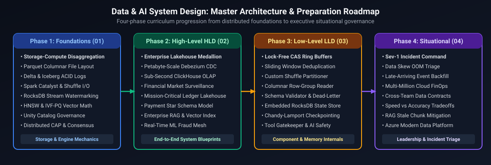

# Data and AI Engineering: System Design & Situational Scenarios Master Curriculum

A comprehensive, production-grade guide covering distributed data and AI systems foundations, 14 high-level distributed data architectures, 8 low-level machine coding components, and 41 engineering leadership, incident triage, and architectural situational scenarios tailored specifically for Staff and Principal Data & AI Platform Engineers.

---

## Master Architecture & Preparation Roadmap

*D2 Source:* [assets/00_system_design_and_situational_index/01_master_architecture_and_preparation_roadmap.d2](assets/00_system_design_and_situational_index/01_master_architecture_and_preparation_roadmap.d2)

---

## Curriculum Coverage & Module Index

The index below details the 4 core pillars of the consolidated System Design & Situational curriculum for Data and AI Platform Engineers:

| Module File | Scope & Domain | Key Architectures & Scenarios Covered |
| :--- | :--- | :--- |
| [`01_system_design_foundations.md`](01_system_design_foundations.md) | Data & AI Distributed Foundations | Storage vs. compute disaggregation, Parquet/ORC columnar layouts, dictionary & RLE encoding, predicate pushdown, Delta Lake & Iceberg ACID transaction logs, Catalyst optimizer & physical plan generation, Broadcast Hash Join vs Sort-Merge Join, shuffle disk spills, stateful streaming watermarks, RocksDB state backends, vector search distance metrics, HNSW graph navigation, IVF-PQ product quantization, and Unity Catalog 3-level governance. |
| [`02_high_level_system_design.md`](02_high_level_system_design.md) | 14 High-Level Data & AI Architectures | Multi-Hop Medallion Lakehouse, Petabyte-scale Debezium CDC, Sub-second ClickHouse/Pinot OLAP serving, 100M GPS pings telemetry ingestion, Hybrid multi-cloud platforms (Azure + Databricks + Snowflake), Cross-region active-active DR, **Trade Surveillance CEP detecting market manipulation across venues**, **Regulatory reporting pipeline with 100% completeness & exact 6-month reproduction**, **Real-time payment event streaming & deduplication (millions of events/sec)**, **Enterprise payments data warehouse with SCD Type 2**, End-to-end Enterprise RAG with hybrid search (BM25+HNSW), Enterprise Feature Store (Redis + Delta Lake), **Continuous ML model drift detection & retraining**, and **Multi-tenant LLM assistant with customer data isolation & prompt guardrails**. |
| [`03_low_level_system_design.md`](03_low_level_system_design.md) | 8 Machine Coding Components | High-throughput streaming Ring Buffer with backpressure, Stateful stream deduplication engine with sliding time window, Custom shuffle partitioner & disk spill manager, Columnar storage row-group reader with dictionary/RLE encoding, Schema evolution compatibility validator (Backward/Forward/Full), Rate-limited database batch sink with exponential backoff & DLQ, In-memory vector index with cosine similarity & vector search, and **AI Agent Safe Tool Execution Gatekeeper with permissions, spending limits & human-in-the-loop approval**. |
| [`04_situational_scenarios.md`](04_situational_scenarios.md) | 41 Senior/Staff Situational Scenarios | Incident command during Sev-1 pipeline failures, 11 PM critical board reporting discrepancy resolution, Data skew OOM and executor crash triage, Spark ETL performance optimization (6.7h to 48m), Infrastructure-level vs data-level defect isolation, Explaining technical complexities to non-technical stakeholders, Disagreeing with management on lakehouse storage, Balancing speed vs accuracy in financial data pipelines, End-to-end enterprise hybrid architecture on Azure, Cross-team dependency & SLA governance, **Triaging LLM hallucinations from stale retrieval chunks**, **Managing multi-million dollar GPU cluster costs vs latency SLAs**, **Making high-stakes technical decisions with incomplete information**, and **Navigating unclear or rapidly shifting business requirements**. |

---

## References & Further Reading
- Kleppmann, Martin. *Designing Data-Intensive Applications*. O'Reilly Media.
- Reis, Joe & Housley, Matt. *Fundamentals of Data Engineering*. O'Reilly Media.
- Armbrust, Michael et al. *Lakehouse: A New Generation of Open Platforms*. CIDR.
- Zaharia, Matei et al. *Apache Spark: A Unified Engine for Big Data Processing*. Communications of the ACM.
- Milovidov, Alexey. *ClickHouse: Ultra-fast Columnar Database for Real-Time Analytics*.

