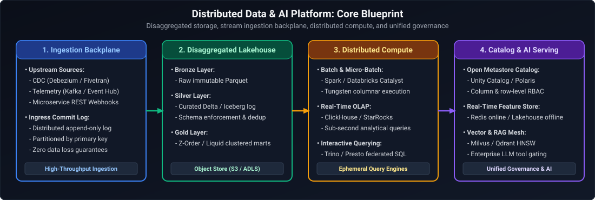
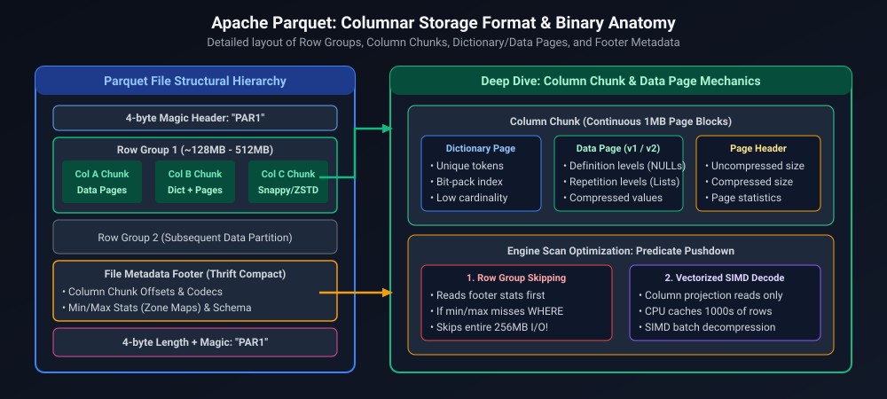
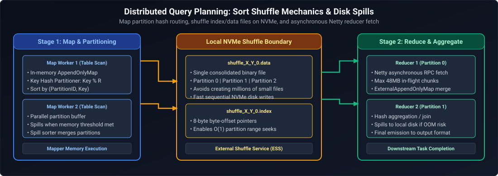

# 01. Data & AI Engineering: Distributed System Foundations & Architecture Primitives

A comprehensive, production-grade guide covering universal distributed systems foundations tailored specifically for Staff and Principal Data & AI Platform Engineers: storage-compute disaggregation, lakehouse storage engine internals, columnar formats, distributed shuffle mechanics, stateful streaming watermarks, vector search indexing math, distributed catalog consensus, and caching backplanes.

---

## Architectural Overview: Distributed Data & AI Platform Core Blueprint

*D2 Source: [`01_distributed_data_ai_platform_core_blueprint.d2`](assets/01_system_design_foundations/01_distributed_data_ai_platform_core_blueprint.d2)*

---

## Table of Contents
1. [Storage vs. Compute Disaggregation](#1-storage-vs-compute-disaggregation)
2. [Columnar Storage Formats & Compression Internals](#2-columnar-storage-formats--compression-internals)
3. [Lakehouse Storage Engines & ACID Transaction Semantics](#3-lakehouse-storage-engines--acid-transaction-semantics)
4. [Distributed Query Planning & Shuffle Mechanics](#4-distributed-query-planning--shuffle-mechanics)
5. [Stateful Stream Processing, Watermarks & State Stores](#5-stateful-stream-processing-watermarks--state-stores)
6. [High-Dimensional Vector Search & Indexing Math](#6-high-dimensional-vector-search--indexing-math)
7. [Distributed Catalog Governance & Multi-Engine Federation](#7-distributed-catalog-governance--multi-engine-federation)
8. [Summary & Platform Reference Matrix](#8-summary--platform-reference-matrix)

---

# 1. Storage vs. Compute Disaggregation

In modern cloud data architecture, separating compute from persistent storage is the foundational architectural primitive:
- **Traditional Appliances (HDFS, Teradata):** Compute and storage are co-located on worker nodes. Scaling storage requires provisioning idle CPU cores; node failure triggers massive network-saturating data rebalancing.
- **Disaggregated Cloud Architecture:**
  - **Storage:** Amazon S3, Azure Data Lake Storage (ADLS Gen2), Google Cloud Storage (GCS). Virtually unlimited durability (99.999999999%), cheap capacity, but higher p99 latency per I/O operation ($20\text{–}100\text{ms}$) and aggressive request rate limits per prefix ($3,500\text{ PUT/sec}, 5,500\text{ GET/sec}$).
  - **Compute:** Ephemeral Spark, Trino, Flink, or Ray clusters auto-scaled from zero to thousands of cores.
  - **The Bandwidth Bottleneck:** Moving data over top-of-rack network switches replaces PCIe/NVMe bus bandwidth. **Mitigation:** Columnar projection pushdown, dictionary filter pushdown, local SSD caching (e.g. Databricks Disk Cache / Alluxio), and aggressive file partition sizing ($128\text{MB}\text{–}1\text{GB}$).

---

# 2. Columnar Storage Formats & Compression Internals

Analytical workloads rarely scan all columns in a wide table; they scan a few columns across millions of rows.

*D2 Source: [`02_parquet_columnar_storage_format.d2`](assets/01_system_design_foundations/02_parquet_columnar_storage_format.d2)*

1. **Physical Layout:**
   - **Row Group:** Horizontal partitioning of data containing e.g. 1,000,000 rows.
   - **Column Chunk:** Contiguous byte sequence containing data for one column within a row group.
   - **Page:** Lowest atomic compression unit ($1\text{MB}$).
2. **Encoding Algorithms:**
   - **Dictionary Encoding:** Replaces high-cardinality repetitive strings with compact integer IDs.
   - **Run-Length Encoding (RLE) & Bit-Packing:** Compresses sequences of identical values into `(count, value)` pairs.
3. **Predicate Pushdown & Min/Max Pruning:**
   - The Parquet file footer stores exact $\min$ and $\max$ statistics for every column chunk.
   - For query `WHERE age > 65`, the reader reads only the file footer first. If $\max(\text{age}) \le 65$ for Row Group 1, the entire 128 MB row group is bypassed with **zero disk or network I/O**.

---

# 3. Lakehouse Storage Engines & ACID Transaction Semantics

Object stores are fundamentally key-value systems; they lack POSIX atomic file append and multi-file rename guarantees. Lakehouse storage engines (**Delta Lake, Apache Iceberg, Apache Hudi**) layer ACID transactions over object storage.

| Storage Engine | Transaction Log Architecture | Concurrency Control | Compaction / Optimization |
| :--- | :--- | :--- | :--- |
| **Delta Lake** | JSON commit files in `_delta_log/` (`00000.json`, `00001.json`) with periodic Parquet checkpoint snapshots | Optimistic Concurrency Control (OCC) using conditional PUT (`putIfAbsent`) | `OPTIMIZE ... ZORDER BY (col)` for spatial clustering; `VACUUM` for snapshot cleanup |
| **Apache Iceberg** | Hierarchical metadata tree: Snapshot Pointer $\to$ Metadata JSON $\to$ Manifest List $\to$ Manifest Files $\to$ Parquet Data Files | Optimistic Concurrency Control with atomic pointer swap in catalog | In-place partition evolution; Copy-on-Write (CoW) or Merge-on-Read (MoR) with delete files |
| **Apache Hudi** | Timeline log files with write-ahead log (WAL) alongside Parquet base files | MVCC with timeline-based coordination | Inline and asynchronous compaction; Index-backed record key lookups |

---

# 4. Distributed Query Planning & Shuffle Mechanics

Distributed engines like Apache Spark break SQL queries into a directed acyclic graph (DAG) of stages separated by **shuffle boundaries**.

*D2 Source: [`03_distributed_query_planning_shuffle_mechanics.d2`](assets/01_system_design_foundations/03_distributed_query_planning_shuffle_mechanics.d2)*

1. **Shuffle Cost Breakdown:**
   - Serialization to bytes $\to$ write to disk on mapper $\to$ network transfer over rack $\to$ deserialization on reducer $\to$ sort/merge in reducer RAM.
2. **Shuffle Mitigations:**
   - **Broadcast Hash Join (BHJ):** When one table is small ($< 10\text{MB}$ default, or configured via hint), Spark broadcasts the entire small table to all executors, completely eliminating the shuffle stage.
   - **Salting for Data Skew:** When a single key contains 80% of rows, that key overwhelms one reducer (OOM). Append random suffix $k \in [0, S-1]$ to distribute the key evenly across $S$ reducers.
   - **Adaptive Query Execution (AQE):** Dynamically coalesces post-shuffle partitions, converts Sort-Merge to Broadcast Join at runtime, and handles skewed joins automatically.

---

# 5. Stateful Stream Processing, Watermarks & State Stores

Stream processing engines (Structured Streaming, Flink) maintain running aggregate state across continuous event streams.

1. **Event Time vs. Processing Time:**
   - **Event Time:** Timestamp when the event physically occurred at the source device.
   - **Processing Time:** Timestamp when the event reached the processing cluster.
2. **Watermarking for Late-Arriving Events:**
   - Watermark $W(t) = \max(\text{event\_time}) - \Delta_{\text{delay}}$.
   - Guarantees the engine will retain state for events arriving up to $\Delta_{\text{delay}}$ late. Any event arriving with $\text{event\_time} < W(t)$ is discarded as unrecoverably late.
3. **Embedded State Backend (RocksDB):**
   - In-memory JVM heap state causes massive GC pauses under millions of active window keys.
   - **RocksDB State Store:** Stores intermediate state in off-heap C++ memory backed by local NVMe SSDs with LSM Trees, periodically checkpointing incremental SST files to ADLS/S3.

---

# 6. High-Dimensional Vector Search & Indexing Math

AI applications require querying vectors $\mathbf{v} \in \mathbb{R}^D$ where $D \in [256, 1536]$ at sub-10ms latencies. Exact k-Nearest Neighbors ($k\text{-NN}$) requires an $O(N \cdot D)$ brute-force distance scan across all $N$ items, which fails at billion scale.

1. **Distance Metrics:**
   - **Cosine Distance:** $1 - \frac{\mathbf{u} \cdot \mathbf{v}}{\|\mathbf{u}\| \|\mathbf{v}\|}$ (Focuses on orientation, invariant to scale).
   - **Euclidean ($L_2$) Distance:** $\sqrt{\sum_{i=1}^D (u_i - v_i)^2}$.
   - **Inner Product (IP):** $\mathbf{u} \cdot \mathbf{v}$ (Equivalent to Cosine if vectors are normalized to unit length).
2. **HNSW (Hierarchical Navigable Small World):**
   - Multi-layer proximity graph where upper layers contain sparse long-range highway edges and bottom layer contains dense local edges.
   - Graph navigation exhibits logarithmic search complexity: **$O(\log N)$**.
3. **IVF-PQ (Inverted File with Product Quantization):**
   - Partitions vector space into Voronoi cells via $k$-means clustering (IVF).
   - Decomposes high-dimensional vector into $M$ sub-vectors and quantizes each sub-vector to the nearest centroid index in an 8-bit codebook (PQ).
   - Reduces vector RAM footprint by **$90\text{–}97\%$**, enabling in-memory similarity scoring using hardware-accelerated Asymmetric Distance Computation (ADC).

---

# 7. Distributed Catalog Governance & Multi-Engine Federation

Modern enterprise data architectures run multiple specialized compute engines over the same lakehouse storage.

1. **The 3-Level Namespace:**
   $$\text{Catalog} \longrightarrow \text{Schema (Database)} \longrightarrow \text{Table / Volume / Model}$$
2. **Unified Catalogs (Databricks Unity Catalog / Apache Iceberg REST Catalog):**
   - Centralizes table metadata, row-level security filters, column-level masking, and cryptographic lineage tracking.
   - Allows Spark, DuckDB, Trino, and Python backend APIs to read the exact same data without proprietary lock-in.

---

# 8. Summary & Platform Reference Matrix

| Platform Subsystem | Primary Latency Target | Core Scaling Bottleneck | Canonical Architecture Choice | Standard Technology |
| :--- | :--- | :--- | :--- | :--- |
| **Object Storage Access** | $20\text{–}50\text{ms}$ | Cloud prefix request limits, network bandwidth | Parquet predicate pushdown + local SSD cache | ADLS Gen2 / AWS S3 |
| **ACID Transaction Commit** | $< 500\text{ms}$ | Concurrent conflicting writes to same partition | Optimistic Concurrency Control (OCC) | Delta Lake / Apache Iceberg |
| **Distributed Shuffle** | Seconds to Minutes | Cross-node network saturation, disk spill | Tungsten sort-merge + AQE dynamic coalescing | Apache Spark / Databricks |
| **Stateful Streaming** | Sub-second | Heap GC pauses on large sliding windows | Off-heap RocksDB state store with checkpoints | Flink / Structured Streaming |
| **Vector Similarity Search** | $< 10\text{ms}$ | Curse of dimensionality, memory footprint | HNSW graph for high recall; IVF-PQ for massive scale | Milvus / Qdrant / Pgvector |
| **Real-Time OLAP Query** | $< 100\text{ms}$ | High concurrency aggregate scans | Columnar vectorized SIMD execution + primary sparse index | ClickHouse / Apache Pinot |

