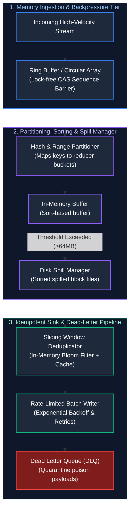

# 03. Data and AI Engineering: Low-Level Design (LLD) & Component Internals

A comprehensive, production-grade guide answering real-world Data Engineering Low-Level Design (LLD), streaming memory internals, shuffle partitioners, columnar format mechanics, and custom pipeline component implementations for Senior, Staff, and Principal Data Engineers.

---

## Architectural Overview: Component Internals of a Streaming Data Engine



---

## Table of Contents & Scenario Mapping

1. **Streaming Memory Buffers & Concurrency Control**
   - [DE-LLD 1. Design a High-Throughput In-Memory Streaming Ring Buffer with Backpressure](#de-lld-1-design-a-high-throughput-in-memory-streaming-ring-buffer-with-backpressure)
   - [DE-LLD 2. Stateful Stream Deduplication Engine with Sliding Time Window](#de-lld-2-stateful-stream-deduplication-engine-with-sliding-time-window)
2. **Shuffle Mechanics & Spill Management**
   - [DE-LLD 3. Custom Shuffle Partitioner & Disk Spill Manager (Spark-Style)](#de-lld-3-custom-shuffle-partitioner--disk-spill-manager-spark-style)
3. **Data Encoding & Storage Format Internals**
   - [DE-LLD 4. Columnar Storage Row-Group Reader with Dictionary & Run-Length Encoding (RLE)](#de-lld-4-columnar-storage-row-group-reader-with-dictionary--run-length-encoding-rle)
   - [DE-LLD 5. Schema Evolution Compatibility Validator (Backward, Forward & Full)](#de-lld-5-schema-evolution-compatibility-validator-backward-forward--full)
4. **Resilient Sinks & Error Handling**
   - [DE-LLD 6. Rate-Limited Database Batch Sink with Exponential Backoff & Dead Letter Queue (DLQ)](#de-lld-6-rate-limited-database-batch-sink-with-exponential-backoff--dead-letter-queue-dlq)
5. **Vector Storage & AI Autonomous Agent Gatekeepers**
   - [DE-LLD 7. In-Memory Vector Index & Exact Cosine / Approximate Search](#deai-lld-7-in-memory-vector-index--exact-cosine--approximate-search)
   - [DE-LLD 8. AI Agent Safe Tool Execution Gatekeeper (Permissions, Limits & Human-in-the-Loop)](#de-lld-8-ai-agent-safe-tool-execution-gatekeeper-permissions-limits--human-in-the-loop)

---

# 1. Streaming Memory Buffers & Concurrency Control

---

### DE-LLD 1. Design a High-Throughput In-Memory Streaming Ring Buffer with Backpressure
**Design Focus:** Lock-Free Ring Buffers, Sequence Barriers, False Sharing Prevention, Backpressure Signaling.

#### Complete Production Implementation (Java)
```java
import java.util.concurrent.atomic.AtomicLong;
import java.util.concurrent.locks.LockSupport;

public class StreamingRingBuffer<T> {
    private final Object[] ring;
    private final int capacity;
    private final int mask;

    private final AtomicLong writeSequence = new AtomicLong(-1);
    private final AtomicLong readSequence = new AtomicLong(-1);

    public StreamingRingBuffer(int capacity) {
        if (Integer.bitCount(capacity) != 1) {
            throw new IllegalArgumentException("Capacity must be a power of 2 for fast modulo masking");
        }
        this.capacity = capacity;
        this.mask = capacity - 1;
        this.ring = new Object[capacity];
    }

    public void publish(T event) {
        long currentWrite;
        long nextWrite;

        // Apply backpressure if buffer is full
        while (true) {
            currentWrite = writeSequence.get();
            nextWrite = currentWrite + 1;
            long currentRead = readSequence.get();

            if (nextWrite - currentRead <= capacity) {
                if (writeSequence.compareAndSet(currentWrite, nextWrite)) {
                    break; // Claimed sequence slot
                }
            } else {
                // Backpressure wait (100 microseconds park)
                LockSupport.parkNanos(100_000);
            }
        }

        int index = (int) (nextWrite & mask);
        ring[index] = event;
    }

    @SuppressWarnings("unchecked")
    public T poll() {
        while (true) {
            long currentRead = readSequence.get();
            long nextRead = currentRead + 1;
            long currentWrite = writeSequence.get();

            if (nextRead <= currentWrite) {
                if (readSequence.compareAndSet(currentRead, nextRead)) {
                    int index = (int) (nextRead & mask);
                    T item = (T) ring[index];
                    ring[index] = null; // Prevent memory leak
                    return item;
                }
            } else {
                return null; // Empty buffer
            }
        }
    }
}
```

---

### DE-LLD 2. Stateful Stream Deduplication Engine with Sliding Time Window
**Design Focus:** Event-Time Ordering, Watermarking, In-Memory Sliding TTL State Store.

```java
import java.util.Iterator;
import java.util.LinkedHashMap;
import java.util.Map;

public class SlidingWindowDeduplicator {
    private final long windowDurationMillis;
    // LinkedHashMap with access-order preserves arrival timestamps for eviction
    private final LinkedHashMap<String, Long> seenMessageIds = new LinkedHashMap<>(1000, 0.75f, false);

    public SlidingWindowDeduplicator(long windowDurationMillis) {
        this.windowDurationMillis = windowDurationMillis;
    }

    public synchronized boolean isDuplicate(String messageId, long eventTimestampMillis) {
        evictExpiredEntries(eventTimestampMillis);

        if (seenMessageIds.containsKey(messageId)) {
            return true; // Duplicate detected
        }

        seenMessageIds.put(messageId, eventTimestampMillis);
        return false;
    }

    private void evictExpiredEntries(long currentWatermarkMillis) {
        long expirationThreshold = currentWatermarkMillis - windowDurationMillis;
        Iterator<Map.Entry<String, Long>> it = seenMessageIds.entrySet().iterator();

        while (it.hasNext()) {
            Map.Entry<String, Long> entry = it.next();
            if (entry.getValue() < expirationThreshold) {
                it.remove(); // Evict entry older than sliding window
            } else {
                break; // Because elements are time-ordered, break on first unexpired entry
            }
        }
    }
}
```

---

# 2. Shuffle Mechanics & Spill Management

---

### DE-LLD 3. Custom Shuffle Partitioner & Disk Spill Manager (Spark-Style)
**Design Focus:** Hash Partitioning, In-Memory Row Buffers, Spilling to Disk on Threshold.

```java
import java.io.*;
import java.util.*;

public class ShuffleSpillManager<K, V> {
    public static class Record<K, V> implements Serializable {
        final K key;
        final V value;
        public Record(K key, V value) { this.key = key; this.value = value; }
    }

    private final int numPartitions;
    private final long maxMemoryBytes;
    private final List<Record<K, V>> inMemoryBuffer = new ArrayList<>();
    private final List<File> spilledFiles = new ArrayList<>();
    private long currentMemoryUsage = 0;

    public ShuffleSpillManager(int numPartitions, long maxMemoryBytes) {
        this.numPartitions = numPartitions;
        this.maxMemoryBytes = maxMemoryBytes;
    }

    public int getPartition(K key) {
        return Math.abs(key.hashCode()) % numPartitions;
    }

    public synchronized void append(K key, V value, long estimatedBytes) throws IOException {
        if (currentMemoryUsage + estimatedBytes > maxMemoryBytes) {
            spillToDisk();
        }
        inMemoryBuffer.add(new Record<>(key, value));
        currentMemoryUsage += estimatedBytes;
    }

    private void spillToDisk() throws IOException {
        // Sort in-memory records by partition ID before spilling
        inMemoryBuffer.sort(Comparator.comparingInt(r -> getPartition(r.key)));

        File spillFile = File.createTempFile("spark_shuffle_spill_", ".bin");
        spillFile.deleteOnExit();

        try (ObjectOutputStream oos = new ObjectOutputStream(new BufferedOutputStream(new FileOutputStream(spillFile)))) {
            for (Record<K, V> record : inMemoryBuffer) {
                oos.writeObject(record);
            }
        }

        spilledFiles.add(spillFile);
        inMemoryBuffer.clear();
        currentMemoryUsage = 0;
        System.out.println("Spilled " + spillFile.length() + " bytes to executor disk: " + spillFile.getAbsolutePath());
    }
}
```

---

# 3. Data Encoding & Storage Format Internals

---

### DE-LLD 4. Columnar Storage Row-Group Reader with Dictionary & Run-Length Encoding (RLE)
**Design Focus:** Column-Oriented Serialization, Dictionary Decoding, Run-Length Decoding.

```java
import java.util.*;

public class ColumnarChunkReader {
    public static class EncodedColumnChunk {
        final List<String> dictionary; // Unique string mapping (Index -> String)
        final List<Integer> rleLengths; // Counts for repeated indexes
        final List<Integer> rleValues;  // Dictionary index repeated

        public EncodedColumnChunk(List<String> dictionary, List<Integer> rleLengths, List<Integer> rleValues) {
            this.dictionary = dictionary;
            this.rleLengths = rleLengths;
            this.rleValues = rleValues;
        }
    }

    public List<String> decompressColumn(EncodedColumnChunk chunk) {
        List<String> decompressed = new ArrayList<>();

        for (int i = 0; i < chunk.rleValues.size(); i++) {
            int dictIndex = chunk.rleValues.get(i);
            int repeatCount = chunk.rleLengths.get(i);
            String value = chunk.dictionary.get(dictIndex);

            for (int r = 0; r < repeatCount; r++) {
                decompressed.add(value);
            }
        }

        return decompressed;
    }
}
```

---

### DE-LLD 5. Schema Evolution Compatibility Validator (Backward, Forward & Full)
**Design Focus:** Avro/Protobuf Schema Registry Rules, Breaking Change Detection.

```java
import java.util.*;

public class SchemaCompatibilityValidator {
    public enum CompatibilityMode { BACKWARD, FORWARD, FULL }

    public static class SchemaField {
        final String name;
        final String type;
        final boolean hasDefault;

        public SchemaField(String name, String type, boolean hasDefault) {
            this.name = name;
            this.type = type;
            this.hasDefault = hasDefault;
        }
    }

    public boolean validateCompatibility(List<SchemaField> oldSchema, List<SchemaField> newSchema, CompatibilityMode mode) {
        Map<String, SchemaField> oldFields = new HashMap<>();
        for (SchemaField f : oldSchema) oldFields.put(f.name, f);

        Map<String, SchemaField> newFields = new HashMap<>();
        for (SchemaField f : newSchema) newFields.put(f.name, f);

        if (mode == CompatibilityMode.BACKWARD || mode == CompatibilityMode.FULL) {
            // New schema can read data written by old schema:
            // Every deleted field in new schema must have had a default value in old schema,
            // and every new field in new schema must have a default value!
            for (SchemaField nf : newSchema) {
                if (!oldFields.containsKey(nf.name) && !nf.hasDefault) {
                    return false; // New field without default breaks backward compatibility
                }
            }
        }

        if (mode == CompatibilityMode.FORWARD || mode == CompatibilityMode.FULL) {
            // Old schema can read data written by new schema:
            // Every deleted field must have a default value in old schema!
            for (SchemaField of : oldSchema) {
                if (!newFields.containsKey(of.name) && !of.hasDefault) {
                    return false; // Deleted field without default breaks forward compatibility
                }
            }
        }

        return true;
    }
}
```

---

# 4. Resilient Sinks & Error Handling

---

### DE-LLD 6. Rate-Limited Database Batch Sink with Exponential Backoff & Dead Letter Queue (DLQ)
**Design Focus:** Batch Flushes, Throttling, Idempotent Upserts, Poison Message Isolation.

```java
import java.util.*;

public class ResilientBatchSink<T> {
    private final int batchSize;
    private final int maxRetries;
    private final List<T> buffer = new ArrayList<>();
    private final List<T> deadLetterQueue = new ArrayList<>();

    public interface DatabaseWriter<T> {
        void writeBatch(List<T> batch) throws Exception;
    }

    private final DatabaseWriter<T> writer;

    public ResilientBatchSink(int batchSize, int maxRetries, DatabaseWriter<T> writer) {
        this.batchSize = batchSize;
        this.maxRetries = maxRetries;
        this.writer = writer;
    }

    public synchronized void addRecord(T record) {
        buffer.add(record);
        if (buffer.size() >= batchSize) {
            flush();
        }
    }

    public synchronized void flush() {
        if (buffer.isEmpty()) return;

        int attempts = 0;
        long backoffMillis = 100;

        while (attempts < maxRetries) {
            try {
                writer.writeBatch(buffer);
                buffer.clear();
                return; // Success
            } catch (Exception e) {
                attempts++;
                System.err.println("Batch write failed (Attempt " + attempts + "): " + e.getMessage());
                try {
                    Thread.sleep(backoffMillis);
                } catch (InterruptedException ie) {
                    Thread.currentThread().interrupt();
                    break;
                }
                backoffMillis *= 2; // Exponential backoff
            }
        }

        // On terminal failure: Quarantine poison batch to Dead Letter Queue
        System.err.println("Batch failed after " + maxRetries + " attempts. Diverting " + buffer.size() + " records to DLQ.");
        deadLetterQueue.addAll(buffer);
        buffer.clear();
    }

    public List<T> getDeadLetterQueue() { return Collections.unmodifiableList(deadLetterQueue); }
}
```

---

# 5. Vector Storage & Nearest Neighbor Retrieval Internals

---

## DE/AI-LLD 7. In-Memory Vector Index & Exact Cosine / Approximate Search

### Problem Statement
Implement a thread-safe in-memory vector index capable of indexing high-dimensional embeddings ($D = 1536$), supporting exact cosine similarity search and metadata filtering with lock-free reads.

### Production Implementation (Python)
```python
import numpy as np
from typing import List, Dict, Any, Tuple, Optional
import threading

class VectorDocument:
    def __init__(self, doc_id: str, vector: np.ndarray, metadata: Dict[str, Any]):
        self.doc_id = doc_id
        # Normalize vector upon ingestion for fast dot-product cosine similarity
        norm = np.linalg.norm(vector)
        self.vector = vector / (norm if norm > 0 else 1.0)
        self.metadata = metadata

class InMemoryVectorIndex:
    def __init__(self, dimension: int):
        self.dimension = dimension
        self._lock = threading.Lock()
        self._docs: List[VectorDocument] = []
        self._matrix: Optional[np.ndarray] = None
        self._is_dirty = False

    def insert(self, doc_id: str, vector: List[float], metadata: Dict[str, Any] = None) -> None:
        if len(vector) != self.dimension:
            raise ValueError(f"Vector dimension mismatch: expected {self.dimension}, got {len(vector)}")
        
        doc = VectorDocument(doc_id, np.array(vector, dtype=np.float32), metadata or {})
        with self._lock:
            self._docs.append(doc)
            self._is_dirty = True

    def _rebuild_matrix_if_dirty(self) -> None:
        if self._is_dirty:
            with self._lock:
                if self._is_dirty:
                    if not self._docs:
                        self._matrix = np.empty((0, self.dimension), dtype=np.float32)
                    else:
                        self._matrix = np.vstack([d.vector for d in self._docs])
                    self._is_dirty = False

    def search(
        self,
        query_vector: List[float],
        top_k: int = 5,
        filter_metadata: Optional[Dict[str, Any]] = None
    ) -> List[Tuple[str, float, Dict[str, Any]]]:
        if len(query_vector) != self.dimension:
            raise ValueError(f"Dimension mismatch: expected {self.dimension}, got {len(query_vector)}")

        self._rebuild_matrix_if_dirty()
        if self._matrix is None or len(self._matrix) == 0:
            return []

        # Normalize query vector
        q = np.array(query_vector, dtype=np.float32)
        norm = np.linalg.norm(q)
        q = q / (norm if norm > 0 else 1.0)

        # Batch matrix multiplication: dot product of normalized vectors equals cosine similarity
        scores = np.dot(self._matrix, q)

        # Get top-k indices using argpartition for O(N + K log K) complexity
        candidate_count = min(top_k * 4 if filter_metadata else top_k, len(scores))
        top_indices = np.argpartition(scores, -candidate_count)[-candidate_count:]
        sorted_indices = top_indices[np.argsort(-scores[top_indices])]

        results: List[Tuple[str, float, Dict[str, Any]]] = []
        for idx in sorted_indices:
            doc = self._docs[idx]
            if filter_metadata:
                match = all(doc.metadata.get(k) == v for k, v in filter_metadata.items())
                if not match:
                    continue
            results.append((doc.doc_id, float(scores[idx]), doc.metadata))
            if len(results) == top_k:
                break

        return results
```

---

## DE-LLD 8. AI Agent Safe Tool Execution Gatekeeper (Permissions, Limits & Human-in-the-Loop)

### Problem Statement
An autonomous LLM agent is granted access to internal banking tools (e.g. `initiate_refund(customer_id, transaction_id, amount, reason)`). Design a low-level software component that intercepts every tool call, enforces strict role-based tool permissions, enforces velocity and cumulative spending caps, and intercepts high-risk or hallucinated calls with human-in-the-loop approval gates before any money can move.

### Production Implementation (Python)
```python
from enum import Enum
from dataclasses import dataclass, field
from typing import Dict, Optional, Set, Tuple
import time
import threading
import uuid

class ExecutionDecision(Enum):
    AUTO_APPROVED = "AUTO_APPROVED"
    REQUIRES_HUMAN_APPROVAL = "REQUIRES_HUMAN_APPROVAL"
    REJECTED_POLICY_VIOLATION = "REJECTED_POLICY_VIOLATION"

class ToolRiskTier(Enum):
    READ_ONLY = 0
    LOW_RISK_MUTATION = 1
    HIGH_RISK_FINANCIAL = 2

@dataclass
class ToolInvocationContext:
    agent_id: str
    agent_role: str
    tool_name: str
    customer_id: str
    amount_usd: float
    idempotency_key: str
    caller_ip: str
    timestamp: float = field(default_factory=time.time)

@dataclass
class ApprovalTicket:
    ticket_id: str
    context: ToolInvocationContext
    reason: str
    created_at: float
    status: str = "PENDING"  # PENDING, APPROVED, REJECTED

class AgentToolGatekeeper:
    """
    Thread-safe defensive gatekeeper intercepting autonomous AI agent tool executions.
    Guarantees:
      1. Role capability check (agents can only invoke registered tools).
      2. Per-transaction financial ceiling ($100 max for automated agent execution).
      3. Rolling 24-hour customer refund cap ($250 max per customer per day).
      4. Rate-limiting velocity checks (no more than 5 tool calls/minute per agent).
      5. Mandatory human approval ticket generation for high-value actions.
    """
    def __init__(
        self,
        single_txn_limit: float = 100.0,
        daily_customer_limit: float = 250.0,
        rate_limit_per_minute: int = 5
    ):
        self.single_txn_limit = single_txn_limit
        self.daily_customer_limit = daily_customer_limit
        self.rate_limit_per_minute = rate_limit_per_minute

        self._lock = threading.Lock()
        
        # Role -> Allowed Tools mapping
        self._role_permissions: Dict[str, Set[str]] = {
            "tier1_support_agent": {"get_balance", "lookup_transaction", "initiate_refund"},
            "read_only_auditor": {"get_balance", "lookup_transaction"},
        }
        
        # Customer ID -> List of (timestamp, amount) in last 24h
        self._customer_daily_spending: Dict[str, list] = {}
        
        # Agent ID -> List of timestamps for velocity rate limiting
        self._agent_call_history: Dict[str, list] = {}
        
        # Pending human review tickets
        self.pending_tickets: Dict[str, ApprovalTicket] = {}

    def evaluate_tool_call(self, ctx: ToolInvocationContext) -> Tuple[ExecutionDecision, str, Optional[str]]:
        with self._lock:
            # 1. Role Capability Check
            allowed_tools = self._role_permissions.get(ctx.agent_role, set())
            if ctx.tool_name not in allowed_tools:
                return (
                    ExecutionDecision.REJECTED_POLICY_VIOLATION,
                    f"Agent role '{ctx.agent_role}' not permitted to call '{ctx.tool_name}'",
                    None
                )

            # 2. Velocity Rate Limiting
            now = time.time()
            agent_calls = [t for t in self._agent_call_history.get(ctx.agent_id, []) if now - t < 60.0]
            if len(agent_calls) >= self.rate_limit_per_minute:
                return (
                    ExecutionDecision.REJECTED_POLICY_VIOLATION,
                    "Agent exceeded velocity rate limit (max 5 calls/min)",
                    None
                )
            agent_calls.append(now)
            self._agent_call_history[ctx.agent_id] = agent_calls

            # 3. Non-financial tools execute immediately
            if ctx.amount_usd <= 0.0:
                return ExecutionDecision.AUTO_APPROVED, "Read-only / zero-cost tool allowed", None

            # 4. Check Single-Transaction Limit
            if ctx.amount_usd > self.single_txn_limit:
                ticket_id = self._create_ticket(ctx, f"Amount ${ctx.amount_usd:.2f} exceeds auto-limit ${self.single_txn_limit:.2f}")
                return (
                    ExecutionDecision.REQUIRES_HUMAN_APPROVAL,
                    f"Transaction requires human supervisor review (Ticket: {ticket_id})",
                    ticket_id
                )

            # 5. Check Rolling 24-Hour Customer Refund Cumulative Limit
            history = [
                (t, amt) for (t, amt) in self._customer_daily_spending.get(ctx.customer_id, [])
                if now - t < 86400.0
            ]
            current_total = sum(amt for _, amt in history)
            if current_total + ctx.amount_usd > self.daily_customer_limit:
                ticket_id = self._create_ticket(
                    ctx,
                    f"Cumulative 24h refunds (${current_total + ctx.amount_usd:.2f}) exceed daily limit ${self.daily_customer_limit:.2f}"
                )
                return (
                    ExecutionDecision.REQUIRES_HUMAN_APPROVAL,
                    f"Customer daily limit exceeded. Routed to human queue (Ticket: {ticket_id})",
                    ticket_id
                )

            # Approved: Record spending
            history.append((now, ctx.amount_usd))
            self._customer_daily_spending[ctx.customer_id] = history
            return ExecutionDecision.AUTO_APPROVED, "Refund authorized within autonomous budget", None

    def _create_ticket(self, ctx: ToolInvocationContext, reason: str) -> str:
        ticket_id = f"TICKET-{uuid.uuid4().hex[:8].upper()}"
        ticket = ApprovalTicket(ticket_id=ticket_id, context=ctx, reason=reason, created_at=time.time())
        self.pending_tickets[ticket_id] = ticket
        return ticket_id

    def resolve_ticket(self, ticket_id: str, approved: bool, supervisor_id: str) -> bool:
        with self._lock:
            if ticket_id not in self.pending_tickets:
                return False
            ticket = self.pending_tickets[ticket_id]
            ticket.status = "APPROVED" if approved else "REJECTED"
            if approved:
                now = time.time()
                history = self._customer_daily_spending.setdefault(ticket.context.customer_id, [])
                history.append((now, ticket.context.amount_usd))
            return True
```

---

## Summary & Data Engineering Low-Level Design Reference Matrix

Low-level data engineering components implement the core runtime machinery that powers distributed storage engines, streaming brokers, analytical query executors, and AI agent execution environments. At the execution engine tier, algorithms must balance CPU cache line efficiency, zero-allocation memory pools, and lock-free concurrency primitives against unpredictable network delays, disk I/O saturation, and agent security risks. Designing defensive data platforms requires implementing backpressure mechanisms, atomic partition-spill policies, vector distance normalization, and robust fault-isolation structures like Dead Letter Queues and human-in-the-loop permission gatekeepers.

The reference matrix below synthesizes the foundational design patterns, concurrency controls, and critical production failure modes across the core data engine components implemented in this guide:

| Component | Design Pattern | Core Concurrency Primitive | Production Failure Mode |
| :--- | :--- | :--- | :--- |
| **Streaming Ring Buffer** | Circular Ring Buffer | Atomic CAS sequence counters | Buffer overrun / subscriber backpressure collapse |
| **Sliding Deduplicator** | Time-Ordered LinkedHashMap | Access-order eviction iterator | Unbounded memory growth from out-of-order late events |
| **Shuffle Spill Manager** | Partition-Indexed Sorter | Temporary file I/O streams | Executor disk saturation (100% full partition error) |
| **Columnar Reader** | Dictionary & Run-Length Encoding | Bit-packing / Offset pointers | Decompression buffer overflow on corrupted file headers |
| **Schema Validator** | Contract Compatibility | Set difference & field inspection | Silent data corruption from un-defaulted new columns |
| **Resilient Sink** | Batch Flush with DLQ | Exponential backoff timer | Database connection pool exhaustion / silent dropped batches |
| **In-Memory Vector Index** | High-Dimensional Cosine Index | Lock-free reads / Normalized dot product | Out-of-memory crash on unbounded unquantized embedding vectors |
| **Agent Tool Gatekeeper** | Interceptor & Policy Guard | Thread lock + Sliding timestamp history | Unauthorized tool invocation / runaway agent spend loops |

---

## References & Further Reading
- Martin Kleppmann, *Designing Data-Intensive Applications* (O'Reilly).
- LMAX Disruptor Architecture: *High Performance Alternative to Bounded Queues*.
- Apache Spark Internals: *Shuffle Block Fetching & ExternalSorter*.
- Apache Parquet File Format Specification: *Encodings and Column Chunks*.
- Malkov, Yu A., and D. A. Yashunin. *Efficient and robust approximate nearest neighbor search using Hierarchical Navigable Small World graphs.* TPAMI (2018).
- Anthropic / OpenAI: *Function Calling and Model Context Protocol (MCP) Specifications*.


