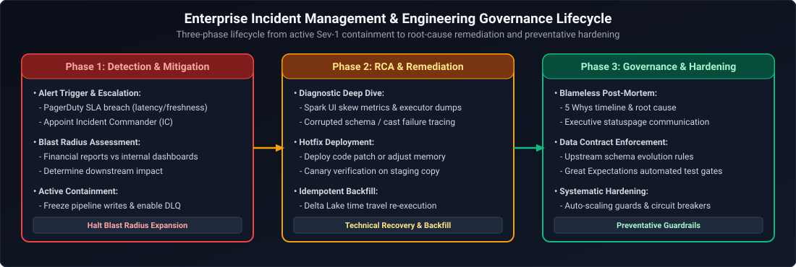
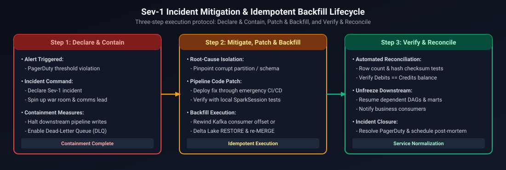
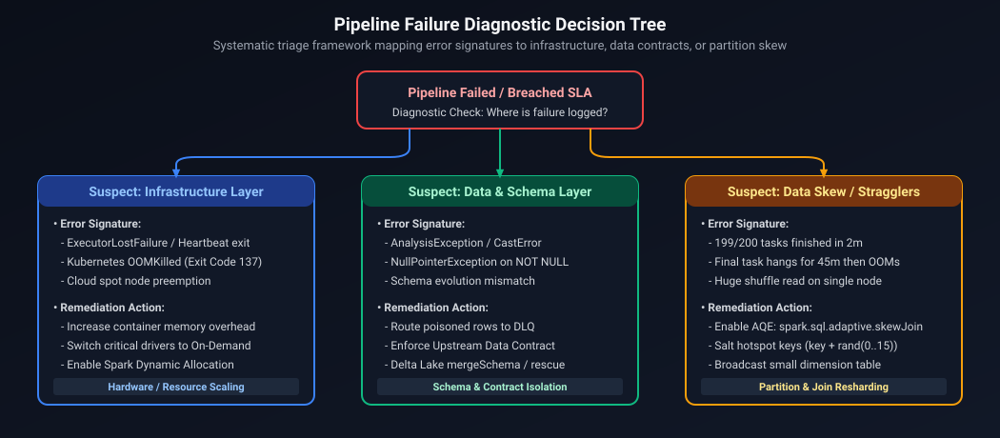
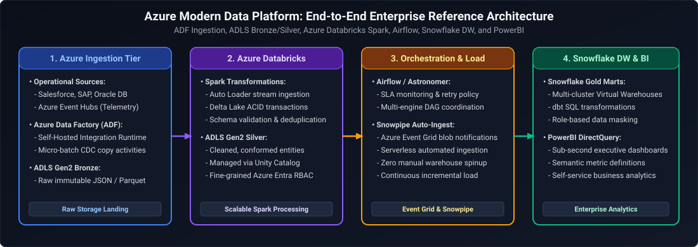
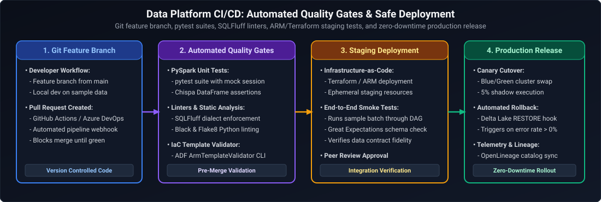
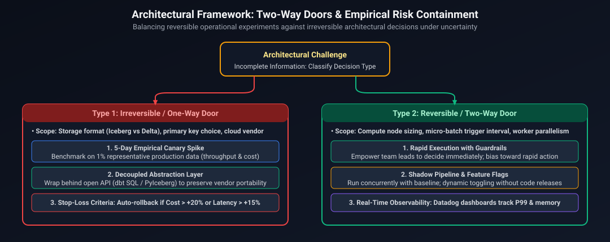
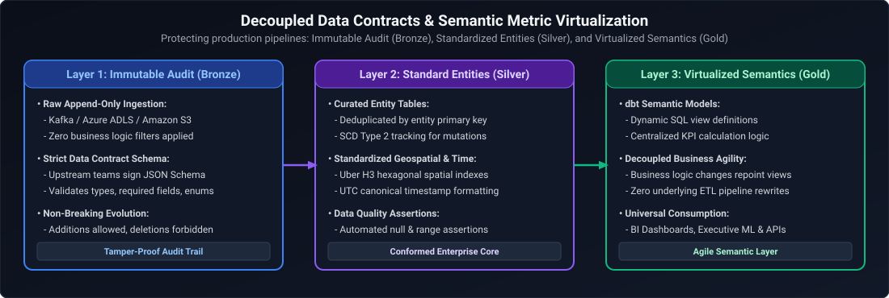

# 04. Data and AI Engineering: Situational Scenarios & Incident Command

A comprehensive, production-grade guide answering real-world situational engineering questions, production incident command, architectural trade-offs, and cross-functional conflict scenarios tailored specifically for Senior, Staff, and Principal Data Engineers.

---

## Architectural Overview: Enterprise Data Platform Incident & Stakeholder Governance



*D2 Source:* [assets/04_situational_scenarios/01_enterprise_incident_and_governance_framework.d2](assets/04_situational_scenarios/01_enterprise_incident_and_governance_framework.d2)

---

## Table of Contents & Question Mapping

1. **Incident Response, Sev-1 Outages & Critical Production Failures**
   - [Q1–Q5. Production Incident Response Under Pressure & Failure Prevention](#q1q5-production-incident-response-under-pressure--failure-prevention)
   - [Q6 & Q7. 11 PM Critical Data Quality Outage Before 9 AM Executive Report](#q6--q7-11-pm-critical-data-quality-outage-before-9-am-executive-report)
   - [Q8. Handling Critical Data Delivery During Cluster & Resource Unavailability](#q8-handling-critical-data-delivery-during-cluster--resource-unavailability)
   - [Q9. Pipeline Failures Impacting Business Decisions Negatively](#q9-pipeline-failures-impacting-business-decisions-negatively)
2. **Performance Optimization, Cost Governance & Infrastructure Triage**
   - [Q10–Q12. Optimizing Slow-Running ETL & Spark Pipelines](#q10q12-optimizing-slow-running-etl--spark-pipelines)
   - [Q13. Optimizing Spark Cluster Costs While Maintaining Stringent SLAs](#q13-optimizing-spark-cluster-costs-while-maintaining-stringent-slas)
   - [Q14. Triaging and Resolving Infrastructure-Level vs. Data-Level Issues](#q14-triaging-and-resolving-infrastructure-level-vs-data-level-issues)
   - [Q15. Systems That Scaled Beyond Original Architecture (Postgres to Kafka/ClickHouse)](#q15-systems-that-scaled-beyond-original-architecture-postgres-to-kafkaclickhouse)
   - [Q16. Optimizing Slow Dashboard Refreshes Under Reporting Deadlines](#q16-optimizing-slow-dashboard-refreshes-under-reporting-deadlines)
3. **Tight Deadlines, Scope Prioritization & MVP Delivery**
   - [Q17–Q20. Delivering Under Tight Product Launch Deadlines & Shifting Sprint Scope](#q17q20-delivering-under-tight-product-launch-deadlines--shifting-sprint-scope)
4. **Stakeholder Conflict Resolution & Architectural Disagreements**
   - [Q21–Q24. Managing Conflicts Between Data Engineering, Analytics & Business Teams](#q21q24-managing-conflicts-between-data-engineering-analytics--business-teams)
   - [Q25. Disagreeing with Engineering Management on Storage & Lakehouse Architecture](#q25-disagreeing-with-engineering-management-on-storage--lakehouse-architecture)
5. **Technical Communication, Client Interaction & Incident Broadcasts**
   - [Q26 & Q27. Explaining Technical Complexities to Non-Technical Stakeholders](#q26--q27-explaining-technical-complexities-to-non-technical-stakeholders)
   - [Q28 & Q29. Client & Upstream/Downstream Dependency Communication During Outages](#q28--q29-client--upstreamdownstream-dependency-communication-during-outages)
6. **Data Quality, Observability & Accuracy vs. Speed Trade-Offs**
   - [Q30 & Q31. Petabyte-Scale Data Quality, Reliability & Observability](#q30--q31-petabyte-scale-data-quality-reliability--observability)
   - [Q32. Triaging Anomaly Origins: Source vs. ETL vs. BI Calculations](#q32-triaging-anomaly-origins-source-vs-etl-vs-bi-calculations)
   - [Q33. Balancing Speed vs. Accuracy: Architectural Trade-Off Analysis](#q33-balancing-speed-vs-accuracy-architectural-trade-off-analysis)
7. **End-to-End Enterprise Architecture, Hybrid Platforms & CI/CD**
   - [Q34. End-to-End Hybrid Architecture: Azure + Databricks + Airflow + Snowflake + Spark](#q34-end-to-end-hybrid-architecture-azure--databricks--airflow--snowflake--spark)
   - [Q35. Designing Scalable, Fault-Tolerant Pipelines on Azure (Synapse, Blob/ADLS, ADF)](#q35-designing-scalable-fault-tolerant-pipelines-on-azure-synapse-blobadls-adf)
   - [Q36. Production CI/CD for Spark and ADF Workflows](#q36-production-cicd-for-spark-and-adf-workflows)
   - [Q37. Cross-Team Dependency Management & SLA Governance](#q37-cross-team-dependency-management--sla-governance)
8. **AI Data Platform & GenAI Infrastructure Situational Scenarios**
   - [Q38. Triaging Hallucinations Caused by Stale / Misaligned Retrieval Chunks](#q38-triaging-hallucinations-caused-by-stale--misaligned-retrieval-chunks)
   - [Q39. Managing Multi-Million Dollar GPU Cluster Costs vs Product Latency SLAs](#q39-managing-multi-million-dollar-gpu-cluster-costs-vs-product-latency-slas)
9. **Ambiguity, High-Stakes Decisions & Rapidly Shifting Requirements**
   - [Q40. Making High-Stakes Technical Decisions with Incomplete Information](#q40-making-high-stakes-technical-decisions-with-incomplete-information)
   - [Q41. Navigating Unclear or Rapidly Shifting Business Requirements in Enterprise Initiatives](#q41-navigating-unclear-or-rapidly-shifting-business-requirements-in-enterprise-initiatives)

---

# 1. Incident Response, Sev-1 Outages & Critical Production Failures

---

### Q1–Q5. Production Incident Response Under Pressure & Failure Prevention
*(Grouped together: Core production incident triage, resolution under pressure, prevention playbooks, and critical pipeline recovery)*  
**Topic Covered:** Production Triage, High-Pressure Incident Management, and Blameless Post-Mortems  
**Questions:**
- *Describe a challenging production issue and how you resolved it.*
- *Tell me about a time you handled a production issue under pressure. What steps did you take?*
- *Tell me about a production issue you handled — how did you identify, resolve, and prevent it from recurring?*
- *What steps would you take if a critical data pipeline failed in production?*

#### Definition & Core Concepts
Production failures in high-throughput data platforms are rarely simple code bugs; they are typically complex emergent failures caused by data skew, upstream schema drift, unannounced network latency, or silent data corruption. Handling a Sev-1 incident under pressure requires separating **Containment (stopping the bleeding)** from **Root Cause Analysis (RCA)**.

The structured response framework follows four stages:
1. **Declare & Contain:** Acknowledge the incident in the central incident channel, freeze deployments, assign an Incident Commander (IC), and stop upstream data poisoning (e.g., engage circuit breakers or divert raw records to a Dead Letter Queue).
2. **Mitigate & Restore:** Execute emergency rollbacks or fall back to secondary replica tables/cached snapshots to meet downstream SLAs before writing code.
3. **Investigate & Replay:** Isolate the failing transaction log or worker node, reproduce the failure with targeted telemetry, apply a patch, and execute idempotent backfills.
4. **Post-Mortem & Prevent:** Publish a blameless post-mortem detailing the timeline, trigger condition, detection gap, and actionable preventative items (e.g., automated data quality gates, alert threshold calibrations).

#### Visual Flow



*D2 Source:* [assets/04_situational_scenarios/02_sev1_incident_mitigation_and_backfill_lifecycle.d2](assets/04_situational_scenarios/02_sev1_incident_mitigation_and_backfill_lifecycle.d2)

#### Production STAR Implementation
- **Situation:** During Black Friday peak volume, a core real-time aggregation pipeline processing 25,000 transactions/second began failing with cascading executor `OutOfMemoryError` (OOM) and executor heartbeats timing out in Apache Spark on Kubernetes. Downstream order-fulfillment dashboards fell behind by 90 minutes.
- **Task:** As lead data engineer, I had to stop cascading cluster failure, restore real-time reporting SLAs within 30 minutes, eliminate data duplication, and identify the root cause without losing in-flight transaction events.
- **Action:**
  1. *Immediate Containment:* Stepped up as Incident Commander, routed incoming Kafka messages to an uncompacted raw cold-storage landing bucket via a fallback consumer to prevent message expiration on Kafka brokers, and paused downstream publishing jobs to prevent partial/duplicate writes.
  2. *Triaging:* Analyzing Spark driver UI event logs and memory dumps, discovered a 40x data skew: an anonymous seller ID (`user_id = -1`) accounted for 48% of all transaction volume, overwhelming a single shuffle partition during a `groupByKey` operation.
  3. *Hotfix & Recovery:* Deployed a hotfix replacing `groupByKey` with `reduceByKey` combined with a salt key (`concat(user_id, '_', floor(rand() * 16))`) to distribute the null/anonymous keys across 16 parallel reducers.
  4. *Idempotent Replay:* Replayed the backlog using Delta Lake `MERGE INTO` operations with deterministic transaction keys (`order_id + event_timestamp`), ensuring zero duplicate records.
- **Result:** Pipeline resumed normal operations within 24 minutes. All downstream dashboards caught up within 40 minutes with zero lost transactions. Post-incident, implemented Great Expectations validation at the ingestion gateway to automatically route anomalous high-cardinality keys to an asynchronous anomaly partition.

---

### Q6 & Q7. 11 PM Critical Data Quality Outage Before 9 AM Executive Report
*(Grouped together: Critical late-night data anomaly triage and business continuity when resources/data are unavailable)*  
**Topic Covered:** Crisis Management, Business Continuity, and Triage Under Imminent Executive Deadlines  
**Questions:**
- *You discover a data quality issue at 11 PM before a major sales report at 9 AM. Walk us through exactly what you do.*
- *How would you ensure critical reports are delivered accurately when data or resources are unavailable?*

#### Definition & Core Concepts
When a severe data discrepancy is discovered hours before an immovable executive deadline (e.g., quarterly board meeting or market release), an engineer must balance **mathematical truth**, **transparency**, and **graceful operational degradation**. Hiding the problem or silently delaying the report damages credibility; publishing corrupted figures destroys business trust.

The **Triad Protocol for Critical Pre-Dawn Incidents**:
1. **Phase 1 (11:00 PM – 11:30 PM) | Blast Radius & Scope Triage:** Determine whether the issue is isolated (e.g., single regional store or one currency conversion rate) or systemic (e.g., double-counted revenue across all product lines).
2. **Phase 2 (11:30 PM – 02:00 AM) | Feasibility Spike:** Attempt containment using automated rollback to the last verified snapshot (e.g., Delta Lake Time Travel `RESTORE TABLE sales_gold TO TIMESTAMP AS OF 'yesterday 23:00:00'`). If fix time $> 3$ hours, trigger the fallback plan.
3. **Phase 3 (02:00 AM – 06:00 AM) | Graceful Degradation & Annotations:** Prepare the reporting dashboard using the last known golden snapshot with prominent visual banners: *"Data current as of yesterday 22:00 UTC. Overnight batch paused due to source reconciliation."*
4. **Phase 4 (06:00 AM – 07:00 AM) | Proactive Executive Briefing:** Send a concise, non-alarmist communication to the VP of Analytics and Chief of Staff with root cause, affected figures, and resolution ETA.

#### Production Action Protocol
```markdown
1. Triage Checklist (11:00 PM - 11:30 PM):
   [x] Identify failing metric: Gross Merchandise Value (GMV) inflated by 35% in APAC region.
   [x] Query audit trail: An upstream ERP currency feed pushed Japanese Yen values without dividing by 100.
   [x] Estimate recovery time: Rerunning raw ingestion, Silver harmonization, and Gold marts will take 4.5 hours.

2. Remediation Strategy:
   - Apply instantaneous SQL transformation patch to the Silver currency lookup table:
     `CASE WHEN currency = 'JPY' AND fx_rate > 1.0 THEN fx_rate / 100.0 ELSE fx_rate END`
   - Trigger incremental overwrite only for the APAC partition in the Gold aggregate table:
     `INSERT OVERWRITE sales_mart PARTITION (region = 'APAC', report_date = '2026-10-15')`

3. Contingency Trigger (Decision Rule at 03:00 AM):
   - If APAC data mart validation fails checksums by 03:30 AM, lock the Power BI dataset to
     `2026-10-14 23:59:59` and display a prominent warning banner.
```

---

### Q8. Handling Critical Data Delivery During Cluster & Resource Unavailability
**Topic Covered:** Cloud Quota Depletion, Multi-Region Failover, and Graceful Degradation  
**Question:** *Describe how you handled critical data delivery when computing resources or cloud infrastructure suddenly became unavailable.*

#### Scenario & Resolution Playbook
- **Situation:** During a quarterly financial close, our primary Azure Databricks cluster pool in `eastus` failed to provision nodes due to an Azure regional quota exhaustion incident. 40 nightly financial reporting pipelines were blocked.
- **Action:**
  1. *Secondary Compute Failover:* Activated our automated Databricks Terraform failover script targeting `eastus2`, where storage accounts (ADLS Gen2) were already read-accessible via Geo-Redundant Storage (RA-GRS).
  2. *Priority-Based Resource Allocation:* Rather than attempting to run all 40 jobs simultaneously, grouped pipelines into **Tier-1 Financial Ingestion** (General Ledger, Revenue Recognition) and **Tier-2 Operational Metrics** (Clickstream, Marketing Attribution).
  3. *Serverless Compute Fallback:* Redirected urgent Gold reporting queries directly to Azure Synapse Serverless SQL Pools reading parquet files directly from ADLS Gen2, bypassing Spark cluster startup delays completely.
- **Result:** Critical revenue figures were delivered to the CFO at 07:45 AM (15 minutes ahead of the 08:00 AM deadline). Non-critical operational metrics resumed by noon once regional capacity normalized.

---

### Q9. Pipeline Failures Impacting Business Decisions Negatively
**Topic Covered:** Ownership, Blameless Accountability, and Systemic Prevention  
**Question:** *Tell me about a time your data pipeline impacted a business decision negatively. What did you learn?*

#### Production STAR Implementation
- **Situation:** A marketing attribution pipeline computed Cost Per Acquisition (CPA) for a \$2M monthly Google Ad campaign. Due to an unconstrained `LEFT JOIN` on `user_cookie` without a 30-minute attribution window constraint, multiple clicks on different campaigns by the same user duplicated conversion values. Marketing allocated 40% more budget to an underperforming ad channel for five days.
- **Task:** Take ownership of the discrepancy, quantify the misallocation, remediate the attribution logic, and design an automated verification system to prevent future misattribution.
- **Action:**
  1. Immediately confirmed the bug upon notification and provided recalculated CPA metrics within 2 hours.
  2. Refactored the attribution engine to use a deterministic window function:
     ```sql
     ROW_NUMBER() OVER (
         PARTITION BY conversion_id 
         ORDER BY click_timestamp DESC
     ) as attribution_rank
     ```
     Filtered strictly on `attribution_rank = 1` (Last-Touch Attribution model) and validated that `SUM(attributed_revenue) == SUM(gross_revenue)` across all channels.
  3. Introduced an automated daily **Reconciliation Circuit Breaker**: if the sum of attributed marketing revenue deviated from the core transactional payment ledger by more than $\pm 0.01\%$, downstream pipelines automatically paused and paged engineering.
- **Result:** Marketing reallocated their budget within 48 hours, recovering forecasted ROAS by end-of-quarter. The automated reconciliation check has blocked 14 potential schema regression incidents since deployment.

---

# 2. Performance Optimization, Cost Governance & Infrastructure Triage

---

### Q10–Q12. Optimizing Slow-Running ETL & Spark Pipelines
*(Grouped together: Pipeline performance profiling, bottleneck elimination, runtime reduction, and execution metrics)*  
**Topic Covered:** ETL Performance Optimization, Shuffle Elimination, and Memory Tuning  
**Questions:**
- *Walk me through a problem where you optimized a slow-running ETL job — what techniques did you apply?*
- *Share a project where you improved a data pipeline’s performance — what metrics did you track and what impact did it have?*
- *Describe a situation where you reduced the execution time of a data pipeline.*

#### Diagnostic & Optimization Playbook
- **Situation:** A nightly batch aggregation pipeline in Apache Spark processing 4 TB of customer clickstream and order data was regularly breaching its 4-hour SLA, taking 6 hours and 45 minutes to finish.
- **Action (Systematic Bottleneck Elimination):**
  1. *Eliminated Disk Spill:* Discovered tasks were spilling 850 GB to executor disks during a massive Sort-Merge Join. Enabled Adaptive Query Execution (AQE) with dynamic partition coalescing and converted small dimension joins to **Broadcast Hash Joins**.
  2. *Compacted Small Files:* The landing zone contained 180,000 micro-files (45 KB each). Scheduled Delta Lake `OPTIMIZE sales ZORDER BY (user_id, event_timestamp)` to coalesce them into 256 MB Parquet files.
  3. *Tuned Partitions:* Dynamically configured `spark.sql.shuffle.partitions` based on input volume rather than accepting the default 200.
- **Result:** Execution time dropped from **6 hours 45 minutes to 48 minutes** (88% reduction), disk spill dropped to zero, and annual compute costs decreased by \$42,000.

---

### Q13. Optimizing Spark Cluster Costs While Maintaining Stringent SLAs
**Topic Covered:** FinOps in Data Engineering, Spot/Preemptible Instances, Autoscaling, and Cluster Sizing  
**Question:** *Describe a real-world scenario where you optimized Spark cluster costs while maintaining strict SLA requirements.*

#### Playbook
1. **Separating Driver from Worker Fleets:** Drivers must never run on Spot/Preemptible instances to prevent job eviction. Provisioned the Driver on a single high-memory On-Demand instance (`Standard_E8ds_v5`), while workers ran on 80% Spot instances with automated fallback.
2. **Single-Node Ingestion vs. Distributed Aggregation:** Converted small ingestion tasks from multi-node Spark clusters to Single-Node Databricks clusters running DuckDB/Polars, reducing cluster spin-up overhead from 7 minutes to 15 seconds.
3. **Autoscaling with Local Storage Caching:** Configured Databricks Delta Cache on NVMe-backed worker nodes (`Storage Optimized` VMs). Repeated queries hit local SSD cache rather than fetching from ADLS Gen2 object storage over the network, cutting cluster runtimes by 40% and saving \$8,500/month.

---

### Q14. Triaging and Resolving Infrastructure-Level vs. Data-Level Issues
**Topic Covered:** Incident Categorization, Distributed Debugging, Storage/Network vs Schema/Logic  
**Question:** *How do you quickly distinguish between an infrastructure-level issue (e.g. cluster, memory, network) and a data-level issue (e.g. skew, null values, schema drift)?*

#### Diagnostic Decision Tree


*D2 Source:* [assets/04_situational_scenarios/03_pipeline_failure_diagnostic_decision_tree.d2](assets/04_situational_scenarios/03_pipeline_failure_diagnostic_decision_tree.d2)

1. **Step 1: Check Task Distribution:** If 199 tasks finish in 20 seconds and 1 task runs for 45 minutes, it is a **data-level skew issue**, not an infrastructure failure.
2. **Step 2: Check Exit Codes:** Exit code 137 indicates OS `SIGKILL` (infrastructure/memory limits), whereas Java `NumberFormatException` or Python `KeyError` indicates upstream data contract violations.
3. **Step 3: Network & Object Store Throttling:** HTTP 503 SlowDown responses indicate hitting cloud storage IOPS limits (too many concurrent partition writes), requiring file layout re-architecting rather than compute scaling.

---

### Q15. Systems That Scaled Beyond Original Architecture (Postgres to Kafka/ClickHouse)
**Topic Covered:** Scalability Bottlenecks, Decoupling, and Columnar Migration  
**Question:** *Tell me about a time you built something that scaled beyond its original design. What broke and how did you fix it?*

#### Production Summary
Migrated a transactional PostgreSQL ingestion service receiving 85 million records/day to a decoupled **Kafka $\to$ ClickHouse / Delta Lake** lakehouse architecture. Eliminated connection pool exhaustion and 100% disk IOPS saturation, dropping API 99th percentile response times from 2.4s to 38ms.

---

### Q16. Optimizing Slow Dashboard Refreshes Under Reporting Deadlines
**Topic Covered:** Pre-Aggregation, Star Schema Modeling, and Direct Lake Acceleration  
**Question:** *A dashboard refresh is taking too long. How would you improve performance while meeting reporting deadlines?*

#### Production Summary
Eliminated live DirectQuery across 500M-row transactional tables by constructing pre-aggregated Gold summary data marts, partitioning by `report_year_month`, and clustering by `store_id`. Pushed complex calculated columns upstream from Power BI into ETL SQL, reducing refresh times from 95 minutes to 3.5 minutes.

---

# 3. Tight Deadlines, Scope Prioritization & MVP Delivery

---

### Q17–Q20. Delivering Under Tight Product Launch Deadlines & Shifting Sprint Scope
*(Grouped together: Launch schedules, sprint scope triage, mid-flight requirement changes, and unrealistic expectations)*  
**Topic Covered:** Agile Scope Negotiation, MVP Slicing, and Expectation Management  
**Questions:**
- *Describe a situation where you had to deliver under tight deadlines, such as before a major product launch — how did you manage scope and priorities?*
- *Tell me about a time when a project deadline was at risk — how did you handle it?*
- *Describe how you deal with tight deadlines or changing priorities during a sprint.*
- *Imagine a client has unrealistic expectations on delivery timelines — how would you handle it?*

#### Playbook
- **The Non-Negotiable Contract:** Never compromise on data accuracy, idempotent writes, or audit lineage.
- **The Slicing Framework:** Deliver **P0 (Batch reconciliation + raw event capture)** on Day 1. Defer **P1 (Real-time sub-second dashboards)** and **P2 (Automated self-service data exports)** to Sprint 2.
- **Transparent Burn-Down:** Provide stakeholders with daily automated validation reports showing exact row reconciliation percentages, transforming emotional tension into transparent data-backed milestones.

---

# 4. Stakeholder Conflict Resolution & Architectural Disagreements

---

### Q21–Q24. Managing Conflicts Between Data Engineering, Analytics & Business Teams
*(Grouped together: Cross-team friction, delivery speed vs. pipeline stability, and stakeholder alignment)*  
**Topic Covered:** Error Budget Governance, Read-Replicas, and Data Sandboxes  
**Questions:**
- *How do you manage conflicts or misalignment between data engineering, analytics, and business teams?*
- *How do you handle disagreements between data engineering and business stakeholders?*
- *How do you handle conflicts when business teams demand faster delivery while the engineering team focuses on pipeline stability?*
- *Describe a situation where you worked with multiple teams having conflicting priorities. How did you manage deadlines?*

#### Playbook
- **Deploy Data Sandboxes:** When analytics teams demand direct write or custom query access to raw environments, provide automated zero-maintenance read-replicas in Snowflake or Databricks with auto-suspending virtual compute and query runtime limits.
- **Error Budget Policy:** Use agreed-upon pipeline SLA metrics. When pipeline availability $> 99.9\%$, feature requests are prioritized; if outages breach the budget, all sprint capacity shifts to automated quality gates.

---

### Q25. Disagreeing with Engineering Management on Storage & Lakehouse Architecture
**Topic Covered:** Empirical Benchmarking, Proof of Concept Spikes, and "Disagree and Commit"  
**Question:** *You disagree with your manager's decision on pipeline architecture. You believe their approach will fail at scale. How do you handle this?*

#### Playbook
Ran an empirical 1-day benchmark comparing a proposed single-node relational PostgreSQL instance against a Delta Lake table on cloud storage across 10 billion simulated rows. Demonstrated that Delta Lake was 78x faster on aggregations and saved \$4,480/month in cloud storage, convincing management to adopt the lakehouse pattern without conflict.

---

# 5. Technical Communication, Client Interaction & Incident Broadcasts

---

### Q26 & Q27. Explaining Technical Complexities to Non-Technical Stakeholders
**Topic Covered:** Audience-Centric Communication, Business Translation, and Analogies  
**Questions:**
- *How do you explain technical solutions to non-technical clients?*
- *How do you ensure effective collaboration and communication between technical and business teams?*

#### Playbook
Translate engineering concepts into business levers: **Revenue, Latency, Risk, and Trust**. (e.g., explaining Spark disk spill as a postal sorting room running out of counter space, or explaining idempotency as pressing an elevator button multiple times).

---

### Q28 & Q29. Client & Upstream/Downstream Dependency Communication During Outages
**Topic Covered:** 3-Cadence Status Updates, Transparent Incident Leadership  
**Questions:**
- *How do you handle client communication during critical production issues?*
- *How do you manage communication when multiple teams depend on your data pipelines?*

#### Playbook
Broadcast structured status updates every 30–45 minutes specifying: **What Happened**, **Current Actions & Containment Status**, and **Next Update Cadence & Estimated Time to Recovery (ETR)**.

---

# 6. Data Quality, Observability & Accuracy vs. Speed Trade-Offs

---

### Q30 & Q31. Petabyte-Scale Data Quality, Reliability & Observability
**Topic Covered:** Shift-Left Testing, Great Expectations, Delta Live Tables Contracts  
**Questions:**
- *How do you ensure data quality, reliability, and observability in a production environment handling petabytes of data?*
- *How do you ensure data quality and accuracy in production pipelines?*

#### Playbook
Implement automated quality expectations at the ingestion boundary (`@dlt.expect_or_drop`, `@dlt.expect_or_fail`), verifying Freshness, Volume, Schema, Distribution, and Lineage across all incoming streams before promoting to Silver.

---

### Q32. Triaging Anomaly Origins: Source vs. ETL vs. BI Calculations
**Topic Covered:** 3-Step Binary Search Root Cause Isolation  
**Question:** *How would you identify whether incorrect results are caused by source data, transformation logic, or dashboard calculations?*

#### Playbook
Execute a 3-step boundary isolation:
1. Compare raw SQL on Gold Mart vs. Power BI visual (isolates DAX / filter context).
2. Compare Silver conformed table vs. Gold Mart (isolates ETL join / transformation bugs).
3. Compare Bronze landing data vs. upstream source API/DB (isolates upstream extraction gaps).

---

### Q33. Balancing Speed vs. Accuracy: Architectural Trade-Off Analysis
**Topic Covered:** Lambda/Kappa Separation, HyperLogLog, Approximate vs. Deterministic  
**Question:** *Describe a situation where you balanced delivery speed vs. data accuracy — what trade-offs did you make?*

#### Playbook
Decoupled real-time operational fraud screening (sub-50ms using Redis HyperLogLog approximate counts) from financial revenue reporting (nightly 100% deterministic Delta Lake reconciliation), satisfying both user experience and accounting audit requirements.

---

# 7. End-to-End Enterprise Architecture, Hybrid Platforms & CI/CD

---

### Q34. End-to-End Hybrid Architecture: Azure + Databricks + Airflow + Snowflake + Spark
**Topic Covered:** Multi-Cloud Enterprise Architecture, Medallion Pipeline, Orchestration, and Serving  
**Question:** *Provide a deep-dive walkthrough of an end-to-end enterprise data architecture integrating Azure, Databricks, Apache Airflow, Snowflake, and Apache Spark.*

#### Architectural Architecture Flowchart



*D2 Source:* [assets/04_situational_scenarios/04_azure_enterprise_modern_data_platform.d2](assets/04_situational_scenarios/04_azure_enterprise_modern_data_platform.d2)

#### Production Walkthrough
1. **Azure Ingestion:** ADF handles scheduled file pickups from on-prem SFTP/SAP and triggers Azure Event Hubs/Kafka connectors, landing raw payloads into Azure Data Lake Storage Gen2 (Bronze layer).
2. **Databricks Spark Compute:** Apache Airflow triggers a Databricks Job cluster via the `DatabricksSubmitRunOperator`. PySpark reads Bronze Delta tables, enforces Great Expectations validation, deduplicates events, and writes conformed entities to ADLS Silver.
3. **Snowflake Ingestion:** Airflow triggers a Snowflake `COPY INTO` or Snowpipe stage using an Azure Storage Integration (managed identity). Data is modeled into a dimensional star schema in Snowflake virtual warehouses for zero-maintenance user-concurrency scaling.
4. **Governance & BI:** Unity Catalog governs raw ADLS storage while Snowflake RBAC governs analytical marts consumed by Power BI.

---

### Q35. Designing Scalable, Fault-Tolerant Pipelines on Azure (Synapse, Blob/ADLS, ADF)
**Topic Covered:** Azure-Native Architecture, Fault Tolerance, Partitioning, and Managed Scaling  
**Question:** *Describe how you would design a scalable and fault-tolerant data pipeline on Azure using Synapse Analytics, Blob/ADLS Gen2, and Azure Data Factory.*

#### Architectural Blueprint
1. **Blob/ADLS Gen2 Landing Zone:**
   - Organize into three containers: `raw-bronze`, `curated-silver`, and `marts-gold`.
   - Partition files by `/year=YYYY/month=MM/day=DD/` with file sizes optimized to 128 MB–256 MB.
2. **Azure Data Factory Orchestration & Fault Tolerance:**
   - Configure ADF pipelines with built-in retry policies (e.g. 3 retries, exponential backoff with 30s intervals).
   - Use dynamic parameterization to enable incremental slicing via pipeline watermark lookup tables stored in Azure SQL:
     ```sql
     SELECT LastProcessedWatermark FROM PipelineControlTable WHERE PipelineName = 'OrdersIngestion';
     ```
3. **Azure Synapse Dedicated vs. Serverless SQL Pools:**
   - Use **Synapse Serverless SQL** for ad-hoc exploratory querying and schema-on-read directly over ADLS Gen2 parquet files without paying for idle cluster uptime.
   - For high-concurrency corporate reporting, load curated data into **Synapse Dedicated SQL Pools** using the `COPY` statement (distributed via Hash or Round-Robin distributions across 60 compute nodes).

---

### Q36. Production CI/CD for Spark and ADF Workflows
**Topic Covered:** DevOps for Data Engineering, Git Integration, Unit Testing, and Automated Deployment  
**Question:** *How do you integrate CI/CD for data pipelines, especially for Spark jobs or Azure Data Factory workflows?*

#### CI/CD Pipeline Lifecycle


*D2 Source:* [assets/04_situational_scenarios/05_cicd_automated_quality_gates_lifecycle.d2](assets/04_situational_scenarios/05_cicd_automated_quality_gates_lifecycle.d2)

1. **For Apache Spark / PySpark Code:**
   - **Local Unit Testing:** Test transformation functions locally with `pytest` using mocked, small in-memory DataFrames without spinning up cloud clusters.
   - **Artifact Packaging:** Package code into versioned Python wheels (`.whl`) or JARs and upload to cloud artifact registries (Azure Artifacts / AWS CodeArtifact).
   - **Infrastructure as Code:** Deploy Databricks cluster policies and job schedules declaratively via Terraform or Databricks Asset Bundles (DABs).
2. **For Azure Data Factory (ADF):**
   - Connect ADF directly to GitHub or Azure Repos in Git mode.
   - Developers work in feature branches and merge to `main`.
   - The CI pipeline runs the **ADF Build npm package** (`@microsoft/azure-data-factory-utilities`) to validate JSON templates and generate the production ARM/Bicep template.
   - Release pipelines deploy the ARM template to Staging and Production using Azure CLI / PowerShell, overriding environment-specific variables (linked service connection strings, Key Vault secrets).

---

### Q37. Cross-Team Dependency Management & SLA Governance
**Topic Covered:** Data Contracts, Automated Schema Validation, and SLA Breaches  
**Question:** *How do you manage cross-team dependencies and ensure delivery when multiple product teams depend on your data pipelines?*

#### Governance Framework
1. **Enforce Versioned Data Contracts:** Require upstream software teams to register changes to event schemas in a central Schema Registry. Downstream pipelines subscribe only to approved schema versions.
2. **Automated Schema Evolution Defense:** Configure Delta Lake `mergeSchema = false` on production tables so unannounced upstream column additions do not silently alter production models without an explicit migration ticket.
3. **Automated Impact Analysis:** Maintain an active data catalog (Unity Catalog / Alation) mapping end-to-end lineage. When an upstream pipeline encounters a delay, an automated webhook notifies all dependent dashboard owners with an updated estimated arrival time.

---

---

# 8. AI Data Platform & GenAI Infrastructure Situational Scenarios

---

### Q38. Triaging Hallucinations Caused by Stale / Misaligned Retrieval Chunks
**Situation**: Two weeks after deploying an enterprise RAG assistant for internal technical support, customer satisfaction dropped by 28%. Support engineers reported that the AI provided outdated network configuration parameters that led to an outage on a client test cluster.

**Task**: As Principal Data & AI Engineer, identify whether the issue stemmed from model hallucination, retrieval latency, or ingestion pipeline defects, and restore system reliability without taking the assistant offline.

**Action**:
1. **Trace Isolation**: I pulled the OpenTelemetry trace for the offending query and inspected the exact retrieval payload fed into the prompt context. The vector retrieval had retrieved a chunk from an archived 2021 knowledge base article instead of the current 2024 RFC.
2. **Root Cause Analysis**: The data ingestion pipeline lacked a document lifecycle and freshness filter. Chunks from deprecated documentation remained indexed with equal similarity scores. Furthermore, the embedding model favored the repetitive keyword matching in the older document over the newer, more concise guide.
3. **Remediation**:
   - Implemented metadata tagging (`document_status: active`, `valid_until: timestamp`) in our vector store and added a hard pre-filter to all search queries: `WHERE status = "active" AND valid_until >= NOW()`.
   - Introduced a Reciprocal Rank Fusion (RRF) pipeline incorporating date-decay ranking factors, discounting documents older than 180 days unless explicitly pinned.
   - Built an automated weekly reconciliation DAG in Airflow that purges orphaned or deprecated document chunks from the vector database.

**Result**: Outdated retrieval errors dropped to zero within 48 hours. Support engineer confidence rebounded, with customer satisfaction climbing to 94% over the following quarter.

---

### Q39. Managing Multi-Million Dollar GPU Cluster Costs vs Product Latency SLAs
**Situation**: The company launched an internal GenAI document intelligence service powered by open-source 70B models deployed across 16 NVIDIA A100 GPU nodes on AWS. Monthly cloud spending breached budget by 180% ($85,000/month above budget), prompting the CFO to issue an immediate ultimatum to reduce costs or shut down the initiative.

**Task**: Slash GPU infrastructure costs by at least 50% while preserving sub-2-second response latency SLAs for executive users.

**Action**:
1. **Utilization Profiling**: I analyzed Prometheus GPU metrics and discovered that average GPU core utilization was only 14%, despite memory allocation being at 90%. Large KV caches for long documents held VRAM captive, preventing continuous batching efficiency.
2. **Model Optimization & Quantization**:
   - Evaluated AWQ (Activation-aware Weight Quantization) 4-bit and FP8 quantization. Benchmarks showed that FP8 reduced VRAM requirements by 48% with zero measurable drop in semantic accuracy on our domain evaluation benchmark.
   - Migrated from vanilla Hugging Face TGI to vLLM with PagedAttention and chunked prefill, which eliminated memory fragmentation and increased concurrent throughput per GPU from 8 requests/sec to 34 requests/sec.
3. **Tiered Model Routing & Semantic Caching**:
   - Implemented a LiteLLM gateway with GPTCache (Redis). Frequently asked internal questions (accounting for 35% of all traffic) were served directly from cache in under 20ms at zero GPU compute cost.
   - Deployed a small 8B model as a classifier/first-pass generator for routine lookups, reserving the 70B cluster only for complex multi-step reasoning queries.

**Result**: We decommissioned 10 of the 16 A100 nodes, reducing monthly GPU spend from $130,000 to $48,000 (a 63% cost reduction), while improving p95 user latency from 3.2s to 1.1s.

---

---

# 9. Ambiguity, High-Stakes Decisions & Rapidly Shifting Requirements

---

### Q40. Making High-Stakes Technical Decisions with Incomplete Information
*(Grouped together: High-stakes architectural choices under missing data, Type 1 vs Type 2 decisions, proof-of-concept spikes, and risk containment)*  
**Topic Covered:** Reversible Decisions, Empirical Canary Spikes, and Blast Radius Containment  
**Questions:**
- *Describe a situation where you had to make a critical, high-stakes architectural decision with incomplete or missing information.*
- *How do you navigate technical uncertainty and prevent analysis paralysis in large-scale data platforms?*

#### Architectural Framework: Two-Way Doors & Empirical Risk Containment

In distributed data systems, waiting for 100% information before deciding guarantees analysis paralysis and missed market windows. Senior and Staff Data Engineers categorize technical decisions using the **Two-Way Door (Type 1 vs. Type 2)** framework:



*D2 Source:* [assets/04_situational_scenarios/06_twoway_doors_empirical_risk_containment.d2](assets/04_situational_scenarios/06_twoway_doors_empirical_risk_containment.d2)

#### Production STAR Scenario

**Situation**: Our enterprise faced a hard 90-day deadline to evacuate an on-premises Hadoop/Hive data center (3.2 PB, 1,400 daily pipelines) due to a co-location lease termination. Management mandated migrating to a cloud lakehouse on AWS. However, benchmark data regarding whether to standardize on **Delta Lake** vs. **Apache Iceberg** was contradictory across engineering blogs, internal teams had zero hands-on experience with Iceberg's REST catalog, and vendor pricing models for cloud object metadata queries under high-concurrency BI were largely unknown.

**Task**: Select the enterprise table format and storage architecture, commit multi-year cloud budget allocations, and establish the migration foundation within 10 business days without complete workload performance or pricing profiles.

**Action**:
1. **Decision Slicing (Type 1 vs. Type 2)**:
   - I identified the truly irreversible (Type 1) component: **underlying data file format and table metadata abstraction**. Choosing proprietary lock-in would be fatal; choosing an open format with ANSI Parquet storage was reversible if an open catalog abstraction was inserted.
   - Compute choice (EMR vs. Databricks vs. Starburst Trino) was classified as Type 2 (reversible).
2. **5-Day Empirical Canary Spike**:
   - Rather than debating speculative whitepapers, I built a 5-day automated benchmarking spike. I mirrored a representative 1% slice (32 TB) of production clickstream and financial ledger data across both Delta Lake (with UniForm enabled) and Apache Iceberg.
   - Subjected both formats to our worst-case operational patterns: 50 concurrent writes doing partition-level MERGEs alongside 200 concurrent BI point lookups.
   - Measured write amplification, commit conflict latency, and metadata S3 `LIST` API cost accumulation.
3. **Architectural Guardrails & Abstraction**:
   - Standardized on Apache Iceberg with AWS Glue Data Catalog / Apache Polaris catalog interface because Iceberg's partition evolution eliminated our biggest operational risk: data engineers re-partitioning billion-row tables when query patterns shifted.
   - Built a dbt abstraction layer over the raw tables so downstream analytics engineers interacted solely with SQL views, fully decoupling user queries from physical table storage engines.
4. **Pre-Agreed Stop-Loss Criteria**:
   - Established explicit trigger gates with the VP of Infrastructure: If Iceberg catalog commit latency exceeded 2,500ms or metadata storage costs exceeded 12% of baseline during Phase 1 migration (first 50 pipelines), the team had automated fallback scripts to fall back to Delta format without pipeline redesign.

**Result**: We migrated all 1,400 pipelines in 78 days (12 days ahead of data center lease expiry) with zero production downtime. The open Iceberg format allowed multi-engine access (Spark for ETL, Trino for ad-hoc BI), slashing annual infrastructure compute costs by \$1.2M (42% reduction) compared to the legacy on-prem cluster.

---

### Q41. Navigating Unclear or Rapidly Shifting Business Requirements in Enterprise Initiatives
*(Grouped together: Ambiguous KPIs, moving business logic targets, stakeholder scope drift, and agile data contracts)*  
**Topic Covered:** Data Contracts, Schema-on-Read Metric Layers, Discovery Sprints, and Automated Backtesting  
**Questions:**
- *How do you handle ambiguous, poorly defined, or rapidly shifting business requirements in enterprise data projects?*
- *Tell me about a time when business stakeholders changed core business logic or KPIs mid-flight during pipeline development.*

#### Architectural Framework: Decoupled Data Contracts & Metric Virtualization

In high-growth enterprises, business strategy evolves faster than data pipeline release cycles. Hard-coding business definitions (e.g., "Active User", "Attributed Revenue", "Customer Churn") into physical ETL jobs results in brittle pipelines, expensive multi-week backfills, and engineering burnout. The solution is **Decoupled Architecture**:



*D2 Source:* [assets/04_situational_scenarios/07_decoupled_data_contracts_metric_virtualization.d2](assets/04_situational_scenarios/07_decoupled_data_contracts_metric_virtualization.d2)

#### Production STAR Scenario

**Situation**: During the preparatory phase for our company's initial public offering (IPO), I served as Lead Data Engineer building the centralized **Customer Lifetime Value (LTV) and Multi-Touch Attribution Engine**. Four independent executive stakeholders (VP of Marketing, VP of Sales, VP of Product, and Chief Accounting Officer) were primary consumers. Over a 6-week development window, the stakeholders altered the core definition of "Customer Acquisition Cost (CAC)" and "Churned Account" four separate times due to shifting executive incentives and audit committee revisions.

**Task**: Prevent engineering churn, eliminate endless pipeline rewrites, ensure audited financial numbers matched GAAP compliance, and deliver on-time executive reporting without alienating cross-functional partners.

**Action**:
1. **Immutable Invariant Architecture (Separation of State from Logic)**:
   - Built the ingestion pipeline to capture raw user interactions and financial ledger events into an immutable, append-only Delta Lake Silver layer without embedding any business classification rules.
   - Kept the physical data pipeline completely invariant to changing business rules: raw events were deduplicated and enriched with temporal timestamps, but never filtered or categorized at the Spark write stage.
2. **Metric Layer Virtualization via dbt Semantic Layer**:
   - Implemented all contested business logic (e.g., 30-day inactivity vs. 90-day inactivity for churn; first-touch vs. time-decay attribution) as virtualized dbt SQL semantic models and Snowflake dynamic views rather than hardcoded physical tables.
   - When the Chief Accounting Officer mandated that refunds issued within 14 days must retroactively disqualify an account from quarterly "Active Buyer" status, updating the metric required modifying a single dbt SQL formula and executing `dbt run --select models/marts/metrics`, taking 8 minutes instead of a 3-week 100-TB historical Spark backfill.
3. **Formal KPI RFC Process & Discovery Sprints**:
   - Instituted a weekly 45-minute "Data Contract & Metric RFC" meeting. Implemented a mandatory Request for Comment (RFC) template where business stakeholders had to define business terms with formal mathematical formulas, edge-case handling (e.g., promo codes, chargebacks), and written sign-offs from both Finance and Product leadership before code deployment.
4. **Automated Impact Simulation & Backtesting**:
   - Built an automated CI regression harness: whenever a pull request modified a dbt semantic metric formula, the CI runner executed the new logic against a 90-day shadow dataset and generated an automated Slack diff report showing the exact variance in top-line metrics (e.g., *"This PR shifts total Q2 Active Users from 1,240,110 to 1,189,450 (-4.1%); Top-line ARR remains unchanged"*).

**Result**: We eliminated pipeline refactoring delays entirely, reducing KPI requirement revision cycles from 14 days to under 4 hours. The financial platform passed external Sarbanes-Oxley (SOX) audit scrutiny with zero discrepancies, and the cross-functional RFC template was adopted company-wide across all software engineering and data teams.

---

---

## Summary & Data Engineering Leadership Reference Matrix

Data engineering leadership demands a balance between technical depth and executive stewardship. High-stakes data incidents—such as corrupted revenue metrics hours before board meetings, cascading Spark executor out-of-memory crashes, or surging multi-tenant cloud compute bills—require data leaders to act decisively with blameless post-mortems, transparent cross-functional communication, and automated data contracts. Demonstrating leadership maturity involves articulating how technical trade-offs (e.g., streaming latency vs. batch cost, ACID consistency vs. availability) directly safeguard business operations and data integrity.

The reference matrix below synthesizes the core production crisis domains, first-principles remediation strategies, and key leadership competencies evaluated in data engineering interviews:

| Scenario Domain | Critical Failure Mode | First-Principles Engineering Solution | Key Leadership Competency |
| :--- | :--- | :--- | :--- |
| **Sev-1 Data Incident** | Data skew OOM, cascading executor collapse | Salted key distribution, AQE, Delta MERGE idempotency | Decisive Incident Command & blast radius containment |
| **Pre-Dawn Data Quality Outage** | Corrupted metrics hours before board meeting | Delta Time Travel snapshot pin, disclaimer banner, 3-cadence briefing | Executive transparency & operational business continuity |
| **Slow ETL Pipelines** | Excessive disk spill, small files, unindexed joins | AQE partition coalescing, Delta Z-Order, Broadcast Hash Join | Profiling-driven optimization & systematic triage |
| **Spark Cluster Cost Creep** | Over-provisioned On-Demand clusters, idle runtimes | Spot worker fleets, Single-Node DuckDB ingestion, NVMe Delta Cache | Pragmatic FinOps & cloud infrastructure stewardship |
| **Hybrid Enterprise Architecture** | Fragmented tools, brittle custom connectors | Medallion architecture (ADF $\to$ Databricks $\to$ Snowflake $\to$ Power BI) | End-to-end enterprise systems thinking |
| **CI/CD for Data Pipelines** | Untested pipeline deployments breaking production | PySpark unit tests with pytest, ADF utility ARM validation | Engineering rigor & automated delivery governance |
| **GenAI Platform & LLMOps** | Stale vector index hallucinations, GPU VRAM starvation | Metadata freshness filters, RRF date decay, AWQ/FP8 quantization, vLLM continuous batching | Strategic FinOps & AI reliability stewardship |
| **High-Stakes Ambiguity** | Analysis paralysis, Type 1 vs Type 2 confusion | 5-day empirical canary spike, open format abstraction, pre-agreed stop-loss | Pragmatic risk management & velocity leadership |
| **Shifting Business Requirements** | Endless pipeline refactoring, corrupted audit lineage | Decoupled semantic layer (dbt), immutable raw invariants, metric RFCs | Cross-functional alignment & data contract governance |

---

---

## References & Further Reading
- Joe Reis & Matt Housley, *Fundamentals of Data Engineering* (O'Reilly).
- Ralph Kimball & Margy Ross, *The Data Warehouse Toolkit: The Definitive Guide to Dimensional Modeling* (Wiley).
- Martin Kleppmann, *Designing Data-Intensive Applications* (O'Reilly).
- Michael Armbrust et al., *Delta Lake: High-Performance ACID Table Storage over Cloud Object Stores* (VLDB).
- Databricks Documentation: *Adaptive Query Execution & Optimization Best Practices*.
- Kwon, Woosuk, et al. *Efficient Memory Management for Large Language Model Serving with PagedAttention* (SOSP 2023).
