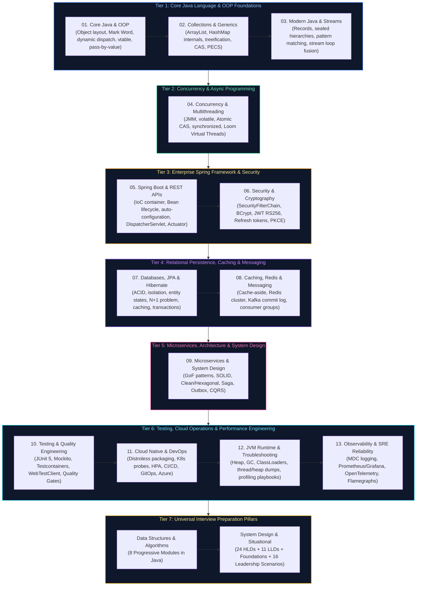

# Java Backend Engineering Master Curriculum & Comprehensive Study Guide

This master guide provides the definitive, production-grade learning roadmap, conceptual index, and chronological study order for modern Java Backend Engineering. The curriculum spans JVM memory mechanics, Core Java language foundations, collections and generics, functional programming (Java 8–21), high-concurrency multithreading, software architecture and GoF design patterns, Spring Framework and Spring Boot internals, RESTful web services, enterprise persistence (JPA, Hibernate, transactions), modern security (OAuth2, JWT), caching and messaging (Redis, Kafka, RabbitMQ), distributed microservices and system design, comprehensive testing (JUnit 5, Testcontainers), cloud operations (Docker, Kubernetes, Azure, AWS), production performance engineering, and full interview preparation (DSA, System Design, Situational Scenarios, and Technical FAQs).

Every guide includes formal architectural definitions, Mermaid topological diagrams, memory/hardware mechanics, production code implementations with detailed line-by-line commentary, edge-case mitigation, and production troubleshooting playbooks.

---

## Recommended Chronological Study Order

---

## Core Curriculum Modules Overview

| Study Order | Guide File | Conceptual Domain | Companion Interview FAQs | Key Topics & Production Scenarios Covered |
| :---: | :--- | :--- | :--- | :--- |
| **01** | [`01_core_java_and_oop.md`](01_core_java_and_oop.md) | Object Model & OOP Language Mechanics | [`01_core_java_and_oop_faq.md`](frequently_asked_questions/01_core_java_and_oop_faq.md) | 64-bit JVM object headers (Mark Word, Klass Word), dynamic method dispatch via `vtable`, inheritance vs composition, keyword semantics (`final`, `static`), access modifiers, pass-by-value, and the `Object` contract (`equals` & `hashCode`). |
| **02** | [`02_java_collections_and_generics.md`](02_java_collections_and_generics.md) | Data Structures, Hashing & Generics | [`02_java_collections_and_generics_faq.md`](frequently_asked_questions/02_java_collections_and_generics_faq.md) | Collections hierarchy, `ArrayList` contiguous array vs `LinkedList`, `HashMap` capacity, load factor, threshold, bitwise hashing and Red-Black treeification, `ConcurrentHashMap` CAS, `Comparable` vs `Comparator`, and PECS wildcard generics. |
| **03** | [`03_modern_java_streams_and_records.md`](03_modern_java_streams_and_records.md) | Modern Java, Functional & Streams API | [`03_modern_java_streams_and_records_faq.md`](frequently_asked_questions/03_modern_java_streams_and_records_faq.md) | Functional interfaces, `@FunctionalInterface`, Method references, `Optional` monad, Stream pipeline lazy execution and `Sink` loop fusion, `map` vs `flatMap`, Java 16 Records, Java 17 Sealed hierarchies, and Java 21 Pattern Matching `switch`. |
| **04** | [`04_java_concurrency_and_multithreading.md`](04_java_concurrency_and_multithreading.md) | Concurrency, JMM & Async Programming | [`04_java_concurrency_and_multithreading_faq.md`](frequently_asked_questions/04_java_concurrency_and_multithreading_faq.md) | Java Memory Model (JMM) happens-before rules, `volatile` memory barriers, `AtomicInteger` CAS, intrinsic monitors (`synchronized`, `wait`/`notify`), `ThreadPoolExecutor` queue policies, `CompletableFuture` pipelining, and Java 21 Virtual Threads (Loom). |
| **05** | [`05_spring_boot_and_rest_apis.md`](05_spring_boot_and_rest_apis.md) | Spring Boot & RESTful APIs | [`05_spring_boot_and_rest_apis_faq.md`](frequently_asked_questions/05_spring_boot_and_rest_apis_faq.md) | `ApplicationContext` vs `BeanFactory`, DI constructor injection mechanics, stereotype annotations, Bean lifecycle, auto-configuration engine, Actuator, `DispatcherServlet` pipeline, REST statelessness, HTTP verbs (`PUT` vs `PATCH`), RFC 7807 ProblemDetail, and gRPC/REST trade-offs. |
| **06** | [`06_security_and_cryptography.md`](06_security_and_cryptography.md) | Spring Security, OAuth2 & Identity | [`06_security_and_cryptography_faq.md`](frequently_asked_questions/06_security_and_cryptography_faq.md) | `SecurityFilterChain` filter sequence, `AuthenticationManager`, BCrypt password hashing, `@PreAuthorize` SpEL, CSRF tokens, stateless JWT RS256 token verification, HttpOnly cookies, refresh token rotation, and OAuth2 Authorization Code Flow with PKCE. |
| **07** | [`07_databases_jpa_and_hibernate.md`](07_databases_jpa_and_hibernate.md) | Relational Storage, JPA & Hibernate | [`07_databases_jpa_and_hibernate_faq.md`](frequently_asked_questions/07_databases_jpa_and_hibernate_faq.md) | Relational engines, ACID, transaction isolation levels, execution plans, Spring Data JPA, entity lifecycle states, N+1 query problem, 1st/2nd level caching, `@Transactional` propagation, and optimistic/pessimistic locking. |
| **08** | [`08_caching_redis_and_kafka.md`](08_caching_redis_and_kafka.md) | Distributed Caching & Event Messaging | [`08_caching_redis_and_kafka_faq.md`](frequently_asked_questions/08_caching_redis_and_kafka_faq.md) | Cache-aside and write-through patterns, Redis data structures and distributed locking, AMQP RabbitMQ exchanges, Apache Kafka commit log architecture, partitions, consumer groups, Spring Boot `@KafkaListener`, and Dead Letter Queue. |
| **09** | [`09_microservices_and_system_design.md`](09_microservices_and_system_design.md) | Architecture, Microservices & Patterns | [`09_microservices_and_system_design_faq.md`](frequently_asked_questions/09_microservices_and_system_design_faq.md) | GoF design patterns, SOLID principles, Clean/Hexagonal Architecture, Service discovery, API Gateway, Circuit Breakers, Saga Orchestration, Transactional Outbox, CQRS, and high-scale system design. |
| **10** | [`10_testing_and_quality_engineering.md`](10_testing_and_quality_engineering.md) | Testing Pyramid, Testcontainers & Quality | [`10_testing_and_quality_engineering_faq.md`](frequently_asked_questions/10_testing_and_quality_engineering_faq.md) | Testing Pyramid, JUnit 5 extensions and lifecycle, Mockito argument captors and verification, Spring Boot test slices (`@WebMvcTest`, `@DataJpaTest`), Testcontainers with PostgreSQL/Kafka, consumer-driven contract testing (Pact), and SonarQube quality gates. |
| **11** | [`11_cloud_native_containers_and_devops.md`](11_cloud_native_containers_and_devops.md) | Cloud Native, Kubernetes & GitOps | [`11_cloud_native_containers_and_devops_faq.md`](frequently_asked_questions/11_cloud_native_containers_and_devops_faq.md) | Distroless multi-stage Docker builds, Kubernetes Pod architecture, startup/liveness/readiness probes, HPA dynamic autoscaling, PodDisruptionBudgets, NetworkPolicies, GitHub Actions CI/CD workflows, ArgoCD GitOps, and Terraform Azure infrastructure. |
| **12** | [`12_jvm_internals_performance_and_troubleshooting.md`](12_jvm_internals_performance_and_troubleshooting.md) | JVM Runtime, Memory, GC & Dumps | [`12_jvm_internals_performance_and_troubleshooting_faq.md`](frequently_asked_questions/12_jvm_internals_performance_and_troubleshooting_faq.md) | JVM memory architecture (Young/Old Heap, Metaspace, Code Cache, Off-Heap), ClassLoader parent delegation, GC algorithms (G1, ZGC, Shenandoah), JIT compilation (C1/C2), Java NIO channels and selectors, Project Panama, thread dump triage (`jstack`), and heap leak diagnosis. |
| **13** | [`13_linux_networking_and_distributed_reliability.md`](13_linux_networking_and_distributed_reliability.md) | Observability, Profiling & Reliability | [`13_linux_networking_and_distributed_reliability_faq.md`](frequently_asked_questions/13_linux_networking_and_distributed_reliability_faq.md) | Structured logging with Logback & MDC, Micrometer metrics, Prometheus/Grafana alerting rules, OpenTelemetry distributed tracing, async-profiler non-safepoint CPU/memory flamegraphs, and production failure playbooks for high-concurrency systems. |

---

## Dedicated Universal Interview Preparation Pillars

### 1. [Data Structures & Algorithms (DSA)](data_structures_and_algorithms/00_dsa_study_guide_and_index.md)
Comprehensive 8-module progressive algorithmic curriculum implemented in Java:
- [`01. Linear Structures & Pointer Patterns`](data_structures_and_algorithms/01_linear_structures_and_pointer_patterns.md) — Arrays, Convergent Two Pointers, Fast & Slow Pointers, Sliding Window, Monotonic Deque, Cyclic Sort, and Prefix Sums.
- [`02. Linked Lists, Stacks & Monotonic Structures`](data_structures_and_algorithms/02_linked_lists_stacks_and_monotonic_structures.md) — Singly/Doubly Linked Lists, in-place reversal, reverse in $k$-groups, Min-Stack, Monotonic Stack/Deque, and complete $O(1)$ LRU & LFU Caches.
- [`03. Trees, Binary Search Trees & Trie Architectures`](data_structures_and_algorithms/03_trees_binary_search_trees_and_tries.md) — Binary Trees & BSTs, Inorder/Pre/Post traversals, Zigzag Level-Order BFS, LCA, Tree Serialization/Deserialization, and Multi-Way Prefix Tries.
- [`04. Binary Search & Divide-and-Conquer`](data_structures_and_algorithms/04_binary_search_and_divide_and_conquer.md) — Midpoint overflow prevention, Rotated Sorted Array search, Binary Search on Answer / Feasibility Search, Merge Sort, and QuickSelect ($O(N)$ average).
- [`05. Heaps, Intervals & Greedy Algorithms`](data_structures_and_algorithms/05_heaps_intervals_and_greedy_algorithms.md) — Binary Heaps, $O(N)$ Heapify, Two Heaps (Continuous Running Median), Top-K Frequent, Sweep-Line Intervals, and Greedy Decisions.
- [`06. Graphs, Topological Sort & Shortest Paths`](data_structures_and_algorithms/06_graphs_topological_sort_and_shortest_paths.md) — Adjacency representations, Bidirectional BFS, 3-Color DFS Cycle Detection, Kahn's Topo Sort, Alien Dictionary, DSU with Rank, Dijkstra, and Bellman-Ford.
- [`07. Dynamic Programming & State Transitions`](data_structures_and_algorithms/07_dynamic_programming_and_state_transitions.md) — Memoization vs Tabulation, State Space Compression, Kadane & Circular Maximum Subarray, Patience LIS, String DP (LCS & Edit Distance), Word Break, and Knapsack.
- [`08. Backtracking & Bit Manipulation`](data_structures_and_algorithms/08_backtracking_and_bit_manipulation.md) — State tree pruning, Combinatorial Search (Subsets, Permutations), N-Queens, XOR algebraic cancellations, Single Number I/II/III, and Brian Kernighan trick.

### 2. [System Design & Situational Track (HLD, LLD & Leadership)](system_design_and_situational/00_system_design_and_situational_index.md)
Comprehensive, consolidated curriculum covering distributed foundations, 24 high-level architectures, 11 low-level machine coding systems, and 16 engineering leadership situational scenarios:
- [`01. System Design Foundations`](system_design_and_situational/01_system_design_foundations.md) — Scalability, L4/L7 load balancing, Consistent Hashing with V-Nodes, CAP & PACELC theorems, Raft consensus, 2PC, B+ Tree vs LSM Tree, database sharding, caching topologies, cache stampede defenses, gRPC vs REST, circuit breakers, and rate limiting algorithms.
- [`02. High-Level System Design (HLD)`](system_design_and_situational/02_high_level_system_design.md) — 24 distributed architectures: URL Shortener, Multi-Region Active-Active Redirects, API Rate Limiter, Global CDN, 64-bit Snowflake ID Generator, Real-Time Chat (WhatsApp/Slack), Notification Engine, Video Streaming (YouTube/Netflix), Payments (Stripe), Flash Sale Checkout, Ride-Hailing (Uber), Uber Eats Homepage, Distributed Cache (Redis), File Storage (Dropbox), Autocomplete, Collaborative Docs, Job Scheduler, Workflow Engine, Feed System, Billion-Scale Graph Search, **UK Faster Payments 24/7 Settlement**, **Real-Time Card Fraud Detection (<100ms)**, **Open Banking API Platform with Instant Revocation**, and **Mainframe to Microservices Zero-Downtime Migration**.
- [`03. Low-Level Design (LLD) & Machine Coding`](system_design_and_situational/03_low_level_system_design.md) — 11 concurrency & machine coding challenges: Custom Bounded Queue & ThreadPool from scratch (no `ExecutorService`), Concurrent Sorted Linked List (ReadWriteLock), Segmented File Manager with byte-range locking, DAG Job Scheduler with dependency resolution, Playground Player Assignment with anti-starvation, Train & Platform Scheduler, In-Memory Twitter, In-Memory Pull-Based Message Queue, In-Memory Filesystem (`mkdir`, `pwd`, `cd` with wildcards), Rule Engine (AST/Composite), and Spotify LLD.
- [`04. Situational Scenarios & Engineering Leadership`](system_design_and_situational/04_situational_scenarios.md) — 16 production scenarios tailored for Senior, Staff & Principal Engineers: Incident command during cascading outages, JVM memory leak & GC pause triage, HikariCP pool exhaustion, Pushing back on management (Monolith vs Microservices), Delivering under tight deadlines, Managing breaking API contracts, Turning around underperforming engineers, **Project failure postmortems & learnings**, **Radical cross-cutting system ownership**, **Balancing speed vs accuracy**, and **Handling conflicting business vs technical requirements**.

### 3. [Interview FAQs & Question Bank](frequently_asked_questions/00_java_faq_study_guide_and_index.md)
13 dedicated scenario guides covering HashMap collision mechanics, multithreading puzzles, Spring bean lifecycle, JPA N+1 optimization, Kafka consumer lag, Testcontainers setup, cgroups v2 memory limits, JVM GC pause optimization, and Linux kernel socket tuning.

---

## Production Problem-Solution Cross-Reference Index

The table below maps **53 canonical Java backend engineering production problems** to their architectural solutions and corresponding curriculum chapters.

| Problem | Canonical Solution | Module Reference |
| :--- | :--- | :--- |
| **Object Identity Confusion** | Value-based `equals()` and `hashCode()` contract override | [`01_core_java_and_oop.md`](01_core_java_and_oop.md) |
| **String Allocation Overhead** | JVM `StringTable` interning & `StringBuilder` | [`01_core_java_and_oop.md`](01_core_java_and_oop.md) [`12_jvm_internals_performance_and_troubleshooting.md`](12_jvm_internals_performance_and_troubleshooting.md) |
| **HashMap Collision Skew** | Balanced Red-Black Treeification & uniform `hashCode()` | [`02_java_collections_and_generics.md`](02_java_collections_and_generics.md) |
| **Concurrent Map Corruption** | Lock-free volatile reads & CAS bucket updates | [`02_java_collections_and_generics.md`](02_java_collections_and_generics.md) |
| **Iterator Concurrent Modification** | Fail-safe iterators & `Collection.removeIf()` | [`02_java_collections_and_generics.md`](02_java_collections_and_generics.md) |
| **Memory Boxing Overhead** | Primitive arrays (`int[]`) & zero-allocation collections | [`02_java_collections_and_generics.md`](02_java_collections_and_generics.md) |
| **Null Pointer Exceptions (NPE)** | Monadic `Optional` return types & defensive validation | [`03_modern_java_streams_and_records.md`](03_modern_java_streams_and_records.md) |
| **Stream Overhead on Tiny Lists** | Classic indexed `for` loops for latency-critical paths | [`03_modern_java_streams_and_records.md`](03_modern_java_streams_and_records.md) |
| **Data Immutability Violations** | Java 16 Records with shallow copy immutability | [`03_modern_java_streams_and_records.md`](03_modern_java_streams_and_records.md) |
| **Polymorphic Hierarchy Leakage** | Java 17 Sealed Classes & exhaustive pattern matching | [`03_modern_java_streams_and_records.md`](03_modern_java_streams_and_records.md) |
| **Shared State Race Conditions** | Mutex synchronization, `ReentrantLock` & atomic CAS | [`04_java_concurrency_and_multithreading.md`](04_java_concurrency_and_multithreading.md) |
| **CPU Cache Incoherency** | Memory barriers via `volatile` & `VarHandle` fences | [`04_java_concurrency_and_multithreading.md`](04_java_concurrency_and_multithreading.md) |
| **Deadlock in Nested Locking** | Strict global lock acquisition ordering & `tryLock()` | [`04_java_concurrency_and_multithreading.md`](04_java_concurrency_and_multithreading.md) |
| **Thread Pool Saturation** | Bounded queues with `CallerRunsPolicy` backpressure | [`04_java_concurrency_and_multithreading.md`](04_java_concurrency_and_multithreading.md) |
| **OS Thread Exhaustion on I/O** | Java 21 Virtual Threads (Project Loom) continuation scheduler | [`04_java_concurrency_and_multithreading.md`](04_java_concurrency_and_multithreading.md) |
| **Circular Bean Dependencies** | Constructor injection refactoring & `@Lazy` break | [`05_spring_boot_and_rest_apis.md`](05_spring_boot_and_rest_apis.md) |
| **Duplicate Bean Registration** | `@ConditionalOnMissingBean` & `@Primary` resolution | [`05_spring_boot_and_rest_apis.md`](05_spring_boot_and_rest_apis.md) |
| **Slow Application Startup** | Lazy initialization & Spring AOT Native Compilation | [`05_spring_boot_and_rest_apis.md`](05_spring_boot_and_rest_apis.md) |
| **Non-Standard API Errors** | RFC 7807 `ProblemDetail` via `@ControllerAdvice` | [`05_spring_boot_and_rest_apis.md`](05_spring_boot_and_rest_apis.md) |
| **Uncontrolled Microservice Latency** | Asynchronous non-blocking `WebClient` & reactive drivers | [`05_spring_boot_and_rest_apis.md`](05_spring_boot_and_rest_apis.md) |
| **Insecure Password Storage** | Adaptive work-factor BCrypt & Argon2id hashing | [`06_security_and_cryptography.md`](06_security_and_cryptography.md) |
| **Stateful Session Bottlenecks** | Asymmetric RS256 JWT stateless verification | [`06_security_and_cryptography.md`](06_security_and_cryptography.md) |
| **Cross-Site Request Forgery** | HttpOnly SameSite cookies & Double Submit tokens | [`06_security_and_cryptography.md`](06_security_and_cryptography.md) |
| **API Unauthorized Access** | Spring Security `@PreAuthorize` SpEL role enforcement | [`06_security_and_cryptography.md`](06_security_and_cryptography.md) |
| **Relational JPA N+1 Queries** | `JOIN FETCH` queries, `@EntityGraph` & batch fetching | [`07_databases_jpa_and_hibernate.md`](07_databases_jpa_and_hibernate.md) |
| **Lost Database Updates** | Versioned `@Version` optimistic locking | [`07_databases_jpa_and_hibernate.md`](07_databases_jpa_and_hibernate.md) |
| **Long-Running DB Transactions** | Fine-grained `@Transactional(readOnly = true)` scopes | [`07_databases_jpa_and_hibernate.md`](07_databases_jpa_and_hibernate.md) |
| **Connection Pool Exhaustion** | HikariCP leak detection threshold & connection validation | [`07_databases_jpa_and_hibernate.md`](07_databases_jpa_and_hibernate.md) |
| **Cache Stampede / Thundering Herd**| Distributed Redis mutex locking (`SET NX PX`) & probabilistic refresh | [`08_caching_redis_and_kafka.md`](08_caching_redis_and_kafka.md) |
| **Cache Penetration** | Redis Bloom Filters & short-lived null value caching | [`08_caching_redis_and_kafka.md`](08_caching_redis_and_kafka.md) |
| **Kafka Out-of-Order Messages** | Idempotent producer (`enable.idempotence=true`) & partition key affinity | [`08_caching_redis_and_kafka.md`](08_caching_redis_and_kafka.md) |
| **Kafka Consumer Lag** | Dynamic partition scaling & batch processing listeners | [`08_caching_redis_and_kafka.md`](08_caching_redis_and_kafka.md) |
| **Poison-Pill Message Hangs** | Kafka Dead Letter Queues (`DefaultErrorHandler`) | [`08_caching_redis_and_kafka.md`](08_caching_redis_and_kafka.md) |
| **Consumer Crash Offset Inconsistency** | Transactional outbox & database deduplication store | [`08_caching_redis_and_kafka.md`](08_caching_redis_and_kafka.md) |
| **Cascading Downstream Outages** | Resilience4j Circuit Breakers & fallback endpoints | [`09_microservices_and_system_design.md`](09_microservices_and_system_design.md) |
| **Cascading Retry Storms (A to B to C)** | Single-point retry, 10% retry budget & deadline propagation | [`09_microservices_and_system_design.md`](09_microservices_and_system_design.md) |
| **Distributed Multi-DB Consistency** | Saga Pattern orchestration & Transactional Outbox | [`09_microservices_and_system_design.md`](09_microservices_and_system_design.md) |
| **Flaky Integration Tests** | Disposable Docker testcontainers (Postgres, Kafka, Redis) | [`10_testing_and_quality_engineering.md`](10_testing_and_quality_engineering.md) |
| **Slow Integration Test Suites** | Spring Boot test context caching & reusable containers | [`10_testing_and_quality_engineering.md`](10_testing_and_quality_engineering.md) |
| **Breaking API Upstream Changes** | Consumer-Driven Contract testing with Pact | [`10_testing_and_quality_engineering.md`](10_testing_and_quality_engineering.md) |
| **Fat Vulnerable Docker Images** | Multi-stage distroless Temurin container packaging | [`11_cloud_native_containers_and_devops.md`](11_cloud_native_containers_and_devops.md) |
| **Kubernetes OOMKilled Exit 137** | `-XX:+UseContainerSupport` & `-XX:MaxRAMPercentage=75.0` | [`11_cloud_native_containers_and_devops.md`](11_cloud_native_containers_and_devops.md) |
| **Serverless Java Cold-Start Spikes** | AWS Lambda SnapStart (CRaC) & GraalVM AOT native compilation | [`11_cloud_native_containers_and_devops.md`](11_cloud_native_containers_and_devops.md) |
| **Downtime During Deployments** | K8s Readiness/PreStop probes & zero-downtime rolling updates | [`11_cloud_native_containers_and_devops.md`](11_cloud_native_containers_and_devops.md) |
| **Configuration Drift Across Envs** | GitOps continuous reconciliation via ArgoCD | [`11_cloud_native_containers_and_devops.md`](11_cloud_native_containers_and_devops.md) |
| **Heap Memory Leaks** | Heap dump capture (`jcmd GC.heap_dump`) & Eclipse MAT dominator tree | [`12_jvm_internals_performance_and_troubleshooting.md`](12_jvm_internals_performance_and_troubleshooting.md) |
| **Metaspace OOM Exceptions** | Dynamic proxy generation cleanup & ClassLoader leak isolation | [`12_jvm_internals_performance_and_troubleshooting.md`](12_jvm_internals_performance_and_troubleshooting.md) |
| **Severe GC Stop-The-World Pauses** | Tuning G1 GC (`-XX:MaxGCPauseMillis=200`) or migrating to Generational ZGC | [`12_jvm_internals_performance_and_troubleshooting.md`](12_jvm_internals_performance_and_troubleshooting.md) |
| **CPU Spikes from Spinlocks** | Thread dump sampling (`jstack`) & mapping hex thread IDs via `top -H` | [`12_jvm_internals_performance_and_troubleshooting.md`](12_jvm_internals_performance_and_troubleshooting.md) |
| **Safepoint Bias Skew in Profiling**| Non-safepoint async-profiler sampling & flamegraph analysis | [`13_linux_networking_and_distributed_reliability.md`](13_linux_networking_and_distributed_reliability.md) |
| **Untraceable Distributed Errors** | W3C TraceContext propagation & Slf4j MDC request correlation IDs | [`13_linux_networking_and_distributed_reliability.md`](13_linux_networking_and_distributed_reliability.md) |
| **Silent Metric Drift in Production**| Micrometer timers with p99 SLA distribution histograms | [`13_linux_networking_and_distributed_reliability.md`](13_linux_networking_and_distributed_reliability.md) |
| **Microservice Thread Starvation** | Separate bulkheads & dedicated async I/O worker pools | [`13_linux_networking_and_distributed_reliability.md`](13_linux_networking_and_distributed_reliability.md) |

---

## References & Further Reading
- Goetz, Brian, et al. *Java Concurrency in Practice*. Addison-Wesley.
- Bloch, Joshua. *Effective Java* (3rd Edition). Addison-Wesley.
- Walls, Craig. *Spring in Action* (6th Edition). Manning.
- Kleppmann, Martin. *Designing Data-Intensive Applications*. O'Reilly Media.
- Evans, Eric. *Domain-Driven Design: Tackling Complexity in the Heart of Software*. Addison-Wesley.
- Beyer, Betsy, et al. *Site Reliability Engineering: How Google Runs Production Systems*. O'Reilly Media.
