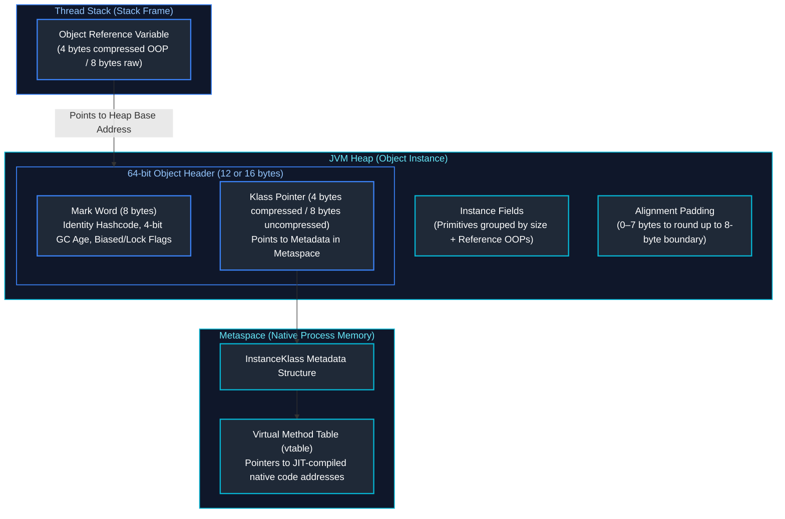
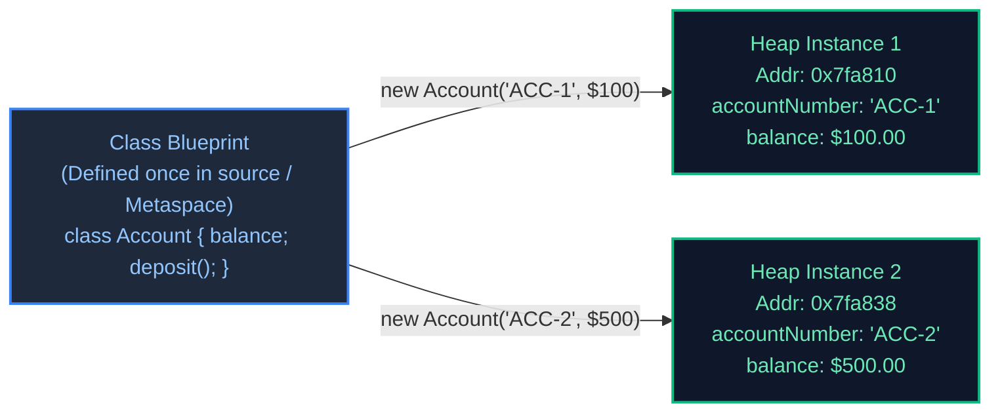
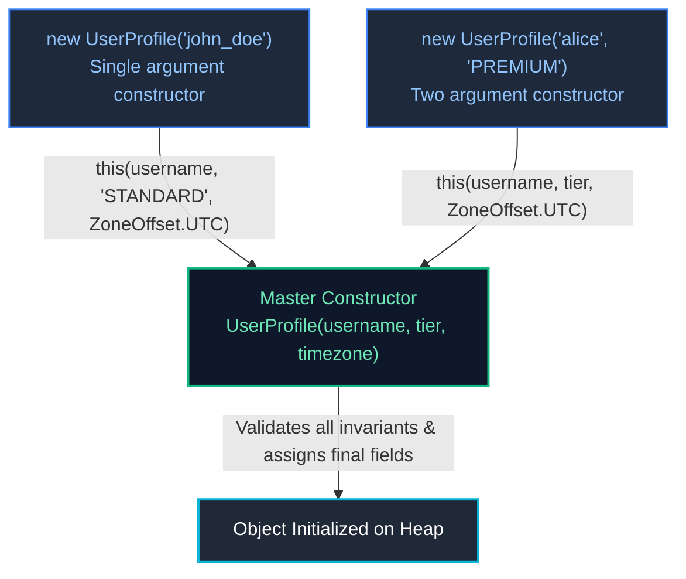
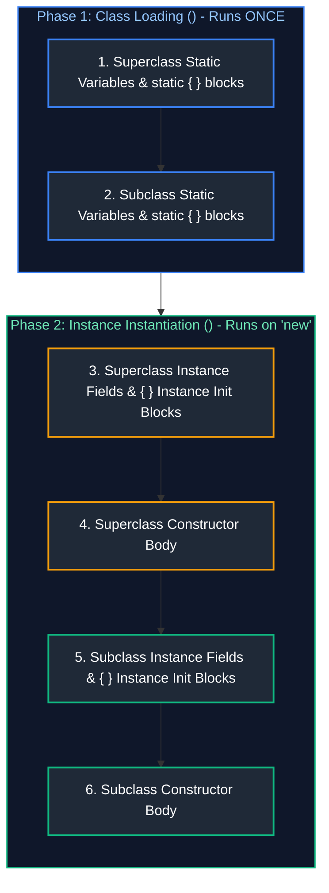
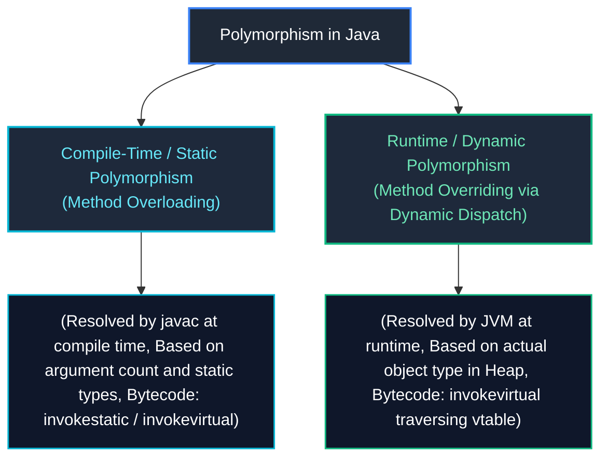
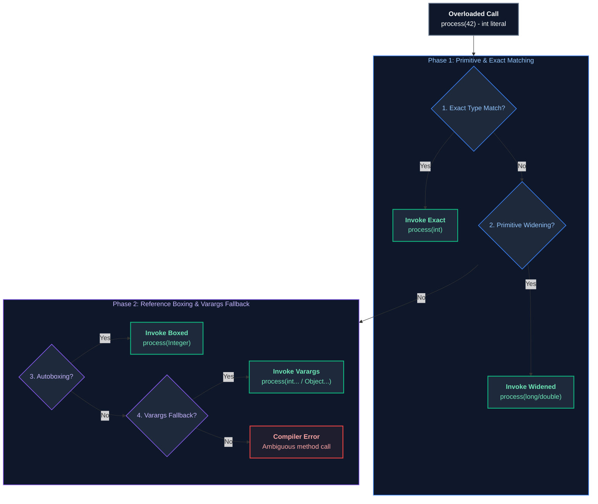
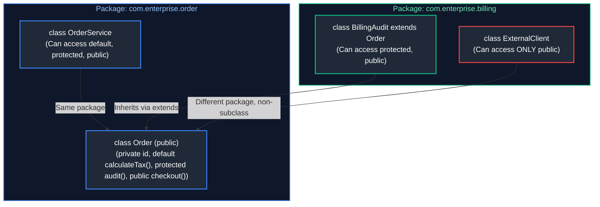
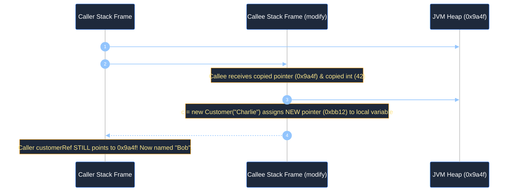
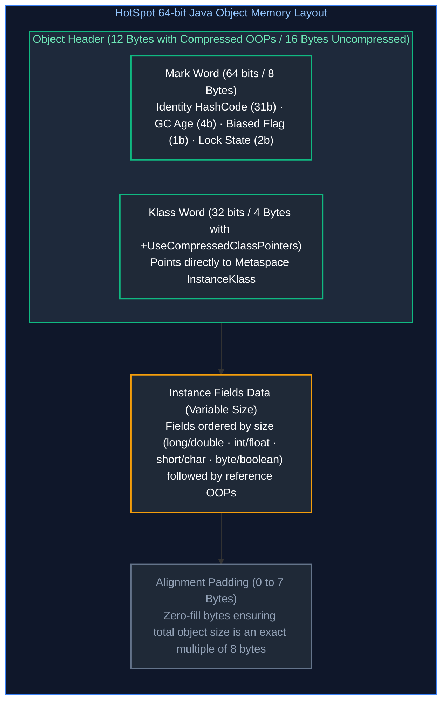
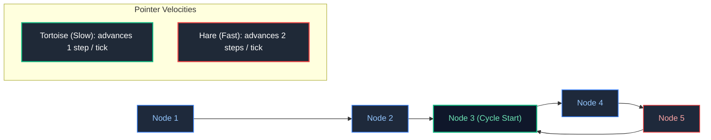

# 01. Core Java & Object-Oriented Programming

A comprehensive, production-grade learning guide to Java language fundamentals, Object-Oriented Programming (OOP) paradigms, the HotSpot JVM object model, memory layout, dynamic method dispatch, keywords, value semantics, and the `Object` class master contracts.

---

## Architectural Overview: Object Model & Virtual Method Dispatch



---

## Table of Contents
1. [Foundations: Classes, Objects & Java Program Execution](#1-foundations-classes-objects--java-program-execution)
   - [1.1 What is Object-Oriented Programming (OOP)?](#11-what-is-object-oriented-programming-oop)
   - [1.2 Classes vs Objects: The Blueprint and the Instance](#12-classes-vs-objects-the-blueprint-and-the-instance)
   - [1.3 Anatomy of a Java Class](#13-anatomy-of-a-java-class)
   - [1.4 Constructor Mechanics, Overloading & Chaining (`this()`, `super()`)](#14-constructor-mechanics-overloading--chaining-this-super)
   - [1.5 Variables in Java: Local vs Instance vs Static (Scope & Lifetime)](#15-variables-in-java-local-vs-instance-vs-static-scope--lifetime)
2. [The Four Core OOP Pillars: In-Depth](#2-the-four-core-oop-pillars-in-depth)
   - [2.1 Encapsulation: Information Hiding & Domain Invariant Protection](#21-encapsulation-information-hiding--domain-invariant-protection)
   - [2.2 Inheritance: Code Reuse, IS-A Relationships & Initialization Order](#22-inheritance-code-reuse-is-a-relationships--initialization-order)
   - [2.3 Polymorphism: Compile-Time vs Runtime Dynamic Binding](#23-polymorphism-compile-time-vs-runtime-dynamic-binding)
   - [2.4 Abstraction: Abstract Classes vs Interfaces (When to Use Which)](#24-abstraction-abstract-classes-vs-interfaces-when-to-use-which)
3. [Method Dispatch: Overloading vs Overriding](#3-method-dispatch-overloading-vs-overriding)
   - [3.1 Method Overloading (Compile-Time Static Resolution)](#31-method-overloading-compile-time-static-resolution)
   - [3.2 Method Overriding (Runtime Dynamic Dispatch via `vtable`)](#32-method-overriding-runtime-dynamic-dispatch-via-vtable)
   - [3.3 Covariant Return Types & Exception Narrowing Rules](#33-covariant-return-types--exception-narrowing-rules)
   - [3.4 Method Hiding (`static`) vs Overriding](#34-method-hiding-static-vs-overriding)
4. [Java Keywords & Language Guarantees](#4-java-keywords--language-guarantees)
   - [4.1 `this` and `super` In Detail](#41-this-and-super-in-detail)
   - [4.2 The `static` Keyword: Variables, Methods, Blocks & Metaspace](#42-the-static-keyword-variables-methods-blocks--metaspace)
   - [4.3 The `final` Keyword: Variables, Methods, Classes & JMM Freeze Action](#43-the-final-keyword-variables-methods-classes--jmm-freeze-action)
   - [4.4 The `instanceof` Operator: Legacy Casting vs Java 16+ Pattern Matching](#44-the-instanceof-operator-legacy-casting-vs-java-16-pattern-matching)
5. [Access Modifiers & Architectural Scoping](#5-access-modifiers--architectural-scoping)
   - [5.1 The Access Matrix: `public`, `protected`, Package-Private, `private`](#51-the-access-matrix-public-protected-package-private-private)
   - [5.2 Package-Private as an Architectural Encapsulation Boundary](#52-package-private-as-an-architectural-encapsulation-boundary)
6. [Java Value Semantics, Primitives & Wrappers](#6-java-value-semantics-primitives--wrappers)
   - [6.1 Strictly Pass-by-Value Mechanics (Stack & Heap Memory Tracing)](#61-strictly-pass-by-value-mechanics-stack--heap-memory-tracing)
   - [6.2 The 8 Primitives vs Wrapper Classes & Autoboxing Hazards](#62-the-8-primitives-vs-wrapper-classes--autoboxing-hazards)
   - [6.3 The Integer Cache (`-128` to `127`) & Equality Pitfalls (`==` vs `equals()`)](#63-the-integer-cache--128-to-127--equality-pitfalls--vs-equals)
7. [Nested, Inner & Anonymous Classes](#7-nested-inner--anonymous-classes)
   - [7.1 Static Nested Classes vs Inner Classes](#71-static-nested-classes-vs-inner-classes)
   - [7.2 Anonymous Classes vs Modern Lambdas](#72-anonymous-classes-vs-modern-lambdas)
   - [7.3 The Hidden Outer `this` Reference Memory Leak Trap](#73-the-hidden-outer-this-reference-memory-leak-trap)
8. [The HotSpot JVM Object Model & Memory Layout](#8-the-hotspot-jvm-object-model--memory-layout)
   - [8.1 64-bit JVM Object Header (Mark Word & Klass Word)](#81-64-bit-jvm-object-header-mark-word--klass-word)
   - [8.2 Compressed OOPs (`-XX:+UseCompressedOops`)](#82-compressed-oops--xxusecompressedoops)
   - [8.3 Object Allocation Fast-Path: TLAB & Escape Analysis](#83-object-allocation-fast-path-tlab--escape-analysis)
9. [The `Object` Class Master Contract](#9-the-object-class-master-contract)
   - [9.1 The `equals()` Contract Requirements & Symmetry Pitfall](#91-the-equals-contract-requirements--symmetry-pitfall)
   - [9.2 The `hashCode()` Contract & Hash Collision Degradation](#92-the-hashcode-contract--hash-collision-degradation)
   - [9.3 `toString()`, `getClass()` & Why `clone()` is an Anti-Pattern](#93-tostring-getclass--why-clone-is-an-anti-pattern)
   - [9.4 Object Cleanup: Deprecated `finalize()` vs `Cleaner` & `AutoCloseable`](#94-object-cleanup-deprecated-finalize-vs-cleaner--autocloseable)
10. [Advanced Production Case Study: Object Graph Cycle Detection](#10-advanced-production-case-study-object-graph-cycle-detection)
11. [Production Troubleshooting Playbook](#11-production-troubleshooting-playbook)
12. [Summary Comparison & Production Engineering Reference Matrix](#12-summary-comparison--production-engineering-reference-matrix)
13. [References & Further Reading](#13-references--further-reading)
---

# 1. Foundations: Classes, Objects & Java Program Execution

---

### 1.1 What is Object-Oriented Programming (OOP)?

**Object-Oriented Programming (OOP)** is a programming paradigm structured around the concept of **objects**—entities that encapsulate both **state** (data stored in fields/attributes) and **behavior** (operations implemented as methods).

#### The Problem OOP Solves
In early procedural programming languages (e.g., C, Pascal), data structures (`struct`) and functions operated independently. Any function in the codebase could directly read and mutate data anywhere in memory. As applications grew to millions of lines of code, this led to:
1. **Uncontrolled Global State Mutation**: A bug in one module could corrupt data used by a completely unrelated module.
2. **High Coupling & Fragility**: Changing the structure of a record broke hundreds of functions that accessed its fields directly.
3. **Lack of Invariant Protection**: An entity representing a `BankBalance` could be set to a negative number or `null` from anywhere without validation.

OOP solves these problems by binding data and the algorithms that manipulate that data into self-contained units called **Objects**, exposing well-defined interfaces while hiding internal mechanics.

---

### 1.2 Classes vs Objects: The Blueprint and the Instance

To understand Java, a software engineer must establish a clear mental model of the distinction between a **Class** and an **Object**:

* **Class**: A compile-time blueprint or structural template. It defines what fields and methods instances of that type will possess. It exists as class metadata in JVM **Metaspace** (in native memory).
* **Object (Instance)**: A runtime concrete entity instantiated dynamically on the JVM **Heap**. It possesses its own private copy of instance fields, occupies a measurable number of bytes, and has a physical memory address.



**Analogy for Beginners**:
A blueprint of a house drawn on paper is a **Class**. It specifies that every house has 3 bedrooms, 2 bathrooms, and a front door. You cannot live inside a blueprint. When a construction crew pours concrete and puts up walls at 123 Elm Street, that physical house is an **Object**. Another house built from the same blueprint at 456 Oak Street is a separate Object; painting the kitchen in the Elm Street house does not turn the kitchen in Oak Street yellow.

---

### 1.3 Anatomy of a Java Class

A production-grade Java class typically consists of package declarations, imports, field definitions, constructors, methods, and lifecycle hooks:

```java
package com.enterprise.banking.model; // 1. Package declaration (namespace)

import java.math.BigDecimal;           // 2. Explicit imports
import java.time.Instant;
import java.util.Objects;
import java.util.UUID;

/**
 * Represents a customer bank account.
 * Follows encapsulation by keeping fields private and exposing intentional operations.
 */
public class BankAccount {

    // 3. Static / Class Variable (shared across all instances in the JVM)
    private static final BigDecimal MINIMUM_OPENING_BALANCE = new BigDecimal("25.00");

    // 4. Instance Fields (each object on the heap gets its own distinct copy)
    private final UUID accountId;
    private final String accountHolder;
    private BigDecimal currentBalance;
    private final Instant createdAt;

    // 5. Constructor (initializes object state when 'new' is invoked)
    public BankAccount(String accountHolder, BigDecimal initialDeposit) {
        // Invariant validation
        this.accountHolder = Objects.requireNonNull(accountHolder, "Account holder cannot be null");
        if (initialDeposit == null || initialDeposit.compareTo(MINIMUM_OPENING_BALANCE) < 0) {
            throw new IllegalArgumentException("Opening balance must be at least $" + MINIMUM_OPENING_BALANCE);
        }
        this.accountId = UUID.randomUUID();
        this.currentBalance = initialDeposit;
        this.createdAt = Instant.now();
    }

    // 6. Instance Methods (Behavior)
    public synchronized void deposit(BigDecimal amount) {
        if (amount == null || amount.compareTo(BigDecimal.ZERO) <= 0) {
            throw new IllegalArgumentException("Deposit amount must be strictly positive");
        }
        this.currentBalance = this.currentBalance.add(amount);
    }

    // 7. Controlled Getters (Never provide raw setters for business-critical state)
    public UUID getAccountId() { return accountId; }
    public String getAccountHolder() { return accountHolder; }
    public BigDecimal getCurrentBalance() { return currentBalance; }
    public Instant getCreatedAt() { return createdAt; }
}
```

---

### 1.4 Constructor Mechanics, Overloading & Chaining (`this()`, `super()`)

A **constructor** is a specialized block of code invoked automatically when an object is instantiated via the `new` operator. Its sole responsibility is to initialize instance fields and guarantee that the object enters the heap in a valid, consistent state.

#### Core Rules of Constructors:
1. **Name Matching**: A constructor must share the exact case-sensitive name of the enclosing class.
2. **No Return Type**: Constructors do not declare any return type (not even `void`). Declaring `public void BankAccount()` turns the method into a normal instance method, not a constructor.
3. **The Default Constructor**: If a class defines **no constructors at all**, the Java compiler (`javac`) automatically injects a default public no-argument constructor:
   ```java
   public BankAccount() {
       super(); // Calls Object class default constructor
   }
   ```
   **Critical Trap**: As soon as you declare **any constructor** (e.g., a constructor taking parameters), the compiler **stops generating the default no-arg constructor**. If external frameworks (like Jackson, Hibernate, or Spring) require a no-arg constructor, you must explicitly declare one.

#### Constructor Overloading & Constructor Chaining (`this()`)
Constructor overloading allows a class to offer multiple initialization paths with default parameters. **Constructor Chaining** via `this(...)` allows one constructor to call another in the same class, avoiding duplicated initialization logic:



```java
public class UserProfile {
    private final String username;
    private final String membershipTier;
    private final ZoneOffset timezone;

    // Overloaded Constructor 1: Defaults tier to "STANDARD" and timezone to UTC
    public UserProfile(String username) {
        this(username, "STANDARD", ZoneOffset.UTC); // Invokes Constructor 3
    }

    // Overloaded Constructor 2: Defaults timezone to UTC
    public UserProfile(String username, String membershipTier) {
        this(username, membershipTier, ZoneOffset.UTC); // Invokes Constructor 3
    }

    // Master Constructor 3: Performs all validation and state assignment
    public UserProfile(String username, String membershipTier, ZoneOffset timezone) {
        // Rule: this(...) or super(...) MUST be the very first statement in a constructor!
        this.username = Objects.requireNonNull(username, "Username is required");
        this.membershipTier = Objects.requireNonNull(membershipTier, "Tier is required");
        this.timezone = Objects.requireNonNull(timezone, "Timezone is required");
    }
}
```

> [!IMPORTANT]
> In Java, a call to `this(...)` or `super(...)` must be the **very first line** of any constructor body. You cannot execute validation statements before calling `this()` prior to Java 22 (JEP 447 introduces flexible constructor bodies preview, but prior statements cannot access `this`).

---

### 1.5 Variables in Java: Local vs Instance vs Static (Scope & Lifetime)

Java defines three distinct categories of variables based on where they are declared, how long they live, and where they reside in physical JVM memory:

| Characteristic | Local Variable | Instance Variable (Field) | Static Variable (Class Field) |
| :--- | :--- | :--- | :--- |
| **Where Declared** | Inside a method, constructor, or `{}` block | Inside class, outside any method (without `static`) | Inside class, marked with `static` |
| **Memory Location** | Thread Stack (inside the active method frame) | JVM Heap (embedded inside the object's body) | Metaspace / JVM Class metadata |
| **Lifecycle** | Created when method executes; destroyed when frame pops | Created with `new`; destroyed when object is GC'd | Created when class is loaded; destroyed when ClassLoader unloads |
| **Default Value?** | **NO**. Compiler throws error if read before initialization | **YES** (`0`, `0.0`, `false`, or `null` for references) | **YES** (`0`, `0.0`, `false`, or `null` for references) |
| **Thread Safety** | Inherently thread-safe (confined to calling thread stack) | Not thread-safe if mutated concurrently by multiple threads | Shared globally across all threads; high risk of race conditions |

#### Code Demonstration: Variable Lifetime & Initialization
```java
public class VariableScopingDemo {

    // 1. Static Variable: Shared across all instances
    public static int totalGlobalRequests = 0;

    // 2. Instance Variable: Independent copy per instance on Heap
    private int instanceCounter = 0; // Default initialized to 0

    public void processPayment(double paymentAmount) {
        // 3. Local Variable: Allocated on the current thread's Stack Frame
        int localTransactionId;

        // System.out.println(localTransactionId); // ❌ COMPILE ERROR: Variable might not have been initialized

        localTransactionId = 1001; // Explicit initialization required!
        instanceCounter++;         // Increments heap variable of this object
        totalGlobalRequests++;     // Increments class-wide variable in Metaspace

        System.out.println("Tx ID: " + localTransactionId + ", Instance count: " + instanceCounter);
    }
}
```

> [!TIP]
> **Deep-Dive Interview Scenarios:**
> - [Q1. Reverse a String Without Built-ins](frequently_asked_questions/01_core_java_and_oop_faq.md#q1-medium-reverse-a-string-without-built-ins)
> - [Q2. Convert First Half to Lowercase & Second Half to Uppercase](frequently_asked_questions/01_core_java_and_oop_faq.md#q2-medium-convert-first-half-to-lowercase--second-half-to-uppercase)
> - [Q3. First Non-Repeating Character in a String](frequently_asked_questions/01_core_java_and_oop_faq.md#q3-medium-first-non-repeating-character-in-a-string)
> - [Q4. Longest Substring Without Repeating Characters](frequently_asked_questions/01_core_java_and_oop_faq.md#q4-medium-longest-substring-without-repeating-characters)
> - [Q5. Longest Common Prefix in an Array of Strings](frequently_asked_questions/01_core_java_and_oop_faq.md#q5-medium-longest-common-prefix-in-an-array-of-strings)
> - [Q8. Print Prime Numbers Between 1 and 200 (Minimal Complexity)](frequently_asked_questions/01_core_java_and_oop_faq.md#q8-medium-print-prime-numbers-between-1-and-200-minimal-complexity)
> - [Q10. Path Sum Verification in a Binary Tree (Root to Leaf)](frequently_asked_questions/01_core_java_and_oop_faq.md#q10-medium-path-sum-verification-in-a-binary-tree-root-to-leaf)
> - [Q31. Records, Standard Classes & Sealed Classes in Production](frequently_asked_questions/01_core_java_and_oop_faq.md#q31-medium-records-standard-classes--sealed-classes-in-production)

---

# 2. The Four Core OOP Pillars: In-Depth

---

### 2.1 Encapsulation: Information Hiding & Domain Invariant Protection

**Encapsulation** is the bundling of data and the methods that operate on that data into a single unit, while restricting direct access to the internal components.

#### The Beginner Misconception: "Encapsulation is just private fields with getters and setters."
Generating public getters and setters for every private field is known as the **Anemic Domain Model** anti-pattern. If a class exposes `setBalance(BigDecimal balance)`, any code anywhere can corrupt the object's state:

```java
// ❌ ANTI-PATTERN: Leaky setters destroy encapsulation and invariant protection
public class AnemicAccount {
    private BigDecimal balance;

    public BigDecimal getBalance() { return balance; }
    public void setBalance(BigDecimal balance) { this.balance = balance; }
}

// Anywhere in the codebase, a developer can write:
AnemicAccount account = new AnemicAccount();
account.setBalance(new BigDecimal("-999999.00")); // Invariant destroyed!
```

#### The Production Standard: "Tell, Don't Ask" & Defensive Copying
In true encapsulation:
1. **Fields are private and validated**: State is modified only through business operations that enforce rules.
2. **Tell, Don't Ask**: Instead of asking an object for its data, making decisions outside, and setting it back, you **tell** the object what business operation to perform.
3. **Defensive Copying**: If an object encapsulates a mutable reference (such as `java.util.Date` or `java.util.List`), returning or accepting that reference directly allows external callers to mutate internal state without the object's knowledge.

```java
public final class Order {
    private final String orderId;
    private final List<OrderItem> items; // Mutable collection
    private OrderStatus status;

    public Order(String orderId, List<OrderItem> initialItems) {
        this.orderId = Objects.requireNonNull(orderId);
        // Defensive Copy on Input: Prevent caller from mutating the list later
        this.items = new ArrayList<>(Objects.requireNonNull(initialItems));
        this.status = OrderStatus.PENDING;
    }

    // Business operation with invariant check
    public void cancel() {
        if (this.status == OrderStatus.SHIPPED || this.status == OrderStatus.DELIVERED) {
            throw new IllegalStateException("Cannot cancel an order that has already shipped or delivered.");
        }
        this.status = OrderStatus.CANCELLED;
    }

    // Defensive Copy on Output: Return unmodifiable view to prevent external mutation
    public List<OrderItem> getItems() {
        return Collections.unmodifiableList(new ArrayList<>(this.items));
    }
}
```

---

### 2.2 Inheritance: Code Reuse, IS-A Relationships & Initialization Order

**Inheritance** is a mechanism where a new class (subclass/derived class) derives attributes and behaviors from an existing class (superclass/base class) using the `extends` keyword.

* **IS-A Relationship**: A subclass must genuinely be a specialized subtype of the parent class (e.g., `SavingsAccount` **is a** `BankAccount`).
* **Single Class Inheritance**: Java supports only single class inheritance (`class A extends B`). A class cannot extend multiple classes simultaneously (preventing the classic C++ diamond problem of multiple state inheritance).

#### Composition Over Inheritance (Effective Java Item 18)
While inheritance provides code reuse, it creates the tightest coupling in software engineering. Changes in the parent class can silently break subclasses (the **Fragile Base Class problem**). Modern production architecture strongly favors **Composition (HAS-A)** over **Inheritance (IS-A)**:

```java
// ❌ INHERITANCE TRAP: InstrumentedHashSet breaks when parent HashSet internally changes
// If HashSet's addAll() calls add(), our overridden addAll() double-counts elements!

// ✅ COMPOSITION & FORWARDING: Robust, resilient, and decoupled
public class InstrumentedSet<E> implements Set<E> {
    private final Set<E> delegate; // HAS-A relationship
    private int addCount = 0;

    public InstrumentedSet(Set<E> delegate) {
        this.delegate = Objects.requireNonNull(delegate);
    }

    @Override
    public boolean add(E e) {
        addCount++;
        return delegate.add(e);
    }

    @Override
    public boolean addAll(Collection<? extends E> c) {
        addCount += c.size();
        return delegate.addAll(c);
    }

    public int getAddCount() { return addCount; }
    // Forward remaining Set interface methods directly to delegate...
    @Override public int size() { return delegate.size(); }
    @Override public boolean isEmpty() { return delegate.isEmpty(); }
    @Override public boolean contains(Object o) { return delegate.contains(o); }
    @Override public Iterator<E> iterator() { return delegate.iterator(); }
    @Override public Object[] toArray() { return delegate.toArray(); }
    @Override public <T> T[] toArray(T[] a) { return delegate.toArray(a); }
    @Override public boolean remove(Object o) { return delegate.remove(o); }
    @Override public boolean containsAll(Collection<?> c) { return delegate.containsAll(c); }
    @Override public boolean retainAll(Collection<?> c) { return delegate.retainAll(c); }
    @Override public boolean removeAll(Collection<?> c) { return delegate.removeAll(c); }
    @Override public void clear() { delegate.clear(); }
}
```

#### Exact Class Initialization Order
When a subclass is instantiated, the JVM executes static initialization (`<clinit>`) followed by instance initialization (`<init>`) in strict hierarchical order:



---

### 2.3 Polymorphism: Compile-Time vs Runtime Dynamic Binding

**Polymorphism** (from Greek: "many forms") is the ability of an object reference to take on different forms and exhibit different runtime behaviors depending on the actual concrete type on the Heap.

Java divides polymorphism into two fundamental forms:



#### Production Walkthrough: Decoupled Payment Gateway
```java
// 1. Common Interface defining behavioral contract
public interface PaymentGateway {
    PaymentResult processPayment(PaymentRequest request);
}

// 2. Concrete implementation 1
public class StripeGateway implements PaymentGateway {
    @Override
    public PaymentResult processPayment(PaymentRequest request) {
        // Calls Stripe REST API
        return new PaymentResult("STRIPE-" + UUID.randomUUID(), true);
    }
}

// 3. Concrete implementation 2
public class PayPalGateway implements PaymentGateway {
    @Override
    public PaymentResult processPayment(PaymentRequest request) {
        // Calls PayPal SDK
        return new PaymentResult("PAYPAL-" + UUID.randomUUID(), true);
    }
}

// 4. Client service depends solely on the polymorphic abstraction
public class CheckoutService {
    private final PaymentGateway paymentGateway;

    // Injected at runtime via constructor (Dependency Injection)
    public CheckoutService(PaymentGateway paymentGateway) {
        this.paymentGateway = paymentGateway;
    }

    public void checkout(Order order) {
        PaymentRequest req = new PaymentRequest(order.getTotal());
        // At runtime, JVM traverses the vtable to invoke StripeGateway or PayPalGateway
        PaymentResult result = paymentGateway.processPayment(req);
        System.out.println("Payment processed: " + result.transactionId());
    }
}
```

---

### 2.4 Abstraction: Abstract Classes vs Interfaces (When to Use Which)

**Abstraction** is the technique of hiding internal implementation details and exposing only the essential interface to the consumer. In Java, abstraction is achieved via **Abstract Classes** and **Interfaces**.

| Architectural Dimension | Abstract Class | Interface |
| :--- | :--- | :--- |
| **Inheritance Model** | Single inheritance (`class A extends BaseClass`) | Multiple inheritance (`class A implements X, Y, Z`) |
| **Instance State** | Can maintain mutable instance fields (`int count;`) | **Cannot maintain instance state** (only `public static final` constants) |
| **Constructors** | **Has constructors** (called during subclass instantiation) | **No constructors** (cannot participate in object creation) |
| **Method Modifiers** | Can have `abstract`, `protected`, `final`, package-private, or `public` | Historically all `public abstract`. Java 8+ added `default` and `static`. Java 9+ added `private` helper methods. |
| **Speed / Dispatch** | Resolved via class `vtable` (`invokevirtual` - faster) | Resolved via interface `itable` (`invokeinterface` - slight lookup overhead) |
| **Primary Architectural Intent** | **IS-A relationship**: Skeletal implementation, shared mutable state, code reuse among closely related family members | **CAN-DO capability**: Defines a behavioral contract for completely unrelated classes (e.g., `Comparable`, `AutoCloseable`, `Serializable`) |

```java
// Interface: Defines what an entity CAN DO (Behavioral capability)
public interface Auditable {
    void recordAuditLog(String action);

    // Java 8 default method: Provides default behavior without breaking implementers
    default void logSystemEvent(String event) {
        System.out.println("[" + Instant.now() + "] SYSTEM: " + event);
    }
}

// Abstract Class: Provides a skeletal base with shared state and invariant enforcement
public abstract class AbstractDatabaseService {
    protected final String connectionUrl; // Shared state
    private boolean isConnected;

    public AbstractDatabaseService(String connectionUrl) {
        this.connectionUrl = Objects.requireNonNull(connectionUrl);
        this.isConnected = false;
    }

    // Template Method Pattern: Defines the algorithm structure
    public final void executeTransaction(String sql) {
        connect();
        try {
            doExecute(sql); // Delegated to concrete subclass
        } finally {
            disconnect();
        }
    }

    protected abstract void doExecute(String sql); // Abstract hook

    private void connect() { isConnected = true; }
    private void disconnect() { isConnected = false; }
}
```

> [!TIP]
> **Deep-Dive Interview Scenarios:**
> - [Q6. Remove Duplicates from an Array in a Single Iteration](frequently_asked_questions/01_core_java_and_oop_faq.md#q6-medium-remove-duplicates-from-an-array-in-a-single-iteration)
> - [Q7. Rearrange Integer Array: Even Before Odd](frequently_asked_questions/01_core_java_and_oop_faq.md#q7-medium-rearrange-integer-array-even-before-odd)
> - [Q9. Reverse a Singly Linked List (Iterative & Recursive)](frequently_asked_questions/01_core_java_and_oop_faq.md#q9-medium-reverse-a-singly-linked-list-iterative--recursive)
> - [Q16. Composition Over Inheritance](frequently_asked_questions/01_core_java_and_oop_faq.md#q16-medium-composition-over-inheritance)

---

# 3. Method Dispatch: Overloading vs Overriding

---

### 3.1 Method Overloading (Compile-Time Static Resolution)

Method overloading occurs when a class has multiple methods with the **same name but different parameter lists** (different number of arguments, different argument types, or different order of types).

#### What Does NOT Participate in Overloading:
* **Return Type**: Changing only the return type does **not** overload a method. It causes a compile error:
  ```java
  public int getCount() { return 1; }
  public double getCount() { return 1.0; } // ❌ COMPILE ERROR: 'getCount()' is already defined
  ```
* **Access Modifiers & Thrown Exceptions**: Differences in `public`/`private` or `throws Exception` do not differentiate overloaded methods.

#### Compiler Resolution Precedence Tree
When the compiler encounters an overloaded method call, it evaluates candidates in strict order:
1. **Exact Primitive Match**: `int` matches `int`.
2. **Primitive Widening**: `int` widens to `long`, then `float`, then `double` (Widening never narrows; `int` will not implicitly widen to `byte`).
3. **Autoboxing**: `int` is boxed into `Integer`.
4. **Varargs**: `int...` (lowest priority, considered only if no other match exists).



#### The Classic Ambiguity Trap with `null`:
```java
public class OverloadAmbiguity {
    public void print(String str) { System.out.println("String: " + str); }
    public void print(Integer num) { System.out.println("Integer: " + num); }

    public static void main(String[] args) {
        OverloadAmbiguity demo = new OverloadAmbiguity();
        // demo.print(null); // ❌ COMPILE ERROR: Reference to 'print' is ambiguous!
        // Both String and Integer are reference types; neither is more specific than the other.

        // Fix: Explicitly cast to the target type
        demo.print((String) null); // Outputs: String: null
    }
}
```

---

### 3.2 Method Overriding (Runtime Dynamic Dispatch via `vtable`)

Method overriding occurs when a subclass defines a method with the **exact same signature** (name and parameter types) as a method in its superclass.

#### Requirements for Valid Overriding:
1. **Signature Identity**: Name and parameter types must match exactly.
2. **Access Modifier Narrowing Forbidden**: The overriding method cannot make the access more restrictive (`protected` $\to$ `public` is allowed; `public` $\to$ `protected` is a compile-time error).
3. **`@Override` Annotation**: Always annotate overriding methods. It instructs `javac` to verify that a method is actually being overridden; if you accidentally misspell the method name, the compiler catches it immediately.

#### HotSpot Dynamic Dispatch Mechanics (`invokevirtual` & `vtable`)
In HotSpot JVM, dynamic dispatch is implemented using a **Virtual Method Table (`vtable`)**:
1. When a class is loaded, the JVM creates a `vtable` in Metaspace containing an array of memory pointers to executable method code.
2. If a subclass overrides a method, its `vtable` slot points to its own overridden implementation. If it does not override, its `vtable` slot points to the parent class's implementation.
3. At runtime, executing `account.calculateInterest()` emits the bytecode instruction `invokevirtual`. The JVM dereferences the object's `Klass` pointer, looks up the fixed offset in the `vtable`, and invokes the function pointer directly.
4. **JIT Optimization**: If the HotSpot C2 compiler observes that only one concrete class is ever executed at a call site (**monomorphic call site**), it completely inlines the method body into machine code, eliminating dispatch overhead entirely!

---

### 3.3 Covariant Return Types & Exception Narrowing Rules

Java 5 introduced **Covariant Return Types**, allowing an overriding subclass method to return a more specialized subtype of the parent method's return type:

```java
public class VehicleProducer {
    public Vehicle manufacture() throws Exception {
        return new Vehicle();
    }
}

public class SportsCarProducer extends VehicleProducer {
    // ✅ VALID OVERRIDE:
    // 1. Covariant Return Type: SportsCar is a subclass of Vehicle
    // 2. Exception Narrowing: IOException is narrower than Exception (or declare NO exceptions)
    // 3. Access Modifier: Broader access (public) is allowed
    @Override
    public SportsCar manufacture() throws IOException {
        return new SportsCar();
    }
}
```

#### Exception Narrowing Invariant:
An overriding method:
* Can declare **fewer** checked exceptions than the parent method.
* Can declare **narrower** (subclass) checked exceptions.
* Can declare any unchecked (`RuntimeException`).
* **Can NEVER declare broader or new checked exceptions**! If it did, client code expecting the base type would fail to catch the new exception, violating the Liskov Substitution Principle (LSP).

---

### 3.4 Method Hiding (`static`) vs Overriding

Declaring a `static` method in a subclass with the same signature as a `static` method in the superclass is **Method Hiding**, NOT overriding:

```java
class SuperClass {
    public static void display() { System.out.println("Super static"); }
    public void execute() { System.out.println("Super instance"); }
}

class SubClass extends SuperClass {
    public static void display() { System.out.println("Sub static"); } // Hides SuperClass.display()
    @Override
    public void execute() { System.out.println("Sub instance"); }     // Overrides SuperClass.execute()
}

public class DispatchDemo {
    public static void main(String[] args) {
        SuperClass ref = new SubClass();
        ref.display(); // Prints: "Super static" -> Resolved at COMPILE-TIME by reference type (SuperClass)!
        ref.execute(); // Prints: "Sub instance" -> Resolved at RUNTIME by Heap instance type (SubClass)!
    }
}
```

> [!TIP]
> **Deep-Dive Interview Scenarios:**
> - [Q19. Overriding Static Methods & Method Hiding](frequently_asked_questions/01_core_java_and_oop_faq.md#q19-easy-overriding-static-methods--method-hiding)
> - [Q34. Static Method Hiding vs Dynamic Method Overriding in Java Inheritance](frequently_asked_questions/01_core_java_and_oop_faq.md#q34-easy-static-method-hiding-vs-dynamic-method-overriding-in-java-inheritance)
> - [Q37. Checked vs Unchecked Exceptions, Performance Overhead & `@ControllerAdvice` Exception Handling](frequently_asked_questions/01_core_java_and_oop_faq.md#q37-medium-checked-vs-unchecked-exceptions-performance-overhead--controlleradvice-exception-handling)
> - [Q42. Static Method Overloading vs Dynamic Overriding: Virtual Method Table (vtable) vs Compile-Time Direct Invocations](frequently_asked_questions/01_core_java_and_oop_faq.md#q42-easy-static-method-overloading-vs-dynamic-overriding-virtual-method-table-vtable-vs-compile-time-direct-invocations)

---

# 4. Java Keywords & Language Guarantees

---

### 4.1 `this` and `super` In Detail

* **`this`**: An implicit reference available in any non-static method pointing to the **current object instance** on the Heap.
  * Used to resolve name collisions between method parameters and instance fields (`this.amount = amount`).
  * Used for constructor chaining (`this(arg1, arg2)`).
  * Used to pass the current instance to external listeners (`publisher.register(this)`).
* **`super`**: A keyword used to access members of the immediate **superclass**.
  * Used to invoke parent constructors (`super(name)`).
  * Used to invoke parent method implementations that were overridden (`super.execute()`).

---

### 4.2 The `static` Keyword: Variables, Methods, Blocks & Metaspace

The `static` modifier denotes that a member belongs to the **Class itself**, rather than any individual object instance.

```java
public class DatabasePool {
    // 1. Static Variable: Exactly one copy in Metaspace for the whole application
    private static int activeConnections = 0;

    // 2. Static Initialization Block: Runs once when class is loaded into JVM
    static {
        System.out.println("Class loaded: Initializing native connection drivers...");
        activeConnections = 10;
    }

    // 3. Static Method: Operates without requiring an instance on the heap
    public static int getActiveConnections() {
        // cannot use 'this' or access non-static instance fields here!
        return activeConnections;
    }
}
```

#### Thread-Safety Guarantee of `<clinit>`
The JVM specification guarantees that class loading and static block execution (`<clinit>`) are **inherently thread-safe**. When multiple threads attempt to load a class concurrently, the JVM acquires an internal initialization lock on the `Class` object. This makes static holder singletons (Bill Pugh Singleton Pattern) completely thread-safe without explicit locks:

```java
public class ThreadSafeSingleton {
    private ThreadSafeSingleton() {}

    // Static nested class is NOT loaded until getInstance() is called
    private static class Holder {
        private static final ThreadSafeSingleton INSTANCE = new ThreadSafeSingleton();
    }

    public static ThreadSafeSingleton getInstance() {
        return Holder.INSTANCE; // ClassLoader guarantees safe publication
    }
}
```

---

### 4.3 The `final` Keyword: Variables, Methods, Classes & JMM Freeze Action

The `final` keyword serves different purposes based on context:

1. **`final` Variable**: Can be assigned a value exactly once.
   * *Compile-Time Constant*: `public static final int TIMEOUT = 5000;` (The `javac` compiler inlines the primitive literal directly into consuming bytecodes).
   * *Blank Final*: An unassigned final field that must be initialized inside every constructor.
   * *Reference Mutability Trap*: Declaring `final List<String> items = new ArrayList<>();` prevents `items` from being reassigned to a new list, but the list contents can still be mutated (`items.add("new element")`).
2. **`final` Method**: Prevents subclasses from overriding the method, allowing the JIT compiler to aggressively inline it.
3. **`final` Class**: Prevents inheritance entirely (e.g., `java.lang.String`, `java.lang.Integer`). This is essential for building immutable, secure types.
4. **JMM Safe Publication Guarantee (JSR-133)**: Under the Java Memory Model, all fields marked `final` undergo a **Freeze Action** upon constructor exit. Even if an object reference is published across concurrent threads without locks, all threads are guaranteed to see the fully initialized values of `final` fields without seeing partially-constructed stale state.

---

### 4.4 The `instanceof` Operator: Legacy Casting vs Java 16+ Pattern Matching

The `instanceof` operator tests whether an object reference is an instance of a specified class or implements an interface:

```java
// ❌ Legacy Java (Verbose, unsafe, repetitive casting)
public void processMessage(Object message) {
    if (message instanceof TextMessage) {
        TextMessage text = (TextMessage) message; // Redundant manual cast
        System.out.println("Text: " + text.getContent());
    }
}

// ✅ Modern Java 16+ Pattern Matching for instanceof
public void processMessageModern(Object message) {
    if (message instanceof TextMessage text && !text.getContent().isBlank()) {
        // 'text' is automatically in-scope and cast with pattern variable
        System.out.println("Processing: " + text.getContent());
    }
}
```

> [!TIP]
> **Deep-Dive Interview Scenarios:**
> - [Q11. `==` vs `equals()` and the String Pool Mechanism](frequently_asked_questions/01_core_java_and_oop_faq.md#q11-medium--vs-equals-and-the-string-pool-mechanism)
> - [Q12. Short-Circuiting with Logical Operators (`&&`, `||`)](frequently_asked_questions/01_core_java_and_oop_faq.md#q12-easy-short-circuiting-with-logical-operators--)
> - [Q13. Constructors and Invoking Static Methods Inside Constructors](frequently_asked_questions/01_core_java_and_oop_faq.md#q13-easy-constructors-and-invoking-static-methods-inside-constructors)
> - [Q14. `final`, `finally`, and `finalize()`](frequently_asked_questions/01_core_java_and_oop_faq.md#q14-easy-final-finally-and-finalize)
> - [Q15. `ClassCastException`: Root Causes and Prevention](frequently_asked_questions/01_core_java_and_oop_faq.md#q15-medium-classcastexception-root-causes-and-prevention)
> - [Q29. Text Blocks and Multiline Strings](frequently_asked_questions/01_core_java_and_oop_faq.md#q29-easy-text-blocks-and-multiline-strings)
> - [Q30. Pattern Matching for `switch`](frequently_asked_questions/01_core_java_and_oop_faq.md#q30-medium-pattern-matching-for-switch)
> - [Q32. Virtual Threads (Project Loom) vs Platform Threads](frequently_asked_questions/01_core_java_and_oop_faq.md#q32-expert-virtual-threads-project-loom-vs-platform-threads)
> - [Q40. String Mutability via Reflection/Unsafe vs JVM String Pool Security Invariants](frequently_asked_questions/01_core_java_and_oop_faq.md#q40-hard-string-mutability-via-reflectionunsafe-vs-jvm-string-pool-security-invariants)
> - [Q41. String Pool vs Java Heap: `new String("hello")` Allocation Dynamics & Constant Pool Resolution](frequently_asked_questions/01_core_java_and_oop_faq.md#q41-easy-string-pool-vs-java-heap-new-stringhello-allocation-dynamics--constant-pool-resolution)

---

# 5. Access Modifiers & Architectural Scoping

---

### 5.1 The Access Matrix: `public`, `protected`, Package-Private, `private`

Java provides four levels of visibility to enforce structural encapsulation:

| Access Modifier | Enclosing Class | Same Package | Subclass (Different Package) | World (Anywhere) |
| :--- | :---: | :---: | :---: | :---: |
| **`private`** | ✅ Yes | ❌ No | ❌ No | ❌ No |
| **Package-Private (no modifier)** | ✅ Yes | ✅ Yes | ❌ No | ❌ No |
| **`protected`** | ✅ Yes | ✅ Yes | ✅ Yes (only via inheritance) | ❌ No |
| **`public`** | ✅ Yes | ✅ Yes | ✅ Yes | ✅ Yes |



---

### 5.2 Package-Private as an Architectural Encapsulation Boundary

In enterprise Spring Boot applications, a pervasive anti-pattern is making every class, method, and repository `public`. This completely dissolves encapsulation boundaries across modular packages.

**Senior Architectural Standard**:
* Declare only the service interface and API DTOs as `public`.
* Keep the concrete `@Service` implementation, the `@Repository` interface, and helper mappers **package-private** (no modifier) inside their internal package:
  ```java
  // Public API exposed to external modules
  package com.enterprise.order.api;
  public interface OrderService {
      OrderResponse createOrder(CreateOrderRequest request);
  }

  // Package-Private internal implementation (hidden from outside packages!)
  package com.enterprise.order.internal;
  @Service
  class OrderServiceImpl implements OrderService {
      private final OrderRepository repository; // Package-private repository!
      OrderServiceImpl(OrderRepository repository) {
          this.repository = repository;
      }
      @Override
      public OrderResponse createOrder(CreateOrderRequest request) { ... }
  }
  ```

---

# 6. Java Value Semantics, Primitives & Wrappers

---

### 6.1 Strictly Pass-by-Value Mechanics (Stack & Heap Memory Tracing)

> [!CAUTION]
> **Definitive Rule**: Java is **STRICTLY Pass-by-Value** in all circumstances. There is NO pass-by-reference in Java.

To master Java, an engineer must visualize what happens on the stack when a method call occurs:
1. When passing a **primitive** (`int`, `double`, `boolean`), a raw copy of the bit value is pushed onto the method's new stack frame. Mutating it has zero impact on the caller.
2. When passing an **object reference**, Java copies the **memory address pointer** by value. Both the caller and the callee possess independent stack variables pointing to the **same object on the Heap**.
   * Mutating object state via the pointer modifies the shared heap instance.
   * **Reassigning** the parameter variable inside the method (`param = new Customer()`) merely overwrites the callee's local stack pointer. The caller's stack pointer remains completely unchanged!



#### Step-by-Step Code Proof:
```java
public class PassByValueProof {

    static class Customer {
        String name;
        Customer(String name) { this.name = name; }
    }

    public static void modify(Customer c, int primitiveNum) {
        c.name = "Alice Mutated";           // Affects the shared heap object!
        primitiveNum = 999;                 // Modifies ONLY callee stack frame copy!
        c = new Customer("Bob Reassigned"); // Overwrites callee stack pointer only!
    }

    public static void main(String[] args) {
        Customer myCustomer = new Customer("Alice Original");
        int myNum = 10;

        modify(myCustomer, myNum);

        System.out.println("Customer name: " + myCustomer.name); // Prints: "Alice Mutated"
        System.out.println("Primitive num: " + myNum);           // Prints: 10 (NOT 999!)
    }
}
```

---

### 6.2 The 8 Primitives vs Wrapper Classes & Autoboxing Hazards

Java defines 8 primitive types stored directly in stack frames (or packed into heap objects without object overhead):

| Primitive | Wrapper Class | Bit Width / Size | Default Value | Value Range |
| :--- | :--- | :--- | :--- | :--- |
| `boolean` | `Boolean` | JVM dependent (1 bit logic, 1 byte in arrays) | `false` | `true`, `false` |
| `byte` | `Byte` | 8 bits (1 byte) | `0` | $-128$ to $127$ |
| `short` | `Short` | 16 bits (2 bytes) | `0` | $-32,768$ to $32,767$ |
| `char` | `Character` | 16 bits (2 bytes) | `'\u0000'` | Unicode $0$ to $65,535$ |
| `int` | `Integer` | 32 bits (4 bytes) | `0` | $-2^{31}$ to $2^{31}-1$ |
| `long` | `Long` | 64 bits (8 bytes) | `0L` | $-2^{63}$ to $2^{63}-1$ |
| `float` | `Float` | 32 bits (4 bytes) | `0.0f` | IEEE 754 floating point |
| `double` | `Double` | 64 bits (8 bytes) | `0.0d` | IEEE 754 floating point |

#### The 3 Major Autoboxing Hazards in Production:

1. **Catastrophic Performance Degradation in Loops**:
   ```java
   // ❌ PRODUCTION BUG: Autoboxing allocates 10,000,000 Long objects on the Heap!
   Long sum = 0L; // Object wrapper!
   for (long i = 0; i < 10_000_000; i++) {
       sum += i; // Behind the scenes: sum = Long.valueOf(sum.longValue() + i);
   }
   // Result: 10 million temporary heap objects triggering major GC pressure!
   // Fix: Change 'Long sum' to primitive 'long sum'. Runs ~10x faster with 0 GC!
   ```

2. **NullPointerException on Unboxing**:
   ```java
   // ❌ CRITICAL OUTAGE RISK: Automatic unboxing throws NPE when wrapper is null
   Boolean isPremiumUser = getNullableSubscriptionStatus();
   if (isPremiumUser) { // Compiles to: if (isPremiumUser.booleanValue())
       // Throws NullPointerException at runtime if isPremiumUser == null!
   }
   // Fix: Use Boolean.TRUE.equals(isPremiumUser) or check null explicitly
   ```

3. **Memory Footprint Expansion**:
   * A primitive `int` consumes **4 bytes**.
   * An `Integer` object on a 64-bit JVM consumes **16 bytes** (8-byte Mark Word + 4-byte Klass pointer + 4-byte payload) $\to$ **4x memory overhead**!

---

### 6.3 The Integer Cache (`-128` to `127`) & Equality Pitfalls (`==` vs `equals()`)

To optimize memory, the HotSpot JVM maintains an internal cache of `Integer` objects for values between `-128` and `127` (via `Integer.valueOf(int)`):

```java
Integer x = 100;
Integer y = 100;
System.out.println(x == y); // true (Points to identical flyweight instance in IntegerCache!)

Integer p = 200;
Integer q = 200;
System.out.println(p == q);      // ❌ FALSE! Values exceed 127; distinct heap objects allocated!
System.out.println(p.equals(q)); // ✅ TRUE! Compares actual primitive payload values
```

> [!IMPORTANT]
> **Production Rule**: Never use the `==` reference identity operator to compare wrapper objects. Always use `.equals()` or `Objects.equals(a, b)`.

---

# 7. Nested, Inner & Anonymous Classes

---

### 7.1 Static Nested Classes vs Inner Classes

In Java, classes defined inside another class fall into two fundamentally distinct categories: **Static Nested Classes** and **Non-Static Inner Classes** (often called member inner classes). The presence or absence of the `static` modifier completely alters the memory layout, bytecode structure, and garbage collection lifecycle of the instances.

#### JVM Memory Architecture & The Hidden Synthetic Pointer Hazard
1. **Static Nested Classes (`static class Node<K, V>`):**
   - **JVM Representation:** A static nested class is conceptually equivalent to an ordinary top-level class, merely packaged inside the outer class namespace for logical encapsulation.
   - **Memory Layout:** Instances of a static nested class exist entirely independently on the Java heap. They hold **zero reference** to the enclosing outer class instance and can only access the outer class's `static` fields and methods.
   - **Production Pattern:** Standard choice for internal data structures (e.g., `Node` in `HashMap`, `Entry` in `TreeMap`, or Builder patterns). Because they lack an outer reference, they can be created, cached, or transferred without preventing the enclosing class from being garbage collected.

2. **Non-Static Inner Classes (`class InnerHelper`):**
   - **Synthetic Field Injection (`this$0`):** When javac compiles a non-static inner class, the bytecode compiler automatically injects a hidden, synthetic final instance variable pointing to the enclosing class:
     ```java
     final OuterClass this$0; // Synthesized by javac
     ```
   - **Instantiation Dependency:** An inner class instance cannot exist without an active instance of the outer class (`outerInstance.new InnerClass()`). It can freely read and mutate private instance members of the enclosing object.
   - **The Silent Memory Leak Anti-Pattern:** Because the inner class instance retains an implicit hard reference (`this$0`) to the outer class object, long-lived inner instances (such as background event listeners, asynchronous task handlers, or cached callbacks) will **prevent the entire outer object from being garbage collected**, leading to severe memory leaks in production servers.

| Dimension | Static Nested Class (`static class Node`) | Non-Static Inner Class (`class Node`) |
| :--- | :--- | :--- |
| **Enclosing Reference** | Does **NOT** hold a reference to outer instance | Holds an **implicit synthetic pointer** (`OuterClass.this`) |
| **Instantiation** | `new OuterClass.StaticNested()` | `outerInstance.new InnerClass()` |
| **Access to Outer State** | Can access only `static` members of outer class | Can directly access all private instance fields of outer class |
| **Best Practice** | **Preferred default** for internal helper nodes | Use only when deep access to enclosing instance is required |

---

### 7.2 Anonymous Classes vs Modern Lambdas

An **anonymous class** is an inline class defined without a name that simultaneously declares and instantiates a subclass or interface implementation:

```java
// Anonymous Class: Generates separate OuterClass$1.class bytecode file on disk
Runnable r1 = new Runnable() {
    @Override
    public void run() {
        System.out.println("Anonymous class running");
    }
};

// Modern Java 8+ Lambda: Uses invokedynamic (JSR 292); no separate class file created
Runnable r2 = () -> System.out.println("Lambda running");
```

---

### 7.3 The Hidden Outer `this` Reference Memory Leak Trap

Because non-static inner classes and anonymous classes hold an implicit pointer to their enclosing outer class, retaining an inner instance prevents the entire outer instance from being garbage-collected:


```java
public class HeavyReportService {
    private byte[] cachedData = new byte[100 * 1024 * 1024]; // 100 MB

    public void schedulePeriodicJob(ScheduledExecutorService executor) {
        // ❌ MEMORY LEAK: Anonymous Runnable keeps entire HeavyReportService in memory!
        executor.scheduleAtFixedRate(new Runnable() {
            @Override
            public void run() {
                System.out.println("Heartbeat ping");
            }
        }, 1, 1, TimeUnit.HOURS);
    }

    // ✅ SOLUTION: Use a static nested class or a method reference without instance fields
    private static final class HeartbeatTask implements Runnable {
        @Override
        public void run() {
            System.out.println("Heartbeat ping");
        }
    }
}
```

> [!TIP]
> **Deep-Dive Interview Scenario:**
> - [Q20. Anonymous Inner Classes & Scoping](frequently_asked_questions/01_core_java_and_oop_faq.md#q20-easy-anonymous-inner-classes--scoping)

---

# 8. The HotSpot JVM Object Model & Memory Layout

---

### 8.1 64-bit JVM Object Header (Mark Word & Klass Word)

Every object residing on the HotSpot heap starts with an internal **Object Header**:



| Memory Component | Bit Width (64-bit JVM) | Byte Width | Architectural Contents & Function |
| :--- | :---: | :---: | :--- |
| **Mark Word** | 64 bits | 8 Bytes | Hashcode, 4-bit GC age, biased locking bit, 2-bit lock state tags (`01`, `00`, `10`, `11`). |
| **Klass Pointer** | 32 bits (Compressed) | 4 Bytes | Pointer to native C++ `InstanceKlass` metadata in native Metaspace memory. |
| **Instance Data** | Variable | Variable | Primitive variables and compressed 32-bit reference pointers to other heap instances. |
| **Alignment Padding** | $0\text{--}56$ bits | $0\text{--}7$ Bytes | Round-up padding ensuring 8-byte CPU cache boundary alignment. |

1. **Mark Word (64 bits / 8 bytes)**: Stores runtime metadata dynamically updated by the JVM:
   * **Identity Hash Code** (31 bits): Computed on first invocation of `System.identityHashCode(obj)`.
   * **GC Age** (4 bits): Tracks survival cycles across young generation survivor spaces (range: $0$ to $15$).
   * **Lock State Flags** (2 bits): Indicates whether the object is unlocked (`01`), locked lightly with CAS (`00`), inflated to an OS heavyweight mutex monitor (`10`), or marked for GC (`11`).
2. **Klass Word (32 bits / 4 bytes with Compressed Class Pointers)**:
   * Pointer referencing the class metadata structure in **Metaspace**.
3. **Instance Data**: Fields defined in the class hierarchy, packed to minimize memory gaps.
4. **Alignment Padding**: HotSpot enforces that all heap objects are aligned to **8-byte boundaries**. If an object's header + fields equal 28 bytes, 4 bytes of padding are added to make it 32 bytes.

---

### 8.2 Compressed OOPs (`-XX:+UseCompressedOops`)

On 64-bit architectures, raw memory pointers consume 8 bytes (64 bits). Because objects are always 8-byte aligned, the lowest 3 bits of any object address are always zero (`000`).

The JVM exploits this by shifting addresses right by 3 bits, compressing 64-bit pointers into **32-bit Compressed Ordinary Object Pointers (Compressed OOPs)**:
* Enables a 32-bit pointer to address up to $2^{32} \times 8\text{ bytes} = 32\text{ GB}$ of Heap!
* Enabled by default on heaps $< 32\text{ GB}$.
* If you configure `-Xmx33g`, Compressed OOPs are disabled, immediately ballooning object references from 4 bytes to 8 bytes and increasing heap consumption by up to $30\%$!

---

### 8.3 Object Allocation Fast-Path: TLAB & Escape Analysis

To prevent thread contention when hundreds of threads allocate objects simultaneously:
* **TLAB (Thread-Local Allocation Buffer)**: HotSpot assigns each thread an exclusive slice of Eden space. Inside its TLAB, allocating an object is a simple, lock-free **bump-the-pointer** operation ($O(1)$).
* **Escape Analysis & Scalar Replacement**: The C2 JIT compiler analyzes whether an object escapes the method allocating it. If an object is strictly local and never passed to external methods, heap allocation is omitted entirely: the object is decomposed into primitive variables mapped directly into **CPU registers or stack slots**.

> [!TIP]
> **Deep-Dive Interview Scenarios:**
> - [Q23. `StringBuffer` vs `StringBuilder`](frequently_asked_questions/01_core_java_and_oop_faq.md#q23-easy-stringbuffer-vs-stringbuilder)
> - [Q24. JVM Memory Architecture & Handling `OutOfMemoryError`](frequently_asked_questions/01_core_java_and_oop_faq.md#q24-hard-jvm-memory-architecture--handling-outofmemoryerror)
> - [Q25. ClassLoader Architecture and Delegation Model](frequently_asked_questions/01_core_java_and_oop_faq.md#q25-medium-classloader-architecture-and-delegation-model)
> - [Q26. Java Reflection API & Dynamic Proxies](frequently_asked_questions/01_core_java_and_oop_faq.md#q26-hard-java-reflection-api--dynamic-proxies)
> - [Q27. Java NIO `Path` vs Classic IO `File`](frequently_asked_questions/01_core_java_and_oop_faq.md#q27-medium-java-nio-path-vs-classic-io-file)
> - [Q28. Tail Call Optimization in Java](frequently_asked_questions/01_core_java_and_oop_faq.md#q28-hard-tail-call-optimization-in-java)
> - [Q39. PC Register (Program Counter Register) Mechanics & Thread State Isolation in the JVM](frequently_asked_questions/01_core_java_and_oop_faq.md#q39-medium-pc-register-program-counter-register-mechanics--thread-state-isolation-in-the-jvm)

---

# 9. The `Object` Class Master Contract

---

### 9.1 The `equals()` Contract Requirements & Symmetry Pitfall

According to the Java Language Specification, any override of `equals(Object o)` must satisfy:
1. **Reflexive**: `x.equals(x)` must return `true`.
2. **Symmetric**: `x.equals(y)` returns `true` if and only if `y.equals(x)` returns `true`.
3. **Transitive**: If `x.equals(y)` is `true` and `y.equals(z)` is `true`, then `x.equals(z)` must return `true`.
4. **Consistent**: Repeated invocations return the same result unless state is mutated.
5. **Non-nullity**: `x.equals(null)` must return `false`.

#### The Symmetry Pitfall with Inheritance:
```java
// ❌ BROKEN SYMMETRY TRAP
class Point {
    final int x, y;
    Point(int x, int y) { this.x = x; this.y = y; }

    @Override
    public boolean equals(Object o) {
        if (!(o instanceof Point p)) return false;
        return this.x == p.x && this.y == p.y;
    }
}

class ColorPoint extends Point {
    final String color;
    ColorPoint(int x, int y, String color) { super(x, y); this.color = color; }

    @Override
    public boolean equals(Object o) {
        if (!(o instanceof ColorPoint cp)) return false;
        return super.equals(o) && Objects.equals(this.color, cp.color);
    }
}

// Breaking Symmetry:
Point p = new Point(1, 2);
ColorPoint cp = new ColorPoint(1, 2, "RED");
p.equals(cp);  // TRUE  (Point only checks x and y!)
cp.equals(p);  // FALSE (ColorPoint checks if p is instanceof ColorPoint!)
```

> [!TIP]
> **Production Fix**: Favor composition over inheritance when extending value classes, or use strict `getClass() == o.getClass()` if subclasses must never equal parent instances.

---

### 9.2 The `hashCode()` Contract & Hash Collision Degradation

1. **If `a.equals(b)` is `true`, then `a.hashCode() == b.hashCode()` MUST be `true`!**
2. If two objects are unequal, their hash codes are not required to be distinct (collisions are permitted, but minimizing collisions ensures $O(1)$ lookup in `HashMap`).
3. If you override `equals()` but forget to override `hashCode()`, hashing collections (`HashSet`, `HashMap`) break completely:

```java
public final class AccountId {
    private final String id;
    public AccountId(String id) { this.id = id; }

    @Override
    public boolean equals(Object o) {
        if (this == o) return true;
        if (!(o instanceof AccountId that)) return false;
        return Objects.equals(this.id, that.id);
    }
    // ❌ FORGOT TO OVERRIDE hashCode()!
}

// Production Disaster:
Map<AccountId, String> map = new HashMap<>();
AccountId id1 = new AccountId("ACC-100");
map.put(id1, "Active");

AccountId id2 = new AccountId("ACC-100");
System.out.println(map.get(id2)); // Returns null! Even though id1.equals(id2) is true!
```

---

### 9.3 `toString()`, `getClass()` & Why `clone()` is an Anti-Pattern

* **`toString()`**: Always override to provide clear, diagnostic representations for logging and distributed tracing.
* **`getClass()`**: Returns the runtime `java.lang.Class<?>` metadata object.
* **Why `clone()` is an Anti-Pattern**:
  * The `Cloneable` interface is defective (it defines no methods; `clone()` is declared protected in `Object`).
  * Default `clone()` performs shallow copying, violating encapsulation for mutable nested references.
  * Bypasses class constructors, circumventing validation invariants.
  * **Production Standard**: Always use **Copy Constructors** or **Static Factory Methods**:
    ```java
    public UserProfile(UserProfile source) {
        this(source.username, source.membershipTier, source.timezone);
    }
    ```

---

### 9.4 Object Cleanup: Deprecated `finalize()` vs `Cleaner` & `AutoCloseable`

* **`finalize()` (Deprecated in Java 9, removed in modern specs)**: Unpredictable, delays GC cycles, can resurrect dead objects, and causes severe performance bottlenecks.
* **Modern Standard**: Use `AutoCloseable` with `try-with-resources` for deterministic resource reclamation, or `java.lang.ref.Cleaner` for asynchronous safety-net cleanup.

> [!TIP]
> **Deep-Dive Interview Scenarios:**
> - [Q17. Interface vs Abstract Class & Static vs Default Methods](frequently_asked_questions/01_core_java_and_oop_faq.md#q17-medium-interface-vs-abstract-class--static-vs-default-methods)
> - [Q18. Marker Interfaces and Modern Alternatives](frequently_asked_questions/01_core_java_and_oop_faq.md#q18-easy-marker-interfaces-and-modern-alternatives)
> - [Q21. Designing Completely Immutable Classes](frequently_asked_questions/01_core_java_and_oop_faq.md#q21-medium-designing-completely-immutable-classes)
> - [Q22. Shallow Copy vs Deep Copy](frequently_asked_questions/01_core_java_and_oop_faq.md#q22-medium-shallow-copy-vs-deep-copy)

---

# 10. Advanced Production Case Study: Object Graph Cycle Detection

In distributed architectures, object graphs representing workflows, linked lists, or transaction dependency graphs can accidentally contain cycles. Traversing cyclic structures leads to infinite loops, stack overflow, or memory leaks where objects cannot be reclaimed by GC if root nodes retain them.

### Floyd's Cycle-Finding Algorithm (Tortoise and Hare)
Detects cycles in $O(N)$ time and $O(1)$ auxiliary memory using two pointers moving at different velocities:



```java
package com.enterprise.datastructures;

public final class CycleDetector {

    public static final class Node<T> {
        private final T data;
        private Node<T> next;

        public Node(T data) { this.data = data; }
        public T getData() { return data; }
        public Node<T> getNext() { return next; }
        public void setNext(Node<T> next) { this.next = next; }
    }

    /**
     * Determines whether a cycle exists in O(N) time and O(1) space.
     */
    public static <T> boolean hasCycle(Node<T> head) {
        if (head == null || head.next == null) return false;

        Node<T> slow = head;
        Node<T> fast = head;

        while (fast != null && fast.next != null) {
            slow = slow.next;      // Moves 1 step
            fast = fast.next.next; // Moves 2 steps

            if (slow == fast) {
                return true; // Collision: cycle confirmed
            }
        }
        return false; // Fast reached end of list
    }

    /**
     * Identifies the exact node where the cycle begins in O(N) time and O(1) space.
     */
    public static <T> Node<T> findCycleOrigin(Node<T> head) {
        if (head == null || head.next == null) return null;

        Node<T> slow = head;
        Node<T> fast = head;

        while (fast != null && fast.next != null) {
            slow = slow.next;
            fast = fast.next.next;
            if (slow == fast) {
                // Mathematical proof: Reset slow to head; advance both by 1 step.
                // Their meeting point is the exact cycle entrance node.
                Node<T> entry = head;
                while (entry != slow) {
                    entry = entry.next;
                    slow = slow.next;
                }
                return entry;
            }
        }
        return null;
    }
}
```

> [!TIP]
> **Deep-Dive Interview Scenarios:**
> - [Q33. Detect a Cycle in a Singly Linked List Without Using Extra Space](frequently_asked_questions/01_core_java_and_oop_faq.md#q33-medium-detect-a-cycle-in-a-singly-linked-list-without-using-extra-space)
> - [Q35. Character Parity / Zero vs One Frequency Comparison Without Using a Third Variable](frequently_asked_questions/01_core_java_and_oop_faq.md#q35-medium-character-parity--zero-vs-one-frequency-comparison-without-using-a-third-variable)
> - [Q36. Highest Average Student Score (Rounded Down) from Tabular Data](frequently_asked_questions/01_core_java_and_oop_faq.md#q36-medium-highest-average-student-score-rounded-down-from-tabular-data)
> - [Q38. Validating Balanced Parentheses / Brackets: Stack-Based vs Recursive Stackless Approaches](frequently_asked_questions/01_core_java_and_oop_faq.md#q38-medium-validating-balanced-parentheses--brackets-stack-based-vs-recursive-stackless-approaches)

---

# 11. Production Troubleshooting Playbook

### Incident 1: `NullPointerException` Root Causes & Helpful NPE Bytecode Analysis
* **Symptom**: Application logs throw `java.lang.NullPointerException` under production load, crashing user requests with HTTP 500 errors.
* **Root Cause**:
  1. Invoking an instance method on a `null` object reference (`invokevirtual` opcode receives a null pointer on the operand stack).
  2. Accessing or mutating a field of a null reference (`getfield` / `putfield`).
  3. Attempting to unbox a `null` wrapper object into a primitive:
     ```java
     // LETHAL AUTO-UNBOXING NPE:
     Boolean isEnabled = null;
     if (isEnabled) { ... } // Compiler generates: isEnabled.booleanValue() -> NPE!
     ```
* **Diagnostic via Java 14+ Helpful NPEs**:
  Modern HotSpot JVMs analyze the exact bytecode instruction that faulted:
  ```
  Exception in thread "main" java.lang.NullPointerException: 
      Cannot invoke "com.enterprise.model.Address.getZipCode()" because 
      the return value of "com.enterprise.model.Customer.getAddress()" is null
  ```
* **Production Remedy & Defensive Engineering**:
  1. **Enforce `Objects.requireNonNull()` at Method Boundaries**:
     ```java
     public OrderService(OrderRepository repo) {
         this.repo = Objects.requireNonNull(repo, "OrderRepository must not be null");
     }
     ```
  2. **Never Return Null for Collections or Optionals**: Return `Collections.emptyList()` or `Optional.empty()`.
  3. **Use Primitive Wrappers with Explicit Null Checks**: Never use primitive boolean conditionals directly on boxed types without an explicit null guard.

---

### Incident 2: `ClassCastException` and Generics Heap Pollution
* **Symptom**: Application fails at runtime with `java.lang.ClassCastException: class java.lang.String cannot be cast to class java.lang.Integer`.
* **Root Cause**: Mixing raw types with parameterized generic types or unsafe deserialization creates **Heap Pollution**, bypassing compile-time type safety:
  ```java
  List rawList = new ArrayList();
  rawList.add("malicious_string"); // Raw type allows adding String
  List<Integer> integerList = rawList; // Unchecked warning ignored
  Integer value = integerList.get(0); // FAILS AT RUNTIME: Compiler emits checkcast (Integer)!
  ```
* **Production Remedy**:
  1. **Ban Raw Types Entirely**: Enable compiler flags `-Xlint:unchecked -Werror` in Maven / Gradle builds.
  2. **Employ Type Tokens for Generic Deserialization**:
     ```java
     // When deserializing JSON using Jackson:
     List<OrderDto> orders = objectMapper.readValue(json, new TypeReference<List<OrderDto>>() {});
     ```

---

### Incident 3: Memory Leak via Non-Static Inner Class Synthetic `this$0`
* **Symptom**: Microservice heap grows continuously; memory profiler (Eclipse MAT) reports thousands of leaked `OrderController` instances held in memory by background task runnables.
* **Root Cause**: Non-static inner classes and anonymous classes automatically hold an implicit, synthetic reference (`this$0`) to their enclosing outer class instance. If the inner class is submitted to a long-running thread pool or event listener, the entire outer class and all its injected beans cannot be garbage collected!
* **Production Remedy**:
  1. **Always Declare Nested Helper Classes as `static`**: Static nested classes do **not** retain a reference to the enclosing class.
  2. **Refactor Anonymous Classes to Top-Level Classes or Static Lambdas**:
     ```java
     // BAD: Retains hidden reference to OrderService.this!
     executor.submit(new Runnable() {
         @Override public void run() { doWork(); }
     });

     // GOOD: Static method reference has zero enclosing object retention!
     executor.submit(OrderService::doStaticWork);
     ```

---

### Incident 4: Hash Collision Degradation & Denial of Service (HashDoS)
* **Symptom**: A web application accepting multipart form-data or JSON payloads experiences sudden CPU spikes to 100% when parsing incoming request parameters.
* **Root Cause**: Attackers generate thousands of parameter keys designed to produce the identical 32-bit `hashCode()` (e.g. string pairs with matching hash codes). In legacy Java versions ($<8$), this degraded `HashMap` bucket lookups from $O(1)$ to $O(N)$ linked list traversals.
* **Production Remedy**:
  1. **Java 8+ Red-Black Treeification**: Modern JVMs automatically treeify buckets with $>8$ collisions into Red-Black trees ($O(\log N)$ traversal).
  2. **Implement `Comparable<K>` on Custom Hash Keys**: When custom classes serve as Map keys, implementing `Comparable` allows the Red-Black tree to compare instances directly, preventing CPU fallback loops.

---

### Incident 5: Subclass Constructor Calling Overridable Method (Anti-Pattern)
* **Symptom**: Subclass instances initialize with unexpected `null` or `0` values, resulting in silent bugs or `NullPointerException` during construction.
* **Root Cause**:
  In Java initialization order, the superclass constructor (`<init>`) executes **before** the subclass instance fields are initialized. If the superclass constructor invokes an overridable method, the subclass's overridden implementation runs against uninitialized subclass fields!
  ```java
  public class SuperClass {
      public SuperClass() {
          printState(); // DANGEROUS: Invokes overridden method in subclass!
      }
      public void printState() { System.out.println("Super state"); }
  }

  public class SubClass extends SuperClass {
      private final String initializedField = "VALID_DATA";
      @Override
      public void printState() {
          // PRINTS NULL because initializedField is NOT yet assigned when SuperClass.<init> runs!
          System.out.println("Sub state: " + initializedField);
      }
  }
  ```
* **Production Remedy**:
  **Never invoke overridable methods inside constructors.** Constructors should call only `private` or `final` helper methods.

---

### Incident 6: Accidental Reference Mutation via Leaked Internal State
* **Symptom**: In-memory domain entity or cache state changes unexpectedly without any mutating method being called on the service interface.
* **Root Cause**: Returning raw references to internal mutable fields (such as `java.util.Date`, arrays, or mutable collections) leaks internal state to outside callers:
  ```java
  public class SecurityPolicy {
      private final List<String> allowedRoles;
      public SecurityPolicy(List<String> roles) { this.allowedRoles = roles; }
      public List<String> getAllowedRoles() { return allowedRoles; } // LEAKS RAW REFERENCE!
  }
  // Caller can do: policy.getAllowedRoles().clear(); -> Security policy emptied!
  ```
* **Production Remedy**:
  Always practice **defensive copying** or return unmodifiable views:
  ```java
  public class SecurityPolicy {
      private final List<String> allowedRoles;
      public SecurityPolicy(List<String> roles) {
          // Defensive copy on entry
          this.allowedRoles = List.copyOf(roles); // Java 10+ unmodifiable copy
      }
      public List<String> getAllowedRoles() {
          return Collections.unmodifiableList(allowedRoles); // Safe unmodifiable view
      }
  }
  ```

---

# 12. Summary Comparison & Production Engineering Reference Matrix

| Feature / Concept | Low-Level JVM / Language Mechanism | Production Engineering Rule |
| :--- | :--- | :--- |
| **Class vs Object** | Class is metadata in Metaspace; Object is instance on Heap | Avoid static mutable state; design objects around domain invariants. |
| **Encapsulation** | `private` fields + domain operations + defensive copying | Never use anemic getters/setters for mutable business state. |
| **Inheritance** | Class specialization sharing `<clinit>` & `<init>` | Prefer composition over inheritance to prevent fragile base classes. |
| **Dynamic Dispatch** | `invokevirtual` indexing `vtable` in Metaspace | Keep call-sites monomorphic for aggressive C2 JIT inlining. |
| **Pass-by-Value** | Stack pushes raw bits for primitives and pointer copies for objects | Reassigning a parameter inside a method has zero effect on the caller. |
| **`final` Field** | Enforces JMM Freeze Action upon constructor completion | Use for all domain identifiers and immutable data transfer objects. |
| **`static` Initializer** | Synchronized by JVM ClassLoader initialization lock | Safe for thread-safe singleton initialization without manual locking. |
| **Integer Caching** | Reuses flyweight instances between `-128` and `127` | Never compare wrappers with `==`; always use `.equals()`. |
| **Inner Class Leaks** | Synthetic `Outer.this` pointer embedded in class bytecode | Always declare nested helper classes `static`. |
| **`equals` / `hashCode`** | Hash-based collections use bucket hashing then equality checks | Always override both together using immutable identity fields. |

---

# 13. References & Further Reading

---

- [Oracle Java Language Specification - Classes & Objects](https://docs.oracle.com/javase/specs/jls/se21/html/jls-8.html)
- [Oracle HotSpot Virtual Machine Garbage Collection Tuning Guide](https://docs.oracle.com/en/java/javase/21/gctuning/)
- [Effective Java (3rd Edition) by Joshua Bloch - Items 10, 11, 15, 17, 18](https://www.oreilly.com/library/view/effective-java-3rd/9780134686097/)
- [Java Virtual Machine Specification - Class Loading, Linking, and Initializing](https://docs.oracle.com/javase/specs/jvms/se21/html/jvms-5.html)
- [OpenJDK Project Loom - Virtual Threads and Continuation Frames](https://openjdk.org/projects/loom/)
