# 02. Java Collections Framework & Generics

A comprehensive guide to Java Collections Framework, internal data structures, algorithms, time complexity, thread-safety, and Java Generics.

---

## Architectural Overview: Java Collections Framework & Map Architecture

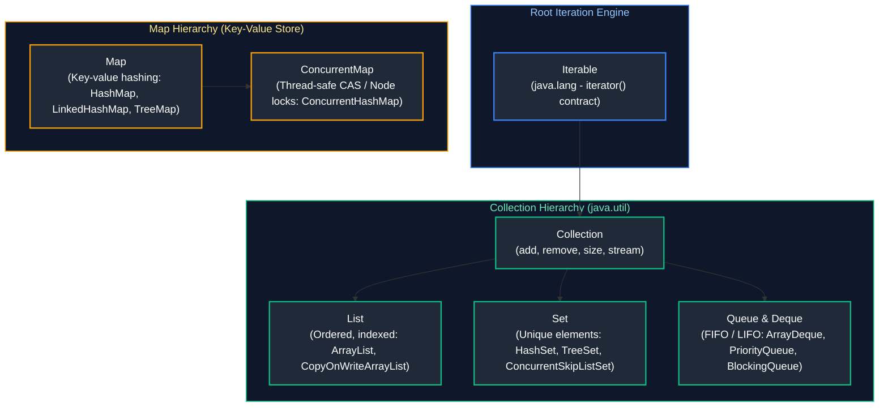

---

## Table of Contents
1. [Collections Framework Overview](#1-collections-framework-overview)
2. [List Implementations](#2-list-implementations)
3. [Set Implementations](#3-set-implementations)
4. [Queue & Deque Implementations](#4-queue--deque-implementations)
5. [Map Implementations](#5-map-implementations)
6. [Collection Internals & Advanced Topics](#6-collection-internals--advanced-topics)
7. [Java Generics](#7-java-generics)
8. [Modern Data Handling & Sequenced Collections (Java 21)](#8-modern-data-handling--sequenced-collections-java-21)
9. [Summary Comparison & Production Engineering Reference Matrix](#9-summary-comparison--production-engineering-reference-matrix)
10. [References & Further Reading](#10-references--further-reading)
---

# 1. Collections Framework Overview

---

### Collection Hierarchy

#### Definition
The Java Collections Framework (JCF) is a unified architecture located in `java.util` for representing and manipulating groups of objects. It defines core interfaces (`Collection`, `List`, `Set`, `Queue`, `Deque`) and their corresponding concrete classes. Note that `Map` is part of the framework but does not inherit from `Collection`.

#### Visual Hierarchy
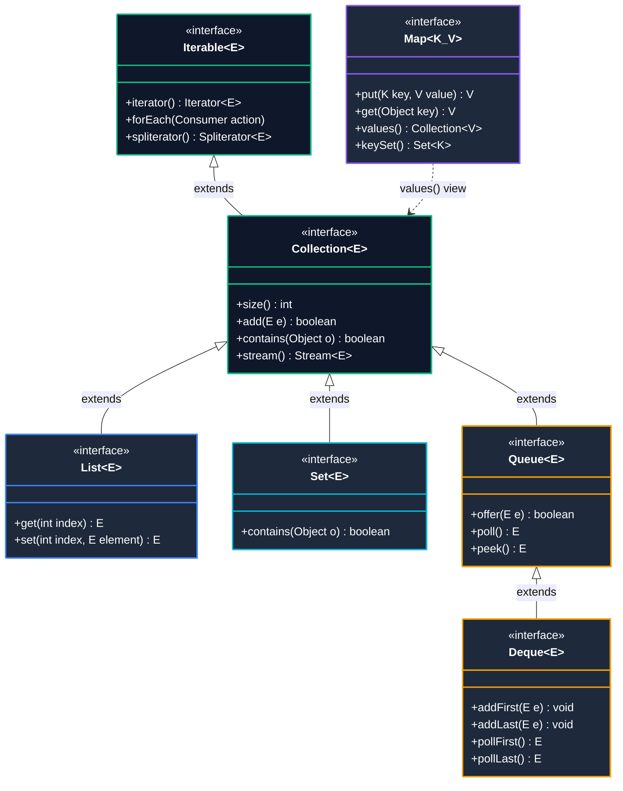

#### Quick Selection Rules for Backend Engineers:
- **General-Purpose Defaults**: Prefer `ArrayList` for indexed lists, `HashSet` for unique sets, and `HashMap` for key-value lookups.
- **FIFO Queues & LIFO Stacks**: Prefer `ArrayDeque` over legacy `Stack` and `LinkedList` (ArrayDeque has lower memory overhead and better cache locality).
- **Sorted Collections**: Use `TreeSet` and `TreeMap` (Red-Black tree) when natural or custom sorting is required ($O(\log N)$).
- **High-Concurrency Workloads**: 
  - For key-value caching: use `ConcurrentHashMap` (lock-free reads via volatile table array, node-level CAS/synchronized writes).
  - For read-heavy listeners: use `CopyOnWriteArrayList` (creates snapshot copy on each write; zero lock contention on reads).
  - For thread pool coordination: use `BlockingQueue` implementations.
- **Legacy Synchronized Classes**: Avoid `Vector`, `Stack`, and `Hashtable` in modern codebases due to coarse-grained method-level synchronization bottlenecks.

#### Foundational Abstractions of the Collection Hierarchy
The Java Collections Framework (`java.util`) unifies data structures under two distinct root hierarchies:
1. **The `Collection<E>` Hierarchy:** The root interface for collections of discrete elements.
   - **`List<E>`:** An ordered sequence (sequence/array abstraction). Elements are accessed by integer positional index (`get(i)`). Allows duplicate elements and preserves insertion order.
   - **`Set<E>`:** A mathematical set abstraction. Guarantees element uniqueness based on `equals()` and `hashCode()`. Implementations vary in ordering: `HashSet` (unordered), `LinkedHashSet` (insertion order), and `TreeSet` (sorted order).
   - **`Queue<E>`:** A collection designed for holding elements prior to processing. Typically orders elements in FIFO (First-In-First-Out) order, priority heap order, or LIFO order. Provides non-blocking inspection and bounded capacity operations.
   - **`Deque<E>` (Double-Ended Queue):** Supports element insertion and removal at both terminal ends. Functions both as a FIFO queue and as a LIFO stack (officially deprecating the legacy `Stack` class).

2. **The `Map<K, V>` Hierarchy:** A separate, parallel hierarchy modeling key-value associations. Maps cannot contain duplicate keys; each key maps to at most one value.

#### Key Differences Between Root Interfaces
| Interface | Ordering | Duplicates Allowed? | Key Characteristics |
| :--- | :--- | :--- | :--- |
| **`List`** | Insertion ordered | Yes | Positional index access (`get(i)`) |
| **`Set`** | Unordered (except `LinkedHashSet`/`TreeSet`) | No | Uniqueness enforced via `equals()` & `hashCode()` |
| **`Queue`** | FIFO / Priority order | Yes | Designed for holding elements prior to processing |
| **`Deque`** | Double-ended (FIFO or LIFO) | Yes | Insertion/removal at both ends; replaces `Stack` |
| **`Map`** | Key-based | Keys: No, Values: Yes | Key-value pairs; separate hierarchy from `Collection` |

**Primary Source Reference**: [GeeksforGeeks - Collections in Java](https://www.geeksforgeeks.org/collections-in-java-2/)

---

# 2. List Implementations

---

### `ArrayList`

#### Definition
A resizable, dynamically growing array implementation of the `List` interface. When capacity is exceeded, it automatically allocates a new array of $1.5\times$ the previous capacity (`newCapacity = oldCapacity + (oldCapacity >> 1)`) and copies elements over via `System.arraycopy`.

#### Usage / Purpose
Default choice for storing ordered collections where frequent random reads (`get(i)`) occur and elements are appended primarily to the end.

#### Visual Structure
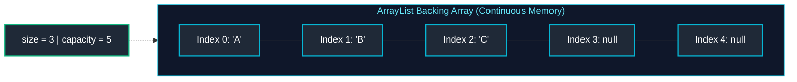

#### Working Code Example
```java
import java.util.ArrayList;
import java.util.List;

public class ArrayListDemo {
    public static void main(String[] args) {
        // Initial capacity avoids early resizes
        List<String> customerQueue = new ArrayList<>(10);

        customerQueue.add("Alice");
        customerQueue.add("Bob");
        customerQueue.add("Charlie");

        // O(1) direct index lookup
        System.out.println("First customer: " + customerQueue.get(0));

        // O(n) element removal (requires shifting subsequent array elements)
        customerQueue.remove("Bob");
        System.out.println("After removal: " + customerQueue);
    }
}
```

#### Key Points / Notes
- **Time Complexity**: `get(i)` is $O(1)$; appending is amortized $O(1)$; arbitrary insertion or deletion is $O(n)$ due to element shifting.
- **Thread Safety**: Not synchronized. Use `Collections.synchronizedList(new ArrayList<>())` or `CopyOnWriteArrayList` for concurrency.

**Primary Source Reference**: [GeeksforGeeks - ArrayList in Java](https://www.geeksforgeeks.org/arraylist-in-java/)

---

### `LinkedList`

#### Definition
A doubly-linked list implementation of `List` and `Deque`. Each element is wrapped inside a discrete `Node` object containing references to the element, the previous node, and the next node.

#### Visual Structure
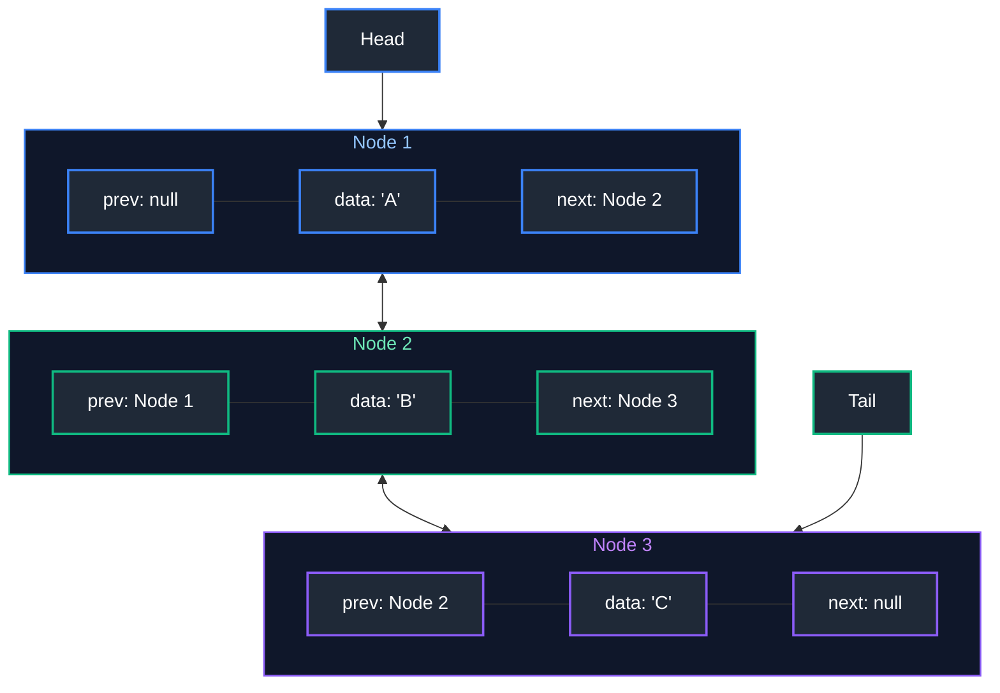

#### Working Code Example
```java
import java.util.LinkedList;

public class LinkedListDemo {
    public static void main(String[] args) {
        LinkedList<String> deque = new LinkedList<>();

        // Efficient insertion at both ends: O(1)
        deque.addFirst("Client-A");
        deque.addLast("Client-B");
        deque.addFirst("Priority-VIP");

        System.out.println("Deque state: " + deque);
        System.out.println("Removed head: " + deque.removeFirst()); // Priority-VIP
    }
}
```

#### Key Points / Notes
- **Memory Overhead**: Significantly higher than `ArrayList` because every item allocates a 24-byte `Node` object on 64-bit JVMs.
- **Cache Locality**: Poor CPU cache locality compared to contiguous arrays. `ArrayList` or `ArrayDeque` is almost always faster in practice even for frequent insertions.

**Primary Source Reference**: [GeeksforGeeks - LinkedList in Java](https://www.geeksforgeeks.org/linked-list-in-java/)

---

### `CopyOnWriteArrayList`

#### Definition
A thread-safe variant of `ArrayList` located in `java.util.concurrent`. Any mutative operation (`add`, `set`, `remove`) makes a completely fresh copy of the underlying array.

#### Usage / Purpose
Ideal for **read-heavy, write-rare** concurrent scenarios (e.g., event listener lists, observer registries). Readers never block and require no locking.

#### Working Code Example
```java
import java.util.Iterator;
import java.util.concurrent.CopyOnWriteArrayList;

public class CopyOnWriteDemo {
    public static void main(String[] args) {
        CopyOnWriteArrayList<String> listeners = new CopyOnWriteArrayList<>();
        listeners.add("LoggerService");
        listeners.add("AuditService");

        // Iterator operates on an immutable snapshot taken at iterator creation time
        Iterator<String> iterator = listeners.iterator();

        // Modifying collection during iteration: Does NOT throw ConcurrentModificationException
        listeners.add("MetricsService");

        while (iterator.hasNext()) {
            System.out.println("Notifying snapshot listener: " + iterator.next());
        }
        System.out.println("Live list after iteration: " + listeners);
    }
}
```

**Primary Source Reference**: [GeeksforGeeks - CopyOnWriteArrayList in Java](https://www.geeksforgeeks.org/copyonwritearraylist-in-java/)

> [!TIP]
> **Deep-Dive Interview Scenarios:**
> - [Q1. `List` vs `Set` Interfaces](frequently_asked_questions/02_java_collections_and_generics_faq.md#q1-easy-list-vs-set-interfaces)
> - [Q2. `ArrayList` vs `LinkedList`](frequently_asked_questions/02_java_collections_and_generics_faq.md#q2-easy-arraylist-vs-linkedlist)
> - [Q3. `Arrays.asList()` vs `List.of()` vs `new ArrayList<>()`](frequently_asked_questions/02_java_collections_and_generics_faq.md#q3-easy-arraysaslist-vs-listof-vs-new-arraylist)

---

# 3. Set Implementations

---

### `HashSet`

#### Definition
An implementation of `Set` backed internally by a `HashMap`. Elements added to a `HashSet` become keys in the backing map, while a dummy constant `PRESENT` (`new Object()`) serves as the value.

#### Characteristics
- Unordered and unsorted.
- Allows a single `null` element.
- Provides $O(1)$ average time complexity for `add`, `remove`, and `contains`.

#### Working Code Example
```java
import java.util.HashSet;
import java.util.Set;

public class HashSetDemo {
    public static void main(String[] args) {
        Set<String> uniqueTags = new HashSet<>();
        uniqueTags.add("java");
        uniqueTags.add("spring");
        boolean isAddedAgain = uniqueTags.add("java"); // duplicate rejected

        System.out.println("Was duplicate 'java' added? " + isAddedAgain); // false
        System.out.println("Contains 'spring'? " + uniqueTags.contains("spring")); // O(1) lookup
    }
}
```

**Primary Source Reference**: [GeeksforGeeks - HashSet in Java](https://www.geeksforgeeks.org/hashset-in-java/)

---

### `LinkedHashSet`

#### Definition
A hash table and doubly-linked list implementation of the `Set` interface. It maintains elements in the exact order in which they were inserted (**insertion-order**).

#### Working Code Example
```java
import java.util.LinkedHashSet;
import java.util.Set;

public class LinkedHashSetDemo {
    public static void main(String[] args) {
        Set<String> insertionOrderSet = new LinkedHashSet<>();
        insertionOrderSet.add("Beta");
        insertionOrderSet.add("Alpha");
        insertionOrderSet.add("Gamma");

        // Iteration order is guaranteed to match insertion order: Beta -> Alpha -> Gamma
        System.out.println("Iteration Order: " + insertionOrderSet);
    }
}
```

**Primary Source Reference**: [GeeksforGeeks - LinkedHashSet in Java](https://www.geeksforgeeks.org/linkedhashset-in-java-with-examples/)

---

### `TreeSet`

#### Definition
A `NavigableSet` implementation backed by a Red-Black tree (`TreeMap`). Elements are ordered using their **natural ordering** (`Comparable`) or by an explicit `Comparator` provided at set creation time.

#### Time Complexity & Characteristics
- Guaranteed $O(\log n)$ time cost for `add`, `remove`, and `contains`.
- Does **not** permit `null` elements (throws `NullPointerException` during comparison).

#### Working Code Example
```java
import java.util.TreeSet;

public class TreeSetDemo {
    public static void main(String[] args) {
        TreeSet<Integer> scores = new TreeSet<>();
        scores.add(85);
        scores.add(42);
        scores.add(99);
        scores.add(67);

        System.out.println("Sorted scores: " + scores); // [42, 67, 85, 99]
        System.out.println("Floor(70) [<= 70]: " + scores.floor(70)); // 67
        System.out.println("Ceiling(70) [>= 70]: " + scores.ceiling(70)); // 85
    }
}
```

**Primary Source Reference**: [GeeksforGeeks - TreeSet in Java](https://www.geeksforgeeks.org/treeset-in-java-with-examples/)

---

### `CopyOnWriteArraySet`

#### Definition
A thread-safe `Set` implementation backed internally by a `CopyOnWriteArrayList`. All mutative operations (`add`, `remove`) create a fresh copy of the underlying array, ensuring thread-safe reads without locking.

#### Usage / Purpose
Designed for concurrent applications where set traversal and reads substantially outnumber writes (e.g. maintaining a set of connected websocket sessions or unique broadcast event subscribers).

#### Working Code Example
```java
import java.util.concurrent.CopyOnWriteArraySet;

public class CopyOnWriteArraySetDemo {
    public static void main(String[] args) {
        CopyOnWriteArraySet<String> activeSessions = new CopyOnWriteArraySet<>();
        activeSessions.add("SESSION-101");
        activeSessions.add("SESSION-102");
        activeSessions.add("SESSION-101"); // Duplicate rejected: set uniqueness maintained

        System.out.println("Active sessions count: " + activeSessions.size()); // 2

        // Safe iteration even if concurrent additions happen
        for (String session : activeSessions) {
            System.out.println("Processing session: " + session);
        }
    }
}
```

#### Key Points / Notes
- **Write Cost**: Adding or removing elements has $O(n)$ time complexity and allocates memory for a new array copy.
- **Deduplication Cost**: Unlike `HashSet` which checks uniqueness in $O(1)$, `CopyOnWriteArraySet` must scan the backing array on every write ($O(n)$) to ensure no duplicate exists.

**Primary Source Reference**: [GeeksforGeeks - CopyOnWriteArraySet in Java](https://www.geeksforgeeks.org/copyonwritearrayset-in-java-with-examples/)

---

### `ConcurrentSkipListSet`

#### Definition
A scalable, thread-safe, concurrent `NavigableSet` implementation based on a multi-level **SkipList** data structure. Elements are maintained in sorted order either by natural ordering or by a custom `Comparator`.

#### Usage / Purpose
Concurrent alternative to `TreeSet`. Ideal for multi-threaded applications requiring sorted, range-queryable sets (e.g., concurrent leaderboard tracking, dynamic time-window metrics) without global lock contention.

#### Working Code Example
```java
import java.util.concurrent.ConcurrentSkipListSet;

public class ConcurrentSkipListSetDemo {
    public static void main(String[] args) {
        ConcurrentSkipListSet<Integer> sortedMetrics = new ConcurrentSkipListSet<>();
        sortedMetrics.add(150);
        sortedMetrics.add(45);
        sortedMetrics.add(200);
        sortedMetrics.add(85);

        // Elements remain sorted concurrently in O(log n) time
        System.out.println("Concurrent Sorted Set: " + sortedMetrics); // [45, 85, 150, 200]
        System.out.println("SubSet (50 to 180): " + sortedMetrics.subSet(50, 180)); // [85, 150]
    }
}
```

#### Key Points / Notes
- Provides $O(\log n)$ average time cost for `add`, `remove`, and `contains`.
- Does **not** permit `null` elements (throws `NullPointerException`).

**Primary Source Reference**: [GeeksforGeeks - ConcurrentSkipListSet in Java](https://www.geeksforgeeks.org/concurrentskiplistset-in-java-with-examples/)

> [!TIP]
> **Deep-Dive Interview Scenarios:**
> - [Q4. `HashSet` vs `LinkedHashSet` vs `TreeSet`](frequently_asked_questions/02_java_collections_and_generics_faq.md#q4-easy-hashset-vs-linkedhashset-vs-treeset)
> - [Q5. `HashSet` Internal Working & Uniqueness Guarantee](frequently_asked_questions/02_java_collections_and_generics_faq.md#q5-medium-hashset-internal-working--uniqueness-guarantee)

---

# 4. Queue & Deque Implementations

---

### `PriorityQueue`

#### Definition
An unbounded priority queue based on a **binary min-heap**. Elements are ordered according to their natural sorting or by a `Comparator`. The head of the queue is always the smallest element.

#### Working Code Example
```java
import java.util.PriorityQueue;

public class PriorityQueueDemo {
    record Task(String name, int priority) implements Comparable<Task> {
        @Override
        public int compareTo(Task o) {
            return Integer.compare(this.priority, o.priority); // lower number = higher priority
        }
    }

    public static void main(String[] args) {
        PriorityQueue<Task> taskQueue = new PriorityQueue<>();
        taskQueue.offer(new Task("LowPriorityCleanup", 10));
        taskQueue.offer(new Task("CriticalSecurityPatch", 1));
        taskQueue.offer(new Task("DatabaseBackup", 5));

        // Polling retrieves elements in ascending priority order
        while (!taskQueue.isEmpty()) {
            System.out.println("Processing: " + taskQueue.poll());
        }
    }
}
```

**Primary Source Reference**: [GeeksforGeeks - PriorityQueue in Java](https://www.geeksforgeeks.org/priority-queue-class-in-java/)

#### Advanced Production Pattern: Interval Scheduling & Min-Heap Resource Allocation (Meeting Rooms II)
A classic high-concurrency problem in backend distributed systems is determining the minimum concurrent server instances, worker threads, or conference rooms required to handle overlapping time intervals without resource collision.

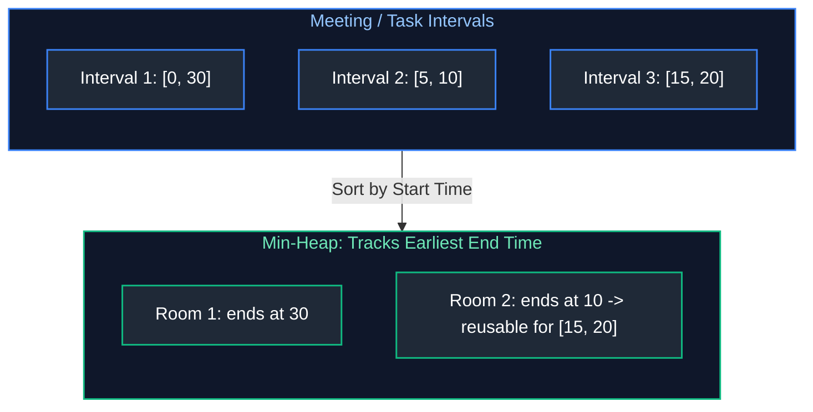

```java
import java.util.Arrays;
import java.util.Comparator;
import java.util.PriorityQueue;

public final class IntervalResourceManager {

    public record Interval(int start, int end) {}

    /**
     * Determines minimum resources needed using Greedy Interval Sorting and Min-Heap.
     * Time Complexity: O(N log N) | Space Complexity: O(N)
     */
    public static int minMeetingRooms(Interval[] intervals) {
        if (intervals == null || intervals.length == 0) return 0;

        // Step 1: Sort intervals by start time ascending
        Arrays.sort(intervals, Comparator.comparingInt(Interval::start));

        // Step 2: Min-heap stores end times of active allocations
        PriorityQueue<Integer> allocator = new PriorityQueue<>(intervals.length);

        // Add the first meeting's end time
        allocator.offer(intervals[0].end());

        for (int i = 1; i < intervals.length; i++) {
            // If the earliest finishing room is free before current meeting starts, reuse it
            if (intervals[i].start() >= allocator.peek()) {
                allocator.poll(); // Room is vacated
            }
            // Allocate room (push new meeting end time)
            allocator.offer(intervals[i].end());
        }

        return allocator.size(); // Total rooms allocated
    }
}
```

---

### `ArrayDeque`

#### Definition
A resizable-array implementation of the `Deque` (Double-Ended Queue) interface. It uses a circular array buffer with head and tail pointers.

#### Why `ArrayDeque` Replaces `Stack` and `LinkedList`
- **Faster than `Stack`**: `java.util.Stack` is legacy and synchronizes every single method invocation (`Vector` overhead).
- **Faster than `LinkedList`**: Contiguous memory layout yields excellent cache locality and zero node allocation overhead.

#### Working Code Example
```java
import java.util.ArrayDeque;
import java.util.Deque;

public class ArrayDequeDemo {
    public static void main(String[] args) {
        // Modern replacement for java.util.Stack (LIFO)
        Deque<String> stack = new ArrayDeque<>();
        stack.push("Page-1");
        stack.push("Page-2");
        stack.push("Page-3");

        System.out.println("Popped: " + stack.pop()); // Page-3
        System.out.println("Peek: " + stack.peek());   // Page-2
    }
}
```

**Primary Source Reference**: [GeeksforGeeks - ArrayDeque in Java](https://www.geeksforgeeks.org/arraydeque-in-java/)

---

### `ConcurrentLinkedQueue`

#### Definition
An unbounded, thread-safe, lock-free FIFO queue implementation of `Queue` based on linked nodes and the Michael & Scott non-blocking queue algorithm. It relies entirely on atomic **Compare-And-Swap (CAS)** operations rather than locks.

#### Usage / Purpose
Ideal for high-throughput multi-threaded producer-consumer architectures where worker threads should never block or sleep waiting for locks (e.g. high-frequency message ingestion, task dispatching).

#### Visual Lock-Free CAS Enqueue
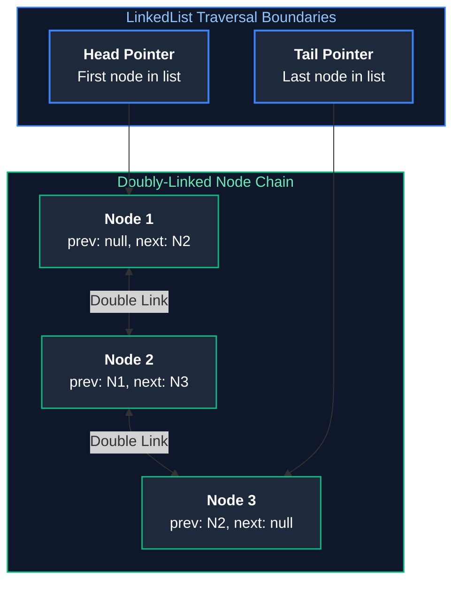

#### Working Code Example
```java
import java.util.concurrent.ConcurrentLinkedQueue;

public class ConcurrentLinkedQueueDemo {
    public static void main(String[] args) {
        ConcurrentLinkedQueue<String> eventQueue = new ConcurrentLinkedQueue<>();

        // Non-blocking lock-free offer
        eventQueue.offer("CLICK_EVENT_01");
        eventQueue.offer("SCROLL_EVENT_02");

        // Non-blocking retrieval (returns null if empty immediately without blocking)
        String event = eventQueue.poll();
        System.out.println("Polled event: " + event); // CLICK_EVENT_01
        System.out.println("Remaining queue peek: " + eventQueue.peek()); // SCROLL_EVENT_02
    }
}
```

#### Key Points / Notes
- **`size()` is $O(n)$**: Unlike standard collections where `size()` is $O(1)$, `ConcurrentLinkedQueue.size()` traverses the linked nodes to count elements because concurrent modifications can alter the count at any millisecond. Avoid calling `.size() == 0`; use `.isEmpty()` which is $O(1)$.
- Does **not** permit `null` elements.

**Primary Source Reference**: [GeeksforGeeks - ConcurrentLinkedQueue in Java](https://www.geeksforgeeks.org/concurrentlinkedqueue-in-java-with-examples/)

---

### `ConcurrentLinkedDeque`

#### Definition
A lock-free, thread-safe, unbounded double-ended queue (`Deque`) based on linked nodes using atomic CAS operations to support concurrent insertion and removal at both head and tail ends.

#### Usage / Purpose
Used for concurrent work-stealing algorithms and bi-directional buffer pipelines where producers and consumers can operate simultaneously at opposite ends of the deque without mutual lock contention.

#### Working Code Example
```java
import java.util.concurrent.ConcurrentLinkedDeque;

public class ConcurrentLinkedDequeDemo {
    public static void main(String[] args) {
        ConcurrentLinkedDeque<String> workDeque = new ConcurrentLinkedDeque<>();

        // Insert at both ends
        workDeque.addFirst("PRIORITY_JOB_1");
        workDeque.addLast("BACKGROUND_JOB_2");

        System.out.println("First job: " + workDeque.pollFirst()); // PRIORITY_JOB_1
        System.out.println("Last job: " + workDeque.pollLast());   // BACKGROUND_JOB_2
    }
}
```

**Primary Source Reference**: [GeeksforGeeks - ConcurrentLinkedDeque in Java](https://www.geeksforgeeks.org/concurrentlinkeddeque-in-java-with-examples/)

---

### `BlockingQueue` Implementations

#### Definition
A `Queue` that supports operations that wait for the queue to become non-empty when retrieving an element, and wait for space to become available when storing an element.

Blocking queues are also commonly used as work queues between executor workers and submitted tasks; see [Topic 04: Executor Framework & Thread Pools](./04_java_concurrency_and_multithreading.md#thread-pools).

#### Visual Producer-Consumer Architecture
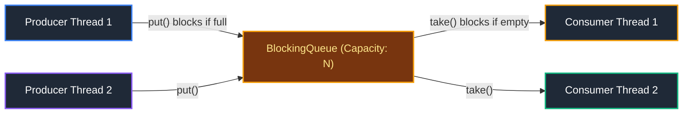

#### Concurrency Mechanics & Locking Architecture of Blocking Queues
`BlockingQueue` implementations synchronize concurrent producer-consumer pipelines by managing thread blocking states when queues are either completely full or empty:

1. **`ArrayBlockingQueue`:**
   - **Internal Mechanics:** Backed by a fixed-size, bounded circular array buffer.
   - **Locking Strategy:** Employs a **single reentrant lock** (`ReentrantLock`) shared across both producers and consumers, accompanied by two conditions (`notEmpty` and `notFull`). Because `put()` and `take()` contend for the exact same physical lock, high concurrency scenarios suffer from thread lock contention.
2. **`LinkedBlockingQueue`:**
   - **Internal Mechanics:** Backed by dynamically linked FIFO node objects. Can be bounded (recommended) or unbounded (`Integer.MAX_VALUE`).
   - **Two-Lock Concurrency:** Employs **two distinct reentrant locks**: a `takeLock` (protecting the head pointer for consumers) and a `putLock` (protecting the tail pointer for producers). Because producers and consumers acquire separate locks, producers can enqueue items concurrently while consumers dequeue, offering significantly higher throughput under heavy parallel workloads.
3. **`PriorityBlockingQueue`:**
   - **Internal Mechanics:** An unbounded concurrent blocking queue backed by an array-based binary min-heap. Elements are dequeued according to natural ordering (`Comparable`) or a custom `Comparator`.
   - **Unbounded Behavior:** The `put()` method never blocks because the backing array grows dynamically, but `take()` blocks when the queue is empty. Uses a single lock with an allocation spinlock for resizing.

#### Comparison of Blocking Implementations
| Implementation | Backing Structure | Bound Type | Locking Strategy |
| :--- | :--- | :--- | :--- |
| **`ArrayBlockingQueue`** | Array | Strictly bounded | Single lock for both put and take |
| **`LinkedBlockingQueue`** | Linked nodes | Optionally bounded | Two separate locks (`putLock` and `takeLock`) |
| **`PriorityBlockingQueue`** | Binary heap | Unbounded | Single lock with priority sorting |

#### Working Code Example
```java
import java.util.concurrent.ArrayBlockingQueue;
import java.util.concurrent.BlockingQueue;

public class BlockingQueueDemo {
    public static void main(String[] args) throws InterruptedException {
        BlockingQueue<String> queue = new ArrayBlockingQueue<>(2);

        // Producer thread
        new Thread(() -> {
            try {
                queue.put("Item-1");
                queue.put("Item-2");
                System.out.println("Queue full. Next put() will block...");
                queue.put("Item-3"); // Blocks until an item is taken
                System.out.println("Item-3 successfully inserted.");
            } catch (InterruptedException e) {
                Thread.currentThread().interrupt();
            }
        }).start();

        Thread.sleep(1000);
        System.out.println("Consumer taking: " + queue.take()); // Frees a slot
    }
}
```

**Primary Source Reference**: [GeeksforGeeks - BlockingQueue Interface in Java](https://www.geeksforgeeks.org/blockingqueue-interface-in-java/)

---

### `PriorityBlockingQueue`

#### Definition
An unbounded, thread-safe blocking queue that uses the same ordering rules as `PriorityQueue` (binary min-heap) but provides blocking retrieval operations protected by a `ReentrantLock`.

#### Usage / Purpose
Used for multi-threaded priority task scheduling where worker consumer threads wait for highest-priority jobs to become available.

#### Working Code Example
```java
import java.util.concurrent.PriorityBlockingQueue;

public class PriorityBlockingQueueDemo {
    record Job(int priority, String name) implements Comparable<Job> {
        @Override
        public int compareTo(Job o) {
            return Integer.compare(this.priority, o.priority); // Lower number = higher priority
        }
    }

    public static void main(String[] args) throws InterruptedException {
        PriorityBlockingQueue<Job> queue = new PriorityBlockingQueue<>();
        queue.put(new Job(3, "BATCH_EMAIL"));
        queue.put(new Job(1, "SECURITY_ALERT"));
        queue.put(new Job(2, "PAYMENT_PROCESS"));

        // Retrieved in ascending priority order
        System.out.println("Processing: " + queue.take().name()); // SECURITY_ALERT
        System.out.println("Processing: " + queue.take().name()); // PAYMENT_PROCESS
    }
}
```

**Primary Source Reference**: [GeeksforGeeks - PriorityBlockingQueue in Java](https://www.geeksforgeeks.org/priorityblockingqueue-class-in-java-with-example/)

---

### `DelayQueue`

#### Definition
An unbounded `BlockingQueue` of elements that implement `java.util.concurrent.Delayed`. An element can only be taken from the queue when its designated delay has expired. The head of the queue is the element whose delay expired furthest in the past.

#### Usage / Purpose
Essential for building task schedulers, retry queues with exponential backoff, and local cache expiration monitors.

#### Working Code Example
```java
import java.util.concurrent.DelayQueue;
import java.util.concurrent.Delayed;
import java.util.concurrent.TimeUnit;

class DelayedTask implements Delayed {
    private final String taskName;
    private final long executeTimeMillis;

    public DelayedTask(String taskName, long delayMillis) {
        this.taskName = taskName;
        this.executeTimeMillis = System.currentTimeMillis() + delayMillis;
    }

    @Override
    public long getDelay(TimeUnit unit) {
        long diff = executeTimeMillis - System.currentTimeMillis();
        return unit.convert(diff, TimeUnit.MILLISECONDS);
    }

    @Override
    public int compareTo(Delayed o) {
        return Long.compare(this.executeTimeMillis, ((DelayedTask) o).executeTimeMillis);
    }

    public String getTaskName() { return taskName; }
}

public class DelayQueueDemo {
    public static void main(String[] args) throws InterruptedException {
        DelayQueue<DelayedTask> queue = new DelayQueue<>();
        queue.put(new DelayedTask("Task-2s", 2000));
        queue.put(new DelayedTask("Task-500ms", 500));

        System.out.println("Waiting for delayed elements to expire...");
        // take() blocks until delay expires for the earliest task
        DelayedTask first = queue.take();
        System.out.println("Expired and retrieved: " + first.getTaskName()); // Task-500ms
        DelayedTask second = queue.take();
        System.out.println("Expired and retrieved: " + second.getTaskName()); // Task-2s
    }
}
```

**Primary Source Reference**: [GeeksforGeeks - DelayQueue in Java](https://www.geeksforgeeks.org/delayqueue-class-in-java-with-example/)

---

### `SynchronousQueue`

#### Definition
A specialized blocking queue in which each insert operation (`put`) must wait for a corresponding remove operation (`take`) by another thread, and vice versa. It contains **no internal capacity** (its capacity is zero).

#### Usage / Purpose
Acts as a direct thread-to-thread handoff mechanism. It is the default queue used by `Executors.newCachedThreadPool()` to hand submitted tasks directly to an idle worker thread or immediately spawn a new thread.

#### Visual Direct Handoff
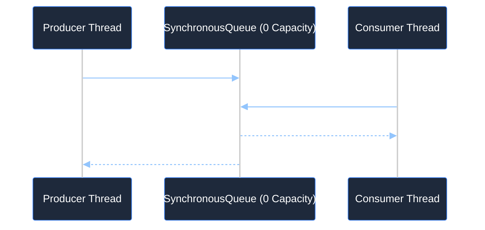

#### Working Code Example
```java
import java.util.concurrent.SynchronousQueue;

public class SynchronousQueueDemo {
    public static void main(String[] args) {
        SynchronousQueue<String> handoffQueue = new SynchronousQueue<>();

        // Consumer thread
        new Thread(() -> {
            try {
                System.out.println("Consumer waiting for direct handoff...");
                String item = handoffQueue.take(); // Blocks until a producer offers
                System.out.println("Consumer received: " + item);
            } catch (InterruptedException e) {
                Thread.currentThread().interrupt();
            }
        }).start();

        // Producer thread
        new Thread(() -> {
            try {
                Thread.sleep(1000);
                System.out.println("Producer handing off data...");
                handoffQueue.put("TRANSFER_TOKEN_99"); // Hands off directly to consumer
                System.out.println("Producer handoff completed.");
            } catch (InterruptedException e) {
                Thread.currentThread().interrupt();
            }
        }).start();
    }
}
```

**Primary Source Reference**: [GeeksforGeeks - SynchronousQueue in Java](https://www.geeksforgeeks.org/synchronousqueue-in-java-with-examples/)

> [!TIP]
> **Deep-Dive Interview Scenarios:**
> - [Q12. `Queue` vs `Deque`](frequently_asked_questions/02_java_collections_and_generics_faq.md#q12-medium-queue-vs-deque)
> - [Q14. `poll()` vs `peek()` vs `remove()`](frequently_asked_questions/02_java_collections_and_generics_faq.md#q14-easy-poll-vs-peek-vs-remove)

---

# 5. Map Implementations

---

### `HashMap`

#### Definition
A hash table based implementation of the `Map` interface. Maps keys to values using hash codes and handles collisions via separate chaining (linked list transitioning to red-black trees when threshold is reached).

#### Key Characteristics
- Permits one `null` key and multiple `null` values.
- Unordered and not thread-safe.
- Offers $O(1)$ average time complexity for `get` and `put`.

#### Working Code Example
```java
import java.util.HashMap;
import java.util.Map;

public class HashMapDemo {
    public static void main(String[] args) {
        Map<String, Double> stockPrices = new HashMap<>();
        stockPrices.put("AAPL", 185.50);
        stockPrices.put("GOOGL", 175.25);
        stockPrices.put("MSFT", 420.10);

        // Compute if absent idiom
        stockPrices.computeIfAbsent("AMZN", k -> 180.00);

        System.out.println("Stock AAPL: $" + stockPrices.get("AAPL"));
        System.out.println("Default lookup: $" + stockPrices.getOrDefault("TSLA", 0.0));
    }
}
```

**Primary Source Reference**: [GeeksforGeeks - HashMap in Java](https://www.geeksforgeeks.org/java-util-hashmap-in-java-with-examples/)

---

### `LinkedHashMap`

#### Definition
A hash table and doubly-linked list implementation of `Map`. It maintains an iteration order, which is typically **insertion-order**, or optionally **access-order** (order in which keys were last accessed).

#### LRU (Least Recently Used) Cache via `LinkedHashMap`
```java
import java.util.LinkedHashMap;
import java.util.Map;

public class LRUCache<K, V> extends LinkedHashMap<K, V> {
    private final int maxCapacity;

    public LRUCache(int maxCapacity) {
        // initialCapacity, loadFactor, accessOrder = true
        super(maxCapacity, 0.75f, true);
        this.maxCapacity = maxCapacity;
    }

    @Override
    protected boolean removeEldestEntry(Map.Entry<K, V> eldest) {
        // Automatically evicts the least recently accessed entry when size exceeds capacity
        return size() > maxCapacity;
    }

    public static void main(String[] args) {
        LRUCache<Integer, String> cache = new LRUCache<>(2);
        cache.put(1, "A");
        cache.put(2, "B");
        cache.get(1);      // Access entry 1; makes entry 2 least-recently used
        cache.put(3, "C"); // Evicts entry 2!

        System.out.println("Cache contents: " + cache); // {1=A, 3=C}
    }
}
```

**Primary Source Reference**: [GeeksforGeeks - LinkedHashMap in Java](https://www.geeksforgeeks.org/linkedhashmap-class-in-java/)

---

### `TreeMap`

#### Definition
A Red-Black tree based `NavigableMap` implementation. Keys are sorted according to their natural ordering or by an explicit `Comparator`. Guarantees $O(\log n)$ performance for `containsKey`, `get`, `put`, and `remove`.

**Primary Source Reference**: [GeeksforGeeks - TreeMap in Java](https://www.geeksforgeeks.org/treemap-in-java/)

---

### `ConcurrentHashMap`

#### Definition
A highly concurrent, thread-safe hash table implementation that allows concurrent reads and high concurrency for writes without locking the entire table.

#### Internal Architecture evolution (Java 7 vs Java 8+)
- **Java 7**: Used Segment-based locking (`ReentrantLock` guarding individual segment partitions).
- **Java 8+**: Replaced segments with **CAS (Compare-And-Swap) for empty bucket insertions** and **`synchronized` locks on the head node** of the bucket during collisions. Bucket structures transition from linked lists to red-black trees just like `HashMap`.

#### Visual Architecture
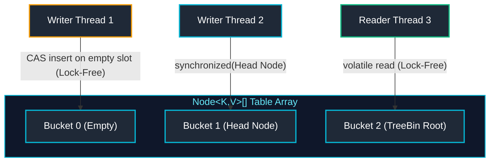

#### Working Code Example
```java
import java.util.concurrent.ConcurrentHashMap;

public class ConcurrentHashMapDemo {
    public static void main(String[] args) {
        ConcurrentHashMap<String, Integer> wordCounts = new ConcurrentHashMap<>();

        // Atomic update idiom: merge or compute
        wordCounts.merge("cloud", 1, Integer::sum);
        wordCounts.merge("cloud", 1, Integer::sum);

        System.out.println("Count for 'cloud': " + wordCounts.get("cloud")); // 2
    }
}
```

**Primary Source Reference**: [GeeksforGeeks - ConcurrentHashMap in Java](https://www.geeksforgeeks.org/concurrenthashmap-in-java/)

---

### `ConcurrentSkipListMap`

#### Definition
A concurrent, scalable, sorted map implementation based on a concurrent multi-level SkipList. It provides expected $O(\log n)$ time cost for `containsKey`, `get`, `put`, and `remove` operations concurrently across multiple threads.

#### Usage / Purpose
Acts as the thread-safe concurrent alternative to `TreeMap`. Used in real-time trading engines, concurrent key-value indices, and range-query caching where sorted key order must be maintained without blocking reads.

#### Working Code Example
```java
import java.util.concurrent.ConcurrentSkipListMap;

public class ConcurrentSkipListMapDemo {
    public static void main(String[] args) {
        ConcurrentSkipListMap<String, String> userIndex = new ConcurrentSkipListMap<>();
        userIndex.put("user_charlie", "ACTIVE");
        userIndex.put("user_alice", "ACTIVE");
        userIndex.put("user_bob", "SUSPENDED");

        // Keys automatically sorted in concurrent environment
        System.out.println("First key (Alphabetical): " + userIndex.firstKey()); // user_alice
        System.out.println("SubMap ('user_a' to 'user_c'): " + userIndex.subMap("user_a", "user_c"));
    }
}
```

**Primary Source Reference**: [GeeksforGeeks - ConcurrentSkipListMap in Java](https://www.geeksforgeeks.org/concurrentskiplistmap-in-java-with-examples/)

---

### `Hashtable`

#### Definition
A synchronized, hash table based implementation of the `Map` interface from JDK 1.0. It synchronizes every method using an intrinsic monitor lock on `this`.

#### Why `Hashtable` is Obsolete
- **Coarse-Grained Locking**: Every read (`get`) and write (`put`) acquires a global lock on the entire instance, causing severe thread contention.
- **Null Hostile**: Does **not** allow `null` keys or `null` values (throws `NullPointerException`), unlike `HashMap`.
- Replaced by `HashMap` for single-threaded usage and `ConcurrentHashMap` for concurrent multithreaded usage.

#### Detailed Concurrency & Locking Mechanics
1. **`Hashtable` (Obsolete Monolithic Locking):**
   - **Internal Mechanics:** Synchronizes every method (`synchronized get()`, `synchronized put()`) on the `Hashtable` object's intrinsic monitor lock (`this`). 
   - **Performance Bottleneck:** Only a single thread can interact with the table at any given time—even multiple concurrent read requests are forced to execute sequentially, causing severe thread stalls.
2. **`HashMap` (Single-Threaded High-Performance):**
   - **Internal Mechanics:** Zero synchronization overhead. Optimized purely for single-threaded speed using an array of linked list nodes that dynamically convert to red-black tree bins (`TreeNode`) when bucket collisions reach the threshold of 8 (`TREEIFY_THRESHOLD`).
   - **Concurrency Hazard:** Concurrent writes can corrupt internal bucket pointers or trigger infinite loops (in legacy Java 7 rehashing) and race conditions.
3. **`ConcurrentHashMap` (Modern Fine-Grained Concurrency):**
   - **Internal Mechanics:** Eliminates monolithic table locking entirely. Reads execute completely lock-free via `volatile` table array reads and volatile node pointers. 
   - **Fine-Grained Bucket Locking:** Concurrent writes (`put`, `computeIfAbsent`) synchronize strictly on the individual head node of the specific colliding bucket bin using Java's `synchronized` block, or use lock-free Compare-And-Swap (CAS) if the bucket is empty. Two threads writing to different hash bins proceed in full parallel execution with zero lock contention.

#### Comparison: `Hashtable` vs `HashMap` vs `ConcurrentHashMap`
| Feature | `Hashtable` | `HashMap` | `ConcurrentHashMap` |
| :--- | :--- | :--- | :--- |
| **Thread Safety** | Thread-safe (coarse lock on `this`) | Not thread-safe | Thread-safe (CAS + bucket head lock) |
| **Null Keys/Values**| Disallowed (throws NPE) | 1 null key, N null values | Disallowed |
| **Performance** | Low (high thread contention) | High (single-threaded) | Extremely high concurrency |
| **Status** | Legacy / Obsolete | Active Standard | Active Concurrent Standard |

#### Working Code Example
```java
import java.util.Hashtable;

public class HashtableLegacyDemo {
    public static void main(String[] args) {
        Hashtable<String, Integer> table = new Hashtable<>();
        table.put("A", 1);
        table.put("B", 2);

        try {
            table.put(null, 3); // Throws NullPointerException!
        } catch (NullPointerException e) {
            System.out.println("Hashtable strictly prohibits null keys or values.");
        }
    }
}
```

**Primary Source Reference**: [GeeksforGeeks - Difference Between HashMap and Hashtable in Java](https://www.geeksforgeeks.org/differences-between-hashmap-and-hashtable-in-java/)

> [!TIP]
> **Deep-Dive Interview Scenario:**
> - [Q11. `EnumSet` and `EnumMap`](frequently_asked_questions/02_java_collections_and_generics_faq.md#q11-medium-enumset-and-enummap)

---

# 6. Collection Internals & Advanced Topics

---

### HashMap Internal Working

#### How Hashing & Index Calculation Work
1. Key's `hashCode()` is obtained.
2. High-order bits are spread to lower bits via the hash function: `h = key.hashCode() ^ (h >>> 16)`.
3. Array bucket index is computed using bitwise AND: `index = (n - 1) & hash` (where $n$ is always a power of 2).

#### Visual Bucket Structure & Treeification
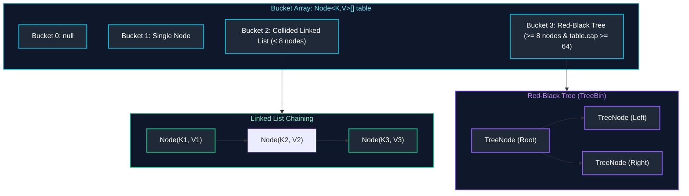

#### Treeification Thresholds
- **TREEIFY_THRESHOLD = 8**: If a collision chain reaches 8 nodes and the table capacity is at least 64, the linked list is converted into a Red-Black Tree, reducing lookup from $O(n)$ to $O(\log n)$.
- **UNTREEIFY_THRESHOLD = 6**: When shrinking/resizing causes a tree to have $\le 6$ nodes, it is converted back to a linked list.
- **MIN_TREEIFY_CAPACITY = 64**: If collision length reaches 8 but capacity $< 64$, the map simply resizes instead of treeifying.

**Primary Source Reference**: [GeeksforGeeks - Internal Working of HashMap in Java](https://www.geeksforgeeks.org/internal-working-of-hashmap-java/)

---

### Load Factor & Resizing

- **Initial Capacity**: Default is 16. Must always be a power of 2 ($2^k$) to enable the bitwise index calculation `(n - 1) & hash`.
- **Load Factor**: Default is $0.75$. It represents the tradeoff between time cost and space overhead.
- **Threshold**: Calculated as $\text{Capacity} \times \text{Load Factor}$ (e.g., $16 \times 0.75 = 12$). When the number of elements exceeds 12, the array size doubles to 32, and all entries are re-indexed.

**Primary Source Reference**: [GeeksforGeeks - HashMap load factor in Java](https://www.geeksforgeeks.org/load-factor-in-hashmap-in-java-with-examples/)

---

### `Comparable` vs `Comparator`

#### Comparison Table
| Feature | `Comparable<T>` | `Comparator<T>` |
| :--- | :--- | :--- |
| **Package** | `java.lang` | `java.util` |
| **Method** | `int compareTo(T o)` | `int compare(T o1, T o2)` |
| **Sorting Intent** | Defines the **single, natural** ordering of an object | Defines **multiple, custom** external sorting strategies |
| **Class Modification** | Requires modifying the target class code | Does not require modifying the target class |

#### Working Code Example
```java
import java.util.ArrayList;
import java.util.Collections;
import java.util.Comparator;
import java.util.List;

// 1. Natural ordering via Comparable
class Book implements Comparable<Book> {
    String title;
    double price;

    public Book(String title, double price) { this.title = title; this.price = price; }

    @Override
    public int compareTo(Book other) {
        return this.title.compareTo(other.title); // Natural order by title
    }
}

public class ComparisonDemo {
    public static void main(String[] args) {
        List<Book> books = new ArrayList<>();
        books.add(new Book("Effective Java", 45.0));
        books.add(new Book("Clean Code", 40.0));

        // Sort by natural order (title)
        Collections.sort(books);

        // 2. Custom ordering via Comparator (by price ascending)
        books.sort(Comparator.comparingDouble(b -> b.price));
    }
}
```

**Primary Source Reference**: [GeeksforGeeks - Comparable vs Comparator in Java](https://www.geeksforgeeks.org/comparable-vs-comparator-in-java/)

---

### Iterators: Fail-Fast vs Weakly Consistent

#### Definition & Behavior
- **Fail-Fast**: Iterators on standard collections (`ArrayList`, `HashMap`, `HashSet`) maintain an internal modification count (`modCount`). If structural modification occurs during iteration without using the iterator's own `remove()` method, it immediately throws `ConcurrentModificationException`.
- **Weakly Consistent / Fail-Safe**: Iterators on concurrent collections (`ConcurrentHashMap`, `CopyOnWriteArrayList`) operate on a snapshot or tolerate concurrent modifications without throwing `ConcurrentModificationException`.

#### Visual Modification Check
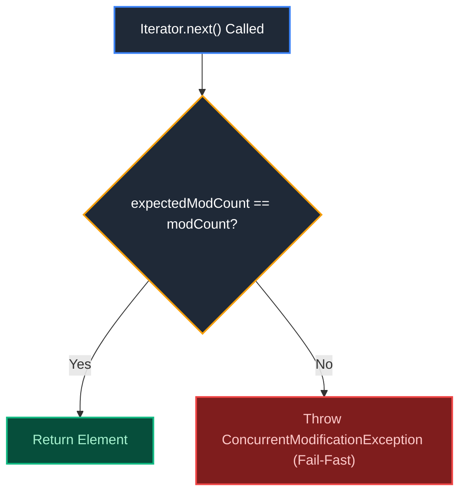

**Primary Source Reference**: [GeeksforGeeks - Fail Fast and Fail Safe Iterators in Java](https://www.geeksforgeeks.org/fail-fast-fail-safe-iterators-java/)

---

### Immutable Collections

#### Legacy vs Modern Java
- **`Collections.unmodifiableList(list)`** (Java 2+): Creates an unmodifiable wrapper view around the original collection. **Not truly immutable**: If the underlying backing list is modified, the unmodifiable view reflects those changes!
- **`List.of()`, `Set.of()`, `Map.of()`** (Java 9+): Creates truly immutable, space-efficient, null-hostile collection instances. Any mutation attempt throws `UnsupportedOperationException`.

#### Working Code Example
```java
import java.util.List;

public class ImmutableCollectionsDemo {
    public static void main(String[] args) {
        // Modern Java 9+ Immutable Factory
        List<String> immutableList = List.of("DEV", "STAGING", "PROD");

        try {
            immutableList.add("TEST"); // Throws UnsupportedOperationException
        } catch (UnsupportedOperationException e) {
            System.out.println("Cannot mutate List.of collection.");
        }
    }
}
```

**Primary Source Reference**: [GeeksforGeeks - Java 9 List of() Method](https://www.geeksforgeeks.org/java-9-list-interface-factory-methods-with-examples/)

---

### Big-O Complexity Matrix

| Collection | Get by Index | Search by Value | Insert (Append) | Insert (Arbitrary) | Delete |
| :--- | :---: | :---: | :---: | :---: | :---: |
| **`ArrayList`** | $O(1)$ | $O(n)$ | $O(1)$ amortized | $O(n)$ | $O(n)$ |
| **`LinkedList`** | $O(n)$ | $O(n)$ | $O(1)$ | $O(1)^*$ | $O(1)^*$ |
| **`ArrayDeque`** | N/A | $O(n)$ | $O(1)$ (head/tail) | N/A | $O(1)$ (head/tail) |
| **`HashSet` / `HashMap`** | N/A | $O(1)$ avg / $O(\log n)$ | $O(1)$ avg | N/A | $O(1)$ avg |
| **`TreeSet` / `TreeMap`** | N/A | $O(\log n)$ | $O(\log n)$ | N/A | $O(\log n)$ |

*\* Insertion/deletion in `LinkedList` is $O(1)$ only once the node reference is already positioned.*

---

### Collection Selection Decision Tree

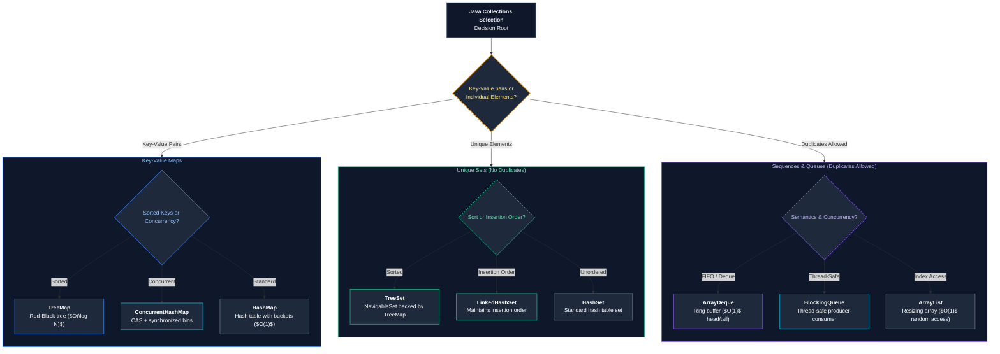

> [!TIP]
> **Deep-Dive Interview Scenarios:**
> - [Q6. The `hashCode()` and `equals()` Contract & Custom Keys](frequently_asked_questions/02_java_collections_and_generics_faq.md#q6-medium-the-hashcode-and-equals-contract--custom-keys)
> - [Q7. `HashMap` Internals: Capacity, Load Factor, Resizing, Null Keys & Collisions](frequently_asked_questions/02_java_collections_and_generics_faq.md#q7-medium-hashmap-internals-capacity-load-factor-resizing-null-keys--collisions)
> - [Q8. `HashMap` vs `ConcurrentHashMap` vs `Hashtable` & Concurrency Mechanics](frequently_asked_questions/02_java_collections_and_generics_faq.md#q8-hard-hashmap-vs-concurrenthashmap-vs-hashtable--concurrency-mechanics)
> - [Q9. `WeakHashMap` vs `HashMap`](frequently_asked_questions/02_java_collections_and_generics_faq.md#q9-medium-weakhashmap-vs-hashmap)
> - [Q10. `TreeMap` Red-Black Tree Sorting & Null Keys](frequently_asked_questions/02_java_collections_and_generics_faq.md#q10-medium-treemap-red-black-tree-sorting--null-keys)
> - [Q13. `PriorityQueue` Internal Working](frequently_asked_questions/02_java_collections_and_generics_faq.md#q13-medium-priorityqueue-internal-working)
> - [Q15. `Iterator` vs `ListIterator`](frequently_asked_questions/02_java_collections_and_generics_faq.md#q15-easy-iterator-vs-listiterator)
> - [Q16. Fail-Fast vs Fail-Safe, `ConcurrentModificationException` & Safe Removal](frequently_asked_questions/02_java_collections_and_generics_faq.md#q16-medium-fail-fast-vs-fail-safe-concurrentmodificationexception--safe-removal)
> - [Q17. `Comparable` vs `Comparator`](frequently_asked_questions/02_java_collections_and_generics_faq.md#q17-easy-comparable-vs-comparator)
> - [Q18. Stable vs In-Place Sorting Algorithms](frequently_asked_questions/02_java_collections_and_generics_faq.md#q18-medium-stable-vs-in-place-sorting-algorithms)
> - [Q19. Creating Truly Immutable Collections](frequently_asked_questions/02_java_collections_and_generics_faq.md#q19-medium-creating-truly-immutable-collections)
> - [Q21. Filter Employees by Salary > 10,000](frequently_asked_questions/02_java_collections_and_generics_faq.md#q21-medium-filter-employees-by-salary--10000)
> - [Q22. Rearrange List: Min at First Index, Max at Last Index](frequently_asked_questions/02_java_collections_and_generics_faq.md#q22-medium-rearrange-list-min-at-first-index-max-at-last-index)
> - [Q23. Finding Frequency of Elements & Most Frequent Element](frequently_asked_questions/02_java_collections_and_generics_faq.md#q23-medium-finding-frequency-of-elements--most-frequent-element)
> - [Q24. LRU Cache Implementation with $O(1)$ Operations](frequently_asked_questions/02_java_collections_and_generics_faq.md#q24-hard-lru-cache-implementation-with-o1-operations)
> - [Q25. Sorting a `Map` by Values](frequently_asked_questions/02_java_collections_and_generics_faq.md#q25-medium-sorting-a-map-by-values)
> - [Q26. Meeting Rooms II: Greedy Interval Scheduling via Min-Heap (`PriorityQueue`)](frequently_asked_questions/02_java_collections_and_generics_faq.md#q26-medium-meeting-rooms-ii-greedy-interval-scheduling-via-min-heap-priorityqueue)
> - [Q27. Finding the Nth-Largest Element Using a Min-Heap (`PriorityQueue`)](frequently_asked_questions/02_java_collections_and_generics_faq.md#q27-medium-finding-the-nth-largest-element-using-a-min-heap-priorityqueue)
> - [Q28. Can HashMap Keys Be Mutable? Key Mutation Pitfalls & Memory Leaks](frequently_asked_questions/02_java_collections_and_generics_faq.md#q28-medium-can-hashmap-keys-be-mutable-key-mutation-pitfalls--memory-leaks)
> - [Q29. HashMap Rehashing Internals, Threshold Triggers & Bitwise Power-of-Two Indexing](frequently_asked_questions/02_java_collections_and_generics_faq.md#q29-hard-hashmap-rehashing-internals-threshold-triggers--bitwise-power-of-two-indexing)
> - [Q31. Single-Pass $O(N)$ Second-Highest Element Discovery & Non-Comparison Array Sorting (Dutch National Flag)](frequently_asked_questions/02_java_collections_and_generics_faq.md#q31-medium-single-pass-on-second-highest-element-discovery--non-comparison-array-sorting-dutch-national-flag)
> - [Q32. HashMap vs LinkedHashMap vs TreeMap: Memory Topology, Access-Order LRU Eviction & Red-Black Tree Invariants](frequently_asked_questions/02_java_collections_and_generics_faq.md#q32-medium-hashmap-vs-linkedhashmap-vs-treemap-memory-topology-access-order-lru-eviction--red-black-tree-invariants)

---

# 7. Java Generics

---

### Generic Classes, Interfaces & Methods

#### Definition
Generics add compile-time type safety to the Java Collections Framework, allowing classes, interfaces, and methods to operate on parameterized types without explicit runtime casting.

#### Working Code Example
```java
// Generic Class
public class DataBox<T> {
    private T item;

    public void set(T item) { this.item = item; }
    public T get() { return item; }

    // Generic Method: Type parameter <K> declared before return type
    public static <K> void printArray(K[] array) {
        for (K element : array) {
            System.out.print(element + " ");
        }
        System.out.println();
    }

    public static void main(String[] args) {
        DataBox<String> stringBox = new DataBox<>();
        stringBox.set("Generics in Java");
        String value = stringBox.get(); // No cast needed!
        System.out.println(value);

        Integer[] intArray = {1, 2, 3, 4};
        DataBox.printArray(intArray);
    }
}
```

**Primary Source Reference**: [GeeksforGeeks - Generics in Java](https://www.geeksforgeeks.org/generics-in-java/)

---

### Bounded Type Parameters

Restricts the allowable types that can be substituted for a type parameter using `extends`.

```java
// Bounded type parameter: T must be Number or a subclass of Number
public class NumericStats<T extends Number> {
    private final T[] numbers;

    public NumericStats(T[] numbers) { this.numbers = numbers; }

    public double average() {
        double sum = 0.0;
        for (T n : numbers) {
            sum += n.doubleValue(); // doubleValue() is guaranteed available on Number
        }
        return sum / numbers.length;
    }
}
```

**Primary Source Reference**: [GeeksforGeeks - Bounded Types in Java](https://www.geeksforgeeks.org/bounded-types-generics-java/)

---

### Wildcards & PECS Principle

#### The PECS Rule: Producer `extends`, Consumer `super`
- Use **`? extends T`** when you only **read/consume data from** a collection (the collection is a *Producer* of items).
- Use **`? super T`** when you only **write/insert data into** a collection (the collection is a *Consumer* of items).

#### Visual PECS Flow
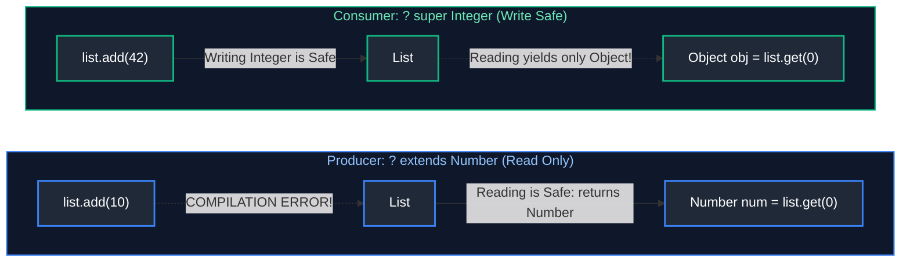

#### Working Code Example
```java
import java.util.ArrayList;
import java.util.List;

public class PecsDemo {
    // Producer: Read from src (List<? extends Number>)
    public static double sumOfList(List<? extends Number> list) {
        double s = 0.0;
        for (Number n : list) {
            s += n.doubleValue(); // Safe read
        }
        // list.add(10); // Compile Error: Cannot add to ? extends Number
        return s;
    }

    // Consumer: Write into dest (List<? super Integer>)
    public static void addIntegers(List<? super Integer> list) {
        list.add(100); // Safe write
        list.add(200);
        // Integer n = list.get(0); // Compile Error: Reading only guarantees Object
    }

    public static void main(String[] args) {
        List<Double> doubleList = List.of(1.5, 2.5, 3.5);
        System.out.println("Sum: " + sumOfList(doubleList));

        List<Number> numList = new ArrayList<>();
        addIntegers(numList);
        System.out.println("Added numbers: " + numList);
    }
}
```

**Primary Source Reference**: [GeeksforGeeks - Wildcards in Java](https://www.geeksforgeeks.org/wildcards-in-java/)

---

### Type Erasure

#### Definition
Java implements generics via **Type Erasure**. The compiler enforces type constraints at compile time, and then **erases (removes)** all type parameters when generating bytecode, replacing unbounded parameters with `Object` and bounded parameters with their upper bound.

#### Visual Bytecode Transformation
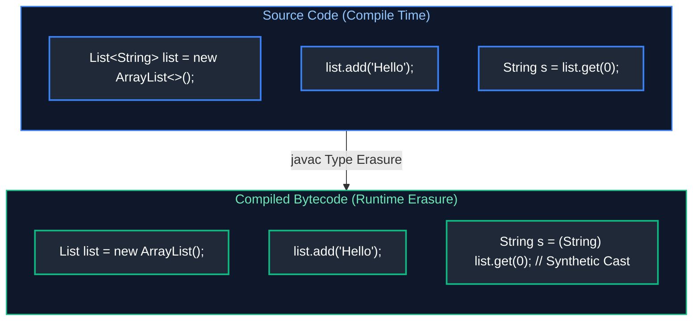

#### Implications of Type Erasure
1. Cannot create instances of type parameters (`new T()`).
2. Cannot create arrays of parameterized types (`new List<String>[10]`).
3. Cannot use primitive types in generics (`List<int>` is invalid; use `List<Integer>`).
4. Overloads with identical erased signatures fail compilation (`void print(List<String> l)` and `void print(List<Integer> l)` cannot coexist).

**Primary Source Reference**: [GeeksforGeeks - Type Erasure in Java](https://www.geeksforgeeks.org/type-erasure-java/)

---

### Generic Interfaces & Generic Collections

#### Generic Interfaces
Generic interfaces define abstract contracts parameterized by type, allowing implementations to either specialize the type or remain generic.

#### Working Code Example: Generic Repository & Generic Collection
```java
import java.util.*;

// Generic Interface
interface Repository<T, ID> {
    void save(T entity);
    Optional<T> findById(ID id);
    List<T> findAll();
}

// Generic In-Memory Collection Wrapper
public class InMemoryRepository<T, ID> implements Repository<T, ID> {
    private final Map<ID, T> storage = new HashMap<>();

    @Override
    public void save(T entity) {
        // In real implementations, extract ID from entity
        System.out.println("Saved generic entity: " + entity);
    }

    @Override
    public Optional<T> findById(ID id) {
        return Optional.ofNullable(storage.get(id));
    }

    @Override
    public List<T> findAll() {
        return Collections.unmodifiableList(new ArrayList<>(storage.values()));
    }

    public static void main(String[] args) {
        Repository<String, Long> userRepo = new InMemoryRepository<>();
        userRepo.save("User-Admin");
        System.out.println("Repository initialized successfully with Generics.");
    }
}
```

#### Bridge Methods
When a class implements a parameterized interface with a concrete type (e.g. `class StringRepo implements Repository<String, Long>`), type erasure erases the interface method to `save(Object)`. To preserve polymorphism and method overriding at runtime, the Java compiler automatically generates a synthetic **Bridge Method** that casts the `Object` argument and delegates to `save(String)`.

**Primary Source Reference**: [GeeksforGeeks - Generics in Java](https://www.geeksforgeeks.org/generics-in-java/)

> [!TIP]
> **Deep-Dive Interview Scenario:**
> - [Q30. Java Generics PECS Rule (`? extends T` vs `? super T`) & Optional Idiomatic Usage](frequently_asked_questions/02_java_collections_and_generics_faq.md#q30-medium-java-generics-pecs-rule--extends-t-vs--super-t--optional-idiomatic-usage)

---

# 8. Modern Data Handling & Sequenced Collections (Java 21)

---

### SequencedCollection, SequencedSet & SequencedMap

Prior to Java 21, the Collections Framework lacked a unified abstraction representing a collection with a defined encounter order. For example, getting the first element required `list.get(0)`, `deque.getFirst()`, `sortedSet.first()`, or `linkedHashSet.iterator().next()`. Java 21 introduced **Sequenced Collections** (JEP 431) to establish consistent first/last access and reverse-order iteration.

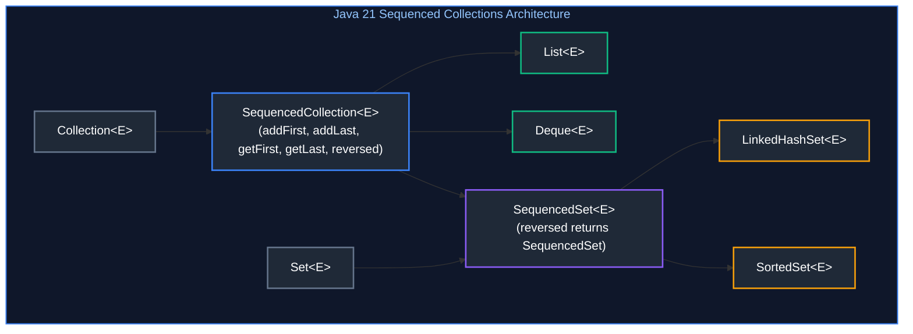

#### Production Code: Java 21 Sequenced Collections & Reverse Iteration
```java
import java.util.*;

public class SequencedCollectionsDemo {
    public static void main(String[] args) {
        // 1. SequencedCollection on LinkedHashSet
        SequencedSet<String> stages = new LinkedHashSet<>();
        stages.addLast("BUILD");
        stages.addLast("TEST");
        stages.addFirst("LINT"); // Directly prepends without LinkedList conversion
        stages.addLast("DEPLOY");

        System.out.println("First Stage: " + stages.getFirst()); // LINT
        System.out.println("Last Stage: " + stages.getLast());   // DEPLOY

        // 2. Non-destructive reversed view
        SequencedSet<String> rollbackOrder = stages.reversed();
        System.out.println("Rollback Order: " + rollbackOrder); // [DEPLOY, TEST, BUILD, LINT]

        // 3. SequencedMap on LinkedHashMap
        SequencedMap<Integer, String> priorityQueue = new LinkedHashMap<>();
        priorityQueue.putFirst(1, "CRITICAL");
        priorityQueue.putLast(10, "LOW");
        priorityQueue.putFirst(0, "EMERGENCY");

        Map.Entry<Integer, String> highest = priorityQueue.firstEntry();
        System.out.println("Highest Priority: " + highest.getKey() + " -> " + highest.getValue());
    }
}
```

---

### Immutable Collections vs. Unmodifiable Wrappers

Understanding the distinction between an unmodifiable view and a true immutable collection is critical for defensive programming:

1. **`Collections.unmodifiableList(list)`**:
   - Creates a read-only wrapper around the *original* backing list.
   - **Vulnerability:** If code retains a reference to the mutable backing list and modifies it, the unmodifiable view reflects those mutations immediately.
2. **`List.of(...)` & `List.copyOf(collection)` (Java 9 & 10)**:
   - Constructs a true immutable, compact, space-optimized value-based collection.
   - **Null-Hostile:** Immediately throws `NullPointerException` if any element is `null`.
   - **Thread-Safe:** Safe to publish across threads without synchronization locks.

```java
// ✅ PRODUCTION PATTERN: Defensive copy producing true immutability
public record TenantSecurityPolicy(String tenantId, List<String> allowedIpRanges) {
    public TenantSecurityPolicy {
        // Creates an unalterable, null-safe snapshot independent of caller's list
        allowedIpRanges = List.copyOf(allowedIpRanges);
    }
}
```

> [!TIP]
> **Deep-Dive Interview Scenario:**
> - [Q20. Handling Large Datasets in Memory Using Collections](frequently_asked_questions/02_java_collections_and_generics_faq.md#q20-hard-handling-large-datasets-in-memory-using-collections)

---

# 9. Summary Comparison & Production Engineering Reference Matrix

| Collection Interface / Class | Internal Data Structure | Read Complexity | Write / Insert Complexity | Thread Safe? | Allows Null? | Encounter Order | Memory Footprint / Overhead |
| :--- | :--- | :---: | :---: | :---: | :---: | :--- | :--- |
| **`ArrayList`** | Dynamic `Object[]` array | $O(1)$ | $O(1)$ amortized, $O(N)$ worst | No | Yes | Insertion | Minimal (contiguous buffer, $\approx 4\text{B}/8\text{B}$ per ref) |
| **`LinkedList`** | Doubly-linked `Node` chain | $O(N)$ | $O(1)$ at ends, $O(N)$ index | No | Yes | Insertion | High (24 bytes node overhead + 2 pointers/elem) |
| **`CopyOnWriteArrayList`** | Replaced `volatile Object[]` | $O(1)$ | $O(N)$ (copies entire array) | **Yes** | Yes | Insertion | High on write; optimal for $99\%$ read workloads |
| **`HashSet`** | Backed by `HashMap` | $O(1)$ avg | $O(1)$ avg, $O(\log N)$ worst | No | Yes (1 null) | Unordered | High (stores dummy `PRESENT` value per key) |
| **`LinkedHashSet`** | `HashMap` + Doubly-linked list | $O(1)$ avg | $O(1)$ avg | No | Yes (1 null) | Insertion | Moderate ($32\text{B}$ per entry node) |
| **`TreeSet`** | Red-Black Tree (`TreeMap`) | $O(\log N)$ | $O(\log N)$ | No | No | Natural / Comparator | High (left, right, parent pointers + color bit) |
| **`ArrayDeque`** | Circular array buffer | $O(1)$ at ends | $O(1)$ amortized | No | **No** | FIFO / LIFO | Minimal (more cache-friendly than `LinkedList`) |
| **`PriorityQueue`** | Min-binary heap `Object[]` | $O(1)$ peek | $O(\log N)$ offer/poll | No | **No** | Priority sorted | Low (array-based heap layout) |
| **`HashMap`** | Array of `Node` bins + Red-Black trees | $O(1)$ avg | $O(1)$ avg, $O(\log N)$ tree | No | Yes (1 null key) | Unordered | $16\text{B}$ per `Node` + array capacity $\times 8\text{B}$ |
| **`LinkedHashMap`** | `HashMap` + doubly-linked list | $O(1)$ avg | $O(1)$ avg | No | Yes (1 null key) | Insertion / Access | $24\text{B}$ per entry node (ideal for LRU cache) |
| **`TreeMap`** | Red-Black Tree | $O(\log N)$ | $O(\log N)$ | No | **No** (keys) | Sorted key order | High (3 pointers + color bit per entry) |
| **`ConcurrentHashMap`** | CAS + Bins synchronized locks | $O(1)$ lock-free | $O(1)$ synchronized bin | **Yes** | **No** | Unordered | High (locks on head bins, counter cells) |

---

# 10. References & Further Reading

- [Oracle Java SE 21 Documentation - Collections Framework Overview](https://docs.oracle.com/en/java/javase/21/docs/api/java.base/java/util/doc-files/coll-overview.html)
- [JEP 431: Sequenced Collections](https://openjdk.org/jeps/431) — OpenJDK specification unifying ordered collections in Java 21.
- [Baeldung - The Java Collections Framework Guide](https://www.baeldung.com/category/java/java-collections/)
- [Baeldung - Java Generics and PECS Principle](https://www.baeldung.com/java-generics-pecs)
- [GeeksforGeeks - Java Collections Tutorial](https://www.geeksforgeeks.org/collections-in-java-2/)
- [Joshua Bloch: Effective Java (3rd Edition)](https://www.oreilly.com/library/view/effective-java-3rd/9780134686097/) — Items 26–33 (Generics) and Items 49–56 (Defensive Programming & Collections).
