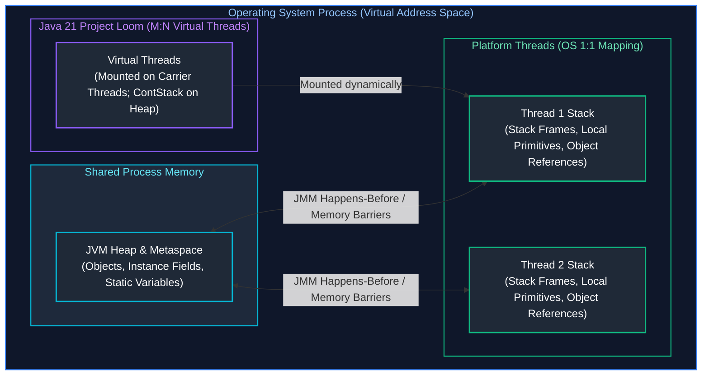
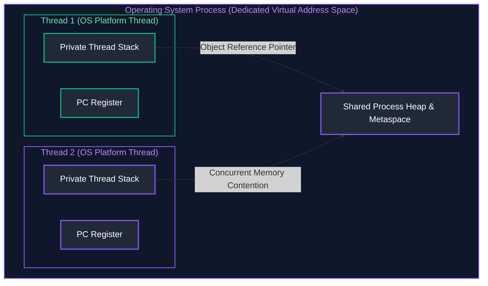
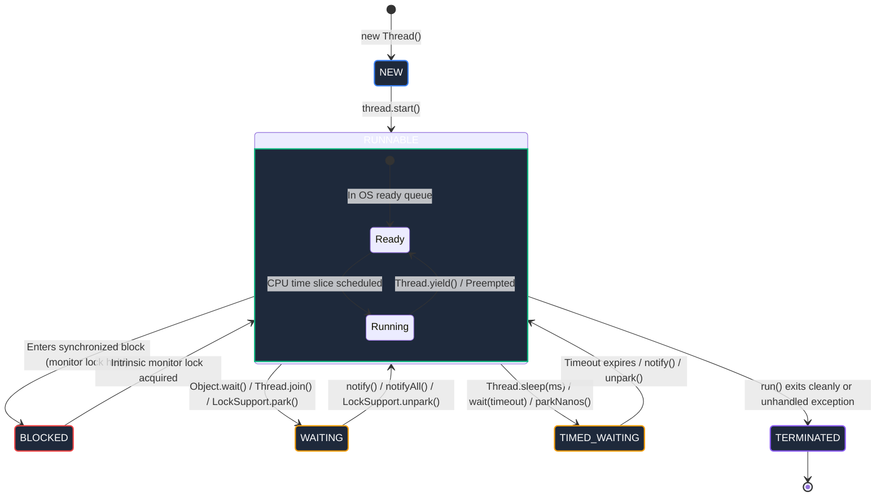
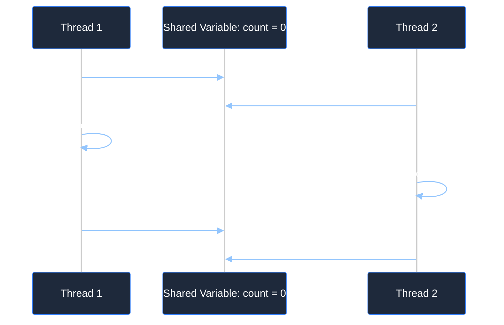
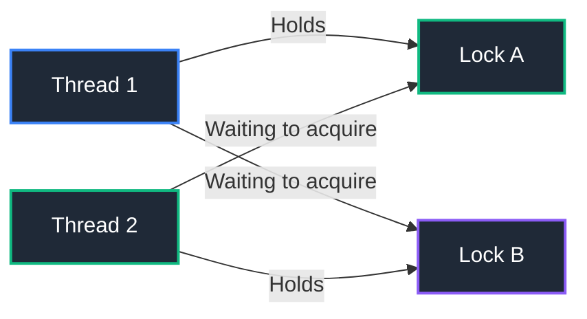
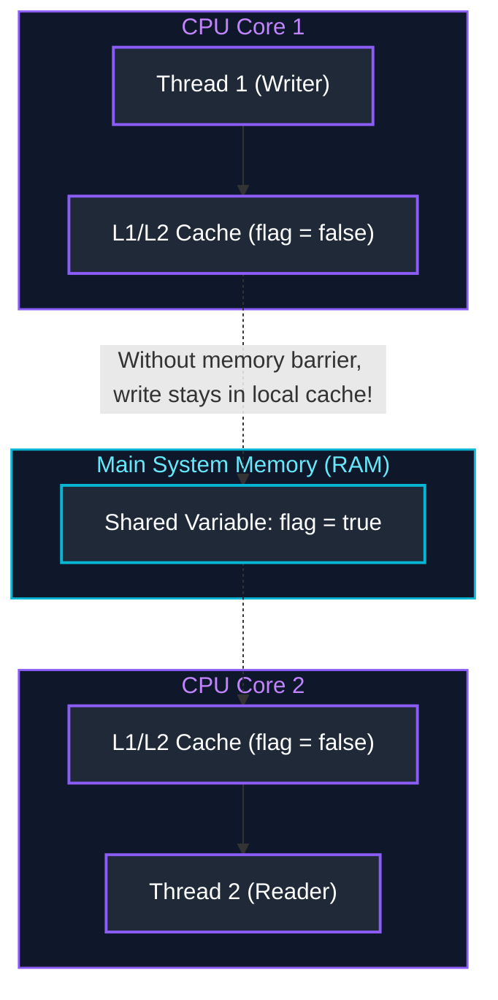
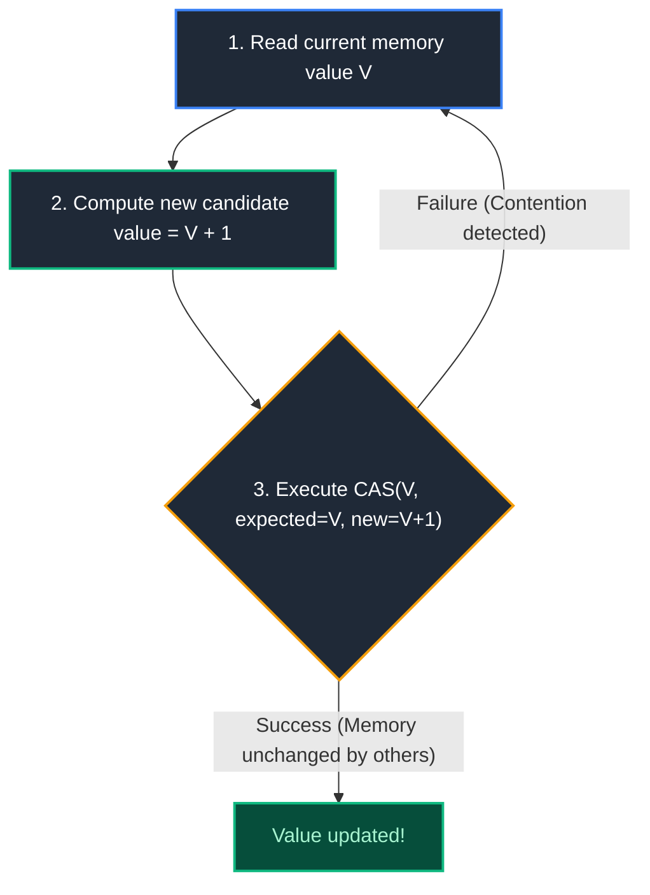
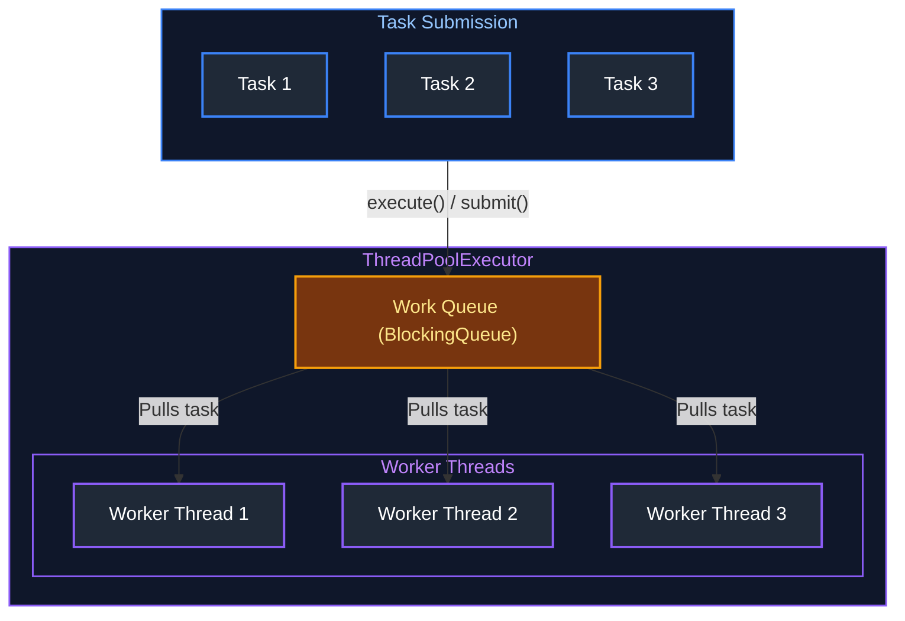
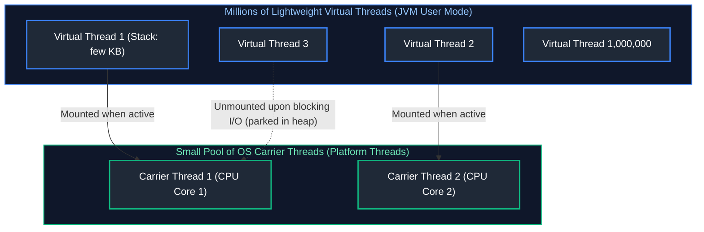
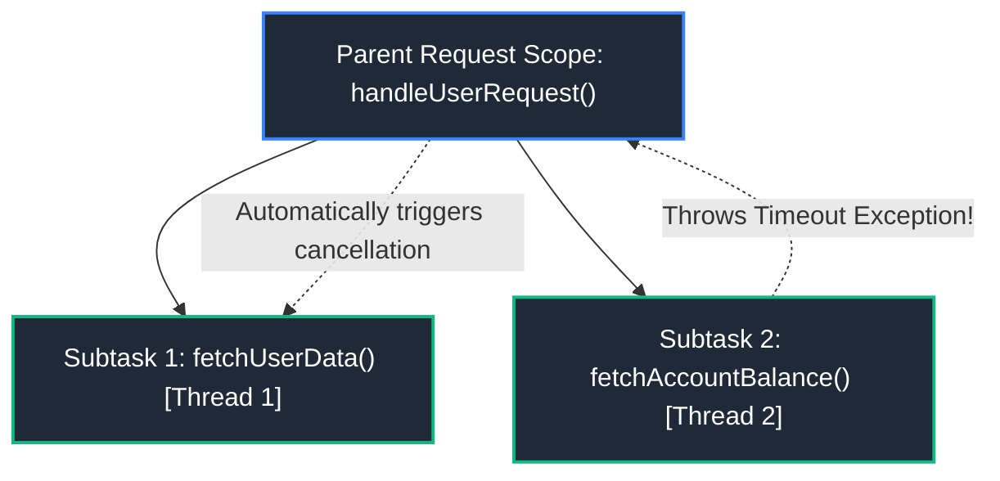

# 04. Java Concurrency & Multithreading

A comprehensive reference guide covering thread fundamentals, thread synchronization, Java Memory Model, lock-free atomic constructs, locks, the Executor framework, CompletableFuture asynchronous pipelines, and modern Virtual Threads (Project Loom). For collection implementation details and selection trade-offs, see [Topic 02: Java Collections](./02_java_collections_and_generics.md); for concurrent collection behavior, see [Concurrent Collections](./02_java_collections_and_generics.md#5-map-implementations).

---

## Architectural Overview: Java Concurrency & Thread Memory Architecture



---

## Table of Contents
1. [Thread Fundamentals](#1-thread-fundamentals)
2. [Synchronization & Thread Safety](#2-synchronization--thread-safety)
3. [Java Memory Model (JMM)](#3-java-memory-model-jmm)
4. [Atomic Operations & Lock-Free Programming](#4-atomic-operations--lock-free-programming)
5. [Locks & Explicit Synchronizers](#5-locks--explicit-synchronizers)
6. [Concurrent Collections](#6-concurrent-collections)
7. [Executor Framework & Asynchronous Pipelines](#7-executor-framework--asynchronous-pipelines)
8. [Modern Java Concurrency](#8-modern-java-concurrency)
9. [Production Troubleshooting Playbook](#9-production-troubleshooting-playbook)
10. [Summary Comparison & Production Engineering Reference Matrix](#10-summary-comparison--production-engineering-reference-matrix)
11. [References & Further Reading](#11-references--further-reading)
---

# 1. Thread Fundamentals

---

### Process vs Thread

#### Visual Architecture


#### First-Principles Breakdown: Process vs. Thread Architecture

Modern multitasking operating systems manage concurrent execution units using two foundational abstractions:

1. **Process (The Heavyweight Unit of Resource Ownership):**
   - **Address Space & Isolation:** A process is an executing program instance with its own private, isolated virtual memory address space (Page Tables, Code/Text segment, Initialized Data, Heap, and Stack) managed by the OS kernel and hardware Memory Management Unit (MMU). One process cannot directly read or mutate memory in another process without explicitly mapped Inter-Process Communication (IPC) primitives (shared memory, UNIX domain sockets, message queues).
   - **Process Control Block (PCB):** The OS tracks each process via a PCB containing the process ID (PID), memory management information, open file descriptor tables, security credentials, and execution context.
   - **Context Switching Overhead:** Switching execution between two different processes requires a full TLB (Translation Lookaside Buffer) flush, CPU register saving, and switching memory page tables, resulting in severe CPU pipeline stalls ($1 - 5\mu\text{s}$).

2. **Thread (The Lightweight Unit of CPU Dispatch):**
   - **Shared Memory Model:** A thread is the smallest schedulable unit of CPU execution. Multiple threads exist *within* the boundary of a single parent process. Peer threads share the process's text segment, global data, open file descriptors, and crucially, the **common JVM Heap**.
   - **Thread Control Block (TCB) & Private State:** Each thread retains strictly private execution state: its own **Thread Stack** (local method stack frames, local variables, and primitive returns) and a **Program Counter (PC) Register** tracking the currently executing bytecode instruction.
   - **Context Switching Cost:** Because threads share identical page tables, switching between peer threads does not require flushing the MMU's TLB cache. Only the CPU registers, PC, and stack pointer must be swapped, making thread context switches significantly faster ($100 - 500\text{ns}$).
   - **Failure Boundary:** Because heap memory is shared, an unhandled error or data race that corrupts shared heap state in one thread can destabilize or crash all peer threads across the entire JVM.

#### Comparison Matrix
| Dimension | Process | Thread |
| :--- | :--- | :--- |
| **Address Space** | Isolated private address space (managed by OS) | Shares address space and heap with peer threads |
| **Creation Cost** | Heavyweight (expensive context switching) | Lightweight compared to processes |
| **Communication** | IPC (sockets, pipes, shared memory) | Direct memory reads/writes via shared heap |
| **Fault Isolation** | High (crash in one process does not kill others) | Low (uncaught exception in one thread can affect heap) |

**Primary Source Reference**: [GeeksforGeeks - Process vs Thread](https://www.geeksforgeeks.org/difference-between-process-and-thread/)

---

### Thread Lifecycle & State Transitions

#### Visual State Diagram


#### The Six Java Thread States (`Thread.State`)
1. **`NEW`**: Thread created (`new Thread()`) but `start()` has not been called.
2. **`RUNNABLE`**: Executing in JVM or waiting for OS CPU scheduling.
3. **`BLOCKED`**: Waiting to acquire an intrinsic monitor lock to enter/re-enter a synchronized block.
4. **`WAITING`**: Waiting indefinitely for another thread to perform a particular action (`wait()`, `join()`).
5. **`TIMED_WAITING`**: Waiting for a specified time period (`Thread.sleep()`, `wait(timeout)`).
6. **`TERMINATED`**: Execution finished or terminated due to an unhandled exception.

**Primary Source Reference**: [GeeksforGeeks - Life Cycle of a Thread in Java](https://www.geeksforgeeks.org/lifecycle-and-states-of-a-thread-in-java/)

---

### Thread Creation

#### Three Primary Approaches
1. **Extending `Thread`**: Limited because Java does not support multiple class inheritance.
2. **Implementing `Runnable`**: Decouples task logic from thread execution mechanism; preferred for tasks returning `void`.
3. **Implementing `Callable<V>`**: Supports returning a computed result and throwing checked exceptions; managed via `ExecutorService`.

#### Working Code Example: Thread Creation, Lifecycle & State Monitoring
The following example demonstrates creating worker threads using `Runnable` and `Callable<V>`, tracking thread state transitions (`NEW`, `RUNNABLE`, `TIMED_WAITING`, `TERMINATED`), and coordinating execution using `join()`:

```java
import java.util.concurrent.*;

public class ThreadCreationDemo {
    public static void main(String[] args) throws ExecutionException, InterruptedException {
        // 1. Creating a Thread using Runnable (for fire-and-forget void tasks)
        Runnable orderProcessingTask = () -> {
            // Obtain the current executing thread reference
            Thread current = Thread.currentThread();
            System.out.println("[" + current.getName() + "] Task started. Priority: " + current.getPriority());

            try {
                // Simulate I/O or database latency (transitions thread to TIMED_WAITING state)
                System.out.println("[" + current.getName() + "] Simulating database write for 300ms...");
                Thread.sleep(300);
            } catch (InterruptedException e) {
                // Restore interrupted status if thread was interrupted during sleep
                current.interrupt();
                System.err.println("[" + current.getName() + "] Thread was interrupted during execution!");
                return;
            }

            System.out.println("[" + current.getName() + "] Task finished successfully.");
        };

        // Instantiate Thread object with a descriptive name (Thread state: NEW)
        Thread workerThread = new Thread(orderProcessingTask, "order-worker-1");
        System.out.println("[Main] Created thread '" + workerThread.getName() + "'. Initial State: " + workerThread.getState()); // Emits NEW

        // start() requests OS scheduler to allocate native thread (Thread state: RUNNABLE)
        workerThread.start();
        System.out.println("[Main] Called start(). Current State: " + workerThread.getState()); // Emits RUNNABLE

        // 2. Creating a Thread using Callable<V> (returns a computed result or throws checked exceptions)
        Callable<Double> calculateInvoiceTask = () -> {
            Thread current = Thread.currentThread();
            System.out.println("[" + current.getName() + "] Calculating invoice total with tax...");

            // Simulate calculation latency
            TimeUnit.MILLISECONDS.sleep(150);

            double subtotal = 450.00;
            double taxRate = 0.08;
            return subtotal * (1.0 + taxRate); // Computes and returns total
        };

        // Submit Callable to an ExecutorService managing underlying worker threads
        try (ExecutorService singleExecutor = Executors.newSingleThreadExecutor()) {
            // submit() non-blockingly returns a Future handle representing the pending computation
            Future<Double> invoiceFuture = singleExecutor.submit(calculateInvoiceTask);

            // While task executes asynchronously, main thread continues other work
            System.out.println("[Main] Doing concurrent work while invoice calculates...");

            // isDone() checks completion non-blockingly
            System.out.println("[Main] Is invoice ready? " + invoiceFuture.isDone());

            // future.get() blocks calling thread until computation finishes (or timeout expires)
            Double totalInvoice = invoiceFuture.get(); // Blocks for ~150ms
            System.out.println("[Main] Invoice calculation finished! Total: $" + String.format("%.2f", totalInvoice));
        } // ExecutorService auto-closes and performs orderly shutdown upon exiting try block

        // 3. Thread Coordination via join()
        // join() halts caller (Main) until target thread completes (transitions to TERMINATED)
        workerThread.join();
        System.out.println("[Main] '" + workerThread.getName() + "' terminated. Final State: " + workerThread.getState()); // Emits TERMINATED
    }
}
```

**Primary Source Reference**: [GeeksforGeeks - Callable and Future in Java](https://www.geeksforgeeks.org/callable-future-java/)

---

### Thread Control

- **`Thread.sleep(ms)`**: Suspends current thread for specified milliseconds. Does **not** release locks.
- **`thread.join()`**: Calling thread halts until target thread terminates.
- **`Thread.yield()`**: Hint to the OS scheduler that the current thread is willing to yield its current CPU time slice.
- **Thread Interruption**: Cooperative cancellation mechanism using `interrupt()`, `isInterrupted()`, and `Thread.interrupted()`. Never use deprecated `stop()`.

#### Working Code Example
```java
public class InterruptionDemo {
    public static void main(String[] args) throws InterruptedException {
        Thread worker = new Thread(() -> {
            while (!Thread.currentThread().isInterrupted()) {
                try {
                    System.out.println("Working...");
                    Thread.sleep(500);
                } catch (InterruptedException e) {
                    System.out.println("Interrupted during sleep! Cleaning up and exiting...");
                    // Restore interrupted status if rethrowing or break
                    Thread.currentThread().interrupt();
                    break;
                }
            }
        });

        worker.start();
        Thread.sleep(1200);
        worker.interrupt(); // Gracefully requests worker thread to stop
        worker.join();      // Wait for thread to finish cleanup
        System.out.println("Worker thread cleanly terminated.");
    }
}
```

**Primary Source Reference**: [GeeksforGeeks - Thread Interruption in Java](https://www.geeksforgeeks.org/interrupting-a-thread-in-java/)

> [!TIP]
> **Deep-Dive Interview Scenarios:**
> - [Q1. `Runnable` vs `Callable` & Calling `run()` vs `start()`](frequently_asked_questions/04_java_concurrency_and_multithreading_faq.md#q1-easy-runnable-vs-callable--calling-run-vs-start)
> - [Q2. Why the JVM Fails to Terminate After `main()` Completes](frequently_asked_questions/04_java_concurrency_and_multithreading_faq.md#q2-medium-why-the-jvm-fails-to-terminate-after-main-completes)
> - [Q7. Concurrent Access Hazards on `HashMap` & Fixes](frequently_asked_questions/04_java_concurrency_and_multithreading_faq.md#q7-medium-concurrent-access-hazards-on-hashmap--fixes)
> - [Q8. `ExecutorService` Architecture, Saturated Queues & Silent Failures](frequently_asked_questions/04_java_concurrency_and_multithreading_faq.md#q8-expert-executorservice-architecture-saturated-queues--silent-failures)
> - [Q13. Modern Thread Creation Strategies: Platform Threads, `ExecutorService` & Java 21 Virtual Threads](frequently_asked_questions/04_java_concurrency_and_multithreading_faq.md#q13-easy-modern-thread-creation-strategies-platform-threads-executorservice--java-21-virtual-threads)

---

# 2. Synchronization & Thread Safety

---

### Race Conditions

A race condition occurs when multiple threads concurrently read and write shared mutable state without proper coordination, and the final outcome depends on the timing or interleaving of thread execution.

#### Visual Interleaving


**Primary Source Reference**: [GeeksforGeeks - Race Condition in Java](https://www.geeksforgeeks.org/race-condition-in-java/)

---

### `synchronized` Methods & Blocks

#### Intrinsic Lock (Monitor) Rules
- Synchronizing an **instance method** acquires the monitor lock on `this` instance.
- Synchronizing a **static method** acquires the monitor lock on the class object (`ClassName.class`).
- **Synchronized Block**: Allows locking on an arbitrary dedicated monitor object, minimizing critical section size.

#### Working Code Example: Thread-Safe Balance Transfer & Deadlock Prevention
The following example demonstrates mutual exclusion using granular `synchronized` blocks, visibility guarantees, and **consistent lock ordering** to prevent deadlocks when transferring money between concurrent bank accounts:

```java
import java.util.concurrent.*;

public class BankTransferDemo {

    // Domain entity encapsulating shared mutable state
    public static class BankAccount {
        private final int accountId;       // Unique ID used for deterministic lock ordering
        private double balance;
        private final Object lock = new Object(); // Explicit monitor object for this account

        public BankAccount(int accountId, double initialBalance) {
            this.accountId = accountId;
            this.balance = initialBalance;
        }

        public int getAccountId() { return accountId; }

        public double getBalance() {
            // Synchronized block ensures memory visibility (flushes CPU cache to main memory)
            synchronized (lock) {
                return balance;
            }
        }

        // Internal credit operation (must be called with lock held)
        public void credit(double amount) {
            synchronized (lock) {
                this.balance += amount;
            }
        }

        // Internal debit operation (must be called with lock held)
        public void debit(double amount) {
            synchronized (lock) {
                if (this.balance < amount) {
                    throw new IllegalStateException("Insufficient funds in account #" + accountId);
                }
                this.balance -= amount;
            }
        }

        public Object getLock() { return lock; }
    }

    // High-concurrency transfer service
    public static class TransferService {

        /**
         * Safely transfers money between two accounts.
         * Prevents DEADLOCK by acquiring locks in strict numerical order of accountId.
         * If Thread 1 transfers A -> B and Thread 2 transfers B -> A, both threads acquire
         * Lock(A) first, completely eliminating cyclic lock dependency!
         */
        public void transfer(BankAccount from, BankAccount to, double amount) {
            if (from.getAccountId() == to.getAccountId()) {
                throw new IllegalArgumentException("Cannot transfer to the same account");
            }

            // Determine strict lock acquisition order based on accountId
            BankAccount firstLock = from.getAccountId() < to.getAccountId() ? from : to;
            BankAccount secondLock = from.getAccountId() < to.getAccountId() ? to : from;

            // Step 1: Acquire the lower-ID account monitor
            synchronized (firstLock.getLock()) {
                // Step 2: Acquire the higher-ID account monitor (no cyclic dependency possible!)
                synchronized (secondLock.getLock()) {
                    // Critical Section: Both accounts are locked simultaneously
                    from.debit(amount);
                    to.credit(amount);
                    System.out.println("[" + Thread.currentThread().getName() + "] Transferred $" + String.format("%.2f", amount) + " from #" + from.getAccountId() + " to #" + to.getAccountId());
                } // Releases secondLock
            } // Releases firstLock
        }
    }

    public static void main(String[] args) throws InterruptedException {
        BankAccount acc1 = new BankAccount(101, 1000.0);
        BankAccount acc2 = new BankAccount(202, 1000.0);
        TransferService service = new TransferService();

        // Launch concurrent threads executing bidirectional transfers
        try (ExecutorService pool = Executors.newFixedThreadPool(4)) {
            // Thread A: Transfers 101 -> 202
            pool.submit(() -> service.transfer(acc1, acc2, 200.0));
            // Thread B: Concurrently transfers 202 -> 101 (Opposite direction)
            pool.submit(() -> service.transfer(acc2, acc1, 150.0));
            // Thread C: Concurrently transfers 101 -> 202
            pool.submit(() -> service.transfer(acc1, acc2, 50.0));
        } // Executor cleanly terminates and waits for transfers to finish

        System.out.println("Final Balances -> Account 101: $" + String.format("%.2f", acc1.getBalance()) + " | Account 202: $" + String.format("%.2f", acc2.getBalance()));
        // Invariant holds: Total money in system remains exactly $2000.00
    }
}
```

**Primary Source Reference**: [GeeksforGeeks - Synchronized in Java](https://www.geeksforgeeks.org/synchronized-in-java/)

---

### Deadlock, Starvation, Livelock

#### Definitions & Visual Deadlock


- **Deadlock**: Two or more threads are permanently blocked, each waiting for a lock held by the other.
  - *Prevention*: Always acquire locks in a globally consistent order across all threads.
- **Starvation**: A thread is perpetually denied CPU time or lock acquisition because greedy threads constantly take priority.
  - *Prevention*: Use fair locks (`new ReentrantLock(true)`).
- **Livelock**: Threads actively change their state in response to each other, but make no forward progress (like two polite people trying to step aside in a narrow hallway repeatedly in sync).

**Primary Source Reference**: [GeeksforGeeks - Deadlock in Java Multithreading](https://www.geeksforgeeks.org/deadlock-in-java-multithreading/)

> [!TIP]
> **Deep-Dive Interview Scenarios:**
> - [Q3. The `synchronized` Monitor & `sleep()` vs `wait()`](frequently_asked_questions/04_java_concurrency_and_multithreading_faq.md#q3-medium-the-synchronized-monitor--sleep-vs-wait)
> - [Q4. `volatile` vs `AtomicInteger` vs `synchronized`](frequently_asked_questions/04_java_concurrency_and_multithreading_faq.md#q4-medium-volatile-vs-atomicinteger-vs-synchronized)
> - [Q5. Deadlock Conditions, Thread Dumps & Prevention](frequently_asked_questions/04_java_concurrency_and_multithreading_faq.md#q5-hard-deadlock-conditions-thread-dumps--prevention)
> - [Q6. Fixing Inconsistent Shared State (Bank Balance Race Condition)](frequently_asked_questions/04_java_concurrency_and_multithreading_faq.md#q6-hard-fixing-inconsistent-shared-state-bank-balance-race-condition)
> - [Q14. `synchronized` vs `ReentrantLock`: Feature Matrix & Trade-Offs](frequently_asked_questions/04_java_concurrency_and_multithreading_faq.md#q14-medium-synchronized-vs-reentrantlock-feature-matrix--trade-offs)
> - [Q19. Why `volatile` Cannot Prevent Lost Updates: Memory Barriers vs Atomic Compound Operations](frequently_asked_questions/04_java_concurrency_and_multithreading_faq.md#q19-medium-why-volatile-cannot-prevent-lost-updates-memory-barriers-vs-atomic-compound-operations)
> - [Q21. Thread-Safe High-Volume Payment Account Balance Updates: Optimistic Locking vs Pessimistic Locking vs LMAX Disruptor In-Memory Isolation](frequently_asked_questions/04_java_concurrency_and_multithreading_faq.md#q21-hard-thread-safe-high-volume-payment-account-balance-updates-optimistic-locking-vs-pessimistic-locking-vs-lmax-disruptor-in-memory-isolation)

---

# 3. Java Memory Model (JMM)

---

### JMM Pillars

The Java Memory Model defines the rules for how the JVM and hardware interact when reading and writing shared variables across CPU caches.
1. **Atomicity**: An operation executes completely or not at all (no intermediate state visible).
2. **Visibility**: When one thread modifies shared state, other threads are guaranteed to see the updated value.
3. **Ordering**: Instructions may be reordered by the compiler, JIT, or CPU pipeline as long as single-threaded semantics (*as-if-serial*) are preserved.

#### Visual CPU Cache Architecture


---

### `volatile` Keyword

#### Definition & Guarantees
- **Visibility Guarantee**: Direct read from and flush to main memory. Reads/writes bypass CPU L1/L2 registers.
- **Ordering Guarantee**: Establishes a **Memory Barrier** (fence) that prohibits instruction reordering around the volatile variable.
- **Limitation**: `volatile` does **NOT** provide atomicity for compound operations (e.g., `count++` requires a read, modify, and write).

#### Working Code Example
```java
public class VolatileStatusFlag {
    // Guarantees immediate visibility across CPU cores
    private volatile boolean running = true;

    public void stopRunning() {
        this.running = false; // Writes immediately flush to main memory
    }

    public void runLoop() {
        while (running) {
            // Without volatile, JIT compiler could optimize this loop into:
            // if (running) while (true) {} -> Infinite Loop!
        }
        System.out.println("Loop terminated cleanly.");
    }
}
```

**Primary Source Reference**: [GeeksforGeeks - Volatile Keyword in Java](https://www.geeksforgeeks.org/volatile-keyword-in-java/)

---

### Happens-Before

If action $A$ happens-before action $B$ ($A \xrightarrow{hb} B$), the memory effects of $A$ are guaranteed to be fully visible to $B$.
1. **Program Order Rule**: Each action in a thread happens-before any subsequent action in that thread.
2. **Monitor Lock Rule**: An unlock on a monitor happens-before every subsequent lock on the same monitor.
3. **Volatile Variable Rule**: A write to a `volatile` variable happens-before every subsequent read of that variable.
4. **Thread Start Rule**: A call to `Thread.start()` happens-before any action in the started thread.
5. **Thread Termination Rule**: Any action in a thread happens-before another thread successfully detects that it has terminated via `join()`.

> [!TIP]
> **Deep-Dive Interview Scenario:**
> - [Q12. Shared Mutable Object Hazards: Race Conditions, Memory Visibility & JMM](frequently_asked_questions/04_java_concurrency_and_multithreading_faq.md#q12-medium-shared-mutable-object-hazards-race-conditions-memory-visibility--jmm)

---

# 4. Atomic Operations & Lock-Free Programming

---

### CAS Primitive

#### Definition
**Compare-And-Swap (CAS)** is an atomic CPU instruction supported by modern architectures (e.g., `CMPXCHG` on x86). It compares the contents of a memory location to a given expected value and, only if they match, modifies the contents to a new value. If they do not match, it returns false, allowing optimistic retry loops without blocking or context switching.

#### Visual CAS Optimistic Retry Loop


---

### Atomic Variables

Located in `java.util.concurrent.atomic`, these classes (`AtomicInteger`, `AtomicLong`, `AtomicBoolean`, `AtomicReference`) provide lock-free, thread-safe operations powered by CAS.

#### Working Code Example
```java
import java.util.concurrent.atomic.AtomicInteger;

public class AtomicCounterDemo {
    private final AtomicInteger counter = new AtomicInteger(0);

    public void increment() {
        // Lock-free atomic increment using internal CAS loop
        counter.incrementAndGet();
    }

    public int get() {
        return counter.get();
    }

    public static void main(String[] args) {
        AtomicCounterDemo demo = new AtomicCounterDemo();
        demo.increment();
        System.out.println("Counter: " + demo.get());
    }
}
```

**Primary Source Reference**: [GeeksforGeeks - Atomic Variables in Java](https://www.geeksforgeeks.org/atomic-variables-in-java-with-examples/)

---

# 5. Locks & Explicit Synchronizers

---

### `ReentrantLock`

#### Why Use `ReentrantLock` Over `synchronized`
1. **Lock Interruptibility**: `lockInterruptibly()` can be canceled while waiting.
2. **Timed Acquisition**: `tryLock(timeout, unit)` avoids infinite blocking.
3. **Fairness Option**: Can guarantee FIFO ordering to prevent starvation (`new ReentrantLock(true)`).
4. **Multiple Condition Variables**: Supports fine-grained wait sets via `Condition`.

#### Working Code Example
```java
import java.util.concurrent.locks.ReentrantLock;

public class ReentrantLockDemo {
    private final ReentrantLock lock = new ReentrantLock();
    private int balance = 100;

    public void withdraw(int amount) {
        // Always place lock() outside try block, and unlock() inside finally
        lock.lock();
        try {
            if (balance >= amount) {
                balance -= amount;
                System.out.println("Withdrew " + amount + ". Balance: " + balance);
            }
        } finally {
            lock.unlock(); // Guaranteed release
        }
    }
}
```

**Primary Source Reference**: [GeeksforGeeks - ReentrantLock in Java](https://www.geeksforgeeks.org/reentrant-lock-java/)

---

### `ReadWriteLock` & `StampedLock`

- **`ReentrantReadWriteLock`**: Maintains a pair of associated locks: one for read-only operations and one for write operations. Multiple threads can read concurrently as long as no writer holds the lock.
- **`StampedLock`** (Java 8+): Provides **Optimistic Reading** without acquiring an actual read lock, delivering superior read-heavy throughput.

#### Working Code Example: Optimistic Reading with `StampedLock`
```java
import java.util.concurrent.locks.StampedLock;

public class PointCoordinate {
    private double x, y;
    private final StampedLock sl = new StampedLock();

    public void move(double dx, double dy) {
        long stamp = sl.writeLock(); // Exclusive write lock
        try {
            x += dx;
            y += dy;
        } finally {
            sl.unlockWrite(stamp);
        }
    }

    public double distanceFromOrigin() {
        long stamp = sl.tryOptimisticRead(); // Non-blocking optimistic read
        double curX = x, curY = y;
        if (!sl.validate(stamp)) { // Check if a write occurred during read
            stamp = sl.readLock(); // Fallback to pessimistic read lock
            try {
                curX = x;
                curY = y;
            } finally {
                sl.unlockRead(stamp);
            }
        }
        return Math.sqrt(curX * curX + curY * curY);
    }
}
```

**Primary Source Reference**: [GeeksforGeeks - StampedLock in Java](https://www.geeksforgeeks.org/stampedlock-in-java-with-examples/)

---

### Synchronizers

#### Coordination Primitives in `java.util.concurrent`
Multithreaded applications require deterministic coordination patterns to synchronize thread execution phases, govern shared resource capacities, and orchestrate initialization sequences without relying on fragile `wait()`/`notify()` loops. Java provides high-level synchronizers built primarily on the **AbstractQueuedSynchronizer (AQS)** framework:

1. **`CountDownLatch` (One-Way Gateway):**
   - **Internal Mechanics:** Initializes an internal AQS `state` to an integer $N$. Calling threads invoke `latch.await()` and suspend until the state reaches zero. Worker threads perform tasks and invoke `latch.countDown()`, atomically decrementing the state via CAS (`compareAndSetState`).
   - **Non-Reusable:** Once the counter hits zero, the latch remains permanently open; subsequent calls to `await()` return immediately. It cannot be reset.

2. **`CyclicBarrier` (Rendezvous Point):**
   - **Internal Mechanics:** Coordinates a fixed set of $N$ threads. Threads perform parallel computations and call `barrier.await()`, blocking until all $N$ parties have arrived at the barrier. Once all parties arrive, an optional barrier action runs, and all threads are released simultaneously.
   - **Reusable:** The barrier automatically resets its count back to $N$ after tripping, allowing threads to iterate through repeated phased algorithms (e.g., matrix calculations or physics simulations).

3. **`Semaphore` (Permit-Based Concurrency Throttling):**
   - **Internal Mechanics:** Controls access to a bounded resource pool using a set of available permits managed by AQS state. Calling `acquire()` decrements available permits (blocking if none are available); `release()` increments permits.
   - **Use Case:** Preventing database connection exhaustion, rate-limiting outbound third-party API calls, or bounding parallel file downloads.

4. **`Phaser` (Dynamic Multi-Phase Barrier):**
   - **Internal Mechanics:** An advanced, highly flexible synchronization barrier that subsumes `CountDownLatch` and `CyclicBarrier`. Supports a dynamic number of registered parties (threads can register and deregister at any time) and advances through sequential numeric phases (`phase 0`, `phase 1`, ...).

| Synchronizer | Mechanism | Reusable? | Typical Use Case |
| :--- | :--- | :---: | :--- |
| **`CountDownLatch`** | Counter initialized to $N$; blocks until counter hits zero via `countDown()`. | **No** | Waiting for $N$ services or files to initialize before boot. |
| **`CyclicBarrier`** | Threads block at barrier until $N$ threads call `await()`; then all released. | **Yes** | Multi-phase parallel algorithms, simulations. |
| **`Semaphore`** | Manages a fixed set of permits; `acquire()` and `release()`. | **Yes** | Rate limiting, connection pool concurrency throttling. |
| **`Phaser`** | Flexible barrier with dynamic number of parties and phased execution. | **Yes** | Complex multi-stage parallel pipelines. |

#### Working Code Example: `CountDownLatch`
```java
import java.util.concurrent.CountDownLatch;

public class LatchDemo {
    public static void main(String[] args) throws InterruptedException {
        CountDownLatch latch = new CountDownLatch(3);

        for (int i = 1; i <= 3; i++) {
            final int id = i;
            new Thread(() -> {
                System.out.println("Service " + id + " initialized.");
                latch.countDown();
            }).start();
        }

        latch.await(); // Main thread blocks until latch counter reaches 0
        System.out.println("All services ready. Application started successfully!");
    }
}
```

**Primary Source Reference**: [GeeksforGeeks - CountDownLatch in Java](https://www.geeksforgeeks.org/countdownlatch-in-java/)

---

### `CyclicBarrier`

#### Definition
A synchronizer that allows a fixed set of threads to wait for each other to reach a common execution barrier before proceeding. Unlike `CountDownLatch`, a `CyclicBarrier` can be reset and reused after the waiting threads are released.

#### Working Code Example
```java
import java.util.concurrent.CyclicBarrier;

public class CyclicBarrierDemo {
    public static void main(String[] args) {
        final int parties = 3;
        // Barrier action runs automatically when all parties arrive
        CyclicBarrier barrier = new CyclicBarrier(parties, () -> {
            System.out.println("All 3 worker threads arrived at barrier! Merging step results");
        });

        for (int i = 1; i <= parties; i++) {
            final int workerId = i;
            new Thread(() -> {
                try {
                    System.out.println("Worker " + workerId + " finished Phase 1.");
                    barrier.await(); // Waits for all parties

                    System.out.println("Worker " + workerId + " proceeding to Phase 2.");
                } catch (Exception e) {
                    Thread.currentThread().interrupt();
                }
            }).start();
        }
    }
}
```

**Primary Source Reference**: [GeeksforGeeks - CyclicBarrier in Java](https://www.geeksforgeeks.org/cyclicbarrier-in-java/)

---

### `Semaphore`

#### Definition
A concurrency control primitive that maintains a set of permits. Threads request permits via `acquire()` and return them via `release()`. If no permits are available, `acquire()` blocks until one is released.

#### Usage / Purpose
Used for throttling concurrent access to a finite physical or network resource (e.g. bounding concurrent external HTTP API calls, limiting database connection handles).

#### Working Code Example
```java
import java.util.concurrent.Semaphore;
import java.util.concurrent.TimeUnit;

public class SemaphoreDemo {
    // Only 2 threads can access the resource simultaneously
    private final Semaphore rateLimiter = new Semaphore(2);

    public void accessResource(String threadName) {
        boolean acquired = false;
        try {
            rateLimiter.acquire();
            acquired = true;
            System.out.println(threadName + " acquired permit. Working...");
            TimeUnit.MILLISECONDS.sleep(500);
        } catch (InterruptedException e) {
            Thread.currentThread().interrupt();
        } finally {
            if (acquired) {
                System.out.println(threadName + " releasing permit.");
                rateLimiter.release();
            }
        }
    }

    public static void main(String[] args) {
        SemaphoreDemo demo = new SemaphoreDemo();
        for (int i = 1; i <= 4; i++) {
            final String name = "Worker-" + i;
            new Thread(() -> demo.accessResource(name)).start();
        }
    }
}
```

**Primary Source Reference**: [GeeksforGeeks - Semaphore in Java](https://www.geeksforgeeks.org/semaphore-in-java/)

> [!TIP]
> **Deep-Dive Interview Scenario:**
> - [Q15. ReentrantLock vs ReentrantReadWriteLock: Read/Write Contention & Lock Downgrading](frequently_asked_questions/04_java_concurrency_and_multithreading_faq.md#q15-medium-reentrantlock-vs-reentrantreadwritelock-readwrite-contention--lock-downgrading)

---

# 6. Concurrent Collections

Concurrent collections located in `java.util.concurrent` provide thread-safe operations and significantly higher concurrency throughput than legacy synchronized wrappers (`Collections.synchronizedMap`) by eliminating single global lock bottlenecks. They leverage fine-grained locking, lock-free Compare-And-Swap (CAS) primitives, and immutable snapshot arrays.

> [!NOTE]
> For detailed internal data structures, hash collision resolution, red-black treeification, and complete Big-O time complexity charts of these collections, see [02. Java Collections, Generics & Data Handling](02_java_collections_and_generics.md#architectural-overview-java-collections-framework--map-architecture).

| Concurrent Collection | Internal Concurrency Mechanism | Lock Contention Profile | Production Backend Target Use Case | Detailed Architectural Reference |
| :--- | :--- | :--- | :--- | :--- |
| **`ConcurrentHashMap`** | CAS on empty bins + `synchronized` on bin head | Per-bin node-level coordination | High-throughput distributed cache stores & session lookup tables | [02. Collections: ConcurrentHashMap](02_java_collections_and_generics.md#concurrenthashmap) |
| **`CopyOnWriteArrayList`** | Creates immutable snapshot copy of array on every write | Lock-free reads ($O(1)$), expensive writes ($O(N)$) | Read-heavy subscriber and event listener registries | [02. Collections: CopyOnWriteArrayList](02_java_collections_and_generics.md#copyonwritearraylist) |
| **`ArrayBlockingQueue`** | Single `ReentrantLock` with dual `Condition` monitors (`notEmpty`, `notFull`) | Producer-consumer lock contention | Bounded buffer task queues feeding `ThreadPoolExecutor` (prevents OOM) | [02. Collections: BlockingQueue](02_java_collections_and_generics.md#blockingqueue-implementations) |
| **`LinkedBlockingQueue`** | Dual independent locks (`takeLock` and `putLock`) | Decoupled producer/consumer concurrency | High-throughput async messaging and ingestion pipelines | [02. Collections: BlockingQueue](02_java_collections_and_generics.md#blockingqueue-implementations) |
| **`ConcurrentSkipListMap`** | Lock-free skip-list pointer CAS updates | Logarithmic time ($O(\log N)$) | Thread-safe sorted/navigable key-value lookups (replaces `TreeMap`) | [02. Collections: ConcurrentSkipListMap](02_java_collections_and_generics.md#concurrentskiplistmap) |

---

# 7. Executor Framework & Asynchronous Pipelines

---

### Thread Pools

The Executor Framework decouples task submission from thread management and allocation. `Executor` defines task execution (`execute`); `ExecutorService` adds lifecycle management and result-bearing submission (`submit`), while `ScheduledExecutorService` adds delayed and periodic execution.

#### Visual Thread Pool Architecture


#### Common Pool Types (`Executors`)
- `newFixedThreadPool(n)`: Fixed number of worker threads with an unbounded queue.
- `newSingleThreadExecutor()`: Executes tasks sequentially on one worker; useful when task ordering matters.
- `newCachedThreadPool()`: Creates threads as needed with zero queue capacity (tasks are handed off via a `SynchronousQueue`); idle threads terminate after 60 seconds. Because the pool can grow without a fixed thread limit, it can exhaust resources under sustained load.
- `newScheduledThreadPool(n)`: Executes tasks periodically or with specified delays.
- `newWorkStealingPool()`: Uses a `ForkJoinPool` for tasks that can be split into smaller tasks.
- `newVirtualThreadPerTaskExecutor()` (Java 21+): Starts a new virtual thread for each task; use for large numbers of mostly blocking tasks rather than CPU-bound work.

> [!WARNING]
> In production enterprise systems, avoid `Executors.newFixedThreadPool()` because it uses an unbounded `LinkedBlockingQueue`, which can lead to `OutOfMemoryError` under high traffic. Prefer constructing a `ThreadPoolExecutor` with a bounded queue and explicit `RejectedExecutionHandler`. The cached pool can also grow without bound; choose a bounded platform-thread pool or virtual threads according to the workload. `SynchronousQueue` handoff behavior is described in [Topic 02: SynchronousQueue](./02_java_collections_and_generics.md#synchronousqueue).

#### Working Code Example: Production `ThreadPoolExecutor` Architecture
The following production-grade Java 21 example constructs a fully configured `ThreadPoolExecutor` with a bounded work queue, custom named thread factory, dynamic scaling from core to max pool, explicit rejection handling (`CallerRunsPolicy`), and a reliable shutdown sequence:

```java
import java.util.ArrayList;
import java.util.List;
import java.util.concurrent.*;
import java.util.concurrent.atomic.AtomicInteger;

public class BoundedExecutorDemo {

    // Custom ThreadFactory for assignable names, priority, and uncaught exception handling
    public static class CustomThreadFactory implements ThreadFactory {
        private final String poolPrefix;
        private final AtomicInteger threadNumber = new AtomicInteger(1);

        public CustomThreadFactory(String poolPrefix) {
            this.poolPrefix = poolPrefix;
        }

        @Override
        public Thread newThread(Runnable r) {
            // Construct a new native platform thread with explicit naming
            Thread thread = new Thread(r, poolPrefix + "-thread-" + threadNumber.getAndIncrement());
            // Set thread as non-daemon so JVM does not shut down before in-flight tasks finish
            thread.setDaemon(false);
            // Default normal priority
            thread.setPriority(Thread.NORM_PRIORITY);
            // Attach uncaught exception handler to prevent silent background thread crashes
            thread.setUncaughtExceptionHandler((t, ex) -> {
                System.err.println("[CRITICAL] Uncaught exception in thread " + t.getName() + ": " + ex.getMessage());
            });
            return thread;
        }
    }

    public static void main(String[] args) throws InterruptedException {
        // Parameter Tuning Breakdown:
        // 1. corePoolSize = 2: Minimum number of active threads kept in memory
        // 2. maximumPoolSize = 4: Upper bound on threads created when queue fills
        // 3. keepAliveTime = 30s: Idle time before excess threads (>corePoolSize) die
        // 4. workQueue = ArrayBlockingQueue(4): Bounded queue preventing OOM
        // 5. threadFactory = Custom naming and exception logging
        // 6. handler = CallerRunsPolicy: Throttles producer by executing overflow in caller thread
        int corePoolSize = 2;
        int maxPoolSize = 4;
        long keepAliveTime = 30L;
        BlockingQueue<Runnable> workQueue = new ArrayBlockingQueue<>(4);
        ThreadFactory threadFactory = new CustomThreadFactory("order-processor");
        RejectedExecutionHandler rejectionHandler = new ThreadPoolExecutor.CallerRunsPolicy();

        ThreadPoolExecutor executor = new ThreadPoolExecutor(
            corePoolSize,
            maxPoolSize,
            keepAliveTime,
            TimeUnit.SECONDS,
            workQueue,
            threadFactory,
            rejectionHandler
        );

        System.out.println("[Main] ThreadPoolExecutor initialized.");
        List<Future<String>> taskFutures = new ArrayList<>();

        // Submit 10 concurrent tasks:
        // - Tasks 1-2 will allocate Core Worker Threads (Pool size = 2)
        // - Tasks 3-6 will fill the Bounded Work Queue (Queue size = 4)
        // - Tasks 7-8 will scale pool up to maximumPoolSize (Pool size = 4)
        // - Tasks 9-10 will exceed capacity and trigger CallerRunsPolicy (Executed by 'main' thread!)
        for (int i = 1; i <= 10; i++) {
            final int taskId = i;
            System.out.println("[Main] Submitting Task #" + taskId + ". Active: " + executor.getActiveCount() + ", Queue: " + executor.getQueue().size() + ", PoolSize: " + executor.getPoolSize());

            Future<String> future = executor.submit(() -> {
                String threadName = Thread.currentThread().getName();
                System.out.println("  --> Task #" + taskId + " executing in [" + threadName + "]");
                try {
                    // Simulate processing time
                    TimeUnit.MILLISECONDS.sleep(200);
                } catch (InterruptedException e) {
                    Thread.currentThread().interrupt();
                    return "Task #" + taskId + " Interrupted";
                }
                return "Task #" + taskId + " Completed by [" + threadName + "]";
            });

            taskFutures.add(future);
        }

        // Graceful Shutdown Lifecycle Protocol
        // Step 1: Initiates orderly shutdown (stops accepting new tasks, processes queued)
        System.out.println("[Main] Initiating graceful shutdown via shutdown()...");
        executor.shutdown();

        // Step 2: Wait up to 5 seconds for existing tasks to terminate
        if (!executor.awaitTermination(5, TimeUnit.SECONDS)) {
            System.err.println("[Main] Tasks timed out! Forcing immediate shutdownNow()...");
            // Step 3: Cancels active tasks via Thread.interrupt() and drains unstarted queue
            List<Runnable> droppedTasks = executor.shutdownNow();
            System.err.println("[Main] Dropped " + droppedTasks.size() + " unexecuted tasks from queue.");
        } else {
            System.out.println("[Main] All tasks completed cleanly.");
        }

        // Collect and verify output results
        for (Future<String> future : taskFutures) {
            try {
                if (future.isDone() && !future.isCancelled()) {
                    System.out.println("Result -> " + future.get());
                }
            } catch (ExecutionException e) {
                System.err.println("Task execution failed: " + e.getCause().getMessage());
            }
        }
    }
}
```

**Task and lifecycle notes**
- `execute(Runnable)` is fire-and-forget; `submit(Runnable)` / `submit(Callable<T>)` return a `Future` for completion, cancellation, or a result.
- `Future.get()` blocks. Exceptions thrown by submitted tasks are reported through `ExecutionException`; interruption should be propagated or the interrupt status restored.
- `shutdown()` stops accepting new work but lets submitted tasks finish. Use `shutdownNow()` to request interruption and retrieve queued tasks; tasks must cooperate with interruption.
- A bounded queue applies backpressure through its capacity. `AbortPolicy` rejects overflow with `RejectedExecutionException`; select a rejection strategy deliberately. The queue implementations and their trade-offs are covered in [Topic 02: Queue & Deque Implementations](./02_java_collections_and_generics.md#4-queue--deque-implementations).

#### Working Code Example: Scheduled Tasks
`ScheduledExecutorService` can run delayed or recurring work. Cancel a recurring task when it is no longer needed; if an execution throws an exception, later executions of that periodic task are suppressed.
```java
import java.util.concurrent.Executors;
import java.util.concurrent.ScheduledExecutorService;
import java.util.concurrent.ScheduledFuture;
import java.util.concurrent.TimeUnit;

public class ScheduledExecutorDemo {
    public static void main(String[] args) throws InterruptedException {
        try (ScheduledExecutorService scheduler = Executors.newSingleThreadScheduledExecutor()) {
            ScheduledFuture<?> heartbeat = scheduler.scheduleAtFixedRate(
                    () -> System.out.println("Heartbeat from " + Thread.currentThread().getName()),
                    0,
                    1,
                    TimeUnit.SECONDS);

            TimeUnit.SECONDS.sleep(3);
            heartbeat.cancel(false); // Do not interrupt an already-running execution
        }
    }
}
```

**Primary Source Reference**: [GeeksforGeeks - ExecutorService in Java](https://www.geeksforgeeks.org/executorservice-in-java/)

---

### `CompletableFuture`

#### Definition
Introduced in Java 8, `CompletableFuture` implements `Future` and `CompletionStage`. It enables non-blocking, asynchronous reactive pipelines that can be chained, composed, and transformed using functional callbacks.

#### Core Chaining & Composition Methods
- `supplyAsync(Supplier)`: Initiates async computation on `ForkJoinPool.commonPool()`.
- `thenApply(Function)`: Transforms the result synchronously when ready.
- `thenCompose(Function)`: FlatMaps into another async `CompletableFuture`.
- `thenCombine(BiFunction)`: Executes two independent futures concurrently and combines their outputs.
- `exceptionally(Function)`: Recovers from exceptions with a fallback value.

#### Working Code Example: Production Asynchronous Orchestration Pipeline
The following example demonstrates an asynchronous microservice composition pipeline using `CompletableFuture`: non-blocking parallel HTTP/RPC calls, functional transformations, combining concurrent independent futures, timeout enforcement (`orTimeout`), and fallback exception recovery (`exceptionally`):

```java
import java.util.concurrent.*;

public class CompletableFuturePipelineDemo {

    // Domain models
    record UserProfile(String userId, String name, String email) {}
    record CreditReport(String userId, int creditScore, boolean approved) {}
    record AggregatedAccountSummary(UserProfile profile, CreditReport credit, String riskTier) {}

    public static void main(String[] args) {
        // Dedicated thread pool for async I/O operations to avoid starving ForkJoinPool.commonPool()
        ExecutorService ioExecutor = Executors.newFixedThreadPool(4, 
            Thread.ofPlatform().name("async-io-", 1).factory());

        try {
            String targetUserId = "usr_88492";
            System.out.println("[Main] Initiating asynchronous customer aggregation pipeline...");

            // Branch 1: Asynchronously fetch User Profile from Remote Service
            CompletableFuture<UserProfile> profileFuture = CompletableFuture.supplyAsync(() -> {
                System.out.println("[" + Thread.currentThread().getName() + "] Calling User Management Service for " + targetUserId + "...");
                try {
                    TimeUnit.MILLISECONDS.sleep(150); // Simulate network latency
                } catch (InterruptedException e) {
                    Thread.currentThread().interrupt();
                }
                return new UserProfile(targetUserId, "Jane Doe", "jane.doe@enterprise.com");
            }, ioExecutor);

            // Branch 2: Asynchronously fetch Credit Report from Bureau Service
            CompletableFuture<CreditReport> creditFuture = CompletableFuture.supplyAsync(() -> {
                System.out.println("[" + Thread.currentThread().getName() + "] Calling Credit Bureau Service for " + targetUserId + "...");
                try {
                    TimeUnit.MILLISECONDS.sleep(200); // Simulate network latency
                } catch (InterruptedException e) {
                    Thread.currentThread().interrupt();
                }
                return new CreditReport(targetUserId, 780, true);
            }, ioExecutor);

            // Stage 3: Combine Branch 1 & Branch 2 concurrently via thenCombineAsync
            CompletableFuture<AggregatedAccountSummary> aggregatedPipeline = profileFuture
                // thenCombineAsync waits for BOTH profileFuture and creditFuture to complete
                .thenCombineAsync(creditFuture, (profile, credit) -> {
                    System.out.println("[" + Thread.currentThread().getName() + "] Combining Profile and Credit into Account Summary...");
                    String tier = credit.creditScore() > 750 ? "TIER_PREMIUM" : "TIER_STANDARD";
                    return new AggregatedAccountSummary(profile, credit, tier);
                }, ioExecutor)
                // Enforces maximum SLA: throws TimeoutException if pipeline takes > 1000ms (Java 9+)
                .orTimeout(1000, TimeUnit.MILLISECONDS)
                // exceptionally catches any failure in the chain and provides a safe fallback
                .exceptionally(throwable -> {
                    System.err.println("[Pipeline Error] " + throwable.getMessage() + " occurred! Falling back to guest profile...");
                    return new AggregatedAccountSummary(
                        new UserProfile(targetUserId, "Guest User", "none"),
                        new CreditReport(targetUserId, 0, false),
                        "TIER_RESTRICTED"
                    );
                });

            // join() non-checked blocks calling thread until async pipeline completes
            AggregatedAccountSummary summary = aggregatedPipeline.join();
            System.out.println("Pipeline Output:");
            System.out.println("- Name: " + summary.profile().name());
            System.out.println("- Email: " + summary.profile().email());
            System.out.println("- Score: " + summary.credit().creditScore());
            System.out.println("- Tier: " + summary.riskTier());

        } finally {
            ioExecutor.shutdown();
        }
    }
}
```

**Primary Source Reference**: [GeeksforGeeks - CompletableFuture in Java](https://www.geeksforgeeks.org/completablefuture-in-java-with-examples/)

---

### `ForkJoinPool`

Specialized thread pool designed for recursively divisible divide-and-conquer workloads. It uses **Work-Stealing**: idle worker threads steal tasks from the tails of deques belonging to busy worker threads, maximizing multi-core CPU utilization.

#### Working Code Example: Parallel RecursiveTask
```java
import java.util.concurrent.ForkJoinPool;
import java.util.concurrent.RecursiveTask;

public class ForkJoinSumDemo extends RecursiveTask<Long> {
    private static final int THRESHOLD = 10_000;
    private final long[] array;
    private final int start;
    private final int end;

    public ForkJoinSumDemo(long[] array, int start, int end) {
        this.array = array;
        this.start = start;
        this.end = end;
    }

    @Override
    protected Long compute() {
        int length = end - start;
        if (length <= THRESHOLD) {
            long sum = 0;
            for (int i = start; i < end; i++) sum += array[i];
            return sum;
        }

        int mid = start + length / 2;
        ForkJoinSumDemo leftTask = new ForkJoinSumDemo(array, start, mid);
        ForkJoinSumDemo rightTask = new ForkJoinSumDemo(array, mid, end);

        leftTask.fork(); // Asynchronously execute in pool
        Long rightResult = rightTask.compute(); // Compute synchronously
        Long leftResult = leftTask.join();     // Wait and retrieve left result

        return leftResult + rightResult;
    }

    public static void main(String[] args) {
        long[] numbers = new long[100_000];
        for (int i = 0; i < numbers.length; i++) numbers[i] = i;

        try (ForkJoinPool pool = new ForkJoinPool()) {
            Long total = pool.invoke(new ForkJoinSumDemo(numbers, 0, numbers.length));
            System.out.println("ForkJoin Parallel Array Sum: " + total);
        }
    }
}
```

**Primary Source Reference**: [GeeksforGeeks - Fork/Join Framework in Java](https://www.geeksforgeeks.org/difference-between-fork-join-framework-and-executorservice-in-java/)

> [!TIP]
> **Deep-Dive Interview Scenarios:**
> - [Q9. `Future` vs `CompletableFuture`, `thenApply` vs `thenCompose` & Concurrency Optimization](frequently_asked_questions/04_java_concurrency_and_multithreading_faq.md#q9-hard-future-vs-completablefuture-thenapply-vs-thencompose--concurrency-optimization)
> - [Q10. Why Parallel Streams Degrade Production Latency](frequently_asked_questions/04_java_concurrency_and_multithreading_faq.md#q10-hard-why-parallel-streams-degrade-production-latency)
> - [Q11. Orchestrating Asynchronous and Synchronous Remote Calls with `CompletableFuture`](frequently_asked_questions/04_java_concurrency_and_multithreading_faq.md#q11-hard-orchestrating-asynchronous-and-synchronous-remote-calls-with-completablefuture)
> - [Q20. CompletableFuture Default Thread Pool Dynamics: `ForkJoinPool.commonPool()` Starvation vs Custom Thread Pool Isolation](frequently_asked_questions/04_java_concurrency_and_multithreading_faq.md#q20-hard-completablefuture-default-thread-pool-dynamics-forkjoinpoolcommonpool-starvation-vs-custom-thread-pool-isolation)

---

# 8. Modern Java Concurrency

---

### Virtual Threads (Project Loom / Java 21)

#### The Problem with Platform Threads
Traditional Java threads (`java.lang.Thread`) are 1:1 wrappers around operating system kernel threads. Each consumes ~1MB of off-heap stack memory and incurs high OS context-switching costs. A server could handle at most a few thousand concurrent connections before crashing with memory exhaustion.

#### The Solution: Virtual Threads
Virtual threads are lightweight, user-mode threads managed entirely by the Java runtime (JVM). They run millions of concurrent tasks on a small pool of underlying OS **Carrier Threads**.

#### Visual Architecture


#### Working Code Example
```java
import java.util.concurrent.Executors;

public class VirtualThreadDemo {
    public static void main(String[] args) {
        // Creates an executor that spawns an unbound Virtual Thread per task
        try (var executor = Executors.newVirtualThreadPerTaskExecutor()) {
            for (int i = 0; i < 10_000; i++) {
                final int taskId = i;
                executor.submit(() -> {
                    // Blocking I/O unmounts virtual thread from carrier without blocking OS thread
                    Thread.sleep(1000);
                    return taskId;
                });
            }
        } // AutoCloseable: waits for all virtual threads to complete
        System.out.println("Completed 10,000 virtual thread tasks efficiently!");
    }
}
```

#### Important Rules for Virtual Threads
- **Do not pool virtual threads**: They are cheap and designed to be created and discarded per task.
- **Avoid `synchronized` blocks for long I/O**: Synchronized blocks pin the virtual thread to its OS carrier thread, preventing unmounting. Prefer `ReentrantLock`.

**Primary Source Reference**: [GeeksforGeeks - Virtual Threads in Java](https://www.geeksforgeeks.org/virtual-threads-in-java/)

---

### Structured Concurrency Concepts

#### Definition
Structured Concurrency (standardized in recent JDK releases) treats multiple concurrent subtasks spawned in different threads as a single atomic unit of work with clear syntactical block lifetimes. If one subtask fails or times out, the scope cancels all remaining sibling subtasks automatically, eliminating thread leaks.

#### Visual Structured Task Scope


#### Working Code Example (Java 21 `StructuredTaskScope`)
```java
import java.util.concurrent.StructuredTaskScope;
import java.util.function.Supplier;

public class StructuredConcurrencyDemo {
    record UserDashboard(String userProfile, double balance) {}

    public UserDashboard loadDashboard(String userId) throws Exception {
        // ShutdownOnFailure cancels all subtasks if any single subtask fails
        try (var scope = new StructuredTaskScope.ShutdownOnFailure()) {
            Supplier<String> profileTask = scope.fork(() -> fetchProfile(userId));
            Supplier<Double> balanceTask = scope.fork(() -> fetchBalance(userId));

            scope.join();            // Wait for both subtasks to complete
            scope.throwIfFailed();   // Propagate exception if any subtask failed

            // Safe retrieval: both tasks succeeded
            return new UserDashboard(profileTask.get(), balanceTask.get());
        }
    }

    private String fetchProfile(String id) { return "Profile-Data-" + id; }
    private double fetchBalance(String id) { return 1500.50; }

    public static void main(String[] args) throws Exception {
        StructuredConcurrencyDemo demo = new StructuredConcurrencyDemo();
        System.out.println("Loaded: " + demo.loadDashboard("USR-101"));
    }
}
```

**Primary Source Reference**: [GeeksforGeeks - Structured Concurrency in Java](https://www.geeksforgeeks.org/structured-concurrency-in-java/)

---

# 9. Production Troubleshooting Playbook

### Incident 1: Cyclic Deadlock Outage in Multi-Resource Operations
* **Symptom**: Microservice throughput drops to zero, active worker thread count plateaus at maximum pool capacity, and application stops responding to incoming HTTP traffic without throwing errors.
* **Root Cause**: Two or more threads attempt to acquire mutual locks on shared resources in opposing sequences (e.g. Thread 1 locks Account A then Account B; Thread 2 locks Account B then Account A).
* **Diagnostic & Detection via `ThreadMXBean`**:
  ```java
  package com.enterprise.concurrency.diagnostics;

  import java.lang.management.ManagementFactory;
  import java.lang.management.ThreadInfo;
  import java.lang.management.ThreadMXBean;

  public final class DeadlockDetector {
      private static final ThreadMXBean THREAD_MX_BEAN = ManagementFactory.getThreadMXBean();

      public static void detectAndLogDeadlocks() {
          long[] deadlockedThreadIds = THREAD_MX_BEAN.findDeadlockedThreads();
          if (deadlockedThreadIds != null && deadlockedThreadIds.length > 0) {
              ThreadInfo[] threadInfos = THREAD_MX_BEAN.getThreadInfo(deadlockedThreadIds, true, true);
              System.err.println("CRITICAL: DEADLOCK DETECTED AMONG " + deadlockedThreadIds.length + " THREADS!");
              for (ThreadInfo info : threadInfos) {
                  System.err.println("Thread '" + info.getThreadName() + "' (ID: " + info.getThreadId() + 
                                     ") is BLOCKED on lock: " + info.getLockName() + 
                                     " held by Thread: '" + info.getLockOwnerName() + "' (ID: " + info.getLockOwnerId() + ")");
              }
          }
      }
  }
  ```
* **Production Remedy**:
  1. **Enforce Global Deterministic Lock Ordering**: Always sort resource IDs before acquiring locks:
     ```java
     Account first = accountA.getId() < accountB.getId() ? accountA : accountB;
     Account second = accountA.getId() < accountB.getId() ? accountB : accountA;
     synchronized (first) {
         synchronized (second) {
             // Safe transfer: circular deadlock cycle mathematically impossible
         }
     }
     ```
  2. **Adopt Timed Lock Acquisition with `tryLock()`**:
     ```java
     if (lockA.tryLock(500, TimeUnit.MILLISECONDS)) {
         try {
             if (lockB.tryLock(500, TimeUnit.MILLISECONDS)) {
                 try { executeTransfer(); } finally { lockB.unlock(); }
             } else {
                 // Back off and retry later to prevent livelock
             }
         } finally { lockA.unlock(); }
     }
     ```

---

### Incident 2: Thread Pool Queue Starvation & Unbounded Queue Out-Of-Memory
* **Symptom**: Application experiences sudden JVM process crashes with `java.lang.OutOfMemoryError: Java heap space`. Heap dumps show millions of queued `FutureTask` instances occupying 85% of memory.
* **Root Cause**: Using `Executors.newFixedThreadPool(n)` or `Executors.newSingleThreadExecutor()`. Both factory methods back the thread pool with an **unbounded** `LinkedBlockingQueue` (capacity $2^{31}-1 \approx 2.14 \text{ billion}$ elements). When downstream services slow down, requests queue up endlessly until heap exhaustion.
* **Production Remedy**:
  Always define custom, bounded `ThreadPoolExecutor` configurations with explicit saturation backpressure policies:
  ```java
  @Bean(name = "productionTaskExecutor")
  public ThreadPoolTaskExecutor productionTaskExecutor() {
      ThreadPoolTaskExecutor executor = new ThreadPoolTaskExecutor();
      executor.setCorePoolSize(16);
      executor.setMaxPoolSize(32);
      executor.setQueueCapacity(1000); // Strictly bounded queue!
      executor.setThreadNamePrefix("prod-worker-");
      // CallerRunsPolicy pushes execution back to calling thread, slowing down producers!
      executor.setRejectedExecutionHandler(new ThreadPoolExecutor.CallerRunsPolicy());
      executor.setWaitForTasksToCompleteOnShutdown(true);
      executor.setAwaitTerminationSeconds(30);
      executor.initialize();
      return executor;
  }
  ```

---

### Incident 3: `ThreadLocal` Memory Leak in Container Thread Pools
* **Symptom**: Web applications deployed on Tomcat/Jetty report creeping Old Generation heap growth over days. Heap dump analysis reveals thousands of leaked `ThreadLocalMap$Entry` objects holding custom class loaders and user data.
* **Root Cause**: Worker threads in servlet containers are pooled and never terminate. If a servlet request sets a `ThreadLocal` value (e.g. user authentication context) and fails to call `.remove()`, that object remains referenced by the worker thread's internal `threadLocals` table indefinitely.
* **Production Remedy**:
  1. Always invoke `remove()` inside a mandatory `finally` block:
     ```java
     public static final ThreadLocal<RequestContext> CONTEXT = new ThreadLocal<>();

     public void handleRequest(HttpRequest request) {
         try {
             CONTEXT.set(new RequestContext(request));
             processRequest();
         } finally {
             CONTEXT.remove(); // MANDATORY: Prevents memory leaks on pooled threads!
         }
     }
     ```
  2. Implement Spring's `TaskDecorator` to clear MDC and context maps upon asynchronous thread boundary traversal.

---

### Incident 4: The ABA Problem in Lock-Free Concurrent Algorithms
* **Symptom**: A custom lock-free stack or queue experiences silent data corruption or lost elements under concurrent worker threads.
* **Root Cause**:
  Thread 1 reads node value $A$.
  Thread 2 preempts Thread 1, pops $A$, pushes $B$, and pushes a *new* node $A$ at the identical memory address.
  Thread 1 resumes, executes `compareAndSet(A, C)`, and succeeds because the reference matches $A$, unaware that the intermediate state changed!
* **Production Remedy**:
  Utilize `AtomicStampedReference<V>` to pair object references with an incrementing integer version stamp:
  ```java
  package com.enterprise.concurrency.lockfree;

  import java.util.concurrent.atomic.AtomicStampedReference;

  public class LockFreeStack<T> {
      private static class Node<T> {
          final T value;
          Node<T> next;
          Node(T value) { this.value = value; }
      }

      private final AtomicStampedReference<Node<T>> top = new AtomicStampedReference<>(null, 0);

      public void push(T value) {
          Node<T> newHead = new Node<>(value);
          int[] stampHolder = new int[1];
          Node<T> currentHead;
          do {
              currentHead = top.get(stampHolder);
              newHead.next = currentHead;
          } while (!top.compareAndSet(currentHead, newHead, stampHolder[0], stampHolder[0] + 1));
      }

      public T pop() {
          int[] stampHolder = new int[1];
          Node<T> currentHead;
          Node<T> newHead;
          do {
              currentHead = top.get(stampHolder);
              if (currentHead == null) return null;
              newHead = currentHead.next;
          } while (!top.compareAndSet(currentHead, newHead, stampHolder[0], stampHolder[0] + 1));
          return currentHead.value;
      }
  }
  ```

---

### Incident 5: False Sharing & Cache Line Ping-Pong Under High Contention
* **Symptom**: Increasing CPU core count degrades throughput rather than improving it on atomic counters or queue ring buffers.
* **Root Cause**: Two distinct variables modified by independent CPU cores reside on the identical **64-byte L1/L2 cache line**. When Core 1 writes to variable $A$, the MESI cache coherence protocol invalidates the entire 64-byte line on Core 2, forcing expensive cache reloads across the interconnect bus.
* **Production Remedy**:
  1. Add 64-byte padding or employ `@jdk.internal.vm.annotation.Contended`:
     ```java
     // Requires JVM flag: -XX:-RestrictContended
     @jdk.internal.vm.annotation.Contended
     public class IsolatedCounter {
         public volatile long counterValue = 0L;
     }
     ```
  2. For high-velocity counters, migrate from `AtomicLong` to `LongAdder`, which stripes contention across an array of internally padded `Cell` elements.

---

### Incident 6: Virtual Thread Carrier Pinning Under High Concurrency
* **Symptom**: Migrating an I/O-intensive service to Java 21 Virtual Threads (`spring.threads.virtual.enabled=true`) results in thread pool starvation and surging p99 latency; carrier threads reach 100% CPU.
* **Root Cause**: Virtual threads executing blocking operations inside a `synchronized` block or calling native C libraries (JNI) are **pinned** to their underlying OS carrier thread, preventing unmounting.
* **Diagnostic Flags & Remedy**:
  1. Run JVM with `-Djdk.tracePinnedThreads=full` to print stack traces where pinning occurs.
  2. Replace `synchronized` blocks around network or database calls with `ReentrantLock`:
     ```java
     // BAD: Pins virtual thread to carrier OS thread during blocking socket I/O!
     public synchronized String queryExternalService() {
         return restClient.get().retrieve().body(String.class);
     }

     // GOOD: ReentrantLock allows virtual thread to unmount cleanly during socket wait!
     private final ReentrantLock lock = new ReentrantLock();
     public String queryExternalServiceSafe() {
         lock.lock();
         try {
             return restClient.get().retrieve().body(String.class);
         } finally {
             lock.unlock();
         }
     }
     ```

---

# 10. Summary Comparison & Production Engineering Reference Matrix

| Concurrency Primitive / Mechanism | Underlying JVM / OS Mechanics | Memory Overhead | Contention Handling | Production Engineering Rule |
| :--- | :--- | :--- | :--- | :--- |
| **Platform Thread** (`Thread`) | 1:1 mapped to native OS kernel thread (`clone()`) | $\approx 1\text{ MB}$ thread stack | OS preemptive CFS scheduling | Pool strictly via bounded `ThreadPoolExecutor`; never create per-request. |
| **Virtual Thread** (Loom) | M:N user-mode thread mounted on Carrier `ForkJoinPool` | $\approx 1\text{ KB}$ initial stack on heap | Unmounts on blocking I/O; cooperative scheduling | Do not pool! Spawn per-task for blocking I/O; avoid thread pinning. |
| **`synchronized`** | Biased $\to$ Thin CAS $\to$ Fat OS Mutex / Monitor | Object header Mark Word | OS mutex sleep + context switch | Prefer for simple critical sections; Java 21 Loom unpins synchronized blocks. |
| **`ReentrantLock`** | AbstractQueuedSynchronizer (AQS) state FIFO queue | AQS Node instances | Spun CAS $\to$ Park via `LockSupport.park()` | Always release inside `finally` block; use for `tryLock(timeout)`. |
| **`StampedLock`** | Optimistic read validation stamp | AQS-style sequence state | Zero lock acquisition overhead for reads | Ideal for read-heavy cache lookups ($>99\%$ reads); non-reentrant. |
| **`volatile`** | CPU memory barrier (StoreLoad / fence) | Zero additional bytes | No mutual exclusion (race conditions on `i++`) | Use strictly for single-variable flags or safe publication of immutable objects. |
| **`AtomicInteger`** | `Unsafe.compareAndSwapInt` (hardware CAS) | Single primitive wrapper | Busy-wait retry loop | Ideal for low-to-medium contention counters and sequence generators. |
| **`LongAdder`** | Stripped Cell array with hashed thread bins | Dynamically allocated Cell array | Sharded across cores to eliminate CAS bus contention | Standard for ultra-high throughput distributed telemetry and metrics. |
| **`ConcurrentHashMap`** | CAS on empty bins, `synchronized` on bin head | Segmented bin array | Per-bucket lock striping | Never call compound `if (!map.containsKey(k)) map.put(k, v)`; use `computeIfAbsent()`. |

---

# 11. References & Further Reading

---

- [Oracle OpenJDK - JEP 444: Virtual Threads](https://openjdk.org/jeps/444) — Specification for user-mode virtual threads in Java 21.
- [JEP 453: Structured Concurrency (Preview)](https://openjdk.org/jeps/453) — OpenJDK API simplifying multi-threaded error propagation and cancellation.
- [Brian Goetz: Java Concurrency in Practice](https://jcip.net/) — The definitive guide to thread safety, synchronization, and the Java Memory Model.
- [Doug Lea: Concurrent Programming in Java](https://gee.cs.oswego.edu/dl/cpj/) — Design principles from the lead author of `java.util.concurrent`.
- [Baeldung - Java Concurrency and Multithreading Guide](https://www.baeldung.com/java-concurrency)
- [GeeksforGeeks - Java Multithreading & Virtual Threads](https://www.geeksforgeeks.org/multithreading-in-java/)
