# 05. Spring Framework, Spring Boot & REST APIs

A comprehensive, production-grade guide to the Spring ecosystem, Spring Boot auto-configuration, dependency injection internals, DispatcherServlet request lifecycles, and resilient RESTful API architecture tailored for Staff/Principal Java Engineers.

---

## Architectural Overview: Enterprise Spring Core & Spring Boot Runtime Architecture

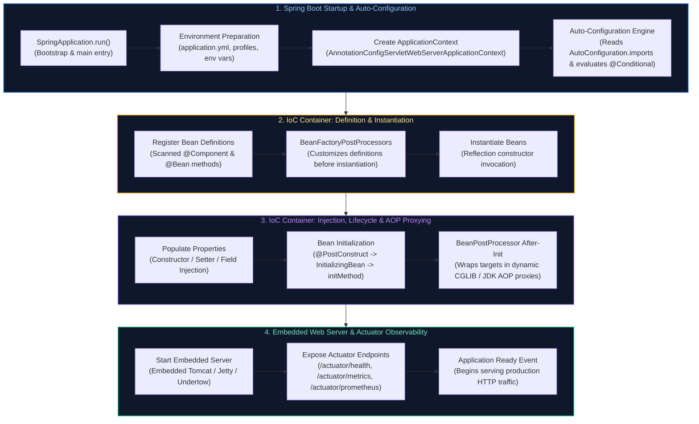

---

## Table of Contents
1. [Spring Core & Inversion of Control (IoC)](#1-spring-core--inversion-of-control-ioc)
   - [1.1 Why Spring? The Evolution Beyond Heavyweight EJB](#11-why-spring-the-evolution-beyond-heavyweight-ejb)
   - [1.2 Inversion of Control (IoC) & The Hollywood Principle](#12-inversion-of-control-ioc--the-hollywood-principle)
   - [1.3 Dependency Injection (DI) Types: Constructor vs Setter vs Field Injection](#13-dependency-injection-di-types-constructor-vs-setter-vs-field-injection)
   - [1.4 `BeanFactory` vs `ApplicationContext` Architectural Differences & Internal Hierarchy](#14-beanfactory-vs-applicationcontext-architectural-differences--internal-hierarchy)
   - [1.5 Spring Bean Scopes & The Prototype-In-Singleton Injection Dilemma](#15-spring-bean-scopes--the-prototype-in-singleton-injection-dilemma)
2. [Stereotype Annotations, Scanning & Candidate Disambiguation](#2-stereotype-annotations-scanning--candidate-disambiguation)
   - [2.1 The Stereotype Family (`@Component`, `@Service`, `@Repository`, `@Controller`, `@RestController`)](#21-the-stereotype-family-component-service-repository-controller-restcontroller)
   - [2.2 Disambiguation: `@Autowired`, `@Primary`, and `@Qualifier`](#22-disambiguation-autowired-primary-and-qualifier)
   - [2.3 Multi-Bean Injection & The Dynamic Strategy Pattern](#23-multi-bean-injection--the-dynamic-strategy-pattern)
   - [2.4 Circular Dependencies: The Three-Level Cache, Spring Boot 2.6+ Ban & Architectural Remedies](#24-circular-dependencies-the-three-level-cache-spring-boot-26-ban--architectural-remedies)
3. [The Spring Bean Lifecycle & Container Extension Points](#3-the-spring-bean-lifecycle--container-extension-points)
   - [3.1 The Complete 12-Phase Spring Bean Lifecycle](#31-the-complete-12-phase-spring-bean-lifecycle)
   - [3.2 Lifecycle Hooks: `@PostConstruct`, `InitializingBean`, and `@PreDestroy`](#32-lifecycle-hooks-postconstruct-initializingbean-and-predestroy)
   - [3.3 `BeanFactoryPostProcessor` vs `BeanPostProcessor` vs `FactoryBean<T>`](#33-beanfactorypostprocessor-vs-beanpostprocessor-vs-factorybeant)
   - [3.4 Hands-on Deep Dive: Custom BeanPostProcessor for Field Encryption/Masking](#34-hands-on-deep-dive-custom-beanpostprocessor-for-field-encryptionmasking)
4. [Application Configuration & Enterprise Secret Management](#4-application-configuration--enterprise-secret-management)
   - [4.1 Java Configuration: `@Configuration` (Full Mode) vs `@Component` (Lite Mode)](#41-java-configuration-configuration-full-mode-vs-component-lite-mode)
   - [4.2 Multi-Environment Profiles (`@Profile`) & Configuration Hierarchies](#42-multi-environment-profiles-profile--configuration-hierarchies)
   - [4.3 Externalized Configuration: `@Value` vs `@ConfigurationProperties` with Records & JSR-380](#43-externalized-configuration-value-vs-configurationproperties-with-records--jsr-380)
   - [4.4 Conditional Bean Registration (`@ConditionalOnProperty`, `@ConditionalOnClass`, `@ConditionalOnMissingBean`)](#44-conditional-bean-registration-conditionalonproperty-conditionalonclass-conditionalonmissingbean)
   - [4.5 In-Process Application Events (`ApplicationEventPublisher`, `@EventListener`, `@TransactionalEventListener`)](#45-in-process-application-events-applicationeventpublisher-eventlistener-transactionaleventlistener)
5. [Aspect-Oriented Programming (AOP) & Proxy Internals](#5-aspect-oriented-programming-aop--proxy-internals)
   - [5.1 Core AOP Concepts: Aspect, Advice, JoinPoint, and Pointcut](#51-core-aop-concepts-aspect-advice-joinpoint-and-pointcut)
   - [5.2 JDK Dynamic Proxies vs CGLIB Proxies Under the Hood](#52-jdk-dynamic-proxies-vs-cglib-proxies-under-the-hood)
   - [5.3 The Self-Invocation Proxy Bypass Trap & Production Solutions](#53-the-self-invocation-proxy-bypass-trap--production-solutions)
   - [5.4 Enterprise Implementation: Custom Distributed Rate-Limiting & Performance Aspect](#54-enterprise-implementation-custom-distributed-rate-limiting--performance-aspect)
6. [Spring Boot Architecture, Bootstrapping & Modern Runtime](#6-spring-boot-architecture-bootstrapping--modern-runtime)
   - [6.1 What Problem Does Spring Boot Solve?](#61-what-problem-does-spring-boot-solve)
   - [6.2 Deconstructing `@SpringBootApplication` & Bootstrap Sequence](#62-deconstructing-springbootapplication--bootstrap-sequence)
   - [6.3 The Auto-Configuration Engine (`AutoConfiguration.imports` & Condition Evaluation)](#63-the-auto-configuration-engine-autoconfigurationimports--condition-evaluation)
   - [6.4 Developing a Production-Ready Custom Spring Boot Starter](#64-developing-a-production-ready-custom-spring-boot-starter)
   - [6.5 Embedded Web Servers (Tomcat, Jetty, Undertow) & Graceful Shutdown](#65-embedded-web-servers-tomcat-jetty-undertow--graceful-shutdown)
   - [6.6 Spring Boot 3 AOT Compilation & GraalVM Native Images](#66-spring-boot-3-aot-compilation--graalvm-native-images)
7. [Spring Boot Actuator & Production Operations](#7-spring-boot-actuator--production-operations)
   - [7.1 Key Actuator Endpoints (`/health`, `/metrics`, `/loggers`, `/env`, `/threaddump`)](#71-key-actuator-endpoints-health-metrics-loggers-env-threaddump)
   - [7.2 Kubernetes Liveness & Readiness Probes (`AvailabilityChangeEvent`)](#72-kubernetes-liveness--readiness-probes-availabilitychangeevent)
   - [7.3 Custom Actuator Management Endpoints (`@Endpoint`, `@ReadOperation`, `@WriteOperation`)](#73-custom-actuator-management-endpoints-endpoint-readoperation-writeoperation)
   - [7.4 Custom Micrometer Observability (Gauges, Counters, Timers)](#74-custom-micrometer-observability-gauges-counters-timers)
   - [7.5 Dynamic Runtime Log Level Switching & Securing Actuator Endpoints](#75-dynamic-runtime-log-level-switching--securing-actuator-endpoints)
8. [Production Troubleshooting Playbook](#8-production-troubleshooting-playbook)
9. [Spring MVC Architecture & Request Processing Pipeline](#9-spring-mvc-architecture--request-processing-pipeline)
   - [9.1 The Front Controller Pattern & `DispatcherServlet`](#91-the-front-controller-pattern--dispatcherservlet)
   - [9.2 End-to-End HTTP Request Lifecycle Sequence](#92-end-to-end-http-request-lifecycle-sequence)
   - [9.3 `HandlerInterceptor` Lifecycle & ThreadLocal Context Cleanup](#93-handlerinterceptor-lifecycle--threadlocal-context-cleanup)
   - [9.4 Custom `HandlerMethodArgumentResolver` Implementation](#94-custom-handlermethodargumentresolver-implementation)
   - [9.5 `HttpMessageConverter` & Jackson Serialization Tuning](#95-httpmessageconverter--jackson-serialization-tuning)
   - [9.6 Asynchronous HTTP Processing (`DeferredResult`, `CompletableFuture`, `SseEmitter`)](#96-asynchronous-http-processing-deferredresult-completablefuture-sseemitter)
10. [HTTP Protocols, Methods Taxonomy & Safety vs Idempotence](#10-http-protocols-methods-taxonomy--safety-vs-idempotence)
   - [10.1 REST Architectural Constraints & Resource Modeling](#101-rest-architectural-constraints--resource-modeling)
   - [10.2 Transport Protocol Evolution: HTTP/1.1 vs HTTP/2 vs HTTP/3 (QUIC)](#102-transport-protocol-evolution-http11-vs-http2-vs-http3-quic)
   - [10.3 Comprehensive HTTP Methods Taxonomy (`GET`, `POST`, `PUT`, `PATCH`, `DELETE`, `OPTIONS`, `HEAD`)](#103-comprehensive-http-methods-taxonomy-get-post-put-patch-delete-options-head)
   - [10.4 Deep-Dive: Safety vs Idempotence & The `DELETE` 404 Paradox](#104-deep-dive-safety-vs-idempotence--the-delete-404-paradox)
   - [10.5 Partial Updates: JSON Merge Patch (RFC 7396) vs JSON Patch (RFC 6902)](#105-partial-updates-json-merge-patch-rfc-7396-vs-json-patch-rfc-6902)
   - [10.6 `OPTIONS` Method & CORS Preflight Handshake Mechanics](#106-options-method--cors-preflight-handshake-mechanics)
   - [10.7 HTTP Status Codes Reference Matrix (2xx, 3xx, 4xx, 5xx)](#107-http-status-codes-reference-matrix-2xx-3xx-4xx-5xx)
   - [10.8 Content Negotiation (`Accept` & `Content-Type`)](#108-content-negotiation-accept--content-type)
11. [Production API Idempotency Architecture](#11-production-api-idempotency-architecture)
   - [11.1 The Idempotency-Key Pattern & IETF Standard Specification](#111-the-idempotency-key-pattern--ietf-standard-specification)
   - [11.2 Idempotency Lifecycle State Machine](#112-idempotency-lifecycle-state-machine)
   - [11.3 Production Spring Boot Idempotency Filter with Redis & Payload SHA-256 Hashing](#113-production-spring-boot-idempotency-filter-with-redis--payload-sha-256-hashing)
   - [11.4 Database-Level Idempotency Patterns (Unique Constraints, Conditional Updates, Upserts, Advisory Locks)](#114-database-level-idempotency-patterns-unique-constraints-conditional-updates-upserts-advisory-locks)
12. [Spring MVC Web Annotations](#12-spring-mvc-web-annotations)
   - [12.1 Controller Stereotypes: `@Controller` vs `@RestController`](#121-controller-stereotypes-controller-vs-restcontroller)
   - [12.2 Routing Mappings (`@GetMapping`, `@PostMapping`, `@PutMapping`, `@DeleteMapping`, `@PatchMapping`)](#122-routing-mappings-getmapping-postmapping-putmapping-deletemapping-patchmapping)
   - [12.3 Extracting Input: `@PathVariable`, `@RequestParam`, `@RequestBody`, `@RequestHeader`, `@CookieValue`](#123-extracting-input-pathvariable-requestparam-requestbody-requestheader-cookievalue)
13. [DTOs & Jakarta Bean Validation](#13-dtos--jakarta-bean-validation)
   - [13.1 Entity vs DTO Separation of Concerns & Mass Assignment Defense](#131-entity-vs-dto-separation-of-concerns--mass-assignment-defense)
   - [13.2 Bean Validation Annotations (`@NotNull`, `@NotBlank`, `@Size`, `@Pattern`)](#132-bean-validation-annotations-notnull-notblank-size-pattern)
   - [13.3 `@Valid` vs `@Validated` & Group Validation (`OnCreate`, `OnUpdate`)](#133-valid-vs-validated--group-validation-oncreate-onupdate)
   - [13.4 Custom Constraint Validators (e.g. ISO Country Code, Business Tax ID)](#134-custom-constraint-validators-eg-iso-country-code-business-tax-id)
14. [Advanced API Capabilities & Modern Clients](#14-advanced-api-capabilities--modern-clients)
   - [14.1 Pagination, Sorting & Cursor/Keyset Pagination](#141-pagination-sorting--cursorkeyset-pagination)
   - [14.2 API Versioning Strategies (URI, Header, Media Type)](#142-api-versioning-strategies-uri-header-media-type)
   - [14.3 OpenAPI 3 / Swagger Documentation (SpringDoc)](#143-openapi-3--swagger-documentation-springdoc)
   - [14.4 Modern HTTP Clients: `RestClient`, `WebClient`, and Spring 6 `@HttpExchange`](#144-modern-http-clients-restclient-webclient-and-spring-6-httpexchange)
   - [14.5 Cross-Origin Resource Sharing (CORS) Security Configuration](#145-cross-origin-resource-sharing-cors-security-configuration)
15. [API Error Handling & Resilience](#15-api-error-handling--resilience)
   - [15.1 Centralized Exception Handling (`@RestControllerAdvice`)](#151-centralized-exception-handling-restcontrolleradvice)
   - [15.2 RFC 9457 Standard Problem Details](#152-rfc-9457-standard-problem-details)
   - [15.3 REST API Diagnostic cURL Commands Cheatsheet](#153-rest-api-diagnostic-curl-commands-cheatsheet)
16. [API Communication Paradigms: REST vs RPC vs gRPC & Protocol Buffers](#16-api-communication-paradigms-rest-vs-rpc-vs-grpc--protocol-buffers)
   - [16.1 API Communication Paradigms (Resource-Oriented REST vs Action-Oriented RPC)](#161-api-communication-paradigms-resource-oriented-rest-vs-action-oriented-rpc)
   - [16.2 gRPC Internals: HTTP/2 Transport & Binary Protocol Buffers](#162-grpc-internals-http2-transport--binary-protocol-buffers)
   - [16.3 gRPC Communication Modes (Unary, Server, Client, Bidirectional Streaming)](#163-grpc-communication-modes-unary-server-client-bidirectional-streaming)
   - [16.4 Production gRPC Java Implementation (`.proto` Definition, ServiceBase, Stubs)](#164-production-grpc-java-implementation-proto-definition-servicebase-stubs)
   - [16.5 Comprehensive Evaluation: REST vs gRPC Architecture Comparison Matrix](#165-comprehensive-evaluation-rest-vs-grpc-architecture-comparison-matrix)
17. [Production Troubleshooting Playbook](#8-production-troubleshooting-playbook)
18. [Summary Comparison & Production Engineering Reference Matrix](#18-summary-comparison--production-engineering-reference-matrix)
19. [References & Further Reading](#19-references--further-reading)

---

# 1. Spring Core & Inversion of Control (IoC)

---

### 1.1 Why Spring? The Evolution Beyond Heavyweight EJB

In the late 1990s and early 2000s, enterprise Java development was dominated by **Enterprise JavaBeans (EJB 2.x)**:
* To implement a simple business object, developers had to inherit from heavyweight EJB base interfaces, create distinct Home and Remote interfaces, and maintain voluminous XML deployment descriptors.
* Code could not be tested outside of proprietary, memory-hungry application servers (such as WebLogic, WebSphere, or JBoss). A single test run required building an enterprise archive (`.ear`), booting a server taking several minutes, and executing complex JNDI lookups.
* Objects were tightly coupled to framework APIs. If the vendor upgraded or changed specifications, code broke immediately.

In 2002, Rod Johnson published *Expert One-on-One J2EE Design and Development*, challenging the orthodoxy. He argued that enterprise applications did not need bloated application servers. Instead, enterprise capabilities—declarative transactions, persistence management, security, and remoting—could be applied to lightweight **Plain Old Java Objects (POJOs)** using a non-intrusive container. This codebase evolved into the **Spring Framework**.

Spring decoupled enterprise software architecture from proprietary infrastructure. It allowed developers to build modular, highly decoupled systems using pure Java objects, relying on **Inversion of Control (IoC)** to connect components and **Aspect-Oriented Programming (AOP)** to layer cross-cutting infrastructure concerns on top.

---

### 1.2 Inversion of Control (IoC) & The Hollywood Principle

**Inversion of Control (IoC)** is an architectural pattern in which the control flow of a program is inverted relative to traditional procedural code. In standard procedural programming, your code controls its own lifecycle: when an object needs a database connection, an encryption utility, or an HTTP client, it directly creates that dependency using the `new` operator.

Under IoC, control is inverted: a central container creates the objects, wires them together with their required dependencies, manages their lifecycles, and invokes them when events or requests occur.

> [!NOTE]
> **The Hollywood Principle**: *"Don't call us, we'll call you."*
> In traditional programming, your class calls the factory or invokes `new PostgresOrderRepository()`. Under IoC, your class simply declares what it requires (e.g., via a constructor), and the container **calls your class** to provide those dependencies.

#### Real-World Mental Model: The Commercial Kitchen vs The Solo Chef
Imagine a chef in a restaurant:
* **Without IoC (Solo Chef)**: The chef must leave the kitchen, drive to the farm, harvest tomatoes, butcher cattle, return to the kitchen, forge a knife, cook the steak, and serve the customer. The chef is tightly coupled to raw ingredient creation, logistics, and tooling. If the tomato farm closes, the chef cannot cook.
* **With IoC (Commercial Kitchen with Supply Chain)**: The chef stands at the cooking station and simply requests ingredients: `public Chef(Steak steak, Tomatoes tomatoes, ChefKnife knife)`. The restaurant's logistics department (the IoC container) procures the certified ingredients, inspects them, and delivers them directly to the chef's counter. The chef focuses 100% on pure culinary domain logic.

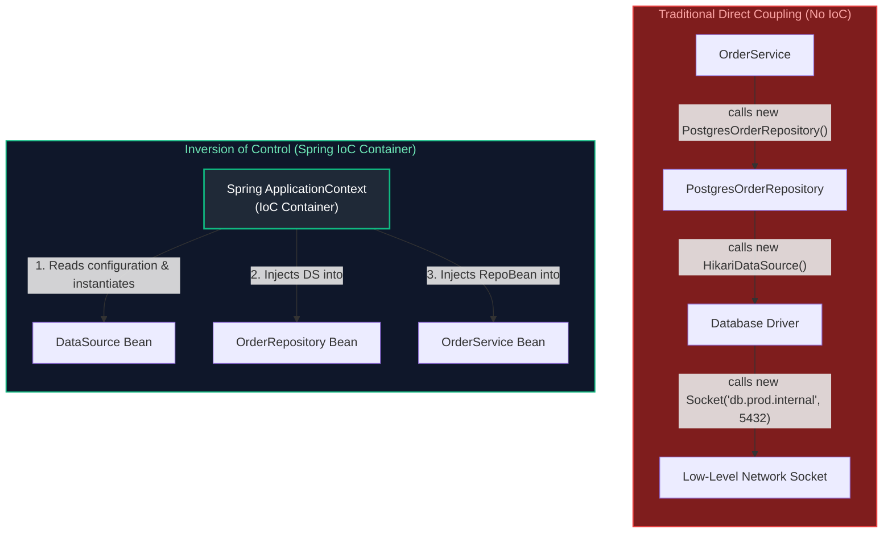

#### Why IoC is Vital for Enterprise Systems:
1. **Loose Coupling**: Business services depend only on interfaces (`OrderRepository`), never concrete database implementations (`PostgresOrderRepository`). Switching to MongoDB, Cassandra, or an in-memory test store requires zero changes to core business code.
2. **Deterministic Testability**: Unit tests can instantiate the target class using `new OrderService(mockRepo, mockPayment)` with Mockito mocks. No heavyweight Spring context or live database connections are required for fast, isolated tests.
3. **Transparent Infrastructure Augmentation**: Because the container controls instantiation, it can wrap objects in dynamic proxies. This allows transactions (`@Transactional`), security checks (`@PreAuthorize`), and performance metrics (`@Timed`) to be applied without cluttering business logic.

---

### 1.3 Dependency Injection (DI) Types: Constructor vs Setter vs Field Injection

Dependency Injection (DI) is the specific design pattern through which the IoC container fulfills a component's dependencies. In the Java ecosystem, three primary DI mechanisms exist:

| Injection Style | Syntax Pattern | Immutability (`final`) | Null Safety / Testability | Circular Reference Handling | Production Recommendation |
| :--- | :--- | :---: | :---: | :---: | :--- |
| **Constructor Injection** | `public OrderService(Repo r) { this.r = r; }` | **YES** | **Outstanding** (Plain JUnit without Spring) | Fails Fast at startup (Detects cycles immediately) | **MANDATORY DEFAULT** |
| **Setter Injection** | `public void setRepo(Repo r) { this.r = r; }` | NO | Moderate (Risk of `NullPointerException` before setter call) | Resolves via multi-phase initialization | Optional or reconfigurable dependencies only |
| **Field Injection** | `@Autowired private Repo r;` | NO | **Terrible** (Requires reflection to test) | Masked until runtime | **BANNED / ANTI-PATTERN** |

#### Why Field Injection (`@Autowired private MyService service;`) is an Enterprise Anti-Pattern:
1. **Breaks Immutability**: Injected fields cannot be marked `final`. Objects are mutable after instantiation, introducing thread-safety risks in concurrent web applications.
2. **Hides Class Dependencies**: A class using field injection conceals its dependencies from outside consumers. Looking at the public API (`public OrderService()`), you cannot determine what the class requires to function.
3. **Prevents Plain Unit Testing**: You cannot test the class with `new OrderService()`. To inject a mock, you must boot the entire Spring context (slowing test execution from 2 milliseconds to 5 seconds) or rely on reflection utilities like `ReflectionTestUtils.setField()`, which breaks encapsulation.
4. **Obscures Single Responsibility Principle (SRP) Violations**: It is deceptively easy to add 15 `@Autowired` private fields to a service without noticing. With constructor injection, a constructor with 15 parameters immediately signals a code smell that the class has taken on too many responsibilities.

#### Production Standard: Constructor Injection with Lombok or Explicit Records

```java
package com.enterprise.order.service;

import com.enterprise.order.domain.Order;
import com.enterprise.order.domain.OrderResponse;
import com.enterprise.order.domain.CreateOrderRequest;
import com.enterprise.order.repository.OrderRepository;
import com.enterprise.payment.service.PaymentGateway;
import com.enterprise.notification.service.NotificationService;
import org.springframework.stereotype.Service;

import java.util.Objects;

@Service
public class OrderService {

    // All dependencies are explicitly declared final to guarantee immutability
    private final OrderRepository orderRepository;
    private final PaymentGateway paymentGateway;
    private final NotificationService notificationService;

    // In modern Spring (4.3+), if a class defines a single constructor,
    // the @Autowired annotation is completely OPTIONAL. Spring automatically invokes it.
    public OrderService(OrderRepository orderRepository,
                        PaymentGateway paymentGateway,
                        NotificationService notificationService) {
        this.orderRepository = Objects.requireNonNull(orderRepository, "orderRepository must not be null");
        this.paymentGateway = Objects.requireNonNull(paymentGateway, "paymentGateway must not be null");
        this.notificationService = Objects.requireNonNull(notificationService, "notificationService must not be null");
    }

    public OrderResponse createOrder(CreateOrderRequest request) {
        // Business logic execution...
        Order order = new Order(request.customerId(), request.items(), request.totalAmount());
        Order savedOrder = orderRepository.save(order);
        
        paymentGateway.charge(savedOrder.getId(), savedOrder.getTotalAmount());
        notificationService.sendOrderConfirmation(savedOrder);
        
        return new OrderResponse(savedOrder.getId(), "CONFIRMED");
    }
}
```

```java
// Testing OrderService requires ZERO Spring infrastructure!
class OrderServiceTest {

    private OrderRepository orderRepository;
    private PaymentGateway paymentGateway;
    private NotificationService notificationService;
    private OrderService orderService;

    @BeforeEach
    void setUp() {
        orderRepository = Mockito.mock(OrderRepository.class);
        paymentGateway = Mockito.mock(PaymentGateway.class);
        notificationService = Mockito.mock(NotificationService.class);
        // Direct constructor instantiation: fast, deterministic, pure Java!
        orderService = new OrderService(orderRepository, paymentGateway, notificationService);
    }

    @Test
    void shouldCreateOrderSuccessfully() {
        CreateOrderRequest request = new CreateOrderRequest("CUST-1", List.of(), new BigDecimal("100.00"));
        when(orderRepository.save(any())).thenReturn(new Order("ORD-99", "CUST-1", List.of(), new BigDecimal("100.00")));

        OrderResponse response = orderService.createOrder(request);

        assertThat(response.status()).isEqualTo("CONFIRMED");
        verify(paymentGateway, times(1)).charge(eq("ORD-99"), any());
    }
}
```

---

### 1.4 `BeanFactory` vs `ApplicationContext` Architectural Differences & Internal Hierarchy

Spring separates its container design into two fundamental interface hierarchies:

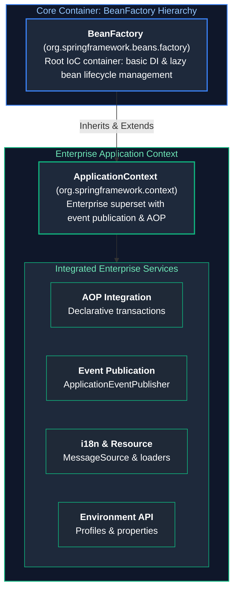

| Dimension | `BeanFactory` | `ApplicationContext` |
| :--- | :--- | :--- |
| **Package** | `org.springframework.beans.factory` | `org.springframework.context` |
| **Instantiation Strategy** | **Lazy Initialization**: Beans are instantiated only when explicitly requested via `getBean()`. | **Eager Pre-Instantiation**: All singleton beans are constructed, wired, initialized, and validated during application startup. |
| **Fail-Fast Behavior** | **Late Failure**: Misconfigured dependencies or missing beans fail at runtime when a user request triggers bean lookup. | **Fail-Fast**: Configuration errors, missing beans, or unresolvable properties immediately abort startup, preventing broken deployments. |
| **Enterprise Features** | Core DI and lifecycle only. No AOP proxy auto-generation, no event publisher, no profile management. | Full AOP proxy generation, `ApplicationEventPublisher`, internationalization (`MessageSource`), Actuator integration. |
| **Memory Footprint** | Extremely lightweight ($\sim 1\text{ MB}$ overhead). | Slightly higher overhead due to event multicaster, environment state, and eager singletons. |
| **Production Use** | Ultra-constrained IoT / embedded edge environments ($< 32\text{ MB}$ total heap). | **Standard runtime for 100% of modern Spring Boot production enterprise applications**. |

#### Key ApplicationContext Implementations in Spring Boot:
* **`AnnotationConfigServletWebServerApplicationContext`**: Used by standard Spring Boot Web (Spring MVC + Embedded Tomcat/Jetty).
* **`AnnotationConfigReactiveWebServerApplicationContext`**: Used by Spring Boot Reactive (Spring WebFlux + Netty).
* **`AnnotationConfigApplicationContext`**: Used in standalone, non-web command-line applications or background workers.

---

### 1.5 Spring Bean Scopes & The Prototype-In-Singleton Injection Dilemma

Spring provides five core bean scopes that control instance lifecycle and visibility:

1. **`singleton` (Default Scope)**: Exactly **one instance** per Spring IoC container (`ApplicationContext`).
   * *Concurrency Warning*: Singleton beans are shared across all concurrent request threads. They **must be stateless** or use thread-safe data structures (`ConcurrentHashMap`, atomic primitives). Never store user-specific request state in instance variables of a singleton bean!
2. **`prototype`**: A **new instance** is created every time the bean is requested from the container (via injection or `getBean()`).
   * *Memory Warning*: Spring creates prototype beans and executes their `@PostConstruct` hooks, but **does not manage their destruction** (`@PreDestroy` is never called on prototypes). Holding references to prototypes will cause memory leaks.
3. **`request` (Web-aware)**: Exactly one instance created per HTTP request lifecycle. Destroyed automatically when the HTTP response completes.
4. **`session` (Web-aware)**: Exactly one instance per HTTP session. Survives multiple HTTP requests from the same user session.
5. **`application` (Web-aware)**: Exactly one instance per `ServletContext` lifecycle (similar to singleton, but tied to the servlet container level).

#### The Prototype-in-Singleton Injection Dilemma
A classic production bug occurs when a developer injects a `@Scope("prototype")` bean directly into a `@Scope("singleton")` bean:

```java
@Component
@Scope(ConfigurableBeanFactory.SCOPE_PROTOTYPE)
public class TokenGenerator {
    private final String tokenId = UUID.randomUUID().toString();
    public String getTokenId() { return tokenId; }
}

@Service // Singleton scope by default!
public class AuthenticationService {

    private final TokenGenerator tokenGenerator;

    // ❌ CRITICAL BUG: Constructor injection happens EXACTLY ONCE at application startup!
    // The singleton AuthenticationService receives a single TokenGenerator instance on boot.
    // Every subsequent request will receive the EXACT SAME tokenId, completely neutralizing the prototype scope!
    public AuthenticationService(TokenGenerator tokenGenerator) {
        this.tokenGenerator = tokenGenerator;
    }

    public String issueToken() {
        return tokenGenerator.getTokenId(); // Always returns the startup UUID!
    }
}
```

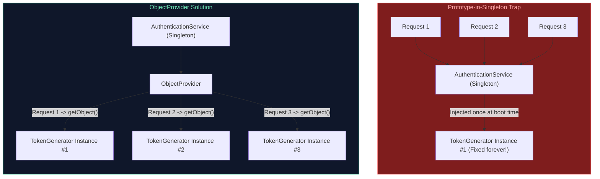

#### Production Solutions:

##### Solution 1: `ObjectProvider<T>` (Recommended Standard)
`ObjectProvider<T>` is a type-safe variant of `BeanFactory` lookup that defers instantiation until runtime:

```java
@Service
public class AuthenticationService {

    private final ObjectProvider<TokenGenerator> tokenGeneratorProvider;

    public AuthenticationService(ObjectProvider<TokenGenerator> tokenGeneratorProvider) {
        this.tokenGeneratorProvider = tokenGeneratorProvider;
    }

    public String issueToken() {
        // getObject() reaches back into the IoC container to create a fresh prototype instance
        TokenGenerator freshGenerator = tokenGeneratorProvider.getObject();
        return freshGenerator.getTokenId();
    }
}
```

##### Solution 2: Scoped Proxies (`proxyMode = ScopedProxyMode.TARGET_CLASS`)
Spring generates a dynamic CGLIB proxy around the prototype bean. When the singleton invokes a method on the proxy, the proxy delegates to a brand-new target instance:

```java
@Component
@Scope(value = ConfigurableBeanFactory.SCOPE_PROTOTYPE, proxyMode = ScopedProxyMode.TARGET_CLASS)
public class TokenGenerator {
    private final String tokenId = UUID.randomUUID().toString();
    public String getTokenId() { return tokenId; }
}

@Service
public class AuthenticationService {
    private final TokenGenerator tokenGenerator; // Injected as a CGLIB proxy

    public AuthenticationService(TokenGenerator tokenGenerator) {
        this.tokenGenerator = tokenGenerator;
    }

    public String issueToken() {
        // Calling tokenGenerator.getTokenId() goes through the CGLIB proxy,
        // which retrieves a fresh instance from the ApplicationContext!
        return tokenGenerator.getTokenId();
    }
}
```

##### Solution 3: Method Injection via `@Lookup`
Spring dynamically subclasses the singleton bean at runtime using CGLIB, overriding the abstract `@Lookup` method to return a fresh prototype from `ApplicationContext`:

```java
@Service
public abstract class AuthenticationService {

    @Lookup
    public abstract TokenGenerator getTokenGenerator();

    public String issueToken() {
        return getTokenGenerator().getTokenId();
    }
}
```

> [!TIP]
> **Deep-Dive Interview Scenarios:**
> - [Q6. `@Bean` vs `@Autowired` in Dependency & Database Management](frequently_asked_questions/05_spring_boot_and_rest_apis_faq.md#q6-easy-bean-vs-autowired-in-dependency--database-management)
> - [Q39. Configuring Multiple DataSources (Primary vs Secondary) with Segregated EntityManagerFactories and JpaTransactionManagers in Spring Boot](frequently_asked_questions/05_spring_boot_and_rest_apis_faq.md#q39-hard-configuring-multiple-datasources-primary-vs-secondary-with-segregated-entitymanagerfactories-and-jpatransactionmanagers-in-spring-boot)

---

# 2. Stereotype Annotations, Scanning & Candidate Disambiguation

---

### 2.1 The Stereotype Family (`@Component`, `@Service`, `@Repository`, `@Controller`, `@RestController`)

Stereotype annotations are specialized forms of `@Component` that assign clear architectural roles within a multi-tier enterprise application:

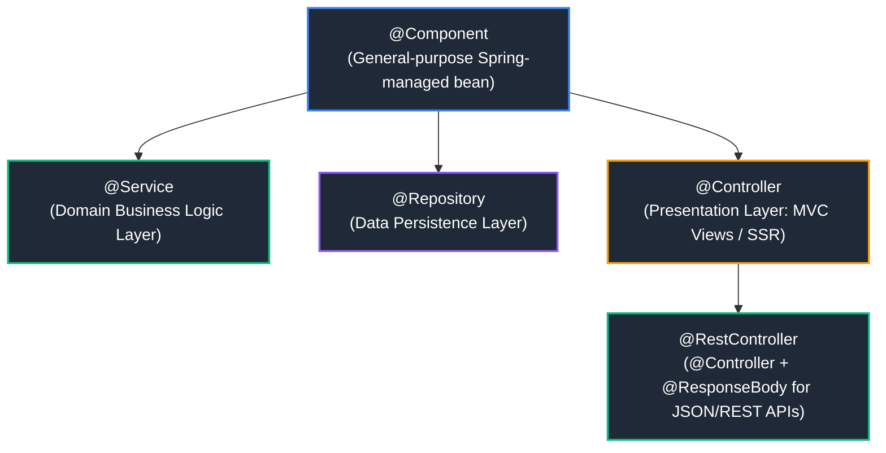

#### Stereotype Responsibilities:
* **`@Component`**: The root stereotype. Any class annotated with `@Component` is picked up during component scanning and registered as a Spring bean definition.
* **`@Service`**: Semantically identifies classes containing core domain business logic, orchestration, and transaction boundaries (`@Transactional`). Contains no technical behavioral differences from `@Component`, but communicates architectural intent.
* **`@Repository`**: Semantically identifies classes interacting with persistent storage (databases, key-value stores).
  * **Special Architectural Behavior**: In addition to component scanning, `@Repository` triggers Spring's `PersistenceExceptionTranslationPostProcessor`. This post-processor automatically intercepts low-level database exceptions (e.g., vendor-specific `SQLException`, Hibernate's `HibernateException`, or MongoDB exceptions) and translates them into Spring's unified, unchecked **`DataAccessException` hierarchy** (e.g., `DuplicateKeyException`, `CannotAcquireLockException`, `DataIntegrityViolationException`). This prevents lower-layer database driver exceptions from leaking into business services.
* **`@Controller`**: Presentation layer component responsible for routing incoming HTTP requests, model preparation, and dispatching views (JSP, Thymeleaf).
* **`@RestController`**: Meta-annotation combining `@Controller` and `@ResponseBody`. Informs Spring's `HandlerAdapter` that every controller method serializes return objects directly into the HTTP response body (typically via Jackson JSON) rather than rendering an HTML view template.

---

### 2.2 Disambiguation: `@Autowired`, `@Primary`, and `@Qualifier`

When multiple beans implement the same interface, Spring's IoC container cannot determine which candidate to inject by type alone. Without explicit instructions, startup crashes with a `NoUniqueBeanDefinitionException`:

```
Parameter 0 of constructor in com.enterprise.order.service.CheckoutService 
required a single bean of type 'com.enterprise.payment.service.PaymentGateway', 
but 2 were found: [stripeGateway, payPalGateway]
```

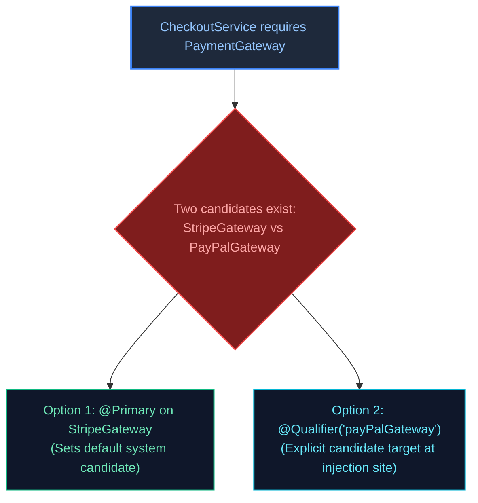

#### Production Resolution Strategies:

```java
public interface PaymentGateway {
    void processPayment(BigDecimal amount);
}

@Component("stripe")
@Primary // Strategy 1: Makes Stripe the default candidate if no qualifier is specified
public class StripeGateway implements PaymentGateway {
    @Override
    public void processPayment(BigDecimal amount) {
        // Stripe integration logic
    }
}

@Component("paypal")
public class PayPalGateway implements PaymentGateway {
    @Override
    public void processPayment(BigDecimal amount) {
        // PayPal integration logic
    }
}

@Service
public class CheckoutService {

    private final PaymentGateway defaultGateway;
    private final PaymentGateway payPalGateway;

    public CheckoutService(
            PaymentGateway defaultGateway, // Injects StripeGateway due to @Primary
            @Qualifier("paypal") PaymentGateway payPalGateway // Injects PayPalGateway via explicit qualifier
    ) {
        this.defaultGateway = defaultGateway;
        this.payPalGateway = payPalGateway;
    }
}
```

---

### 2.3 Multi-Bean Injection & The Dynamic Strategy Pattern

Spring provides native support for the **Strategy Pattern**. If you inject a collection (`List<Interface>` or `Map<String, Interface>`), Spring automatically discovers and injects **all beans** implementing that interface:

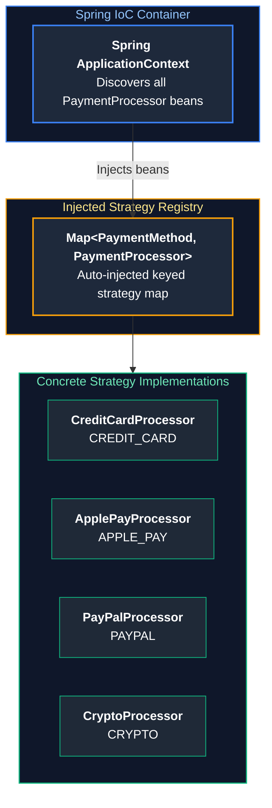

#### Production Implementation: Pluggable Payment Routing Engine
```java
public enum PaymentMethod { CREDIT_CARD, APPLE_PAY, PAYPAL, CRYPTO }

public interface PaymentProcessor {
    PaymentMethod getSupportedMethod();
    void executeTransaction(String transactionId, BigDecimal amount);
}

@Component
public class CreditCardProcessor implements PaymentProcessor {
    @Override public PaymentMethod getSupportedMethod() { return PaymentMethod.CREDIT_CARD; }
    @Override public void executeTransaction(String txId, BigDecimal amount) { /* ... */ }
}

@Component
public class ApplePayProcessor implements PaymentProcessor {
    @Override public PaymentMethod getSupportedMethod() { return PaymentMethod.APPLE_PAY; }
    @Override public void executeTransaction(String txId, BigDecimal amount) { /* ... */ }
}

@Service
public class PaymentRoutingService {

    private final Map<PaymentMethod, PaymentProcessor> processorMap;

    // Spring discovers all beans implementing PaymentProcessor and passes them as a List.
    // The constructor transforms the list into an immutable lookup Map for O(1) strategy dispatch!
    public PaymentRoutingService(List<PaymentProcessor> processors) {
        this.processorMap = processors.stream()
                .collect(Collectors.toUnmodifiableMap(
                        PaymentProcessor::getSupportedMethod,
                        Function.identity()
                ));
    }

    public void processOrderPayment(PaymentMethod method, String txId, BigDecimal amount) {
        PaymentProcessor processor = processorMap.get(method);
        if (processor == null) {
            throw new UnsupportedOperationException("No processor registered for method: " + method);
        }
        processor.executeTransaction(txId, amount);
    }
}
```

---

### 2.4 Circular Dependencies: The Three-Level Cache, Spring Boot 2.6+ Ban & Architectural Remedies

A circular dependency occurs when Bean A requires Bean B, and Bean B directly or indirectly requires Bean A:

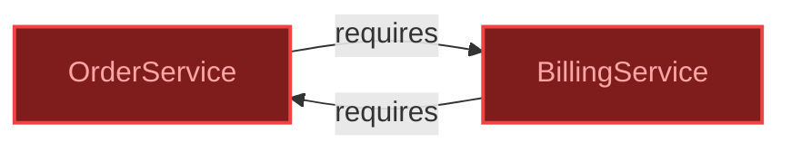

#### How Spring Solved This Historically: The Three-Level Cache
Inside `DefaultSingletonBeanRegistry`, Spring maintains three concurrent maps:
1. **Level 1 (`singletonObjects`)**: Holds fully initialized, ready-to-use singleton beans (`Map<String, Object>`).
2. **Level 2 (`earlySingletonObjects`)**: Holds early bean references (instantiated, but properties not yet injected and initialization hooks not yet run). Used to expose partially created instances to break cycles.
3. **Level 3 (`singletonFactories`)**: Holds ObjectFactories (`Map<String, ObjectFactory<?>>`). This level generates early AOP proxies if a bean requires dynamic proxy wrapping.

*Why constructor injection always failed with circular dependencies*:
The three-level cache relies on instantiating the object via its zero-argument constructor *first*, placing its factory into Level 3, and *then* populating properties. With **constructor injection**, Bean A cannot be instantiated until Bean B exists, and Bean B cannot be instantiated until Bean A exists. The JVM cannot allocate either object, throwing `BeanCurrentlyInCreationException`.

#### Spring Boot 2.6+ Circular Dependency Ban
Starting in **Spring Boot 2.6**, circular references between beans are **forbidden by default**. The application will fail to start:
```text
***************************
APPLICATION FAILED TO START
***************************
Description:
The dependencies of some of the beans in the application context form a cycle:

   orderService (field private billingService)
      ↓
   billingService (field private orderService)
      ↓
   orderService
```

#### Production Architectural Remedies:
1. **Domain Refactoring (Recommended Staff Standard)**: Circular dependencies are almost always symptomatic of flawed domain boundaries and violations of the Single Responsibility Principle. Extract the shared logic into an independent third service:

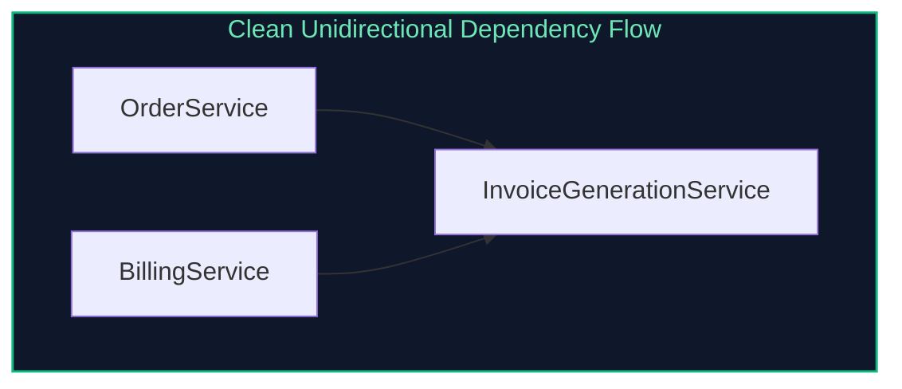

2. **Event-Driven Decoupling**: Replace the synchronous method call with an in-process `ApplicationEventPublisher`. `OrderService` publishes an `OrderCompletedEvent`, and `BillingService` listens via `@EventListener`. Neither service references the other.
3. **`@Lazy` Injection (Temporary Band-aid)**: Injecting `@Lazy` on one side tells Spring to inject a dynamic CGLIB proxy instead of the real bean. The proxy defers resolution of the target bean until a method is actually invoked at runtime:

```java
@Service
public class OrderService {
    private final BillingService billingService;

    public OrderService(@Lazy BillingService billingService) {
        this.billingService = billingService;
    }
}
```

> [!TIP]
> **Deep-Dive Interview Scenarios:**
> - [Q4. Stereotype Annotations (`@Component`, `@Service`, `@Repository`, `@Controller`) & Scanning](frequently_asked_questions/05_spring_boot_and_rest_apis_faq.md#q4-medium-stereotype-annotations-component-service-repository-controller--scanning)
> - [Q5. `@Primary` vs `@Qualifier`](frequently_asked_questions/05_spring_boot_and_rest_apis_faq.md#q5-easy-primary-vs-qualifier)

---

# 3. The Spring Bean Lifecycle & Container Extension Points

---

### 3.1 The Complete 12-Phase Spring Bean Lifecycle

Understanding the exact sequence of bean instantiation, property injection, initialization, and destruction is vital for building robust framework components and debugging startup anomalies:

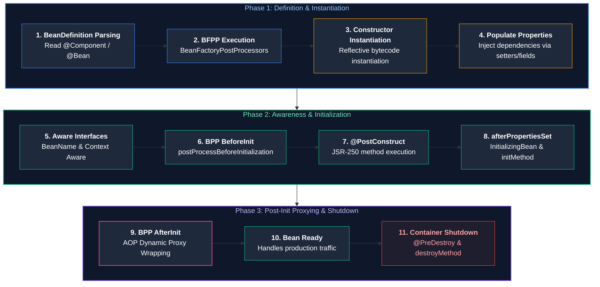

#### Detailed Phase Breakdown:
1. **BeanDefinition Parsing**: The container scans the classpath, parsing annotations (`@Component`, `@Service`, `@Bean`) into metadata structures called `BeanDefinition`. These record the bean class, scope, lazy initialization state, and dependency requirements.
2. **`BeanFactoryPostProcessor` Execution**: Intercepts the raw `BeanDefinition` metadata before any bean instances are constructed.
3. **Instantiation**: The JVM allocates heap memory and invokes the selected constructor via reflection.
4. **Populate Properties**: Dependencies are resolved and injected into the newly constructed bean.
5. **Aware Interfaces**: Spring injects container-level references if implemented:
   * `BeanNameAware`: Provides the bean's registered name in the context.
   * `BeanFactoryAware`: Provides the owning `BeanFactory`.
   * `ApplicationContextAware`: Provides the full `ApplicationContext`.
6. **`BeanPostProcessor.postProcessBeforeInitialization`**: Custom preprocessing on the bean instance.
7. **`@PostConstruct`**: JSR-250 annotation hook invoked after dependencies are injected.
8. **`InitializingBean.afterPropertiesSet`**: Spring framework-specific lifecycle callback.
9. **Custom `initMethod`**: User-defined initialization method defined on `@Bean(initMethod = "start")`.
10. **`BeanPostProcessor.postProcessAfterInitialization`**: **Critical AOP Phase**: Spring examines the initialized bean for annotations like `@Transactional`, `@Async`, or `@Aspect`, and wraps the raw bean in a dynamic proxy (CGLIB or JDK dynamic proxy).
11. **Bean Ready**: The bean is active and serving application traffic.
12. **Container Shutdown**: Initiated when the JVM receives a `SIGTERM` or the context closes:
   * `@PreDestroy` executes.
   * `DisposableBean.destroy()` executes.
   * Custom `destroyMethod` executes.

---

### 3.2 Lifecycle Hooks: `@PostConstruct`, `InitializingBean`, and `@PreDestroy`

```java
package com.enterprise.cache;

import jakarta.annotation.PostConstruct;
import jakarta.annotation.PreDestroy;
import org.slf4j.Logger;
import org.slf4j.LoggerFactory;
import org.springframework.beans.factory.DisposableBean;
import org.springframework.beans.factory.InitializingBean;
import org.springframework.stereotype.Component;

@Component
public class CacheWarmupManager implements InitializingBean, DisposableBean {

    private static final Logger log = LoggerFactory.getLogger(CacheWarmupManager.class);
    private final RedisClient redisClient;

    public CacheWarmupManager(RedisClient redisClient) {
        this.redisClient = redisClient;
        log.info("Phase 3 & 4: Constructor completed; dependencies injected.");
    }

    // JSR-250 Standard: Preferred modern approach
    @PostConstruct
    public void onPostConstruct() {
        log.info("Phase 7: @PostConstruct executing. Pre-loading reference data cache...");
        redisClient.primeCache();
    }

    // Spring Interface: Executes immediately after @PostConstruct
    @Override
    public void afterPropertiesSet() throws Exception {
        log.info("Phase 8: InitializingBean.afterPropertiesSet() validating Redis cluster ping...");
        if (!redisClient.isHealthy()) {
            throw new IllegalStateException("Redis cluster is unreachable during cache warmup!");
        }
    }

    // JSR-250 Shutdown Hook
    @PreDestroy
    public void onPreDestroy() {
        log.info("Phase 12: @PreDestroy executing. Flushing dirty buffers to disk...");
        redisClient.flushBuffers();
    }

    // Spring Interface Shutdown Hook
    @Override
    public void destroy() throws Exception {
        log.info("Phase 12: DisposableBean.destroy() disconnecting Redis client connection pool...");
        redisClient.disconnect();
    }
}
```

---

### 3.3 `BeanFactoryPostProcessor` vs `BeanPostProcessor` vs `FactoryBean<T>`

These three extension interfaces are frequently confused in technical interviews and codebases:

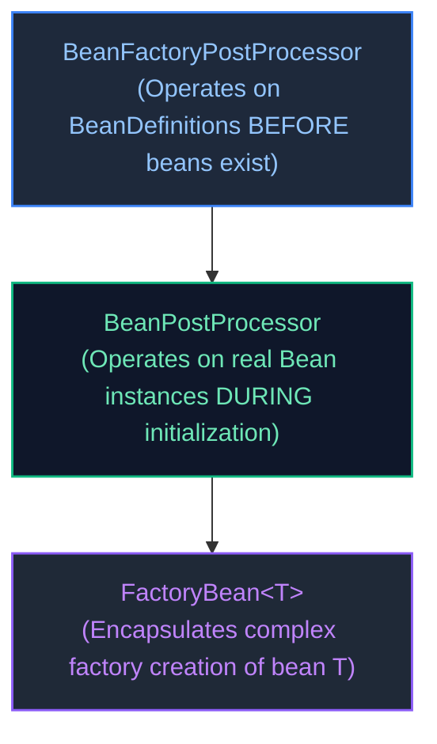

| Interface | Operates On | Execution Timing | Primary Enterprise Use Case |
| :--- | :--- | :--- | :--- |
| **`BeanFactoryPostProcessor`** | `BeanDefinition` metadata structures | **Before any beans are instantiated** | Resolving property placeholders (`${database.url}`) from `application.yml` via `PropertySourcesPlaceholderConfigurer`; registering dynamic bean definitions. |
| **`BeanPostProcessor`** | Actual **bean instances** | **During bean initialization** (before and after init hooks) | Inspecting custom annotations and wrapping beans in dynamic proxies (`@Transactional`, `@Async`, `@Cacheable`, security masking). |
| **`FactoryBean<T>`** | Factory producing complex bean `T` | On-demand when bean `T` is requested | Constructing complex third-party library objects requiring intricate setup (e.g., `LocalContainerEntityManagerFactoryBean`, Apache Kafka producer factories). |

---

### 3.4 Hands-on Deep Dive: Custom BeanPostProcessor for Field Encryption/Masking

A powerful use case for `BeanPostProcessor` in enterprise banking is automatically masking sensitive PII fields (credit cards, SSNs) returned from services:

```java
@Retention(RetentionPolicy.RUNTIME)
@Target(ElementType.METHOD)
public @interface MaskPII {}

@Component
public class PiiMaskingBeanPostProcessor implements BeanPostProcessor {

    private static final Logger log = LoggerFactory.getLogger(PiiMaskingBeanPostProcessor.class);

    @Override
    public Object postProcessBeforeInitialization(Object bean, String beanName) throws BeansException {
        // No modification prior to initialization
        return bean;
    }

    @Override
    public Object postProcessAfterInitialization(Object bean, String beanName) throws BeansException {
        Class<?> targetClass = bean.getClass();
        
        // Scan methods for the @MaskPII annotation
        boolean hasMaskedMethods = Arrays.stream(targetClass.getMethods())
                .anyMatch(m -> m.isAnnotationPresent(MaskPII.class));

        if (!hasMaskedMethods) {
            return bean; // Return original unmodified bean instance
        }

        log.info("Creating dynamic CGLIB proxy for bean '{}' to enforce PII masking", beanName);
        Enhancer enhancer = new Enhancer();
        enhancer.setSuperclass(targetClass);
        enhancer.setCallback((MethodInterceptor) (obj, method, args, proxy) -> {
            Object result = proxy.invoke(bean, args);
            if (method.isAnnotationPresent(MaskPII.class) && result instanceof String s) {
                // Mask string: display only last 4 characters
                return maskValue(s);
            }
            return result;
        });

        return enhancer.create(); // Return dynamic proxy wrapped around original bean
    }

    private String maskValue(String input) {
        if (input == null || input.length() <= 4) return "****";
        return "****-****-****-" + input.substring(input.length() - 4);
    }
}
```

> [!TIP]
> **Deep-Dive Interview Scenarios:**
> - [Q7. The Complete Spring Bean Lifecycle](frequently_asked_questions/05_spring_boot_and_rest_apis_faq.md#q7-medium-the-complete-spring-bean-lifecycle)
> - [Q8. Spring Bean Scopes & Switching via `@Scope`](frequently_asked_questions/05_spring_boot_and_rest_apis_faq.md#q8-easy-spring-bean-scopes--switching-via-scope)
> - [Q17. Complete Spring Bean Lifecycle Pipeline](frequently_asked_questions/05_spring_boot_and_rest_apis_faq.md#q17-medium-complete-spring-bean-lifecycle-pipeline)

---

# 4. Application Configuration & Enterprise Secret Management

---

### 4.1 Java Configuration: `@Configuration` (Full Mode) vs `@Component` (Lite Mode)

When declaring `@Bean` methods, where the annotation is placed changes the runtime mechanics:

```java
@Configuration // "Full" Configuration Mode
public class DatabaseConfiguration {

    @Bean
    public DataSource dataSource() {
        return new HikariDataSource();
    }

    @Bean
    public JdbcTemplate jdbcTemplate() {
        // CGLIB Interception: Does NOT create a second DataSource instance!
        // The CGLIB proxy intercepts the call and returns the existing singleton DataSource bean.
        return new JdbcTemplate(dataSource());
    }
}
```

* **Full Configuration (`@Configuration(proxyBeanMethods = true)`)**:
  Spring subclasses the configuration class using **CGLIB** at runtime. Method invocations between `@Bean` methods are intercepted. If the bean already exists in the container, the CGLIB proxy returns the cached singleton reference, strictly guaranteeing singleton identity.
* **Lite Configuration (`@Component` or `@Configuration(proxyBeanMethods = false)`)**:
  No CGLIB proxy is generated. Calling `dataSource()` from within `jdbcTemplate()` executes standard Java method invocation, allocating a **duplicate `DataSource` object** and creating an unmanaged connection pool!
* *Spring Boot 2.2+ Standard*: Spring Boot internal auto-configurations use `proxyBeanMethods = false` to improve startup performance and reduce memory overhead, relying on explicit method parameter injection instead of inter-method calls.

---

### 4.2 Multi-Environment Profiles (`@Profile`) & Configuration Hierarchies

Spring Profiles enable conditional configuration across development, staging, and production environments:

```java
@Configuration
@Profile("prod")
public class ProductionCloudStorageConfig {
    @Bean
    public StorageClient storageClient() {
        return new AmazonS3Client();
    }
}

@Configuration
@Profile("local | test")
public class LocalStorageConfig {
    @Bean
    public StorageClient storageClient() {
        return new LocalFileSystemStorageClient();
    }
}
```

#### Spring Boot Configuration Precedence Hierarchy (Highest to Lowest):
When the same property key is defined in multiple sources, Spring Boot resolves values in the following order:
1. **Command-Line Arguments** (`--server.port=9090`)
2. **Spring Boot DevTools global settings** (`~/.config/spring-boot-devtools.properties`)
3. **OS Environment Variables** (`SERVER_PORT=9090` or `SPRING_DATASOURCE_PASSWORD=secret`)
4. **Profile-specific application properties outside packaged JAR** (`config/application-prod.yml`)
5. **Profile-specific application properties packaged inside JAR** (`src/main/resources/application-prod.yml`)
6. **Application properties outside packaged JAR** (`config/application.yml`)
7. **Application properties packaged inside JAR** (`src/main/resources/application.yml`)
8. **Default properties on `@PropertySource` annotations**

---

### 4.3 Externalized Configuration: `@Value` vs `@ConfigurationProperties` with Records & JSR-380

```java
// ❌ Legacy @Value: Prone to typos, unvalidated, scatters property keys across services
@Service
public class PaymentGatewayService {
    @Value("${payment.stripe.api-key}")
    private String apiKey; // Fails late at runtime if missing; not type-safe
}
```

#### The Production Standard: `@ConfigurationProperties` with Immutable Java Records
Combining `@ConfigurationProperties` with Java 16+ records and Jakarta Bean Validation (`@Validated`) provides type safety, immutability, and boot-time fail-fast validation:

```java
@ConfigurationProperties(prefix = "payment.gateway")
@Validated
public record PaymentGatewayProperties(
    @NotBlank(message = "API key must not be blank")
    String apiKey,

    @NotNull(message = "Endpoint URI is required")
    URI endpointUri,

    @Min(value = 100, message = "Timeout must be at least 100ms")
    @Max(value = 30000, message = "Timeout cannot exceed 30000ms")
    int timeoutMs,

    @PositiveOrZero
    int maxRetryAttempts,

    Duration connectionTimeout
) {}
```

Enable scanning in your configuration:
```java
@Configuration
@EnableConfigurationProperties(PaymentGatewayProperties.class)
public class PaymentConfig {

    private final PaymentGatewayProperties properties;

    public PaymentConfig(PaymentGatewayProperties properties) {
        this.properties = properties;
    }

    @Bean
    public RestClient paymentRestClient() {
        return RestClient.builder()
                .baseUrl(properties.endpointUri().toString())
                .defaultHeader("Authorization", "Bearer " + properties.apiKey())
                .build();
    }
}
```

---

### 4.4 Conditional Bean Registration (`@ConditionalOnProperty`, `@ConditionalOnClass`, `@ConditionalOnMissingBean`)

Spring Boot auto-configuration is driven by declarative condition annotations evaluated during container startup:

```java
@Configuration
public class AuditingAutoConfiguration {

    @Bean
    // Only registered if 'app.audit.enabled' is explicitly 'true'
    @ConditionalOnProperty(prefix = "app.audit", name = "enabled", havingValue = "true", matchIfMissing = false)
    // Only registered if KafkaTemplate is present on the application classpath
    @ConditionalOnClass(name = "org.springframework.kafka.core.KafkaTemplate")
    // Only registered if the user has NOT provided their own AuditPublisher bean
    @ConditionalOnMissingBean(AuditPublisher.class)
    public AuditPublisher kafkaAuditPublisher(KafkaTemplate<String, String> kafkaTemplate) {
        return new KafkaAuditPublisher(kafkaTemplate);
    }

    @Bean
    // Fallback bean registered if Kafka is absent or audit logging uses local file
    @ConditionalOnMissingBean(AuditPublisher.class)
    public AuditPublisher consoleAuditPublisher() {
        return new ConsoleAuditPublisher();
    }
}
```

---

### 4.5 In-Process Application Events (`ApplicationEventPublisher`, `@EventListener`, `@TransactionalEventListener`)

Spring provides an in-memory event bus decoupling publishers from subscribers:

```java
public record OrderPlacedEvent(String orderId, String customerEmail, BigDecimal totalAmount) {}

@Service
public class OrderService {

    private final ApplicationEventPublisher eventPublisher;
    private final OrderRepository orderRepository;

    public OrderService(ApplicationEventPublisher eventPublisher, OrderRepository orderRepository) {
        this.eventPublisher = eventPublisher;
        this.orderRepository = orderRepository;
    }

    @Transactional
    public void placeOrder(CreateOrderRequest request) {
        Order order = orderRepository.save(new Order(request));
        // Publishes event synchronously onto Spring's ApplicationEventMulticaster
        eventPublisher.publishEvent(new OrderPlacedEvent(order.getId(), order.getCustomerEmail(), order.getTotalAmount()));
    }
}
```

#### The Critical Production Difference: `@EventListener` vs `@TransactionalEventListener`

```mermaid
flowchart TD
    TX["Database Transaction Begins"] --> Insert["INSERT INTO orders..."]
    Insert --> Publish["publishEvent(OrderPlacedEvent)"]
    Publish --> Commit{"Does DB commit succeed?"}

    Commit -->|YES (Committed)| Listener["@TransactionalEventListener(AFTER_COMMIT)<br/>Fires successfully! Sends customer email."]
    Commit -->|NO (Rollback)| Dropped["Event Dropped!<br/>Customer is NEVER erroneously emailed!"]

    style TX fill:#1e293b,stroke:#3b82f6,stroke-width:1.5px,color:#93c5fd
    style Listener fill:#0f172a,stroke:#10b981,stroke-width:2px,color:#6ee7b7
    style Dropped fill:#7f1d1d,stroke:#ef4444,stroke-width:2px,color:#fca5a5
```

```java
@Component
public class NotificationEventListener {

    private static final Logger log = LoggerFactory.getLogger(NotificationEventListener.class);
    private final EmailClient emailClient;

    public NotificationEventListener(EmailClient emailClient) {
        this.emailClient = emailClient;
    }

    // ❌ DANGEROUS: Standard @EventListener executes IMMEDIATELY inside the active DB transaction!
    // If sending the email fails, the DB transaction rolls back.
    // If DB commit fails later, the email has ALREADY been sent to the user!
    // @EventListener
    // public void handleImmediate(OrderPlacedEvent event) { ... }

    // ✅ PRODUCTION STANDARD: Executes ONLY AFTER the database transaction has successfully committed!
    @TransactionalEventListener(phase = TransactionPhase.AFTER_COMMIT)
    @Async // Offloads email dispatch to a background thread pool, freeing the HTTP request thread
    public void onOrderPlaced(OrderPlacedEvent event) {
        log.info("Transaction committed successfully. Dispatching order confirmation email to {}", event.customerEmail());
        emailClient.sendOrderConfirmation(event.orderId(), event.customerEmail());
    }
}
```

> [!TIP]
> **Deep-Dive Interview Scenarios:**
> - [Q9. `@SpringBootApplication` & Auto-Configuration Internals](frequently_asked_questions/05_spring_boot_and_rest_apis_faq.md#q9-hard-springbootapplication--auto-configuration-internals)
> - [Q10. Property Injection via `@Value` vs `@ConfigurationProperties`](frequently_asked_questions/05_spring_boot_and_rest_apis_faq.md#q10-expert-property-injection-via-value-vs-configurationproperties)
> - [Q11. Multi-Environment Spring Profiles](frequently_asked_questions/05_spring_boot_and_rest_apis_faq.md#q11-medium-multi-environment-spring-profiles)

---

# 5. Aspect-Oriented Programming (AOP) & Proxy Internals

---

### 5.1 Core AOP Concepts: Aspect, Advice, JoinPoint, and Pointcut

Aspect-Oriented Programming isolates **cross-cutting concerns** (concerns that touch multiple layers of the application, such as logging, security auditing, caching, and transaction management) from core business logic:

* **Aspect**: A modular class encapsulating a cross-cutting concern (annotated with `@Aspect` and `@Component`).
* **JoinPoint**: A specific point during program execution. In Spring AOP (which is proxy-based), a JoinPoint is **always a method execution**.
* **Pointcut**: A predicate expression that selects specific JoinPoints (e.g., `@annotation(com.enterprise.annotation.Audited)` or `execution(* com.enterprise.service.*.*(..))`).
* **Advice**: The action taken at a JoinPoint:
  * `@Before`: Executes prior to method execution.
  * `@AfterReturning`: Executes after normal method completion.
  * `@AfterThrowing`: Executes if the method throws an exception.
  * `@After`: Executes regardless of outcome (analogous to `finally`).
  * `@Around`: Wraps method execution, completely controlling arguments, return values, and whether the target method executes at all.

---

### 5.2 JDK Dynamic Proxies vs CGLIB Proxies Under the Hood

When Spring encounters an `@Aspect`, `@Transactional`, or `@Cacheable` annotation, its `BeanPostProcessor` wraps the raw bean in a **Dynamic Proxy**:

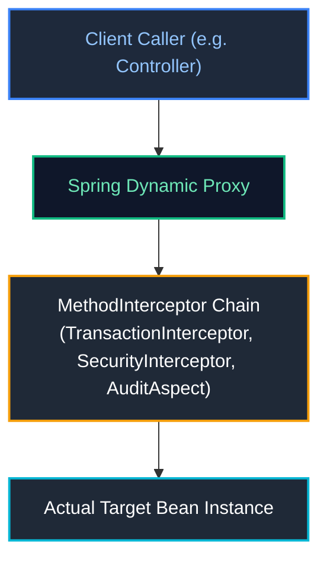

| Dimension | JDK Dynamic Proxy | CGLIB Proxy |
| :--- | :--- | :--- |
| **Technology** | Built into standard JDK (`java.lang.reflect.Proxy`) | Bytecode generation library (`org.springframework.cglib`) |
| **Requirements** | Target class **must implement at least one interface** | Target class does **not** need an interface |
| **Mechanism** | Generates a proxy class implementing the same interface | Generates a dynamic subclass extending the target class |
| **Restrictions** | Only interface methods can be proxied | **`final` classes and `final` methods cannot be proxied!** Target class must have a visible constructor. |
| **Spring Boot Default** | Historical default in Spring 3.x / 4.x | **Default in Spring Boot 2.x and 3.x** (`spring.aop.proxy-target-class=true`) |

---

### 5.3 The Self-Invocation Proxy Bypass Trap & Production Solutions

The single most common bug with declarative Spring annotations (`@Transactional`, `@Cacheable`, `@Async`) is **Self-Invocation**:

```java
@Service
public class UserService {

    public void registerUser(UserRegistrationDto dto) {
        // Business logic...
        
        // ❌ PRODUCTION BUG: Internal call bypasses the Spring Proxy!
        // Calling this.sendActivationEmail() invokes the raw object method directly.
        // The @Async annotation is completely IGNORED and executes synchronously on the HTTP thread!
        sendActivationEmail(dto.email());
    }

    @Async
    public void sendActivationEmail(String email) {
        // Slow SMTP email dispatch (blocks for 3 seconds!)
    }
}
```

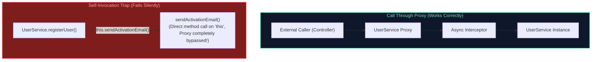

#### Production Fixes for Self-Invocation:

##### Solution 1: Extract to a Collaborator Service (Best Practice)
Move the asynchronous or transactional method to a dedicated collaborator service:

```java
@Service
public class UserRegistrationService {
    private final UserEmailService emailService;

    public UserRegistrationService(UserEmailService emailService) {
        this.emailService = emailService;
    }

    public void registerUser(UserRegistrationDto dto) {
        // Invoking method on an injected collaborator routes through its proxy!
        emailService.sendActivationEmail(dto.email());
    }
}

@Service
public class UserEmailService {
    @Async
    public void sendActivationEmail(String email) {
        // Runs asynchronously on background thread pool
    }
}
```

##### Solution 2: Self-Injection with `@Lazy`
Inject the bean's own proxy reference into itself via constructor or setter with `@Lazy`:

```java
@Service
public class UserService {

    private final ObjectProvider<UserService> selfProvider;

    public UserService(ObjectProvider<UserService> selfProvider) {
        this.selfProvider = selfProvider;
    }

    public void registerUser(UserRegistrationDto dto) {
        // Retrieves the Spring Proxy from the provider
        selfProvider.getObject().sendActivationEmail(dto.email());
    }

    @Async
    public void sendActivationEmail(String email) {
        // Asynchronous execution
    }
}
```

---

### 5.4 Enterprise Implementation: Custom Distributed Rate-Limiting & Performance Aspect

```java
@Retention(RetentionPolicy.RUNTIME)
@Target(ElementType.METHOD)
public @interface RateLimited {
    int maxRequestsPerMinute() default 60;
    String keyPrefix() default "rate_limit:";
}

@Aspect
@Component
public class DistributedRateLimitingAspect {

    private static final Logger log = LoggerFactory.getLogger(DistributedRateLimitingAspect.class);
    private final StringRedisTemplate redisTemplate;

    public DistributedRateLimitingAspect(StringRedisTemplate redisTemplate) {
        this.redisTemplate = redisTemplate;
    }

    @Around("@annotation(rateLimited)")
    public Object enforceRateLimit(ProceedingJoinPoint joinPoint, RateLimited rateLimited) throws Throwable {
        String clientIp = resolveClientIp();
        String redisKey = rateLimited.keyPrefix() + clientIp + ":" + joinPoint.getSignature().toShortString();

        // Increment counter in Redis with 60-second sliding expiration
        Long currentCount = redisTemplate.opsForValue().increment(redisKey);
        if (currentCount != null && currentCount == 1) {
            redisTemplate.expire(redisKey, Duration.ofMinutes(1));
        }

        if (currentCount != null && currentCount > rateLimited.maxRequestsPerMinute()) {
            log.warn("Rate limit exceeded for IP {} on operation {}", clientIp, joinPoint.getSignature().getName());
            throw new ResponseStatusException(HttpStatus.TOO_MANY_REQUESTS, "Exceeded rate limit of " + rateLimited.maxRequestsPerMinute() + " requests/minute");
        }

        long start = System.nanoTime();
        try {
            return joinPoint.proceed(); // Invoke target method
        } finally {
            long durationMs = (System.nanoTime() - start) / 1_000_000;
            log.info("Execution of [{}] took {} ms", joinPoint.getSignature().toShortString(), durationMs);
        }
    }

    private String resolveClientIp() {
        ServletRequestAttributes attrs = (ServletRequestAttributes) RequestContextHolder.getRequestAttributes();
        if (attrs == null) return "INTERNAL";
        HttpServletRequest req = attrs.getRequest();
        String xForwardedFor = req.getHeader("X-Forwarded-For");
        return (xForwardedFor != null) ? xForwardedFor.split(",")[0].trim() : req.getRemoteAddr();
    }
}
```

---

# 6. Spring Boot Architecture, Bootstrapping & Modern Runtime

---

### 6.1 What Problem Does Spring Boot Solve?

Before Spring Boot, building a production enterprise Spring application required:
1. Writing extensive, error-prone XML descriptors (`web.xml`, `applicationContext.xml`, `dispatcher-servlet.xml`).
2. Manually resolving transitive Maven/Gradle dependency version conflicts between Spring, Jackson, Hibernate, and logging libraries.
3. Building a Web Application Archive (`.war`) file and deploying it to external application servers (Tomcat, WebLogic). Upgrading or patching servlet containers required server-wide downtime.

Spring Boot revolutionized the ecosystem through **Opinionated Defaults** and **Convention over Configuration**:
* **Spring Boot Starters**: Curated dependency descriptors guaranteeing tested, mutually compatible library versions.
* **Auto-Configuration Engine**: Introspects the classpath and configures necessary infrastructure beans automatically.
* **Embedded Web Servers**: Packages Tomcat, Jetty, or Undertow directly into a self-contained, executable Fat JAR (`java -jar app.jar`).

---

### 6.2 Deconstructing `@SpringBootApplication` & Bootstrap Sequence

The `@SpringBootApplication` annotation on your main entry class is a meta-annotation composed of three fundamental annotations:

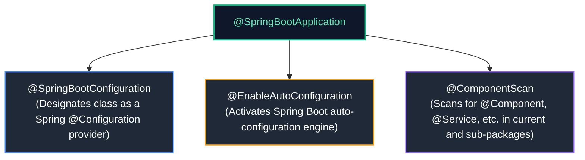

#### Step-by-Step Bootstrap Sequence of `SpringApplication.run()`:
1. **Instantiate `SpringApplication`**:
   * Inspects the classpath to determine web application type: `SERVLET` (Spring MVC), `REACTIVE` (WebFlux), or `NONE` (CLI/batch).
   * Discovers and registers `ApplicationContextInitializer` and `ApplicationListener` instances from `META-INF/spring.factories`.
2. **Prepare Environment**:
   * Initializes `StandardEnvironment` or `StandardServletEnvironment`.
   * Loads active profiles and merges configuration sources (`application.yml`, env vars, CLI args).
   * Emits `ApplicationEnvironmentPreparedEvent`.
3. **Print Banner**: Displays the ASCII Spring Boot startup banner.
4. **Create `ApplicationContext`**:
   * Instantiates the appropriate context (e.g., `AnnotationConfigServletWebServerApplicationContext`).
5. **Prepare Context**:
   * Applies `ApplicationContextInitializer` instances.
   * Loads bean definitions from the primary source class.
   * Emits `ApplicationPreparedEvent`.
6. **Refresh Context (`refresh()`)**:
   * Runs `BeanFactoryPostProcessors`.
   * Registers `BeanPostProcessors`.
   * **Starts Embedded Web Server** (e.g., binds embedded Tomcat to port 8080).
   * Eagerly instantiates and initializes all singleton beans.
7. **Execute Runners**:
   * Discovers and executes all beans implementing `ApplicationRunner` and `CommandLineRunner`.
8. **Emit `ApplicationReadyEvent`**: The application is fully booted and ready to process incoming HTTP requests.

---

### 6.3 The Auto-Configuration Engine (`AutoConfiguration.imports` & Condition Evaluation)

How does Spring Boot know to configure a PostgreSQL `DataSource` when `org.postgresql:postgresql` is added to `pom.xml`?

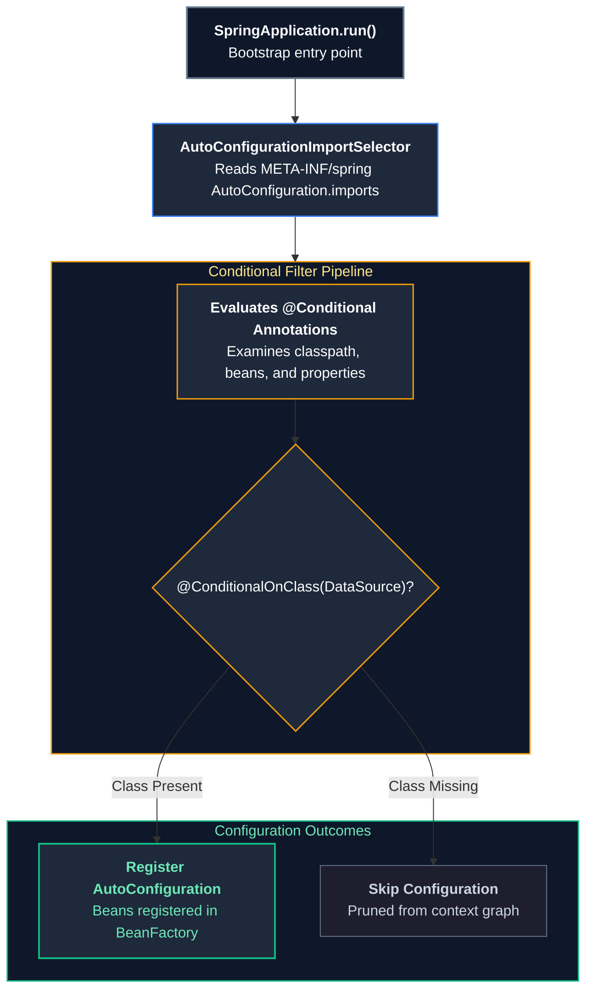

* **In Spring Boot 3.x / 2.7+**: Candidate auto-configurations are listed in:
  `META-INF/spring/org.springframework.boot.autoconfigure.AutoConfiguration.imports`
* **Condition Evaluation Report**: You can inspect why auto-configurations were applied or skipped by booting with `--debug` or querying `/actuator/conditions`.

---

### 6.4 Developing a Production-Ready Custom Spring Boot Starter

Building custom internal starters is a senior engineering requirement for standardizing security, logging, and database connectivity across microservices.

#### Project Layout:
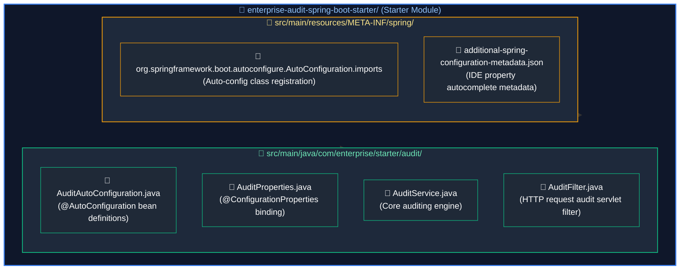

#### Step 1: Configuration Properties Record
```java
package com.enterprise.starter.audit;

import org.springframework.boot.context.properties.ConfigurationProperties;

@ConfigurationProperties(prefix = "enterprise.audit")
public record AuditProperties(boolean enabled, String applicationName, int bufferSize) {}
```

#### Step 2: Auto-Configuration Class
```java
package com.enterprise.starter.audit;

import org.springframework.boot.autoconfigure.AutoConfiguration;
import org.springframework.boot.autoconfigure.condition.ConditionalOnMissingBean;
import org.springframework.boot.autoconfigure.condition.ConditionalOnProperty;
import org.springframework.boot.context.properties.EnableConfigurationProperties;
import org.springframework.context.annotation.Bean;

@AutoConfiguration
@EnableConfigurationProperties(AuditProperties.class)
@ConditionalOnProperty(prefix = "enterprise.audit", name = "enabled", havingValue = "true", matchIfMissing = true)
public class AuditAutoConfiguration {

    @Bean
    @ConditionalOnMissingBean(AuditService.class)
    public AuditService defaultAuditService(AuditProperties properties) {
        return new DefaultAuditService(properties.applicationName(), properties.bufferSize());
    }
}
```

#### Step 3: Registration Descriptor
Create `src/main/resources/META-INF/spring/org.springframework.boot.autoconfigure.AutoConfiguration.imports`:
```
com.enterprise.starter.audit.AuditAutoConfiguration
```

Any downstream microservice adding this starter to its dependencies automatically receives `AuditService` without manual configuration!

---

### 6.5 Embedded Web Servers (Tomcat, Jetty, Undertow) & Graceful Shutdown

Spring Boot packages embedded web servers directly into the executable archive.

#### Production Tuning in `application.yml`:
```yaml
server:
  port: 8080
  # Graceful shutdown: When SIGTERM is received, stop accepting new HTTP connections
  # and allow active in-flight requests up to 30 seconds to finish processing!
  shutdown: graceful
  tomcat:
    threads:
      max: 200 # Maximum worker threads in the Tomcat pool
      min-spare: 20 # Minimum idle threads kept warm
    max-connections: 8192 # Maximum connections accepted by the OS socket acceptor
    accept-count: 100 # Maximum backlog queue when all worker threads are busy
    connection-timeout: 5000ms

spring:
  lifecycle:
    timeout-per-shutdown-phase: 30s # Grace period for in-flight requests
```

---

### 6.6 Spring Boot 3 AOT Compilation & GraalVM Native Images

Spring Boot 3 introduces native support for **Ahead-of-Time (AOT) Compilation** using the GraalVM native image compiler:

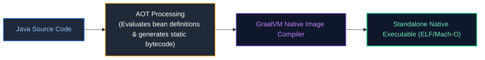

| Metric | Traditional JVM Mode (`java -jar`) | GraalVM Native Image |
| :--- | :--- | :--- |
| **Startup Latency** | $2.5\text{ seconds} - 6.0\text{ seconds}$ | **$0.04\text{ seconds} - 0.09\text{ seconds}$ (Instant)** |
| **Memory Footprint (RSS)** | $300\text{ MB} - 600\text{ MB}$ | **$30\text{ MB} - 55\text{ MB}$ (10x reduction)** |
| **Build Time** | $15\text{ seconds}$ (Maven/Gradle) | $3 - 8\text{ minutes}$ (Closed-world analysis) |
| **Peak Throughput** | Higher (C2 JIT runtime profiling) | Slightly lower (no runtime profile-guided optimization) |
| **Serverless Fit** | Poor (Cold start penalty) | **Exceptional** (Sub-100ms scale-to-zero) |

#### Registering Native Reflection Hints:
Because GraalVM enforces a **closed-world assumption**, any dynamic reflection or serialization requires explicit reachability metadata:

```java
@Configuration
public class NativeRuntimeHintsConfig implements RuntimeHintsRegistrar {
    @Override
    public void registerHints(RuntimeHints hints, ClassLoader classLoader) {
        // Register reflection access for classes loaded dynamically at runtime
        hints.reflection().registerType(PaymentPayload.class, 
                MemberCategory.INVOKE_PUBLIC_CONSTRUCTORS, 
                MemberCategory.INVOKE_PUBLIC_METHODS);
    }
}
```

> [!TIP]
> **Deep-Dive Interview Scenarios:**
> - [Q1. Spring Framework vs Spring Boot](frequently_asked_questions/05_spring_boot_and_rest_apis_faq.md#q1-easy-spring-framework-vs-spring-boot)
> - [Q2. What is `ApplicationContext` in Spring?](frequently_asked_questions/05_spring_boot_and_rest_apis_faq.md#q2-easy-what-is-applicationcontext-in-spring)
> - [Q3. Dependency Injection Internals & Best Practices in Spring Boot](frequently_asked_questions/05_spring_boot_and_rest_apis_faq.md#q3-medium-dependency-injection-internals--best-practices-in-spring-boot)
> - [Q16. What Happens Internally When a Spring Boot Application Starts (`SpringApplication.run()`)?](frequently_asked_questions/05_spring_boot_and_rest_apis_faq.md#q16-hard-what-happens-internally-when-a-spring-boot-application-starts-springapplicationrun)
> - [Q29. How Spring Boot Handles High-Concurrency Requests](frequently_asked_questions/05_spring_boot_and_rest_apis_faq.md#q29-hard-how-spring-boot-handles-high-concurrency-requests)
> - [Q30. Rate Limiting & Throttling in Spring Boot APIs](frequently_asked_questions/05_spring_boot_and_rest_apis_faq.md#q30-expert-rate-limiting--throttling-in-spring-boot-apis)
> - [Q38. Silent API Latency Explosion (200ms to 3s) with Low CPU and Healthy Heap: HikariCP Connection Pool Exhaustion & Thread Serialization](frequently_asked_questions/05_spring_boot_and_rest_apis_faq.md#q38-hard-silent-api-latency-explosion-200ms-to-3s-with-low-cpu-and-healthy-heap-hikaricp-connection-pool-exhaustion--thread-serialization)

---

# 7. Spring Boot Actuator & Production Operations

---

### 7.1 Key Actuator Endpoints (`/health`, `/metrics`, `/loggers`, `/env`, `/threaddump`)

Spring Boot Actuator provides production observability, metrics collection, and operational management endpoints:

```yaml
management:
  endpoints:
    web:
      exposure:
        include: "health,metrics,prometheus,loggers,info"
  endpoint:
    health:
      show-details: when_authorized
      probes:
        enabled: true # Enables Kubernetes /liveness and /readiness probes
```

---

### 7.2 Kubernetes Liveness & Readiness Probes (`AvailabilityChangeEvent`)

Actuator natively understands Kubernetes Pod lifecycle semantics:

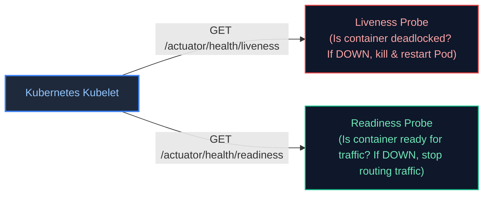

#### Dynamically Modifying Pod Readiness During Cache Warming:
```java
@Component
public class CacheWarmupOrchestrator {

    private final ApplicationEventPublisher eventPublisher;

    public CacheWarmupOrchestrator(ApplicationEventPublisher eventPublisher) {
        this.eventPublisher = eventPublisher;
    }

    public void reloadCache() {
        // 1. Tell Kubernetes to stop routing traffic to this Pod
        AvailabilityChangeEvent.publish(eventPublisher, this, ReadinessState.REFUSING_TRAFFIC);

        try {
            // Perform heavy cache reload...
            rebuildIndex();
        } finally {
            // 2. Cache is warm: signal Kubernetes to restore traffic!
            AvailabilityChangeEvent.publish(eventPublisher, this, ReadinessState.ACCEPTING_TRAFFIC);
        }
    }
}
```

---

### 7.3 Custom Actuator Management Endpoints (`@Endpoint`, `@ReadOperation`, `@WriteOperation`)

You can expose custom domain operations to operations teams via Actuator:

```java
@Component
@Endpoint(id = "circuitBreakers")
public class CircuitBreakerActuatorEndpoint {

    private final ConcurrentMap<String, String> breakerStates = new ConcurrentHashMap<>();

    @ReadOperation // Exposes GET /actuator/circuitBreakers
    public Map<String, String> getAllStates() {
        return breakerStates;
    }

    @ReadOperation // Exposes GET /actuator/circuitBreakers/{name}
    public String getState(@Selector String name) {
        return breakerStates.getOrDefault(name, "UNKNOWN");
    }

    @WriteOperation // Exposes POST /actuator/circuitBreakers
    public void resetBreaker(String name, String state) {
        breakerStates.put(name, state);
    }
}
```

---

### 7.4 Custom Micrometer Observability (Gauges, Counters, Timers)

Spring Boot Actuator integrates with **Micrometer** to publish metrics to Prometheus, Datadog, or InfluxDB:

```java
@Service
public class OrderProcessingMetricsService {

    private final Counter orderSuccessCounter;
    private final Counter orderFailureCounter;
    private final Timer orderProcessingTimer;

    public OrderProcessingMetricsService(MeterRegistry meterRegistry) {
        this.orderSuccessCounter = Counter.builder("orders.processed")
                .tag("status", "success")
                .description("Total successfully processed orders")
                .register(meterRegistry);

        this.orderFailureCounter = Counter.builder("orders.processed")
                .tag("status", "failed")
                .description("Total failed orders")
                .register(meterRegistry);

        this.orderProcessingTimer = Timer.builder("orders.latency")
                .publishPercentiles(0.5, 0.95, 0.99)
                .publishPercentileHistogram()
                .register(meterRegistry);
    }

    public void recordOrder(boolean success, long durationNanos) {
        if (success) {
            orderSuccessCounter.increment();
        } else {
            orderFailureCounter.increment();
        }
        orderProcessingTimer.record(durationNanos, TimeUnit.NANOSECONDS);
    }
}
```

---

### 7.5 Dynamic Runtime Log Level Switching & Securing Actuator Endpoints

#### Incident Troubleshooting via Dynamic Log Level Switching:
During a live production incident, you can elevate logging to `DEBUG` without restarting pods or losing thread state:

```bash
# Query active logging level
curl -X GET http://localhost:8080/actuator/loggers/com.enterprise.order.service

# Dynamically change logging level to DEBUG
curl -X POST http://localhost:8080/actuator/loggers/com.enterprise.order.service \
     -H "Content-Type: application/json" \
     -d '{"configuredLevel": "DEBUG"}'

# Revert back to INFO once incident is resolved
curl -X POST http://localhost:8080/actuator/loggers/com.enterprise.order.service \
     -H "Content-Type: application/json" \
     -d '{"configuredLevel": "INFO"}'
```

#### Securing Actuator with Spring Security:
> [!CAUTION]
> Never expose `/actuator/env`, `/actuator/heapdump`, or sensitive endpoints without strict authorization. They expose environment secrets and process memory.

```java
@Configuration
@EnableWebSecurity
public class ActuatorSecurityConfig {

    @Bean
    public SecurityFilterChain securityFilterChain(HttpSecurity http) throws Exception {
        return http
            .authorizeHttpRequests(auth -> auth
                .requestMatchers(EndpointRequest.to("health", "info")).permitAll()
                .requestMatchers(EndpointRequest.toAnyEndpoint()).hasRole("OPS_ADMIN")
                .anyRequest().authenticated()
            )
            .httpBasic(Customizer.withDefaults())
            .build();
    }
}
```

> [!TIP]
> **Deep-Dive Interview Scenarios:**
> - [Q14. Spring Boot Actuator in Production & Endpoint Security](frequently_asked_questions/05_spring_boot_and_rest_apis_faq.md#q14-hard-spring-boot-actuator-in-production--endpoint-security)
> - [Q15. Architectural Approach to Developing a New Spring Boot Module](frequently_asked_questions/05_spring_boot_and_rest_apis_faq.md#q15-medium-architectural-approach-to-developing-a-new-spring-boot-module)
> - [Q32. Designing a REST Endpoint for Last N Orders (Spring Boot + Spring Data JPA)](frequently_asked_questions/05_spring_boot_and_rest_apis_faq.md#q32-medium-designing-a-rest-endpoint-for-last-n-orders-spring-boot--spring-data-jpa)

---

# 8. Production Troubleshooting Playbook

### Incident 1: `BeanCurrentlyInCreationException` (Circular Dependency)
* **Symptom**: Application fails to boot with `BeanCurrentlyInCreationException: Error creating bean with name 'A': Requested bean is currently in creation`.
* **Root Cause**: Two or more beans require each other in their constructors, or circular injection occurs with default Spring Boot 2.6+ settings.
* **Remedy**:
  1. Inspect the exception stack trace to locate the circular cycle (`A -> B -> C -> A`).
  2. Extract common logic into an independent third service (`D`).
  3. Decouple components using `ApplicationEventPublisher`.
  4. If refactoring is not immediately feasible during an urgent outage, mark one dependency `@Lazy` as a temporary bridge.

### Incident 2: `@Transactional` or `@Async` Fails Silently (Self-Invocation)
* **Symptom**: Method annotated with `@Transactional` does not roll back on exception, or `@Async` method runs synchronously and blocks the caller.
* **Root Cause**: The method is being invoked internally from within the same class (`this.method()`), bypassing the Spring CGLIB/JDK proxy interceptor chain.
* **Remedy**:
  1. Move the annotated method into an independent collaborator bean and inject it.
  2. Never call transactional or async methods via `this`.

### Incident 3: High Latency Due to Slow Application Startup
* **Symptom**: Cloud auto-scaling fails because new container pods take 45+ seconds to boot.
* **Diagnostics**:
  * Run with `ApplicationStartup` flight recorder:
    ```java
    SpringApplication app = new SpringApplication(Application.class);
    app.setApplicationStartup(new FlightRecorderApplicationStartup());
    app.run(args);
    ```
  * Query `/actuator/startup` to locate beans with slow constructors or `@PostConstruct` methods.
* **Remedy**:
  * Offload slow initialization (e.g., priming massive caches or verifying remote third-party APIs) out of `@PostConstruct` into asynchronous background threads after `ApplicationReadyEvent`.

---

# 9. Spring MVC Architecture & Request Processing Pipeline

---

### 9.1 The Front Controller Pattern & `DispatcherServlet`

In early Java web applications (Servlets & JSPs), developers registered distinct `HttpServlet` classes for every URL route inside `web.xml`. This led to massive duplication of cross-cutting concerns: authentication, logging, request parsing, character encoding, and error routing had to be repeated across every servlet.

Spring MVC implements the **Front Controller Architectural Pattern** via **`DispatcherServlet`**:
* A single central servlet (`DispatcherServlet`) intercepts all incoming HTTP requests matching the servlet mapping (`/*`).
* It coordinates a pipeline of specialized, modular components to route, parse, execute, validate, and serialize the request:

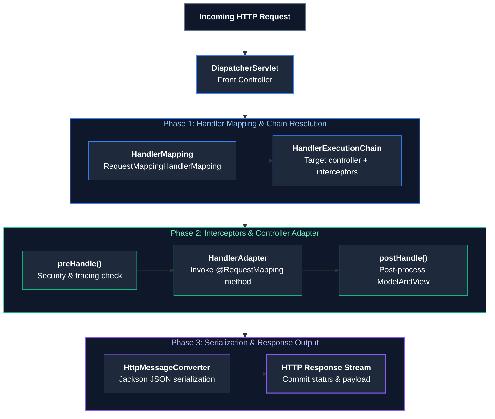

---

### 9.2 End-to-End HTTP Request Lifecycle Sequence

```mermaid
%%{init: {'theme': 'dark', 'themeVariables': { 'actorBkg': '#1e293b', 'actorBorder': '#3b82f6', 'actorTextColor': '#ffffff', 'signalColor': '#93c5fd', 'signalTextColor': '#ffffff', 'noteBkgColor': '#1e293b', 'noteBorderColor': '#f59e0b', 'noteTextColor': '#fde68a', 'activationBkgColor': '#3b82f6', 'sequenceNumberColor': '#ffffff' }}}%%
sequenceDiagram
    autonumber
    actor Client as HTTP Client
    participant Filter as FilterChain (CORS, MDC)
    participant DS as DispatcherServlet
    participant HM as RequestMappingHandlerMapping
    participant Interceptor as HandlerInterceptor
    participant HA as RequestMappingHandlerAdapter
    participant Resolver as HandlerMethodArgumentResolver
    participant Controller as OrderRestController
    participant Converter as JacksonHttpMessageConverter

    Client->>Filter: POST /api/v1/orders (JSON body)
    Filter->>DS: doFilter(request, response)
    DS->>HM: getHandler(request)
    HM-->>DS: HandlerExecutionChain (OrderController + Interceptors)
    
    DS->>Interceptor: preHandle(request, response, handler)
    Note over Interceptor: Auth checks, MDC logging setup
    Interceptor-->>DS: true (proceed)
    
    DS->>HA: handle(request, response, handlerMethod)
    HA->>Resolver: resolveArgument(CreateOrderRequest.class)
    Resolver->>Converter: read(CreateOrderRequest.class, HTTP body)
    Converter-->>Resolver: Java Object Instantiated & Validated
    Resolver-->>HA: Injected CreateOrderRequest DTO
    
    HA->>Controller: createOrder(requestDto)
    Note over Controller: Executes business logic & DB transactions
    Controller-->>HA: return ResponseEntity.ok(orderResponseDto)
    
    HA->>Converter: write(orderResponseDto, application/json, response)
    Converter-->>HA: JSON bytes written to ServletOutputStream
    HA-->>DS: ModelAndView (null for @ResponseBody)
    
    DS->>Interceptor: afterCompletion(request, response, handler, ex)
    Note over Interceptor: Clean up MDC & metrics
    DS-->>Filter: Response committed
    Filter-->>Client: HTTP 201 Created + JSON Body
```

---

### 9.3 `HandlerInterceptor` Lifecycle & ThreadLocal Context Cleanup

While Servlet `Filter` instances wrap the entire servlet invocation (before `DispatcherServlet` runs), `HandlerInterceptor` operates within the Spring context, giving you access to the specific Spring controller `HandlerMethod` that will execute:

```mermaid
flowchart TD
    Pre["1. preHandle(): Returns boolean.<br/>Executes before controller. If false, halts execution immediately."]
    --> Ctrl["Controller Method Execution"]
    --> Post["2. postHandle(): Executes after controller returns, but BEFORE view rendering.<br/>(Skipped if exception thrown or @ResponseBody used)"]
    --> After["3. afterCompletion(): ALWAYS executes in finally block.<br/>Critical for ThreadLocal & MDC clean-up!"]

    style Pre fill:#1f2937,stroke:#3b82f6,stroke-width:1.5px,color:#93c5fd
    style Ctrl fill:#0f172a,stroke:#10b981,stroke-width:2px,color:#6ee7b7
    style Post fill:#1f2937,stroke:#f59e0b,stroke-width:1.5px,color:#fde68a
    style After fill:#7f1d1d,stroke:#ef4444,stroke-width:1.5px,color:#fca5a5
```

#### Production Standard: Distributed Trace Logging & MDC Cleanup Interceptor
```java
@Component
public class CorrelationIdInterceptor implements HandlerInterceptor {

    private static final String CORRELATION_ID_HEADER = "X-Correlation-Id";
    private static final String MDC_KEY = "correlationId";

    @Override
    public boolean preHandle(HttpServletRequest request, HttpServletResponse response, Object handler) {
        String correlationId = request.getHeader(CORRELATION_ID_HEADER);
        if (correlationId == null || correlationId.isBlank()) {
            correlationId = UUID.randomUUID().toString();
        }
        
        // Populate SLF4J MDC (Mapped Diagnostic Context) stored in ThreadLocal
        MDC.put(MDC_KEY, correlationId);
        response.addHeader(CORRELATION_ID_HEADER, correlationId);
        return true; // Continue processing chain
    }

    @Override
    public void afterCompletion(HttpServletRequest request, HttpServletResponse response, 
                                Object handler, Exception ex) {
        // ⚠️ CRITICAL STAFF RULE: Always clean up ThreadLocal in afterCompletion()!
        // Tomcat threads are pooled. If MDC is not cleared, the next unrelated HTTP request
        // handled by this pooled thread will inherit the previous user's correlation ID!
        MDC.remove(MDC_KEY);
    }
}
```

Register the interceptor in Spring Web configuration:
```java
@Configuration
public class WebMvcConfig implements WebMvcConfigurer {

    private final CorrelationIdInterceptor correlationIdInterceptor;

    public WebMvcConfig(CorrelationIdInterceptor correlationIdInterceptor) {
        this.correlationIdInterceptor = correlationIdInterceptor;
    }

    @Override
    public void addInterceptors(InterceptorRegistry registry) {
        registry.addInterceptor(correlationIdInterceptor)
                .addPathPatterns("/api/**")
                .excludePathPatterns("/actuator/**", "/swagger-ui/**");
    }
}
```

---

### 9.4 Custom `HandlerMethodArgumentResolver` Implementation

Custom argument resolvers eliminate boilerplate code for extracting authenticated user context, tenant IDs, or device metadata:

```java
// 1. Define custom parameter annotation
@Target(ElementType.PARAMETER)
@Retention(RetentionPolicy.RUNTIME)
public @interface CurrentUser {}

// 2. Strongly-typed user context record
public record AuthenticatedUser(String userId, String email, Set<String> roles) {}

// 3. Implement HandlerMethodArgumentResolver
@Component
public class CurrentUserArgumentResolver implements HandlerMethodArgumentResolver {

    @Override
    public boolean supportsParameter(MethodParameter parameter) {
        return parameter.hasParameterAnnotation(CurrentUser.class) 
            && parameter.getParameterType().equals(AuthenticatedUser.class);
    }

    @Override
    public Object resolveArgument(MethodParameter parameter,
                                  ModelAndViewContainer mavContainer,
                                  NativeWebRequest webRequest,
                                  WebDataBinderFactory binderFactory) {
        
        // Extract JWT or SecurityContextHolder details
        Authentication auth = SecurityContextHolder.getContext().getAuthentication();
        if (auth == null || !auth.isAuthenticated() || auth instanceof AnonymousAuthenticationToken) {
            throw new ResponseStatusException(HttpStatus.UNAUTHORIZED, "User is not authenticated");
        }

        Jwt jwt = (Jwt) auth.getPrincipal();
        return new AuthenticatedUser(
                jwt.getSubject(),
                jwt.getClaimAsString("email"),
                new HashSet<>(jwt.getClaimAsStringList("roles"))
        );
    }
}
```

Now, any controller method can seamlessly inject the current user without touching Spring Security APIs:
```java
@GetMapping("/api/v1/profile")
public UserProfileResponse getProfile(@CurrentUser AuthenticatedUser user) {
    return new UserProfileResponse(user.userId(), user.email());
}
```

---

### 9.5 `HttpMessageConverter` & Jackson Serialization Tuning

Spring Boot configures `MappingJackson2HttpMessageConverter` as the default converter for `@ResponseBody` JSON serialization. In high-scale production systems, standard Jackson settings cause subtle date/time bugs, precision loss, and security risks.

#### Production ObjectMapper Configuration:
```java
@Configuration
public class JacksonConfig {

    @Bean
    @Primary
    public ObjectMapper objectMapper() {
        return JsonMapper.builder()
                // 1. Support Java 8 Date and Time API (Instant, LocalDate, ZonedDateTime)
                .addModule(new JavaTimeModule())
                // 2. Prevent writing dates as timestamps ([2026, 10, 16]) -> write ISO-8601 strings
                .disable(SerializationFeature.WRITE_DATES_AS_TIMESTAMPS)
                // 3. Tolerate unknown JSON fields sent by newer client versions without failing
                .disable(DeserializationFeature.FAIL_ON_UNKNOWN_PROPERTIES)
                // 4. Do NOT fail on empty beans
                .disable(SerializationFeature.FAIL_ON_EMPTY_BEANS)
                // 5. Exclude null fields from JSON output to save network bandwidth
                .serializationInclusion(JsonInclude.Include.NON_NULL)
                .build();
    }
}
```

---

### 9.6 Asynchronous HTTP Processing (`DeferredResult`, `CompletableFuture`, `SseEmitter`)

Standard Spring MVC request processing assigns one Tomcat worker thread per HTTP request. If a request blocks on a slow 5-second third-party service, that worker thread is trapped, leading to thread pool starvation under heavy load.

#### 1. Non-Blocking CompletableFuture Controller
```java
@GetMapping("/api/v1/credit-score/{userId}")
public CompletableFuture<CreditScoreResponse> getCreditScore(@PathVariable String userId) {
    // Releases the Tomcat worker thread back to the pool immediately!
    // The response is resumed on a dedicated Virtual Thread or async executor when ready.
    return CompletableFuture.supplyAsync(() -> creditBureauClient.fetchScore(userId), asyncTaskExecutor);
}
```

#### 2. Server-Sent Events (SSE) via `SseEmitter`
SSE establishes a unidirectional persistent HTTP connection over which the server streams real-time updates (e.g. LLM token generation, live stock ticks):

```java
@GetMapping(value = "/api/v1/orders/{orderId}/tracking-stream", produces = MediaType.TEXT_EVENT_STREAM_VALUE)
public SseEmitter streamTrackingUpdates(@PathVariable String orderId) {
    SseEmitter emitter = new SseEmitter(60_000L); // 60-second timeout

    // Register async task to push updates
    asyncTaskExecutor.execute(() -> {
        try {
            for (int i = 0; i < 5; i++) {
                Thread.sleep(1000);
                emitter.send(SseEmitter.event()
                        .name("order-status")
                        .data(new TrackingUpdate(orderId, "STEP_" + i, Instant.now())));
            }
            emitter.complete(); // Clean close
        } catch (Exception ex) {
            emitter.completeWithError(ex);
        }
    });

    return emitter;
}
```

> [!TIP]
> **Deep-Dive Interview Scenarios:**
> - [Q12. `ViewResolver` in Spring MVC Architecture](frequently_asked_questions/05_spring_boot_and_rest_apis_faq.md#q12-medium-viewresolver-in-spring-mvc-architecture)
> - [Q22. `@Controller` vs `@RestController` & HTTP Request Mapping Annotations](frequently_asked_questions/05_spring_boot_and_rest_apis_faq.md#q22-easy-controller-vs-restcontroller--http-request-mapping-annotations)
> - [Q23. Parameter Binding: `@RequestParam` vs `@PathVariable` vs `@RequestBody`](frequently_asked_questions/05_spring_boot_and_rest_apis_faq.md#q23-easy-parameter-binding-requestparam-vs-pathvariable-vs-requestbody)
> - [Q24. The DTO Pattern & Request Flow Across Controller, Service, and Repository](frequently_asked_questions/05_spring_boot_and_rest_apis_faq.md#q24-medium-the-dto-pattern--request-flow-across-controller-service-and-repository)
> - [Q31. Configuring Spring Security for JWT on a Subset of Endpoints](frequently_asked_questions/05_spring_boot_and_rest_apis_faq.md#q31-expert-configuring-spring-security-for-jwt-on-a-subset-of-endpoints)

---

# 10. HTTP Protocols, Methods Taxonomy & Safety vs Idempotence

---

### 10.1 REST Architectural Constraints & Resource Modeling

REST (Representational State Transfer), formulated by Roy Fielding, is an architectural style defined by six core constraints:
1. **Client-Server Separation**: Separation of concerns allows client UIs and backend persistence to evolve independently.
2. **Statelessness**: Every request contains all necessary credentials and parameters; no conversational session state is stored on the server.
3. **Cacheability**: Responses explicitly specify whether they can be cached via standard headers (`Cache-Control: max-age=3600, public`).
4. **Uniform Interface**: Resources are addressed by consistent URIs (`/orders/{id}`), manipulated through representations (JSON DTOs), self-descriptive messages, and hypermedia (HATEOAS).
5. **Layered System**: The client cannot tell whether it is communicating directly with the origin server or through an API Gateway, CDN, or load balancer.
6. **Code-on-Demand (Optional)**: Transferring executable code (e.g. WebAssembly or JavaScript scripts).

---

### 10.2 Transport Protocol Evolution: HTTP/1.1 vs HTTP/2 vs HTTP/3 (QUIC)

```mermaid
flowchart TD
    subgraph HTTP1 ["HTTP/1.1 (1997)"]
        direction TB
        H1["Text-Based Framing<br/>One active request per TCP socket<br/>Head-of-Line Blocking at HTTP layer<br/>Redundant uncompressed headers"]
    end

    subgraph HTTP2 ["HTTP/2 (2015)"]
        direction TB
        H2["Binary Framing (HEADERS & DATA frames)<br/>Multiplexing over Single TCP Connection<br/>HPACK Header Compression<br/>Server Push"]
    end

    subgraph HTTP3 ["HTTP/3 (2022)"]
        direction TB
        H3["QUIC Transport over UDP<br/>Zero Head-of-Line Blocking at TCP layer<br/>0-RTT Fast Connection Resumption<br/>Seamless IP Handover / Mobile Roaming"]
    end

    HTTP1 --> HTTP2
    HTTP2 --> HTTP3

    style HTTP1 fill:#1f2937,stroke:#ef4444,stroke-width:1.5px,color:#fca5a5
    style HTTP2 fill:#1f2937,stroke:#3b82f6,stroke-width:1.5px,color:#93c5fd
    style HTTP3 fill:#0f172a,stroke:#10b981,stroke-width:2px,color:#6ee7b7
```

| Dimension | HTTP/1.1 | HTTP/2 | HTTP/3 (QUIC) |
| :--- | :--- | :--- | :--- |
| **Transport Layer** | TCP | TCP | **UDP (QUIC)** |
| **Wire Protocol** | Human-readable ASCII text | Binary frames | Binary packets |
| **Connection Multiplexing** | No (Requires 6 parallel TCP connections) | **Yes** (Multiplexed streams over single TCP) | **Yes** (Independent streams over UDP) |
| **Head-of-Line (HoL) Blocking** | Severe at application layer | Resolved at HTTP layer, **still exists at TCP packet loss level** | **Completely eliminated** (single lost packet affects only that stream) |
| **Header Compression** | None (Redundant cookies sent every time) | **HPACK** (Sliding dictionary) | **QPACK** (Optimized for out-of-order UDP) |
| **Connection Setup Latency** | 2–3 RTT (TCP + TLS 1.3 handshake) | 2–3 RTT | **0-RTT or 1-RTT (Integrated TLS 1.3)** |

---

### 10.3 Comprehensive HTTP Methods Taxonomy (`GET`, `POST`, `PUT`, `PATCH`, `DELETE`, `OPTIONS`, `HEAD`)

#### Uniform Interface & Resource Operations in HTTP/1.1 and HTTP/2
The foundational constraint of RESTful architecture is the **Uniform Interface**, where HTTP request verbs establish standard, standardized operations on target resources identified by URIs (`RFC 9110`). Correctly applying these verbs enables intermediate proxies, CDNs, and API gateways to perform automated caching, error retries, and preflight security checks:

1. **Read & Inspection Verbs (`GET`, `HEAD`):**
   - **`GET`:** Requests a transfer of the current representation of the target resource. Must never carry a mutating request payload.
   - **`HEAD`:** Identical to `GET`, except the server **must not return a message body** in the response. Used to inspect metadata headers (`Content-Length`, `Last-Modified`, `ETag`) before initiating large downloads or to check resource existence.

2. **Creation & Processing Verbs (`POST`, `PUT`):**
   - **`POST`:** Submits an enclosed entity to be processed by the server according to its own specific semantics. Typically used for creating subordinate resources under a parent collection (`POST /api/v1/orders`), triggering state machine transitions (`POST /api/v1/orders/42/cancel`), or submitting bulk batch commands. It is neither safe nor idempotent.
   - **`PUT`:** Replaces all current representations of the target resource with the request payload, or creates the resource if the client dictates the exact URI (`PUT /api/v1/users/42`). If fields are omitted in a `PUT` payload, the server replaces them with `null` or defaults. It is strictly idempotent.

3. **Delta Mutation & Removal Verbs (`PATCH`, `DELETE`):**
   - **`PATCH`:** Applies a delta set of modifications to the target resource (RFC 5789 / JSON Patch RFC 6902). Unlike `PUT`, omitted fields remain unchanged. Idempotency depends on the patch document semantics.
   - **`DELETE`:** Removes the target resource mapping permanently.

4. **Protocol Negotiation & Preflight (`OPTIONS`):**
   - **`OPTIONS`:** Queries the communication options and HTTP methods supported by the server for that URI. Used by web browsers to dispatch Cross-Origin Resource Sharing (CORS) preflight requests.

| HTTP Method | Purpose / Intent | Request Body? | Response Body? | Safe? | Idempotent? | Typical Status Codes |
| :--- | :--- | :---: | :---: | :---: | :---: | :--- |
| **`GET`** | Retrieve resource representation | No | **Yes** | **Yes** | **Yes** | `200 OK`, `304 Not Modified`, `404 Not Found` |
| **`HEAD`** | Retrieve response headers only (no body) | No | **No** | **Yes** | **Yes** | `200 OK`, `304 Not Modified` |
| **`POST`** | Create a subordinate resource / trigger action | **Yes** | **Yes** | **No** | **No** | `201 Created` (`Location` header), `200 OK` |
| **`PUT`** | Completely replace resource / create at known URI | **Yes** | Optional | **No** | **Yes** | `200 OK`, `204 No Content` |
| **`PATCH`**| Partially update specific fields of a resource | **Yes** | **Yes** | **No** | **Conditional**| `200 OK`, `204 No Content` |
| **`DELETE`**| Permanently remove target resource | No | Optional | **No** | **Yes** | `200 OK`, `204 No Content`, `404 Not Found` |
| **`OPTIONS`**| Query supported methods / CORS preflight | No | Optional | **Yes** | **Yes** | `200 OK`, `204 No Content` |
| **`TRACE`**| Loopback diagnostic test echoing request | No | **Yes** | **Yes** | **Yes** | `200 OK` (Typically disabled for security) |

---

### 10.4 Deep-Dive: Safety vs Idempotence & The `DELETE` 404 Paradox

#### 1. Mathematical Definitions:
* **Safe Methods ($f(x) \rightarrow \text{State Unmodified}$)**:
  Methods that **never mutate resource state on the origin server**. `GET` and `HEAD` are strictly read-only. A client can execute `GET /orders/10` one million times without causing database side-effects.
* **Idempotent Methods ($f(f(x)) = f(x)$)**:
  Methods where **executing an operation once produces the exact same server resource state as executing it $N$ times consecutively**.

```mermaid
flowchart LR
    subgraph NonIdempotent ["POST: Non-Idempotent"]
        direction TB
        P1["POST /orders (Book)"] --> DB1["Database: 1 Order"]
        P2["Retry POST /orders (Book)"] --> DB2["Database: 2 Orders (DUPLICATE BILLING!)"]
    end

    subgraph Idempotent ["PUT: Strictly Idempotent"]
        direction TB
        U1["PUT /users/42 {name: 'Alice'}"] --> S1["Database: User 42 is Alice"]
        U2["Retry PUT /users/42 {name: 'Alice'}"] --> S2["Database: User 42 is STILL Alice"]
    end

    style NonIdempotent fill:#7f1d1d,stroke:#ef4444,stroke-width:1.5px,color:#fca5a5
    style Idempotent fill:#0f172a,stroke:#10b981,stroke-width:1.5px,color:#6ee7b7
```

#### 2. The `DELETE` 404 Paradox: Is `DELETE` Truly Idempotent?
Consider this scenario:
1. Client sends `DELETE /orders/101` $\rightarrow$ Database deletes row, server returns `204 No Content`.
2. Client retries `DELETE /orders/101` $\rightarrow$ Database row no longer exists, server returns `404 Not Found`.

> [!IMPORTANT]
> **Is `DELETE` still idempotent even though the HTTP status code changed from 204 to 404?**
> **YES!** Idempotency applies to **server resource state**, not HTTP response status codes.
> - Prior to call 1: Order 101 existed.
> - After call 1: Order 101 is deleted.
> - After call 2, 3, and 100: Order 101 remains deleted.
> The server's persistent state is completely identical after the first call and after subsequent calls.

---

### 10.5 Partial Updates: JSON Merge Patch (RFC 7396) vs JSON Patch (RFC 6902)

When modifying a subset of fields, `PUT` is semantically incorrect because `PUT` requires sending the **entire** object representation (omitted fields are assumed to be reset to `null`). `PATCH` is the standardized mechanism for partial updates:

| Dimension | JSON Merge Patch (RFC 7396) | JSON Patch (RFC 6902) |
| :--- | :--- | :--- |
| **`Content-Type`** | `application/merge-patch+json` | `application/json-patch+json` |
| **Payload Structure**| Partial JSON object matching target schema | Array of sequential operational instructions |
| **Complexity** | Extremely simple; intuitive for web/mobile developers | Higher complexity; requires patch processing engine |
| **Null Semantics** | Sending `{"field": null}` deletes/nulls the field | Explicit operation: `{"op": "remove", "path": "/field"}` |
| **Array Mutations** | Replaces the entire array; cannot append a single item | Surgical: `{"op": "add", "path": "/tags/1", "value": "java"}` |

#### 1. JSON Merge Patch Example (RFC 7396)
```http
PATCH /api/v1/users/42 HTTP/1.1
Content-Type: application/merge-patch+json

{
  "email": "updated.email@enterprise.com",
  "phoneNumber": null
}
```
*(Updates email, removes phoneNumber, and leaves all other user attributes intact).*

#### 2. JSON Patch Example (RFC 6902)
```http
PATCH /api/v1/orders/102 HTTP/1.1
Content-Type: application/json-patch+json

[
  { "op": "test", "path": "/status", "value": "PENDING" },
  { "op": "replace", "path": "/status", "value": "APPROVED" },
  { "op": "add", "path": "/trackingNumbers/0", "value": "FEDEX-889102" },
  { "op": "remove", "path": "/temporaryHoldReason" }
]
```

---

### 10.6 `OPTIONS` Method & CORS Preflight Handshake Mechanics

When a browser makes a cross-origin HTTP request (`https://dashboard.company.com` accessing `https://api.backend.com`) with non-simple headers (`Authorization`, `Idempotency-Key`) or methods other than `GET`/`POST`, the browser automatically executes an **`OPTIONS` Preflight Handshake**:

```mermaid
%%{init: {'theme': 'dark', 'themeVariables': { 'actorBkg': '#1e293b', 'actorBorder': '#3b82f6', 'actorTextColor': '#ffffff', 'signalColor': '#93c5fd', 'signalTextColor': '#ffffff', 'noteBkgColor': '#1e293b', 'noteBorderColor': '#f59e0b', 'noteTextColor': '#fde68a', 'activationBkgColor': '#3b82f6', 'sequenceNumberColor': '#ffffff' }}}%%
sequenceDiagram
    autonumber
    actor Browser as Web Browser (https://app.com)
    participant API as Spring Boot API (https://api.com)

    Note over Browser,API: 1. CORS Preflight Handshake (OPTIONS)
    Browser->>API: OPTIONS /api/v1/orders
    Note over Browser: Origin: https://app.com<br/>Access-Control-Request-Method: POST<br/>Access-Control-Request-Headers: Authorization, Idempotency-Key
    
    API->>API: Match CORS Policy Filter
    API-->>Browser: HTTP 204 No Content
    Note over API: Access-Control-Allow-Origin: https://app.com<br/>Access-Control-Allow-Methods: GET, POST, PUT, DELETE, OPTIONS<br/>Access-Control-Allow-Headers: Authorization, Idempotency-Key<br/>Access-Control-Max-Age: 3600 (Cache preflight for 1 hour!)

    Note over Browser,API: 2. Actual Business Request (POST)
    Browser->>API: POST /api/v1/orders (with Authorization & Idempotency-Key)
    API-->>Browser: HTTP 201 Created (Order Response JSON)
```

---

### 10.7 HTTP Status Codes Reference Matrix (2xx, 3xx, 4xx, 5xx)

#### Standardized Protocol Response Taxonomy (RFC 9110)
HTTP status codes provide an unambiguous, 3-digit numerical signaling mechanism communicating the outcome of a client's request. They are logically segmented into five functional families based on the leading digit:

1. **`1xx` Informational:** Request received, continuing process (e.g., `101 Switching Protocols` for WebSockets).
2. **`2xx` Success:** The action was successfully received, understood, and accepted by the server.
3. **`3xx` Redirection:** Further action must be taken by the user agent to fulfill the request (e.g., locating resources at a new URI or validating client-side caches).
4. **`4xx` Client Error:** The client committed an error (malformed syntax, missing authorization token, requesting nonexistent resources, violating rate limits).
5. **`5xx` Server Error:** The server failed to fulfill an apparently valid request due to internal application runtime crashes, unhandled database errors, or upstream gateway timeouts.

| Status Code | Reason Phrase | Semantic Meaning & Best Practice Usage |
| :--- | :--- | :--- |
| **`200 OK`** | Success | Request succeeded; response payload contains data. |
| **`201 Created`** | Created | Resource created; includes `Location` header pointing to new resource URI. |
| **`202 Accepted`** | Asynchronous | Request accepted for background processing; includes job status URL. |
| **`204 No Content`** | No Content | Action succeeded; response body intentionally empty (common for `DELETE`). |
| **`301 Moved Permanently`** | Redirect | Permanent redirect; client updates stored URLs to `Location`. |
| **`304 Not Modified`** | Cached | Client's cached copy remains fresh (`ETag` or `If-Modified-Since` matched). |
| **`400 Bad Request`** | Validation Error | Malformed JSON syntax or Bean Validation constraint failure. |
| **`401 Unauthorized`** | Missing Auth | Missing or invalid authentication token. |
| **`403 Forbidden`** | Access Denied | Authenticated, but lacking sufficient permissions or roles. |
| **`404 Not Found`** | Missing Resource | Resource identified by URI does not exist. |
| **`409 Conflict`** | State Collision | Database unique constraint violation or optimistic lock conflict. |
| **`422 Unprocessable`** | Semantic Error | Syntactically valid JSON, but violates business validation rules. |
| **`429 Too Many Requests`** | Rate Limited | Client exceeded rate limit; includes `Retry-After` header. |
| **`500 Internal Error`** | Server Failure | Unhandled runtime exception inside application. |
| **`502 Bad Gateway`** | Upstream Error | Upstream microservice, database, or gateway returned invalid response. |
| **`503 Unavailable`** | Maintenance/Overload| Server temporarily overloaded or undergoing graceful shutdown. |
| **`504 Gateway Timeout`**| Network Timeout | Upstream service failed to respond within configured timeout window. |

---

### 10.8 Content Negotiation (`Accept` & `Content-Type`)

- `Content-Type`: Specifies the format of the data in the **request body** (`application/json`, `application/x-www-form-urlencoded`).
- `Accept`: Informs the server what media format the **client expects in return** (`application/json`, `application/pdf`, `text/csv`).

```java
@GetMapping(
    value = "/api/v1/reports/{id}",
    produces = {MediaType.APPLICATION_JSON_VALUE, MediaType.APPLICATION_PDF_VALUE}
)
public ResponseEntity<?> generateReport(@PathVariable String id, @RequestHeader(HttpHeaders.ACCEPT) String accept) {
    if (accept.contains(MediaType.APPLICATION_PDF_VALUE)) {
        byte[] pdfBytes = reportService.renderPdf(id);
        return ResponseEntity.ok().contentType(MediaType.APPLICATION_PDF).body(pdfBytes);
    }
    return ResponseEntity.ok(reportService.getJsonData(id));
}
```

> [!TIP]
> **Deep-Dive Interview Scenarios:**
> - [Q21. Comprehensive HTTP Status Codes Taxonomy](frequently_asked_questions/05_spring_boot_and_rest_apis_faq.md#q21-easy-comprehensive-http-status-codes-taxonomy)
> - [Q34. Standard Enterprise Headers in `RestTemplate` / `WebClient` Outbound Requests](frequently_asked_questions/05_spring_boot_and_rest_apis_faq.md#q34-easy-standard-enterprise-headers-in-resttemplate--webclient-outbound-requests)
> - [Q36. `@ControllerAdvice` vs `@RestControllerAdvice` & RFC 7807 `ProblemDetail`](frequently_asked_questions/05_spring_boot_and_rest_apis_faq.md#q36-easy-controlleradvice-vs-restcontrolleradvice--rfc-7807-problemdetail)

---

# 11. Production API Idempotency Architecture

---

### 11.1 The Idempotency-Key Pattern & IETF Standard Specification

In distributed microservices, transient network failures (dropped TCP connections, load balancer 504 timeouts) leave the client unsure whether a mutating `POST` request completed on the server:
- If the client **does not retry**, a valid payment or order may never execute.
- If the client **retries naively**, the customer may be charged multiple times or duplicate inventory may be reserved.

The **`Idempotency-Key` specification (IETF Draft)** resolves this:
1. The client generates a unique UUID (e.g. `Idempotency-Key: 9b1deb4d-3b7d-4bad-9bdd-2b0d7b3dcb6d`) and passes it in the header of mutating requests (`POST`).
2. The server acquires a distributed lock in Redis for in-flight protection and hashes the request body.
3. The server executes business logic and stores the resulting HTTP status and serialized response in Redis under the key.
4. Any repeated request with the same key returns the cached response immediately, bypassing business re-execution.

---

### 11.2 Idempotency Lifecycle State Machine

```mermaid
flowchart TD
    subgraph Stage1 ["Stage 1: Ingress & Distributed Lock Evaluation"]
        direction LR
        ClientReq["Incoming POST Request<br/>Header: Idempotency-Key"] --> CheckRedis{"Lookup Redis Key<br/>'idempotency:uuid-123'"}
    end

    subgraph Stage2 ["Stage 2: Cache Validation & Concurrency Resolution"]
        direction LR
        CompareHash{"Compare Request<br/>SHA-256 Hash"}
        CompareHash -- "Hash Matches" --> ReturnCached["Return Cached Response (200/201)<br/>(Zero Business Re-execution)"]
        CompareHash -- "Payload Tampered" --> Return422["Return HTTP 422 Unprocessable<br/>(Reused Key with Different Body)"]
        Return409["Return HTTP 409 Conflict<br/>(Request In-Flight. Retry with Backoff)"]
    end

    subgraph Stage3 ["Stage 3: First-Execution Pipeline & Cache Mutation"]
        direction LR
        AcquireLock["Acquire Redis Mutex<br/>(TTL: 30s, State: IN_FLIGHT)"] --> ExecuteLogic["Execute Business Logic<br/>& ACID DB Transactions"]
        ExecuteLogic --> SaveResponse["Save Response to Redis<br/>(State: COMPLETED, TTL: 24h)"]
        SaveResponse --> ReleaseLock["Release Mutex Lock"]
        ReleaseLock --> ReturnResponse["Return HTTP 201 Created<br/>(Delivered to Client)"]
    end

    CheckRedis -- "State: COMPLETED" --> CompareHash
    CheckRedis -- "State: IN_FLIGHT" --> Return409
    CheckRedis -- "Key Absent (First Request)" --> AcquireLock

    style Stage1 fill:#0f172a,stroke:#3b82f6,stroke-width:1.5px,color:#93c5fd
    style Stage2 fill:#0f172a,stroke:#f59e0b,stroke-width:1.5px,color:#fde68a
    style Stage3 fill:#0f172a,stroke:#10b981,stroke-width:1.5px,color:#6ee7b7

    style ClientReq fill:#1e3a8a,stroke:#3b82f6,stroke-width:2px,color:#93c5fd
    style CheckRedis fill:#1f2937,stroke:#f59e0b,stroke-width:2px,color:#fff
    style CompareHash fill:#1f2937,stroke:#f59e0b,stroke-width:2px,color:#fff
    style ReturnCached fill:#064e3b,stroke:#10b981,stroke-width:2px,color:#a7f3d0
    style Return422 fill:#7f1d1d,stroke:#ef4444,stroke-width:2px,color:#fecaca
    style Return409 fill:#7f1d1d,stroke:#ef4444,stroke-width:2px,color:#fecaca
    style AcquireLock fill:#1f2937,stroke:#3b82f6,stroke-width:2px,color:#fff
    style ExecuteLogic fill:#1f2937,stroke:#10b981,stroke-width:2px,color:#fff
    style SaveResponse fill:#064e3b,stroke:#10b981,stroke-width:2px,color:#a7f3d0
    style ReleaseLock fill:#1f2937,stroke:#f59e0b,stroke-width:2px,color:#fff
    style ReturnResponse fill:#064e3b,stroke:#10b981,stroke-width:2px,color:#a7f3d0
```

---

### 11.3 Production Spring Boot Idempotency Filter with Redis & Payload SHA-256 Hashing

```java
package com.company.security.idempotency;

import jakarta.servlet.FilterChain;
import jakarta.servlet.ServletException;
import jakarta.servlet.http.HttpServletRequest;
import jakarta.servlet.http.HttpServletResponse;
import org.springframework.data.redis.core.StringRedisTemplate;
import org.springframework.http.HttpStatus;
import org.springframework.stereotype.Component;
import org.springframework.web.filter.OncePerRequestFilter;
import org.springframework.web.util.ContentCachingRequestWrapper;
import org.springframework.web.util.ContentCachingResponseWrapper;

import java.io.IOException;
import java.nio.charset.StandardCharsets;
import java.security.MessageDigest;
import java.security.NoSuchAlgorithmException;
import java.time.Duration;
import java.util.HexFormat;

@Component
public class IdempotencyFilter extends OncePerRequestFilter {

    private static final String IDEMPOTENCY_HEADER = "Idempotency-Key";
    private static final Duration IDEMPOTENCY_TTL = Duration.ofHours(24);
    private final StringRedisTemplate redisTemplate;

    public IdempotencyFilter(StringRedisTemplate redisTemplate) {
        this.redisTemplate = redisTemplate;
    }

    @Override
    protected void doFilterInternal(HttpServletRequest request,
                                    HttpServletResponse response,
                                    FilterChain filterChain) throws ServletException, IOException {

        // Enforce idempotency checks only on mutating state methods (POST)
        if (!"POST".equalsIgnoreCase(request.getMethod())) {
            filterChain.doFilter(request, response);
            return;
        }

        String idempotencyKey = request.getHeader(IDEMPOTENCY_HEADER);
        if (idempotencyKey == null || idempotencyKey.isBlank()) {
            filterChain.doFilter(request, response);
            return;
        }

        ContentCachingRequestWrapper wrappedRequest = new ContentCachingRequestWrapper(request);
        ContentCachingResponseWrapper wrappedResponse = new ContentCachingResponseWrapper(response);

        // Read payload bytes to compute SHA-256 fingerprint
        byte[] body = wrappedRequest.getInputStream().readAllBytes();
        String currentPayloadHash = calculateSha256(body);

        String redisDataKey = "idempotency:data:" + idempotencyKey;
        String redisLockKey = "idempotency:lock:" + idempotencyKey;

        // 1. Inspect if a previous execution completed successfully
        String cachedData = redisTemplate.opsForValue().get(redisDataKey);
        if (cachedData != null) {
            String[] parts = cachedData.split("::", 3);
            String savedHash = parts[0];
            int savedStatus = Integer.parseInt(parts[1]);
            String savedBody = parts[2];

            // Verify the client did not alter the payload with the same idempotency key
            if (!savedHash.equals(currentPayloadHash)) {
                response.sendError(HttpStatus.UNPROCESSABLE_ENTITY.value(),
                        "Idempotency-Key was reused with a conflicting request payload");
                return;
            }

            // Return cached original response immediately
            response.setStatus(savedStatus);
            response.setContentType("application/json");
            response.addHeader("X-Cache-Lookup", "HIT-IDEMPOTENT");
            response.getWriter().write(savedBody);
            return;
        }

        // 2. Atomic distributed lock acquisition for in-flight protection (SETNX with 30s TTL)
        Boolean lockAcquired = redisTemplate.opsForValue()
                .setIfAbsent(redisLockKey, "IN_FLIGHT", Duration.ofSeconds(30));

        if (Boolean.FALSE.equals(lockAcquired)) {
            response.sendError(HttpStatus.CONFLICT.value(),
                    "Concurrent in-flight request with identical Idempotency-Key is actively processing");
            return;
        }

        try {
            // 3. Dispatch downstream to Spring MVC controller and service pipeline
            filterChain.doFilter(wrappedRequest, wrappedResponse);

            int status = wrappedResponse.getStatus();
            byte[] responseBytes = wrappedResponse.getContentAsByteArray();
            String responseBody = new String(responseBytes, StandardCharsets.UTF_8);

            // 4. Cache successful responses (2xx status codes) for 24 hours
            if (status >= 200 && status < 300) {
                String record = currentPayloadHash + "::" + status + "::" + responseBody;
                redisTemplate.opsForValue().set(redisDataKey, record, IDEMPOTENCY_TTL);
            }

            // Copy response bytes back to output stream so client receives them
            wrappedResponse.copyBodyToResponse();

        } finally {
            // Always release in-flight lock mutex
            redisTemplate.delete(redisLockKey);
        }
    }

    private String calculateSha256(byte[] data) {
        try {
            MessageDigest digest = MessageDigest.getInstance("SHA-256");
            byte[] hash = digest.digest(data);
            return HexFormat.of().formatHex(hash);
        } catch (NoSuchAlgorithmException e) {
            throw new RuntimeException("SHA-256 digest unavailable", e);
        }
    }
}
```

---

### 11.4 Database-Level Idempotency Patterns (Unique Constraints, Conditional Updates, Upserts, Advisory Locks)

In addition to API filter caches, database layers must enforce structural idempotency:

#### 1. Unique Constraints & Natural Keys
```sql
ALTER TABLE payments ADD CONSTRAINT uk_payment_idempotency_key UNIQUE (idempotency_key);
```
If a duplicate request passes the cache, the second `INSERT` fails with a unique constraint violation, which Spring catches as `DataIntegrityViolationException`.

#### 2. Conditional State Transitions
```sql
-- Safe to retry: state transitions from PENDING to CANCELLED only once
UPDATE orders
SET status = 'CANCELLED', updated_at = CURRENT_TIMESTAMP
WHERE id = 101 AND status = 'PENDING';
```

#### 3. PostgreSQL Advisory Locks for Critical Resource Sections
```sql
-- Acquire transaction-level application lock
SELECT pg_advisory_xact_lock(hashtext('order_checkout_' || 'ORD-101'));
```

> [!TIP]
> **Deep-Dive Interview Scenarios:**
> - [Q20. `PUT` vs `PATCH` & Designing Idempotent API Operations](frequently_asked_questions/05_spring_boot_and_rest_apis_faq.md#q20-medium-put-vs-patch--designing-idempotent-api-operations)
> - [Q35. RESTful API Versioning Strategies in Production](frequently_asked_questions/05_spring_boot_and_rest_apis_faq.md#q35-medium-restful-api-versioning-strategies-in-production)
> - [Q37. Idempotent API Design with Idempotency-Keys to Prevent Duplicate Postings on Client Timeouts](frequently_asked_questions/05_spring_boot_and_rest_apis_faq.md#q37-hard-idempotent-api-design-with-idempotency-keys-to-prevent-duplicate-postings-on-client-timeouts)

---

# 12. Spring MVC Web Annotations

---

### 12.1 Controller Stereotypes: `@Controller` vs `@RestController`

- **`@Controller`**: Presentation layer stereotype. Controller methods return a view template name (e.g. `"index"`) resolved by a `ViewResolver` (Thymeleaf, FreeMarker) to render HTML.
- **`@RestController`**: Meta-annotation combining `@Controller` and `@ResponseBody`. Informs `RequestMappingHandlerAdapter` that method return values serialize directly into the HTTP response stream via Jackson JSON converters.

---

### 12.2 Routing Mappings (`@GetMapping`, `@PostMapping`, `@PutMapping`, `@DeleteMapping`, `@PatchMapping`)

```java
@RestController
@RequestMapping("/api/v1/orders")
public class OrderController {

    private final OrderService orderService;

    public OrderController(OrderService orderService) {
        this.orderService = orderService;
    }

    @GetMapping("/{id}")
    public OrderResponse getOrder(@PathVariable Long id) {
        return orderService.findById(id);
    }

    @PostMapping
    public ResponseEntity<OrderResponse> createOrder(@Valid @RequestBody CreateOrderRequest request) {
        OrderResponse created = orderService.create(request);
        URI location = URI.create("/api/v1/orders/" + created.id());
        return ResponseEntity.created(location).body(created); // Returns HTTP 201 Created + Location header
    }

    @PutMapping("/{id}")
    public ResponseEntity<OrderResponse> replaceOrder(@PathVariable Long id, @Valid @RequestBody UpdateOrderRequest request) {
        return ResponseEntity.ok(orderService.update(id, request));
    }

    @DeleteMapping("/{id}")
    public ResponseEntity<Void> deleteOrder(@PathVariable Long id) {
        orderService.delete(id);
        return ResponseEntity.noContent().build(); // Returns HTTP 204 No Content
    }
}
```

---

### 12.3 Extracting Input: `@PathVariable`, `@RequestParam`, `@RequestBody`, `@RequestHeader`, `@CookieValue`

```java
@GetMapping("/search/{category}")
public PageResponse<ProductDTO> search(
        @PathVariable String category,                                    // Path segment: /search/electronics
        @RequestParam(defaultValue = "0") int page,                       // Query param: ?page=0
        @RequestParam(defaultValue = "20") int size,                      // Query param: &size=20
        @RequestHeader("X-Tenant-Id") String tenantId,                    // HTTP header
        @CookieValue(name = "sessionId", required = false) String session // Cookie
) {
    // Process search logic...
    return PageResponse.empty();
}
```

> [!TIP]
> **Deep-Dive Interview Scenarios:**
> - [Q13. Spring Web Exception Handling Annotations](frequently_asked_questions/05_spring_boot_and_rest_apis_faq.md#q13-medium-spring-web-exception-handling-annotations)
> - [Q18. How `@EnableAutoConfiguration` Works Internally with Conditional Annotations](frequently_asked_questions/05_spring_boot_and_rest_apis_faq.md#q18-medium-how-enableautoconfiguration-works-internally-with-conditional-annotations)

---

# 13. DTOs & Jakarta Bean Validation

---

### 13.1 Entity vs DTO Separation of Concerns & Mass Assignment Defense

> [!CAUTION]
> Never expose JPA `@Entity` classes directly in REST API controller parameters or return types!

#### Security & Architecture Rationale:
1. **Prevents Mass Assignment Vulnerabilities (GitHub Incident)**: Attackers can craft malicious JSON payloads containing administrative fields (e.g. `{"isAdmin": true}`). If an `@Entity` is directly bound, Jackson binds the field, elevating privileges.
2. **Eliminates Infinite Jackson Serialization Loops**: Bidirectional relationships (`@OneToMany` / `@ManyToOne`) cause Jackson to serialize circularly until `StackOverflowError` occurs.
3. **Decouples API Contracts from Database Relational Schema**: Database tables can be renamed, split, or normalized without breaking external client API contracts.

---

### 13.2 Bean Validation Annotations (`@NotNull`, `@NotBlank`, `@Size`, `@Pattern`)

```java
public record CreateUserRequest(
    @NotBlank(message = "Username cannot be blank")
    @Size(min = 3, max = 50, message = "Username must be between 3 and 50 characters")
    String username,

    @NotBlank(message = "Email is required")
    @Email(message = "Must be a syntactically valid email address")
    String email,

    @Pattern(regexp = "^(?=.*[A-Za-z])(?=.*\\d)[A-Za-z\\d]{8,}$", 
             message = "Password must contain minimum 8 characters with at least one letter and one number")
    String password,

    @Min(value = 18, message = "Must be 18 or older")
    @Max(value = 120, message = "Invalid age provided")
    int age
) {}
```

---

### 13.3 `@Valid` vs `@Validated` & Group Validation (`OnCreate`, `OnUpdate`)

- **`@Valid`**: Standard Jakarta EE (`jakarta.validation.Valid`) annotation. Placed on controller method arguments to trigger cascade validation.
- **`@Validated`**: Spring-specific (`org.springframework.validation.annotation.Validated`) annotation. Supports **Validation Groups**, enabling different validation constraints on creation vs update:

```java
// 1. Define marker interfaces for validation groups
public interface OnCreate {}
public interface OnUpdate {}

// 2. Apply groups to DTO constraints
public record UserDto(
    @Null(groups = OnCreate.class, message = "ID must be null during user creation")
    @NotNull(groups = OnUpdate.class, message = "ID is required during update")
    Long id,

    @NotBlank(groups = {OnCreate.class, OnUpdate.class})
    String name,

    @NotBlank(groups = OnCreate.class)
    String temporaryPassword
) {}

// 3. Activate groups in Controller
@RestController
@RequestMapping("/api/v1/users")
public class UserController {

    @PostMapping
    public ResponseEntity<?> createUser(@Validated(OnCreate.class) @RequestBody UserDto dto) {
        // Enforces OnCreate rules
        return ResponseEntity.ok().build();
    }

    @PutMapping("/{id}")
    public ResponseEntity<?> updateUser(@Validated(OnUpdate.class) @RequestBody UserDto dto) {
        // Enforces OnUpdate rules
        return ResponseEntity.ok().build();
    }
}
```

---

### 13.4 Custom Constraint Validators (e.g. ISO Country Code, Business Tax ID)

```java
// 1. Declare Custom Annotation
@Target({ElementType.FIELD, ElementType.PARAMETER})
@Retention(RetentionPolicy.RUNTIME)
@Constraint(validatedBy = IsoCountryCodeValidator.class)
@Documented
public @interface ValidCountryCode {
    String message() default "Invalid ISO-3166-1 alpha-2 country code";
    Class<?>[] groups() default {};
    Class<? extends Payload>[] payload() default {};
}

// 2. Implement ConstraintValidator
public class IsoCountryCodeValidator implements ConstraintValidator<ValidCountryCode, String> {

    private static final Set<String> ISO_COUNTRIES = Set.of(Locale.getISOCountries());

    @Override
    public boolean isValid(String value, ConstraintValidatorContext context) {
        if (value == null) return true; // Let @NotNull handle null checks
        return ISO_COUNTRIES.contains(value.toUpperCase());
    }
}
```

---

# 14. Advanced API Capabilities & Modern Clients

---

### 14.1 Pagination, Sorting & Cursor/Keyset Pagination

#### Offset Pagination (Standard Spring Data `Pageable`)
```java
@GetMapping("/api/v1/products")
public Page<ProductResponse> getProducts(
        @PageableDefault(size = 20, sort = "createdAt", direction = Sort.Direction.DESC) Pageable pageable
) {
    return productRepository.findAll(pageable).map(ProductResponse::fromEntity);
}
```
* **Performance Trap of Offset Pagination**: Executing `OFFSET 1000000 LIMIT 20` forces the database engine to scan and discard 1,000,000 index rows, causing extreme query degradation on deep pages.

#### Production Solution: Keyset / Cursor Pagination
Keyset pagination uses the last seen item ID and timestamp as a filter condition:
```sql
SELECT id, name, price, created_at 
FROM products 
WHERE (created_at, id) < ('2026-10-15 14:00:00', 'PROD-9981')
ORDER BY created_at DESC, id DESC 
LIMIT 20;
```
This query uses a composite index `(created_at, id)` to jump directly to the target leaf node in $O(\log N)$ time, achieving constant latency regardless of page depth.

---

### 14.2 API Versioning Strategies (URI, Header, Media Type)

| Strategy | Syntax Example | Pros | Cons |
| :--- | :--- | :--- | :--- |
| **URI Path** | `/api/v1/orders` vs `/api/v2/orders` | Explicit, easy to route in API gateways | Breaks strict URI resource identity |
| **Custom Header** | `X-API-Version: 2` | Clean URIs; preserves resource identity | Cannot test easily via standard browser address bar |
| **Media Type (Accept)**| `Accept: application/vnd.company.v2+json` | Purest RESTful HATEOAS representation | High client configuration complexity |

---

### 14.3 OpenAPI 3 / Swagger Documentation (SpringDoc)

Add the `springdoc-openapi-starter-webmvc-ui` dependency to automatically expose OpenAPI 3 specs:
* **Interactive UI**: `http://localhost:8080/swagger-ui.html`
* **Raw JSON Spec**: `http://localhost:8080/v3/api-docs`

```java
@Operation(summary = "Create an order", description = "Creates a new customer order with idempotency protection")
@ApiResponses(value = {
    @ApiResponse(responseCode = "201", description = "Order created successfully"),
    @ApiResponse(responseCode = "400", description = "Validation constraint failure"),
    @ApiResponse(responseCode = "409", description = "Concurrent in-flight duplicate request")
})
@PostMapping("/api/v1/orders")
public ResponseEntity<OrderResponse> createOrder(@Valid @RequestBody CreateOrderRequest req) { ... }
```

---

### 14.4 Modern HTTP Clients: `RestClient`, `WebClient`, and Spring 6 `@HttpExchange`

Spring 6 / Spring Boot 3 introduces **`RestClient`** (a synchronous, fluent HTTP client) and declarative **HTTP Interfaces (`@HttpExchange`)**:

```java
// 1. Declare declarative HTTP interface
public interface PaymentClient {
    @PostExchange("/charges")
    ChargeResponse executeCharge(@RequestBody ChargeRequest request);

    @GetExchange("/charges/{id}")
    ChargeResponse getCharge(@PathVariable String id);
}

// 2. Configure HTTP Client Proxy
@Configuration
public class ClientConfig {

    @Bean
    public PaymentClient paymentClient(RestClient.Builder builder) {
        RestClient restClient = builder
                .baseUrl("https://api.stripe.com/v1")
                .defaultHeader("Authorization", "Bearer sk_test_123")
                .build();

        HttpServiceProxyFactory factory = HttpServiceProxyFactory
                .builderFor(RestClientAdapter.create(restClient))
                .build();

        return factory.createClient(PaymentClient.class);
    }
}
```

---

### 14.5 Cross-Origin Resource Sharing (CORS) Security Configuration

```java
@Configuration
public class SecurityCorsConfiguration implements WebMvcConfigurer {

    @Override
    public void addCorsMappings(CorsRegistry registry) {
        registry.addMapping("/api/**")
                .allowedOrigins("https://portal.enterprise.com", "https://checkout.enterprise.com")
                .allowedMethods("GET", "POST", "PUT", "DELETE", "PATCH", "OPTIONS")
                .allowedHeaders("Authorization", "Content-Type", "Idempotency-Key", "X-Correlation-Id")
                .exposedHeaders("X-Correlation-Id", "Location")
                .allowCredentials(true)
                .maxAge(3600); // Cache preflight response for 1 hour
    }
}
```

> [!TIP]
> **Deep-Dive Interview Scenario:**
> - [Q27. HTTP Clients: `RestTemplate` vs `WebClient` vs `FeignClient`](frequently_asked_questions/05_spring_boot_and_rest_apis_faq.md#q27-medium-http-clients-resttemplate-vs-webclient-vs-feignclient)

---

# 15. API Error Handling & Resilience

---

### 15.1 Centralized Exception Handling (`@RestControllerAdvice`)

Centralized exception handlers intercept unhandled controller exceptions, preventing stack traces from leaking to clients and guaranteeing consistent error payloads across all endpoints.

---

### 15.2 RFC 9457 Standard Problem Details

Spring Boot 3 natively supports **RFC 9457 (Problem Details for HTTP APIs)** via `ProblemDetail`:

```java
package com.company.exception;

import org.springframework.http.HttpStatus;
import org.springframework.http.ProblemDetail;
import org.springframework.web.bind.MethodArgumentNotValidException;
import org.springframework.web.bind.annotation.ExceptionHandler;
import org.springframework.web.bind.annotation.RestControllerAdvice;

import java.net.URI;
import java.time.Instant;
import java.util.HashMap;
import java.util.Map;

@RestControllerAdvice
public class GlobalExceptionHandler {

    @ExceptionHandler(ResourceNotFoundException.class)
    public ProblemDetail handleNotFound(ResourceNotFoundException ex) {
        ProblemDetail problem = ProblemDetail.forStatusAndDetail(HttpStatus.NOT_FOUND, ex.getMessage());
        problem.setTitle("Resource Not Found");
        problem.setType(URI.create("https://api.company.com/errors/not-found"));
        problem.setProperty("timestamp", Instant.now());
        return problem;
    }

    @ExceptionHandler(MethodArgumentNotValidException.class)
    public ProblemDetail handleValidation(MethodArgumentNotValidException ex) {
        ProblemDetail problem = ProblemDetail.forStatusAndDetail(HttpStatus.BAD_REQUEST, "Validation failed");
        problem.setTitle("Invalid Request Payload");
        problem.setType(URI.create("https://api.company.com/errors/validation-error"));

        Map<String, String> invalidFields = new HashMap<>();
        ex.getBindingResult().getFieldErrors().forEach(err ->
            invalidFields.put(err.getField(), err.getDefaultMessage())
        );

        problem.setProperty("invalidFields", invalidFields);
        problem.setProperty("timestamp", Instant.now());
        return problem;
    }
}
```

Sample RFC 9457 response returned to client:
```json
{
  "type": "https://api.company.com/errors/validation-error",
  "title": "Invalid Request Payload",
  "status": 400,
  "detail": "Validation failed",
  "instance": "/api/v1/orders",
  "invalidFields": {
    "totalAmount": "must be greater than 0",
    "customerEmail": "Must be a syntactically valid email address"
  },
  "timestamp": "2026-10-16T14:30:00Z"
}
```

---

### 15.3 REST API Diagnostic cURL Commands Cheatsheet

| Command & Syntax | Key Flags Explained | What Does What | Practical Operational Scenario |
| :--- | :--- | :--- | :--- |
| `curl -i -X GET https://api.company.com/orders` | `-i`: Include HTTP response headers in output | Dumps response status code, headers, and body | Checking HTTP status codes and response headers |
| `curl -X POST https://api.company.com/orders -H "Content-Type: application/json" -H "Idempotency-Key: uuid-123" -d '{"amount":100}'` | `-H "Idempotency-Key: ..."`: Attach key<br>`-d`: Payload | Sends idempotent POST request to create resource | Testing API idempotency and duplicate prevention |
| `curl -X OPTIONS https://api.company.com/orders -H "Origin: https://app.com" -H "Access-Control-Request-Method: POST" -i` | `OPTIONS`: Preflight test<br>`-H "Origin: ..."` | Tests server CORS preflight headers | Diagnosing CORS issues in browser apps |
| `curl -H "Authorization: Bearer <token>" https://api.company.com/orders` | `-H "Authorization: Bearer ..."` | Supplies OAuth2 / JWT access token | Testing authenticated REST API endpoints |
| `curl -s -o /dev/null -w "%{http_code}\n" https://api.company.com/health` | `-s`: Silent mode<br>`-o /dev/null`: Discard body<br>`-w`: Extract HTTP code | Outputs strictly the HTTP numeric status code | Automated bash health check scripts and probes |
| `curl -w "@curl-format.txt" -o /dev/null -s https://api.company.com/orders` | `-w`: Format timing output (DNS, TCP, TTFB) | Measures detailed latency breakdown per network phase | Diagnosing API latency bottlenecks |

> [!TIP]
> **Deep-Dive Interview Scenarios:**
> - [Q25. Graceful Error Handling & Global Exception Management via `@RestControllerAdvice`](frequently_asked_questions/05_spring_boot_and_rest_apis_faq.md#q25-medium-graceful-error-handling--global-exception-management-via-restcontrolleradvice)
> - [Q26. Handling Inconsistent External API Calls (Nulls & Failures Gracefully)](frequently_asked_questions/05_spring_boot_and_rest_apis_faq.md#q26-hard-handling-inconsistent-external-api-calls-nulls--failures-gracefully)

---

# 16. API Communication Paradigms: REST vs RPC vs gRPC & Protocol Buffers

---

### 16.1 API Communication Paradigms (Resource-Oriented REST vs Action-Oriented RPC)

```mermaid
flowchart LR
    subgraph REST_Paradigm["Resource-Oriented: REST (HTTP/1.1 & JSON)"]
        R_Client["Client"] -->|GET /orders/123| R_Server["Server"]
        R_Client -->|POST /orders| R_Server
        R_Client -->|DELETE /orders/123| R_Server
        Note1["Noun-based resources with standard HTTP verb semantics"]
    end

    subgraph RPC_Paradigm["Action-Oriented: RPC / gRPC (HTTP/2 & Protobuf)"]
        G_Client["Client"] -->|"OrderService.CreateOrder(OrderRequest)"| G_Server["Server"]
        G_Client -->|"OrderService.CancelOrder(CancelRequest)"| G_Server
        Note2["Method-oriented: Calling remote functions as if they were local Java methods"]
    end

    style REST_Paradigm fill:#0f172a,stroke:#3b82f6,stroke-width:1.5px,color:#93c5fd
    style RPC_Paradigm fill:#0f172a,stroke:#f59e0b,stroke-width:1.5px,color:#fde68a
```

---

### 16.2 gRPC Internals: HTTP/2 Transport & Binary Protocol Buffers

gRPC (Google Remote Procedure Call) utilizes **HTTP/2** as its underlying transport and **Protocol Buffers (Protobuf v3)** as its interface definition and serialization language:
* **Binary Framing**: No text parsing overhead. Payloads are compact binary buffers.
* **Tag-Based Encoding**: Field names are never sent over the wire; fields are mapped to compact integer tags (1, 2, 3).
* **Strict Interface Contract**: The `.proto` file provides a single source of truth across polyglot microservice teams.

---

### 16.3 gRPC Communication Modes (Unary, Server, Client, Bidirectional Streaming)

```mermaid
flowchart LR
    subgraph Mode1["1. Unary RPC (1-to-1)"]
        direction LR
        C1["Client"] -->|Single Request| S1["Server"]
        S1 -->|Single Response| C1
    end

    subgraph Mode2["2. Server Streaming (1-to-Many)"]
        C2["Client"] -->|Single Request| S2["Server"]
        S2 -->|Stream Chunks| C2
    end

    subgraph Mode3["3. Client Streaming (Many-to-1)"]
        C3["Client"] -->|Stream Chunks| S3["Server"]
        S3 -->|Single Aggregated Response| C3
    end

    subgraph Mode4["4. Bidirectional Streaming (Full-Duplex)"]
        direction LR
        C4["Client"] <-->|Full Duplex Concurrent Stream| S4["Server"]
    end

    style Mode1 fill:#0f172a,stroke:#3b82f6,stroke-width:1.5px,color:#93c5fd
    style Mode2 fill:#0f172a,stroke:#f59e0b,stroke-width:1.5px,color:#fde68a
    style Mode3 fill:#0f172a,stroke:#f59e0b,stroke-width:1.5px,color:#fde68a
    style Mode4 fill:#0f172a,stroke:#10b981,stroke-width:1.5px,color:#6ee7b7
```

---

### 16.4 Production gRPC Java Implementation (`.proto` Definition, ServiceBase, Stubs)

#### 1. `.proto` Interface Definition (`order_service.proto`)
```protobuf
syntax = "proto3";

package com.company.orders.grpc;

option java_multiple_files = true;
option java_package = "com.company.orders.grpc";
option java_outer_classname = "OrderProto";

service OrderGrpcService {
    // Unary RPC
    rpc GetOrder (OrderRequest) returns (OrderResponse);
    // Server Streaming RPC
    rpc StreamOrderAuditLogs (OrderRequest) returns (stream AuditLogEntry);
}

message OrderRequest {
    string order_id = 1;
}

message OrderResponse {
    string order_id = 1;
    string customer_id = 2;
    double amount = 3;
    string status = 4;
}

message AuditLogEntry {
    string event_id = 1;
    string timestamp = 2;
    string message = 3;
}
```

#### 2. Java Server Implementation
```java
@GrpcService
public class OrderGrpcServiceImpl extends OrderGrpcServiceGrpc.OrderGrpcServiceImplBase {

    @Override
    public void getOrder(OrderRequest request, StreamObserver<OrderResponse> responseObserver) {
        OrderResponse response = OrderResponse.newBuilder()
                .setOrderId(request.getOrderId())
                .setCustomerId("CUST-9901")
                .setAmount(250.75)
                .setStatus("CONFIRMED")
                .build();

        responseObserver.onNext(response);
        responseObserver.onCompleted();
    }

    @Override
    public void streamOrderAuditLogs(OrderRequest request, StreamObserver<AuditLogEntry> responseObserver) {
        for (int i = 1; i <= 3; i++) {
            AuditLogEntry log = AuditLogEntry.newBuilder()
                    .setEventId("EVT-" + i)
                    .setTimestamp(Instant.now().toString())
                    .setMessage("Order transitioned to STEP_" + i)
                    .build();
            responseObserver.onNext(log);
        }
        responseObserver.onCompleted();
    }
}
```

#### 3. Java Client Implementation
```java
@Service
public class OrderGrpcClient {

    private final OrderGrpcServiceGrpc.OrderGrpcServiceBlockingStub blockingStub;

    public OrderGrpcClient() {
        ManagedChannel channel = ManagedChannelBuilder.forAddress("order-service.internal", 9090)
                .usePlaintext() // Production uses TLS / mTLS
                .build();
        this.blockingStub = OrderGrpcServiceGrpc.newBlockingStub(channel);
    }

    public OrderResponse fetchOrder(String orderId) {
        return blockingStub.getOrder(OrderRequest.newBuilder().setOrderId(orderId).build());
    }
}
```

---

### 16.5 Comprehensive Evaluation: REST vs gRPC Architecture Comparison Matrix

In distributed enterprise topologies, selecting the inter-service communication protocol dictates latency percentiles, payload serialization overhead, bandwidth utilization, and client integration friction. Modern distributed systems divide responsibilities between **REST** (for public/external ingress) and **gRPC** (for high-throughput internal microservice-to-microservice mesh communication):

#### First-Principles Architectural Analysis
1. **REST over HTTP/1.1 / JSON (The Web-Native Standard):**
   - **Serialization & Payload:** Transmits text-based JSON documents. Field names (e.g., `"transaction_timestamp"`) are repeated verbatim in every single message, resulting in significant network payload bloat. Parsing JSON requires CPU-intensive string scanning, tokenization, and dynamic object creation in the JVM.
   - **Transport Mechanics:** Built historically on HTTP/1.1, requiring separate TCP connections or incurring Head-of-Line (HoL) blocking on single connections.
   - **Universal Accessibility:** Native support in all modern web browsers, curl, Postman, and API gateways. Ideal for public-facing developer APIs.

2. **gRPC over HTTP/2 & Protocol Buffers (The Cloud-Native Backbone):**
   - **Binary Framing & Compact Encoding:** Developed by Google, gRPC uses **Protocol Buffers (protobuf)**. Messages are serialized into compact binary bitstreams where field names are replaced by compact 1–2 byte numeric tags (`1`, `2`), achieving $5\times - 10\times$ smaller payloads. Deserialization executes directly into compiled C++/Java memory structs with minimal CPU overhead.
   - **HTTP/2 Transport:** Multiplexes hundreds of concurrent requests/responses over a single persistent TCP connection using binary framing, completely eliminating TCP handshake overhead and socket exhaustion.
   - **Streaming Topologies:** Natively supports Unary (1 request $\to$ 1 response), Server Streaming, Client Streaming, and full Bidirectional Streaming.

| Architectural Dimension | REST (Representational State Transfer) | gRPC (Google Remote Procedure Call) |
| :--- | :--- | :--- |
| **Primary Protocol** | HTTP/1.1 (standard) or HTTP/2 | **HTTP/2 exclusively** (multiplexed, binary framing) |
| **Payload Format** | Text-based JSON (human-readable, verbose) | **Binary Protocol Buffers** (compact, machine-optimized) |
| **Performance & Latency**| Moderate (JSON serialization and string parsing cost) | **Ultra-Low Latency (7–10x faster serialization than JSON)** |
| **Streaming Support** | Unary request/response (SSE or WebSockets separate) | **Native 4-way Streaming** (Unary, Server, Client, Bidirectional) |
| **Schema & Typing** | Optional (OpenAPI/Swagger), loose enforcement | **Strict `.proto` contract**, compile-time code generation |
| **Browser Compatibility**| **Universal** (Native in every web browser fetch/XHR) | Limited (requires `grpc-web` proxy translation) |
| **Payload Size** | Larger (field keys repeated in every message) | Minimal (keys encoded as 1–2 byte numeric tags) |
| **Idempotency & Caching**| Built-in via HTTP verbs & Cache-Control headers | Application-level implementation required |
| **Best Production Use Case**| **Public APIs, Mobile/Web Frontends, Gateway Ingress** | **Internal Microservice-to-Microservice, High-Frequency Trading, IoT** |

> [!TIP]
> **Deep-Dive Interview Scenarios:**
> - [Q19. Is REST Architecture Stateless or Stateful, and Why?](frequently_asked_questions/05_spring_boot_and_rest_apis_faq.md#q19-easy-is-rest-architecture-stateless-or-stateful-and-why)
> - [Q28. API Versioning Strategies in Production](frequently_asked_questions/05_spring_boot_and_rest_apis_faq.md#q28-medium-api-versioning-strategies-in-production)
> - [Q33. REST vs gRPC vs GraphQL Architectural Comparison](frequently_asked_questions/05_spring_boot_and_rest_apis_faq.md#q33-hard-rest-vs-grpc-vs-graphql-architectural-comparison)

---

# 17. Production Troubleshooting Playbook

### Incident 1: Broken Browser CORS Preflight (`403 Forbidden` on `OPTIONS`)
* **Symptom**: Web frontend throws `Access to XMLHttpRequest at '...' from origin '...' has been blocked by CORS policy: Response to preflight request doesn't pass access control check`.
* **Root Cause**: Spring Security intercepts the `OPTIONS` preflight request and rejects it as unauthenticated before it reaches the CORS filter.
* **Remedy**:
  Ensure Spring Security explicitly permits all `OPTIONS` requests:
  ```java
  http.cors(Customizer.withDefaults())
      .authorizeHttpRequests(auth -> auth
          .requestMatchers(HttpMethod.OPTIONS, "/**").permitAll()
          ...
      );
  ```

### Incident 2: Infinite Jackson JSON Serialization (`StackOverflowError`)
* **Symptom**: `GET /api/v1/departments/1` crashes with `java.lang.StackOverflowError` in `JacksonHttpMessageConverter`.
* **Root Cause**: JPA entities with bidirectional relationships (`Department` $\leftrightarrow$ `Employee`) serializing each other indefinitely.
* **Remedy**:
  1. **Best Practice**: Map entities to DTO records before serialization.
  2. If annotating entities directly: place `@JsonManagedReference` on the parent and `@JsonBackReference` on the child.

### Incident 3: Connection Reset by Peer Under High Concurrency
* **Symptom**: Upstream load balancers return `502 Bad Gateway` during peak traffic bursts.
* **Root Cause**: Tomcat `accept-count` backlog queue is exceeded or keep-alive timeouts do not match load balancer idle timeouts.
* **Remedy**:
  Tune embedded server settings in `application.yml`:
  ```yaml
  server:
    tomcat:
      threads:
        max: 400
        min-spare: 50
      accept-count: 200
      connection-timeout: 20000ms
  ```

---

# 18. Summary Comparison & Production Engineering Reference Matrix

| Feature / Subsystem | Internal Mechanism | Senior Engineering Standard |
| :--- | :--- | :--- |
| **Dependency Injection** | Constructor injection via reflection | Ban field injection; use immutable constructor injection for clean unit testing. |
| **Bean Scopes** | Singleton cached in container registry; Prototype generated on demand | When injecting prototype into singleton, use `ObjectProvider<T>`. |
| **`@Repository`** | Registers `PersistenceExceptionTranslationPostProcessor` | Encapsulates DB vendor exceptions into Spring `DataAccessException`. |
| **Circular Dependencies** | Three-level singleton cache | Forbidden in Spring Boot 2.6+; decouple via events or extract shared services. |
| **Bean Initialization** | `@PostConstruct` $\to$ `InitializingBean` $\to$ custom `initMethod` | Use `@PostConstruct` for cache warming and validation. |
| **AOP Proxies** | CGLIB dynamic subclassing proxy by default | Beware self-invocation proxy bypass; classes and methods cannot be `final`. |
| **Auto-Configuration** | Evaluates `@Conditional` on `AutoConfiguration.imports` | Use `@ConditionalOnMissingBean` when building reusable team starters. |
| **Config Properties** | Binds YAML to validated records via JSR-380 | Replace `@Value` with `@ConfigurationProperties` records for type safety. |
| **Actuator Probes** | Integrates with K8s via `AvailabilityChangeEvent` | Enable `/actuator/health/liveness` and `/readiness` for safe zero-downtime rolling deploys. |

---

| HTTP Method / Protocol | Safety Guarantees | Idempotence Guarantees | Spring MVC Controller Idiom | Production Engineering Rule |
| :--- | :---: | :---: | :--- | :--- |
| **`GET`** | **Safe** | **Idempotent** | `@GetMapping` | Cacheable; must never cause server-side state mutation. |
| **`POST`** | Non-Safe | Non-Idempotent | `@PostMapping` | Enforce Idempotency-Key header with Redis locks for payments/orders. |
| **`PUT`** | Non-Safe | **Idempotent** | `@PutMapping` | Full resource replacement; client must provide complete entity representation. |
| **`PATCH`** | Non-Safe | Conditional | `@PatchMapping` | Partial mutation; use JSON Merge Patch (RFC 7396) or JSON Patch (RFC 6902). |
| **`DELETE`** | Non-Safe | **Idempotent** | `@DeleteMapping` | Idempotent on resource state (resource ceases to exist regardless of retry count). |
| **`HEAD`** | **Safe** | **Idempotent** | `@RequestMapping(method = RequestMethod.HEAD)` | Returns identical headers to `GET` without message body; used for cache validation. |
| **`OPTIONS`** | **Safe** | **Idempotent** | Handled by CORS Filter | Preflight handshake; configure allowed origins, headers, and credentials strictly. |
| **gRPC** | Configurable | Configurable | `GrpcService` + `io.grpc.stub.StreamObserver` | Binary Protobuf over HTTP/2; 7–10x faster serialization for internal microservices. |

---

# 19. References & Further Reading

---

- [Spring Framework Official Documentation (Core Technologies)](https://docs.spring.io/spring-framework/reference/core.html)
- [Spring Boot Reference Guide - Auto-configuration & Starters](https://docs.spring.io/spring-boot/docs/current/reference/html/)
- [Martin Fowler - Inversion of Control Containers and the Dependency Injection Pattern](https://martinfowler.com/articles/injection.html)
- [Spring Boot 3 - GraalVM Native Image Support](https://docs.spring.io/spring-boot/docs/current/reference/html/native-image.html)
- [Micrometer Application Observability Documentation](https://micrometer.io/docs)

---

- [RFC 9110: HTTP Semantics Specification](https://www.rfc-editor.org/rfc/rfc9110.html) — Authoritative HTTP standards.
- [RFC 9457: Problem Details for HTTP APIs](https://www.rfc-editor.org/rfc/rfc9457.html) — Standardized JSON machine-readable error bodies.
- [IETF Draft: The Idempotency-Key HTTP Header Field](https://datatracker.ietf.org/doc/draft-ietf-httpapi-idempotency-key-header/)
- [gRPC Official Documentation & Guides](https://grpc.io/docs/languages/java/)
- [Protocol Buffers Language Guide (proto3)](https://protobuf.dev/programming-guides/proto3/)
- [RFC 7396: JSON Merge Patch](https://www.rfc-editor.org/rfc/rfc7396.html)
- [RFC 6902: JavaScript Object Notation (JSON) Patch](https://www.rfc-editor.org/rfc/rfc6902.html)
- [Spring MVC Official Documentation](https://docs.spring.io/spring-framework/reference/web/webmvc.html)
