# 06. Security, Identity & Cryptography

A comprehensive, production-grade guide covering Spring Security 6 internal filter architectures, stateless OAuth 2.0 / OIDC authentication with PKCE, Web application defense (OWASP Top 10), Security response headers, Public Key Infrastructure (PKI), TLS 1.3 handshakes, Java Keystores (`KeyStore`) vs Truststores (`TrustStore`), Mutual TLS (mTLS), Spring Boot 3.1+ SSL Bundles (`SslBundle`), production SSL/TLS diagnostics (`keytool`, `openssl`), and high-impact incident troubleshooting playbooks.

---

## Architectural Overview: Enterprise Security & Cryptographic Trust Architecture

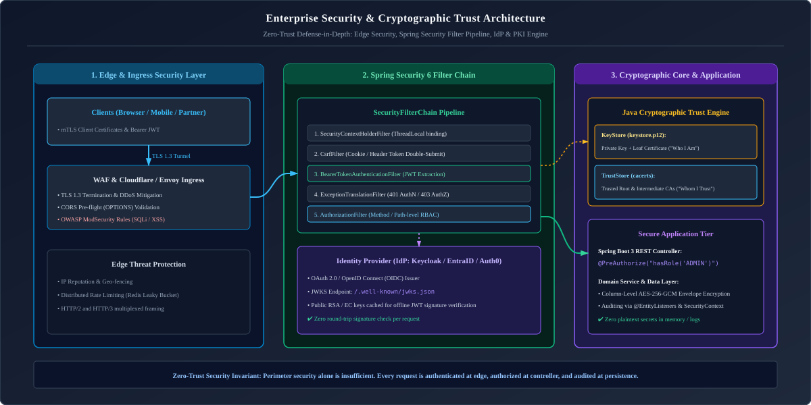

*D2 Source:* [assets/06_security_and_cryptography/01_enterprise_security_trust_architecture.d2](assets/06_security_and_cryptography/01_enterprise_security_trust_architecture.d2)

---

## Table of Contents
1. [Security Foundations: Concepts & Mental Models](#1-security-foundations-concepts--mental-models)
   - [1.1 Authentication (AuthN) vs Authorization (AuthZ): The Airport Analogy](#11-authentication-authn-vs-authorization-authz-the-airport-analogy)
   - [1.2 Cryptography Primitives: Symmetric vs Asymmetric vs Hashing vs HMAC](#12-cryptography-primitives-symmetric-vs-asymmetric-vs-hashing-vs-hmac)
   - [1.2.1 Production JPA AttributeConverter: Column-Level AES-256-GCM Encryption](#121-production-jpa-attributeconverter-column-level-aes-256-gcm-encryption)
   - [1.3 The CIA Triad, Principle of Least Privilege & Zero Trust Architecture](#13-the-cia-triad-principle-of-least-privilege--zero-trust-architecture)
   - [1.4 Defense in Depth in Modern Microservices](#14-defense-in-depth-in-modern-microservices)
2. [Spring Security 6 Internal Architecture](#2-spring-security-6-internal-architecture)
   - [2.1 Servlet Filter Architecture: `DelegatingFilterProxy` & `FilterChainProxy`](#21-servlet-filter-architecture-delegatingfilterproxy--filterchainproxy)
   - [2.2 The Complete Ordered Filter Chain Pipeline](#22-the-complete-ordered-filter-chain-pipeline)
   - [2.3 Modern Component-Based Security Configuration (`SecurityFilterChain`)](#23-modern-component-based-security-configuration-securityfilterchain)
   - [2.3.1 Production Custom Authentication Filter & Provider (API Key Security)](#231-production-custom-authentication-filter--provider-api-key-security)
   - [2.3.2 Multi-Tenant JWT Issuer Resolution (`JwtIssuerAuthenticationManagerResolver`)](#232-multi-tenant-jwt-issuer-resolution-jwtissuerauthenticationmanagerresolver)
   - [2.4 `SecurityContextHolder` & The ThreadLocal Concurrency Hazard in Async Pools](#24-securitycontextholder--the-threadlocal-concurrency-hazard-in-async-pools)
   - [2.5 The Authentication Flow: `AuthenticationManager`, `ProviderManager` & `AuthenticationProvider`](#25-the-authentication-flow-authenticationmanager-providermanager--authenticationprovider)
   - [2.6 Custom Authentication Entry Point & Access Denied Handlers (RFC 9457 Integration)](#26-custom-authentication-entry-point--access-denied-handlers-rfc-9457-integration)
   - [2.7 Cryptographic Password Hashing: BCrypt vs PBKDF2 vs Argon2id](#27-cryptographic-password-hashing-bcrypt-vs-pbkdf2-vs-argon2id)
3. [Token-Based Authentication & OAuth 2.0 / OIDC](#3-token-based-authentication--oauth-20--oidc)
   - [3.1 Stateful Session Authentication vs Stateless JWT Tokens](#31-stateful-session-authentication-vs-stateless-jwt-tokens)
   - [3.2 JWT Anatomy: Header, Payload Claims & Asymmetric RS256 Verification via JWKS](#32-jwt-anatomy-header-payload-claims--asymmetric-rs256-verification-via-jwks)
   - [3.3 Access Token vs Refresh Token Lifecycle & Silent Token Rotation](#33-access-token-vs-refresh-token-lifecycle--silent-token-rotation)
   - [3.4 OAuth 2.0 & OpenID Connect: The 4 Core Roles](#34-oauth-20--openid-connect-the-4-core-roles)
   - [3.5 Authorization Code Flow with PKCE (Proof Key for Code Exchange)](#35-authorization-code-flow-with-pkce-proof-key-for-code-exchange)
   - [3.6 Client Credentials Flow for Machine-to-Machine Microservices](#36-client-credentials-flow-for-machine-to-machine-microservices)
   - [3.7 Method-Level Security: `@PreAuthorize`, SpEL & Custom Evaluators](#37-method-level-security-preauthorize-spel--custom-evaluators)
   - [3.8 Production Keycloak & OIDC JWT Role Claims Converter](#38-production-keycloak--oidc-jwt-role-claims-converter)
4. [Web Application Defenses & OWASP Top 10](#4-web-application-defenses--owasp-top-10)
   - [4.1 Cross-Site Request Forgery (CSRF): Mechanics & Token Repositories](#41-cross-site-request-forgery-csrf-mechanics--token-repositories)
   - [4.2 Cross-Site Scripting (XSS) & Content Security Policy (CSP)](#42-cross-site-scripting-xss--content-security-policy-csp)
   - [4.3 Insecure Direct Object References (IDOR) & Tenancy Enforcement](#43-insecure-direct-object-references-idor--tenancy-enforcement)
   - [4.4 Server-Side Request Forgery (SSRF) & Internal Network Shielding](#44-server-side-request-forgery-ssrf--internal-network-shielding)
   - [4.5 Security Response Headers (`HSTS`, `X-Content-Type-Options`, `X-Frame-Options`)](#45-security-response-headers-hsts-x-content-type-options-x-frame-options)
   - [4.6 Distributed Rate Limiting & Brute-Force Defense (Redis Token Bucket)](#46-distributed-rate-limiting--brute-force-defense-redis-token-bucket)
5. [Public Key Infrastructure (PKI), TLS 1.3 & Certificate Management](#5-public-key-infrastructure-pki-tls-13--certificate-management)
   - [5.1 PKI Fundamentals: Asymmetric Encryption & X.509 Certificate Chain of Trust](#51-pki-fundamentals-asymmetric-encryption--x509-certificate-chain-of-trust)
   - [5.2 TLS 1.3 Handshake Deep-Dive & Perfect Forward Secrecy](#52-tls-13-handshake-deep-dive--perfect-forward-secrecy)
   - [5.3 Java Keystore (`KeyStore`) vs Truststore (`TrustStore`)](#53-java-keystore-keystore-vs-truststore-truststore)
   - [5.4 Mutual TLS (mTLS / Two-Way SSL) in Microservices & B2B Banking Gateways](#54-mutual-tls-mtls--two-way-ssl-in-microservices--b2b-banking-gateways)
   - [5.5 Spring Boot 3.1+ SSL Bundles (`SslBundle`) & Dynamic Reloading](#55-spring-boot-31-ssl-bundles-sslbundle--dynamic-reloading)
   - [5.6 Cryptographic Diagnostic CLI Playbook (`keytool` & `openssl`)](#56-cryptographic-diagnostic-cli-playbook-keytool--openssl)
6. [Production Troubleshooting Playbook](#6-production-troubleshooting-playbook)
7. [Summary Comparison & Production Engineering Reference Matrix](#7-summary-comparison--production-engineering-reference-matrix)
8. [References & Further Reading](#8-references--further-reading)
---

# 1. Security Foundations: Concepts & Mental Models

---

### 1.1 Authentication (AuthN) vs Authorization (AuthZ): The Airport Analogy

To build secure software, engineers must never conflate authentication with authorization:

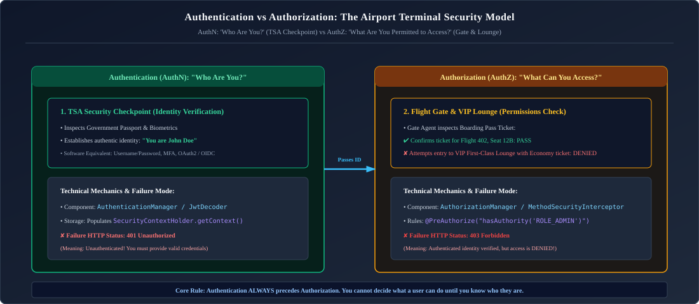

*D2 Source:* [assets/06_security_and_cryptography/02_authentication_vs_authorization_airport_model.d2](assets/06_security_and_cryptography/02_authentication_vs_authorization_airport_model.d2)

* **Authentication (AuthN)**: Validating the claimed identity of a user or system (e.g., matching username/password, verifying an X.509 certificate, or validating an asymmetric RSA signature on a JWT token).
* **Authorization (AuthZ)**: Evaluating whether an authenticated principal holds the necessary privileges, roles, or attributes to execute an action on a target resource (e.g., verifying whether John Doe can delete order #402).

---

### 1.2 Cryptography Primitives: Symmetric vs Asymmetric vs Hashing vs HMAC

Backend engineers must distinguish the four core cryptographic primitives:

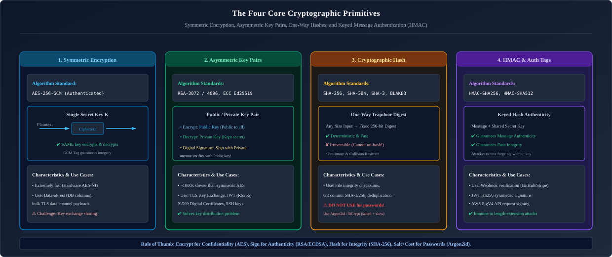

*D2 Source:* [assets/06_security_and_cryptography/03_cryptographic_primitives_matrix.d2](assets/06_security_and_cryptography/03_cryptographic_primitives_matrix.d2)

| Primitive | Key Requirements | Reversible? | Primary Enterprise Use Case |
| :--- | :--- | :---: | :--- |
| **Symmetric Encryption** (`AES-GCM-256`) | Single shared secret key | **Yes** | Encrypting databases at rest, session cookies, internal secrets. Extremely fast. |
| **Asymmetric Encryption** (`RSA-4096`, `ECDSA`, `Ed25519`) | Key Pair (Public Key + Private Key) | **Yes** | Digital signatures, JWT signing (RS256), TLS 1.3 key exchange, mTLS. |
| **Cryptographic Hash** (`SHA-256`, `SHA-3`) | None (No key) | **NO** | Data integrity verification, file checksums, blockchain blocks. |
| **HMAC** (`HmacSHA256`) | Shared secret key + Hash | **NO** | API request signing (AWS Signature v4), webhook payload authentication (Stripe/GitHub). |

---

### 1.2.1 Production JPA AttributeConverter: Column-Level AES-256-GCM Encryption

Storing unencrypted sensitive fields (Social Security Numbers, Credit Cards, Tax IDs) in a database leaves organizations vulnerable to database dump leaks. A production-grade JPA `AttributeConverter` encrypts data in-memory before writing to SQL and decrypts automatically upon entity retrieval:

```java
package com.enterprise.security.crypto;

import jakarta.persistence.AttributeConverter;
import jakarta.persistence.Converter;

import javax.crypto.Cipher;
import javax.crypto.SecretKey;
import javax.crypto.spec.GCMParameterSpec;
import javax.crypto.spec.SecretKeySpec;
import java.nio.ByteBuffer;
import java.nio.charset.StandardCharsets;
import java.security.SecureRandom;
import java.util.Base64;

@Converter
public class AesGcmAttributeConverter implements AttributeConverter<String, String> {

    private static final String ALGORITHM = "AES/GCM/NoPadding";
    private static final int TAG_LENGTH_BIT = 128;
    private static final int IV_LENGTH_BYTE = 12; // 96-bit IV recommended for GCM
    private static final SecureRandom SECURE_RANDOM = new SecureRandom();

    // 256-bit AES master key loaded securely from cloud vault / environment
    private static final byte[] MASTER_KEY_BYTES = "SuperSecretMasterKey32BytesLong!".getBytes(StandardCharsets.UTF_8);
    private static final SecretKey SECRET_KEY = new SecretKeySpec(MASTER_KEY_BYTES, "AES");

    @Override
    public String convertToDatabaseColumn(String plainText) {
        if (plainText == null || plainText.isBlank()) return plainText;

        try {
            // 1. Generate unique 12-byte Initialization Vector (IV) for each encryption operation
            byte[] iv = new byte[IV_LENGTH_BYTE];
            SECURE_RANDOM.nextBytes(iv);

            // 2. Initialize AES-GCM Cipher
            Cipher cipher = Cipher.getInstance(ALGORITHM);
            GCMParameterSpec gcmSpec = new GCMParameterSpec(TAG_LENGTH_BIT, iv);
            cipher.init(Cipher.ENCRYPT_MODE, SECRET_KEY, gcmSpec);

            // 3. Encrypt plaintext
            byte[] cipherText = cipher.doFinal(plainText.getBytes(StandardCharsets.UTF_8));

            // 4. Prepend IV to ciphertext: [IV (12 bytes)] + [Ciphertext + Auth Tag]
            ByteBuffer byteBuffer = ByteBuffer.allocate(iv.length + cipherText.length);
            byteBuffer.put(iv);
            byteBuffer.put(cipherText);

            return Base64.getEncoder().encodeToString(byteBuffer.array());
        } catch (Exception e) {
            throw new IllegalStateException("Failed to encrypt database column", e);
        }
    }

    @Override
    public String convertToEntityAttribute(String dbData) {
        if (dbData == null || dbData.isBlank()) return dbData;

        try {
            byte[] decoded = Base64.getDecoder().decode(dbData);
            ByteBuffer byteBuffer = ByteBuffer.wrap(decoded);

            // 1. Extract IV from first 12 bytes
            byte[] iv = new byte[IV_LENGTH_BYTE];
            byteBuffer.get(iv);

            // 2. Extract remaining ciphertext
            byte[] cipherText = new byte[byteBuffer.remaining()];
            byteBuffer.get(cipherText);

            // 3. Decrypt and verify GCM authentication tag
            Cipher cipher = Cipher.getInstance(ALGORITHM);
            GCMParameterSpec gcmSpec = new GCMParameterSpec(TAG_LENGTH_BIT, iv);
            cipher.init(Cipher.DECRYPT_MODE, SECRET_KEY, gcmSpec);

            byte[] plainTextBytes = cipher.doFinal(cipherText);
            return new String(plainTextBytes, StandardCharsets.UTF_8);
        } catch (Exception e) {
            throw new IllegalStateException("Failed to decrypt database column. Key mismatch or data corrupted!", e);
        }
    }
}
```

```java
// Entity Usage:
@Entity
@Table(name = "customer_profiles")
public class CustomerProfile {
    @Id
    private UUID id;

    @Convert(converter = AesGcmAttributeConverter.class)
    @Column(name = "tax_identification_number", nullable = false)
    private String taxIdentificationNumber; // Automatically encrypted at rest!
}
```

---

### 1.3 The CIA Triad, Principle of Least Privilege & Zero Trust Architecture

1. **Confidentiality**: Ensuring data is accessible only to authorized entities (enforced via AES-256 encryption at rest and TLS 1.3 in transit).
2. **Integrity**: Protecting data against unauthorized modification or tampering (enforced via cryptographic HMACs, digital signatures, and database constraints).
3. **Availability**: Ensuring systems and data are reliably accessible to authorized users (enforced via DDoS mitigation, rate limiting, and circuit breakers).
4. **Principle of Least Privilege (PoLP)**: Every module, user, and service account must operate using only the minimal set of permissions required to complete its job. A billing service should have read-only access to customer profiles, never administrative rights.
5. **Zero Trust Architecture (NIST SP 800-207)**:
   * **Core Tenet**: *"Never trust, always verify."*
   * Traditional castle-and-moat security assumed that anything inside the internal corporate VPN was trustworthy. Modern cloud engineering rejects this: every network packet, inter-service RPC call, and database query must be authenticated and authorized, even across internal microservice meshes.

---

### 1.4 Defense in Depth in Modern Microservices

Never rely on a single perimeter wall (such as an API Gateway). Security must be enforced across multiple concentric layers:
1. **Network Layer**: Private VPC subnets, AWS Security Groups, Kubernetes NetworkPolicies, Mutual TLS (mTLS) between pods.
2. **Transport Layer**: TLS 1.3 with strict HSTS policies.
3. **Application Gateway Layer**: Rate limiting, WAF (Web Application Firewall) inspecting SQLi/XSS, CORS filtering.
4. **Service Boundary Layer**: Spring Security filter chain validating JWT cryptographic signatures and claims.
5. **Method / Domain Layer**: `@PreAuthorize` attribute-based tenancy checks (`#order.customerId == authentication.name`).
6. **Data Persistence Layer**: Transparent Data Encryption (TDE), column-level field encryption for PII (Personally Identifiable Information), database audit logs.

---

# 2. Spring Security 6 Internal Architecture

---

### 2.1 Servlet Filter Architecture: `DelegatingFilterProxy` & `FilterChainProxy`

Spring Security does not intercept requests at the Spring MVC controller level; it intercepts requests at the low-level **Servlet Filter pipeline** before requests ever reach `DispatcherServlet`:

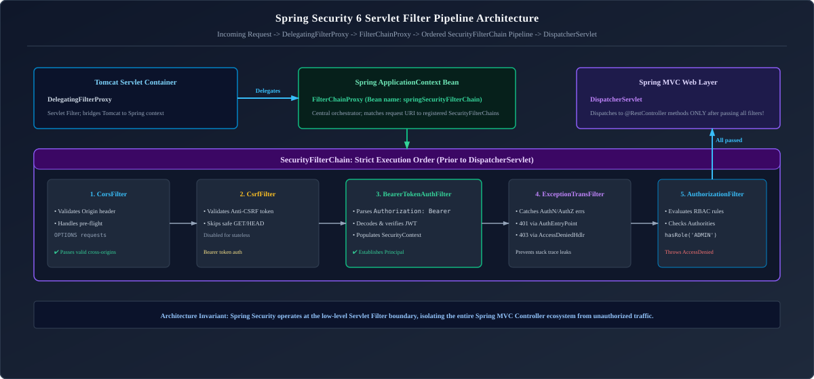

*D2 Source:* [assets/06_security_and_cryptography/04_spring_security_filter_chain_architecture.d2](assets/06_security_and_cryptography/04_spring_security_filter_chain_architecture.d2)

* **`DelegatingFilterProxy`**: A standard J2EE servlet filter configured in Tomcat that acts as a bridge, delegating all incoming HTTP filtering calls to a Spring-managed bean named `springSecurityFilterChain`.
* **`FilterChainProxy`**: The master Spring bean that inspects the request URI and routes it to the matching `SecurityFilterChain`.

---

### 2.2 The Complete Ordered Filter Chain Pipeline

Spring Security processes filters in a strict, deterministic sequence:
1. `ChannelProcessingFilter`: Enforces HTTPS / TLS redirection.
2. `CorsFilter`: Handles CORS preflight `OPTIONS` requests before authentication.
3. `CsrfFilter`: Validates CSRF synchronizer tokens on state-mutating requests (`POST`, `PUT`, `DELETE`).
4. `LogoutFilter`: Handles `/logout` and invalidates sessions/tokens.
5. `BearerTokenAuthenticationFilter` / `UsernamePasswordAuthenticationFilter`: Extracts credentials from headers or forms and attempts authentication.
6. `SecurityContextHolderFilter`: Populates `SecurityContext` from session or token.
7. `ExceptionTranslationFilter`: Intercepts `AuthenticationException` (translating to HTTP 401 Unauthorized) and `AccessDeniedException` (translating to HTTP 403 Forbidden).
8. `AuthorizationFilter`: Final filter verifying endpoint access rules.

---

### 2.3 Modern Component-Based Security Configuration (`SecurityFilterChain`)

In Spring Security 6 (Spring Boot 3), the legacy `WebSecurityConfigurerAdapter` has been completely removed in favor of a component-based model where security behavior is configured by declaring `@Bean SecurityFilterChain` instances.

```java
package com.enterprise.security.config;

import com.enterprise.security.filter.ApiKeyAuthenticationFilter;
import org.springframework.context.annotation.Bean;
import org.springframework.context.annotation.Configuration;
import org.springframework.core.convert.converter.Converter;
import org.springframework.security.authentication.AbstractAuthenticationToken;
import org.springframework.security.config.annotation.method.configuration.EnableMethodSecurity;
import org.springframework.security.config.annotation.web.builders.HttpSecurity;
import org.springframework.security.config.annotation.web.configuration.EnableWebSecurity;
import org.springframework.security.config.http.SessionCreationPolicy;
import org.springframework.security.core.GrantedAuthority;
import org.springframework.security.core.authority.SimpleGrantedAuthority;
import org.springframework.security.oauth2.jwt.Jwt;
import org.springframework.security.oauth2.server.resource.authentication.JwtAuthenticationConverter;
import org.springframework.security.web.SecurityFilterChain;
import org.springframework.security.web.authentication.UsernamePasswordAuthenticationFilter;

import java.util.Collection;
import java.util.Collections;
import java.util.List;
import java.util.Map;
import java.util.stream.Collectors;

@Configuration
@EnableWebSecurity
@EnableMethodSecurity(prePostEnabled = true, securedEnabled = true) // Activates @PreAuthorize, @PostAuthorize
public class SecurityConfiguration {

    private final ApiKeyAuthenticationFilter apiKeyAuthenticationFilter;

    public SecurityConfiguration(ApiKeyAuthenticationFilter apiKeyAuthenticationFilter) {
        this.apiKeyAuthenticationFilter = apiKeyAuthenticationFilter;
    }

    @Bean
    public SecurityFilterChain filterChain(HttpSecurity http) throws Exception {
        http
            // 1. Disable CSRF for stateless REST APIs utilizing Bearer JWTs or API keys
            .csrf(csrf -> csrf.disable())

            // 2. Enforce strict Stateless session management (Tomcat never creates an HttpSession)
            .sessionManagement(session -> session.sessionCreationPolicy(SessionCreationPolicy.STATELESS))

            // 3. Configure URI authorization rules
            .authorizeHttpRequests(auth -> auth
                .requestMatchers("/api/v1/auth/**", "/actuator/health/**", "/swagger-ui/**", "/v3/api-docs/**").permitAll()
                .requestMatchers("/api/v1/admin/**").hasRole("ADMIN")
                .requestMatchers("/api/v1/reports/**").hasAnyRole("ADMIN", "ANALYST")
                .anyRequest().authenticated()
            )

            // 4. Register custom API Key authentication filter prior to standard username/password filter
            .addFilterBefore(apiKeyAuthenticationFilter, UsernamePasswordAuthenticationFilter.class)

            // 5. Configure OAuth2 JWT Resource Server with custom Keycloak/Auth0 claim mapper
            .oauth2ResourceServer(oauth2 -> oauth2
                .jwt(jwt -> jwt.jwtAuthenticationConverter(customJwtAuthenticationConverter()))
            );

        return http.build();
    }

    /**
     * Maps Keycloak's nested realm_access.roles claim JSON array to Spring Security's ROLE_ format.
     */
    @Bean
    public Converter<Jwt, ? extends AbstractAuthenticationToken> customJwtAuthenticationConverter() {
        JwtAuthenticationConverter converter = new JwtAuthenticationConverter();
        converter.setJwtGrantedAuthoritiesConverter(jwt -> {
            Map<String, Object> realmAccess = jwt.getClaim("realm_access");
            if (realmAccess == null || !realmAccess.containsKey("roles")) {
                return Collections.emptyList();
            }
            @SuppressWarnings("unchecked")
            List<String> roles = (List<String>) realmAccess.get("roles");
            return roles.stream()
                .map(role -> (GrantedAuthority) new SimpleGrantedAuthority("ROLE_" + role.toUpperCase()))
                .collect(Collectors.toList());
        });
        return converter;
    }
}
```

---

### 2.3.1 Production Custom Authentication Filter & Provider (API Key Security)

In high-throughput B2B partner APIs, authentication often relies on cryptographically random API keys passed via `X-API-KEY` headers rather than interactive OAuth logins. Here is how to implement a clean, idiomatic Spring Security 6 filter and provider:

```java
package com.enterprise.security.filter;

import jakarta.servlet.FilterChain;
import jakarta.servlet.ServletException;
import jakarta.servlet.http.HttpServletRequest;
import jakarta.servlet.http.HttpServletResponse;
import org.springframework.security.authentication.AuthenticationManager;
import org.springframework.security.authentication.BadCredentialsException;
import org.springframework.security.core.Authentication;
import org.springframework.security.core.context.SecurityContext;
import org.springframework.security.core.context.SecurityContextHolder;
import org.springframework.stereotype.Component;
import org.springframework.web.filter.OncePerRequestFilter;

import java.io.IOException;

@Component
public class ApiKeyAuthenticationFilter extends OncePerRequestFilter {

    private static final String API_KEY_HEADER = "X-API-KEY";
    private final AuthenticationManager authenticationManager;

    public ApiKeyAuthenticationFilter(AuthenticationManager authenticationManager) {
        this.authenticationManager = authenticationManager;
    }

    @Override
    protected void doFilterInternal(HttpServletRequest request,
                                    HttpServletResponse response,
                                    FilterChain filterChain) throws ServletException, IOException {
        String apiKey = request.getHeader(API_KEY_HEADER);

        if (apiKey != null && !apiKey.isBlank()) {
            try {
                // Wrap raw API key in unauthenticated token
                ApiKeyAuthenticationToken unauthenticatedToken = new ApiKeyAuthenticationToken(apiKey);
                // Delegate validation to AuthenticationProvider
                Authentication authenticatedToken = authenticationManager.authenticate(unauthenticatedToken);

                // Populate SecurityContext for current thread
                SecurityContext context = SecurityContextHolder.createEmptyContext();
                context.setAuthentication(authenticatedToken);
                SecurityContextHolder.setContext(context);

            } catch (BadCredentialsException ex) {
                SecurityContextHolder.clearContext();
                response.sendError(HttpServletResponse.SC_UNAUTHORIZED, "Invalid API Key supplied");
                return;
            }
        }

        filterChain.doFilter(request, response);
    }
}
```

```java
package com.enterprise.security.filter;

import org.springframework.security.authentication.AuthenticationProvider;
import org.springframework.security.authentication.BadCredentialsException;
import org.springframework.security.core.Authentication;
import org.springframework.security.core.AuthenticationException;
import org.springframework.security.core.authority.SimpleGrantedAuthority;
import org.springframework.stereotype.Component;

import java.util.List;

@Component
public class ApiKeyAuthenticationProvider implements AuthenticationProvider {

    private final ApiKeyVaultService apiKeyVaultService;

    public ApiKeyAuthenticationProvider(ApiKeyVaultService apiKeyVaultService) {
        this.apiKeyVaultService = apiKeyVaultService;
    }

    @Override
    public Authentication authenticate(Authentication authentication) throws AuthenticationException {
        ApiKeyAuthenticationToken token = (ApiKeyAuthenticationToken) authentication;
        String rawApiKey = token.getCredentials();

        // Validate hash of API key against vault/database
        var partnerAccount = apiKeyVaultService.findAccountByApiKey(rawApiKey)
            .orElseThrow(() -> new BadCredentialsException("Unrecognized or revoked API key"));

        // Return fully populated, authenticated token with partner authorities
        return new ApiKeyAuthenticationToken(
            partnerAccount.clientId(),
            List.of(new SimpleGrantedAuthority("ROLE_PARTNER"), new SimpleGrantedAuthority("SCOPE_READ"))
        );
    }

    @Override
    public boolean supports(Class<?> authentication) {
        return ApiKeyAuthenticationToken.class.isAssignableFrom(authentication);
    }
}
```

---

### 2.3.2 Multi-Tenant JWT Issuer Resolution (`JwtIssuerAuthenticationManagerResolver`)

In enterprise SaaS platforms, a single backend service must accept JWTs issued by multiple distinct Identity Providers (e.g., Tenant A uses Okta, Tenant B uses Microsoft Entra ID / Azure AD, and internal admins use Keycloak). Spring Security provides `JwtIssuerAuthenticationManagerResolver`:

```java
package com.enterprise.security.config;

import jakarta.servlet.http.HttpServletRequest;
import org.springframework.context.annotation.Bean;
import org.springframework.context.annotation.Configuration;
import org.springframework.security.authentication.AuthenticationManager;
import org.springframework.security.authentication.AuthenticationManagerResolver;
import org.springframework.security.config.annotation.web.builders.HttpSecurity;
import org.springframework.security.oauth2.server.resource.authentication.JwtAuthenticationProvider;
import org.springframework.security.oauth2.server.resource.authentication.JwtIssuerAuthenticationManagerResolver;
import org.springframework.security.oauth2.jwt.JwtDecoders;
import org.springframework.security.web.SecurityFilterChain;

import java.util.HashMap;
import java.util.Map;

@Configuration
public class MultiTenantSecurityConfiguration {

    private static final String OKTA_ISSUER = "https://dev-company.okta.com/oauth2/default";
    private static final String KEYCLOAK_ISSUER = "https://id.company.com/realms/enterprise";

    @Bean
    public SecurityFilterChain multiTenantFilterChain(HttpSecurity http) throws Exception {
        http
            .authorizeHttpRequests(auth -> auth
                .requestMatchers("/api/public/**").permitAll()
                .anyRequest().authenticated()
            )
            .oauth2ResourceServer(oauth2 -> oauth2
                .authenticationManagerResolver(issuerAuthenticationManagerResolver())
            );

        return http.build();
    }

    @Bean
    public AuthenticationManagerResolver<HttpServletRequest> issuerAuthenticationManagerResolver() {
        Map<String, AuthenticationManager> managers = new HashMap<>();

        // Register Okta Provider
        JwtAuthenticationProvider oktaProvider = new JwtAuthenticationProvider(JwtDecoders.fromIssuerLocation(OKTA_ISSUER));
        managers.put(OKTA_ISSUER, oktaProvider::authenticate);

        // Register Keycloak Provider
        JwtAuthenticationProvider keycloakProvider = new JwtAuthenticationProvider(JwtDecoders.fromIssuerLocation(KEYCLOAK_ISSUER));
        managers.put(KEYCLOAK_ISSUER, keycloakProvider::authenticate);

        // Dynamically inspects the 'iss' claim in the untrusted incoming JWT header/payload to select the manager
        return new JwtIssuerAuthenticationManagerResolver(managers::get);
    }
}
```

---

### 2.4 `SecurityContextHolder` & The ThreadLocal Concurrency Hazard in Async Pools

* **`SecurityContextHolder`**: Stores security context details using a `ThreadLocal` strategy. Any thread serving an authenticated request can access the current user via `SecurityContextHolder.getContext().getAuthentication()`.
* **The Thread Pool Concurrency Trap**:
  In modern asynchronous code (`@Async`, `CompletableFuture.supplyAsync()`, or custom `ExecutorService`), child worker threads **do not inherit the parent thread's `ThreadLocal` context**! The child thread executes with an empty `SecurityContext` $\to$ `NullPointerException` or unauthenticated failure!
* **Production Remedy**: Wrap thread pool executors using Spring's `DelegatingSecurityContextExecutorService`:
  ```java
  ExecutorService delegate = Executors.newFixedThreadPool(10);
  ExecutorService securityExecutor = new DelegatingSecurityContextExecutorService(delegate);
  ```

---

### 2.5 The Authentication Flow: `AuthenticationManager`, `ProviderManager` & `AuthenticationProvider`

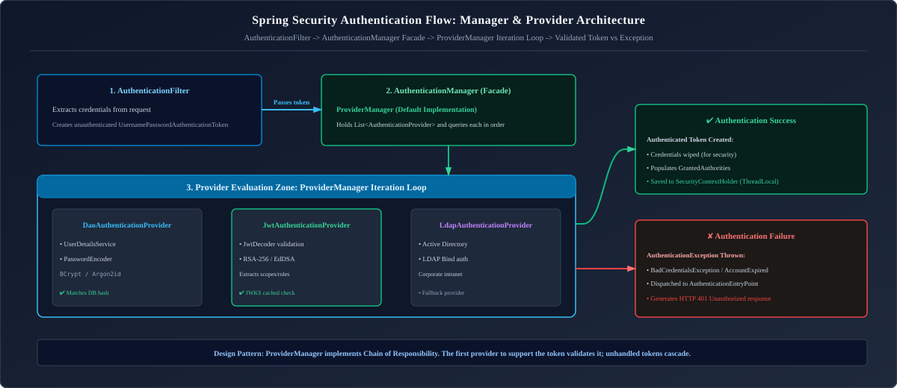

*D2 Source:* [assets/06_security_and_cryptography/05_authentication_manager_provider_flow.d2](assets/06_security_and_cryptography/05_authentication_manager_provider_flow.d2)

---

### 2.6 Custom Authentication Entry Point & Access Denied Handlers (RFC 9457 Integration)

When an unauthenticated or unauthorized request fails, Spring Security by default renders an empty page or basic HTML. In REST microservices, you must emit standardized RFC 9457 JSON problem details:

```java
@Component
public class ProblemDetailsAuthenticationEntryPoint implements AuthenticationEntryPoint {

    private final ObjectMapper objectMapper;

    public ProblemDetailsAuthenticationEntryPoint(ObjectMapper objectMapper) {
        this.objectMapper = objectMapper;
    }

    @Override
    public void commence(HttpServletRequest request, HttpServletResponse response,
                         AuthenticationException authException) throws IOException {
        
        response.setStatus(HttpStatus.UNAUTHORIZED.value());
        response.setContentType(MediaType.APPLICATION_PROBLEM_JSON_VALUE);

        ProblemDetail problem = ProblemDetail.forStatusAndDetail(
                HttpStatus.UNAUTHORIZED, "Full authentication is required to access this resource");
        problem.setTitle("Unauthorized Access");
        problem.setType(URI.create("https://api.enterprise.com/errors/unauthorized"));
        problem.setInstance(URI.create(request.getRequestURI()));
        problem.setProperty("timestamp", Instant.now());

        response.getWriter().write(objectMapper.writeValueAsString(problem));
    }
}
```

---

### 2.7 Cryptographic Password Hashing: BCrypt vs PBKDF2 vs Argon2id

> [!CAUTION]
> **Production Rule**: Never store passwords using MD5, SHA-1, SHA-256, or SHA-512! Modern GPUs can compute over 10 billion SHA-256 hashes per second, cracking common passwords in minutes using precomputed rainbow tables.

Modern password storage requires **Adaptive Key Derivation Functions (KDFs)** that incorporate:
1. **Cryptographic Salt**: A unique, random byte sequence generated per user, preventing rainbow table attacks.
2. **Work Factor / Iteration Cost**: Tunable computational cost that can be increased as hardware gets faster.

| Algorithm | Key Characteristic | Memory Hardness | Production Recommendation |
| :--- | :--- | :---: | :--- |
| **BCrypt** | Blowfish-based; configurable cost factor ($2^{10}$ to $2^{14}$) | Low | **Standard Production Default in Spring Security** |
| **PBKDF2** | NIST standard; HMAC iteration loop | Low | Enterprise compliance requirements (FIPS) |
| **Argon2id** | Winner of Password Hashing Competition; hybrid memory/time hard | **Very High** | **Gold Standard** (Resistant to GPU / ASIC cracking) |

```java
@Bean
public PasswordEncoder passwordEncoder() {
    // Argon2id configuration: salt length 16, hash length 32, parallelism 1, memory 65536 KB, iterations 3
    return new Argon2PasswordEncoder(16, 32, 1, 65536, 3);
}
```

> [!TIP]
> **Deep-Dive Interview Scenarios:**
> - [Q2. Spring Security Internal Architecture, Filter Chain & `AuthenticationManager`](frequently_asked_questions/06_security_and_cryptography_faq.md#q2-expert-spring-security-internal-architecture-filter-chain--authenticationmanager)
> - [Q3. `UserDetailsService` & Custom `AuthenticationProvider`](frequently_asked_questions/06_security_and_cryptography_faq.md#q3-medium-userdetailsservice--custom-authenticationprovider)
> - [Q4. `BCryptPasswordEncoder` vs Plain Text Passwords](frequently_asked_questions/06_security_and_cryptography_faq.md#q4-easy-bcryptpasswordencoder-vs-plain-text-passwords)
> - [Q5. Method-Level Security: `@PreAuthorize` vs `@Secured` vs `@RolesAllowed`](frequently_asked_questions/06_security_and_cryptography_faq.md#q5-medium-method-level-security-preauthorize-vs-secured-vs-rolesallowed)
> - [Q6. Spring Security CSRF Protection Mechanics](frequently_asked_questions/06_security_and_cryptography_faq.md#q6-easy-spring-security-csrf-protection-mechanics)
> - [Q7. Remember-Me Authentication Architecture](frequently_asked_questions/06_security_and_cryptography_faq.md#q7-medium-remember-me-authentication-architecture)
> - [Q12. JWT Security Risks & Mitigations](frequently_asked_questions/06_security_and_cryptography_faq.md#q12-medium-jwt-security-risks--mitigations)

---

# 3. Token-Based Authentication & OAuth 2.0 / OIDC

---

### 3.1 Stateful Session Authentication vs Stateless JWT Tokens

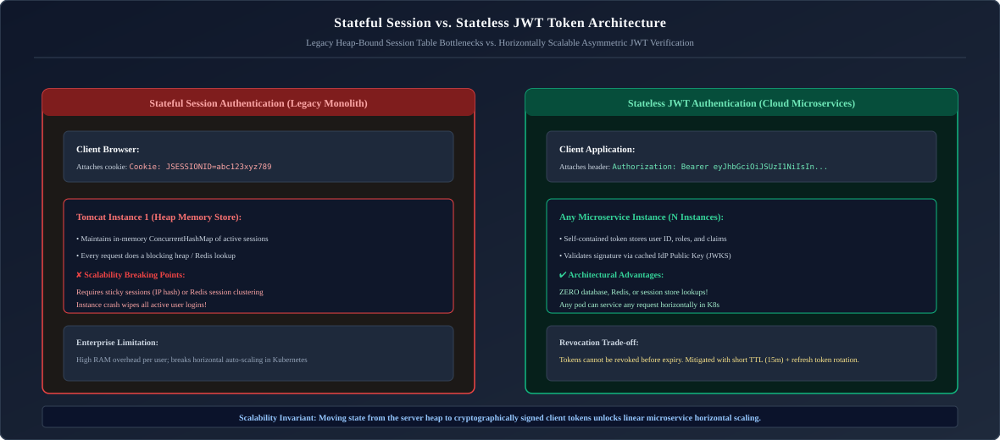

*D2 Source:* [assets/06_security_and_cryptography/06_stateful_session_vs_stateless_jwt.d2](assets/06_security_and_cryptography/06_stateful_session_vs_stateless_jwt.d2)

---

### 3.2 JWT Anatomy: Header, Payload Claims & Asymmetric RS256 Verification via JWKS

A JSON Web Token (JWT) is composed of three Base64URL-encoded strings separated by dots (`.`):

```json
    // "header": 
    {
        "alg": "HS256",
        "typ": "JWT"
    }
    // "payload": 
    {
        "sub": "user_12345",
        "iat": 1700000000,
        "exp": 1700003600,
        "roles": ["admin", "data_ingest"]
    }
    // "signature": "a-string-secret-at-least-256-bits-long"

// Gets Encoded as: 
// eyJhbGciOiJIUzI1NiIsInR5cCI6IkpXVCJ9.        -> 1. HEADER (Algorithm & Type)
// eyJzdWIiOiJ1c2VyXzEyMzQ1IiwiaWF0IjoxNzAw...  -> 2. PAYLOAD (Claims & Subject)
// DWkrkUkOXitp6TASupJi-vV7l7C84yUiPWAZ4_cDO0k  -> 3. SIGNATURE (Cryptographic Proof)
```

1. **Header**: Declares the cryptographic algorithm (e.g., `{"alg": "RS256", "typ": "JWT"}`).
2. **Payload**: Contains standard claims (`sub` = subject user ID, `iss` = issuer URI, `exp` = expiration timestamp) and custom business claims (`roles`).
3. **Signature (RS256 - Asymmetric)**:
   $$\text{Signature} = \text{RSA-SHA256}(\text{Base64Url}(\text{Header}) + "." + \text{Base64Url}(\text{Payload}),\ \text{Private Key})$$
   * **Why RS256 over HS256**: In HS256 (symmetric), both the authorization server and all 50 microservices must share the identical secret key. If one service is compromised, an attacker can forge valid tokens for the entire ecosystem! With **RS256 (asymmetric)**, only the Identity Provider holds the **Private Key** to sign tokens; microservices require only the **Public Key** to verify signatures.

---

### 3.3 Access Token vs Refresh Token Lifecycle & Silent Token Rotation

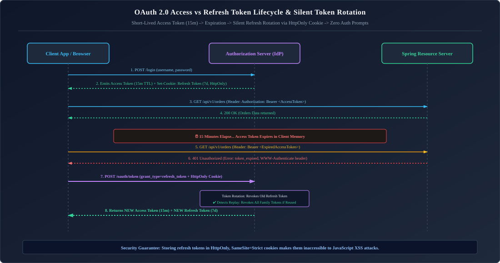

*D2 Source:* [assets/06_security_and_cryptography/07_oauth2_jwt_access_refresh_token_lifecycle.d2](assets/06_security_and_cryptography/07_oauth2_jwt_access_refresh_token_lifecycle.d2)

---

### 3.4 OAuth 2.0 & OpenID Connect: The 4 Core Roles

* **Resource Owner**: The end-user who owns the data.
* **Client**: The application attempting to act on the user's behalf (e.g., React SPA, iOS mobile app, backend service).
* **Authorization Server**: The identity system that authenticates the user and issues tokens (Keycloak, Okta, Azure AD).
* **Resource Server**: The Spring Boot backend hosting protected business APIs.
* **OpenID Connect (OIDC)**: An identity layer built directly on top of OAuth 2.0 that introduces the **ID Token** to communicate user identity profile information.

---

### 3.5 Authorization Code Flow with PKCE (Proof Key for Code Exchange)

The **Authorization Code Flow with PKCE (RFC 7636)** is the global industry standard for authenticating users across single-page applications (React, Angular) and mobile apps. In public clients, client secrets cannot be securely stored because compiled JavaScript or mobile binary code can be reverse-engineered. PKCE dynamically creates a cryptographic secret per authentication attempt.

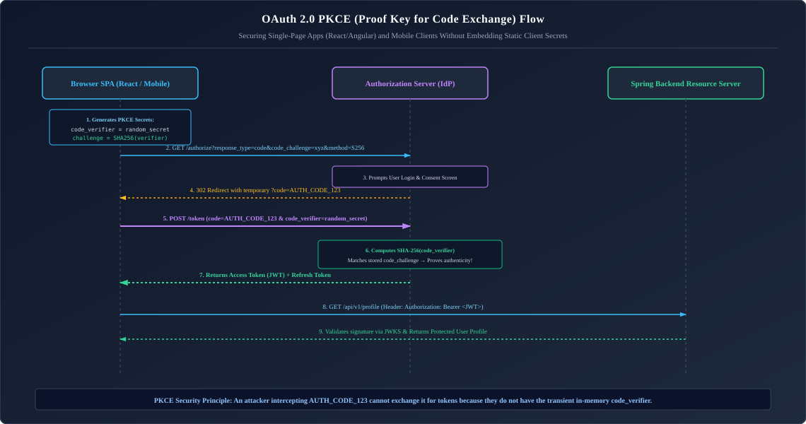

*D2 Source:* [assets/06_security_and_cryptography/08_oauth2_pkce_authorization_code_flow.d2](assets/06_security_and_cryptography/08_oauth2_pkce_authorization_code_flow.d2)

#### Production Java PKCE Generator Implementation

```java
package com.enterprise.security.pkce;

import java.nio.charset.StandardCharsets;
import java.security.MessageDigest;
import java.security.NoSuchAlgorithmException;
import java.security.SecureRandom;
import java.util.Base64;

public final class PkceUtility {

    private static final SecureRandom SECURE_RANDOM = new SecureRandom();

    private PkceUtility() {}

    /**
     * Generates a cryptographically random, high-entropy Code Verifier string (43 to 128 characters).
     */
    public static String generateCodeVerifier() {
        byte[] randomBytes = new byte[32];
        SECURE_RANDOM.nextBytes(randomBytes);
        // Base64URL-encode without padding as required by RFC 7636
        return Base64.getUrlEncoder().withoutPadding().encodeToString(randomBytes);
    }

    /**
     * Computes the SHA-256 Code Challenge from the Code Verifier.
     * Code Challenge = Base64URL-Encode(SHA-256(Code Verifier))
     */
    public static String generateCodeChallenge(String codeVerifier) {
        try {
            MessageDigest digest = MessageDigest.getInstance("SHA-256");
            byte[] hash = digest.digest(codeVerifier.getBytes(StandardCharsets.US_ASCII));
            return Base64.getUrlEncoder().withoutPadding().encodeToString(hash);
        } catch (NoSuchAlgorithmException e) {
            throw new IllegalStateException("SHA-256 algorithm unavailable", e);
        }
    }
}
```

---

### 3.6 Client Credentials Flow for Machine-to-Machine Microservices

When microservices communicate behind the scenes without user interaction (e.g., `OrderService` calling `InventoryService`):

```bash
# Microservice requests machine-to-machine token using Client ID & Client Secret
curl -X POST https://auth.company.com/oauth/token \
     -H "Content-Type: application/x-www-form-urlencoded" \
     -d "grant_type=client_credentials" \
     -d "client_id=order-service-client" \
     -d "client_secret=super_secret_credentials_value" \
     -d "scope=inventory:read inventory:write"
```

---

### 3.7 Method-Level Security: `@PreAuthorize`, SpEL & Custom Evaluators

```java
@Service
public class OrderSecurityEvaluator {
    public boolean isOrderOwner(Authentication auth, Long orderId, OrderRepository repo) {
        String username = auth.getName();
        return repo.findById(orderId)
                .map(order -> order.getCustomerUsername().equals(username))
                .orElse(false);
    }
}

@Service
public class OrderService {

    private final OrderRepository orderRepository;

    public OrderService(OrderRepository orderRepository) {
        this.orderRepository = orderRepository;
    }

    // Advanced ABAC: Delegates authorization to custom Spring bean evaluator!
    @PreAuthorize("hasRole('ADMIN') or @orderSecurityEvaluator.isOrderOwner(authentication, #orderId, @orderRepository)")
    public OrderResponse getOrderDetails(Long orderId) {
        return orderRepository.findById(orderId)
                .map(OrderResponse::fromEntity)
    }
}
```

---

### 3.8 Production Keycloak & OIDC JWT Role Claims Converter

In enterprise microservices integrated with Keycloak, Okta, or Azure AD, identity providers do not store user roles in a top-level `scope` or `roles` claim. Instead, roles are buried inside nested JSON structures such as `realm_access.roles` or `resource_access.{client_id}.roles`:

```json
{
  "iss": "https://auth.enterprise.com/realms/production",
  "sub": "usr_998127391",
  "realm_access": {
    "roles": ["customer", "payment_operator"]
  },
  "resource_access": {
    "billing_service": {
      "roles": ["invoice_viewer", "invoice_admin"]
    }
  }
}
```

Standard Spring Security `JwtAuthenticationConverter` extracts only `SCOPE_` authorities from the `scope` claim, leaving the application unable to authorize `@PreAuthorize("hasRole('INVOICE_ADMIN')")`.

#### Production Custom JwtAuthenticationConverter Bean

```java
package com.enterprise.security.oauth2;

import org.springframework.core.convert.converter.Converter;
import org.springframework.security.authentication.AbstractAuthenticationToken;
import org.springframework.security.core.GrantedAuthority;
import org.springframework.security.core.authority.SimpleGrantedAuthority;
import org.springframework.security.oauth2.jwt.Jwt;
import org.springframework.security.oauth2.server.resource.authentication.JwtAuthenticationToken;
import org.springframework.security.oauth2.server.resource.authentication.JwtGrantedAuthoritiesConverter;
import org.springframework.stereotype.Component;

import java.util.*;
import java.util.stream.Collectors;
import java.util.stream.Stream;

@Component
public class KeycloakJwtAuthenticationConverter implements Converter<Jwt, AbstractAuthenticationToken> {

    private final JwtGrantedAuthoritiesConverter defaultAuthoritiesConverter = new JwtGrantedAuthoritiesConverter();

    @Override
    public AbstractAuthenticationToken convert(Jwt jwt) {
        Collection<GrantedAuthority> authorities = Stream.concat(
                defaultAuthoritiesConverter.convert(jwt).stream(),
                extractNestedRoles(jwt).stream()
        ).collect(Collectors.toSet());

        String principalClaimName = jwt.getClaimAsString("preferred_username");
        if (principalClaimName == null) {
            principalClaimName = jwt.getSubject();
        }

        return new JwtAuthenticationToken(jwt, authorities, principalClaimName);
    }

    @SuppressWarnings("unchecked")
    private Collection<GrantedAuthority> extractNestedRoles(Jwt jwt) {
        Set<GrantedAuthority> grantedAuthorities = new HashSet<>();

        // 1. Extract Realm Roles: realm_access.roles
        Map<String, Object> realmAccess = jwt.getClaim("realm_access");
        if (realmAccess != null && realmAccess.containsKey("roles")) {
            List<String> realmRoles = (List<String>) realmAccess.get("roles");
            realmRoles.stream()
                    .map(role -> new SimpleGrantedAuthority("ROLE_" + role.toUpperCase()))
                    .forEach(grantedAuthorities::add);
        }

        // 2. Extract Client-Specific Roles: resource_access.billing_service.roles
        Map<String, Object> resourceAccess = jwt.getClaim("resource_access");
        if (resourceAccess != null) {
            for (Map.Entry<String, Object> clientEntry : resourceAccess.entrySet()) {
                String clientName = clientEntry.getKey();
                Map<String, Object> clientData = (Map<String, Object>) clientEntry.getValue();
                if (clientData.containsKey("roles")) {
                    List<String> clientRoles = (List<String>) clientData.get("roles");
                    clientRoles.stream()
                            .map(role -> new SimpleGrantedAuthority("ROLE_" + clientName.toUpperCase() + "_" + role.toUpperCase()))
                            .forEach(grantedAuthorities::add);
                }
            }
        }

        return grantedAuthorities;
    }
}
```

#### Registering Converter in SecurityFilterChain

```java
@Bean
public SecurityFilterChain securityFilterChain(HttpSecurity http,
                                               KeycloakJwtAuthenticationConverter keycloakConverter) throws Exception {
    return http
        .authorizeHttpRequests(auth -> auth
            .requestMatchers("/api/admin/**").hasRole("ADMIN")
            .requestMatchers("/api/invoices/**").hasRole("BILLING_SERVICE_INVOICE_ADMIN")
            .anyRequest().authenticated()
        )
        .oauth2ResourceServer(oauth2 -> oauth2
            .jwt(jwt -> jwt.jwtAuthenticationConverter(keycloakConverter))
        )
        .build();
}
```

> [!TIP]
> **Deep-Dive Interview Scenarios:**
> - [Q1. Authentication vs Authorization](frequently_asked_questions/06_security_and_cryptography_faq.md#q1-easy-authentication-vs-authorization)
> - [Q9. Structure of a JWT Token & Cryptographic Validation](frequently_asked_questions/06_security_and_cryptography_faq.md#q9-medium-structure-of-a-jwt-token--cryptographic-validation)
> - [Q10. Client-Side JWT Storage & Early Token Revocation](frequently_asked_questions/06_security_and_cryptography_faq.md#q10-expert-client-side-jwt-storage--early-token-revocation)
> - [Q11. Expired Tokens, Refresh Token Rotation & Concurrency](frequently_asked_questions/06_security_and_cryptography_faq.md#q11-medium-expired-tokens-refresh-token-rotation--concurrency)
> - [Q13. OAuth2 vs Basic Authentication](frequently_asked_questions/06_security_and_cryptography_faq.md#q13-easy-oauth2-vs-basic-authentication)
> - [Q14. OAuth2 Authorization Code Flow with PKCE](frequently_asked_questions/06_security_and_cryptography_faq.md#q14-hard-oauth2-authorization-code-flow-with-pkce)
> - [Q15. OAuth2 Client Credentials Grant for Microservices](frequently_asked_questions/06_security_and_cryptography_faq.md#q15-expert-oauth2-client-credentials-grant-for-microservices)
> - [Q17. Refresh Token Reuse Detection & Blast-Radius Revocation Workflows](frequently_asked_questions/06_security_and_cryptography_faq.md#q17-hard-refresh-token-reuse-detection--blast-radius-revocation-workflows)

---

# 4. Web Application Defenses & OWASP Top 10

---

### 4.1 Cross-Site Request Forgery (CSRF): Mechanics & Token Repositories

In a **CSRF** attack, a malicious website tricks a user's browser into executing an unwanted action on a trusted website where the user is currently authenticated via cookies:

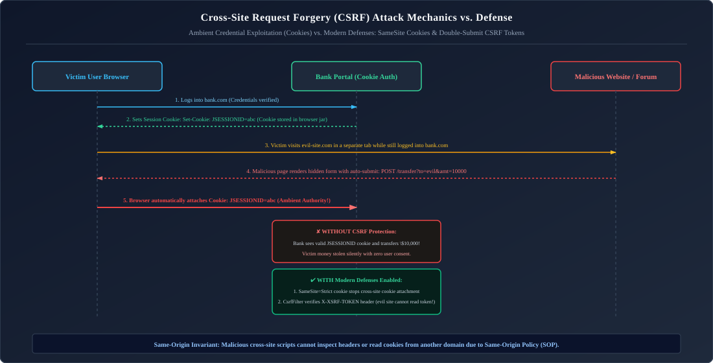

*D2 Source:* [assets/06_security_and_cryptography/09_csrf_attack_and_double_submit_defense.d2](assets/06_security_and_cryptography/09_csrf_attack_and_double_submit_defense.d2)

#### The Defense: Synchronizer Token Pattern
Spring Security injects a unique, cryptographically random CSRF token into each session. Mutating requests (`POST`, `PUT`, `DELETE`) must supply this token in a header (`X-XSRF-TOKEN`), which third-party sites cannot read due to the **Same-Origin Policy (SOP)**:

```java
// For cookie-based SPAs:
http.csrf(csrf -> csrf
    .csrfTokenRepository(CookieCsrfTokenRepository.withHttpOnlyFalse())
);
```

---

### 4.2 Cross-Site Scripting (XSS) & Content Security Policy (CSP)

* **XSS Attack**: Injecting malicious JavaScript into web pages viewed by other users to steal session cookies or credentials.
* **Spring Boot Defense**: Use Thymeleaf (which escapes HTML by default via `th:text`), sanitize input with OWASP Java HTML Sanitizer, and configure strict **Content Security Policy (CSP)** headers:
  ```java
  http.headers(headers -> headers
      .contentSecurityPolicy(csp -> csp
          .policyDirectives("default-src 'self'; script-src 'self'; object-src 'none';")
      )
  );
  ```

---

### 4.3 Insecure Direct Object References (IDOR) & Tenancy Enforcement

An IDOR vulnerability occurs when an application exposes a direct reference to an internal database object (e.g. `GET /api/orders/5001`) without verifying whether the requesting user owns that object:

```java
@GetMapping("/orders/{orderId}")
public OrderResponse getOrder(@PathVariable Long orderId, @AuthenticationPrincipal Jwt jwt) {
    String currentUserId = jwt.getSubject();
    // ✅ TENANCY ENFORCEMENT: Enforce customer ID in the database query!
    return orderRepository.findByIdAndCustomerId(orderId, currentUserId)
            .map(orderMapper::toDto)
            .orElseThrow(() -> new ResourceNotFoundException("Order not found or unauthorized"));
}
```

---

### 4.4 Server-Side Request Forgery (SSRF) & Internal Network Shielding

SSRF occurs when an attacker coaxes a backend server into making HTTP requests to internal, non-routable IP addresses (e.g., AWS metadata endpoint `http://169.254.169.254/latest/meta-data/` to steal IAM roles).
* **Defense**: Strictly whitelist allowed external target domains and block loopback/private subnets (`127.0.0.1`, `10.0.0.0/8`, `169.254.0.0/16`).

---

### 4.5 Security Response Headers (`HSTS`, `X-Content-Type-Options`, `X-Frame-Options`)

Spring Security configures safe default HTTP security headers:
```properties
Strict-Transport-Security: max-age=31536000 ; includeSubDomains (Enforces HTTPS for 1 year)
X-Content-Type-Options: nosniff (Prevents MIME-type sniffing)
X-Frame-Options: DENY (Prevents clickjacking inside iframe)
Referrer-Policy: strict-origin-when-cross-origin
```

---

### 4.6 Distributed Rate Limiting & Brute-Force Defense (Redis Token Bucket)

Authentication endpoints (e.g. `/api/v1/auth/login`, `/oauth/token`) are primary targets for credential stuffing and dictionary brute-force attacks. In distributed architectures, in-memory rate limiting fails because traffic load-balances across dozens of container instances.

#### Distributed Token Bucket Architecture via Redis

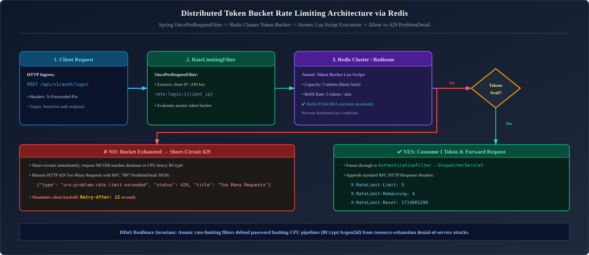

*D2 Source:* [assets/06_security_and_cryptography/10_redis_token_bucket_rate_limiting.d2](assets/06_security_and_cryptography/10_redis_token_bucket_rate_limiting.d2)

#### Production Rate Limiting Filter Implementation

```java
package com.enterprise.security.filter;

import com.fasterxml.jackson.databind.ObjectMapper;
import io.github.bucket4j.Bandwidth;
import io.github.bucket4j.Bucket;
import io.github.bucket4j.ConsumptionProbe;
import io.github.bucket4j.Refill;
import io.github.bucket4j.distributed.proxy.ProxyManager;
import jakarta.servlet.FilterChain;
import jakarta.servlet.ServletException;
import jakarta.servlet.http.HttpServletRequest;
import jakarta.servlet.http.HttpServletResponse;
import org.springframework.http.HttpStatus;
import org.springframework.http.MediaType;
import org.springframework.http.ProblemDetail;
import org.springframework.stereotype.Component;
import org.springframework.web.filter.OncePerRequestFilter;

import java.io.IOException;
import java.net.URI;
import java.time.Duration;

@Component
public class DistributedRateLimitingFilter extends OncePerRequestFilter {

    private final ProxyManager<String> proxyManager;
    private final ObjectMapper objectMapper;

    public DistributedRateLimitingFilter(ProxyManager<String> proxyManager, ObjectMapper objectMapper) {
        this.proxyManager = proxyManager;
        this.objectMapper = objectMapper;
    }

    @Override
    protected void doFilterInternal(HttpServletRequest request,
                                    HttpServletResponse response,
                                    FilterChain filterChain) throws ServletException, IOException {
        // Enforce rate limiting strictly on sensitive authentication routes
        if ("/api/v1/auth/login".equals(request.getRequestURI()) && "POST".equalsIgnoreCase(request.getMethod())) {
            String clientIp = extractClientIp(request);
            String bucketKey = "rate_limit:login:" + clientIp;

            // Strict limit: 5 attempts per minute per IP address
            Bandwidth limit = Bandwidth.classic(5, Refill.intervally(5, Duration.ofMinutes(1)));
            Bucket bucket = proxyManager.builder().build(bucketKey, () -> limit);

            ConsumptionProbe probe = bucket.tryConsumeAndReturnRemaining(1);

            if (probe.isConsumed()) {
                response.addHeader("X-Rate-Limit-Remaining", String.valueOf(probe.getRemainingTokens()));
                filterChain.doFilter(request, response);
            } else {
                long waitForRefillNanos = probe.getNanosToWaitForRefill();
                long waitForRefillSeconds = Math.max(1, waitForRefillNanos / 1_000_000_000L);

                response.setStatus(HttpStatus.TOO_MANY_REQUESTS.value());
                response.setContentType(MediaType.APPLICATION_PROBLEM_JSON_VALUE);
                response.addHeader("Retry-After", String.valueOf(waitForRefillSeconds));

                ProblemDetail problem = ProblemDetail.forStatusAndDetail(
                        HttpStatus.TOO_MANY_REQUESTS,
                        "Too many login attempts. Please wait " + waitForRefillSeconds + " seconds before retrying."
                );
                problem.setType(URI.create("https://enterprise.com/errors/too-many-requests"));
                problem.setTitle("Rate Limit Exceeded");

                response.getWriter().write(objectMapper.writeValueAsString(problem));
                return; // Short-circuit pipeline!
            }
        } else {
            filterChain.doFilter(request, response);
        }
    }

    private String extractClientIp(HttpServletRequest request) {
        String xForwardedFor = request.getHeader("X-Forwarded-For");
        if (xForwardedFor != null && !xForwardedFor.isBlank()) {
            return xForwardedFor.split(",")[0].trim();
        }
        return request.getRemoteAddr();
    }
}
```

> [!TIP]
> **Deep-Dive Interview Scenarios:**
> - [Q8. Why Use JWT Tokens Instead of Stateful Sessions?](frequently_asked_questions/06_security_and_cryptography_faq.md#q8-medium-why-use-jwt-tokens-instead-of-stateful-sessions)
> - [Q16. Cross-Service JWT Propagation & Verification in Distributed Microservices](frequently_asked_questions/06_security_and_cryptography_faq.md#q16-hard-cross-service-jwt-propagation--verification-in-distributed-microservices)

---

# 5. Public Key Infrastructure (PKI), TLS 1.3 & Certificate Management

---

### 5.1 PKI Fundamentals: Asymmetric Encryption & X.509 Certificate Chain of Trust

Public Key Infrastructure binds cryptographic public keys to verified identities using digital certificates signed by **Certificate Authorities (CAs)**:

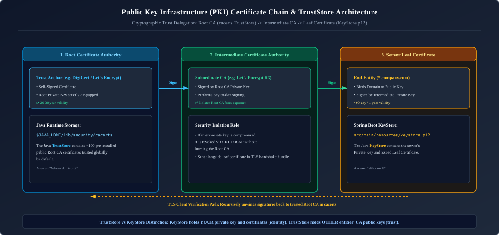

*D2 Source:* [assets/06_security_and_cryptography/11_pki_certificate_chain_truststore.d2](assets/06_security_and_cryptography/11_pki_certificate_chain_truststore.d2)

* When a client connects to a server, the server delivers its **Leaf Certificate** and the **Intermediate Certificate**.
* The client verifies that the Intermediate Certificate was signed by a trusted **Root CA** already present in its local truststore. If any link in the chain is broken or expired, verification fails!

---

### 5.2 TLS 1.3 Handshake Deep-Dive & Perfect Forward Secrecy

TLS 1.3 optimizes the connection handshake from 2 round-trips (TLS 1.2) down to a **single 1-RTT round-trip**:

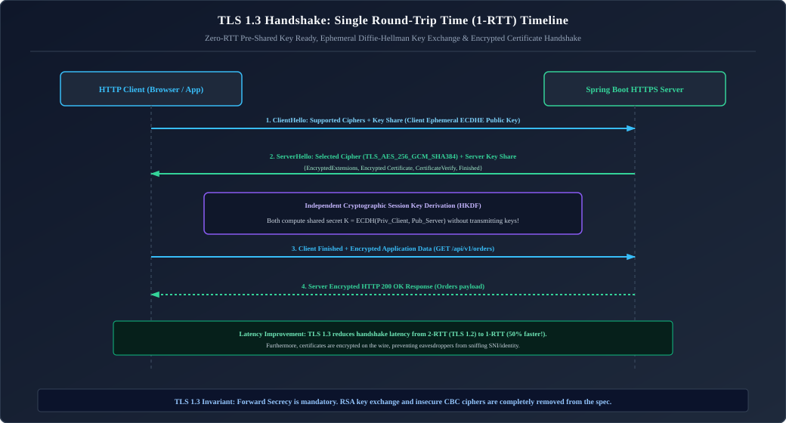

*D2 Source:* [assets/06_security_and_cryptography/12_tls13_handshake_1rtt_timeline.d2](assets/06_security_and_cryptography/12_tls13_handshake_1rtt_timeline.d2)

* **Perfect Forward Secrecy (PFS)**: TLS 1.3 mandates ephemeral Diffie-Hellman key exchanges (`ECDHE`). Even if an attacker records encrypted network traffic today and steals the server's private key 5 years from now, they **cannot decrypt past recorded sessions**!

---

### 5.3 Java Keystore (`KeyStore`) vs Truststore (`TrustStore`)

#### Public Key Infrastructure (PKI) & Java Cryptographic Storage
In the Java Virtual Machine, secure TLS/SSL socket handshakes rely on the Java Cryptography Architecture (JCA) `KeyStore` API (`java.security.KeyStore`) to manage cryptographic keys and certificates. Although both are physically represented by identical storage formats (standardized on PKCS#12 `.p12` since Java 9, replacing legacy proprietary `.jks`), they fulfill fundamentally opposite security roles in the TLS handshake:

1. **Java KeyStore (`keystore.p12` — Identity Assertion):**
   - **Operational Role:** Answers the cryptographic question: *"Who am I to the outside world?"*
   - **Cryptographic Contents:** Contains the server's or client's own **Private Key** paired with its corresponding public **Leaf Certificate** (and intermediate signing certificates forming the certificate chain up to the root CA).
   - **Protection Requirements:** Because it contains private asymmetric keys capable of decrypting traffic or signing data, KeyStores must be encrypted with robust passphrases, stored with restrictive file permissions (`chmod 600`), and injected dynamically via cloud secrets vaults (AWS Secrets Manager, Azure Key Vault).

2. **Java TrustStore (`truststore.p12` / `cacerts` — Peer Verification):**
   - **Operational Role:** Answers the cryptographic question: *"Whom do I trust?"*
   - **Cryptographic Contents:** Contains strictly **Public Certificates** of trusted Root Certificate Authorities (CAs) and Intermediate CAs. It holds zero private keys.
   - **Verification Mechanics:** When a Spring Boot microservice establishes an outbound HTTPS connection to an external payment API, the JVM inspects the server's presented certificate and traverses up its cryptographic signature chain. If the signing root CA exists inside the JVM's TrustStore, the connection is trusted; otherwise, the JVM aborts with a fatal `sun.security.validator.ValidatorException: PKIX path building failed`.

| Dimension | Java KeyStore (`keystore.p12`) | Java TrustStore (`truststore.p12` / `cacerts`) |
| :--- | :--- | :--- |
| **Architectural Purpose** | **"Who I Am" (Authentication Identity)** | **"Whom I Trust" (Verification Registry)** |
| **Contents** | Holds **Private Keys** and their matching public Leaf Certificates. | Holds **Public Certificates of trusted CAs** (Root & Intermediate). |
| **Standard Format** | **PKCS12** (`.p12` - Modern standard replacing legacy JKS) | **PKCS12** or default `$JAVA_HOME/lib/security/cacerts` |
| **Confidentiality** | **Highly Confidential**: Must be protected with strong passwords. | Low/Moderate: Contains public certificates only. |

---

### 5.4 Mutual TLS (mTLS / Two-Way SSL) in Microservices & B2B Banking Gateways

In standard TLS (one-way), only the client authenticates the server. In **Mutual TLS (mTLS)**, both parties authenticate each other:

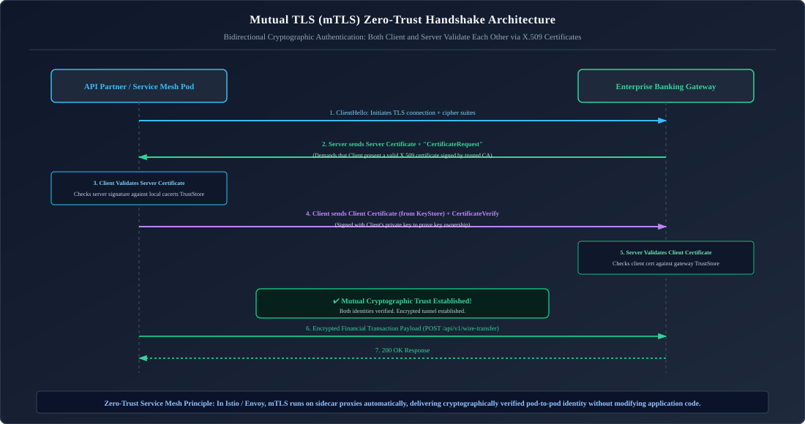

*D2 Source:* [assets/06_security_and_cryptography/13_mtls_mutual_authentication_handshake.d2](assets/06_security_and_cryptography/13_mtls_mutual_authentication_handshake.d2)

#### Production Spring Boot 3 `RestClient` mTLS Client Configuration

When making outbound calls to a secured banking partner requiring client certificate authentication, configure `RestClient` with a custom `SSLContext`:

```java
package com.enterprise.security.client;

import org.apache.hc.client5.http.impl.classic.CloseableHttpClient;
import org.apache.hc.client5.http.impl.classic.HttpClients;
import org.apache.hc.client5.http.impl.io.PoolingHttpClientConnectionManagerBuilder;
import org.apache.hc.client5.http.ssl.SSLConnectionSocketFactoryBuilder;
import org.apache.hc.core5.ssl.SSLContextBuilder;
import org.springframework.beans.factory.annotation.Value;
import org.springframework.context.annotation.Bean;
import org.springframework.context.annotation.Configuration;
import org.springframework.core.io.Resource;
import org.springframework.http.client.HttpComponentsClientHttpRequestFactory;
import org.springframework.web.client.RestClient;

import javax.net.ssl.SSLContext;
import java.io.InputStream;
import java.security.KeyStore;

@Configuration
public class MtlsRestClientConfiguration {

    @Value("${partner.bank.keystore.location}")
    private Resource keystoreResource;

    @Value("${partner.bank.keystore.password}")
    private String keystorePassword;

    @Value("${partner.bank.truststore.location}")
    private Resource truststoreResource;

    @Value("${partner.bank.truststore.password}")
    private String truststorePassword;

    @Bean
    public RestClient partnerBankRestClient() throws Exception {
        // 1. Load Client KeyStore (contains our private key + leaf certificate)
        KeyStore clientKeyStore = KeyStore.getInstance("PKCS12");
        try (InputStream is = keystoreResource.getInputStream()) {
            clientKeyStore.load(is, keystorePassword.toCharArray());
        }

        // 2. Load TrustStore (contains bank partner's root CA certificate)
        KeyStore trustStore = KeyStore.getInstance("PKCS12");
        try (InputStream is = truststoreResource.getInputStream()) {
            trustStore.load(is, truststorePassword.toCharArray());
        }

        // 3. Build SSLContext configured for mTLS
        SSLContext sslContext = SSLContextBuilder.create()
            .loadKeyMaterial(clientKeyStore, keystorePassword.toCharArray())
            .loadTrustMaterial(trustStore, null)
            .build();

        // 4. Create Apache HttpClient 5 socket factory and pooling connection manager
        var connectionManager = PoolingHttpClientConnectionManagerBuilder.create()
            .setSSLSocketFactory(SSLConnectionSocketFactoryBuilder.create().setSslContext(sslContext).build())
            .setMaxConnTotal(100)
            .setMaxConnPerRoute(20)
            .build();

        CloseableHttpClient httpClient = HttpClients.custom()
            .setConnectionManager(connectionManager)
            .build();

        // 5. Build Spring RestClient
        return RestClient.builder()
            .requestFactory(new HttpComponentsClientHttpRequestFactory(httpClient))
            .baseUrl("https://api.partner-bank.com/v1")
            .build();
    }
}
```

---

### 5.5 Spring Boot 3.1+ SSL Bundles (`SslBundle`) & Dynamic Reloading

Spring Boot 3.1 introduced **SSL Bundles**, cleanly centralizing TLS certificates without hardcoded property spaghetti:

```yaml
spring:
  ssl:
    bundle:
      jks:
        server-bundle:
          key:
            alias: "api-server"
          keystore:
            location: "classpath:keystore.p12"
            password: "keystore-secret"
            type: "PKCS12"
          truststore:
            location: "classpath:truststore.p12"
            password: "truststore-secret"
            type: "PKCS12"

server:
  port: 8443
  ssl:
    bundle: "server-bundle"
    client-auth: need # Enforces strict Mutual TLS (mTLS)!
```

---

### 5.6 Cryptographic Diagnostic CLI Playbook (`keytool` & `openssl`)

#### Complete End-to-End Self-Signed SAN Certificate Generation Playbook

Modern browsers and Java 17+ reject certificates without **Subject Alternative Name (SAN)** fields:

```bash

# 6. Generate Private Key and CSR with SAN (DNS and IP)

openssl req -new -newkey rsa:4096 -nodes \
    -keyout server.key -out server.csr \
    -subj "/C=US/ST=California/L=SanFrancisco/O=Enterprise/CN=api.enterprise.com" \
    -addext "subjectAltName=DNS:api.enterprise.com,DNS:localhost,IP:127.0.0.1"

# 7. Self-sign certificate with 1-year validity

openssl x509 -req -days 365 -in server.csr -signkey server.key -out server.crt \
    -copy_extensions copy

# 8. Package private key and certificate into PKCS12 KeyStore

openssl pkcs12 -export \
    -in server.crt -inkey server.key \
    -out keystore.p12 -name "api-server" \
    -passout pass:changeit

# 9. Inspect certificates inside a PKCS12 Java KeyStore

keytool -list -v -keystore keystore.p12 -storetype PKCS12 -storepass changeit

# 10. Import server certificate into client TrustStore

keytool -importcert -alias api-server-ca \
    -file server.crt \
    -keystore truststore.p12 -storetype PKCS12 \
    -storepass changeit -noprompt

# 11. Test remote SSL connection with SNI and verify certificate chain

openssl s_client -connect api.enterprise.com:443 -servername api.enterprise.com -showcerts
```

---

# 6. Production Troubleshooting Playbook

### Incident 1: `SSLHandshakeException: PKIX path building failed`
* **Symptom**: Outbound HTTPS calls fail with:
  `sun.security.validator.ValidatorException: PKIX path building failed: unable to find valid certification path to requested target`.
* **Root Cause**: The remote server presents a certificate signed by a private or corporate internal CA not present in Java's trusted CA registry (`cacerts`).
* **SRE Diagnostic & Resolution**:
  1. Retrieve and view remote server certificate chain:
     ```bash
     openssl s_client -connect remote.service:443 -showcerts </dev/null 2>/dev/null | openssl x509 -outform PEM > server.crt
     ```
  2. Inspect certificate issuer and expiry:
     ```bash
     openssl x509 -in server.crt -text -noout | grep -E "(Issuer|Not After)"
     ```
  3. Import the root/intermediate CA certificate into the application's `TrustStore`:
     ```bash
     keytool -importcert -alias remote-ca -file server.crt -keystore truststore.p12 -storepass secret -noprompt
     ```
  4. Pass truststore flag to JVM:
     `-Djavax.net.ssl.trustStore=/path/to/truststore.p12 -Djavax.net.ssl.trustStorePassword=secret`

### Incident 2: `SSLHandshakeException: Received fatal alert: certificate_unknown` in mTLS
* **Symptom**: In an mTLS setup, client requests fail during handshake before reaching any controller.
* **Root Cause**: The server requested a client certificate (`CertificateRequest`), but the client either sent no certificate or sent a certificate signed by a CA missing from the server's truststore.
* **SRE Diagnostic & Resolution**:
  Enable SSL handshake debug logging in the JVM:
  ```bash
  java -Djavax.net.debug=ssl:handshake -jar application.jar
  ```
  Look for `*** CertificateRequest` from server and verify the client certificate's Subject and Issuer against the server's accepted CA list.

### Incident 3: Memory Leak / User Impersonation via `SecurityContextHolder` in Thread Pools
* **Symptom**: User A occasionally sees User B's private account dashboard after high concurrency bursts.
* **Root Cause**: Tomcat worker threads or asynchronous `@Async` executor threads reuse `ThreadLocal` variables across requests without clearing `SecurityContext`.
* **Remedy**:
  1. Always verify that Spring Security's `SecurityContextHolderFilter` executes.
  2. In manual thread execution, wrap calls in a try-finally block:
     ```java
     try {
         SecurityContextHolder.setContext(context);
         task.run();
     } finally {
         SecurityContextHolder.clearContext(); // MANDATORY!
     }
     ```

### Incident 4: JWKS Key Rotation Desynchronization (`InvalidSignatureException`)
* **Symptom**: Microservices reject all valid user tokens with `InvalidSignatureException: Signature verification failed`.
* **Root Cause**: The Identity Provider rotated its RS256 signing key pair. The incoming JWT has a new `kid` (Key ID), but the resource server cached the old JWKS payload and cannot find the matching public key.
* **Remedy**:
  Configure Nimbus JWT decoder with appropriate cache refresh timeouts and dynamic reload:
  ```java
  @Bean
  public JwtDecoder jwtDecoder() {
      return NimbusJwtDecoder.withJwkSetUri("https://auth.company.com/.well-known/jwks.json")
              .cache(new ConcurrentMapCache("jwksCache"))
              .build();
  }
  ```

### Incident 5: CSRF Token Mismatch (`403 Forbidden`) on Single-Page Applications
* **Symptom**: POST requests from a React frontend return HTTP 403 Forbidden with `Invalid CSRF Token`.
* **Root Cause**: Modern SPAs read the CSRF cookie (`XSRF-TOKEN`) via JavaScript and send it in the `X-XSRF-TOKEN` header. If `CookieCsrfTokenRepository` has `httpOnly=true`, JavaScript cannot read the cookie; or the `CsrfTokenRequestAttributeHandler` is not configured for Deferred CSRF resolution in Spring Security 6.
* **Remedy**:
  ```java
  CookieCsrfTokenRepository tokenRepository = CookieCsrfTokenRepository.withHttpOnlyFalse();
  XorCsrfTokenRequestAttributeHandler delegate = new XorCsrfTokenRequestAttributeHandler();
  http.csrf(csrf -> csrf
      .csrfTokenRepository(tokenRepository)
      .csrfTokenRequestHandler(delegate::handle)
  );
  ```

---

### Incident 6: TLS Certificate Expiration Blackout & Automated cert-manager Renewal Failures
* **Symptom**: Production ingress gateways abruptly reject all incoming HTTPS traffic with `NET::ERR_CERT_DATE_INVALID` or `javax.net.ssl.SSLHandshakeException: Certificate expired`.
* **Root Cause**: In Kubernetes environments, `cert-manager` attempts to renew certificates 30 days before expiration. The automated renewal stalled due to:
  1. Failed ACME HTTP-01 challenge (ingress routing rule blocked `/.well-known/acme-challenge/*`).
  2. Let's Encrypt API rate limits reached (exceeded 5 duplicate certificates per week).
  3. Stale cloud provider DNS API tokens preventing DNS-01 TXT record propagation.
* **SRE Diagnostic & Recovery Playbook**:
  ```bash

# 13. Inspect cert-manager certificate resource state in Kubernetes

kubectl describe certificate enterprise-tls -n production

# 14. Trace underlying ACME Order and Challenge lifecycle

kubectl get orders -n production
  kubectl describe challenge <challenge-name> -n production

# 15. Emergency Manual Keystore Injection (Bypass cert-manager temporarily)

kubectl create secret tls emergency-tls-backup \
      --cert=/tmp/renewed-cert.crt \
      --key=/tmp/renewed-key.key \
      --dry-run=client -o yaml | kubectl apply -n production -f -

# 16. Patch Ingress to use emergency secret immediately

kubectl patch ingress enterprise-ingress -n production \
      --type='json' -p='[{"op": "replace", "path": "/spec/tls/0/secretName", "value":"emergency-tls-backup"}]'
  ```

---

### Incident 7: Side-Channel Timing Attacks in Cryptographic Token Verification
* **Symptom**: Enterprise penetration testing reports a vulnerability in webhook HMAC signatures or custom API key verification: *CWE-208: Observable Timing Discrepancy*.
* **Root Cause**: Developers evaluate secrets using standard equality operators:
  ```java
  // VULNERABLE: Aborts comparison on first mismatched byte!
  if (computedHmac.equals(providedHmac)) { ... }
  ```
  `String.equals()` terminates immediately upon encountering the first differing character ($O(1)$ early exit). An attacker repeatedly transmits crafted HMAC bytes, measuring request response times with microsecond precision. When byte $k$ is guessed correctly, comparison time increases by $\approx 10\text{--}50\text{ nanoseconds}$, allowing full secret reconstruction byte-by-byte!
* **Remedy & Constant-Time Verification**:
  Always execute cryptographic comparisons using constant-time comparison algorithms that run across every byte regardless of mismatch location:
  ```java
  package com.enterprise.security.crypto;

  import java.nio.charset.StandardCharsets;
  import java.security.MessageDigest;

  public final class ConstantTimeSecurity {

      private ConstantTimeSecurity() {}

      /**
       * Evaluates two authentication tokens in constant time, eliminating side-channel timing leaks.
       */
      public static boolean isTokenValid(String expectedToken, String receivedToken) {
          if (expectedToken == null || receivedToken == null) {
              return false;
          }

          byte[] expectedBytes = expectedToken.getBytes(StandardCharsets.UTF_8);
          byte[] receivedBytes = receivedToken.getBytes(StandardCharsets.UTF_8);

          // MessageDigest.isEqual executes a bitwise OR across all bytes without early loop termination!
          return MessageDigest.isEqual(expectedBytes, receivedBytes);
      }
  }
  ```

---

# 7. Summary Comparison & Production Engineering Reference Matrix

| Security Dimension | Technical Mechanism | Production Best Practice |
| :--- | :--- | :--- |
| **Filter Pipeline** | `DelegatingFilterProxy` delegates to `SecurityFilterChain` | Keep stateless REST APIs configured with `SessionCreationPolicy.STATELESS`. |
| **Password Hashing** | Adaptive Key Derivation Functions (BCrypt, Argon2id) | Use BCrypt (cost 12) or Argon2id; never use MD5 or raw SHA-256. |
| **JWT Signing** | Asymmetric RS256 with public/private key pairs | Auth server signs with Private Key; microservices verify via JWKS public keys. |
| **OAuth 2.0 Flow** | Authorization Code Flow with PKCE | Mandatory for SPAs and mobile apps; bans deprecated Implicit Flow. |
| **CSRF Defense** | Synchronizer token validation on state-modifying verbs | Disable for stateless JWT APIs; enable with Cookie repository for browser cookies. |
| **IDOR Protection** | Tenant-scoped database queries | Never trust path IDs blindly; verify user ownership in service/query logic. |
| **Java KeyStore** | Holds private keys and leaf certificates (Who I Am) | Secure with strong passwords; restrict file permissions to `chmod 600`. |
| **Java TrustStore** | Holds trusted CA public certificates (Whom I Trust) | Import internal corporate CAs into custom truststore; avoid editing global `cacerts`. |
| **mTLS** | Two-way cryptographic X.509 handshake | Use for zero-trust east-west microservice traffic and high-security B2B banking APIs. |

---

# 8. References & Further Reading

---

- [Spring Security Reference Documentation (Version 6.x)](https://docs.spring.io/spring-security/reference/)
- [RFC 7519 - JSON Web Token (JWT) Specification](https://datatracker.ietf.org/doc/html/rfc7519)
- [RFC 7636 - Proof Key for Code Exchange (PKCE) by OAuth Public Clients](https://datatracker.ietf.org/doc/html/rfc7636)
- [OWASP Top Ten Web Application Security Risks](https://owasp.org/www-project-top-ten/)
- [NIST Special Publication 800-63B - Digital Identity Guidelines](https://pages.nist.gov/800-63-3/sp800-63b.html)
- [RFC 8446 - The Transport Layer Security (TLS) Protocol Version 1.3](https://datatracker.ietf.org/doc/html/rfc8446)
