# 07. Databases, SQL, JDBC, JPA & Hibernate

A comprehensive, production-grade guide to relational database architecture, SQL execution, ANSI isolation levels, Spring Data JDBC/JPA, Hibernate entity lifecycle, N+1 query resolution, L1/L2 caching, and declarative transaction management.

---

## Architectural Overview: Enterprise Database Engine & Storage Architecture

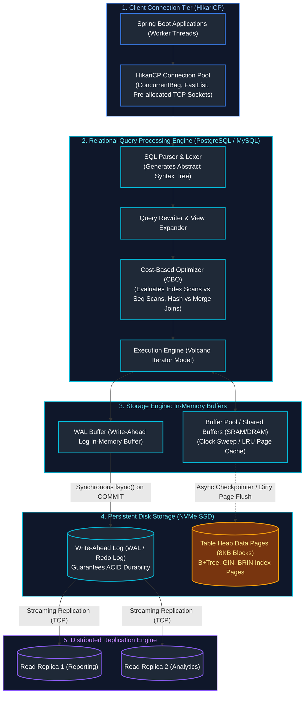

---

## Table of Contents
1. [Relational Foundations & Schema Design](#1-relational-foundations--schema-design)
   - [1.1 Relational Model Foundations: Tables, Rows, Attributes & Integrity Constraints](#11-relational-model-foundations-tables-rows-attributes--integrity-constraints)
   - [1.2 Database Normalization Theory (1NF, 2NF, 3NF, BCNF) with Real-World Anomalies](#12-database-normalization-theory-1nf-2nf-3nf-bcnf-with-real-world-anomalies)
   - [1.3 Controlled Denormalization for High-Scale Read Performance](#13-controlled-denormalization-for-high-scale-read-performance)
   - [1.4 The Exact Logical SQL Order of Execution with Complete Trace Example](#14-the-exact-logical-sql-order-of-execution-with-complete-trace-example)
2. [Advanced SQL Engineering](#2-advanced-sql-engineering)
   - [2.1 Comprehensive JOIN Taxonomy & Visual Guide](#21-comprehensive-join-taxonomy--visual-guide)
   - [2.2 Anti-Joins: `NOT EXISTS` vs `NOT IN` (The Fatal Null Trap & Query Plan Analysis)](#22-anti-joins-not-exists-vs-not-in-the-fatal-null-trap--query-plan-analysis)
   - [2.3 Lateral Joins (`CROSS JOIN LATERAL`) for Correlated Top-N Per Group](#23-lateral-joins-cross-join-lateral-for-correlated-top-n-per-group)
   - [2.4 Aggregations: `GROUP BY`, `HAVING` vs `WHERE` Invariants](#24-aggregations-group-by-having-vs-where-invariants)
   - [2.5 Subqueries: Correlated vs Non-Correlated Execution Mechanics](#25-subqueries-correlated-vs-non-correlated-execution-mechanics)
   - [2.6 Common Table Expressions (CTEs) & Recursive Hierarchical Tree Traversals](#26-common-table-expressions-ctes--recursive-hierarchical-tree-traversals)
   - [2.7 Analytical SQL Window Functions (`ROW_NUMBER`, `RANK`, `DENSE_RANK`, `NTILE`, `LAG`, `LEAD`, `FIRST_VALUE`)](#27-analytical-sql-window-functions-row_number-rank-dense_rank-ntile-lag-lead-first_value)
   - [2.8 Window Frame Specifications: `ROWS` vs `RANGE BETWEEN` & Running Totals](#28-window-frame-specifications-rows-vs-range-between--running-totals)
3. [Relational Database Engine Internals & Concurrency Control](#3-relational-database-engine-internals--concurrency-control)
   - [3.1 Physical Storage Engine Anatomy: 8KB Pages, Slotted Pages & TOAST Storage](#31-physical-storage-engine-anatomy-8kb-pages-slotted-pages--toast-storage)
   - [3.2 Write-Ahead Logging (WAL / Redo Log): How Durability is Guaranteed at Scale](#32-write-ahead-logging-wal--redo-log-how-durability-is-guaranteed-at-scale)
   - [3.3 ACID Transaction Guarantees & Low-Level Mechanics](#33-acid-transaction-guarantees--low-level-mechanics)
   - [3.4 The 4 SQL-92 Transaction Isolation Levels & Concurrency Anomalies](#34-the-4-sql-92-transaction-isolation-levels--concurrency-anomalies)
   - [3.5 Multi-Version Concurrency Control (MVCC) in PostgreSQL vs MySQL InnoDB](#35-multi-version-concurrency-control-mvcc-in-postgresql-vs-mysql-innodb)
   - [3.6 Database Locking Hierarchy: Shared, Exclusive, Intent, Row Locks & Deadlock Detection](#36-database-locking-hierarchy-shared-exclusive-intent-row-locks--deadlock-detection)
4. [Indexing Mechanics & Query Execution Plan Tuning](#4-indexing-mechanics--query-execution-plan-tuning)
   - [4.1 B+Tree Index Anatomy: Node Branching Factors, Leaf Pages & Clustered Indexes](#41-btree-index-anatomy-node-branching-factors-leaf-pages--clustered-indexes)
   - [4.2 The Leftmost Prefix Rule on Composite Indexes & SARGability](#42-the-leftmost-prefix-rule-on-composite-indexes--sargability)
   - [4.3 Specialized Indexes: GIN (JSONB / Full-Text), GiST, BRIN, and Partial Indexes](#43-specialized-indexes-gin-jsonb--full-text-gist-brin-and-partial-indexes)
   - [4.4 Covering Indexes (`INCLUDE` Clause) & Index-Only Scans](#44-covering-indexes-include-clause--index-only-scans)
   - [4.5 Deconstructing Execution Plans (`EXPLAIN (ANALYZE, BUFFERS)`)](#45-deconstructing-execution-plans-explain-analyze-buffers)
   - [4.6 Physical Join Algorithms: Nested Loop vs Hash Join vs Merge Join](#46-physical-join-algorithms-nested-loop-vs-hash-join-vs-merge-join)
   - [4.7 Anti-Patterns That Silently Invalidate Indexes](#47-anti-patterns-that-silently-invalidate-indexes)
   - [4.8 Production Index Maintenance, Bloat & `REINDEX CONCURRENTLY`](#48-production-index-maintenance-bloat--reindex-concurrently)
5. [Connection Management, Migrations & High Availability](#5-connection-management-migrations--high-availability)
   - [5.1 HikariCP Connection Pool Sizing & Starvation Defenses](#51-hikaricp-connection-pool-sizing--starvation-defenses)
   - [5.2 Zero-Downtime Database Refactoring: The Expand-Contract Pattern](#52-zero-downtime-database-refactoring-the-expand-contract-pattern)
   - [5.3 Production Schema Migrations with Flyway & Liquibase](#53-production-schema-migrations-with-flyway--liquibase)
   - [5.4 Database Topologies: Replication, Partitioning & Horizontal Sharding](#54-database-topologies-replication-partitioning--horizontal-sharding)
   - [5.5 Database Administration & Performance Diagnostic CLI Cheatsheet](#55-database-administration--performance-diagnostic-cli-cheatsheet)
6. [Production Troubleshooting Playbook: Relational Databases & SQL](#6-production-troubleshooting-playbook-relational-databases--sql)
7. [From Raw JDBC to Spring Data: The Persistence Evolution](#7-from-raw-jdbc-to-spring-data-the-persistence-evolution)
   - [7.1 The Object-Relational Impedance Mismatch in Depth](#71-the-object-relational-impedance-mismatch-in-depth)
   - [7.2 Raw JDBC Anatomy: Sockets, Drivers & The SQL Injection Attack Vector](#72-raw-jdbc-anatomy-sockets-drivers--the-sql-injection-attack-vector)
   - [7.3 `Statement` vs `PreparedStatement` vs `CallableStatement`](#73-statement-vs-preparedstatement-vs-callablestatement)
   - [7.4 JDBC Batching & Network Round-Trip Optimization](#74-jdbc-batching--network-round-trip-optimization)
   - [7.5 Connection Pooling Architecture: HikariCP Fast-Path & Sizing Mechanics](#75-connection-pooling-architecture-hikaricp-fast-path--sizing-mechanics)
8. [JPA Architecture & The Entity Lifecycle State Machine](#8-jpa-architecture--the-entity-lifecycle-state-machine)
   - [8.1 JPA Specification vs Hibernate ORM Implementation Engine](#81-jpa-specification-vs-hibernate-orm-implementation-engine)
   - [8.2 The Persistence Context as an Identity Map](#82-the-persistence-context-as-an-identity-map)
   - [8.3 The 4 Entity Lifecycle States: Transient, Managed, Detached, Removed](#83-the-4-entity-lifecycle-states-transient-managed-detached-removed)
   - [8.4 Step-by-Step Entity State Transition Code Walkthrough](#84-step-by-step-entity-state-transition-code-walkthrough)
   - [8.5 Automatic Dirty Checking Mechanics & Flush Synchronization](#85-automatic-dirty-checking-mechanics--flush-synchronization)
   - [8.6 First-Level (L1) Cache vs Second-Level (L2) Cache Architecture](#86-first-level-l1-cache-vs-second-level-l2-cache-architecture)
9. [Entity Relationship Modeling & Object Graph Integrity](#9-entity-relationship-modeling--object-graph-integrity)
   - [9.1 Basic Mappings: `@Entity`, `@Table`, `@Id`, and Primary Key Generation Strategies](#91-basic-mappings-entity-table-id-and-primary-key-generation-strategies)
   - [9.2 Relationship Mappings: `@OneToOne`, `@ManyToOne`, `@OneToMany`, `@ManyToMany`](#92-relationship-mappings-onetoone-manytoone-onetomany-manytomany)
   - [9.3 The Owning Side Invariant & The `mappedBy` Attribute](#93-the-owning-side-invariant--the-mappedby-attribute)
   - [9.4 Bidirectional Relationship Synchronization Helper Methods](#94-bidirectional-relationship-synchronization-helper-methods)
   - [9.5 Why Decomposing `@ManyToMany` into an Intermediate Entity is Mandatory](#95-why-decomposing-manytomany-into-an-intermediate-entity-is-mandatory)
   - [9.6 Cascading Options (`CascadeType`) vs `orphanRemoval = true`](#96-cascading-options-cascadetype-vs-orphanremoval--true)
10. [Hibernate Proxies, Lazy Loading & Performance Traps](#10-hibernate-proxies-lazy-loading--performance-traps)
    - [10.1 How Hibernate Implements Lazy Loading: ByteBuddy Dynamic Proxies](#101-how-hibernate-implements-lazy-loading-bytebuddy-dynamic-proxies)
    - [10.2 Why Eager Loading (`FetchType.EAGER`) is a Critical Production Anti-Pattern](#102-why-eager-loading-fetchtypeeager-is-a-critical-production-anti-pattern)
    - [10.3 The `LazyInitializationException`: Root Cause & Solutions](#103-the-lazyinitializationexception-root-cause--solutions)
    - [10.4 The Open-Session-In-View (OSIV) Anti-Pattern: Hazards & Safe Disabling](#104-the-open-session-in-view-osiv-anti-pattern-hazards--safe-disabling)
11. [The N+1 Query Problem & Advanced Query Optimization](#11-the-n1-query-problem--advanced-query-optimization)
    - [11.1 Diagnosing the N+1 Query Disaster with SQL Logs](#111-diagnosing-the-n1-query-disaster-with-sql-logs)
    - [11.2 Production Fix 1: JPQL `JOIN FETCH` & The Pagination Trap (`HHH000104`)](#112-production-fix-1-jpql-join-fetch--the-pagination-trap-hhh000104)
    - [11.3 Production Fix 2: Spring Data JPA `@EntityGraph`](#113-production-fix-2-spring-data-jpa-entitygraph)
    - [11.4 Production Fix 3: Hibernate Batch Fetching (`@BatchSize`)](#114-production-fix-3-hibernate-batch-fetching-batchsize)
    - [11.5 The Cartesian Product Problem & `MultipleBagFetchException`](#115-the-cartesian-product-problem--multiplebagfetchexception)
    - [11.6 Read Projections: Interface Projections vs DTO Constructor Expressions](#116-read-projections-interface-projections-vs-dto-constructor-expressions)
12. [Declarative Transaction Management (`@Transactional`)](#12-declarative-transaction-management-transactional)
    - [12.1 ACID Guarantees in Enterprise Java](#121-acid-guarantees-in-enterprise-java)
    - [12.2 Spring AOP Transaction Interception Architecture](#122-spring-aop-transaction-interception-architecture)
    - [12.3 The Self-Invocation Proxy Bypass Trap & 3 Production Solutions](#123-the-self-invocation-proxy-bypass-trap--3-production-solutions)
    - [12.3.1 Proxy Visibility & Inheritance Traps: `private` & `final` Methods](#1231-proxy-visibility--inheritance-traps-private--final-methods)
    - [12.4 Transaction Propagation Levels Deep-Dive (With Scenario Traces)](#124-transaction-propagation-levels-deep-dive-with-scenario-traces)
    - [12.5 The Connection Pool Deadlock Hazard of `REQUIRES_NEW`](#125-the-connection-pool-deadlock-hazard-of-requires_new)
    - [12.6 Rollback Rules: The Checked vs Unchecked Exception Trap](#126-rollback-rules-the-checked-vs-unchecked-exception-trap)
    - [12.7 Read-Only Transactions (`readOnly = true`) Performance Optimizations](#127-read-only-transactions-readonly--true-performance-optimizations)
13. [Database Concurrency & Locking Strategies](#13-database-concurrency--locking-strategies)
    - [13.1 Lost Updates & Concurrency Anomalies](#131-lost-updates--concurrency-anomalies)
    - [13.2 Optimistic Locking (`@Version`): Implementation & Automated Spring Retry](#132-optimistic-locking-version-implementation--automated-spring-retry)
    - [13.3 Pessimistic Locking (`SELECT FOR UPDATE`), Non-Blocking Queue with `SKIP LOCKED`](#133-pessimistic-locking-select-for-update-non-blocking-queue-with-skip-locked)
14. [Advanced Production Case Study: Dynamic Read/Write Replica Routing](#14-advanced-production-case-study-dynamic-readwrite-replica-routing)
    - [14.1 Master-Replica Topologies & Asynchronous Replication Lag](#141-master-replica-topologies--asynchronous-replication-lag)
    - [14.2 Complete Production Implementation: `AbstractRoutingDataSource` with `LazyConnectionDataSourceProxy`](#142-complete-production-implementation-abstractroutingdatasource-with-lazyconnectiondatasourceproxy)
15. [Production Troubleshooting Playbook: JPA & Hibernate](#15-production-troubleshooting-playbook-jpa--hibernate)
16. [Summary Comparison & Production Engineering Reference Matrix](#16-summary-comparison--production-engineering-reference-matrix)
17. [References & Further Reading](#17-references--further-reading)

---

# 1. Relational Foundations & Schema Design

> [!NOTE]
> **Domain Framing: Enterprise Java OLTP vs. Data Engineering Analytics:**
> In Java enterprise backends, relational databases back business microservices via Spring Data JPA, Hibernate, and HikariCP. The primary engineering concern is transactional integrity, ACID anomaly prevention, optimistic/pessimistic locking, and low-latency point queries.
>
> For massive distributed analytical queries over billions of rows, distributed joins, window aggregations over streaming event logs, and columnar data warehousing, refer to the companion Data Engineering track:
> - [Data Engineering: 01. SQL & Advanced Querying](../Data%20and%20AI%20Engineering/01_sql_and_advanced_querying.md)
> - [Data Engineering: 04. Database Internals & Distributed Systems](../Data%20and%20AI%20Engineering/04_database_internals_and_distributed_systems.md)
> - [System Design Foundations](system_design_and_situational/01_system_design_foundations.md)

---

### 1.1 Relational Model Foundations: Tables, Rows, Attributes & Integrity Constraints

Invented by Edgar F. Codd at IBM in 1970, the **Relational Model** organizes data mathematically based on first-order predicate logic and set theory:
* **Relation (Table)**: An unordered collection of tuples conforming to a strictly typed schema.
* **Tuple (Row / Record)**: An individual member of the relation representing a concrete real-world entity or association.
* **Attribute (Column / Field)**: A named domain attribute with a strict data type (`VARCHAR`, `NUMERIC`, `TIMESTAMP`, `JSONB`, `UUID`).
* **Integrity Constraints**: Invariants enforced directly at the storage engine level to guarantee data validity:
  * **Primary Key (PK)**: Uniquely identifies each tuple in the relation; rejects duplicates and strictly rejects `NULL`.
  * **Foreign Key (FK)**: Enforces referential integrity between parent and child relations (`ON DELETE CASCADE`, `ON DELETE RESTRICT`, `ON DELETE SET NULL`).
  * **Unique Constraint**: Guarantees uniqueness across non-null values.
  * **Check Constraint**: Enforces domain-specific boolean conditions directly in SQL (e.g. `CHECK (balance >= 0 AND discount_pct BETWEEN 0 AND 100)`).
  * **Not Null Constraint**: Prohibits absence of value.

---

### 1.2 Database Normalization Theory (1NF, 2NF, 3NF, BCNF) with Real-World Anomalies

Normalization is the systematic process of organizing relational schemas to eliminate **data redundancy** and prevent **modification anomalies**:

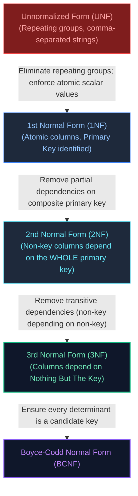

#### The Three Destructive Anomalies of Unnormalized Data:
1. **Insertion Anomaly**: You cannot record a customer until they place an order, or you cannot record a new product until someone purchases it.
2. **Update Anomaly**: If a customer's address or product price is duplicated across 1,000 order rows, updating it requires updating all 1,000 rows. If one update fails or is missed, data becomes corrupt and contradictory.
3. **Deletion Anomaly**: If customer John cancels his only order and you delete that row, you accidentally erase John's customer profile and account history from the database forever!

#### Comprehensive Case Study: E-Commerce Store Decomposition

##### 1. Unnormalized State (UNF):

| `order_id` | `customer_name` | `customer_email` | `items` (Non-Atomic Multi-Valued Attribute) | `order_date` |
| :---: | :--- | :--- | :--- | :---: |
| `101` | Alice Smith | `alice@corp.com` | `"Laptop:1200.00, Mouse:25.00"` | `2026-10-15` |

* **Failure**: The `items` column contains a non-atomic, comma-delimited string. You cannot index individual products, join on inventory, or compute `SUM(price)`.

##### 2. First Normal Form (1NF):
* **Rule**: Every column must hold strictly **atomic (indivisible) scalar values**. No repeating groups. A primary key must be identified.
```sql
CREATE TABLE order_items_1nf (
    order_id INT NOT NULL,
    customer_name VARCHAR(100) NOT NULL,
    customer_email VARCHAR(150) NOT NULL,
    product_id INT NOT NULL,
    product_name VARCHAR(100) NOT NULL,
    unit_price NUMERIC(10, 2) NOT NULL,
    quantity INT NOT NULL,
    PRIMARY KEY (order_id, product_id) -- Composite Primary Key
);
```

##### 3. Second Normal Form (2NF):
* **Rule**: Must be in 1NF, and **no non-key column may depend on a partial subset of a composite primary key**.
* **Analysis**: The composite primary key is `(order_id, product_id)`.
  * `quantity` depends on the full composite key `(order_id, product_id)` (Valid).
  * `product_name` and `unit_price` depend **only on `product_id`**, not `order_id`! (Partial dependency violation).
  * `customer_name` and `customer_email` depend **only on `order_id`**! (Partial dependency violation).
* **Fix**: Decompose into separate entities:
```sql
CREATE TABLE products_2nf (
    product_id INT PRIMARY KEY,
    product_name VARCHAR(100) NOT NULL,
    unit_price NUMERIC(10, 2) NOT NULL
);

CREATE TABLE orders_2nf (
    order_id INT PRIMARY KEY,
    customer_name VARCHAR(100) NOT NULL,
    customer_email VARCHAR(150) NOT NULL
);

CREATE TABLE order_items_2nf (
    order_id INT REFERENCES orders_2nf(order_id),
    product_id INT REFERENCES products_2nf(product_id),
    quantity INT NOT NULL,
    PRIMARY KEY (order_id, product_id)
);
```

##### 4. Third Normal Form (3NF):
* **Rule**: Must be in 2NF, and **no non-key column may depend on another non-key column** (no transitive dependencies). Every non-key column must depend on the key, the whole key, and nothing but the key.
* **Analysis**: In `orders_2nf`, `customer_name` depends on `customer_email`, which depends on `order_id`. If Alice changes her name, multiple historical orders become inconsistent.
* **Fix**: Extract `customers` into its own first-class table:
```sql
CREATE TABLE customers_3nf (
    customer_id INT PRIMARY KEY,
    name VARCHAR(100) NOT NULL,
    email VARCHAR(150) UNIQUE NOT NULL
);

CREATE TABLE orders_3nf (
    order_id INT PRIMARY KEY,
    customer_id INT NOT NULL REFERENCES customers_3nf(customer_id),
    order_date TIMESTAMP WITH TIME ZONE DEFAULT CURRENT_TIMESTAMP
);
```

##### 5. Boyce-Codd Normal Form (BCNF):
* **Rule**: A stricter version of 3NF. Every determinant (a column or set of columns on which another column is fully functionally dependent) **must be a candidate key**.
* **Example**: Consider a tutoring table: `(student_id, subject, professor_id)`.
  * Each student can take multiple subjects.
  * For each subject, multiple professors teach, but each professor teaches **only one subject** (`professor_id -> subject`).
  * If a student takes math with Professor Gauss, the composite key is `(student_id, subject)`.
  * In this table, `professor_id` determines `subject`, but `professor_id` is NOT a candidate key!
  * **BCNF Decomposition**:
    * `student_tutoring(student_id, professor_id)` (PK: `student_id, professor_id`)
    * `professor_subject(professor_id, subject)` (PK: `professor_id`)

##### 6. Fourth Normal Form (4NF) & Multivalued Dependencies:
* **Rule**: A schema is in 4NF if and only if it is in BCNF, and contains **no non-trivial multivalued dependencies (MVDs)**.
* **The Multivalued Dependency Problem ($X \twoheadrightarrow Y$)**:
  Consider an employee table storing an employee's multiple phone numbers and multiple skill certifications:

| `emp_id` | `phone_number` | `skill_certification` |
| :---: | :--- | :--- |
| `101` | `555-0101` | AWS Certified Solutions Architect |
| `101` | `555-0102` | AWS Certified Solutions Architect |
| `101` | `555-0101` | Certified Kubernetes Administrator (CKA) |
| `101` | `555-0102` | Certified Kubernetes Administrator (CKA) |

  Because `phone_number` and `skill_certification` are completely independent facts about the employee, storing them in a single table forces a **Cartesian product explosion** ($M \times N$ rows). Adding a 3rd phone number requires inserting 2 additional rows!
* **4NF Decomposition**:
  Decompose independent multivalued attributes into separate relational entities:
  * `employee_phones(emp_id, phone_number)` (PK: `emp_id, phone_number`)
  * `employee_certifications(emp_id, skill_certification)` (PK: `emp_id, skill_certification`)

---

### 1.3 Controlled Denormalization for High-Scale Read Performance

While 3NF guarantees write consistency, querying a customer order summary in 3NF requires joining 5 tables (`orders` $\to$ `customers` $\to$ `order_items` $\to$ `products` $\to$ `taxes`).
* In high-throughput read workloads, architects intentionally duplicate data (e.g. storing an immutable snapshot of `unit_price` and `customer_name` directly in `orders`).
* **The Rule**: Denormalize only when read latency SLAs cannot be met with indexes, and guarantee consistency via application event hooks or database triggers.

---

### 1.4 The Exact Logical SQL Order of Execution with Complete Trace Example

A pervasive beginner trap is writing an SQL query according to its visual syntax. The database parser executes clauses in a completely different, strict logical order:

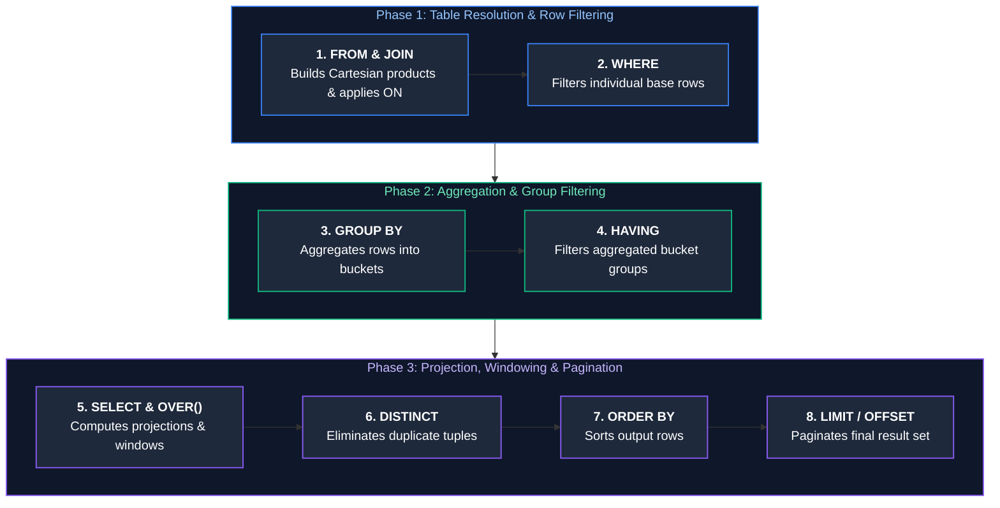

#### Detailed Query Trace:
Consider this analytical query:
```sql
SELECT 
    c.country,
    COUNT(o.order_id) AS total_orders,
    SUM(o.total_amount) AS revenue,
    RANK() OVER (ORDER BY SUM(o.total_amount) DESC) AS revenue_rank
FROM customers c
INNER JOIN orders o ON c.id = o.customer_id
WHERE o.order_date >= '2026-01-01'
GROUP BY c.country
HAVING COUNT(o.order_id) >= 10
ORDER BY revenue DESC
LIMIT 5;
```

#### Step-by-Step Execution Sequence:
1. **`FROM customers c INNER JOIN orders o ON c.id = o.customer_id`**: Loads tables into working memory and evaluates the `ON` join predicate. Rows without matching IDs are discarded.
2. **`WHERE o.order_date >= '2026-01-01'`**: Filters individual joined tuples prior to aggregation. Non-2026 orders are dropped.
3. **`GROUP BY c.country`**: Sorts or hashes remaining tuples into bucket groups identified by unique `c.country` values.
4. **`HAVING COUNT(o.order_id) >= 10`**: Evaluates aggregate count on each country bucket. Discards countries with fewer than 10 orders.
5. **`SELECT c.country, COUNT(o.order_id)...`**: Computes expressions, aggregates, and column projections. Assigns aliases `total_orders` and `revenue`.
6. **`WINDOW RANK() OVER (ORDER BY revenue DESC)`**: Evaluates window functions over the aggregated dataset.
7. **`ORDER BY revenue DESC`**: Sorts final result rows by the computed `revenue` expression.
8. **`LIMIT 5`**: Returns strictly the top 5 sorted tuples to the client application.

---

# 2. Advanced SQL Engineering

---

### 2.1 Comprehensive JOIN Taxonomy & Visual Guide

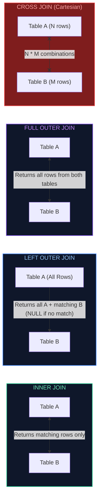

---

### 2.2 Anti-Joins: `NOT EXISTS` vs `NOT IN` (The Fatal Null Trap & Query Plan Analysis)

Finding records in Table A that have no matching records in Table B is called an **Anti-Join**:

```sql
-- ❌ DANGEROUS: NOT IN with NULL values returns ZERO rows!
SELECT * FROM customers 
WHERE id NOT IN (SELECT customer_id FROM orders);
```

#### The Fatal Three-Valued Logic NULL Trap:
If a single row in `orders` contains a `NULL` `customer_id`, the SQL subquery evaluates to:
`id NOT IN (1, 2, NULL)` $\to$ `id != 1 AND id != 2 AND id != NULL`.
In ANSI SQL three-valued logic, `id != NULL` evaluates to **`UNKNOWN`**.
Because `TRUE AND TRUE AND UNKNOWN` is `UNKNOWN`, the entire `WHERE` clause evaluates to false for **every single row**! The query returns zero results silently!

#### The Production Standard: `NOT EXISTS`
`NOT EXISTS` operates on boolean presence rather than value sets and is completely immune to `NULL` corruption:
```sql
-- ✅ PRODUCTION STANDARD: Immune to NULL values; optimizer executes efficient Anti-Join
SELECT c.* 
FROM customers c
WHERE NOT EXISTS (
    SELECT 1 FROM orders o WHERE o.customer_id = c.id
);
```

#### Query Plan Comparison:
* `NOT IN (SELECT...)` prevents the Cost-Based Optimizer from transforming the subquery into a Hash Anti-Join when nullable columns exist, forcing a disastrous $O(N \times M)$ SubPlan filter.
* `NOT EXISTS (SELECT 1...)` is recognized immediately by the optimizer and rewritten into an optimal **Hash Anti-Join** or **Merge Anti-Join**.

---

### 2.3 Lateral Joins (`CROSS JOIN LATERAL`) for Correlated Top-N Per Group

A standard `JOIN` evaluates independently of the current row being examined. A **`LATERAL` Join** behaves like a foreach loop in SQL: for each row in the outer table, it evaluates the subquery with access to columns from that outer row:

```sql
-- Fetch every customer along with their 2 most recent orders
SELECT c.name, o.order_id, o.order_date, o.total_amount
FROM customers c
CROSS JOIN LATERAL (
    SELECT order_id, order_date, total_amount
    FROM orders
    WHERE customer_id = c.id
    ORDER BY order_date DESC
    LIMIT 2
) o;
```
This avoids expensive window functions across the entire table when you only need the Top-N elements for a subset of parent records.

---

### 2.4 Aggregations: `GROUP BY`, `HAVING` vs `WHERE` Invariants

* **`WHERE`**: Filters individual base rows **before** grouping and aggregation occur.
* **`HAVING`**: Filters aggregate bucket calculations **after** grouping occurs.

```sql
SELECT 
    department_id,
    COUNT(*) AS total_employees,
    AVG(salary) AS avg_salary
FROM employees
WHERE status = 'ACTIVE'                -- Step 1: Filter out inactive employees first
GROUP BY department_id                -- Step 2: Group by department
HAVING COUNT(*) >= 5 AND AVG(salary) > 75000; -- Step 3: Filter groups with >=5 employees
```

---

### 2.5 Subqueries: Correlated vs Non-Correlated Execution Mechanics

* **Non-Correlated Subquery**: Independent of the outer query. Evaluated **once**, and its result is cached and reused by the outer query:
  ```sql
  SELECT * FROM products WHERE price > (SELECT AVG(price) FROM products);
  ```
* **Correlated Subquery**: References columns from the enclosing outer query row (`e.department_id`). In unoptimized engines, it is re-evaluated **once for every single candidate row** in the outer table ($O(N \times M)$ overhead):
  ```sql
  SELECT e.emp_id, e.salary
  FROM employees e
  WHERE e.salary > (
      SELECT AVG(sub.salary) 
      FROM employees sub 
      WHERE sub.department_id = e.department_id -- Correlated reference!
  );
  ```

---

### 2.6 Common Table Expressions (CTEs) & Recursive Hierarchical Tree Traversals

Common Table Expressions (CTEs) define named temporary result sets via `WITH`:

#### Recursive CTE: Traversing Hierarchical Organizational Charts
```sql
WITH RECURSIVE OrgHierarchy AS (
    -- Anchor Member: Select top-level CEO (manager_id is NULL)
    SELECT emp_id, name, manager_id, 1 AS level, CAST(name AS VARCHAR(255)) AS path
    FROM employees
    WHERE manager_id IS NULL

    UNION ALL

    -- Recursive Member: Join subordinates to their managers
    SELECT e.emp_id, e.name, e.manager_id, o.level + 1, CAST(o.path || ' -> ' || e.name AS VARCHAR(255))
    FROM employees e
    INNER JOIN OrgHierarchy o ON e.manager_id = o.emp_id
)
SELECT level, path FROM OrgHierarchy ORDER BY path;
```

#### Output Result:

| Recursion Level | Hierarchical Management Path |
| :---: | :--- |
| `1` | Satya Nadella |
| `2` | Satya Nadella -> Scott Guthrie |
| `3` | Satya Nadella -> Scott Guthrie -> Core OS VP |
| `4` | Satya Nadella -> Scott Guthrie -> Core OS VP -> Principal Engineer |

---

### 2.7 Analytical SQL Window Functions (`ROW_NUMBER`, `RANK`, `DENSE_RANK`, `NTILE`, `LAG`, `LEAD`, `FIRST_VALUE`)

#### 1. Overview: Database Pushdown vs. JVM Heap Saturation
In Java backend engineering, querying data for pagination, leaderboards, top-N categories, and historical deltas is standard. A widespread anti-pattern in microservices is pulling thousands of unindexed JPA entities into the JVM (`repository.findAll()`) to sort, filter, and calculate moving metrics using `java.util.stream.Stream`:
```java
// CRITICAL ANTI-PATTERN: Saturated heap, GC stop-the-world pauses, O(N) network transfer!
List<SaleRecord> records = saleRepository.findAll();
Map<String, List<SaleRecord>> topPerDept = records.stream()
    .collect(Collectors.groupingBy(SaleRecord::getDepartment,
        Collectors.collectingAndThen(
            Collectors.toList(),
            list -> list.stream()
                .sorted(Comparator.comparing(SaleRecord::getAmount).reversed())
                .limit(3)
                .toList())));
```
This approach wastes network bandwidth, risks `OutOfMemoryError` under high traffic, and forces costly garbage collection cycles.

**Analytical Window Functions** solve this problem by executing calculations directly inside the database engine. While standard `GROUP BY` collapses $N$ rows into $M$ summary rows, window functions evaluate analytical expressions across a partitioned subset of records (the "window frame") while **preserving the discrete identity and attributes of every single entity row**:

$$\text{GROUP BY: } N \text{ rows} \longrightarrow M \text{ rows } (M \le N) \quad \text{vs.} \quad \text{Window Function: } N \text{ rows} \longrightarrow N \text{ enriched rows}$$

#### 2. Detailed Breakdown of Analytical Function Families

##### A. Ranking Functions
- **`ROW_NUMBER()`**: Generates an unbroken sequential integer sequence ($1, 2, 3, \dots, N$) per partition. Ties in `ORDER BY` are broken non-deterministically unless secondary unique columns (e.g. primary keys) are supplied. Essential for deterministic keyset pagination and entity deduplication.
- **`RANK()`**: Assigns standard competition ranking ($1, 2, 2, 4$). Tied records share the identical rank; subsequent ranks skip by the count of tied records.
- **`DENSE_RANK()`**: Assigns consecutive tier ranking ($1, 2, 2, 3$). Tied records share the identical rank, but subsequent ranks increment strictly by 1 without gaps. This is mandatory for finding "the $N$-th highest distinct salary" or "top 3 revenue tiers".
- **`NTILE(k)`**: Partitions sorted rows into $k$ balanced buckets ($1 \dots k$). Remainder rows $R = N \pmod k$ are distributed by adding 1 row each to the first $R$ buckets. Ideal for batch chunking and quantile segmentation.

##### B. Value Navigation Functions
- **`LAG(col [, offset [, default]])`**: Retrieves a column value from $N$ rows prior to the current row without an expensive self-join. Indispensable for computing Period-over-Period (PoP) revenue deltas.
- **`LEAD(col [, offset [, default]])`**: Retrieves a column value from $N$ rows ahead of the current row. Ideal for event duration calculation and session expiration lookahead.
- **`FIRST_VALUE(col)`**: Returns the evaluated value at the start of the window frame.

#### 3. Practical Step-by-Step Implementation

##### Realistic Sample Dataset: `sales_records` Table
```sql
CREATE TABLE sales_records (
    sale_id INT PRIMARY KEY,
    employee_name VARCHAR(50) NOT NULL,
    department VARCHAR(50) NOT NULL,
    amount NUMERIC(10, 2) NOT NULL,
    sale_date DATE NOT NULL
);

INSERT INTO sales_records VALUES
(1, 'Alice',   'Electronics', 1500.00, '2026-03-01'),
(2, 'Bob',     'Electronics', 1200.00, '2026-03-02'),
(3, 'Charlie', 'Electronics', 1200.00, '2026-03-03'),
(4, 'David',   'Electronics',  800.00, '2026-03-04'),
(5, 'Emma',    'Furniture',   2200.00, '2026-03-01'),
(6, 'Frank',   'Furniture',   1800.00, '2026-03-02'),
(7, 'Grace',   'Furniture',   1800.00, '2026-03-03'),
(8, 'Hannah',  'Furniture',    950.00, '2026-03-04');
```

##### Query 1: Department Ranking Analysis (`ROW_NUMBER`, `RANK`, `DENSE_RANK`, `NTILE`)
```sql
SELECT 
    department,
    employee_name,
    amount,
    -- 1. Sequential integer sequence per department
    ROW_NUMBER() OVER (
        PARTITION BY department 
        ORDER BY amount DESC, sale_id ASC
    ) AS row_num,

    -- 2. Competition ranking with gaps (1, 2, 2, 4)
    RANK() OVER (
        PARTITION BY department 
        ORDER BY amount DESC
    ) AS rnk,

    -- 3. Consecutive ranking without gaps (1, 2, 2, 3)
    DENSE_RANK() OVER (
        PARTITION BY department 
        ORDER BY amount DESC
    ) AS dense_rnk,

    -- 4. Divides each department into 2 performance tiers (Top half = 1, Bottom = 2)
    NTILE(2) OVER (
        PARTITION BY department 
        ORDER BY amount DESC
    ) AS tier
FROM sales_records;
```

##### Exact Ranking Query Output:
| Department | Employee | Amount | `row_num` | `rnk` | `dense_rnk` | `tier` (`NTILE(2)`) |
| :--- | :--- | :---: | :---: | :---: | :---: | :---: |
| **Electronics** | Alice | \$1,500.00 | **1** | **1** | **1** | 1 |
| **Electronics** | Bob | \$1,200.00 | **2** | **2** | **2** | 1 |
| **Electronics** | Charlie | \$1,200.00 | **3** | **2** (Tie) | **2** (Tie) | 2 |
| **Electronics** | David | \$800.00 | **4** | **4** (Skipped 3) | **3** (No Skip) | 2 |
| **Furniture** | Emma | \$2,200.00 | **1** | **1** | **1** | 1 |
| **Furniture** | Frank | \$1,800.00 | **2** | **2** | **2** | 1 |
| **Furniture** | Grace | \$1,800.00 | **3** | **2** (Tie) | **2** (Tie) | 2 |
| **Furniture** | Hannah | \$950.00 | **4** | **4** (Skipped 3) | **3** (No Skip) | 2 |

##### Step-by-Step Resolution Trace:
1. **Alice (\$1,500.00):** Highest earner in Electronics. `row_num = 1`, `rnk = 1`, `dense_rnk = 1`. Placed in top quartile `tier = 1`.
2. **Bob & Charlie (\$1,200.00 each):** Tied in sales amount.
   - `ROW_NUMBER`: Tie broken deterministically via `sale_id ASC` (Bob's id 2 < Charlie's id 3) $\implies$ Bob receives 2, Charlie receives 3.
   - `RANK`: Both share rank 2.
   - `DENSE_RANK`: Both share rank 2.
3. **David (\$800.00):**
   - `ROW_NUMBER`: Receives 4.
   - `RANK`: Exactly 3 records precede David strictly $\implies 1 + 3 = \mathbf{4}$. Rank 3 is skipped!
   - `DENSE_RANK`: Exactly 2 distinct values precede David (\$1500 and \$1200) $\implies 1 + 2 = \mathbf{3}$. Zero gap created!

##### Query 2: Navigational Lookbacks & Period Growth (`LAG`, `LEAD`, `FIRST_VALUE`)
```sql
SELECT 
    department,
    employee_name,
    amount,
    -- 1. Preceding employee's sales amount (default fallback 0.0)
    LAG(amount, 1, 0.00) OVER (
        PARTITION BY department 
        ORDER BY amount DESC
    ) AS prev_amount,

    -- 2. Next colleague's sales amount (lookahead)
    LEAD(amount, 1) OVER (
        PARTITION BY department 
        ORDER BY amount DESC
    ) AS next_amount,

    -- 3. Department champion's sale amount (benchmark)
    FIRST_VALUE(amount) OVER (
        PARTITION BY department 
        ORDER BY amount DESC
        ROWS BETWEEN UNBOUNDED PRECEDING AND CURRENT ROW
    ) AS dept_champion_amount
FROM sales_records;
```

##### Exact Navigational Query Output:
| Department | Employee | Amount | `prev_amount` (`LAG`) | `next_amount` (`LEAD`) | `dept_champion_amount` (`FIRST_VALUE`) |
| :--- | :--- | :---: | :---: | :---: | :---: |
| **Electronics** | Alice | \$1,500.00 | \$0.00 *(fallback)* | \$1,200.00 | \$1,500.00 |
| **Electronics** | Bob | \$1,200.00 | \$1,500.00 | \$1,200.00 | \$1,500.00 |
| **Electronics** | Charlie | \$1,200.00 | \$1,200.00 | \$800.00 | \$1,500.00 |
| **Electronics** | David | \$800.00 | \$1,200.00 | `NULL` *(end)* | \$1,500.00 |
| **Furniture** | Emma | \$2,200.00 | \$0.00 *(fallback)* | \$1,800.00 | \$2,200.00 |
| **Furniture** | Frank | \$1,800.00 | \$2,200.00 | \$1,800.00 | \$2,200.00 |
| **Furniture** | Grace | \$1,800.00 | \$1,800.00 | \$950.00 | \$2,200.00 |
| **Furniture** | Hannah | \$950.00 | \$1,800.00 | `NULL` *(end)* | \$2,200.00 |

#### 4. Comparisons & Engineering Trade-Off Matrix

| Analytical Function | Category | Tie Handling Semantics | Gap Generation | Memory Complexity | Enterprise Backend Use Case |
| :--- | :--- | :---: | :---: | :---: | :--- |
| **`ROW_NUMBER()`** | Ranking | Sequential integer ($1, 2, 3$). Non-deterministic without secondary key. | **No** | $O(N \log N)$ sort | **Database-level pagination (`WHERE rn BETWEEN 21 AND 30`), deduplication.** |
| **`RANK()`** | Ranking | Tied values share rank; subsequent rank skips ($1, 2, 2, 4$). | **Yes** (Gap = tie count) | $O(N \log N)$ sort | **Competitive standings, official quota rankings.** |
| **`DENSE_RANK()`** | Ranking | Tied values share rank; subsequent rank increments consecutively ($1, 2, 2, 3$). | **No** (Zero gaps) | $O(N \log N)$ sort | **Top-N salary tiers, leaderboard tiers without skipped positions.** |
| **`NTILE(k)`** | Bucketing | Assigns bucket index ($1 \dots k$); breaks partitions into $k$ chunks. | **No** | $O(N \log N)$ sort | **Chunking large batch jobs, customer tier segmentations.** |
| **`LAG(col, n)`** | Navigation | Accesses $n$-th preceding row in partition stream. | N/A | $O(1)$ streaming | **Day-over-Day / Month-over-Month metrics, detecting state transitions.** |
| **`LEAD(col, n)`** | Navigation | Accesses $n$-th trailing row in partition stream. | N/A | $O(1)$ streaming | **Calculating elapsed time between events, lookahead validations.** |

#### 5. Advanced Production Insights for Spring Boot & Hibernate Developers

##### 1. Spring Data JPA Native Query with Java 21 DTO Records
Because window functions return computed scalar columns rather than managed entity state, map them directly to immutable Java records via Spring Data native projection:
```java
public record DepartmentPerformanceDto(
    String department,
    String employeeName,
    BigDecimal amount,
    int departmentRank,
    BigDecimal previousColleagueAmount
) {}

@Repository
public interface SalesRecordRepository extends JpaRepository<SalesRecord, Long> {

    @Query(value = """
        SELECT 
            department,
            employee_name AS employeeName,
            amount,
            DENSE_RANK() OVER (PARTITION BY department ORDER BY amount DESC) AS departmentRank,
            LAG(amount, 1, 0.00) OVER (PARTITION BY department ORDER BY amount DESC) AS previousColleagueAmount
        FROM sales_records
        """, nativeQuery = true)
    List<DepartmentPerformanceDto> fetchDepartmentPerformance();
}
```

##### 2. Hibernate 6+ Native Window Function Support
Starting in **Hibernate 6**, window functions are officially first-class citizens in HQL (Hibernate Query Language). You no longer need native SQL strings to invoke ranking functions in modern Spring Boot 3 applications:
```java
// Supported in Hibernate 6+ / Spring Boot 3+
@Query("""
    SELECT s.department, s.employeeName, s.amount,
           dense_rank() OVER (PARTITION BY s.department ORDER BY s.amount DESC)
    FROM SalesRecord s
""")
List<Object[]> fetchRankedHql();
```

##### 3. Composite Indexing for Window Optimization
To evaluate `OVER (PARTITION BY department ORDER BY amount DESC)` without spilling to disk or performing an expensive $O(N \log N)$ sort step at query time, create a **composite B-Tree index**:
```sql
CREATE INDEX idx_sales_dept_amount ON sales_records (department, amount DESC);
```
With this composite index, the database engine uses an **Index Scan** to stream pre-sorted records directly through the window operator in $O(N)$ linear time!

---

### 2.8 Window Frame Specifications: `ROWS` vs `RANGE BETWEEN` & Running Totals

Window frames define the exact subset of rows within a partition evaluated for running calculations:

```sql
SELECT 
    department,
    employee_name,
    amount,
    -- 1. Cumulative running total from beginning of department up to current row
    SUM(amount) OVER (
        PARTITION BY department 
        ORDER BY amount DESC 
        ROWS BETWEEN UNBOUNDED PRECEDING AND CURRENT ROW
    ) AS running_total,

    -- 2. Centered moving average (preceding row, current row, next row)
    AVG(amount) OVER (
        PARTITION BY department 
        ORDER BY amount DESC 
        ROWS BETWEEN 1 PRECEDING AND 1 FOLLOWING
    ) AS centered_3_point_moving_avg
FROM sales_records;
```

#### Critical Difference: `ROWS` vs `RANGE`
* **`ROWS BETWEEN`**: Operates on **physical row counts** relative to the current position. Fast and deterministic.
* **`RANGE BETWEEN`**: Operates on **logical value ranges** on the order column.
  * **Dangerous Default**: When an `ORDER BY` is specified without an explicit frame, SQL defaults to:
    `RANGE BETWEEN UNBOUNDED PRECEDING AND CURRENT ROW`
  * If duplicate values exist, `RANGE` includes all peers with equal values in the running total at once rather than row by row! Always explicitly specify `ROWS BETWEEN` for predictable running totals.

> [!TIP]
> **Deep-Dive Interview Scenarios:**
> - [Q1. ACID Properties & Database Transaction Isolation Levels](frequently_asked_questions/07_databases_jpa_and_hibernate_faq.md#q1-medium-acid-properties--database-transaction-isolation-levels)
> - [Q2. SQL Joins: `INNER`, `LEFT`, `RIGHT`, and `FULL OUTER`](frequently_asked_questions/07_databases_jpa_and_hibernate_faq.md#q2-easy-sql-joins-inner-left-right-and-full-outer)
> - [Q3. Practical SQL Queries: Second-Highest Salary & Department-Wise Averages](frequently_asked_questions/07_databases_jpa_and_hibernate_faq.md#q3-easy-practical-sql-queries-second-highest-salary--department-wise-averages)
> - [Q4. Clustered vs Non-Clustered Indexes & Slow Query Optimization](frequently_asked_questions/07_databases_jpa_and_hibernate_faq.md#q4-medium-clustered-vs-non-clustered-indexes--slow-query-optimization)
> - [Q5. Invoking Stored Procedures via JDBC](frequently_asked_questions/07_databases_jpa_and_hibernate_faq.md#q5-medium-invoking-stored-procedures-via-jdbc)
> - [Q25. SQL Self-Join: Finding Employees Earning More Than Their Managers](frequently_asked_questions/07_databases_jpa_and_hibernate_faq.md#q25-medium-sql-self-join-finding-employees-earning-more-than-their-managers)

---

# 3. Relational Database Engine Internals & Concurrency Control

---

### 3.1 Physical Storage Engine Anatomy: 8KB Pages, Slotted Pages & TOAST Storage

Relational databases organize persistent storage into fixed-size disk blocks called **Pages** (8KB in PostgreSQL, 16KB in MySQL InnoDB):

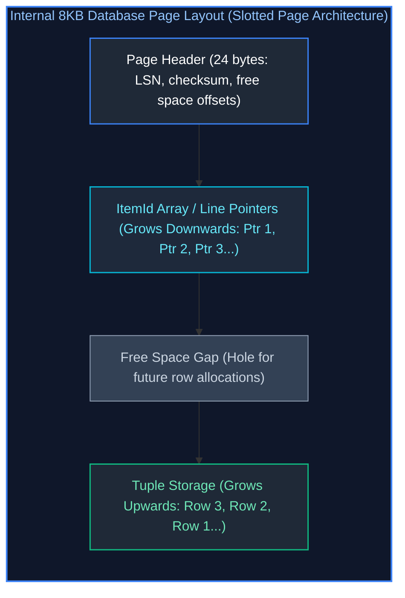

* **Slotted Page Design**: The `ItemId` array grows downwards from the top, while raw row byte tuples grow upwards from the bottom. An external pointer (e.g. from an index) points to `(page_number, item_offset)`. When a row is updated, it can move inside the page without changing its external index pointer!
* **TOAST (The Oversized-Attribute Storage Technique)**: Database pages cannot span multiple physical blocks. When a column value (`TEXT`, `JSONB`) exceeds $\sim 2\text{KB}$, the engine compresses it. If it still exceeds the threshold, it is moved out-of-line into a dedicated auxiliary TOAST table, storing only an 18-byte pointer in the main page.

---

### 3.2 Write-Ahead Logging (WAL / Redo Log): How Durability is Guaranteed at Scale

Relational databases achieve ACID persistence while maintaining high write throughput using **Write-Ahead Logging (WAL)**:

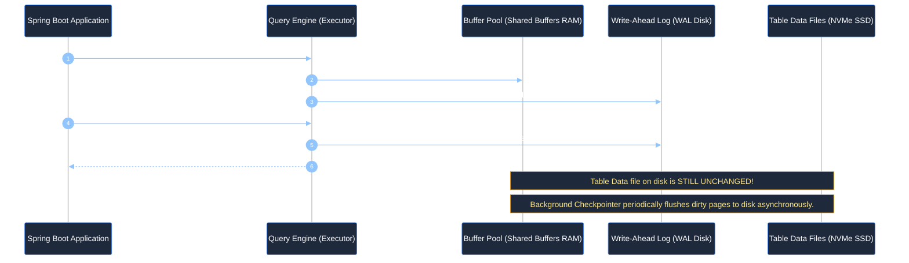

* **The WAL Principle**: Sequential disk writes are up to $100\times$ faster than random page writes. The database appends transaction logs sequentially to WAL and acknowledges commits immediately. If the server loses power, on reboot the engine replays the WAL to recover all unwritten dirty pages!

---

### 3.3 ACID Transaction Guarantees & Low-Level Mechanics

1. **Atomicity**: Enforced via Undo Logs (MySQL InnoDB) or MVCC tuple versioning (PostgreSQL). If an abort occurs, changes are reverted.
2. **Consistency**: Enforced via foreign keys, check constraints, unique constraints, and schema data types.
3. **Isolation**: Enforced via row locks, table locks, and MVCC snapshot read isolation.
4. **Durability**: Enforced via the Write-Ahead Log (WAL) and synchronous `fsync()` to persistent disk storage.

---

### 3.4 The 4 SQL-92 Transaction Isolation Levels & Concurrency Anomalies

#### 1. Overview: Concurrency Throughput vs. Consistency Guarantees
In high-throughput enterprise backends, thousands of concurrent threads read and modify shared database records simultaneously. While executing every transaction strictly one after another (serial execution) guarantees 100% mathematical consistency, it destroys database throughput, yielding intolerable latency and thread starvation.

Database engines therefore implement **Transaction Isolation Levels**—tunable contracts defined by the ANSI/ISO SQL-92 standard that allow backend engineers to balance transactional consistency against concurrency throughput.

#### 2. Detailed Breakdown of the 4 Concurrency Anomalies

##### 1. Dirty Read ($G_1$ / Dirty Read Anomaly)
- **Mechanism:** Transaction $A$ reads uncommitted modifications made by Transaction $B$. If Transaction $B$ subsequently issues a `ROLLBACK`, Transaction $A$ has processed "ghost data" that never legitimately existed on persistent storage.
- **Enterprise Impact:** An account balance check approves a \$10,000 credit withdrawal based on a temporary deposit that subsequently aborts due to fraud checks.

##### 2. Non-Repeatable Read ($G_{2a}$ / Fuzzy Read Anomaly)
- **Mechanism:** Transaction $A$ reads a specific row at time $T_1$. Transaction $B$ subsequently modifies or deletes that row and issues a `COMMIT`. When Transaction $A$ re-reads the identical row at time $T_2$, it finds modified values or discovers the row has vanished.
- **Enterprise Impact:** A billing job calculates invoice tax on an item, but when applying payment seconds later within the same transaction, finds the item price was mutated by an administrator.

##### 3. Phantom Read ($P_3$ / Phantom Range Anomaly)
- **Mechanism:** Transaction $A$ executes a range query (e.g. `SELECT COUNT(*) WHERE age >= 21`). Transaction $B$ inserts a new row matching that predicate and successfully commits. When Transaction $A$ re-executes the exact same range query, it discovers new "phantom" rows that were absent in the first execution.
- **Enterprise Impact:** Financial audit reports calculating category sums find mismatching row counts between audit pass 1 and audit pass 2.

##### 4. Serialization Anomaly / Write Skew
- **Mechanism:** Two concurrent transactions read overlapping datasets, verify a shared business constraint (e.g. "at least one doctor on call"), execute disjoint writes (Transaction $A$ updates Doctor 1; Transaction $B$ updates Doctor 2), and commit. While both individual updates were valid against their local snapshots, their simultaneous execution violates the global business invariant.

#### 3. Detailed Breakdown of the 4 ANSI SQL Isolation Levels

##### 1. `READ UNCOMMITTED` (Lowest Isolation)
- **Working Principle:** Queries execute without acquiring read locks or respecting MVCC snapshot boundaries. Sessions read uncommitted dirty pages directly from buffer cache.
- **Guarantees:** Zero protection. Permitted for coarse analytics (e.g., approximate table row estimates).

##### 2. `READ COMMITTED` (PostgreSQL, Oracle, SQL Server Default)
- **Working Principle:** Enforces **statement-level MVCC snapshots**. Every individual SQL statement within a transaction obtains a fresh read snapshot at the instant the statement begins. Uncommitted writes of other sessions are strictly invisible.
- **Guarantees:** Eliminates Dirty Reads. However, Non-Repeatable Reads and Phantom Reads can occur because subsequent statements within the transaction see newly committed changes.

##### 3. `REPEATABLE READ` (MySQL InnoDB Default)
- **Working Principle:** Enforces **transaction-level MVCC snapshots**. The transaction captures a single immutable read snapshot at the exact moment the transaction begins (or upon its first read). All subsequent queries within that transaction observe the identical point-in-time state.
- **Guarantees:** Eliminates Dirty Reads and Non-Repeatable Reads. In MySQL InnoDB, Next-Key Locks (Index Record Lock + Gap Lock) also eliminate Phantom Reads for locking reads. Write Skew is still possible without explicit locking.

##### 4. `SERIALIZABLE` (Highest Isolation)
- **Working Principle:** Guarantees that the concurrent execution of multiple transactions produces the exact same outcome as some purely serial (one-by-one) execution order. Implemented via **Two-Phase Locking (2PL)** or **Serializable Snapshot Isolation (SSI)** with dependency graph tracking.
- **Guarantees:** Eliminates all anomalies (Dirty Read, Non-Repeatable Read, Phantom Read, Write Skew). Any transaction that causes a cyclic dependency aborts with a serialization failure (`SQLState: 40001`), requiring application-level retries.

#### 4. The ANSI Isolation Level Support Matrix

| Isolation Level | Dirty Read | Non-Repeatable Read | Phantom Read | Write Skew | Default Database Engine |
| :--- | :---: | :---: | :---: | :---: | :--- |
| **Read Uncommitted** | ⚠️ Allowed | ⚠️ Allowed | ⚠️ Allowed | ⚠️ Allowed | Rare in production. |
| **Read Committed** | ❌ Prevented | ⚠️ Allowed | ⚠️ Allowed | ⚠️ Allowed | **PostgreSQL, Oracle, SQL Server** |
| **Repeatable Read** | ❌ Prevented | ❌ Prevented | ❌ Prevented *(InnoDB MVCC)* | ⚠️ Allowed | **MySQL (InnoDB)** |
| **Serializable** | ❌ Prevented | ❌ Prevented | ❌ Prevented | ❌ Prevented | High-integrity financial ledgers. |

#### Step-by-Step Concurrent Execution Timelines

##### 1. Non-Repeatable Read (Fuzzy Read) Anomaly under Read Committed:
```mermaid
%%{init: {'theme': 'dark', 'themeVariables': { 'actorBkg': '#1e293b', 'actorBorder': '#3b82f6', 'actorTextColor': '#ffffff', 'signalColor': '#93c5fd', 'signalTextColor': '#ffffff', 'noteBkgColor': '#1e293b', 'noteBorderColor': '#f59e0b', 'noteTextColor': '#fde68a', 'activationBkgColor': '#3b82f6', 'sequenceNumberColor': '#ffffff' }}}%%
sequenceDiagram
    autonumber
    actor S1 as Session 1 (Tx 101: Read Committed)
    participant DB as PostgreSQL Database
    actor S2 as Session 2 (Tx 102)

    S1->>DB: BEGIN;
    S1->>DB: SELECT balance FROM accounts WHERE id = 1;
    DB-->>S1: Returns 100.00 (Statement Snapshot 1)

    S2->>DB: BEGIN;
    S2->>DB: UPDATE accounts SET balance = 150.00 WHERE id = 1;
    S2->>DB: COMMIT; (Changes permanently written to disk)

    S1->>DB: SELECT balance FROM accounts WHERE id = 1;
    DB-->>S1: Returns 150.00 (Statement Snapshot 2 - Fuzzy Read within same transaction!)
    S1->>DB: COMMIT;
```
* **Why it happens in Read Committed**: Every single SQL statement takes a **fresh snapshot** of the database at the instant the statement begins. Because Tx 102 committed between statement 1 and statement 2, statement 2 sees the new value.
* **How Repeatable Read solves it**: The transaction takes a **single snapshot at the beginning of the transaction**, maintaining that identical point-in-time view across all subsequent queries.

##### 2. The Write Skew Anomaly under Repeatable Read:
Write Skew occurs when two concurrent transactions read overlapping data, verify a shared business rule, make disjoint writes, and commit—violating the rule globally:

```mermaid
%%{init: {'theme': 'dark', 'themeVariables': { 'actorBkg': '#1e293b', 'actorBorder': '#3b82f6', 'actorTextColor': '#ffffff', 'signalColor': '#93c5fd', 'signalTextColor': '#ffffff', 'noteBkgColor': '#1e293b', 'noteBorderColor': '#f59e0b', 'noteTextColor': '#fde68a', 'activationBkgColor': '#3b82f6', 'sequenceNumberColor': '#ffffff' }}}%%
sequenceDiagram
    autonumber
    actor Alice as Dr. Alice (Session 1: Repeatable Read)
    actor Bob as Dr. Bob (Session 2: Repeatable Read)
    participant DB as Hospital RDBMS (Rule: At least 1 doctor on-call!)

    Note over DB: Initial State: Alice on_call=true, Bob on_call=true (Count = 2)

    Alice->>DB: 1. SELECT COUNT(*) FROM doctors WHERE on_call = true;
    DB-->>Alice: Count is 2 (Safe to request leave!)

    Bob->>DB: 2. SELECT COUNT(*) FROM doctors WHERE on_call = true;
    DB-->>Bob: Count is 2 (Safe to request leave!)

    Alice->>DB: 3. UPDATE doctors SET on_call = false WHERE name = 'Alice';
    Bob->>DB: 4. UPDATE doctors SET on_call = false WHERE name = 'Bob';

    Alice->>DB: 5. COMMIT; (Success! Alice's row committed)
    Bob->>DB: 6. COMMIT; (Success! Bob's row committed - no lock conflict!)

    Note over DB: CATASTROPHIC VIOLATION: Zero doctors left on call!
```

* **Why Repeatable Read permits Write Skew**: Neither transaction updated the same row (Alice modified row 1; Bob modified row 2), so row locks never collided!
* **Production Defenses**:
  1. **Serializable Isolation**: Engine detects serialization dependency graph cycle and aborts Session 2 with `could not serialize access due to read/write dependencies among transactions`.
  2. **Pessimistic Locking**: `SELECT ... FOR UPDATE` locks both doctor rows during initial read.

---

### 3.5 Multi-Version Concurrency Control (MVCC) in PostgreSQL vs MySQL InnoDB

In modern relational engines, **Readers Never Block Writers, and Writers Never Block Readers**:

#### 1. PostgreSQL MVCC (Heap Tuple Versioning)

In PostgreSQL, every table row (tuple) on disk includes a 23-byte header containing low-level transaction metadata:
* **`t_xmin`**: The 32-bit transaction ID (XID) that inserted this tuple version.
* **`t_xmax`**: The transaction ID that deleted or replaced this tuple version ($0$ if currently live).
* **`t_ctid`**: Tuple ID pointing to the current physical block and offset of this tuple (or the newer version if updated).
* **`t_infomask`**: Bit flags indicating whether `xmin`/`xmax` are committed or aborted.

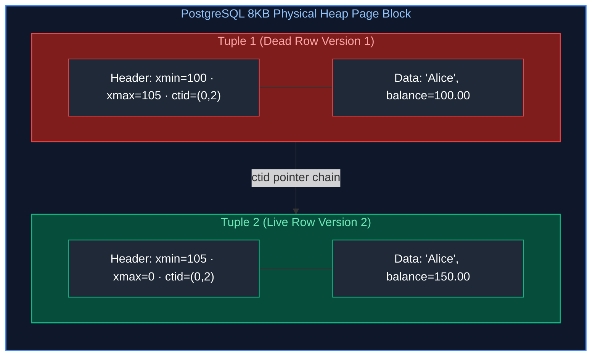

| Physical Tuple Slot | Low-Level Header (`xmin` / `xmax` / `ctid`) | Tuple Status | Visibility Under Active Transactions |
| :--- | :--- | :---: | :--- |
| **Row Version 1** | `xmin=100` · `xmax=105` · `ctid=(0,2)` | ❌ **Dead Tuple** | Visible only to historical snapshots where $\text{TxID} < 105$. Cleaned up by `VACUUM`. |
| **Row Version 2** | `xmin=105` · `xmax=0` · `ctid=(0,2)` | ✅ **Live Tuple** | Visible to all active transactions where $\text{TxID} \ge 105$. Current ground truth. |

* **How UPDATE Works**: PostgreSQL does not modify bytes in-place. It sets `xmax = current_tx` on the old tuple, and inserts a **completely new tuple** with `xmin = current_tx` and `xmax = 0`.
* **The Vacuuming Necessity**: Because old versions remain in table pages, high-update workloads generate **Table Bloat**. The background `VACUUM` worker identifies pages where all dead tuples have `xmax < oldest_active_txid` and frees item pointers.
* **Transaction ID (XID) Wraparound Catastrophe**: 32-bit integers cap transaction IDs at $\approx 4.29 \text{ Billion}$. Without maintenance, modulo arithmetic causes past historical transactions to appear in the "future", making historical data disappear! PostgreSQL prevents this via **`VACUUM FREEZE`**, converting old `xmin` values to a special frozen ID (`FrozenTransactionId = 2`), treated as permanently in the past.

#### 2. MySQL InnoDB MVCC (Undo Log Roll-Pointer Architecture)

MySQL InnoDB uses an entirely different architecture centered around the **Undo Log**:
* Every InnoDB clustered index record contains hidden system columns:
  * **`DB_TRX_ID` (6 bytes)**: Transaction ID of the last modifying transaction.
  * **`DB_ROLL_PTR` (7 bytes)**: Roll-pointer pointing backwards to the prior version in the **Undo Log**.
* **In-Place Updates**: InnoDB modifies the active page directly in-place. If an active transaction needs to view older snapshot data, it reads the current page and follows the `DB_ROLL_PTR` pointer chain back into the Undo Log segment in memory/disk!
* **Purge Threads**: Once older transactions commit and no longer require undo views, background InnoDB purge threads clean up old undo log pages.

---

### 3.6 Database Locking Hierarchy: Shared, Exclusive, Intent, Row Locks & Deadlock Detection

* **Shared Lock (S-Lock / Read Lock)**: Multiple transactions can hold S-locks concurrently to read data. Blocks Exclusive locks.
* **Exclusive Lock (X-Lock / Write Lock)**: Only one transaction can hold an X-lock. Blocks all other readers and writers.
* **Intent Locks (`IS`, `IX`)**: Table-level flags indicating that a transaction holds or intends to acquire fine-grained row locks inside the table. Prevents full-table lock operations (`ALTER TABLE`) from acquiring locks while rows are modified.
* **Deadlocks**: Transaction 1 holds Row A and requests Row B; Transaction 2 holds Row B and requests Row A. The database engine's **Deadlock Detector** runs a background cycle-finding graph search, aborts the cheaper transaction with a serialization error, and allows the other to proceed.

> [!TIP]
> **Deep-Dive Interview Scenarios:**
> - [Q20. Managing Transaction Rollbacks Across a Series of SQL Statements](frequently_asked_questions/07_databases_jpa_and_hibernate_faq.md#q20-medium-managing-transaction-rollbacks-across-a-series-of-sql-statements)
> - [Q22. Deleting Duplicate Rows While Retaining Exactly One Copy in SQL](frequently_asked_questions/07_databases_jpa_and_hibernate_faq.md#q22-medium-deleting-duplicate-rows-while-retaining-exactly-one-copy-in-sql)
> - [Q24. Stored Procedures vs Database Triggers: Performance & Architecture Trade-offs](frequently_asked_questions/07_databases_jpa_and_hibernate_faq.md#q24-medium-stored-procedures-vs-database-triggers-performance--architecture-trade-offs)

---

# 4. Indexing Mechanics & Query Execution Plan Tuning

---

### 4.1 B+Tree Index Anatomy: Node Branching Factors, Leaf Pages & Clustered Indexes

The **B+Tree** is the universal indexing data structure for relational databases:

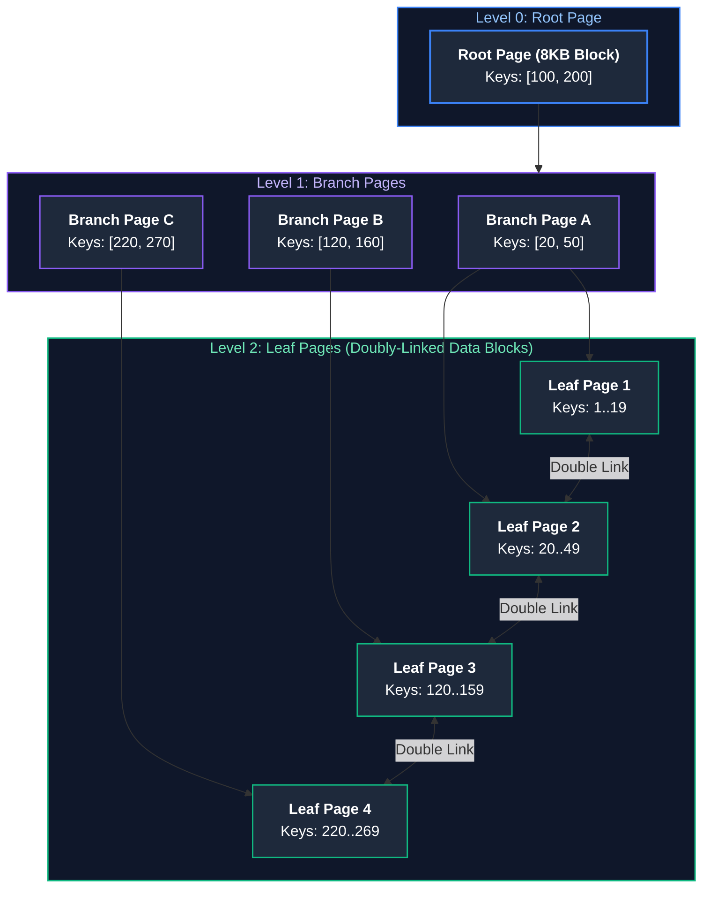

#### Why B+Trees Outperform Standard Binary Trees:
1. **High Branching Factor (Fanout)**: Each 8KB database page holds hundreds of keys (branching factor $\sim 200$). A B+Tree of height 3 can index $200^3 = 8,000,000\text{ rows}$, requiring at most **3 disk I/O operations** to find any row!
2. **Doubly-Linked Leaf Nodes**: Leaf nodes are linked sequentially in a doubly-linked list. Executing range scans (`WHERE age BETWEEN 25 AND 35`) traverses directly across leaf nodes without re-traversing the root!

---

### 4.2 The Leftmost Prefix Rule on Composite Indexes & SARGability

When creating a composite index:
```sql
CREATE INDEX idx_users_country_state_city ON users (country, state, city);
```

The B+Tree sorts keys strictly in **hierarchical leftmost order** (`country` $\to$ `state` $\to$ `city`):
* `WHERE country = 'US'` $\to$ **Uses Index**.
* `WHERE country = 'US' AND state = 'CA'` $\to$ **Uses Index**.
* `WHERE state = 'CA' AND city = 'SF'` $\to$ **CANNOT USE INDEX!** (Violates leftmost prefix; engine falls back to Sequential Scan!).

---

### 4.3 Specialized Indexes: GIN (JSONB / Full-Text), GiST, BRIN, and Partial Indexes

* **GIN (Generalized Inverted Index)**: Maps internal elements to their enclosing rows. Essential for indexing PostgreSQL `JSONB` documents and full-text search:
  ```sql
  CREATE INDEX idx_orders_metadata ON orders USING GIN (metadata);
  ```
* **BRIN (Block Range Index)**: Stores min/max values for physical block ranges on disk. Consumes $< 1\%$ of the RAM of a B+Tree. Outstanding for massive, immutable, append-only time-series tables (e.g. audit logs sorted by `created_at`).
* **Partial Index**: Indexes only a filtered subset of rows, dramatically saving memory and maintenance costs:
  ```sql
  CREATE INDEX idx_active_orders ON orders (customer_id) WHERE status = 'PENDING';
  ```

---

### 4.4 Covering Indexes (`INCLUDE` Clause) & Index-Only Scans

A standard index lookup requires two steps:
1. Traverse the B+Tree to find the row pointer (Heap Tuple ID).
2. Dereference the pointer to fetch data columns from the Table Heap.

A **Covering Index** includes non-search columns in the index leaf pages using the `INCLUDE` clause:
```sql
CREATE INDEX idx_orders_covering ON orders (customer_id) INCLUDE (total_amount, order_date);
```
When code queries:
```sql
SELECT total_amount, order_date FROM orders WHERE customer_id = 101;
```
The database executes an **Index-Only Scan**. The entire result set is satisfied directly from the B+Tree leaf pages **without touching the Table Heap on disk**, delivering a $10\times$ performance boost!

---

### 4.5 Deconstructing Execution Plans (`EXPLAIN (ANALYZE, BUFFERS)`)

The Cost-Based Optimizer (CBO) converts SQL text into a physical execution tree of iterator nodes (the Volcano model). Inspecting execution plans with `EXPLAIN (ANALYZE, BUFFERS)` is the foundation of senior database query optimization:

```sql
EXPLAIN (ANALYZE, BUFFERS, COSTS, VERBOSE, TIMING)
SELECT * FROM orders WHERE customer_id = 90210;
```

#### Annotated Real Execution Plan Output:
```text
Index Scan using idx_orders_customer_id on public.orders  (cost=0.42..8.44 rows=1 width=72) (actual time=0.035..0.037 rows=1 loops=1)
  Output: order_id, customer_id, total_amount, order_date
  Index Cond: (orders.customer_id = 90210)
  Buffers: shared hit=3 read=1
Planning Time: 0.125 ms
Execution Time: 0.058 ms
```

#### Key Output Parameters Explained:
* **`cost=0.42..8.44`**:
  * `0.42`: Estimated startup cost to fetch the very first row.
  * `8.44`: Total estimated cost to process all matching rows. (Cost units are arbitrary, normalized where 1 sequential disk page fetch = 1.0, random page fetch = 4.0).
* **`rows=1 width=72`**: Planner expects 1 row, each row averaging 72 bytes.
* **`actual time=0.035..0.037`**: Actual elapsed wall-clock time in milliseconds (start to finish).
* **`loops=1`**: Number of times this execution node was invoked.
* **`Buffers: shared hit=3 read=1`**:
  * `shared hit=3`: 3 database pages were retrieved directly from RAM (Buffer Pool).
  * `read=1`: 1 page had to be physically read from NVMe disk storage.

---

#### The 4 Core Scan Types Deconstructed

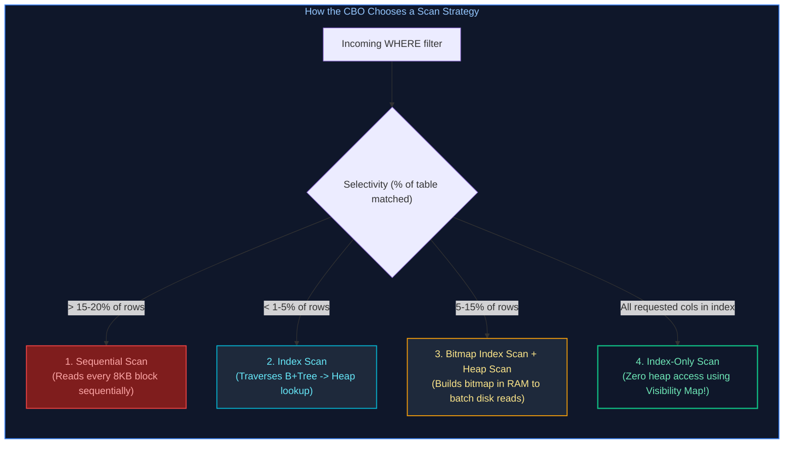

##### 1. Sequential Scan (`Seq Scan`)
Reads every single 8KB block of the table heap from start to finish. Outstanding for small tables ($< 1,000$ rows) or queries returning $>25\%$ of the table, but disastrous on 50-million-row tables.

##### 2. Index Scan (`Index Scan`)
Traverses the B+Tree to identify tuple pointers (`ctid`), then fetches corresponding rows from the heap. Efficient for high selectivity ($< 2\%$ of rows).

##### 3. Bitmap Index Scan + Bitmap Heap Scan
When a query matches thousands of scattered rows, raw index scanning incurs expensive random disk I/O.
* **Phase 1 (Bitmap Index Scan)**: Traverses the B+Tree and builds a bitmap in memory marking which physical heap pages contain matching rows.
* **Phase 2 (Bitmap Heap Scan)**: Reads the physical heap blocks **sequentially in physical disk order**, converting random I/O into fast sequential I/O!

##### 4. Index-Only Scan (`Index Only Scan`)
If every requested column is stored in the index (via composite key or `INCLUDE` clause), the engine satisfies the query entirely from the B+Tree leaf pages without touching the table heap on disk.

---

#### Diagnosing `work_mem` Disk Spills in Sort and Hash Nodes

When an `ORDER BY` or `HASH JOIN` requires more working memory than allocated by `work_mem` (default is 4MB in PostgreSQL), the query engine spills intermediate data to temporary files on disk:

```text
Sort  (cost=125430.00..128900.00 rows=500000 width=64) (actual time=850.12..920.45 rows=500000 loops=1)
  Sort Key: order_date DESC
  Sort Method: external merge  Disk: 42800kB  <-- CRITICAL WARNING: Spilled 42 MB to disk!
```

* **The Problem**: Writing 42MB to disk and reading it back slows the query down by $10\times$ to $50\times$.
* **The Solution**: Increase `work_mem` locally for that specific transaction session:
  ```sql
  SET work_mem = '64MB';
  -- Re-running query now outputs:
  -- Sort Method: quicksort  Memory: 48500kB (Sub-millisecond in-memory sort!)
  ```

---

### 4.6 Physical Join Algorithms: Nested Loop vs Hash Join vs Merge Join

The Cost-Based Optimizer (CBO) selects from three physical join algorithms:

| Join Algorithm | Mechanism | Time Complexity | When Selected |
| :--- | :--- | :---: | :--- |
| **Nested Loop Join** | Outer loop scans table A; inner loop executes index lookups on table B for each row. | $O(N \times \log M)$ | One small table joined against an indexed foreign key. |
| **Hash Join** | Scans smaller table, builds in-memory hash table; streams larger table and probes hash table. | $O(N + M)$ | Large unsorted datasets where join columns are not indexed. |
| **Merge Join** | Both tables are sorted by the join key; advances two pointers simultaneously like merge sort. | $O(N \log N + M \log M)$ | Very large tables pre-sorted by primary key or B+Tree index. |

---

### 4.7 Anti-Patterns That Silently Invalidate Indexes

1. **Applying Functions to Indexed Columns**:
   ```sql
   -- ❌ INVALIDATES INDEX: Database must compute LOWER() for every row on disk!
   SELECT * FROM users WHERE LOWER(email) = 'alice@corp.com';
   -- ✅ FIX: Create an Expression Index
   CREATE INDEX idx_users_lower_email ON users (LOWER(email));
   ```
2. **Leading Wildcard Searches**:
   ```sql
   -- ❌ INVALIDATES B+TREE INDEX: Leftmost prefix cannot match!
   SELECT * FROM customers WHERE name LIKE '%Smith';
   ```
3. **Implicit Type Casting**:
   ```sql
   -- If phone_number is VARCHAR, querying with an integer forces implicit cast across every row!
   SELECT * FROM customers WHERE phone_number = 5551234; -- Invalids index!
   ```

---

### 4.8 Production Index Maintenance, Bloat & `REINDEX CONCURRENTLY`

Over time, frequent `UPDATE` and `DELETE` operations create fragmented, half-empty B+Tree leaf pages (Index Bloat). A bloated index consumes excess RAM in `shared_buffers` and forces the query engine to read dozens of unnecessary disk blocks:

#### Inspecting Index Bloat in PostgreSQL:
```sql
SELECT
    current_database(), schemaname, tablename, indexname,
    ROUND((case when otta=0 then 0.0 else sml.relpages::float/otta end)::numeric, 1) AS bloat_ratio,
    pg_size_pretty((case when relpages < otta then 0 else relpages-otta end * 8192)::bigint) AS wasted_bytes
FROM (
    SELECT schemaname, tablename, relname AS indexname, relpages,
    CEIL((reltuples*(datahdr+ma-case when datahdr%ma=0 then ma else datahdr%ma end+nullhdr2+4))/(bs-20::float)) AS otta
    FROM (
        SELECT s.schemaname, s.tablename, s.relname, s.relpages, s.reltuples,
               current_setting('block_size')::numeric AS bs, 8 AS ma, 24 AS datahdr, 0 AS nullhdr2
        FROM pg_statio_user_indexes i
        JOIN pg_class s ON s.oid = i.indexrelid
    ) sub
) sml
WHERE sml.relpages > 100
ORDER BY wasted_bytes DESC;
```

#### Rebuilding Bloated Indexes Without Table Locks:
Running standard `REINDEX TABLE orders;` acquires a heavy `SHARE` lock that halts all concurrent `INSERT`, `UPDATE`, and `DELETE` transactions!

In production, always rebuild indexes using **`REINDEX CONCURRENTLY`**:
```sql
-- Builds the new index copy in the background while online transactions continue uninterrupted!
REINDEX INDEX CONCURRENTLY idx_orders_customer_id;
```

> [!TIP]
> **Deep-Dive Interview Scenario:**
> - [Q23. Database Indexing Mechanics & Composite Index Leftmost Prefix Rule](frequently_asked_questions/07_databases_jpa_and_hibernate_faq.md#q23-medium-database-indexing-mechanics--composite-index-leftmost-prefix-rule)

---

# 5. Connection Management, Migrations & High Availability

---

### 5.1 HikariCP Connection Pool Sizing & Starvation Defenses

HikariCP is the default, zero-overhead JDBC connection pool in Spring Boot, engineered with byte-code generated fast-paths, a lock-free `ConcurrentBag`, and eliminating `ThreadLocal` allocations.

```properties
# Production HikariCP configuration in application.properties
spring.datasource.hikari.pool-name=EnterpriseHikariPool
# Sizing formula: connections = (core_count * 2) + spindle_count
spring.datasource.hikari.maximum-pool-size=15
spring.datasource.hikari.minimum-idle=10
spring.datasource.hikari.connection-timeout=20000        # 20 seconds
spring.datasource.hikari.idle-timeout=300000             # 5 minutes
spring.datasource.hikari.max-lifetime=1800000            # 30 minutes (must be < DB wait_timeout)
spring.datasource.hikari.leak-detection-threshold=5000   # 5 seconds
```

#### Why Fewer Connections Deliver Higher Throughput:
A common misconception is that increasing connection pool size to 200 improves performance.
* In reality, if your database server has 8 CPU cores, running 200 concurrent active transactions causes severe **CPU context switching** and disk I/O thrashing.
* By constraining the connection pool to $(8 \text{ cores} \times 2) \approx 16$ connections, each query executes uninterrupted at maximum CPU cache efficiency, increasing overall queries-per-second (QPS) while lowering latency!

#### Production Java Configuration with Prometheus Metrics Instrumentation

```java
package com.enterprise.database.config;

import com.zaxxer.hikari.HikariConfig;
import com.zaxxer.hikari.HikariDataSource;
import io.micrometer.core.instrument.MeterRegistry;
import org.springframework.beans.factory.annotation.Value;
import org.springframework.context.annotation.Bean;
import org.springframework.context.annotation.Configuration;

import javax.sql.DataSource;

@Configuration
public class DatabasePoolConfiguration {

    @Value("${spring.datasource.url}")
    private String jdbcUrl;

    @Value("${spring.datasource.username}")
    private String username;

    @Value("${spring.datasource.password}")
    private String password;

    @Bean(destroyMethod = "close")
    public DataSource primaryDataSource(MeterRegistry meterRegistry) {
        HikariConfig config = new HikariConfig();
        config.setPoolName("ProductionHikariPool");
        config.setJdbcUrl(jdbcUrl);
        config.setUsername(username);
        config.setPassword(password);

        // Core Sizing & Timing
        config.setMaximumPoolSize(16);
        config.setMinimumIdle(8);
        config.setConnectionTimeout(20_000);  // 20s
        config.setIdleTimeout(300_000);        // 5m
        config.setMaxLifetime(1_800_000);      // 30m
        config.setLeakDetectionThreshold(5_000); // 5s warning for unclosed connections

        // PostgreSQL Performance Optimizations
        config.addDataSourceProperty("cachePrepStmts", "true");
        config.addDataSourceProperty("prepStmtCacheSize", "250");
        config.addDataSourceProperty("prepStmtCacheSqlLimit", "2048");
        config.addDataSourceProperty("useServerPrepStmts", "true");

        // Bind Micrometer metrics for Prometheus scraping (active, idle, pending connections)
        config.setMetricRegistry(meterRegistry);

        return new HikariDataSource(config);
    }
}
```

---

### 5.2 Zero-Downtime Database Refactoring: The Expand-Contract Pattern

Renaming or splitting columns on production tables with millions of rows cannot be executed with a single `ALTER TABLE users RENAME COLUMN name TO full_name;` without taking an exclusive `ACCESS EXCLUSIVE` table lock that blocks all incoming customer traffic and crashes live microservices.

The **Expand-Contract (Parallel Run) Pattern** achieves zero-downtime database evolution across 4 distinct deployment phases:

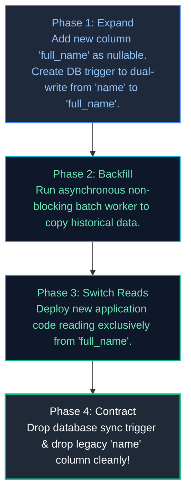

#### Complete Step-by-Step Production Migration Scripts

##### Phase 1: Expand (`V1__expand_add_full_name_column.sql`)
```sql
-- 1. Add new column as nullable (takes sub-millisecond metadata lock in PostgreSQL)
ALTER TABLE users ADD COLUMN full_name VARCHAR(255);

-- 2. Create sync trigger to automatically propagate updates between old and new columns
CREATE OR REPLACE FUNCTION trg_fn_sync_user_name() RETURNS TRIGGER AS $$
BEGIN
    -- If writing to legacy column 'name', copy to 'full_name'
    IF NEW.name IS NOT NULL AND NEW.full_name IS NULL THEN
        NEW.full_name = NEW.name;
    -- If writing to new column 'full_name', copy back to 'name' for backward compatibility
    ELSIF NEW.full_name IS NOT NULL AND NEW.name IS NULL THEN
        NEW.name = NEW.full_name;
    END IF;
    RETURN NEW;
END;
$$ LANGUAGE plpgsql;

CREATE TRIGGER trg_sync_user_name
BEFORE INSERT OR UPDATE ON users
FOR EACH ROW EXECUTE FUNCTION trg_fn_sync_user_name();
```

##### Phase 2: Backfill Historical Data in Non-Blocking Batches (`backfill_script.sql`)
```sql
-- Never run UPDATE users SET full_name = name; without WHERE! It locks the entire table and fills WAL!
-- Run small chunked batches (e.g. 5,000 rows per batch with sleep 0.1s):
DO $$
DECLARE
    batch_size INT := 5000;
    rows_updated INT := 1;
BEGIN
    WHILE rows_updated > 0 LOOP
        UPDATE users
        SET full_name = name
        WHERE id IN (
            SELECT id FROM users
            WHERE full_name IS NULL
            LIMIT batch_size
            FOR UPDATE SKIP LOCKED
        );
        GET DIAGNOSTICS rows_updated = ROW_COUNT;
        COMMIT; -- Commit batch to free row locks and truncate transaction log
        PERFORM pg_sleep(0.05); -- Sleep 50ms to yield I/O to online traffic
    END LOOP;
END $$;
```

##### Phase 3: Switch Reads in Application Code
Deploy Spring Boot application version `1.2.0` that reads directly from `full_name` and writes to both `full_name` and `name`.

##### Phase 4: Contract (`V2__contract_drop_legacy_column.sql`)
```sql
-- 1. Drop trigger and sync function
DROP TRIGGER IF EXISTS trg_sync_user_name ON users;
DROP FUNCTION IF EXISTS trg_fn_sync_user_name();

-- 2. Enforce NOT NULL on the new column safely
ALTER TABLE users ADD CONSTRAINT chk_full_name_not_null CHECK (full_name IS NOT NULL) NOT VALID;
ALTER TABLE users VALIDATE CONSTRAINT chk_full_name_not_null;

-- 3. Drop legacy column cleanly
ALTER TABLE users DROP COLUMN name;
```

---

### 5.3 Production Schema Migrations with Flyway & Liquibase

* **Flyway**: SQL-first versioned migration scripts named `V1__init_schema.sql`, `V2__add_index.sql`. Stores state in the `flyway_schema_history` table.
* **Production Best Practice**: In Kubernetes, **never allow web application pods to execute migrations at boot time**! Multiple concurrent pods will compete for migration locks. Instead, run Flyway migrations in a dedicated **Kubernetes Pre-Install Job** before rolling out web deployments.

---

### 5.4 Database Topologies: Replication, Partitioning & Horizontal Sharding

* **Streaming Replication**: Primary node writes to WAL and streams WAL bytes via TCP to read replicas.
* **Table Partitioning (Declarative)**: Splits a single logical table into physical sub-tables by **Range** (`PARTITION BY RANGE (created_at)`), **List**, or **Hash**. The optimizer performs **Partition Pruning**, skipping unneeded partitions during scans.
* **Horizontal Sharding**: Distributes database rows across completely separate physical database clusters using a sharding key (e.g. `tenant_id`).

---

### 5.5 Database Administration & Performance Diagnostic CLI Cheatsheet

```bash

# 6. Connect to PostgreSQL CLI

psql -U postgres -d enterprise_db -h db.prod.internal

# 7. Identify currently running slow queries in real time

SELECT pid, now() - query_start AS duration, query, state 
FROM pg_stat_activity 
WHERE state != 'idle' ORDER BY duration DESC;

# 8. Kill a rogue query locking tables

SELECT pg_cancel_backend(<PID>);

# 9. Inspect table sizes and bloat

SELECT relname, pg_size_pretty(pg_total_relation_size(relid)) 
FROM pg_catalog.pg_statio_user_tables 
ORDER BY pg_total_relation_size(relid) DESC;

# 10. Check index usage and identify unused indexes

SELECT relname, indexrelname, idx_scan 
FROM pg_stat_user_indexes 
WHERE idx_scan = 0;
```

---

# 6. Production Troubleshooting Playbook: Relational Databases & SQL

### Incident 1: Connection Pool Exhaustion (`SQLTransientConnectionException`)
* **Symptom**: Application throws `HikariPool-1 - Connection is not available, request timed out after 30000ms`, microservice health checks fail with 503 Service Unavailable, and thread dumps show dozens of application threads blocked on `com.zaxxer.hikari.util.ConcurrentBag.borrow()`.
* **Root Causes**:
  1. **Connection Leaks**: Code opens a JDBC connection or starts a `@Transactional` block and fails to return it due to unhandled exceptions, long-running batch loops, or unbounded stream processing.
  2. **External I/O in Transactions**: Developers invoking slow external microservices via REST/Feign, awaiting Kafka acknowledgments, or performing disk I/O while holding an active database connection.
  3. **Pool Misconfiguration**: Setting HikariCP `maximum-pool-size` to 100 on 50 container pods, saturating PostgreSQL's `max_connections` (5,000 backend processes swapping OS memory and fighting over spinlocks).
* **Diagnostic Queries & Telemetry**:
  ```sql
  -- Inspect active vs idle connections and detect blocked backends
  SELECT 
      pid,
      usename,
      client_addr,
      state,
      wait_event_type,
      wait_event,
      now() - state_change AS state_duration,
      query
  FROM pg_stat_activity
  WHERE state <> 'idle'
  ORDER BY state_duration DESC;

  -- Terminate non-responsive zombie queries holding transaction locks
  SELECT pg_terminate_backend(pid) 
  FROM pg_stat_activity 
  WHERE state = 'idle in transaction' 
    AND now() - state_change > interval '5 minutes';
  ```
* **Production Remedy & Mitigation**:
  1. **Strictly Ban Non-DB I/O in Transactions**: Refactor business logic to perform external HTTP calls *before* or *after* the `@Transactional` boundary, never inside it.
  2. **Activate HikariCP Leak Detection**:
     ```yaml
     spring:
       datasource:
         hikari:
           maximum-pool-size: 15
           minimum-idle: 15
           connection-timeout: 30000
           idle-timeout: 600000
           max-lifetime: 1800000
           leak-detection-threshold: 5000  # Logs stack trace if connection held > 5s
     ```
  3. **Deploy PgBouncer / Connection Pooler**: For microservices with hundreds of application pods, place PgBouncer in `transaction` pooling mode in front of PostgreSQL, reducing backend server connection count from thousands to tens.

---

### Incident 2: Table Bloat & Autovacuum Lag in PostgreSQL
* **Symptom**: Query latency progressively degrades over weeks despite proper indexing; database storage usage balloons by hundreds of gigabytes; `pg_total_relation_size` is $10\times$ larger than the theoretical size of the row data.
* **Root Cause**: High-velocity `UPDATE` and `DELETE` workloads create dead tuple versions. PostgreSQL's default `autovacuum` settings are tuned conservatively for low-memory desktop machines (`autovacuum_vacuum_scale_factor = 0.20`, requiring $20\%$ of the table to change before triggering a sweep). On a 100-million-row table, autovacuum sleeps until 20 million dead tuples accumulate.
* **Diagnostic Queries**:
  ```sql
  -- Detect top bloated tables by dead tuple count and vacuum urgency
  SELECT 
      schemaname,
      relname,
      n_live_tup,
      n_dead_tup,
      round(100.0 * n_dead_tup / nullif(n_live_tup + n_dead_tup, 0), 2) AS dead_tuple_pct,
      last_vacuum,
      last_autovacuum,
      last_analyze
  FROM pg_stat_user_tables
  WHERE (n_live_tup + n_dead_tup) > 10000
  ORDER BY n_dead_tup DESC
  LIMIT 10;
  ```
* **Production Remedy**:
  1. **Tune Autovacuum Per-Table for Write-Intensive Entities**:
     ```sql
     -- Trigger vacuuming as soon as 1% or 10,000 rows change
     ALTER TABLE high_throughput_events SET (
         autovacuum_vacuum_scale_factor = 0.01,
         autovacuum_vacuum_threshold = 10000,
         autovacuum_vacuum_cost_limit = 2000,
         autovacuum_vacuum_cost_delay = 2
     );
     ```
  2. **Non-Blocking Reorganization via pg_repack**:
     Do **NOT** run `VACUUM FULL` in production—it acquires an exclusive table lock (`AccessExclusiveLock`), halting all application reads and writes for hours. Instead, utilize `pg_repack` to build an unbloated copy online using shadow tables and change logs:
     ```bash
     # Reorganize bloated table online without blocking concurrent reads or writes
     pg_repack -h db-primary.internal -U postgres -d enterprise_db -t orders
     ```

---

### Incident 3: Catastrophic Lock Contention & Deadlocks on Concurrent Writes
* **Symptom**: High concurrency order processing or financial transfers crash with `PSQLException: ERROR: deadlock detected` or `DeadlockLoserDataAccessException: CannotAcquireLockException`. Latency spikes as worker threads queue behind exclusive row-level locks.
* **Root Cause**: Distinct concurrent transactions acquire row locks on common records in opposing sequences:
  - **Transaction 1**: Updates Account $A$, then attempts to update Account $B$.
  - **Transaction 2**: Updates Account $B$, then attempts to update Account $A$.
  - Both transactions block indefinitely waiting for the other's lock release; PostgreSQL's `deadlock_timeout` (default 1s) detects the cycle and aborts one transaction.
* **Diagnostic Queries**:
  ```sql
  -- Identify blocking and blocked queries in real time
  SELECT 
      blocked_locks.pid     AS blocked_pid,
      blocked_activity.usename  AS blocked_user,
      blocking_locks.pid    AS blocking_pid,
      blocking_activity.usename AS blocking_user,
      blocked_activity.query    AS blocked_statement,
      blocking_activity.query   AS current_statement_in_blocking_process
  FROM  pg_catalog.pg_locks         blocked_locks
  JOIN pg_catalog.pg_stat_activity blocked_activity ON blocked_activity.pid = blocked_locks.pid
  JOIN pg_catalog.pg_locks         blocking_locks 
      ON blocking_locks.locktype = blocked_locks.locktype
      AND blocking_locks.database IS NOT DISTINCT FROM blocked_locks.database
      AND blocking_locks.relation IS NOT DISTINCT FROM blocked_locks.relation
      AND blocking_locks.page IS NOT DISTINCT FROM blocked_locks.page
      AND blocking_locks.tuple IS NOT DISTINCT FROM blocked_locks.tuple
      AND blocking_locks.virtualxid IS NOT DISTINCT FROM blocked_locks.virtualxid
      AND blocking_locks.transactionid IS NOT DISTINCT FROM blocked_locks.transactionid
      AND blocking_locks.classid IS NOT DISTINCT FROM blocked_locks.classid
      AND blocking_locks.objid IS NOT DISTINCT FROM blocked_locks.objid
      AND blocking_locks.objsubid IS NOT DISTINCT FROM blocked_locks.objsubid
      AND blocking_locks.pid != blocked_locks.pid
  JOIN pg_catalog.pg_stat_activity blocking_activity ON blocking_activity.pid = blocking_locks.pid
  WHERE NOT blocked_locks.granted;
  ```
* **Production Remedy**:
  1. **Enforce Deterministic Lock Ordering**: Ensure all application entry points access shared resources in identical sorted order:
     ```java
     // Guarantee deterministic lock ordering to mathematically eliminate deadlock cycles
     List<UUID> sortedAccountIds = accountsToLock.stream()
         .sorted(Comparator.naturalOrder())
         .toList();

     for (UUID id : sortedAccountIds) {
         accountRepository.findAndLockById(id); // SELECT ... FOR UPDATE
     }
     ```
  2. **Set Aggressive Lock Timeouts**: Avoid indefinite thread blocking:
     ```sql
     SET lock_timeout = '3s';
     SET statement_timeout = '10s';
     ```

---

### Incident 4: Missing Indexes & Slow Query Log Analysis (`pg_stat_statements`)
* **Symptom**: CPU utilization on database nodes spikes to $95\text{--}100\%$, disk I/O IOPS saturation alerts fire, and p99 query latency degrades across the entire service.
* **Root Cause**: Developers deploy unindexed queries, or query planner estimates turn inaccurate due to stale statistics (`ANALYZE`), forcing sequential disk scans (`Seq Scan`) across multi-million row tables.
* **Diagnostic Query Analysis**:
  ```sql
  -- Top 5 queries consuming the most total execution time on the cluster
  SELECT 
      round(total_exec_time::numeric, 2) AS total_time_ms,
      calls,
      round(mean_exec_time::numeric, 2) AS avg_time_ms,
      round((100 * total_exec_time / sum(total_exec_time) OVER ())::numeric, 2) AS pct_load,
      rows,
      query
  FROM pg_stat_statements
  ORDER BY total_exec_time DESC
  LIMIT 5;

  -- Deep inspection of physical plan execution with buffer cache hit metrics
  EXPLAIN (ANALYZE, BUFFERS, VERBOSE, SETTINGS)
  SELECT customer_id, count(*), sum(amount)
  FROM payments
  WHERE status = 'SETTLED' AND settled_at >= now() - interval '7 days'
  GROUP BY customer_id;
  ```
* **Reading `EXPLAIN (ANALYZE, BUFFERS)` Output**:
  - `Buffers: shared hit=4210 read=18900`: `shared hit` means data was retrieved from RAM (Postgres shared buffers); `read` means cold disk reads (NVMe SSD page faults). High `read` indicates buffer pool thrashing.
  - `Seq Scan on payments (cost=0.00..89201.00 rows=321040 width=24) (actual time=0.045..1240.500 rows=319800 loops=1)`: Sequential scan examined every single table heap block.
* **Production Remedy**:
  1. **Create Index Concurrently**: Never run raw `CREATE INDEX` on production tables—it grabs a `ShareLock` that blocks all concurrent `INSERT`, `UPDATE`, and `DELETE` queries.
     ```sql
     -- Builds index in background across multiple table passes without locking writes
     CREATE INDEX CONCURRENTLY idx_payments_status_settled_at 
     ON payments (status, settled_at) 
     WHERE status = 'SETTLED';
     ```
  2. **Handle Failed Concurrent Index Builds**: If `CREATE INDEX CONCURRENTLY` terminates midway (e.g. timeout or uniqueness violation), it leaves an `INVALID` index marked in `pg_class`. It continues to consume storage and slows writes without ever being used by the optimizer. Clean it up with:
     ```sql
     DROP INDEX CONCURRENTLY idx_payments_status_settled_at;
     ```

---

### Incident 5: PostgreSQL Transaction ID (XID) Wraparound Catastrophe
* **Symptom**: Emergency alert: PostgreSQL server abruptly shuts down or enters read-only survival mode, refusing all write commands with:
  `FATAL: database is not accepting commands to avoid wraparound data loss in database "orders_db"`.
* **Root Cause**:
  PostgreSQL utilizes a 32-bit unsigned integer for Transaction IDs (XIDs), providing $\approx 4.29 \text{ billion}$ unique transactions. To handle infinite time, PostgreSQL treats XIDs circularly modulo $2^{31}$ ($\approx 2.14 \text{ billion}$). Any XID within the past $2.14 \text{ billion}$ transactions is in the "past" (visible); anything ahead is in the "future" (invisible).
  
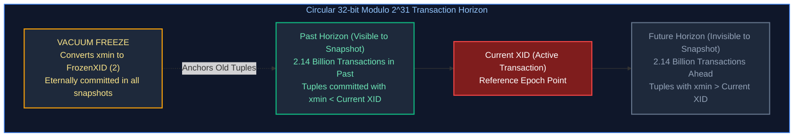

  To prevent older transactions from wrapping around into the "future" and disappearing, `VACUUM FREEZE` marks row tuples with a special `FrozenTransactionId` (value 2), signaling they are eternally committed. If autovacuum cannot keep up (due to aggressive vacuum throttling, long-running transactions holding oldest XID back, or orphaned replication slots), the database approaches the $2\text{ billion}$ limit. At 10 million transactions remaining, PostgreSQL refuses all writes to preserve data integrity.
* **Diagnostic Query**:
  ```sql
  -- Monitor XID age per database to detect impending wraparound
  SELECT 
      datname,
      age(datfrozenxid) AS xid_age,
      2147483648 - age(datfrozenxid) AS tx_until_wraparound,
      round(100.0 * age(datfrozenxid) / 2147483648, 2) AS wraparound_consumed_pct
  FROM pg_database
  ORDER BY xid_age DESC;

  -- Locate tables blocking oldest frozen XID advance
  SELECT 
      relname,
      age(relfrozenxid) AS table_xid_age
  FROM pg_class
  WHERE relkind IN ('r', 't')
  ORDER BY table_xid_age DESC
  LIMIT 10;
  ```
* **Production Disaster Recovery**:
  1. **Emergency Single-User Mode**: If the database halted and refuses connections:
     ```bash
     # Stop PostgreSQL service
     systemctl stop postgresql
     
     # Start PostgreSQL directly in single-user maintenance mode (-O: allow system catalog updates, -P: ignore indexes)
     postgres --single -D /var/lib/postgresql/data -P orders_db
     ```
  2. **Execute Full Freeze Vacuum**:
     ```sql
     -- Run manual freeze vacuum in single-user shell
     VACUUM FREEZE VERBOSE ANALYZE;
     ```
  3. **Restart Standard Cluster**: Exit single-user mode (`Ctrl+D`) and restart normal system service.

---

### Incident 6: Replication Lag & WAL Sender Saturation in Streaming Replicas
* **Symptom**: Read-replica database queries return stale data; replica reports seconds or minutes of `replay_lag`; primary node disk space drops precipitously towards $100\%$ exhaustion in the `pg_wal` directory.
* **Root Causes**:
  1. **Physical Replication Slot Disk Exhaustion**: A physical replication slot retains WAL files on the primary until the replica confirms receipt. If a replica crashes, disconnects, or lags, the primary's `pg_wal` accumulates every generated WAL segment without recycling, risking complete cluster disk full outage.
  2. **Replica Query Conflicts**: Queries running on the read replica attempt to view row versions that autovacuum on the primary has already pruned and logged as dead. When the replica replays the WAL cleanup record, it encounters a conflict: cancel the query or stall WAL replay.
* **Diagnostic Queries**:
  ```sql
  -- On Primary: Inspect replication lag and byte delay across all streaming replicas
  SELECT 
      client_addr,
      application_name,
      state,
      sync_state,
      pg_wal_lsn_diff(pg_current_wal_lsn(), sent_lsn) AS sent_lag_bytes,
      pg_wal_lsn_diff(sent_lsn, write_lsn) AS write_lag_bytes,
      pg_wal_lsn_diff(write_lsn, flush_lsn) AS flush_lag_bytes,
      pg_wal_lsn_diff(flush_lsn, replay_lsn) AS replay_lag_bytes,
      extract(epoch from replay_lag) AS replay_lag_seconds
  FROM pg_stat_replication;

  -- On Primary: Inspect replication slots retaining WAL segments
  SELECT 
      slot_name,
      plugin,
      slot_type,
      active,
      pg_size_pretty(pg_wal_lsn_diff(pg_current_wal_lsn(), restart_lsn)) AS retained_wal_bytes
  FROM pg_replication_slots;
  ```
* **Production Remedy & Mitigation**:
  1. **Enforce Safety Limit on WAL Retention**:
     Prevent lagging or orphaned replicas from crashing the primary node by enforcing `max_slot_wal_keep_size`:
     ```ini
     # postgresql.conf on Primary
     # Cap maximum WAL disk retained for replication slots at 64GB
     max_slot_wal_keep_size = 64GB
     ```
     *If a replica falls behind by more than 64GB, PostgreSQL automatically invalidates the slot and unlinks WAL files, prioritizing primary node survivability over replica continuity.*
  2. **Mitigate Replica Query Conflicts**:
     ```ini
     # postgresql.conf on Read Replica
     hot_standby_feedback = on          # Informs primary of replica's oldest active transaction
     max_standby_streaming_delay = 30s  # Max duration WAL replay waits before canceling conflicting query
     ```
  3. **Emergency Slot Drop on Imminent Disk Outage**:
     ```sql
     -- If primary disk reaches 95% due to an inactive replica slot, drop the slot immediately
     SELECT pg_drop_replication_slot('standby_replica_2');
     ```

---

# 7. From Raw JDBC to Spring Data: The Persistence Evolution

---

### 7.1 The Object-Relational Impedance Mismatch in Depth

Relational databases and object-oriented programming languages are built upon fundamentally conflicting mathematical paradigms:

* **Object Model (Java)**: Based on software engineering principles: encapsulation, state, polymorphism, inheritance, and directional pointer associations.
* **Relational Model (SQL)**: Based on relational algebra and set theory: relations (tables), tuples (rows), attributes (columns), primary keys, and foreign keys.

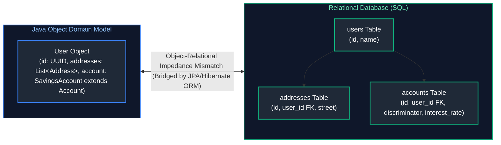

#### The Five Primary Impedance Mismatch Dimensions:
1. **Granularity Problem**: A domain model often possesses complex value objects (e.g. `Money` consisting of an amount and currency, or `Coordinates` with latitude and longitude). In a relational table, there are no composite data types; everything must be flattened into primitive columns (`money_amount`, `money_currency`).
2. **Subtyping & Inheritance Problem**: Java natively models class hierarchies (`class SavingsAccount extends BankAccount`). Relational database tables have no concept of inheritance; tables cannot extend other tables. Bridging this requires mapping strategies (`SINGLE_TABLE`, `JOINED`, `TABLE_PER_CLASS`).
3. **Identity Problem**: Java distinguishes between **Value Equality** (`equals()`) and **Reference Identity** (`==` checking memory addresses). Relational databases define identity strictly through primary key values.
4. **Association Problem**: In Java, associations are unidirectional object references (`customer.getOrders()`). In SQL, foreign keys represent bidirectional relationships navigated via JOIN operations.
5. **Data Navigation Problem**: In Java, code navigates object graphs by chaining getters (`order.getCustomer().getAddress().getCity()`). In SQL, fetching this data requires multi-table JOINs; accessing un-joined relations triggers separate database queries.

---

### 7.2 Raw JDBC Anatomy: Sockets, Drivers & The SQL Injection Attack Vector

Java Database Connectivity (JDBC) is the low-level API (`java.sql`) that opens TCP sockets to relational database servers, formats query packets according to vendor wire protocols, and streams tabular result sets.

#### The Anatomy of an SQL Injection Attack:
When an application uses dynamic string concatenation to construct SQL:

```java
// ❌ CRITICAL SECURITY VULNERABILITY: SQL Injection
public User findByUsername(String userInput) throws SQLException {
    String query = "SELECT * FROM users WHERE username = '" + userInput + "'";
    try (Connection conn = dataSource.getConnection();
         Statement stmt = conn.createStatement();
         ResultSet rs = stmt.executeQuery(query)) {
        if (rs.next()) return mapUser(rs);
        return null;
    }
}
```

If an attacker inputs: `' OR '1'='1' --`
The constructed SQL statement executed by the database engine becomes:
```sql
SELECT * FROM users WHERE username = '' OR '1'='1' --'
```
The database parser evaluates `'1'='1'` to `TRUE` for every row in the table, returning all user records in the system!

---

### 7.3 `Statement` vs `PreparedStatement` vs `CallableStatement`

#### 1. Overview: The JDBC Statement Abstraction Hierarchy
In the Java Database Connectivity (JDBC) API, all database interaction is mediated through the `java.sql.Statement` interface hierarchy:

$$\texttt{Statement} \longleftarrow \texttt{PreparedStatement} \longleftarrow \texttt{CallableStatement}$$

Choosing the correct statement type directly impacts two mission-critical pillars of enterprise backends: **application security** (immunity against SQL Injection) and **throughput performance** (amortizing query compilation overhead across millions of database calls).

#### 2. Detailed Breakdown of Statement Types

##### 1. `java.sql.Statement`: Static Raw SQL Execution
- **Working Principle:** Sends an unparameterized SQL string as plain text across the network.
- **Engine Processing Lifecycle:** For every single execution, the database query processor must:
  1. Lexically tokenize and parse the SQL string.
  2. Perform semantic verification against system catalogs.
  3. Cost-based optimizer computes multiple candidate execution trees.
  4. Generate and compile a new physical execution plan.
- **Security Vulnerability:** Because values are concatenated directly into the SQL string (`"WHERE user = '" + input + "'"`), attacker input escapes the string literal and alters the Abstract Syntax Tree (AST), creating fatal SQL injection vulnerabilities.
- **Enterprise Use Case:** Strictly restricted to one-off administrative DDL executions (`CREATE TABLE`, `ALTER TABLE`, `VACUUM`) where user-supplied runtime parameters do not exist.

##### 2. `java.sql.PreparedStatement`: Precompiled & Parameterized Execution
- **Working Principle:** Precompiles a parameterized SQL template containing question mark placeholders (`?`). The template is transmitted to the database engine and parsed once.
- **Binary Wire Protocol & SQL Injection Immunity:**
  - When parameters are assigned via `ps.setString(1, input)` or `ps.setInt(2, val)`, the JDBC driver transmits the parameters separately across the wire using the database's typed binary protocol.
  - The database executor treats parameter data strictly as literal scalar values, never as executable SQL tokens. Even if an attacker passes `' OR '1'='1`, the engine searches literally for that exact string value in the column, rendering SQL injection mathematically impossible.
- **Execution Plan Caching:** The compiled execution plan is cached in the database engine's prepared statement cache (and optionally in driver-level caches like HikariCP / pgJDBC). Subsequent executions with different parameters reuse the cached plan, bypassing parsing and optimization overhead.
- **Enterprise Use Case:** The mandatory gold standard for all operational DML (`SELECT`, `INSERT`, `UPDATE`, `DELETE`) across enterprise microservices.

##### 3. `java.sql.CallableStatement`: Stored Procedure & Function Invocation
- **Working Principle:** Extends `PreparedStatement` to invoke pre-compiled procedural routines (functions and stored procedures) defined inside the database catalog using standard JDBC escape syntax: `{call procedure_name(?, ?)}`.
- **Parameter Support:** In addition to standard `IN` parameters, `CallableStatement` supports `OUT` and `INOUT` parameters registered using `registerOutParameter(index, java.sql.Types)`.
- **Enterprise Use Case:** Legacy mainframe/enterprise database integration and batch banking settlement procedures encapsulated in PL/SQL or T-SQL.

#### 3. Practical Implementations & Code Walkthroughs

##### Example 1: Production-Grade `PreparedStatement` with Try-With-Resources
```java
public Optional<Account> findAccountById(String accountId) {
    String sql = "SELECT id, owner_name, balance, status FROM accounts WHERE id = ? AND status = ?";

    try (Connection conn = dataSource.getConnection();
         PreparedStatement ps = conn.prepareStatement(sql)) {

        // Parameters bound strictly as typed data literals, NEVER executable SQL!
        ps.setString(1, accountId);
        ps.setString(2, "ACTIVE");

        try (ResultSet rs = ps.executeQuery()) {
            if (rs.next()) {
                Account account = new Account(
                    rs.getString("id"),
                    rs.getString("owner_name"),
                    rs.getBigDecimal("balance"),
                    rs.getString("status")
                );
                return Optional.of(account);
            }
        }
    } catch (SQLException ex) {
        log.error("Database query failed for accountId: {}", accountId, ex);
        throw new DatabaseOperationException("Failed to fetch account", ex);
    }
    return Optional.empty();
}
```

##### Example 2: Calling Database Stored Procedures via `CallableStatement`
```java
public BigDecimal processMonthlyInterest(String accountId) {
    String procedureCall = "{call calculate_and_apply_interest(?, ?)}";

    try (Connection conn = dataSource.getConnection();
         CallableStatement cs = conn.prepareCall(procedureCall)) {

        // 1. Bind IN parameter
        cs.setString(1, accountId);

        // 2. Register OUT parameter type
        cs.registerOutParameter(2, java.sql.Types.DECIMAL);

        // 3. Execute remote procedure
        cs.execute();

        // 4. Retrieve computed OUT parameter value
        BigDecimal updatedBalance = cs.getBigDecimal(2);
        return updatedBalance;
    } catch (SQLException ex) {
        log.error("Failed executing interest procedure for accountId: {}", accountId, ex);
        throw new DatabaseOperationException("Stored procedure execution failed", ex);
    }
}
```

#### 4. Comparisons & Architectural Decision Matrix

| Dimension | `Statement` | `PreparedStatement` | `CallableStatement` |
| :--- | :--- | :--- | :--- |
| **SQL Parsing & Plan** | Sent as raw text; database parses, checks syntax, and compiles an execution plan on **every single execution**. | Precompiled by the database. The query execution plan is **cached** and reused. | Calls stored procedures and functions compiled inside the database engine. |
| **Parameters** | Inlined via string concatenation. | Bound via indexed or named parameter placeholders (`?`). | Supports `IN`, `OUT`, and `INOUT` parameters via JDBC escape syntax. |
| **Security** | **Extremely vulnerable to SQL Injection**. | **Completely immune to SQL Injection**. | Completely immune to SQL Injection when using placeholders. |
| **Protocol** | Text-based SQL protocol. | Passes parameters as typed binary data over database wire protocol. | Uses database vendor procedure wire protocol. |
#### 5. Advanced Production Insights & Connection Pool Statement Caching
1. **Prepared Statement Pooling with HikariCP & pgJDBC:**
   - Precompiling queries inside the database engine incurs CPU memory and handle allocation. If every HTTP request opens and closes a `PreparedStatement`, the precompilation advantage is lost.
   - **Production Remedy:** Enable server-side prepared statement pooling in the database driver:
     ```properties
     # application.properties (PostgreSQL Driver)
     spring.datasource.hikari.data-source-properties.prepStmtCacheSize=250
     spring.datasource.hikari.data-source-properties.prepStmtCacheSqlLimit=2048
     spring.datasource.hikari.data-source-properties.cachePrepStmts=true
     ```
2. **Preventing Plan Invalidation in Dynamic Filters:**
   - If an application constructs SQL with dynamic WHERE clauses via string appending (`sql += " AND age > " + age`), every combination generates a distinct SQL hash, polluting the database query plan cache (plan cache thrashing).
   - **Production Remedy:** Use JPA Criteria API, QueryDSL, or Spring Data Specifications to bind parameters dynamically while preserving parameter placeholders.

---

### 7.4 JDBC Batching & Network Round-Trip Optimization

When inserting or updating thousands of rows, executing statements individually incurs massive network round-trip overhead:

```java
// ❌ CATASTROPHIC PERFORMANCE: 10,000 network round-trips! Takes ~30 seconds!
for (OrderLineItem item : items) {
    ps.setString(1, item.getId());
    ps.setBigDecimal(2, item.getPrice());
    ps.executeUpdate(); // Sends packet over network, waits for ACK
}

// ✅ PRODUCTION STANDARD: JDBC Batching (Sends 1,000 rows in a single network packet)
String batchSql = "INSERT INTO order_items (id, order_id, price) VALUES (?, ?, ?)";
try (PreparedStatement ps = conn.prepareStatement(batchSql)) {
    int batchSize = 1000;
    int count = 0;

    for (OrderLineItem item : items) {
        ps.setString(1, item.getId());
        ps.setString(2, orderId);
        ps.setBigDecimal(3, item.getPrice());
        ps.addBatch(); // Buffers locally in memory

        if (++count % batchSize == 0) {
            ps.executeBatch(); // Transmits batch over network in single packet!
        }
    }
    ps.executeBatch(); // Flush remainder
}
```

> [!TIP]
> In PostgreSQL and MySQL JDBC drivers, batching requires setting explicit driver connection properties:
> * **PostgreSQL**: `reWriteBatchedInserts=true`
> * **MySQL**: `rewriteBatchedStatements=true`
> Without these flags, JDBC drivers secretly execute individual round-trips behind the scenes!

---

### 7.5 Connection Pooling Architecture: HikariCP Fast-Path & Sizing Mechanics

Opening a physical database connection requires TCP handshakes, TLS parameter negotiation, authentication, and backend server process allocation (costing $50\text{ to }100\text{ ms}$).

**HikariCP** maintains a pool of pre-allocated, healthy physical connections:

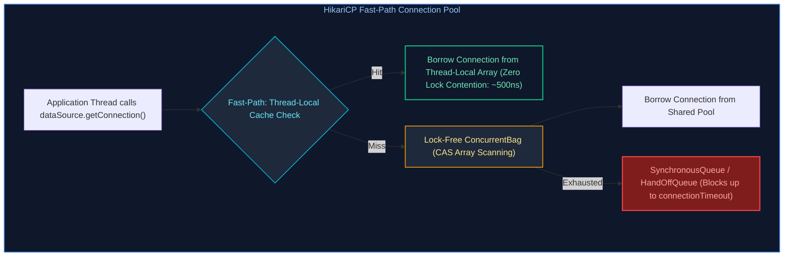

#### The Connection Pool Sizing Formula (Brett Wooldridge):
A pervasive beginner fallacy is configuring large connection pools (`maximum-pool-size=100`). In relational databases, database connections compete for physical CPU cores, RAM, and disk spindle I/O. As connection count increases beyond hardware capacity, the database spends $90\%$ of its CPU cycles context-switching between competing threads rather than executing queries!

$$\text{Optimal Pool Size} = \text{CPU Core Count} \times 2 + \text{Effective Spindle Count}$$

For a database server with 4 CPU cores and SSD storage:
$$\text{Pool Size} = (4 \times 2) + 1 = 9 \text{ to } 12 \text{ connections!}$$
A pool of 10 connections routinely delivers **higher throughput and lower latency** than a pool of 100 connections!

```properties
# Production HikariCP Configuration in Spring Boot
spring.datasource.hikari.maximum-pool-size=15
spring.datasource.hikari.minimum-idle=10
spring.datasource.hikari.connection-timeout=30000
spring.datasource.hikari.idle-timeout=600000
spring.datasource.hikari.max-lifetime=1800000
# Connection Leak Detection: Emits full stack trace if a thread holds connection > 5 seconds!
spring.datasource.hikari.leak-detection-threshold=5000
```

> [!TIP]
> **Deep-Dive Interview Scenario:**
> - [Q16. Pagination and Sorting in Spring Data JPA](frequently_asked_questions/07_databases_jpa_and_hibernate_faq.md#q16-medium-pagination-and-sorting-in-spring-data-jpa)

---

# 8. JPA Architecture & The Entity Lifecycle State Machine

---

### 8.1 JPA Specification vs Hibernate ORM Implementation Engine

* **JPA (Jakarta Persistence)**: An official Java Community Process (JCP) standard. It consists purely of interfaces (`EntityManager`, `EntityTransaction`, `Query`) and metadata annotations (`@Entity`, `@Table`, `@Column`, `@Id`). JPA contains **zero executable implementation code**.
* **Hibernate ORM**: The concrete open-source engine developed by Red Hat that implements the JPA standard, generates vendor-specific SQL dialects, manages the persistence context, executes dirty checking, and orchestrates caching.

---

### 8.2 The Persistence Context as an Identity Map

The **Persistence Context** is an in-memory cache managed by `EntityManager`. It acts as an **Identity Map**:
* For any given database table row (identified by its primary key), the Persistence Context guarantees that **exactly one Java object instance exists in memory**.
* If code queries for `accountRepository.findById(101L)` multiple times within the same transaction, Hibernate executes the SQL query once, stores the object in the Persistence Context, and returns the **identical memory reference** (`a1 == a2` returns `true`) for subsequent calls without hitting the database again!

---

### 8.3 The 4 Entity Lifecycle States: Transient, Managed, Detached, Removed

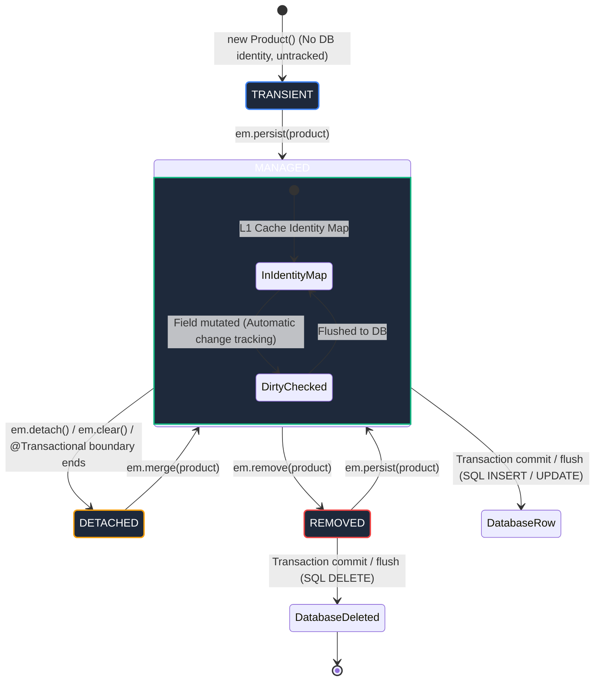

1. **Transient (New)**:
   * Created using standard Java `new` operator (`Product p = new Product()`).
   * Has no persistent database identity (primary key is null).
   * Not associated with any `EntityManager` Persistence Context.
2. **Managed (Persistent)**:
   * Associated with an active Persistence Context.
   * Has a persistent database identity (primary key).
   * **Monitored by Dirty Checking**: Any setter called on a managed entity is automatically tracked and synchronized to the database upon transaction commit.
3. **Detached**:
   * Previously managed, but its Persistence Context closed (e.g. after the `@Transactional` method returned) or was explicitly cleared (`em.detach(p)`, `em.clear()`).
   * Has a primary key, but field modifications are **ignored** by Hibernate.
   * Can be re-attached to a new session using `em.merge(p)`.
4. **Removed**:
   * Scheduled for deletion from the database via `em.remove(p)`.
   * Will emit an SQL `DELETE` statement upon transaction commit.

---

### 8.4 Step-by-Step Entity State Transition Code Walkthrough

```java
@Service
public class EntityLifecycleDemoService {

    @PersistenceContext
    private EntityManager em;

    @Transactional
    public void demonstrateLifecycle() {
        // 1. TRANSIENT STATE: Pure Java object in heap; DB knows nothing about it
        Product product = new Product("Laptop", new BigDecimal("1200.00"));
        System.out.println("Transient: ID is " + product.getId()); // null

        // 2. MANAGED STATE: Attached to Persistence Context
        em.persist(product);
        System.out.println("Managed: ID generated is " + product.getId()); // e.g. 101L

        // 3. DIRTY CHECKING IN ACTION:
        product.setPrice(new BigDecimal("1150.00")); // Field modified in memory!
        // Notice: We do NOT call em.persist() or repository.save()!

        // 4. DETACHED STATE: Explicitly detach entity from context
        em.detach(product);
        product.setPrice(new BigDecimal("999.00")); // This modification is IGNORED!

        // 5. RE-ATTACHING VIA MERGE:
        // merge() creates a NEW managed copy and copies detached state into it!
        Product mergedProduct = em.merge(product);
        mergedProduct.setPrice(new BigDecimal("1050.00"));

        // 6. REMOVED STATE:
        // em.remove(mergedProduct); // Would emit DELETE on commit
    } // Transaction commits here! Hibernate flushes SQL INSERT and SQL UPDATE!
}
```

---

### 8.5 Automatic Dirty Checking Mechanics & Flush Synchronization

How does Hibernate know an entity was modified without explicit save calls?

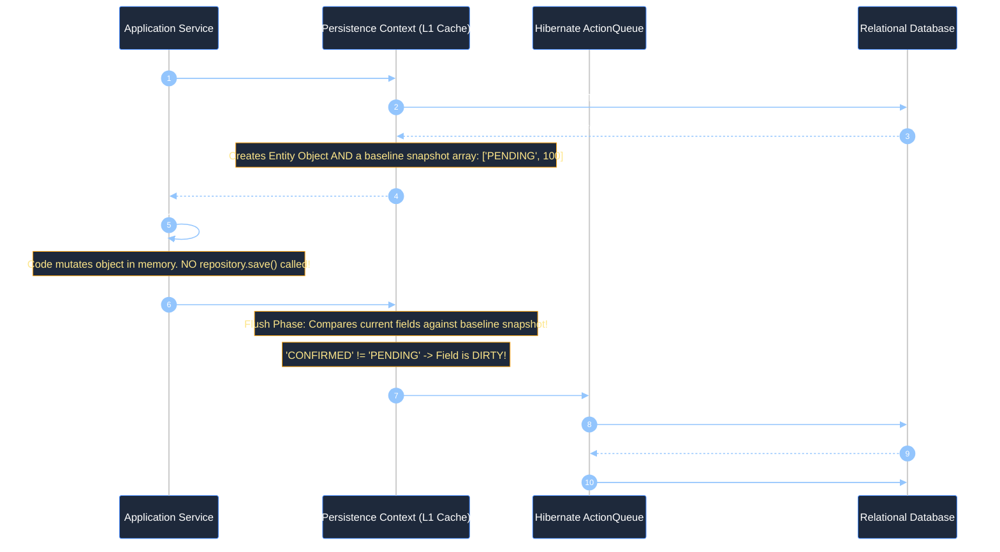

> [!IMPORTANT]
> **Production Standard**: Calling `repository.save(entity)` on an already managed entity inside a `@Transactional` method is redundant and indicates a misunderstanding of JPA dirty checking.

---

### 8.6 First-Level (L1) Cache vs Second-Level (L2) Cache Architecture

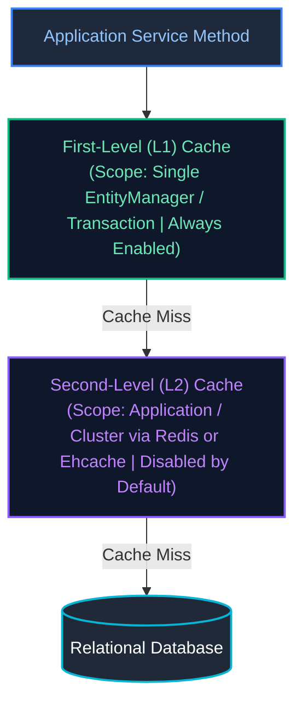

| Dimension | First-Level (L1) Cache | Second-Level (L2) Cache |
| :--- | :--- | :--- |
| **Scope** | Single `EntityManager` / `Session` | Shared across all sessions in the JVM or cluster |
| **Configuration** | **Always enabled** (Mandatory part of JPA specification) | **Disabled by default** (Requires Ehcache, Hazelcast, or Redis) |
| **Storage Format** | Live Java object instances (Identity Map) | Hydrated disassembled state arrays / serialized payloads |
| **Concurrency** | Thread-confined (Inherently thread-safe) | Multi-threaded (Requires lock policies: `READ_WRITE`, `NONSTRICT_READ_WRITE`) |

#### The 4 L2 Cache Concurrency Strategies:
1. **`READ_ONLY`**:
   * For static reference data that never changes (e.g. country codes, tax brackets).
   * Highest performance; zero lock overhead. If mutated, throws an exception.
2. **`NONSTRICT_READ_WRITE`**:
   * For entities that are rarely mutated and where occasional stale reads are acceptable.
   * Updates invalidate the cache upon transaction commit without locking.
3. **`READ_WRITE`**:
   * Standard for read-heavy entities with infrequent updates.
   * Uses soft-locks (sentinels) in the cache during transactions to prevent concurrent transactions from reading uncommitted dirty data.
4. **`TRANSACTIONAL`**:
   * Provides JTA/XA transactional consistency. Requires a distributed cache manager supporting JTA (e.g., Infinispan).

#### Production Spring Boot L2 Cache Configuration with Redisson:
```properties
# Enable Hibernate Second-Level Cache
spring.jpa.properties.hibernate.cache.use_second_level_cache=true
spring.jpa.properties.hibernate.cache.region.factory_class=org.redisson.hibernate.RedissonRegionFactory
spring.jpa.properties.hibernate.cache.use_query_cache=true
spring.jpa.properties.hibernate.cache.redisson.config=classpath:redisson.yaml
```

#### Entity L2 Cache Mapping:
```java
@Entity
@Table(name = "currencies")
@jakarta.persistence.Cacheable
@org.hibernate.annotations.Cache(
    usage = CacheConcurrencyStrategy.READ_ONLY,
    region = "currency-cache"
)
public class CurrencyEntity {
    @Id
    private String code;
    private String name;
    private BigDecimal exchangeRate;
}
```

#### The Hibernate Query Cache Trap:
Enabling `hibernate.cache.use_query_cache=true` caches the results of queries, but comes with a massive caveat:
* **The Query Cache stores ONLY primary keys, NOT full entities**: A cached query result is an array of IDs: `[101, 102, 103]`.
* When the query is executed again, Hibernate fetches the ID array from the Query Cache and then does an individual lookup for each ID in the L2 Entity Cache. **If the entities are NOT also cached in L2, the query cache causes an N+1 query storm!**
* **Aggressive Invalidation**: If *any* transaction commits an `INSERT`, `UPDATE`, or `DELETE` on the `orders` table, Hibernate invalidates the entire query cache region for `orders`, drastically reducing hit rates on write-heavy tables. Use Query Cache strictly for read-only tables!

> [!TIP]
> **Deep-Dive Interview Scenarios:**
> - [Q6. Connecting Multiple DataSources in Spring Boot](frequently_asked_questions/07_databases_jpa_and_hibernate_faq.md#q6-medium-connecting-multiple-datasources-in-spring-boot)
> - [Q7. JPA Primary Key Annotations: `@Id` & `@GeneratedValue`](frequently_asked_questions/07_databases_jpa_and_hibernate_faq.md#q7-medium-jpa-primary-key-annotations-id--generatedvalue)
> - [Q8. Hibernate Entity Lifecycle States](frequently_asked_questions/07_databases_jpa_and_hibernate_faq.md#q8-medium-hibernate-entity-lifecycle-states)
> - [Q9. Criteria API vs JPQL](frequently_asked_questions/07_databases_jpa_and_hibernate_faq.md#q9-hard-criteria-api-vs-jpql)
> - [Q17. Multi-Tenancy Architecture in JPA](frequently_asked_questions/07_databases_jpa_and_hibernate_faq.md#q17-expert-multi-tenancy-architecture-in-jpa)
> - [Q26. Hibernate `session.get()` vs `session.load()` (and `EntityManager.find()` vs `getReference()`): Proxy Initialization & Lazy Traps](frequently_asked_questions/07_databases_jpa_and_hibernate_faq.md#q26-medium-hibernate-sessionget-vs-sessionload-and-entitymanagerfind-vs-getreference-proxy-initialization--lazy-traps)

---

# 9. Entity Relationship Modeling & Object Graph Integrity

---

### 9.1 Basic Mappings: `@Entity`, `@Table`, `@Id`, and Primary Key Generation Strategies

```java
@Entity
@Table(name = "customers", indexes = {
    @Index(name = "idx_customer_email", columnList = "email", unique = true)
})
public class CustomerEntity {

    // GenerationType.IDENTITY: Relies on DB auto-increment column (e.g. SERIAL in Postgres).
    // Hazard: Disables JDBC batching because Hibernate must execute INSERT immediately to fetch ID!
    //
    // GenerationType.SEQUENCE (Preferred): Uses database sequence generator.
    // Supports allocationSize pre-allocation, enabling high-performance JDBC batch inserts!
    @Id
    @GeneratedValue(strategy = GenerationType.SEQUENCE, generator = "cust_seq_gen")
    @SequenceGenerator(name = "cust_seq_gen", sequenceName = "customers_id_seq", allocationSize = 50)
    private Long id;

    @Column(name = "email", nullable = false, length = 150)
    private String email;

    // Enums: ALWAYS map as STRING!
    // Using default ORDINAL means if someone reorders enum constants, data is permanently corrupted!
    @Enumerated(EnumType.STRING)
    @Column(name = "tier", nullable = false)
    private CustomerTier tier;

    @CreationTimestamp
    @Column(name = "created_at", nullable = false, updatable = false)
    private Instant createdAt;
}
```

---

### 9.2 Relationship Mappings: `@OneToOne`, `@ManyToOne`, `@OneToMany`, `@ManyToMany`


---

### 9.3 The Owning Side Invariant & The `mappedBy` Attribute

In bidirectional relationships, **one side MUST be designated the Owning Side**:
* The **Owning Side** owns the physical foreign key column in the database schema. It defines the `@JoinColumn` annotation.
* The **Inverse Side** is marked with the `mappedBy` attribute, which points to the field name on the owning entity.
* **The Golden Invariant**: Hibernate updates database foreign keys **based strictly on the state of the Owning Side**! If you add an order to `customer.getOrders()`, but fail to call `order.setCustomer(customer)`, **Hibernate will write `NULL` to the foreign key column**!

---

### 9.4 Bidirectional Relationship Synchronization Helper Methods

To guarantee object graph consistency in memory and database, always implement bidirectional synchronization helper methods on the parent entity:

```java
@Entity
@Table(name = "orders")
public class OrderEntity {
    @Id @GeneratedValue(strategy = GenerationType.SEQUENCE)
    private Long id;

    // Inverse side of relationship
    @OneToMany(mappedBy = "order", cascade = CascadeType.ALL, orphanRemoval = true)
    private List<OrderItemEntity> items = new ArrayList<>();

    // ✅ MANDATORY PRODUCTION SYNCHRONIZATION HELPERS
    public void addItem(OrderItemEntity item) {
        items.add(item);
        item.setOrder(this); // Updates the owning side foreign key pointer!
    }

    public void removeItem(OrderItemEntity item) {
        items.remove(item);
        item.setOrder(null); // Triggers orphan removal in DB!
    }

    public List<OrderItemEntity> getItems() {
        return Collections.unmodifiableList(items);
    }
}

@Entity
@Table(name = "order_items")
public class OrderItemEntity {
    @Id @GeneratedValue(strategy = GenerationType.SEQUENCE)
    private Long id;

    // Owning side: Holds the physical foreign key column!
    @ManyToOne(fetch = FetchType.LAZY)
    @JoinColumn(name = "order_id", nullable = false)
    private OrderEntity order;

    public void setOrder(OrderEntity order) {
        this.order = order;
    }
}
```

---

### 9.5 Why Decomposing `@ManyToMany` into an Intermediate Entity is Mandatory

Using a direct `@ManyToMany` annotation between `Student` and `Course` creates an invisible join table managed entirely by Hibernate.
* **Why this fails in production**: Real business applications always require metadata on the relationship itself (e.g., `enrolledAt`, `grade`, `paymentStatus`, `status`). Direct `@ManyToMany` cannot accommodate extra columns.
* **The Production Standard**: Decompose `@ManyToMany` into an explicit intermediate entity (`EnrollmentEntity`) mapped via two `@ManyToOne` relationships:


---

### 9.6 Cascading Options (`CascadeType`) vs `orphanRemoval = true`

* **`CascadeType.PERSIST`**: When parent is saved, child entities are saved.
* **`CascadeType.MERGE`**: When parent is merged, child entities are merged.
* **`CascadeType.REMOVE`**: When parent is deleted, all children are deleted.
  * *Production Warning*: Never place `CascadeType.REMOVE` on a `@ManyToOne` or `@ManyToMany`! Doing so will delete the shared parent or related entities across the entire table!
* **`orphanRemoval = true`**: If a child entity is removed from the parent's collection (`order.getItems().remove(0)`), Hibernate marks the orphaned child as `REMOVED` and emits an SQL `DELETE` statement.

---

# 10. Hibernate Proxies, Lazy Loading & Performance Traps

---

### 10.1 How Hibernate Implements Lazy Loading: ByteBuddy Dynamic Proxies

When an entity declares a lazy relationship (`@ManyToOne(fetch = FetchType.LAZY)`):
1. Hibernate does not execute a SQL query to load the related entity.
2. Instead, it instantiates a **ByteBuddy Dynamic Proxy** subclassing the target entity class.
3. The proxy contains an uninitialized target pointer.
4. When application code invokes any business getter on the proxy (e.g. `order.getCustomer().getName()`), the ByteBuddy interceptor wakes up, checks if an active `Session` exists, executes an SQL query to load the customer row, and populates the entity.

---

### 10.2 Why Eager Loading (`FetchType.EAGER`) is a Critical Production Anti-Pattern

```java
// ❌ CRITICAL PRODUCTION PERFORMANCE TRAP
@Entity
public class OrderEntity {
    @ManyToOne(fetch = FetchType.EAGER) // DEFAULT for @ManyToOne and @OneToOne!
    private CustomerEntity customer;
}
```

* **The Problem**: Whenever code queries `orderRepository.findById(id)` or `orderRepository.findAll()`, Hibernate **forces an immediate SQL JOIN or additional queries** to fetch the customer, even if your business logic only needed the order total amount!
* **Cascading Joins**: If `Customer` eagerly loads `Address`, and `Address` eagerly loads `Country`, querying a single Order triggers a monstrous 10-table join!
* **Production Rule**: **Always explicitly declare `fetch = FetchType.LAZY` on ALL relationships without exception**.

---

### 10.3 The `LazyInitializationException`: Root Cause & Solutions

```text
org.hibernate.LazyInitializationException: could not initialize proxy [com.enterprise.Customer#101] - no Session
```

#### Why it Happens:
1. Service method annotated with `@Transactional` finishes execution.
2. The Spring transaction commits and closes the Hibernate `Session` / `EntityManager`.
3. In the Web Controller or JSON serializer, Jackson calls `order.getCustomer().getName()`.
4. The ByteBuddy proxy attempts to fetch data from the database, but discovers the `Session` is closed, throwing `LazyInitializationException`!

#### How to Solve:
* Do NOT use Open-Session-In-View.
* Fetch the required association within the transactional service layer using **`JOIN FETCH`**, **`@EntityGraph`**, or **DTO Projections**.

---

### 10.4 The Open-Session-In-View (OSIV) Anti-Pattern: Hazards & Safe Disabling

Spring Boot ships with `spring.jpa.open-in-view=true` by default.
* **What OSIV Does**: A Servlet Filter opens a Hibernate Session at the start of an HTTP request and keeps it open until the response has finished streaming back to the browser.
* **The Production Outage Hazard**: A database connection from HikariCP is held hostage during slow HTTP rendering. If a client is on a slow 3G mobile network and takes 3 seconds to receive the JSON response, **the physical database connection is locked for 3 full seconds**! Under modest traffic spikes, all 10 HikariCP connections are exhausted in seconds, bringing down the entire microservice!
* **Remedy**: Always disable OSIV in production `application.properties`:
  ```properties
  spring.jpa.open-in-view=false
  ```

---

# 11. The N+1 Query Problem & Advanced Query Optimization

---

### 11.1 Diagnosing the N+1 Query Disaster with SQL Logs

The **N+1 Query Problem** occurs when fetching $N$ parent records requires $1$ initial query, followed by $N$ separate queries to fetch children:

```java
// Query 1: Returns 100 Orders
List<OrderEntity> orders = orderRepository.findAll();

// Triggers 100 separate queries: SELECT * FROM customers WHERE id = ?
for (OrderEntity order : orders) {
    System.out.println(order.getCustomer().getName());
}
// Total: 1 + 100 = 101 queries! Database latency explodes from 2ms to 250ms!
```

#### Automated Unit Testing for N+1 Query Regressions:
In CI/CD pipelines, use Hypersistence Utils or QuickPerf to assert exact SQL statement counts:

```java
package com.enterprise.repository;

import io.hypersistence.utils.jdbc.validator.SQLStatementCountValidator;
import org.junit.jupiter.api.Test;
import org.springframework.beans.factory.annotation.Autowired;
import org.springframework.boot.test.context.SpringBootTest;
import org.springframework.transaction.annotation.Transactional;

@SpringBootTest
public class QueryCountIntegrationTest {

    @Autowired
    private OrderRepository orderRepository;

    @Test
    @Transactional
    public void testNoNPlusOneQueries() {
        SQLStatementCountValidator.reset();

        // Fetch orders using optimized fetch join
        var orders = orderRepository.findAllWithCustomerFetch(OrderStatus.CONFIRMED);

        // Access lazily mapped properties
        orders.forEach(o -> o.getCustomer().getName());

        // Assert strictly 1 SELECT statement was executed across the wire!
        SQLStatementCountValidator.assertSelectCount(1);
    }
}
```

---

### 11.2 Production Fix 1: JPQL `JOIN FETCH` & The Pagination Trap (`HHH000104`)

`JOIN FETCH` instructs Hibernate to write an explicit SQL `JOIN` statement that loads the parent and associated children in a single network round-trip:

```java
public interface OrderRepository extends JpaRepository<OrderEntity, Long> {

    // Single query executes:
    // SELECT o.*, c.* FROM orders o INNER JOIN customers c ON o.customer_id = c.id WHERE o.status = ?
    @Query("SELECT o FROM OrderEntity o JOIN FETCH o.customer WHERE o.status = :status")
    List<OrderEntity> findAllWithCustomerFetch(@Param("status") OrderStatus status);
}
```

#### The Lethal Pagination Trap with Collection `JOIN FETCH`:
If you attempt to paginate (`Pageable`) while executing a `JOIN FETCH` on a `@OneToMany` collection:

```java
// ⚠️ DANGEROUS OUTAGE TRAP:
@Query("SELECT o FROM OrderEntity o JOIN FETCH o.items")
Page<OrderEntity> findOrdersWithItems(Pageable pageable);
```

Hibernate outputs this alarming warning in the logs:
```text
WARN: HHH000104: firstResult/maxResults specified with collection fetch; applying in memory!
```
* **Why this happens**: An SQL JOIN with a collection duplicates parent rows. If Order 1 has 5 items, the SQL result contains 5 rows for Order 1. The database cannot execute `LIMIT 10 OFFSET 20` correctly without cutting an order in half!
* **The Disaster**: Hibernate **strips the `LIMIT` and `OFFSET` clauses entirely**, queries **ALL 5,000,000 orders into the JVM heap**, and filters the 10 rows in Java RAM! This instantly exhausts JVM memory $\to$ `OutOfMemoryError: Java heap space`!

#### The Two-Step Pagination Solution:
1. Paginate parent IDs **without** joining collections.
2. Fetch full entities and collections using `WHERE id IN (:ids)` and let Hibernate reconstitute the graph:

```java
public interface OrderRepository extends JpaRepository<OrderEntity, Long> {

    // Step 1: Paginate only parent IDs (Uses fast SQL LIMIT & OFFSET in database!)
    @Query("SELECT o.id FROM OrderEntity o WHERE o.status = :status ORDER BY o.createdAt DESC")
    Page<Long> findOrderIds(@Param("status") OrderStatus status, Pageable pageable);

    // Step 2: Fetch collections for the current page slice using IN clause
    @Query("SELECT DISTINCT o FROM OrderEntity o JOIN FETCH o.items WHERE o.id IN :ids")
    List<OrderEntity> findOrdersWithItemsByIds(@Param("ids") List<Long> ids);
}
```

---

### 11.3 Production Fix 2: Spring Data JPA `@EntityGraph`

`@EntityGraph` provides a declarative way to override lazy loading paths on a per-query basis without writing custom JPQL joins:

```java
public interface OrderRepository extends JpaRepository<OrderEntity, Long> {

    @EntityGraph(attributePaths = {"customer", "items"})
    List<OrderEntity> findByStatus(OrderStatus status);
}
```
* `EntityGraphType.FETCH` (default): Specified attributes are fetched eagerly; all other attributes are loaded lazily.
* `EntityGraphType.LOAD`: Specified attributes are fetched eagerly; other attributes respect their explicit entity mapping annotations.

---

### 11.4 Production Fix 3: Hibernate Batch Fetching (`@BatchSize`)

If entities are loaded lazily, batch fetching replaces $N$ individual queries with a few batched `WHERE id IN (?, ?, ...)` queries:

```properties
# application.properties: Global Batch Fetching
spring.jpa.properties.hibernate.default_batch_fetch_size=25
```
Instead of 100 individual queries, Hibernate executes only $1 + \frac{100}{25} = 5$ queries!

You can also place `@BatchSize(size = 25)` directly on entity collections:
```java
@Entity
public class OrderEntity {
    @OneToMany(mappedBy = "order")
    @org.hibernate.annotations.BatchSize(size = 25)
    private List<OrderItemEntity> items = new ArrayList<>();
}
```

---

### 11.5 The Cartesian Product Problem & `MultipleBagFetchException`

When you attempt to `JOIN FETCH` two collection relationships (`List<OrderItem>` and `List<OrderTag>`) simultaneously, Hibernate throws:
```text
org.hibernate.loader.MultipleBagFetchException: cannot simultaneously fetch multiple bags
```
* **Why**: An SQL JOIN across two independent collections produces a **Cartesian Product** ($10\text{ items} \times 10\text{ tags} = 100\text{ rows}$ returned for a single order!).
* **Solution 1 (Change List to Set)**:
  ```java
  @OneToMany(mappedBy = "order")
  private Set<OrderItemEntity> items = new HashSet<>();
  ```
* **Solution 2 (Split-Query Entity Reconstitution)**:
  Execute two sequential queries within the same transaction. The Persistence Context (L1 cache) automatically stitches the second collection onto the already-loaded managed entities in memory without Cartesian blowup!
  ```java
  // Query 1: Loads orders with items into Persistence Context
  List<OrderEntity> orders = em.createQuery(
      "SELECT DISTINCT o FROM OrderEntity o JOIN FETCH o.items WHERE o.status = :s", OrderEntity.class)
      .setParameter("s", status).getResultList();

  // Query 2: Loads tags for those orders; L1 cache attaches tags to existing instances!
  em.createQuery(
      "SELECT DISTINCT o FROM OrderEntity o JOIN FETCH o.tags WHERE o IN :orders", OrderEntity.class)
      .setParameter("orders", orders).getResultList();
  ```

### 11.6 Read Projections: Interface Projections vs DTO Constructor Expressions

Loading full entities into the Persistence Context incurs dirty checking and memory overhead. For read-only API responses, use **DTO Projections**:

```java
public record OrderSummaryDto(Long orderId, String customerName, BigDecimal total) {}

public interface OrderRepository extends JpaRepository<OrderEntity, Long> {

    // Fast, lightweight: Fetches ONLY requested columns directly into record! Zero entity overhead!
    @Query("SELECT new com.enterprise.dto.OrderSummaryDto(o.id, o.customer.name, o.totalAmount) " +
           "FROM OrderEntity o WHERE o.id = :id")
    Optional<OrderSummaryDto> findSummaryById(@Param("id") Long id);
}
```

> [!TIP]
> **Deep-Dive Interview Scenarios:**
> - [Q10. `LAZY` vs `EAGER`, `LazyInitializationException` & The N+1 Select Problem](frequently_asked_questions/07_databases_jpa_and_hibernate_faq.md#q10-hard-lazy-vs-eager-lazyinitializationexception--the-n1-select-problem)
> - [Q11. Hibernate Caching: 1st Level vs 2nd Level Cache](frequently_asked_questions/07_databases_jpa_and_hibernate_faq.md#q11-medium-hibernate-caching-1st-level-vs-2nd-level-cache)
> - [Q12. Dirty Checking & Flush Modes](frequently_asked_questions/07_databases_jpa_and_hibernate_faq.md#q12-medium-dirty-checking--flush-modes)
> - [Q13. `CascadeType.ALL` vs `orphanRemoval`](frequently_asked_questions/07_databases_jpa_and_hibernate_faq.md#q13-medium-cascadetypeall-vs-orphanremoval)

---

# 12. Declarative Transaction Management (`@Transactional`)

---

### 12.1 ACID Guarantees in Enterprise Java

* **Atomicity**: All operations in the transaction complete successfully, or all are rolled back.
* **Consistency**: The database transitions from one valid state to another, preserving all schema constraints.
* **Isolation**: Concurrent transactions execute without cross-transaction interference or data corruption.
* **Durability**: Committed data survives physical system crashes or power failures (persisted in write-ahead logs).

---

### 12.2 Spring AOP Transaction Interception Architecture

```mermaid
flowchart TD
    Caller["External Controller / Service"]
    --> Proxy["Spring AOP Transaction Proxy"]
    Proxy --> TxMgr["PlatformTransactionManager<br/>(Acquires DB Connection from HikariCP, sets autocommit = false)"]
    TxMgr --> TargetMethod["Service Method Body"]
    TargetMethod -->|Success| Commit["Commit DB Transaction & Recycle Connection"]
    TargetMethod -->|Exception| Rollback["Rollback DB Transaction & Recycle Connection"]

    style Caller fill:#1e293b,stroke:#3b82f6,stroke-width:2px,color:#93c5fd
    style Proxy fill:#0f172a,stroke:#10b981,stroke-width:2px,color:#6ee7b7
    style TxMgr fill:#1f2937,stroke:#f59e0b,stroke-width:2px,color:#fff
    style TargetMethod fill:#1f2937,stroke:#06b6d4,stroke-width:2px,color:#fff
```

---

### 12.3 The Self-Invocation Proxy Bypass Trap & 3 Production Solutions

The most common transaction bug in Spring applications:

```java
@Service
public class BillingService {

    public void processMonthlyBilling() {
        // ❌ SELF-INVOCATION BUG: Internal call bypasses Spring AOP Proxy!
        // Calling this.chargeCustomer() calls the raw instance directly without going through the proxy.
        // The @Transactional annotation is completely IGNORED!
        chargeCustomer("CUST-101");
    }

    @Transactional
    public void chargeCustomer(String customerId) {
        // Database writes execute without a transaction!
    }
}
```

#### Production Fixes:
1. **Extract to Separate Collaborator Service (Best Practice)**: Move `chargeCustomer` to a dedicated `PaymentChargeService`.
2. **Self-Injection with `@Lazy`**: Inject a lazy proxy reference to self.
3. **Use Programmatic `TransactionTemplate`**.

---

### 12.3.1 Proxy Visibility & Inheritance Traps: `private` & `final` Methods

Spring AOP declarative transactions rely fundamentally on dynamic proxy wrappers (JDK Dynamic Proxies or CGLIB class subclassing):

1. **`@Transactional` on `private` Methods:**
   - **Behavior:** The `@Transactional` annotation is **silently ignored**! No database transaction is ever started.
   - **Root Cause:** CGLIB generates a runtime subclass extending the target bean, while JDK Dynamic Proxies generate a dynamic implementation of an interface. A subclass cannot override or access `private` methods, nor can an interface declare `private` methods for external invocation. Spring's `TransactionAttributeSource` explicitly ignores non-public methods on proxies by default.
   - **Remedy:** Ensure transactional methods are declared `public`, or use compile-time/load-time AspectJ byte-code weaving (`mode = AdviceMode.ASPECTJ`).

2. **`@Transactional` on `public final` Methods:**
   - **Behavior:** The method executes **non-transactionally**, without proxy interception.
   - **Root Cause:** When Spring Boot uses CGLIB (the default proxy mode for classes), the generated proxy subclass cannot override `final` methods in the Java bytecode. When an external bean invokes `bean.finalMethod()`, the JVM dynamic dispatch directly executes the original target method on the superclass, bypassing the Spring transaction interceptor entirely.

3. **Multi-Repository Calls in Unannotated Service Methods:**
   - **Behavior:** If a service method lacks `@Transactional` and executes `orderRepo.save()` followed by `paymentRepo.save()`, and `paymentRepo.save()` throws an exception:
   - **Result:** The `Order` **remains committed in the database**!
   - **Root Cause:** Spring Data's `SimpleJpaRepository` is annotated with `@Transactional` at the class level. In the absence of an outer transaction envelope, each repository method runs in its own isolated physical transaction (`connection.commit()` occurs as soon as `orderRepo.save()` completes). When `paymentRepo.save()` later fails, `orderRepo`'s committed write cannot be rolled back, leaving inconsistent partial data in the database.

4. **Cross-Thread Transactional Boundary (`@Async`):**
   - **Behavior:** If a `@Transactional` method calls an `@Async` method on another bean that inserts a record, and the caller then throws a `RuntimeException`:
   - **Result:** The `@Async` record is **NOT rolled back**!
   - **Root Cause:** Spring transaction context (`Connection`, `EntityManager`) is stored in a `ThreadLocal` via `TransactionSynchronizationManager`. An `@Async` method executes on a separate worker thread borrowed from a `TaskExecutor`. Because `ThreadLocal` variables are not inherited across thread pool boundaries, the asynchronous method opens an independent transaction on a separate physical database connection. The parent thread's rollback has zero effect on the async thread.

5. **Isolation Level Mismatches in Participating Transactions:**
   - **Behavior:** If a `@Transactional` method calls another bean's method annotated with `@Transactional(propagation = Propagation.REQUIRED, isolation = Isolation.SERIALIZABLE)`:
   - **Result:** The outer transaction's isolation level (e.g. `READ_COMMITTED`) applies. Spring cannot alter the isolation level of an existing active JDBC connection.
   - **Enforcement:** If `PlatformTransactionManager.setValidateExistingTransaction(true)` is enabled, Spring detects the conflicting isolation specification and throws `IllegalTransactionStateException`. Otherwise, the inner isolation attribute is silently ignored.

---

### 12.4 Transaction Propagation Levels Deep-Dive (With Scenario Traces)

#### 1. Overview: Physical vs. Logical Transaction Boundaries in Spring
In Spring enterprise architectures, business workflows often compose multiple services—for instance, an `OrderService` calling an `InventoryService`, a `PaymentService`, and an `AuditLoggingService`. When each method is annotated with `@Transactional`, Spring's transaction infrastructure must decide how these method boundaries interact with the underlying database connection:

- **Physical Transaction:** An actual JDBC transaction managed on an active database socket connection via `connection.setAutoCommit(false)`, `connection.commit()`, and `connection.rollback()`.
- **Logical Transaction:** A `@Transactional` method boundary defined in Java code. Multiple nested logical transactions can participate in a single shared physical transaction.

Spring's **Transaction Propagation** settings (defined in `org.springframework.transaction.annotation.Propagation`) control whether a child method participates in an existing physical transaction, opens a new physical connection, or runs non-transactionally.

#### 2. Detailed Breakdown of the 7 Propagation Behaviors

##### 1. `REQUIRED` (Spring Default)
- **Mechanism:** If a physical transaction already exists on the current thread, the method participates in it. If no transaction exists, Spring starts a new physical transaction.
- **Rollback Contract:** If an inner `@Transactional(REQUIRED)` method throws an unhandled `RuntimeException`, it marks the physical transaction as **Rollback-Only** (`setRollbackOnly()`). Even if the outer caller catches the exception with a `try-catch` block, the outer transaction *cannot* commit and will throw an `UnexpectedRollbackException` on completion!
- **Primary Use Case:** Standard business services (accounts, inventory, checkout) where all coordinated mutations must succeed or fail together.

##### 2. `REQUIRES_NEW`
- **Mechanism:** Always creates a brand-new, independent physical transaction. If an existing transaction is active, Spring **suspends** it, detaches the connection from the current thread, borrows a **second connection** from HikariCP, and begins a new transaction.
- **Independence:** The inner transaction commits or rolls back independently of the outer transaction. If the inner transaction commits and returns, the outer transaction can later roll back without affecting the inner committed data.
- **Primary Use Case:** Security audit logs, payment authorization attempts, or notifications that must remain permanently committed in the database even if the parent business transaction fails.

##### 3. `MANDATORY`
- **Mechanism:** Demands that an active physical transaction already exists when called.
- **Exception:** If invoked without an active transaction, Spring immediately throws `IllegalTransactionStateException`.
- **Primary Use Case:** Internal repository helper methods or financial accounting operations that must never execute in isolation without a parent transactional envelope.

##### 4. `SUPPORTS`
- **Mechanism:** If an active transaction exists, the method runs within it. If no transaction exists, it executes non-transactionally without opening a database transaction.
- **Primary Use Case:** Read-only queries or validation checks that can safely participate in an existing caller's read-view, but do not require transactional overhead when called standalone.

##### 5. `NOT_SUPPORTED`
- **Mechanism:** Suspends any active physical transaction and executes non-transactionally. Once complete, resumes the suspended transaction.
- **Primary Use Case:** Long-running operations, such as making external REST API calls or generating large PDF documents, where holding an open database transaction would exhaust connection pool resources.

##### 6. `NEVER`
- **Mechanism:** Demands that **no** active transaction exists.
- **Exception:** If an active transaction is detected on the thread, Spring immediately throws `IllegalTransactionStateException`.
- **Primary Use Case:** Batch jobs or maintenance scripts that perform internal manual commit chunking and would fail if wrapped inside a container-managed transaction.

##### 7. `NESTED`
- **Mechanism:** Executes within a nested transaction using **JDBC Savepoints** on the *same physical connection*. No second connection is borrowed.
- **Rollback Isolation:** If the child method throws an exception, Spring rolls back strictly to the created savepoint, leaving the parent transaction active and capable of continuing.
- **Requirement:** Requires JDBC 3.0+ driver savepoint support and a compatible transaction manager (e.g. `DataSourceTransactionManager`). Note that Hibernate JPA does not natively support `NESTED` without vendor-specific dialect configuration.

#### 3. Comparisons & Architectural Reference Matrix

| Propagation Level | Existing Transaction Behavior | No Existing Transaction Behavior | Physical Connections Used | Rollback Impact |
| :--- | :--- | :--- | :---: | :--- |
| **`REQUIRED`** (Default) | Joins existing transaction. | Creates new transaction. | 1 | Exception marks entire transaction rollback-only. |
| **`REQUIRES_NEW`** | **Suspends** existing; creates new independent transaction. | Creates new transaction. | **2 (Simultaneous)** | Inner commits independently; does not roll back parent. |
| **`MANDATORY`** | Joins existing transaction. | **Throws `IllegalTransactionStateException`**. | 1 | Fails immediately if unmanaged. |
| **`SUPPORTS`** | Joins existing transaction. | Executes non-transactionally. | 0 or 1 | Depends on caller state. |
| **`NOT_SUPPORTED`** | **Suspends** existing; executes non-transactionally. | Executes non-transactionally. | 0 | Unaffected by transaction rollbacks. |
| **`NEVER`** | **Throws `IllegalTransactionStateException`**. | Executes non-transactionally. | 0 | Enforces non-transactional execution. |
| **`NESTED`** | Creates a JDBC Savepoint within current transaction. | Creates new transaction. | 1 | Rolls back to savepoint without aborting parent. |

#### 4. Advanced Production Pitfall: The `REQUIRES_NEW` Connection Pool Starvation Deadlock
A lethal hazard in high-concurrency Spring backends occurs when `REQUIRES_NEW` is combined with small connection pools:
1. Thread $T_1$ starts an outer `@Transactional(REQUIRED)` method, borrowing Connection $C_1$ from HikariCP.
2. Under heavy load, 10 concurrent requests arrive. All 10 threads borrow connections $C_1 \dots C_{10}$ from a pool sized at `maximumPoolSize = 10`.
3. Each thread reaches an inner method annotated with `@Transactional(REQUIRES_NEW)`.
4. To execute the inner method, each thread attempts to borrow a **second connection** from HikariCP.
5. But the pool is 100% exhausted! All 10 threads block waiting for a connection to become free (`connectionTimeout`).
6. Because no thread can proceed to commit and release its first connection, the application enters an **irrecoverable pool deadlock**, crashing all incoming traffic until timeout!
- **Rule of Thumb:** Ensure `maximumPoolSize > concurrent_threads * 2` if employing `REQUIRES_NEW` under load.

#### Propagation Scenario Traces:

##### Scenario A: `REQUIRED` calling `REQUIRES_NEW`:

```mermaid
%%{init: {'theme': 'dark', 'themeVariables': { 'actorBkg': '#1e293b', 'actorBorder': '#3b82f6', 'actorTextColor': '#ffffff', 'signalColor': '#93c5fd', 'signalTextColor': '#ffffff', 'noteBkgColor': '#1e293b', 'noteBorderColor': '#f59e0b', 'noteTextColor': '#fde68a', 'activationBkgColor': '#3b82f6', 'sequenceNumberColor': '#ffffff' }}}%%
sequenceDiagram
    autonumber
    actor Caller as Client / Controller
    participant SvcA as ServiceA.methodA() [@Transactional(REQUIRED)]
    participant Pool as HikariCP Connection Pool
    participant Audit as AuditService.log() [@Transactional(REQUIRES_NEW)]
    participant DB as Database Engine

    Caller->>SvcA: Invokes methodA()
    SvcA->>Pool: Borrows Connection #1 (Tx 1 Started)
    SvcA->>DB: INSERT INTO orders ... (Pending in Tx 1)

    SvcA->>Audit: Invokes log()
    Note over SvcA,Audit: Suspend Tx 1 & Connection #1
    Audit->>Pool: Borrows Connection #2 (Tx 2 Started)
    Audit->>DB: INSERT INTO audit_logs ...
    Audit->>Pool: Commits Tx 2 & Returns Connection #2 to Pool

    Note over SvcA: Resume Tx 1 & Connection #1
    SvcA-->>Caller: Throws RuntimeException!
    SvcA->>Pool: Rollback Tx 1 & Returns Connection #1 to Pool
    Note over DB: Orders insert is undone, but audit_log remains safely committed!
```

##### Scenario B: `REQUIRED` calling `NESTED` (JDBC Savepoints):

```mermaid
%%{init: {'theme': 'dark', 'themeVariables': { 'actorBkg': '#1e293b', 'actorBorder': '#3b82f6', 'actorTextColor': '#ffffff', 'signalColor': '#93c5fd', 'signalTextColor': '#ffffff', 'noteBkgColor': '#1e293b', 'noteBorderColor': '#f59e0b', 'noteTextColor': '#fde68a', 'activationBkgColor': '#3b82f6', 'sequenceNumberColor': '#ffffff' }}}%%
sequenceDiagram
    autonumber
    actor BatchJob as Batch Job Runner
    participant BatchSvc as BatchOrderService [@Transactional(REQUIRED)]
    participant Pool as HikariCP Connection Pool
    participant DB as Database (JDBC Connection #1)

    BatchJob->>BatchSvc: processBatch(100 Orders)
    BatchSvc->>Pool: Borrows Connection #1 (Tx 1 Started)
    
    loop For each Order item in Batch
        BatchSvc->>DB: SAVEPOINT item_savepoint_N
        alt Successful Processing
            BatchSvc->>DB: INSERT INTO order_items ...
        else Item Validation / Processing Failure
            BatchSvc->>DB: ROLLBACK TO SAVEPOINT item_savepoint_N
            Note over BatchSvc,DB: Only failed item reverted; outer Tx 1 remains healthy!
        end
    end

    BatchSvc->>Pool: COMMIT Tx 1 & Returns Connection #1
    Note over DB: All valid order items committed atomically!
```

#### Programmatic Transaction Management with `TransactionTemplate`:
When declarative `@Transactional` annotations cause proxy self-invocation issues or when fine-grained transaction scopes are required (avoiding holding database connections across slow third-party API calls):

```java
package com.enterprise.transaction;

import org.springframework.stereotype.Service;
import org.springframework.transaction.PlatformTransactionManager;
import org.springframework.transaction.TransactionDefinition;
import org.springframework.transaction.support.TransactionTemplate;

@Service
public class ProgrammaticOrderService {

    private final TransactionTemplate transactionTemplate;
    private final OrderRepository orderRepository;
    private final ThirdPartyPaymentClient paymentClient;

    public ProgrammaticOrderService(PlatformTransactionManager transactionManager,
                                   OrderRepository orderRepository,
                                   ThirdPartyPaymentClient paymentClient) {
        this.transactionTemplate = new TransactionTemplate(transactionManager);
        this.transactionTemplate.setIsolationLevel(TransactionDefinition.ISOLATION_READ_COMMITTED);
        this.transactionTemplate.setPropagationBehavior(TransactionDefinition.PROPAGATION_REQUIRED);
        this.transactionTemplate.setTimeout(10); // 10 seconds timeout
        this.orderRepository = orderRepository;
        this.paymentClient = paymentClient;
    }

    public OrderResult processOrder(OrderRequest request) {
        // Step 1: Slow external HTTP payment call (NO DATABASE CONNECTION HELD!)
        PaymentConfirmation confirmation = paymentClient.authorizePayment(request.paymentToken());

        // Step 2: Fine-grained database transaction (Holds connection for only ~2 milliseconds!)
        return transactionTemplate.execute(status -> {
            try {
                OrderEntity order = new OrderEntity(request.customerId(), confirmation.authCode());
                orderRepository.save(order);
                return new OrderResult(order.getId(), OrderStatus.SUCCESS);
            } catch (Exception ex) {
                status.setRollbackOnly(); // Programmatic rollback trigger
                throw new OrderProcessingException("Database write failed", ex);
            }
        });
    }
}
```

---

### 12.5 The Connection Pool Deadlock Hazard of `REQUIRES_NEW`

When Method A (`REQUIRED`) calls Method B (`REQUIRES_NEW`):
* The executing thread holds **TWO active physical database connections** simultaneously!
* If a small connection pool (e.g. 10 connections) receives 10 concurrent requests at Method A, all 10 threads borrow connection #1 and block waiting for connection #2.
* Result: **Complete System Deadlock**! The application freezes permanently until connection timeout occurs!
* **Mathematical Sizing Rule**:
  $$\text{HikariCP Max Pool Size} \ge (\text{Max Concurrent Threads} \times (\text{Max Nesting Depth of REQUIRES\_NEW} + 1)) + 1$$

---

### 12.6 Rollback Rules: The Checked vs Unchecked Exception Trap

By default, Spring rolls back transactions **ONLY for unchecked exceptions** (`RuntimeException` and `Error`):

```java
// ❌ PRODUCTION OUTAGE BUG: Checked Exception DOES NOT ROLL BACK BY DEFAULT!
@Transactional
public void processTransfer(Long fromId, Long toId, BigDecimal amount) throws InsufficientFundsException {
    debit(fromId, amount);
    credit(toId, amount);
    if (balanceNegative()) {
        throw new InsufficientFundsException("Checked exception"); // DB TRANSACTION COMMITS ANYWAY!
    }
}

// ✅ MANDATORY PRODUCTION REMEDY: Explicit rollbackFor declaration
@Transactional(rollbackFor = Exception.class)
public void processTransferFixed(...) throws InsufficientFundsException { ... }
```

---

### 12.7 Read-Only Transactions (`readOnly = true`) Performance Optimizations

Annotating read queries with `@Transactional(readOnly = true)` delivers major performance gains:
1. **Hibernate Disables Dirty Checking**: Hibernate does not create baseline snapshot arrays, cutting memory consumption and CPU usage significantly.
2. **JDBC Driver Optimizations**: Some JDBC drivers route read queries directly to read-only database replicas.
3. **Flushing Suppressed**: Hibernate omits pre-query flushing checks.

> [!TIP]
> **Deep-Dive Interview Scenarios:**
> - [Q14. Spring `@Transactional` Architecture, Propagation Levels & The 10 Core Production Puzzle Scenarios](frequently_asked_questions/07_databases_jpa_and_hibernate_faq.md#q14-medium-spring-transactional-architecture-propagation-levels--the-10-core-production-puzzle-scenarios)
> - [Q27. The Silent Rollback Trap: Catching Downstream Exceptions in `@Transactional` Methods & `UnexpectedRollbackException`](frequently_asked_questions/07_databases_jpa_and_hibernate_faq.md#q27-hard-the-silent-rollback-trap-catching-downstream-exceptions-in-transactional-methods--unexpectedrollbackexception)

---

# 13. Database Concurrency & Locking Strategies

---

### 13.1 Lost Updates & Concurrency Anomalies

A **Lost Update** occurs when two concurrent transactions read the same record, modify it, and commit. The second commit completely overwrites the first transaction's modifications without awareness!

---

### 13.2 Optimistic Locking (`@Version`): Implementation & Automated Spring Retry

Optimistic locking assumes conflicts are rare. It uses a version column without holding database locks:

```mermaid
%%{init: {'theme': 'dark', 'themeVariables': { 'actorBkg': '#1e293b', 'actorBorder': '#3b82f6', 'actorTextColor': '#ffffff', 'signalColor': '#93c5fd', 'signalTextColor': '#ffffff', 'noteBkgColor': '#1e293b', 'noteBorderColor': '#f59e0b', 'noteTextColor': '#fde68a', 'activationBkgColor': '#3b82f6', 'sequenceNumberColor': '#ffffff' }}}%%
sequenceDiagram
    autonumber
    participant T1 as Thread 1 (User A)
    participant T2 as Thread 2 (User B)
    participant DB as PostgreSQL DB

    T1->>DB: Read Account (Balance=$100, version=1)
    T2->>DB: Read Account (Balance=$100, version=1)
    T1->>DB: UPDATE account SET balance=$150, version=2 WHERE id=1 AND version=1
    Note over DB: Success! 1 row updated. Version is now 2.
    T2->>DB: UPDATE account SET balance=$80, version=2 WHERE id=1 AND version=1
    Note over DB: Conflict! 0 rows updated because version is no longer 1!
    DB-->>T2: Throws OptimisticLockException!
```

```java
@Entity
public class AccountEntity {
    @Id
    private Long id;
    private BigDecimal balance;

    @Version // Automatically managed by JPA/Hibernate!
    private Long version;
}

// Service with automated Spring Retry on conflict
@Service
public class AccountService {

    @Retryable(
        retryFor = OptimisticLockingFailureException.class,
        maxAttempts = 3,
        backoff = @Backoff(delay = 100, multiplier = 2.0, random = true)
    )
    @Transactional
    public void deposit(Long accountId, BigDecimal amount) {
        AccountEntity account = accountRepository.findById(accountId).orElseThrow();
        account.setBalance(account.getBalance().add(amount));
    }
}
```

---

### 13.3 Pessimistic Locking (`SELECT FOR UPDATE`), Non-Blocking Queue with `SKIP LOCKED`

Pessimistic locking physically locks database rows using database row-level locks:

* **`PESSIMISTIC_READ`**: Emits `SELECT ... FOR SHARE`. Allows other concurrent transactions to read the row, but prevents anyone from writing/updating until current transaction commits.
* **`PESSIMISTIC_WRITE`**: Emits `SELECT ... FOR UPDATE`. Prevents all other transactions from reading (`FOR UPDATE`) or writing.
* **`PESSIMISTIC_FORCE_INCREMENT`**: Acquires pessimistic write lock and increments the `@Version` property immediately.

#### Building a High-Throughput Worker Queue with PostgreSQL `SKIP LOCKED`:
In high-throughput microservices, multiple background workers poll a `tasks` table for pending work. If all workers execute `SELECT ... FOR UPDATE`, they block each other sequentially.
* **The Solution**: Use **`SKIP LOCKED`**. A worker locks the next available task and instructs PostgreSQL to skip any rows currently locked by peer workers:

```java
public interface TaskQueueRepository extends JpaRepository<TaskEntity, Long> {

    // ✅ LOCK-FREE DISTRIBUTED TASK CONSUMER:
    // Emits SQL: SELECT * FROM tasks WHERE status = 'PENDING' ORDER BY priority DESC LIMIT 1 FOR UPDATE SKIP LOCKED
    @Lock(LockModeType.PESSIMISTIC_WRITE)
    @QueryHints({
        @QueryHint(name = "jakarta.persistence.lock.timeout", value = "-2") // -2 maps to SKIP LOCKED in Hibernate!
    })
    @Query("SELECT t FROM TaskEntity t WHERE t.status = 'PENDING' ORDER BY t.priority DESC LIMIT 1")
    Optional<TaskEntity> pollNextPendingTask();
}
```

> [!TIP]
> **Deep-Dive Interview Scenarios:**
> - [Q15. Optimistic vs Pessimistic Locking & The Train Seat Booking Race Condition](frequently_asked_questions/07_databases_jpa_and_hibernate_faq.md#q15-hard-optimistic-vs-pessimistic-locking--the-train-seat-booking-race-condition)
> - [Q18. Multi-Instance Cron Worker Row Concurrency: `ShedLock` vs `SELECT FOR UPDATE SKIP LOCKED`](frequently_asked_questions/07_databases_jpa_and_hibernate_faq.md#q18-hard-multi-instance-cron-worker-row-concurrency-shedlock-vs-select-for-update-skip-locked)
> - [Q19. Lost Update Anomaly: Optimistic vs Pessimistic Locking Strategy Selection](frequently_asked_questions/07_databases_jpa_and_hibernate_faq.md#q19-hard-lost-update-anomaly-optimistic-vs-pessimistic-locking-strategy-selection)
> - [Q21. `JpaRepository` vs `CrudRepository` vs `PagingAndSortingRepository`](frequently_asked_questions/07_databases_jpa_and_hibernate_faq.md#q21-easy-jparepository-vs-crudrepository-vs-pagingandsortingrepository)

---

# 14. Advanced Production Case Study: Dynamic Read/Write Replica Routing

---

### 14.1 Master-Replica Topologies & Asynchronous Replication Lag

In high-scale systems, writes occur on the Primary database, and reads are offloaded to one or more Read Replicas.
* **Replication Lag Hazard**: Because replication is asynchronous, reading from a replica immediately after writing to primary risks reading stale data (**Read-After-Write Inconsistency**).

---

### 14.2 Complete Production Implementation: `AbstractRoutingDataSource` with `LazyConnectionDataSourceProxy`

```java
package com.enterprise.datasource;

import org.springframework.jdbc.datasource.LazyConnectionDataSourceProxy;
import org.springframework.jdbc.datasource.lookup.AbstractRoutingDataSource;
import org.springframework.transaction.support.TransactionSynchronizationManager;
import javax.sql.DataSource;
import java.util.HashMap;
import java.util.Map;

public class DynamicRoutingDataSource extends AbstractRoutingDataSource {

    public enum RouteKey { PRIMARY, REPLICA }

    @Override
    protected Object determineCurrentLookupKey() {
        boolean isReadOnly = TransactionSynchronizationManager.isCurrentTransactionReadOnly();
        return isReadOnly ? RouteKey.REPLICA : RouteKey.PRIMARY;
    }

    public static DataSource createRoutingProxy(DataSource primaryDs, DataSource replicaDs) {
        DynamicRoutingDataSource routingDataSource = new DynamicRoutingDataSource();

        Map<Object, Object> targetDataSources = new HashMap<>();
        targetDataSources.put(RouteKey.PRIMARY, primaryDs);
        targetDataSources.put(RouteKey.REPLICA, replicaDs);

        routingDataSource.setTargetDataSources(targetDataSources);
        routingDataSource.setDefaultTargetDataSource(primaryDs);
        routingDataSource.afterPropertiesSet();

        // ✅ CRITICAL: LazyConnectionDataSourceProxy defers physical connection acquisition
        // until the first SQL statement is actually executed, allowing TransactionSynchronizationManager
        // to establish whether the transaction is readOnly before borrowing a connection!
        return new LazyConnectionDataSourceProxy(routingDataSource);
    }
}
```

#### Production Multi-DataSource Spring Boot Configuration:
```java
package com.enterprise.datasource.config;

import com.enterprise.datasource.DynamicRoutingDataSource;
import com.zaxxer.hikari.HikariDataSource;
import org.springframework.boot.autoconfigure.jdbc.DataSourceProperties;
import org.springframework.boot.context.properties.ConfigurationProperties;
import org.springframework.context.annotation.Bean;
import org.springframework.context.annotation.Configuration;
import org.springframework.context.annotation.Primary;

import javax.sql.DataSource;

@Configuration
public class RoutingDataSourceConfig {

    @Bean
    @ConfigurationProperties("spring.datasource.primary")
    public DataSourceProperties primaryDataSourceProperties() {
        return new DataSourceProperties();
    }

    @Bean
    @ConfigurationProperties("spring.datasource.replica")
    public DataSourceProperties replicaDataSourceProperties() {
        return new DataSourceProperties();
    }

    @Bean
    public DataSource primaryDataSource() {
        return primaryDataSourceProperties()
                .initializeDataSourceBuilder()
                .type(HikariDataSource.class)
                .build();
    }

    @Bean
    public DataSource replicaDataSource() {
        return replicaDataSourceProperties()
                .initializeDataSourceBuilder()
                .type(HikariDataSource.class)
                .build();
    }

    @Bean
    @Primary
    public DataSource dataSource() {
        return DynamicRoutingDataSource.createRoutingProxy(primaryDataSource(), replicaDataSource());
    }
}
```

#### Mitigating Replication Lag: Sticky Write-Context Routing
When a user updates their profile, redirecting their next GET request to a read replica often shows their old data because replication lag is 50-200ms.
* **The Solution**: Store a sticky timestamp in a Cookie or Redis user session. If the user executed a write within the last 3 seconds, override `RouteKey.REPLICA` and force routing to `RouteKey.PRIMARY` even for `@Transactional(readOnly = true)`:

```java
package com.enterprise.datasource;

public class UserWriteContextHolder {
    private static final ThreadLocal<Boolean> FORCE_PRIMARY = ThreadLocal.withInitial(() -> Boolean.FALSE);

    public static void setForcePrimary(boolean force) {
        FORCE_PRIMARY.set(force);
    }

    public static boolean isForcePrimary() {
        return Boolean.TRUE.equals(FORCE_PRIMARY.get());
    }

    public static void clear() {
        FORCE_PRIMARY.remove();
    }
}
```
In `DynamicRoutingDataSource.determineCurrentLookupKey()`:
```java
if (UserWriteContextHolder.isForcePrimary()) {
    return RouteKey.PRIMARY; // Overrides readOnly to prevent reading stale replicated data!
}
return TransactionSynchronizationManager.isCurrentTransactionReadOnly() ? RouteKey.REPLICA : RouteKey.PRIMARY;
```

---

# 15. Production Troubleshooting Playbook: JPA & Hibernate

### Incident 1: `LazyInitializationException: could not initialize proxy - no Session`
* **Symptom**: REST API calls fail during JSON serialization with:
  `org.hibernate.LazyInitializationException: could not initialize proxy [com.enterprise.entity.Customer#402] - no Session`.
* **Root Cause**: The service method annotated with `@Transactional` completes, closing the Hibernate `Session` and returning the database connection to HikariCP. When Jackson attempts to serialize the detached entity's uninitialized `LAZY` collection or proxy association, no active database session exists to fetch the data.
* **Anti-Pattern "Quick-Fix" to Avoid**:
  Enabling `spring.jpa.open-in-view=true` (OSIV). OSIV keeps database connections held by worker threads throughout the entire HTTP view-rendering phase, leading to connection pool exhaustion under load.
* **Production Remedy**:
  1. **Fetch Necessary Associations in Query**:
     ```java
     @Query("SELECT o FROM Order o JOIN FETCH o.items JOIN FETCH o.customer WHERE o.id = :id")
     Optional<Order> findByIdWithDetails(@Param("id") Long id);
     ```
  2. **Map to Flat DTOs Inside Transaction Boundary**: Never expose JPA entities directly to `@RestController` responses; map to immutable Java Records inside the `@Transactional` service layer.

---

### Incident 2: Unexpected Rollback Exception (`UnexpectedRollbackException`)
* **Symptom**: Application fails with:
  `org.springframework.transaction.UnexpectedRollbackException: Transaction silently rolled back because it has been marked as rollback-only`.
* **Root Cause**:
  Method A calls Method B, both using default `Propagation.REQUIRED`. Method B throws a `RuntimeException`, which is caught and swallowed by Method A:
  ```java
  @Transactional
  public void outerMethod() {
      try {
          innerService.failingMethod(); // Throws RuntimeException!
      } catch (Exception ex) {
          log.warn("Handled inner failure"); // Swallows exception!
      }
      // Attempts to commit outer transaction... FAILS!
  }
  ```
  Even though Method A swallowed the exception, Spring's transaction interceptor around Method B already marked the underlying physical transaction as **Rollback-Only**! When Method A attempts to commit, Spring aborts the commit and throws `UnexpectedRollbackException`.
* **Production Remedy**:
  1. If inner failures must not abort the outer transaction, isolate the inner method with `Propagation.REQUIRES_NEW`:
     ```java
     @Transactional(propagation = Propagation.REQUIRES_NEW)
     public void failingMethod() { ... }
     ```
  2. Alternatively, rethrow the exception or use `TransactionTemplate` to manage sub-transaction savepoints programmatically.

---

### Incident 3: Massive Memory & CPU Spikes from Hibernate Dirty Checking on Bulk Queries
* **Symptom**: Querying 20,000 entities for CSV export causes prolonged Garbage Collection pauses, high Old Gen memory consumption, and thread stalls during transaction commit.
* **Root Cause**: When JPA loads 20,000 managed entities into the First-Level (L1) Cache, Hibernate creates duplicate snapshot copies of all 20,000 objects in memory. Upon transaction completion, the **Automatic Dirty Checking** mechanism performs a deep field-by-field equality comparison between every loaded entity and its initial snapshot!
* **Production Remedy**:
  1. **Mark Transaction Read-Only**: Disables dirty-check snapshot creation:
     ```java
     @Transactional(readOnly = true)
     public void exportReport() { ... }
     ```
  2. **Use Hibernate `StatelessSession` for Bulk Batch ETL**:
     ```java
     // Bypasses L1 cache, dirty checking, and first-level entity snapshots completely
     try (StatelessSession session = sessionFactory.openStatelessSession()) {
         Transaction tx = session.beginTransaction();
         ScrollableResults<Order> orders = session.createQuery("FROM Order", Order.class).scroll();
         while (orders.next()) {
             Order order = orders.get();
             csvWriter.write(order);
         }
         tx.commit();
     }
     ```

---

### Incident 4: High-Concurrency Deadlocks on Cascading Foreign Key Locks
* **Symptom**: High-throughput order placements crash intermittently with `PSQLException: ERROR: deadlock detected` or `MySQLTransactionRollbackException: Deadlock found when trying to get lock`.
* **Root Cause**: Updating a parent row acquires a row lock. Inserting or updating child records verifies foreign keys against the parent table. If concurrent transactions insert child rows for different parent entities while modifying parent counters in varying sequence, a database lock cycle forms.
* **Production Remedy**:
  1. **Index All Foreign Key Columns**: Databases perform sequential table scans or broader table locks if foreign key columns lack indexes.
  2. **Sort Resource Updates Deterministically**: Always lock parent and child entities in strict sorted primary key order.

---

### Incident 5: Primary Key `IDENTITY` Generation Disabling JDBC Batching
* **Symptom**: Batch inserting 10,000 entities takes minutes instead of seconds; application metrics show 10,000 individual SQL `INSERT` statements executing sequentially despite `spring.jpa.properties.hibernate.jdbc.batch_size=50`.
* **Root Cause**: `GenerationType.IDENTITY` relies on database auto-increment columns. To obtain the generated ID for the managed entity, Hibernate must execute the `INSERT` statement **immediately** upon `entityManager.persist()` to fetch the ID via `LAST_INSERT_ID()` or PostgreSQL `RETURNING id`. This completely defeats JDBC batching!
* **Production Remedy**:
  Migrate to `GenerationType.SEQUENCE` with optimized `allocationSize`:
  ```java
  @Id
  @GeneratedValue(strategy = GenerationType.SEQUENCE, generator = "order_seq")
  @SequenceGenerator(name = "order_seq", sequenceName = "order_id_seq", allocationSize = 50)
  private Long id;
  ```
  *Hibernate pre-allocates blocks of 50 IDs in memory using a single database round-trip, restoring full JDBC batch insertion capability.*

---

### Incident 6: Connection Pool Starvation from `@Transactional` Over External Network Calls
* **Symptom**: HTTP latency spikes to 30s; HikariCP throws `ConnectionTimeoutException: Connection is not available`.
* **Root Cause**:
  ```java
  @Transactional
  public void placeOrder(OrderRequest request) {
      Order order = orderRepository.save(new Order(request)); // Borrows DB connection
      paymentGatewayClient.authorizeCard(request);            // SLOW 5-SECOND REST CALL!
      emailService.sendConfirmation(order);                   // NETWORK I/O!
  } // Database connection held hostage for 5+ seconds!
  ```
* **Production Remedy**:
  Shrink the `@Transactional` scope strictly to database read/write operations using `TransactionTemplate`:
  ```java
  @Service
  public class OrderPlacementService {
      private final TransactionTemplate transactionTemplate;
      private final PaymentGatewayClient paymentGatewayClient;

      public void placeOrder(OrderRequest request) {
          // 1. External HTTP call executed WITHOUT holding a DB connection!
          PaymentResult payment = paymentGatewayClient.authorizeCard(request);

          // 2. Short, atomic DB transaction (< 10ms)
          transactionTemplate.executeWithoutResult(status -> {
              orderRepository.save(new Order(request, payment.transactionId()));
          });
      }
  }
  ```

---

# 16. Summary Comparison & Production Engineering Reference Matrix

| Architectural Domain | Internal Database Mechanism | Senior Production Standard |
| :--- | :--- | :--- |
| **Write-Ahead Log (WAL)** | Sequential append-only disk logging | Never disable `fsync`; ensures durability across hardware power cuts. |
| **Normalization** | Enforces scalar attributes and dependency rules (3NF) | Use 3NF for OLTP write models; use controlled denormalization for read APIs. |
| **Anti-Joins** | Presence checks vs value-set checks | Always use `NOT EXISTS`; ban `NOT IN` due to catastrophic 3-valued NULL failure. |
| **Window Functions** | Evaluates partition frame over sorted stream | Use `ROW_NUMBER()` / `DENSE_RANK()` for pagination and running totals without `GROUP BY`. |
| **B+Tree Indexing** | Hierarchical page traversal (Height 3 $\approx$ 8M rows) | Follow Leftmost Prefix Rule on composite indexes. |
| **Covering Index** | Leaf pages hold requested columns via `INCLUDE` | Enables Index-Only Scans, eliminating random table heap reads completely. |
| **MVCC** | Tuple versioning (Postgres) vs Undo Logs (InnoDB) | Readers never block writers; schedule autovacuuming to prevent table bloat. |
| **Connection Pooling** | Fast-path ThreadLocal array + CAS ConcurrentBag | Size pools strictly using $(CPU \times 2) + Spindles$ ($\approx 10\text{--}15$ connections). |
| **Schema Migrations** | Expand-Contract parallel run strategy | Run migrations via dedicated CI/K8s jobs, not inside application startup threads. |

---

| Feature / Subsystem | Low-Level JPA / Hibernate Mechanism | Senior Production Standard |
| :--- | :--- | :--- |
| **`PreparedStatement`** | Parameter binding at driver protocol level | Eliminates SQL injection; caches database execution plans. |
| **HikariCP Sizing** | Direct disk/CPU concurrency formula | Keep pools small ($10\text{--}20$ connections); enable `leak-detection-threshold`. |
| **Persistence Context** | L1 cache acts as identity map & dirty checking baseline | Never call `save()` manually on managed entities within `@Transactional`. |
| **Lazy Loading** | ByteBuddy dynamic proxy subclass intercepts getters | Ban `FetchType.EAGER` across all relationships. |
| **OSIV Anti-Pattern** | Keeps Hibernate Session bound to HTTP request thread | Set `spring.jpa.open-in-view=false` to protect HikariCP from exhaustion. |
| **N+1 Problem** | 1 parent query followed by $N$ child queries | Resolve via `JOIN FETCH`, `@EntityGraph`, or `default_batch_fetch_size`. |
| **Cartesian Products** | Joining multiple collections multiplies row counts | Avoid fetching two `List` collections simultaneously; use `Set` or 2 queries. |
| **Transaction Rollback** | Default rolls back on `RuntimeException` only | Always declare `@Transactional(rollbackFor = Exception.class)`. |
| **`REQUIRES_NEW`** | Suspends parent connection and opens a second connection | Risk of connection pool deadlock; ensure pool size exceeds thread concurrency. |
| **Optimistic Locking** | Checks `@Version` column in SQL UPDATE WHERE clause | Use for high-read/low-write domains; pair with Spring Retry. |

---

# 17. References & Further Reading

---

- [PostgreSQL Official Documentation (Internals & Indexing)](https://www.postgresql.org/docs/current/internals.html)
- [MySQL 8.0 Reference Manual - The InnoDB Storage Engine](https://dev.mysql.com/doc/refman/8.0/en/innodb-storage-engine.html)
- [Markus Winand - Use The Index, Luke! (A Guide to Database Performance)](https://use-the-index-luke.com/)
- [Martin Kleppmann - Designing Data-Intensive Applications (O'Reilly)](https://dataintensive.net/)
- [Brett Wooldridge - HikariCP Connection Pool Sizing](https://github.com/brettwooldridge/HikariCP/wiki/About-Pool-Sizing)

- [Jakarta Persistence (JPA) Specification (Version 3.1)](https://jakarta.ee/specifications/persistence/3.1/)
- [Hibernate ORM User Guide & Performance Tuning](https://docs.jboss.org/hibernate/orm/current/userguide/html_single/Hibernate_User_Guide.html)
- [Vlad Mihalcea - High-Performance Java Persistence](https://vladmihalcea.com/books/high-performance-java-persistence/)
- [Brett Wooldridge - HikariCP Connection Pool Sizing Formula](https://github.com/brettwooldridge/HikariCP/wiki/About-Pool-Sizing)
- [Baeldung - Entity Lifecycle in JPA and Hibernate](https://www.baeldung.com/jpa-entity-lifecycle-events)