# 08. Caching, Redis & Event-Driven Messaging

A comprehensive, production-grade guide covering enterprise distributed caching patterns, multi-tier L1/L2 cache architectures, Redis cluster topologies, distributed locking (Redlock & Lua), Spring Cache abstractions, messaging reliability fundamentals (ACK/NACK, DLQ, Delivery Guarantees), RabbitMQ AMQP routing, and Apache Kafka event-driven architectures with KRaft, consumer rebalancing, exactly-once processing semantics (EOS), and production incident troubleshooting playbooks.

---

## Architectural Overview: Enterprise Caching, Messaging & Event Mesh Architecture

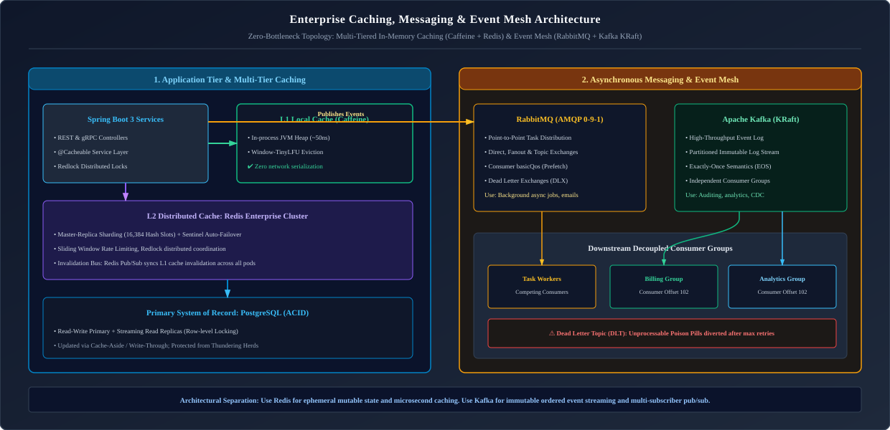

*D2 Source: [`01_caching_messaging_mesh_architecture.d2`](assets/08_caching_redis_and_kafka/01_caching_messaging_mesh_architecture.d2)*

---

## Table of Contents
1. [Foundations of Caching: Hardware Hierarchy & Mental Models](#1-foundations-of-caching-hardware-hierarchy--mental-models)
   - [1.1 The Latency Numbers Every Backend Engineer Must Know](#11-the-latency-numbers-every-backend-engineer-must-know)
   - [1.2 Local In-Memory Caches (Caffeine) vs Distributed Caches (Redis)](#12-local-in-memory-caches-caffeine-vs-distributed-caches-redis)
   - [1.3 Multi-Tier Hybrid Caching (L1 Caffeine + L2 Redis)](#13-multi-tier-hybrid-caching-l1-caffeine--l2-redis)
   - [1.4 Enterprise Caching Patterns (Cache-Aside, Read-Through, Write-Through, Write-Behind)](#14-enterprise-caching-patterns-cache-aside-read-through-write-through-write-behind)
   - [1.5 Cache Eviction Algorithms: LRU, LFU, FIFO, and Approximated LRU](#15-cache-eviction-algorithms-lru-lfu-fifo-and-approximated-lru)
   - [1.6 Production Cache Hazards & Defenses (Stampede, Penetration, Avalanche)](#16-production-cache-hazards--defenses-stampede-penetration-avalanche)
2. [Redis Architecture, Data Structures & Distributed Locking](#2-redis-architecture-data-structures--distributed-locking)
   - [2.1 Why Redis is Blazing Fast (Single-Threaded Reactor & I/O Multiplexing)](#21-why-redis-is-blazing-fast-single-threaded-reactor--io-multiplexing)
   - [2.2 Persistence Mechanics: RDB Snapshots vs AOF Append-Only File](#22-persistence-mechanics-rdb-snapshots-vs-aof-append-only-file)
   - [2.3 High-Availability Topologies: Standalone, Sentinel & Clustered (16,384 Hash Slots)](#23-high-availability-topologies-standalone-sentinel--clustered-16384-hash-slots)
   - [2.4 Core Data Structures & Production Use Cases](#24-core-data-structures--production-use-cases)
   - [2.5 Distributed Rate Limiting via Sliding Window Sorted Sets](#25-distributed-rate-limiting-via-sliding-window-sorted-sets)
   - [2.6 Distributed Locking in Redis: The SET NX PX Dilemma & Atomic Lua Scripting](#26-distributed-locking-in-redis-the-set-nx-px-dilemma--atomic-lua-scripting)
   - [2.7 The Redlock Algorithm for Multi-Master Fault Tolerance & The Redisson Watchdog](#27-the-redlock-algorithm-for-multi-master-fault-tolerance--the-redisson-watchdog)
   - [2.8 Spring Cache Abstraction (`@Cacheable`, `@CachePut`, `@CacheEvict`) & Production Redis Configuration](#28-spring-cache-abstraction-cacheable-cacheput-cacheevict--production-redis-configuration)
   - [2.9 Redis CLI (`redis-cli`) Production Diagnostic Cheatsheet](#29-redis-cli-redis-cli-production-diagnostic-cheatsheet)
3. [Messaging Reliability & Event-Driven Fundamentals](#3-messaging-reliability--event-driven-fundamentals)
   - [3.1 Point-to-Point Queues vs Publish-Subscribe (Pub/Sub) Topics](#31-point-to-point-queues-vs-publish-subscribe-pubsub-topics)
   - [3.2 Push vs Pull Consumer Models & Backpressure](#32-push-vs-pull-consumer-models--backpressure)
   - [3.3 Delivery Guarantees: At-Most-Once, At-Least-Once, and Exactly-Once](#33-delivery-guarantees-at-most-once-at-least-once-and-exactly-once)
   - [3.4 Acknowledgements (ACK/NACK), Dead Letter Queues (DLQ) & Poison Message Quarantine](#34-acknowledgements-acknack-dead-letter-queues-dlq--poison-message-quarantine)
   - [3.5 The Idempotent Consumer Pattern: Deduplication Stores](#35-the-idempotent-consumer-pattern-deduplication-stores)
4. [RabbitMQ & The AMQP 0-9-1 Protocol](#4-rabbitmq--the-amqp-0-9-1-protocol)
   - [4.1 AMQP Broker Model: Exchanges, Queues, and Bindings](#41-amqp-broker-model-exchanges-queues-and-bindings)
   - [4.2 The 4 Exchange Routing Topologies (Direct, Fanout, Topic, Headers)](#42-the-4-exchange-routing-topologies-direct-fanout-topic-headers)
   - [4.3 Prefetch Counts (`basicQos`), Consumer Acknowledgements & Flow Control](#43-prefetch-counts-basicqos-consumer-acknowledgements--flow-control)
   - [4.4 Complete Spring AMQP & RabbitListener Production Implementation](#44-complete-spring-amqp--rabbitlistener-production-implementation)
5. [Apache Kafka: High-Throughput Distributed Event Streaming](#5-apache-kafka-high-throughput-distributed-event-streaming)
   - [5.1 Why Kafka Scales: The Distributed Append-Only Commit Log & Zero-Copy](#51-why-kafka-scales-the-distributed-append-only-commit-log--zero-copy)
   - [5.2 Cluster Architecture: Brokers, Topics, Partitions, and KRaft Metadata](#52-cluster-architecture-brokers-topics-partitions-and-kraft-metadata)
   - [5.3 Producer Internals: Partitioning Strategies, Batching & `acks=all`](#53-producer-internals-partitioning-strategies-batching--acksall)
   - [5.4 High Availability: In-Sync Replicas (ISR) & Leader Election](#54-high-availability-in-sync-replicas-isr--leader-election)
   - [5.5 Consumer Groups & Partition Rebalancing (Eager vs Cooperative Sticky)](#55-consumer-groups--partition-rebalancing-eager-vs-cooperative-sticky)
   - [5.6 Exactly-Once Semantics (EOS): Idempotent Producers & Kafka Transactions](#56-exactly-once-semantics-eos-idempotent-producers--kafka-transactions)
   - [5.7 Production Spring Boot Kafka: Concurrent Listeners & Non-Blocking Retry Topics](#57-production-spring-boot-kafka-concurrent-listeners--non-blocking-retry-topics)
   - [5.8 Kafka Streams: Stream-Table Duality (`KStream`, `KTable`) & Windowing](#58-kafka-streams-stream-table-duality-kstream-ktable--windowing)
   - [5.9 Production Kafka CLI Diagnostic Playbook](#59-production-kafka-cli-diagnostic-playbook)
6. [Production Troubleshooting Playbook](#6-production-troubleshooting-playbook)
7. [Summary Comparison & Production Engineering Reference Matrix](#7-summary-comparison--production-engineering-reference-matrix)
8. [References & Further Reading](#8-references--further-reading)
---

# 1. Foundations of Caching: Hardware Hierarchy & Mental Models

> [!NOTE]
> **Domain Framing: Application Messaging vs. Lakehouse Streaming Ingestion:**
> In Java backend microservices, Redis and Apache Kafka provide asynchronous inter-service communication, distributed locking (Redisson), outbox event publishing, and saga choreography.
>
> For high-throughput analytics, event-time streaming with watermarks, stream-to-lakehouse persistence (Kafka to Delta Lake / Apache Iceberg), and Apache Spark Structured Streaming, see:
> - [Data Engineering: 07. Streaming, Kafka & Event-Driven Systems](../Data%20and%20AI%20Engineering/07_streaming_kafka_and_event_driven_data.md)

---

### 1.1 The Latency Numbers Every Backend Engineer Must Know

Software performance is fundamentally bound by the physical latency of computer memory and networking hardware:

| Operation | Typical Latency | Scaled Comparison (Human Scale: 1 cycle = 1 sec) |
| :--- | :--- | :--- |
| **L1 CPU Cache Hit** | $\sim 0.5\text{ ns}$ | 1 second |
| **L2 CPU Cache Hit** | $\sim 7\text{ ns}$ | 14 seconds |
| **Main RAM Access** | $\sim 100\text{ ns}$ | 3.3 minutes |
| **Redis Distributed Cache Hit (LAN)** | $\sim 500\text{ µs}$ ($0.5\text{ ms}$) | **11.5 days!** |
| **NVMe SSD Random Read** | $\sim 16\text{ µs}$ | 8.8 hours |
| **PostgreSQL Disk Query (Indexed)** | $\sim 5\text{ ms}$ | **4 months!** |
| **Cross-Country WAN Round-Trip** | $\sim 150\text{ ms}$ | **9.5 years!** |

> [!NOTE]
> **The Caching Law**: Reading an entity from local CPU RAM takes $\sim 100\text{ ns}$. Reading that same record from a PostgreSQL database over a network socket takes $\sim 5,000,000\text{ ns}$ ($5\text{ ms}$) $\to$ **a $50,000\times$ latency difference**! Caching is the primary architectural lever for sustaining sub-10ms response times under heavy user concurrency.

---

### 1.2 Local In-Memory Caches (Caffeine) vs Distributed Caches (Redis)

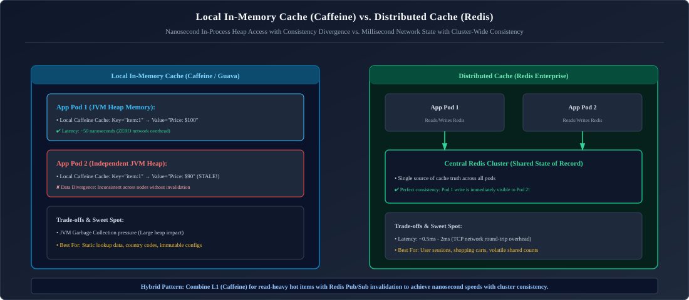

*D2 Source: [`02_local_vs_distributed_cache.d2`](assets/08_caching_redis_and_kafka/02_local_vs_distributed_cache.d2)*

* **Local Cache (Caffeine)**: Stored directly in JVM heap RAM. Ideal for static, immutable reference data (e.g., country codes, tax rates) that rarely change.
* **Distributed Cache (Redis)**: Hosted as a separate stateful cluster. Ideal for session state, high-velocity transactional domain entities, distributed rate limiters, and distributed locks.

---

### 1.3 Multi-Tier Hybrid Caching (L1 Caffeine + L2 Redis)

In ultra-high-throughput systems, combining L1 (local JVM Caffeine cache) with L2 (distributed Redis) provides the ultimate balance of microsecond latency and cluster-wide consistency:

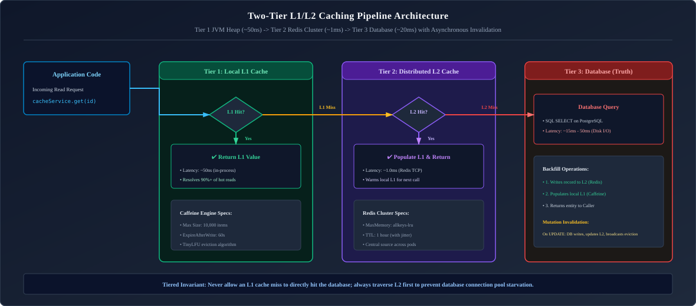

*D2 Source: [`03_two_tier_l1_l2_caching_hierarchy.d2`](assets/08_caching_redis_and_kafka/03_two_tier_l1_l2_caching_hierarchy.d2)*

#### The L1 Invalidation Problem:
When Pod A mutates a database entity, it updates Redis (L2). However, Pod B, Pod C, and Pod D still have the stale version in their local JVM heap (L1).
* **The Solution: Redis Pub/Sub Cache Invalidation Bus**: Whenever any node performs a write or eviction, it publishes an invalidation event to a Redis Pub/Sub topic. Every other pod listening on that topic instantly purges the corresponding key from its local Caffeine cache.

#### Production Implementation: Two-Tier Cache with Redis Invalidation Topic

```java
package com.enterprise.cache.twotier;

import com.github.benmanes.caffeine.cache.Caffeine;
import org.slf4j.Logger;
import org.slf4j.LoggerFactory;
import org.springframework.cache.Cache;
import org.springframework.cache.support.AbstractValueAdaptingCache;
import org.springframework.data.redis.core.RedisTemplate;

import java.io.Serializable;
import java.time.Duration;
import java.util.concurrent.Callable;

public class TwoTierCache extends AbstractValueAdaptingCache {

    private static final Logger log = LoggerFactory.getLogger(TwoTierCache.class);

    private final String name;
    private final com.github.benmanes.caffeine.cache.Cache<Object, Object> l1Cache;
    private final RedisTemplate<String, Object> redisTemplate;
    private final Duration l2Ttl;
    private final String topicName;

    public TwoTierCache(String name,
                        Duration l1Ttl,
                        long l1MaxSize,
                        RedisTemplate<String, Object> redisTemplate,
                        Duration l2Ttl,
                        String topicName) {
        super(true); // Allow caching null values
        this.name = name;
        this.redisTemplate = redisTemplate;
        this.l2Ttl = l2Ttl;
        this.topicName = topicName;
        this.l1Cache = Caffeine.newBuilder()
                .expireAfterWrite(l1Ttl)
                .maximumSize(l1MaxSize)
                .recordStats()
                .build();
    }

    @Override
    public String getName() {
        return this.name;
    }

    @Override
    public Object getNativeCache() {
        return this;
    }

    @Override
    protected Object lookup(Object key) {
        // 1. Check L1 local JVM heap cache (~50 ns)
        Object value = l1Cache.getIfPresent(key);
        if (value != null) {
            log.trace("L1 Cache HIT for key: {}", key);
            return value;
        }

        // 2. Check L2 distributed Redis cache (~0.5 ms)
        String redisKey = buildRedisKey(key);
        value = redisTemplate.opsForValue().get(redisKey);
        if (value != null) {
            log.trace("L2 Cache HIT for key: {}. Backfilling L1.", key);
            l1Cache.put(key, value);
            return value;
        }

        log.trace("L1 and L2 Cache MISS for key: {}", key);
        return null;
    }

    @Override
    @SuppressWarnings("unchecked")
    public <T> T get(Object key, Callable<T> valueLoader) {
        Object value = lookup(key);
        if (value != null) {
            return (T) fromStoreValue(value);
        }

        // Synchronize on key to prevent cache stampede per JVM pod
        synchronized (this) {
            value = lookup(key);
            if (value != null) {
                return (T) fromStoreValue(value);
            }
            try {
                T loaded = valueLoader.call();
                put(key, loaded);
                return loaded;
            } catch (Exception e) {
                throw new ValueRetrievalException(key, valueLoader, e);
            }
        }
    }

    @Override
    public void put(Object key, Object value) {
        Object storeValue = toStoreValue(value);
        // Write to L2 Redis first with TTL
        String redisKey = buildRedisKey(key);
        redisTemplate.opsForValue().set(redisKey, storeValue, l2Ttl);

        // Populate local L1
        l1Cache.put(key, storeValue);

        // Broadcast invalidation message to peer nodes via Redis Pub/Sub
        publishInvalidation(new CacheInvalidationMessage(this.name, key.toString()));
    }

    @Override
    public void evict(Object key) {
        // Evict from L2
        redisTemplate.delete(buildRedisKey(key));
        // Evict from local L1
        l1Cache.invalidate(key);
        // Publish invalidation event so all other pods evict from their local L1
        publishInvalidation(new CacheInvalidationMessage(this.name, key.toString()));
    }

    @Override
    public void clear() {
        l1Cache.invalidateAll();
        // Clear all keys matching cache prefix in Redis
        var keys = redisTemplate.keys(this.name + ":*");
        if (keys != null && !keys.isEmpty()) {
            redisTemplate.delete(keys);
        }
        publishInvalidation(new CacheInvalidationMessage(this.name, "*"));
    }

    // Called exclusively by Redis Pub/Sub listener when a peer pod sends invalidation
    public void evictLocalOnly(Object key) {
        if ("*".equals(key)) {
            l1Cache.invalidateAll();
            log.debug("Purged all L1 entries for cache: {}", this.name);
        } else {
            l1Cache.invalidate(key);
            log.debug("Invalidated L1 key: {} for cache: {}", key, this.name);
        }
    }

    private void publishInvalidation(CacheInvalidationMessage message) {
        redisTemplate.convertAndSend(this.topicName, message);
    }

    private String buildRedisKey(Object key) {
        return this.name + ":" + key.toString();
    }

    public record CacheInvalidationMessage(String cacheName, String key) implements Serializable {}
}
```

---

### 1.4 Enterprise Caching Patterns (Cache-Aside, Read-Through, Write-Through, Write-Behind)

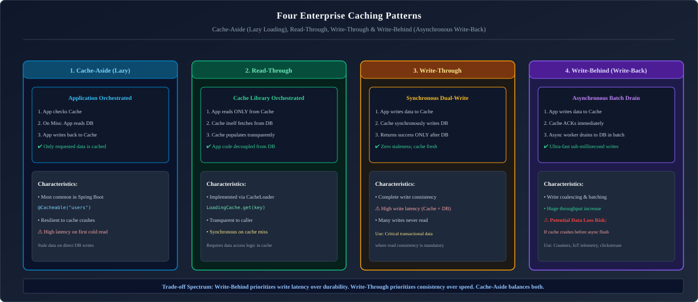

*D2 Source: [`04_enterprise_caching_patterns.d2`](assets/08_caching_redis_and_kafka/04_enterprise_caching_patterns.d2)*

1. **Cache-Aside (Lazy Loading - Most Common)**:
   * The application code is responsible for checking the cache first.
   * If a cache hit occurs, it returns cached data immediately.
   * If a cache miss occurs, the application queries the database, writes the result to the cache, and returns.
   * *Advantage*: The cache holds only data that is actually requested; resilient to cache node restarts.
2. **Read-Through**:
   * The application treats the cache as the primary data store. The cache itself fetches missing data from the database and populates itself transparently.
3. **Write-Through**:
   * When data is updated, the application writes to the cache. The cache synchronously writes the updated record to the database before confirming success.
   * *Advantage*: High data consistency between cache and DB; no stale data.
   * *Drawback*: Higher write latency.
4. **Write-Behind (Write-Back)**:
   * The application writes directly to the cache, which acknowledges success immediately. The cache asynchronously batches updates and flushes them to the database.
   * *Advantage*: Ultra-fast write performance; absorbs heavy write spikes.
   * *Hazard*: Risk of permanent data loss if the cache server crashes before flushing uncommitted dirty writes to disk!

---

### 1.5 Cache Eviction Algorithms: LRU, LFU, FIFO, and Approximated LRU

When cache RAM is exhausted, an eviction policy decides which keys must be discarded:

* **LRU (Least Recently Used)**: Discards the key that has not been accessed for the longest duration.
* **LFU (Least Frequently Used)**: Discards the key with the lowest total access frequency counter.
* **FIFO (First-In, First-Out)**: Discards the oldest key regardless of how frequently it is accessed.
* **Redis Approximated LRU**: To avoid the memory overhead of maintaining a linked list of all keys, Redis does not implement exact LRU. Instead, it samples $N$ random keys (default: 5) and evicts the least recently used key among that sample, delivering nearly identical precision with zero list pointer memory overhead!

---

### 1.6 Production Cache Hazards & Defenses (Stampede, Penetration, Avalanche)

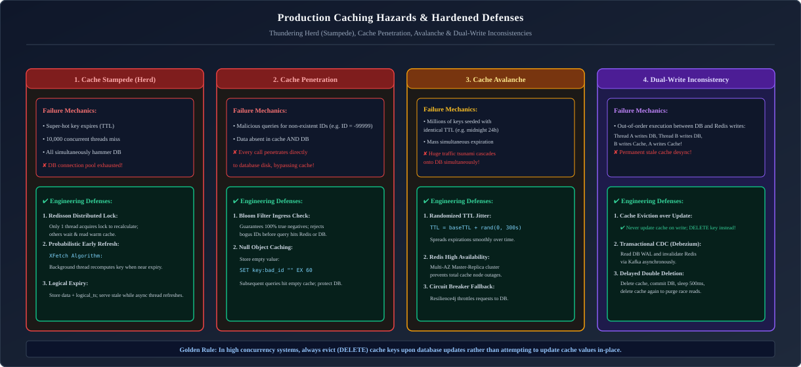

*D2 Source: [`05_cache_hazards_and_defenses.d2`](assets/08_caching_redis_and_kafka/05_cache_hazards_and_defenses.d2)*

#### Hazard 1: Cache Penetration & Defense with Redisson Bloom Filter
When an attacker requests random IDs that do not exist in the database (e.g. `/api/v1/users/-9999999`), every request misses the cache and directly pounds the relational database.
* **Defense A: Null Object Pattern**: Store an explicit empty value with a short TTL (e.g., 60 seconds).
* **Defense B: Distributed Bloom Filter (Redisson)**: A space-efficient probabilistic data structure that guarantees:
  * If the Bloom filter says **"Does NOT exist"**, the record **definitely does not exist** $\to$ reject immediately without querying cache or DB!
  * If the Bloom filter says **"Exists"**, it is likely to exist (with a configurable false positive probability, e.g., 1%).

```java
package com.enterprise.cache.bloom;

import org.redisson.api.RBloomFilter;
import org.redisson.api.RedissonClient;
import org.springframework.stereotype.Service;

import jakarta.annotation.PostConstruct;

@Service
public class UserQueryService {

    private final RedissonClient redissonClient;
    private final UserRepository userRepository;
    private RBloomFilter<String> userBloomFilter;

    public UserQueryService(RedissonClient redissonClient, UserRepository userRepository) {
        this.redissonClient = redissonClient;
        this.userRepository = userRepository;
    }

    @PostConstruct
    public void initBloomFilter() {
        userBloomFilter = redissonClient.getBloomFilter("bloom:users");
        // Initialize: expected 10 million users, 1% false positive probability
        userBloomFilter.tryInit(10_000_000L, 0.01);
    }

    public UserDto getUserById(String userId) {
        // 1. Ingress Bloom Filter check (~100 microseconds)
        if (!userBloomFilter.contains(userId)) {
            // Definitively not in the database; short-circuit!
            return null;
        }

        // 2. Query Cache or Fallback to DB
        return userRepository.findCachedById(userId);
    }

    public void registerNewUser(User user) {
        userRepository.save(user);
        // Add new user ID to Bloom filter
        userBloomFilter.add(user.getId());
    }
}
```

#### Hazard 2: Cache Stampede (Thundering Herd) & Probabilistic Early Expiration (XFetch)
When a heavily accessed key expires, thousands of concurrent threads experience a cache miss at the exact same millisecond and concurrently fire identical heavy queries to the database.

##### The XFetch Algorithm:
Instead of waiting for the key to expire, readers probabilistically refresh the cache in the background **before** expiration. The closer the key is to its expiration time, and the more expensive the database query computation, the higher the probability that a reader will refresh it:

$$\text{Should Refresh if: } -\beta \cdot \delta \cdot \ln(\text{rand}()) > (\text{TTL} - \text{now})$$

Where:
* $\delta$ = computation time to recompute the value from the database (in milliseconds).
* $\beta > 0$ = aggressive refresh factor (typically 1.0).
* $\text{rand}()$ = uniform random number $\in (0, 1]$.
* $\text{TTL} - \text{now}$ = remaining time-to-live of the cached key.

```java
package com.enterprise.cache.xfetch;

import org.springframework.data.redis.core.StringRedisTemplate;
import org.springframework.stereotype.Service;

import java.time.Instant;
import java.util.concurrent.ExecutorService;
import java.util.concurrent.Executors;
import java.util.concurrent.ThreadLocalRandom;
import java.util.function.Supplier;

@Service
public class XFetchCacheService {

    private final StringRedisTemplate redisTemplate;
    private final ExecutorService backgroundRefresher = Executors.newVirtualThreadPerTaskExecutor();

    public XFetchCacheService(StringRedisTemplate redisTemplate) {
        this.redisTemplate = redisTemplate;
    }

    public record CacheEnvelope<T>(T value, long expireAtEpochMs, long computationTimeMs) {}

    public <T> T getOrRefresh(String key,
                              long ttlSeconds,
                              double beta,
                              Supplier<T> dbLoader) {
        // 1. Retrieve envelope containing value, expiration timestamp, and last computation duration
        CacheEnvelope<T> envelope = fetchEnvelope(key);

        long now = Instant.now().toEpochMilli();
        if (envelope == null) {
            // Hard miss: compute synchronously
            return computeAndSave(key, ttlSeconds, dbLoader);
        }

        // 2. Evaluate XFetch Probabilistic Formula
        long delta = envelope.computationTimeMs();
        long remainingTtlMs = envelope.expireAtEpochMs() - now;
        double rand = ThreadLocalRandom.current().nextDouble();
        double xfetchValue = -beta * delta * Math.log(rand);

        if (xfetchValue > remainingTtlMs) {
            // Asynchronously refresh before key actually expires!
            backgroundRefresher.submit(() -> computeAndSave(key, ttlSeconds, dbLoader));
        }

        return envelope.value();
    }

    private <T> T computeAndSave(String key, long ttlSeconds, Supplier<T> dbLoader) {
        long start = System.currentTimeMillis();
        T result = dbLoader.get();
        long computationTime = System.currentTimeMillis() - start;

        long expireAt = Instant.now().toEpochMilli() + (ttlSeconds * 1000);
        CacheEnvelope<T> envelope = new CacheEnvelope<>(result, expireAt, computationTime);
        saveEnvelope(key, envelope, ttlSeconds);
        return result;
    }

    // Envelope serialization / deserialization omitted for brevity
    private <T> CacheEnvelope<T> fetchEnvelope(String key) { /* Redis GET & deserialize */ return null; }
    private <T> void saveEnvelope(String key, CacheEnvelope<T> envelope, long ttlSeconds) { /* Redis SETEX */ }
}
```

---

# 2. Redis Architecture, Data Structures & Distributed Locking

---

### 2.1 Why Redis is Blazing Fast (Single-Threaded Reactor & I/O Multiplexing)

Redis is an in-memory key-value data structure store capable of exceeding **100,000 operations per second per CPU core**.

#### The 3 Architectural Pillars of Redis Speed:
1. **Pure In-Memory Storage**: All data structures reside entirely in physical RAM. Reading and mutating records avoids disk I/O and OS page faults.
2. **Non-Blocking I/O Multiplexing (Reactor Pattern)**: Backed by the OS kernel `epoll` / `kqueue` notification engine. A single execution loop monitors thousands of socket connections simultaneously.
3. **Single-Threaded Core Command Execution**:
   * *Why single-threaded is an advantage*: It completely eliminates multi-threaded race conditions, CPU thread context-switching overhead, and mutex lock contention! Every operation is inherently atomic.

---

### 2.2 Persistence Mechanics: RDB Snapshots vs AOF Append-Only File

Although primarily an in-memory store, Redis provides two distinct durability options:

| Dimension | RDB (Redis Database Snapshots) | AOF (Append-Only File) |
| :--- | :--- | :--- |
| **Mechanism** | Point-in-time binary snapshot of entire memory space written to `dump.rdb`. Uses Linux `fork()` Copy-on-Write (CoW). | Sequential log of every write command appended to `appendonly.aof`. |
| **Data Loss Risk** | Higher: Loses all writes since the last snapshot (e.g. up to 5 minutes of data). | **Very Low**: Configurable `fsync` (`always`, `everysec`, `no`). At most 1 second of loss with `everysec`. |
| **Recovery Speed** | **Extremely Fast**: Restoring a 10 GB binary RDB file takes seconds. | Slower: Must replay millions of SQL-like commands from the log. |
| **File Size** | Highly compressed and compact. | Larger; requires periodic background rewriting (`BGREWRITEAOF`). |
| **Production Recommendation** | Enable **both**: RDB for fast cold-start disaster recovery; AOF with `appendfsync everysec` for minimal data loss. |

---

### 2.3 High-Availability Topologies: Standalone, Sentinel & Clustered (16,384 Hash Slots)

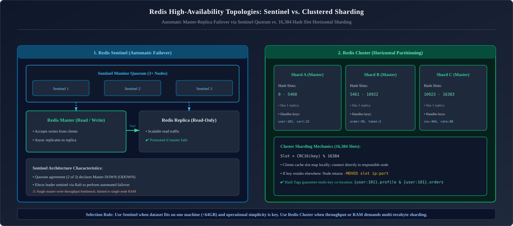

*D2 Source: [`06_redis_ha_topologies.d2`](assets/08_caching_redis_and_kafka/06_redis_ha_topologies.d2)*

* **Redis Sentinel**: Provides high availability without data sharding. 3 or more Sentinel nodes monitor the Master via heartbeats. If the Master goes down, Sentinels reach a quorum and elect a Replica to become the new Master automatically.
* **Redis Cluster**: Provides **horizontal data partitioning across nodes**:
  * Divides the entire keyspace into exactly **16,384 Hash Slots**.
  * Determines a key's slot using:
    $$\text{Slot} = \text{CRC16}(\text{key}) \pmod{16384}$$
  * If a client connects to Node A and queries a key belonging to Node B, Node A returns a `MOVED <slot> <ip:port>` response directing the client to the correct node.

---

### 2.4 Core Data Structures & Production Use Cases

#### Redis In-Memory Data Models & Object Encoding Architecture
Redis is not merely a key-value cache; it is a **data structure server**. Under the hood, every Redis key points to a generic `redisObject` header structure that tracks the object type (`type`), encoding implementation (`encoding`), and least recently used eviction metadata (`lru`). Understanding these underlying encodings allows engineers to optimize memory density by orders of magnitude:

1. **Strings (`REDIS_STRING`):**
   - **Internal Encodings:** Encoded as **`int`** (for integer values stored as 64-bit numbers to enable atomic `INCR`/`DECR`), **`embstr`** (raw memory buffer allocated contiguously with the `redisObject` header for strings $\le 44$ bytes to maximize CPU cache locality), or **`raw`** (dynamically resizable Simple Dynamic String `sds` for strings $> 44$ bytes).
   - **Use Case:** Session token caching, idempotency locks, atomic counters, and full JSON payload cache entries.

2. **Hashes (`REDIS_HASH`):**
   - **Internal Encodings:** Encoded as a memory-compact contiguous **`listpack`** when holding small numbers of short fields (zero pointer overhead), dynamically upgrading to a full **`hashtable`** with MurmurHash and incremental rehashing when thresholds are breached.
   - **Use Case:** Storing entity attributes without serializing/deserializing entire JSON blobs on partial updates.

3. **Lists (`REDIS_LIST`):**
   - **Internal Encodings:** Implemented via **`quicklist`**, a doubly-linked list of contiguous memory chunks (`listpacks`), balancing low insertion costs with CPU cache efficiency.
   - **Use Case:** High-throughput job queues (`LPUSH` / `BRPOP`), audit event buffers.

4. **Sorted Sets (`REDIS_ZSET`):**
   - **Internal Encodings:** Dual-index architecture combining a **SkipList** (ordered by floating-point score for $O(\log N)$ range queries) and a **HashTable** (mapping member strings to scores for $O(1)$ lookups).
   - **Use Case:** Sliding-window rate limiters, priority queues, and real-time leaderboards.

| Data Structure | Description | Time Complexity | Enterprise Production Scenario |
| :--- | :--- | :---: | :--- |
| **String** | Binary-safe strings, integers, raw byte arrays (Max 512 MB). | $O(1)$ | Session token storage, atomic counters (`INCR`), payload caching. |
| **Hash** | Field-value pairs representing an object. | $O(1)$ per field | User profile records (`HSET user:101 name "Alice" role "ADMIN"`). |
| **List** | Linked list of strings ordered by insertion. | $O(1)$ head/tail | Task queues (`LPUSH` / `BRPOP`), activity feeds. |
| **Set** | Unordered collection of unique strings. | $O(1)$ add/remove | Unique visitor tracking, tag associations, set intersection (`SINTER`). |
| **Sorted Set (ZSet)**| Unique strings mapped to a floating-point score. | $O(\log N)$ | Real-time gaming leaderboards, **sliding window rate limiters**. |
| **Stream** | Append-only log with consumer group offsets. | $O(1)$ append | Lightweight event streaming, audit trails. |
| **HyperLogLog** | Probabilistic data structure for estimating cardinality. | $O(1)$ | Counting unique daily active users (DAU) across millions with only 12 KB RAM! |

---

### 2.5 Distributed Rate Limiting via Sliding Window Sorted Sets

Implementing a strict 60-second sliding window rate limiter using Redis Sorted Sets:

```lua
-- KEYS[1]: Rate limit key (e.g. rate_limit:user:101)
-- ARGV[1]: Current Unix epoch timestamp in milliseconds
-- ARGV[2]: Window size in milliseconds (e.g. 60000 for 1 minute)
-- ARGV[3]: Maximum permitted requests (e.g. 100)

local current_time = tonumber(ARGV[1])
local window_start = current_time - tonumber(ARGV[2])
local max_limit = tonumber(ARGV[3])

-- 1. Remove all entries older than the sliding window start
redis.call('ZREMRANGEBYSCORE', KEYS[1], 0, window_start)

-- 2. Count remaining requests in the active window
local request_count = redis.call('ZCARD', KEYS[1])

if request_count < max_limit then
    -- Add current request timestamp (using current_time as both score and member)
    redis.call('ZADD', KEYS[1], current_time, current_time .. ":" .. math.random(1000, 9999))
    redis.call('PEXPIRE', KEYS[1], ARGV[2])
    return 1 -- Allowed
else
    return 0 -- Rejected (Rate limit exceeded)
end
```

---

### 2.6 Distributed Locking in Redis: The SET NX PX Dilemma & Atomic Lua Scripting

In distributed microservices, coordinating exclusive access to a resource across multiple pods requires a **Distributed Lock**:

#### The Flawed Anti-Pattern:
```bash
SETNX lock:order:101 "locked"  # If server crashes right here, lock is NEVER freed!
EXPIRE lock:order:101 30       # Permanent Deadlock!
```

#### The Production Standard: Atomic Single-Command Acquisition
Acquire the lock and set expiration atomically in a single instruction:
```bash
SET lock:order:101 "unique_uuid_token" NX PX 30000
```
* `NX`: Only set if key does not exist.
* `PX 30000`: Expire in 30,000 milliseconds (automatic safety-net release).
* `"unique_uuid_token"`: A unique random identifier generated per acquisition attempt.

#### The Lock Release Trap:
If Service A acquires a lock with a 30s TTL, but an unexpected GC pause causes the service to hang for 35 seconds, the lock expires automatically. Service B now acquires the lock. When Service A wakes up, executing `DEL lock:order:101` **deletes Service B's valid lock!**

#### The Remedy: Atomic Release via Lua Script
A Lua script executes atomically on the single Redis thread. It verifies the stored value matches the caller's unique UUID token before deleting:

```lua
-- Atomic Lock Release Lua Script
if redis.call("get", KEYS[1]) == ARGV[1] then
    return redis.call("del", KEYS[1])
else
    return 0
end
```

#### Production Spring Boot Distributed Lock Service:
```java
package com.enterprise.cache;

import org.springframework.data.redis.core.StringRedisTemplate;
import org.springframework.data.redis.core.script.DefaultRedisScript;
import org.springframework.stereotype.Service;

import java.time.Duration;
import java.util.Collections;
import java.util.UUID;

@Service
public class RedisDistributedLockService {

    private final StringRedisTemplate redisTemplate;
    private static final String UNLOCK_LUA_SCRIPT =
        "if redis.call('get', KEYS[1]) == ARGV[1] then " +
        "    return redis.call('del', KEYS[1]) " +
        "else " +
        "    return 0 " +
        "end";

    public RedisDistributedLockService(StringRedisTemplate redisTemplate) {
        this.redisTemplate = redisTemplate;
    }

    public boolean executeWithLock(String lockKey, Duration timeout, Runnable task) {
        String uniqueToken = UUID.randomUUID().toString();
        Boolean acquired = redisTemplate.opsForValue()
                .setIfAbsent(lockKey, uniqueToken, timeout);

        if (Boolean.TRUE.equals(acquired)) {
            try {
                task.run();
                return true;
            } finally {
                // Atomic release via Lua Script
                redisTemplate.execute(
                    new DefaultRedisScript<>(UNLOCK_LUA_SCRIPT, Long.class),
                    Collections.singletonList(lockKey),
                    uniqueToken
                );
            }
        }
        return false; // Could not acquire lock
    }
}
```

---

### 2.7 The Redlock Algorithm for Multi-Master Fault Tolerance & The Redisson Watchdog

#### The Master-Replica Failover Flaw:
When running a traditional Redis Master-Replica architecture, replication across nodes is strictly **asynchronous**:
1. Client A sends `SET lock:account:42 "uuid-A" NX PX 30000` to the Master. The Master commits to RAM and responds `OK`.
2. Before the master's replication buffer is flushed to the Replica, the Master suffers an abrupt hardware power failure!
3. Redis Sentinel or Cluster promotes the Replica to the new Master.
4. Client B attempts to acquire the lock: `SET lock:account:42 "uuid-B" NX PX 30000`. Because the new Master never received Client A's write, it grants the lock to Client B!
5. **Both Client A and Client B now concurrently execute the critical section**, violating the mutual exclusion invariant!

#### Redisson Distributed Lock & The Watchdog Mechanism
In production Java services, **Redisson** is the de facto standard. Redisson solves two critical problems:
1. **Reentrancy**: Redisson uses a Redis `Hash` data structure storing the client thread ID and an integer reentrancy counter.
2. **The Lease Time vs Execution Duration Dilemma (The Watchdog)**:
   * If you specify a fixed lease time (`lock.lock(10, TimeUnit.SECONDS)`), and your business logic takes 12 seconds, the lock is released prematurely!
   * If you acquire without a lease time (`lock.lock()`), Redisson enables the **Watchdog Timer**. The Watchdog acquires the lock with a default 30-second TTL. Every 10 seconds (`lockWatchdogTimeout / 3`), a background scheduled task checks if the thread holding the lock is still alive. If alive, it extends the lock TTL back to 30 seconds atomically via Lua script!
   * If the JVM crashes, the watchdog stops renewing, and Redis automatically expires the lock after 30 seconds, preventing deadlocks.

```java
package com.enterprise.cache.lock;

import org.redisson.api.RLock;
import org.redisson.api.RedissonClient;
import org.slf4j.Logger;
import org.slf4j.LoggerFactory;
import org.springframework.stereotype.Service;

import java.util.concurrent.TimeUnit;

@Service
public class InventoryLockService {

    private static final Logger log = LoggerFactory.getLogger(InventoryLockService.class);
    private final RedissonClient redissonClient;

    public InventoryLockService(RedissonClient redissonClient) {
        this.redissonClient = redissonClient;
    }

    public boolean deductStockWithLock(String sku, int quantity) {
        String lockKey = "lock:inventory:" + sku;
        RLock lock = redissonClient.getLock(lockKey);

        try {
            // Wait up to 5 seconds to acquire; hold lock with active Watchdog auto-renewal (-1)
            boolean acquired = lock.tryLock(5, -1, TimeUnit.SECONDS);
            if (!acquired) {
                log.warn("Could not acquire lock for SKU: {} within 5 seconds. System under high contention.", sku);
                return false;
            }

            log.info("Acquired distributed lock for SKU: {}. Executing deduction under Watchdog protection.", sku);
            // Critical Section: Deduct inventory from PostgreSQL
            executeStockDeduction(sku, quantity);
            return true;

        } catch (InterruptedException e) {
            Thread.currentThread().interrupt();
            throw new IllegalStateException("Thread interrupted while waiting for lock on SKU: " + sku, e);
        } finally {
            // CRITICAL: Only unlock if currently held by THIS calling thread!
            if (lock.isHeldByCurrentThread()) {
                lock.unlock();
                log.info("Released distributed lock for SKU: {}", sku);
            }
        }
    }

    private void executeStockDeduction(String sku, int quantity) {
        // Business logic...
    }
}
```

#### The Redlock Algorithm:
For safety across unsynchronized Redis instances, Salvatore Sanfilippo designed **Redlock**:
1. Run $N$ (typically 5) completely independent Redis master nodes hosted on separate physical machines or cloud availability zones (no replication between them).
2. The client records the start time $T_1$.
3. The client attempts to acquire the lock sequentially across all $N$ instances using identical key and random values, with a connection timeout much smaller than the lock validity time (e.g., 50ms timeout for a 10s lock).
4. The lock is acquired if and only if:
   * The client acquired the lock on a **majority** of nodes ($\ge \frac{N}{2} + 1 = 3$ out of 5).
   * The total elapsed time $\Delta T = T_2 - T_1$ is strictly less than the lock validity time.
5. If acquisition fails on a majority, the client immediately sends an unlock Lua script to **all** instances.

---

### 2.8 Spring Cache Abstraction (`@Cacheable`, `@CachePut`, `@CacheEvict`) & Production Redis Configuration

Spring Cache decouples caching operations from business logic using declarative AOP annotations. However, default Spring Boot Redis caching has severe production pitfalls:
1. It uses Java Native Serialization by default (vulnerable to deserialization exploits and unreadable in `redis-cli`).
2. It sets **no TTL** by default (leading to inevitable Redis OOM crashes).
3. It allows caching null values indefinitely.

#### Production Spring Boot 3 `RedisCacheConfiguration`:
```java
package com.enterprise.cache.config;

import com.fasterxml.jackson.annotation.JsonTypeInfo;
import com.fasterxml.jackson.databind.ObjectMapper;
import com.fasterxml.jackson.databind.jsontype.impl.LaissezFaireSubTypeValidator;
import com.fasterxml.jackson.datatype.jsr310.JavaTimeModule;
import org.springframework.boot.autoconfigure.cache.RedisCacheManagerBuilderCustomizer;
import org.springframework.cache.annotation.EnableCaching;
import org.springframework.context.annotation.Bean;
import org.springframework.context.annotation.Configuration;
import org.springframework.data.redis.cache.RedisCacheConfiguration;
import org.springframework.data.redis.serializer.GenericJackson2JsonRedisSerializer;
import org.springframework.data.redis.serializer.RedisSerializationContext.SerializationPair;
import org.springframework.data.redis.serializer.StringRedisSerializer;

import java.time.Duration;

@Configuration
@EnableCaching
public class EnterpriseRedisCacheConfig {

    @Bean
    public RedisCacheConfiguration defaultCacheConfiguration(ObjectMapper parentObjectMapper) {
        // Create dedicated ObjectMapper for Redis to handle Java 8 dates and polymorphic type information
        ObjectMapper redisObjectMapper = parentObjectMapper.copy();
        redisObjectMapper.registerModule(new JavaTimeModule());
        // Enables polymorphic typing so Jackson reconstructs exact DTO subclasses without ClassCastException
        redisObjectMapper.activateDefaultTyping(
                LaissezFaireSubTypeValidator.instance,
                ObjectMapper.DefaultTyping.NON_FINAL,
                JsonTypeInfo.As.PROPERTY
        );

        GenericJackson2JsonRedisSerializer serializer = new GenericJackson2JsonRedisSerializer(redisObjectMapper);

        return RedisCacheConfiguration.defaultCacheConfig()
                .entryTtl(Duration.ofMinutes(15)) // Default baseline TTL: 15 minutes
                .disableCachingNullValues()       // Prevent caching null results indefinitely
                .serializeKeysWith(SerializationPair.fromSerializer(new StringRedisSerializer()))
                .serializeValuesWith(SerializationPair.fromSerializer(serializer))
                .prefixCacheNameWith("prod:cache:"); // Namespacing prevents key collisions
    }

    @Bean
    public RedisCacheManagerBuilderCustomizer redisCacheManagerBuilderCustomizer(RedisCacheConfiguration defaultCacheConfig) {
        // Configure specific granular TTLs per cache name
        return builder -> builder
                .withCacheConfiguration("products",
                        defaultCacheConfig.entryTtl(Duration.ofHours(2)))
                .withCacheConfiguration("daily-exchange-rates",
                        defaultCacheConfig.entryTtl(Duration.ofDays(1)))
                .withCacheConfiguration("user-sessions",
                        defaultCacheConfig.entryTtl(Duration.ofMinutes(30)));
    }
}
```

#### Declarative Service Layer Usage:
```java
package com.enterprise.cache.service;

import com.enterprise.cache.dto.ProductDto;
import org.springframework.cache.annotation.CacheEvict;
import org.springframework.cache.annotation.CachePut;
import org.springframework.cache.annotation.Cacheable;
import org.springframework.cache.annotation.Caching;
import org.springframework.stereotype.Service;

@Service
public class ProductService {

    private final ProductRepository productRepository;

    public ProductService(ProductRepository productRepository) {
        this.productRepository = productRepository;
    }

    // 1. Checks cache first; executes method and caches result on cache miss
    @Cacheable(
        value = "products",
        key = "'sku:' + #sku",
        unless = "#result == null || #result.price <= 0"
    )
    public ProductDto getProductBySku(String sku) {
        return productRepository.findBySku(sku)
                .map(ProductDto::fromEntity)
                .orElse(null);
    }

    // 2. Always executes method and updates cache with the returned result
    @CachePut(value = "products", key = "'sku:' + #dto.sku")
    public ProductDto updateProduct(ProductDto dto) {
        Product updated = productRepository.save(dto.toEntity());
        return ProductDto.fromEntity(updated);
    }

    // 3. Evicts the key from the cache (e.g. after database deletion)
    @Caching(evict = {
        @CacheEvict(value = "products", key = "'sku:' + #sku"),
        @CacheEvict(value = "product-search-summaries", allEntries = true)
    })
    public void deleteProduct(String sku) {
        productRepository.deleteBySku(sku);
    }
}
```

---

### 2.9 Redis CLI (`redis-cli`) Production Diagnostic Cheatsheet

```bash

# 3. Connect to Redis with authentication

redis-cli -h redis.prod.internal -p 6379 -a "SuperSecretAuthKey"

# 4. Check cluster health and memory consumption

info memory
info replication
cluster info

# 5. Inspect slowest queries in live system (Latency analysis)

slowlog get 10

# 6. Monitor real-time memory usage of keys without blocking

redis-cli --bigkeys

# 7. Live continuous command monitoring (CAUTION: High CPU overhead in production!)

redis-cli monitor
```

---

# 3. Messaging Reliability & Event-Driven Fundamentals

---

### 3.1 Point-to-Point Queues vs Publish-Subscribe (Pub/Sub) Topics

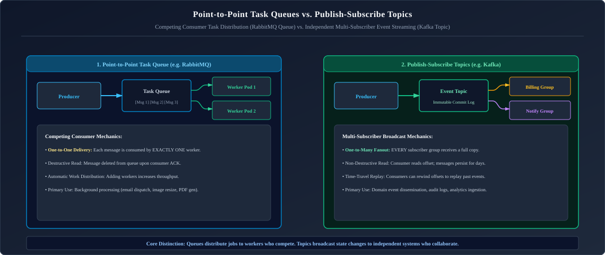

*D2 Source: [`07_point_to_point_vs_pubsub.d2`](assets/08_caching_redis_and_kafka/07_point_to_point_vs_pubsub.d2)*

---

### 3.2 Push vs Pull Consumer Models & Backpressure

* **Push Model (RabbitMQ)**: The broker proactively pushes messages to connected consumers as fast as they arrive.
  * *Hazard*: If a consumer is executing a slow computation, an aggressive push rate exhausts consumer RAM $\to$ `OutOfMemoryError`.
  * *Defense*: Enforce strict **Prefetch Counts** (`basicQos`).
* **Pull Model (Kafka)**: Consumers proactively pull/poll batches of messages (`consumer.poll(Duration.ofMillis(100))`) at their own pace.
  * *Advantage*: Built-in backpressure; consumers never get overwhelmed by upstream traffic spikes.

---

### 3.3 Delivery Guarantees: At-Most-Once, At-Least-Once, and Exactly-Once

1. **At-Most-Once**:
   * Consumer acknowledges message receipt **before** processing begins.
   * If the consumer crashes during processing, the message is permanently lost.
   * *Zero duplicates, possible message loss*.
2. **At-Least-Once (Standard Industry Baseline)**:
   * Consumer acknowledges receipt **after** successfully committing the business operation.
   * If the consumer crashes right after processing but before sending ACK, the broker redelivers the message to another consumer.
   * *Zero message loss, possible duplicate processing*.
3. **Exactly-Once Processing (End-to-End)**:
   * Achieved by combining **At-Least-Once Delivery** with an **Idempotent Consumer**.

---

### 3.4 Acknowledgements (ACK/NACK), Dead Letter Queues (DLQ) & Poison Message Quarantine

A **Poison Message** is a malformed message (e.g. corrupt JSON, invalid schema) that causes a consumer to throw an unhandled exception every time it is read.
* Without safeguards, an unhandled exception causes the broker to redeliver the message infinitely, creating an infinite retry storm that halts processing for all other messages!
* **The Defense**: Configure a **Dead Letter Queue (DLQ)** with exponential backoff retries. If a message fails 3 times, route it to the DLQ for operator triage and continue processing the main queue.

---

### 3.5 The Idempotent Consumer Pattern: Deduplication Stores

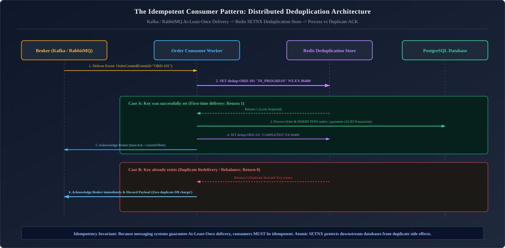

*D2 Source: [`08_idempotent_consumer_dedup_store.d2`](assets/08_caching_redis_and_kafka/08_idempotent_consumer_dedup_store.d2)*

---

# 4. RabbitMQ & The AMQP 0-9-1 Protocol

---

### 4.1 AMQP Broker Model: Exchanges, Queues, and Bindings

In RabbitMQ, producers **never publish directly to a queue**. Instead, messages are published to an **Exchange**, which inspects message attributes and routes messages into **Queues** via **Bindings**:

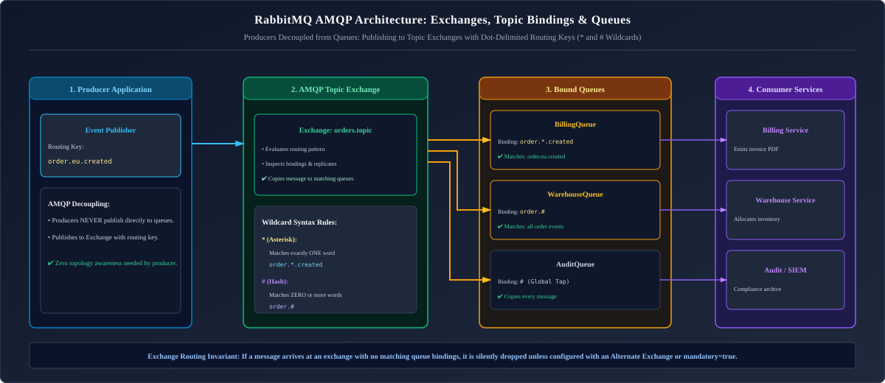

*D2 Source: [`09_rabbitmq_exchange_bindings_queues.d2`](assets/08_caching_redis_and_kafka/09_rabbitmq_exchange_bindings_queues.d2)*

---

### 4.2 The 4 Exchange Routing Topologies (Direct, Fanout, Topic, Headers)

1. **Direct Exchange**: Routes messages to queues whose binding key **exactly matches** the message routing key (e.g. routing key `sms` routes strictly to `SmsQueue`).
2. **Fanout Exchange**: Ignores routing keys entirely; broadcasts every message to **all bound queues** (classic pub/sub broadcast).
3. **Topic Exchange**: Performs wildcard pattern matching against routing keys using dot-delimited words:
   * `*` (asterisk): Matches exactly **one** word (e.g., `order.*.europe` matches `order.created.europe`).
   * `#` (hash): Matches **zero or more** words (e.g., `audit.#` matches `audit.order.created.us`).
4. **Headers Exchange**: Routes based on message header attributes instead of routing keys.

---

### 4.3 Prefetch Counts (`basicQos`), Consumer Acknowledgements & Flow Control

By default, RabbitMQ operates on an eager **Push Model**. As soon as a message is published, the broker pushes it over the TCP socket to any available active consumer.

#### The Unbounded Push Danger:
If a consumer pod takes 200 milliseconds to process a database-heavy task, and 50,000 messages arrive in a spike:
1. RabbitMQ buffers all 50,000 messages into the client's TCP socket and memory buffer.
2. The consumer JVM memory footprint balloons exponentially, leading to severe GC pauses and `OutOfMemoryError`.
3. Other newly spawned consumer pods sit completely starved with 0 messages!

#### The Engineering Solution: Channel `basicQos(prefetchCount)`:
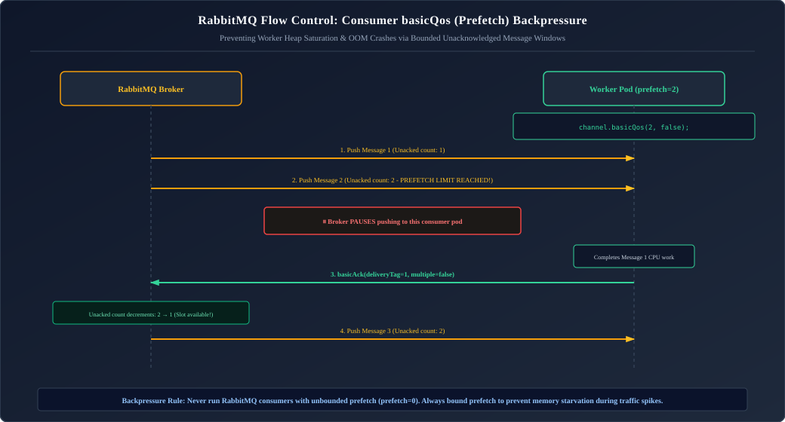

*D2 Source: [`10_rabbitmq_backpressure_prefetch_qos.d2`](assets/08_caching_redis_and_kafka/10_rabbitmq_backpressure_prefetch_qos.d2)*

#### Sizing Rule of Thumb for `prefetchCount`:
$$\text{Optimal Prefetch} = \frac{\text{Round-Trip Network Latency (RTT)} + \text{Processing Time}}{\text{Processing Time}}$$
* For fast tasks ($< 5\text{ ms}$): Set prefetch between $50 - 200$.
* For heavy, slow transactional tasks ($> 100\text{ ms}$): Set prefetch between $1 - 10$ to ensure even load balancing across pods.

---

### 4.4 Complete Spring AMQP & RabbitListener Production Implementation

A resilient production RabbitMQ configuration requires:
1. **Publisher Confirms (`ConfirmCallback`)**: Confirms that the exchange received and committed the message to disk.
2. **Returns Callback (`ReturnsCallback`)**: Catches unroutable messages if an invalid routing key is passed.
3. **Manual Acknowledgement Mode (`AcknowledgeMode.MANUAL`)**: The consumer controls exact commit or rejection semantics.
4. **Dead Letter Exchange (DLX)**: Safely isolates poisoned or exhausted payload records.

#### 1. Advanced RabbitMQ Configuration Bean:
```java
package com.enterprise.rabbitmq.config;

import org.slf4j.Logger;
import org.slf4j.LoggerFactory;
import org.springframework.amqp.core.*;
import org.springframework.amqp.rabbit.config.SimpleRabbitListenerContainerFactory;
import org.springframework.amqp.rabbit.connection.CachingConnectionFactory;
import org.springframework.amqp.rabbit.connection.ConnectionFactory;
import org.springframework.amqp.rabbit.core.RabbitTemplate;
import org.springframework.amqp.support.converter.Jackson2JsonMessageConverter;
import org.springframework.amqp.support.converter.MessageConverter;
import org.springframework.context.annotation.Bean;
import org.springframework.context.annotation.Configuration;

@Configuration
public class EnterpriseRabbitMqConfig {

    private static final Logger log = LoggerFactory.getLogger(EnterpriseRabbitMqConfig.class);

    public static final String EXCHANGE_ORDERS = "orders.direct.exchange";
    public static final String QUEUE_ORDERS_FULFILLMENT = "orders.fulfillment.queue";
    public static final String ROUTING_KEY_ORDERS = "order.fulfill";

    public static final String EXCHANGE_DLX = "orders.dlx.exchange";
    public static final String QUEUE_ORDERS_DLQ = "orders.fulfillment.dlq";
    public static final String ROUTING_KEY_DLQ = "order.fulfill.dlq";

    // 1. Declare Primary Direct Exchange & Dead Letter Exchange
    @Bean
    public DirectExchange ordersExchange() {
        return new DirectExchange(EXCHANGE_ORDERS, true, false);
    }

    @Bean
    public DirectExchange deadLetterExchange() {
        return new DirectExchange(EXCHANGE_DLX, true, false);
    }

    // 2. Declare Primary Queue with DLX arguments
    @Bean
    public Queue fulfillmentQueue() {
        return QueueBuilder.durable(QUEUE_ORDERS_FULFILLMENT)
                .deadLetterExchange(EXCHANGE_DLX)
                .deadLetterRoutingKey(ROUTING_KEY_DLQ)
                .ttl(86400000) // 24 hours message expiration
                .maxLength(500000) // Buffer ceiling
                .build();
    }

    // 3. Declare DLQ Queue
    @Bean
    public Queue deadLetterQueue() {
        return QueueBuilder.durable(QUEUE_ORDERS_DLQ).build();
    }

    // 4. Declare Bindings
    @Bean
    public Binding ordersBinding() {
        return BindingBuilder.bind(fulfillmentQueue()).to(ordersExchange()).with(ROUTING_KEY_ORDERS);
    }

    @Bean
    public Binding dlqBinding() {
        return BindingBuilder.bind(deadLetterQueue()).to(deadLetterExchange()).with(ROUTING_KEY_DLQ);
    }

    // 5. JSON Message Converter
    @Bean
    public MessageConverter jsonMessageConverter() {
        return new Jackson2JsonMessageConverter();
    }

    // 6. RabbitTemplate with Publisher Confirms and Returns
    @Bean
    public RabbitTemplate rabbitTemplate(ConnectionFactory connectionFactory, MessageConverter jsonMessageConverter) {
        RabbitTemplate template = new RabbitTemplate(connectionFactory);
        template.setMessageConverter(jsonMessageConverter);
        template.setMandatory(true); // Guarantees returned callback fires if message is unroutable

        // Publisher Confirm: Broker ACK/NACK to Publisher
        template.setConfirmCallback((correlationData, ack, cause) -> {
            if (ack) {
                log.debug("Broker acknowledged receipt of message with correlation: {}", correlationData != null ? correlationData.getId() : "null");
            } else {
                log.error("Broker REJECTED message receipt! Cause: {}. Message will be retried.", cause);
            }
        });

        // Return Callback: Message could not be routed to any queue
        template.setReturnsCallback(returned -> {
            log.error("NO ROUTE: Message [{}] was returned by broker! ReplyCode: {}, ReplyText: {}, Exchange: {}, RoutingKey: {}",
                    new String(returned.getMessage().getBody()),
                    returned.getReplyCode(),
                    returned.getReplyText(),
                    returned.getExchange(),
                    returned.getRoutingKey());
        });

        return template;
    }

    // 7. Listener Container Factory enforcing Manual ACK & Prefetch
    @Bean
    public SimpleRabbitListenerContainerFactory rabbitListenerContainerFactory(ConnectionFactory connectionFactory,
                                                                               MessageConverter jsonMessageConverter) {
        SimpleRabbitListenerContainerFactory factory = new SimpleRabbitListenerContainerFactory();
        factory.setConnectionFactory(connectionFactory);
        factory.setMessageConverter(jsonMessageConverter);
        factory.setAcknowledgeMode(AcknowledgeMode.MANUAL); // Manual ACK!
        factory.setPrefetchCount(10); // Throttle push rate to 10 in-flight messages per worker
        factory.setConcurrentConsumers(3);
        factory.setMaxConcurrentConsumers(10);
        return factory;
    }
}
```

#### 2. Manual ACK Consumer Implementation:
```java
package com.enterprise.rabbitmq.consumer;

import com.enterprise.rabbitmq.config.EnterpriseRabbitMqConfig;
import com.rabbitmq.client.Channel;
import org.slf4j.Logger;
import org.slf4j.LoggerFactory;
import org.springframework.amqp.rabbit.annotation.RabbitListener;
import org.springframework.amqp.support.AmqpHeaders;
import org.springframework.messaging.handler.annotation.Header;
import org.springframework.messaging.handler.annotation.Payload;
import org.springframework.stereotype.Component;

import java.io.IOException;

@Component
public class RobustOrderFulfillmentConsumer {

    private static final Logger log = LoggerFactory.getLogger(RobustOrderFulfillmentConsumer.class);

    public record OrderFulfillmentPayload(String orderId, String sku, int quantity) {}

    @RabbitListener(queues = EnterpriseRabbitMqConfig.QUEUE_ORDERS_FULFILLMENT)
    public void handleOrder(@Payload OrderFulfillmentPayload payload,
                            Channel channel,
                            @Header(AmqpHeaders.DELIVERY_TAG) long deliveryTag) throws IOException {
        try {
            log.info("Processing deliveryTag {} for orderId: {}", deliveryTag, payload.orderId());

            // Execute core transactional business operation
            processBusinessLogic(payload);

            // 1. Explicitly send positive ACK: single message (multiple = false)
            channel.basicAck(deliveryTag, false);
            log.debug("Successfully acknowledged message tag {}", deliveryTag);

        } catch (TransientNetworkException ex) {
            // 2. Transient error: NACK and requeue so another worker can retry immediately
            log.warn("Transient failure processing order {}. Requeuing message...", payload.orderId(), ex);
            channel.basicNack(deliveryTag, false, true); // requeue = true

        } catch (Exception ex) {
            // 3. Fatal/Business error: NACK without requeue -> Routes to Dead Letter Queue (DLQ)!
            log.error("Fatal failure processing order {}. Forwarding to Dead Letter Queue...", payload.orderId(), ex);
            channel.basicNack(deliveryTag, false, false); // requeue = false -> triggers DLX routing!
        }
    }

    private void processBusinessLogic(OrderFulfillmentPayload payload) {
        // Business processing...
    }

    public static class TransientNetworkException extends RuntimeException {
        public TransientNetworkException(String msg) { super(msg); }
    }
}
```

> [!TIP]
> **Deep-Dive Interview Scenarios:**
> - [Q1. Message Broker Services in Enterprise Java Architecture](frequently_asked_questions/08_caching_redis_and_kafka_faq.md#q1-easy-message-broker-services-in-enterprise-java-architecture)
> - [Q2. What is an Exchange in AMQP / RabbitMQ?](frequently_asked_questions/08_caching_redis_and_kafka_faq.md#q2-easy-what-is-an-exchange-in-amqp--rabbitmq)

---

# 5. Apache Kafka: High-Throughput Distributed Event Streaming

---

### 5.1 Why Kafka Scales: The Distributed Append-Only Commit Log & Zero-Copy

Traditional message brokers (RabbitMQ, ActiveMQ) maintain complex internal indexes, queues, and message acknowledgement states. As queue depth grows to millions of messages, performance degrades exponentially.

**Apache Kafka** is designed around a radically different premise:
1. **Append-Only Commit Log**: Topics are partitioned append-only disk files. Writing is purely sequential disk writes ($O(1)$), which modern SSDs and OS page caches execute at gigabytes per second.
2. **Zero-Copy Kernel Transfer (`sendfile`)**: The Kafka broker never copies message payloads into user-space Java heap memory! It uses the Linux kernel `sendfile` system call to stream bytes directly from disk cache to the network card buffer.
3. **Consumer-Tracked State**: The broker does not track which consumer received which message. Each consumer simply tracks its current integer index (**Offset**) in the log!

---

### 5.2 Cluster Architecture: Brokers, Topics, Partitions, and KRaft Metadata

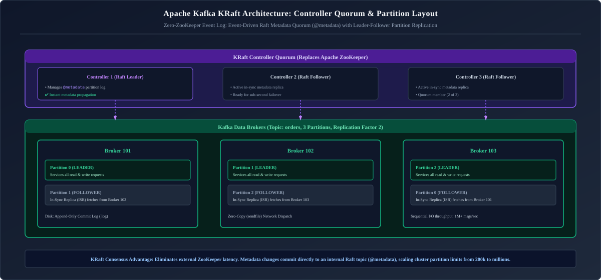

*D2 Source: [`11_kafka_cluster_kraft_architecture.d2`](assets/08_caching_redis_and_kafka/11_kafka_cluster_kraft_architecture.d2)*

* **Partitions**: A Topic is divided into multiple physical Partitions distributed across brokers. **Partitioning is the fundamental unit of parallelism and horizontal scale in Kafka**.
* **KRaft (Kafka Raft)**: Modern Kafka replaces Apache ZooKeeper with an integrated Raft consensus metadata quorum running directly inside Kafka brokers, supporting millions of partitions per cluster with sub-second metadata failovers.

---

### 5.3 Producer Internals: Partitioning Strategies, Batching & `acks=all`

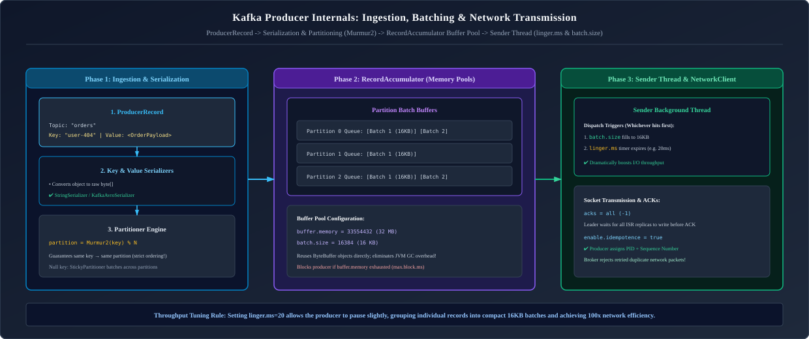

*D2 Source: [`12_kafka_producer_internals_batching.d2`](assets/08_caching_redis_and_kafka/12_kafka_producer_internals_batching.d2)*

#### Producer Acknowledgement Settings (`acks`) & Tuning Parameters:
* **`acks=0`**: Producer fires and forgets; does not wait for any broker acknowledgement. Maximum throughput; high risk of message loss.
* **`acks=1`**: Producer waits for the **Partition Leader** to write to its local log. If the leader crashes before replicating to followers, messages are lost.
* **`acks=all` (`acks=-1`)**: Producer waits for the Partition Leader **AND all In-Sync Replicas (ISR)** to commit the record to disk before acknowledging. Zero message loss guarantee!

#### Production Kafka Producer Configuration Bean:
```java
package com.enterprise.kafka.config;

import org.apache.kafka.clients.producer.ProducerConfig;
import org.apache.kafka.common.serialization.StringSerializer;
import org.springframework.context.annotation.Bean;
import org.springframework.context.annotation.Configuration;
import org.springframework.kafka.core.DefaultKafkaProducerFactory;
import org.springframework.kafka.core.KafkaTemplate;
import org.springframework.kafka.core.ProducerFactory;
import org.springframework.kafka.support.serializer.JsonSerializer;

import java.util.HashMap;
import java.util.Map;

@Configuration
public class EnterpriseKafkaProducerConfig {

    @Bean
    public ProducerFactory<String, Object> producerFactory() {
        Map<String, Object> configProps = new HashMap<>();

        // 1. Connection coordinates
        configProps.put(ProducerConfig.BOOTSTRAP_SERVERS_CONFIG, "kafka-broker-1:9092,kafka-broker-2:9092,kafka-broker-3:9092");

        // 2. Strong Durability & Idempotence Settings
        configProps.put(ProducerConfig.ACKS_CONFIG, "all");               // Wait for all ISRs to write to disk
        configProps.put(ProducerConfig.ENABLE_IDEMPOTENCE_CONFIG, "true"); // De-duplicates retries via Sequence ID
        configProps.put(ProducerConfig.RETRIES_CONFIG, Integer.MAX_VALUE); // Retry infinitely until delivery timeout
        configProps.put(ProducerConfig.MAX_IN_FLIGHT_REQUESTS_PER_CONNECTION, 5); // Safe pipelining with idempotence

        // 3. High-Throughput Batching & Compression
        configProps.put(ProducerConfig.BATCH_SIZE_CONFIG, 64 * 1024);     // 64 KB batch buffer
        configProps.put(ProducerConfig.LINGER_MS_CONFIG, 20);             // Wait up to 20ms to fill batch buffer
        configProps.put(ProducerConfig.COMPRESSION_TYPE_CONFIG, "zstd");  // High compression ratio, fast decompression
        configProps.put(ProducerConfig.BUFFER_MEMORY_CONFIG, 64 * 1024 * 1024L); // 64 MB client memory pool

        // 4. Timeouts & Reliability Guardrails
        configProps.put(ProducerConfig.REQUEST_TIMEOUT_MS_CONFIG, 30000);   // 30 seconds
        configProps.put(ProducerConfig.DELIVERY_TIMEOUT_MS_CONFIG, 120000); // 2 minutes total retry budget

        // 5. Serializers
        configProps.put(ProducerConfig.KEY_SERIALIZER_CLASS_CONFIG, StringSerializer.class);
        configProps.put(ProducerConfig.VALUE_SERIALIZER_CLASS_CONFIG, JsonSerializer.class);

        return new DefaultKafkaProducerFactory<>(configProps);
    }

    @Bean
    public KafkaTemplate<String, Object> kafkaTemplate(ProducerFactory<String, Object> producerFactory) {
        return new KafkaTemplate<>(producerFactory);
    }
}
```

---

### 5.4 High Availability: In-Sync Replicas (ISR) & Leader Election

* **Replication Factor**: Typically set to 3 in production.
* **In-Sync Replicas (ISR)**: The subset of follower replicas that are actively catching up with the partition leader without exceeding `replica.lag.time.max.ms`.
* **`min.insync.replicas=2`**: When paired with `acks=all`, the broker rejects producer writes if fewer than 2 replicas are in-sync, guaranteeing high-durability persistence across physical hardware failures.
* **Unclean Leader Election (`unclean.leader.election.enable=false`)**: If all ISR replicas fail, setting this to `false` prevents a out-of-sync follower from being elected leader, strictly prioritizing data correctness over availability.

---

### 5.5 Consumer Groups & Partition Rebalancing (Eager vs Cooperative Sticky)

* **Consumer Group**: A group of cooperating consumers sharing the work of consuming a topic.
* **The Invariant**: Each individual partition is assigned to **at most one consumer instance** within a consumer group!
  * If a topic has 4 partitions and a consumer group has 2 instances, each instance processes 2 partitions.
  * If the group scales to 4 instances, each gets 1 partition.
  * If the group scales to 8 instances, **4 instances sit completely idle**!

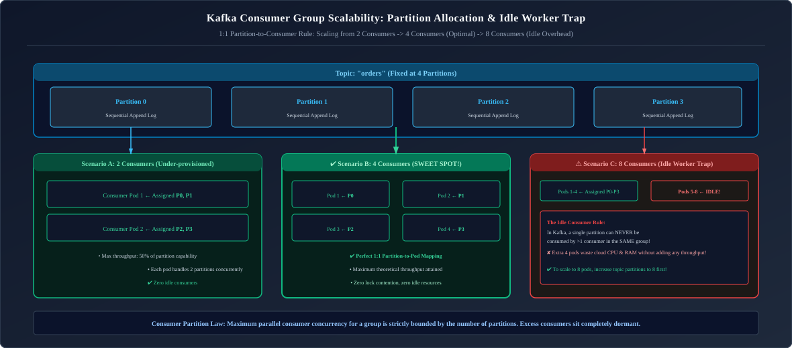

*D2 Source: [`13_kafka_consumer_group_rebalance.d2`](assets/08_caching_redis_and_kafka/13_kafka_consumer_group_rebalance.d2)*

#### Eager Rebalance vs Cooperative Sticky Rebalance:
* **Eager Rebalance (`RangeAssignor`, `RoundRobinAssignor`)**:
  * Whenever a pod joins or leaves, **ALL consumers in the group revoke ALL assigned partitions** (Stop-The-World pause).
  * No events are processed across the entire consumer fleet during the rebalance window!
* **Cooperative Sticky Rebalance (`CooperativeStickyAssignor`)**:
  * Consumers continue processing unaffected partitions during rebalancing.
  * Only partitions that actually need to move between pods are temporarily revoked and reassigned in two phases, eliminating latency spikes.

#### Production Custom Rebalance Listener:
```java
package com.enterprise.kafka.consumer;

import org.apache.kafka.clients.consumer.Consumer;
import org.apache.kafka.clients.consumer.OffsetAndMetadata;
import org.apache.kafka.common.TopicPartition;
import org.slf4j.Logger;
import org.slf4j.LoggerFactory;
import org.springframework.kafka.listener.ConsumerAwareRebalanceListener;
import org.springframework.stereotype.Component;

import java.util.Collection;
import java.util.Map;

@Component
public class ProductionRebalanceListener implements ConsumerAwareRebalanceListener {

    private static final Logger log = LoggerFactory.getLogger(ProductionRebalanceListener.class);

    @Override
    public void onPartitionsRevokedBeforeCommit(Consumer<?, ?> consumer, Collection<TopicPartition> partitions) {
        log.warn("Rebalance in progress: Partitions ABOUT TO BE REVOKED: {}", partitions);
        // Step 1: Flush any pending in-memory data structures to database
        // Step 2: Manually commit current processed offsets before the broker reassigns the partition to another pod!
        try {
            consumer.commitSync();
            log.info("Successfully committed synchronous offsets prior to partition revocation.");
        } catch (Exception ex) {
            log.error("Failed to commit offsets prior to partition revocation!", ex);
        }
    }

    @Override
    public void onPartitionsRevokedAfterCommit(Consumer<?, ?> consumer, Collection<TopicPartition> partitions) {
        log.info("Partitions revoked after commit completed: {}", partitions);
    }

    @Override
    public void onPartitionsAssigned(Consumer<?, ?> consumer, Collection<TopicPartition> partitions) {
        log.info("Partitions newly ASSIGNED to this consumer instance: {}", partitions);
        for (TopicPartition partition : partitions) {
            long currentOffset = consumer.position(partition);
            log.info("Starting consumption for topic {} on partition {} at offset {}",
                    partition.topic(), partition.partition(), currentOffset);
        }
    }
}
```

---

### 5.6 Exactly-Once Semantics (EOS): Idempotent Producers & Kafka Transactions

Kafka provides native end-to-end Exactly-Once Semantics (EOS) for **read-process-write** pipelines:
1. An incoming record is consumed from an input topic.
2. The record is transformed, and output records are produced to an output topic.
3. The consumer's offset on the input topic is committed **atomically within the same transaction** as the published output records!

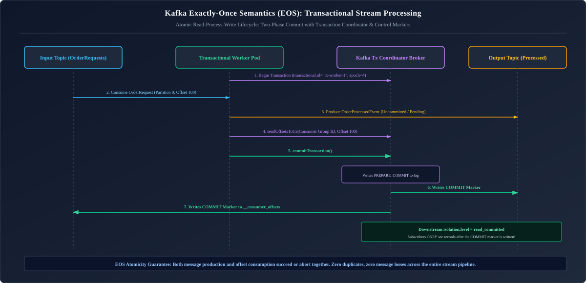

*D2 Source: [`14_kafka_exactly_once_transactional_stream.d2`](assets/08_caching_redis_and_kafka/14_kafka_exactly_once_transactional_stream.d2)*

#### Production Transactional Producer & Consumer Implementation:
```java
package com.enterprise.kafka.eos;

import org.apache.kafka.clients.consumer.ConsumerGroupMetadata;
import org.apache.kafka.clients.consumer.OffsetAndMetadata;
import org.apache.kafka.common.TopicPartition;
import org.slf4j.Logger;
import org.slf4j.LoggerFactory;
import org.springframework.kafka.core.KafkaTemplate;
import org.springframework.stereotype.Service;

import java.util.Collections;
import java.util.Map;

@Service
public class TransactionalOrderPipelineService {

    private static final Logger log = LoggerFactory.getLogger(TransactionalOrderPipelineService.class);
    private final KafkaTemplate<String, Object> transactionalKafkaTemplate;

    public TransactionalOrderPipelineService(KafkaTemplate<String, Object> transactionalKafkaTemplate) {
        this.transactionalKafkaTemplate = transactionalKafkaTemplate;
    }

    public void processOrderExactlyOnce(String orderId,
                                        String inputTopic,
                                        int inputPartition,
                                        long inputOffset,
                                        String consumerGroupId,
                                        Object transformedPayload) {
        // Execute atomic read-process-write transaction across topics and partition offsets
        transactionalKafkaTemplate.executeInTransaction(operations -> {
            // 1. Publish output event to target topic
            operations.send("orders.processed", orderId, transformedPayload);

            // 2. Commit input partition offset inside the same Kafka transaction
            TopicPartition tp = new TopicPartition(inputTopic, inputPartition);
            OffsetAndMetadata offsetAndMetadata = new OffsetAndMetadata(inputOffset + 1); // Next offset to read
            Map<TopicPartition, OffsetAndMetadata> offsets = Collections.singletonMap(tp, offsetAndMetadata);

            operations.sendOffsetsToTransaction(offsets, new ConsumerGroupMetadata(consumerGroupId));
            log.info("Atomically produced transformed event and committed offset {} for order {}", inputOffset, orderId);
            return true;
        });
    }
}
```

---

### 5.7 Production Spring Boot Kafka: Concurrent Listeners & Non-Blocking Retry Topics

```java
package com.enterprise.kafka;

import org.apache.kafka.clients.consumer.ConsumerConfig;
import org.springframework.kafka.annotation.DltHandler;
import org.springframework.kafka.annotation.KafkaListener;
import org.springframework.kafka.annotation.RetryableTopic;
import org.springframework.kafka.retrytopic.TopicSuffixingStrategy;
import org.springframework.kafka.support.KafkaHeaders;
import org.springframework.messaging.handler.annotation.Header;
import org.springframework.retry.annotation.Backoff;
import org.springframework.stereotype.Service;

@Service
public class OrderEventConsumer {

    // ✅ NON-BLOCKING RETRIES & DEAD LETTER TOPIC:
    // If processing fails, Spring Kafka routes message to 'orders-retry-1000', then 'orders-retry-2000'
    // without blocking the main 'orders' topic partition!
    @RetryableTopic(
        attempts = "3",
        backoff = @Backoff(delay = 1000, multiplier = 2.0),
        topicSuffixingStrategy = TopicSuffixingStrategy.SUFFIX_WITH_DELAY_VALUE
    )
    @KafkaListener(topics = "orders", groupId = "order-processing-group", concurrency = "3")
    public void consumeOrder(String orderPayload,
                             @Header(KafkaHeaders.RECEIVED_PARTITION) int partition,
                             @Header(KafkaHeaders.OFFSET) long offset) {
        System.out.printf("Received order on partition %d at offset %d: %s%n", partition, offset, orderPayload);
        // Process order...
    }

    // Automatically triggered after all 3 retries are exhausted
    @DltHandler
    public void handleDeadLetter(String payload, @Header(KafkaHeaders.ORIGINAL_TOPIC) String originalTopic) {
        System.err.printf("POISON MESSAGE quarantined to DLT from topic %s: %s%n", originalTopic, payload);
    }
}
```

---

### 5.8 Kafka Streams: Stream-Table Duality (`KStream`, `KTable`) & Windowing

Kafka Streams provides declarative stream-processing microservices directly in Java without requiring an external cluster (like Flink or Spark Streaming).

#### Production Kafka Streams Pipeline: 5-Minute Windowed Transaction Fraud Detector
```java
package com.enterprise.kafkastreams;

import org.apache.kafka.common.serialization.Serdes;
import org.apache.kafka.streams.StreamsBuilder;
import org.apache.kafka.streams.kstream.*;
import org.springframework.context.annotation.Bean;
import org.springframework.context.annotation.Configuration;
import org.springframework.kafka.annotation.EnableKafkaStreams;

import java.time.Duration;

@Configuration
@EnableKafkaStreams
public class FraudDetectionStreamsConfig {

    @Bean
    public KStream<String, Long> kStream(StreamsBuilder streamsBuilder) {
        KStream<String, String> transactionStream = streamsBuilder.stream(
                "payments.raw",
                Consumed.with(Serdes.String(), Serdes.String())
        );

        // Group by User ID and calculate transaction count over 5-minute tumbling windows
        TimeWindows tumblingWindow = TimeWindows.ofSizeWithNoGrace(Duration.ofMinutes(5));

        KTable<Windowed<String>, Long> transactionCounts = transactionStream
                .groupBy((key, value) -> key, Grouped.with(Serdes.String(), Serdes.String()))
                .windowedBy(tumblingWindow)
                .count(Materialized.as("transaction-count-store"));

        // Filter users exceeding 50 transactions within 5 minutes (Velocity check)
        KStream<String, Long> fraudAlerts = transactionCounts
                .toStream()
                .filter((windowedKey, count) -> count > 50)
                .map((windowedKey, count) -> new KeyValue<>(windowedKey.key(), count));

        // Sink alerts to security topic
        fraudAlerts.to("fraud.alerts", Produced.with(Serdes.String(), Serdes.Long()));

        return fraudAlerts;
    }
}
```

---

### 5.9 Production Kafka CLI Diagnostic Playbook

> [!TIP]
> **Deep-Dive Interview Scenarios:**
> - [Q3. Kafka vs RabbitMQ: Core Differences & Selection Criteria](frequently_asked_questions/08_caching_redis_and_kafka_faq.md#q3-medium-kafka-vs-rabbitmq-core-differences--selection-criteria)
> - [Q4. Kafka Architecture: Brokers, Partitions, Consumer Groups & Scalability](frequently_asked_questions/08_caching_redis_and_kafka_faq.md#q4-expert-kafka-architecture-brokers-partitions-consumer-groups--scalability)
> - [Q5. Integrating Apache Kafka with Spring Boot](frequently_asked_questions/08_caching_redis_and_kafka_faq.md#q5-medium-integrating-apache-kafka-with-spring-boot)
> - [Q6. Dead Letter Queues (DLQ), Retry Policies & Mitigating Slow Consumers](frequently_asked_questions/08_caching_redis_and_kafka_faq.md#q6-hard-dead-letter-queues-dlq-retry-policies--mitigating-slow-consumers)
> - [Q7. How Kafka Interacts with Databases: CDC (Debezium), Kafka Connect & Transactional Outbox](frequently_asked_questions/08_caching_redis_and_kafka_faq.md#q7-hard-how-kafka-interacts-with-databases-cdc-debezium-kafka-connect--transactional-outbox)
> - [Q8. Kafka Schema Registry Architecture, Avro Serialization & Schema Evolution](frequently_asked_questions/08_caching_redis_and_kafka_faq.md#q8-hard-kafka-schema-registry-architecture-avro-serialization--schema-evolution)
> - [Q9. Consumer Groups, Partition Rebalancing & Manual Offset Commit Strategies](frequently_asked_questions/08_caching_redis_and_kafka_faq.md#q9-medium-consumer-groups-partition-rebalancing--manual-offset-commit-strategies)
> - [Q10. Kafka Consumer Lag Diagnosis & Resolution Playbook](frequently_asked_questions/08_caching_redis_and_kafka_faq.md#q10-hard-kafka-consumer-lag-diagnosis--resolution-playbook)
> - [Q11. Kafka Producer Acknowledgements (`acks`), In-Sync Replicas (`min.insync.replicas`) & Durability Trade-Offs](frequently_asked_questions/08_caching_redis_and_kafka_faq.md#q11-hard-kafka-producer-acknowledgements-acks-in-sync-replicas-mininsyncreplicas--durability-trade-offs)
> - [Q12. Preventing Duplicate Business Effects When a Kafka Consumer Commits to Database Then Crashes Before Committing Offsets](frequently_asked_questions/08_caching_redis_and_kafka_faq.md#q12-hard-preventing-duplicate-business-effects-when-a-kafka-consumer-commits-to-database-then-crashes-before-committing-offsets)

```bash
# List active topics in the cluster

kafka-topics.sh --bootstrap-server kafka:9092 --list

# 12. Inspect topic partitions, replicas, and In-Sync Replicas (ISR)

kafka-topics.sh --bootstrap-server kafka:9092 --describe --topic orders

# 13. Inspect Consumer Group Lag (Critical for identifying slow consumers)

kafka-consumer-groups.sh --bootstrap-server kafka:9092 --describe --group order-processing-group

# 14. Reset Consumer Group Offset to beginning (Replay events)

kafka-consumer-groups.sh --bootstrap-server kafka:9092 --group order-processing-group \
    --topic orders --reset-offsets --to-earliest --execute

# 15. Live console consumer testing

kafka-console-consumer.sh --bootstrap-server kafka:9092 --topic orders --from-beginning
```

---

# 6. Production Troubleshooting Playbook

### Incident 1: Consumer Group Rebalance Storm
* **Symptom**: Kafka consumers constantly disconnect and reconnect, triggering continuous rebalance loops. Topic consumer lag increases steadily, and message throughput plummets to near zero.
* **Root Cause**:
  * An individual batch of records takes longer to process than `max.poll.interval.ms` (default: 300,000ms / 5 minutes).
  * Kafka separates heartbeat threads (`heartbeat.interval.ms`) from the consumer processing thread. Even though heartbeats are being sent, if `poll()` is not invoked within `max.poll.interval.ms`, the Kafka coordinator marks the consumer dead and kicks it out of the group!
* **Diagnostic Command**:
  ```bash
  # Check active consumer lag and state
  kafka-consumer-groups.sh --bootstrap-server kafka:9092 --describe --group order-processing-group
  ```
* **Remedy**:
  1. Reduce `max.poll.records` (e.g., from 500 down to 50) so each batch is guaranteed to complete well within the time limit.
  2. Increase `max.poll.interval.ms` (e.g., to 600,000ms / 10 minutes) if individual items involve heavy downstream external calls.
  3. Adopt `CooperativeStickyAssignor` so unaffected partitions stay active during rebalance.

### Incident 2: Redis Out-Of-Memory (`OOM command not allowed`)
* **Symptom**: Spring Boot throws `RedisSystemException: OOM command not allowed when used memory > 'maxmemory'`.
* **Root Cause**: Keys were created without explicit TTLs, or `maxmemory-policy` is set to the default `noeviction`. When physical RAM hits `maxmemory`, Redis rejects all write operations!
* **Diagnostic Commands**:
  ```bash
  # Check memory breakdown and active eviction policy
  redis-cli info memory
  # Identify keys consuming the largest memory footprints
  redis-cli --bigkeys
  # Check memory fragmentation ratio
  redis-cli info memory | grep mem_fragmentation_ratio
  ```
* **Remedy**:
  1. Set an active eviction policy immediately without restart:
     ```bash
     CONFIG SET maxmemory-policy allkeys-lru
     ```
  2. Set eviction policy in `redis.conf`:
     ```text
     maxmemory 8gb
     maxmemory-policy allkeys-lru
     ```
  3. If `mem_fragmentation_ratio > 1.5`, enable active defragmentation:
     ```bash
     CONFIG SET activedefrag yes
     ```

### Incident 3: Kafka Broker Under-Replicated Partitions (URP) Alert
* **Symptom**: Prometheus fires `KafkaUnderReplicatedPartitions > 0`.
* **Root Cause**: A follower broker fell behind the partition leader past `replica.lag.time.max.ms` (default: 30,000ms) due to disk I/O saturation, OS page cache flushing contention, or a prolonged JVM Stop-The-World GC pause.
* **Diagnostic Commands**:
  ```bash
  # List all under-replicated partitions across the cluster
  kafka-topics.sh --bootstrap-server kafka:9092 --describe --under-replicated-partitions
  # Inspect follower broker disk I/O utilization
  iostat -xz 1
  ```
* **Remedy**:
  1. Inspect the lagging broker's JVM GC logs for long pause times ($> 10\text{s}$).
  2. Verify disk throughput and queue depth. Ensure log directories are mounted on separate physical NVMe drives from OS swap.
  3. Increase `num.replica.fetchers` (default: 1) to 4 to parallelize replication across brokers.

### Incident 4: Kafka Poison Pill Infinite Deserialization Loop
* **Symptom**: Consumer thread logs infinite stack traces of `org.apache.kafka.common.errors.SerializationException: Error deserializing key/value for partition ...`. The offset never advances, causing complete partition starvation!
* **Root Cause**: An upstream publisher wrote invalid JSON or incompatible schema bytes into the partition. Standard deserializers throw an exception *before* passing control to the consumer listener, preventing offset commits.
* **Remedy**:
  1. Configure Spring Kafka's `ErrorHandlingDeserializer` wrapping the real deserializer:
     ```properties
     spring.kafka.consumer.value-deserializer=org.springframework.kafka.support.serializer.ErrorHandlingDeserializer
     spring.kafka.consumer.properties.spring.deserializer.value.delegate.class=org.springframework.kafka.support.serializer.JsonDeserializer
     ```
  2. Add a `DefaultErrorHandler` with a `DeadLetterPublishingRecoverer` to automatically publish poison pills to a quarantine dead letter topic without crashing the consumer.

### Incident 5: Redis Cache Stampede (Thundering Herd) Under Flash Sale Traffic
* **Symptom**: Redis CPU spikes to 100%, followed immediately by the primary PostgreSQL connection pool exhausting all connections (`HikariPool-1 - Connection is not available, request timed out after 30000ms`).
* **Root Cause**: A single hot key (e.g. `product:flash-sale-deal`) expired. 20,000 concurrent web requests simultaneously experienced a cache miss and fired identical $50\text{ms}$ queries to the PostgreSQL database.
* **Remedy**:
  1. Wrap the database retrieval with a **Distributed Mutex (Single-Flight Pattern)** so only ONE thread queries the DB while all other 19,999 requests wait for the cache to be backfilled:
     ```java
     String lockKey = "lock:" + key;
     RLock lock = redissonClient.getLock(lockKey);
     if (lock.tryLock(2, 5, TimeUnit.SECONDS)) {
         try {
             value = fetchFromDbAndPopulateCache(key);
         } finally {
             lock.unlock();
         }
     } else {
         // Wait briefly and re-read from cache
         Thread.sleep(50);
         value = redisTemplate.opsForValue().get(key);
     }
     ```
  2. Implement the **XFetch probabilistic early expiration algorithm** (Section 1.6) so the background worker refreshes the cache before TTL expiry.

### Incident 6: RabbitMQ Unacknowledged Message Accumulation & Flow Control Alarm
* **Symptom**: RabbitMQ web management console displays thousands of `Unacked` messages. The broker enters `Flow Control` mode and stops accepting writes from producers (`connection.blocked`).
* **Root Cause**: Consumers are running with `AcknowledgeMode.MANUAL` but fail to invoke `channel.basicAck()` in an unhandled exception branch, or `prefetchCount` is set too high or omitted (unbounded).
* **Diagnostic Commands**:
  ```bash
  # Check unacknowledged message counts per queue
  rabbitmqctl list_queues name messages_unacknowledged consumers
  # Check broker alarms
  rabbitmq-diagnostics alarms
  ```
* **Remedy**:
  1. Ensure all `@RabbitListener` methods enclose processing in a strict `try-catch-finally` block that guarantees either `basicAck()` or `basicNack(requeue=false)` is invoked for every delivery tag.
  2. Enforce a sensible `basicQos(prefetchCount = 10)` in the container factory.
  3. Increase RabbitMQ memory high watermark if the node has sufficient RAM:
     ```bash
     rabbitmqctl set_vm_memory_high_watermark 0.6
     ```

---

# 7. Summary Comparison & Production Engineering Reference Matrix

| Dimension | Redis Caching | RabbitMQ Messaging | Apache Kafka Event Streaming |
| :--- | :--- | :--- | :--- |
| **Primary Architectural Role** | Low-latency in-memory data store | Traditional broker for task distribution | High-throughput distributed append-only commit log |
| **Data Retention** | Ephemeral or persistent with TTL | Removed from queue immediately upon consumer ACK | **Retained on disk for days/weeks** regardless of consumption |
| **Throughput Capacity** | $\sim 100,000\text{ ops/sec}$ | $\sim 50,000\text{ msgs/sec}$ | **$> 1,000,000\text{ msgs/sec}$** via partition parallelism |
| **Consumer Model** | Polling / Pub-Sub | **Push** (Broker pushes to workers with prefetch limits) | **Pull** (Consumers proactively poll batches) |
| **Routing Flexibility** | Key-based hashing (16,384 slots) | **Complex AMQP routing** (Direct, Topic wildcards, Fanout) | Topic & partition key hashing (Murmur2) |
| **Message Replay** | No native log replay | No (Message destroyed upon ACK) | **Native event replay** by rewinding consumer group offsets |
| **Backpressure** | N/A (RAM limits) | Handled via `basicQos` prefetch limits | **Native** (Pull-based polling) |

---

# 8. References & Further Reading

---

- [Redis Official Documentation & Data Structures Guide](https://redis.io/docs/)
- [Martin Kleppmann - Designing Data-Intensive Applications (O'Reilly)](https://dataintensive.net/)
- [RabbitMQ Documentation - AMQP 0-9-1 Model Explained](https://www.rabbitmq.com/tutorials/amqp-concepts.html)
- [Apache Kafka Documentation - Design Fundamentals & KRaft](https://kafka.apache.org/documentation/#design)
- [Baeldung - Spring Cache Abstraction Tutorial](https://www.baeldung.com/spring-cache-tutorial)
- [Confluent - Exactly-Once Semantics in Apache Kafka](https://www.confluent.io/blog/exactly-once-semantics-are-possible-heres-how-apache-kafka-does-it/)