# 09. Software Architecture, Microservices & System Design

A comprehensive, production-grade guide to GoF design patterns, SOLID principles, Clean/Hexagonal Architecture, Microservices decomposition, service discovery, API Gateways, Saga orchestration, Outbox pattern, and distributed system design.

---

## Architectural Overview: Enterprise Design Patterns Architecture

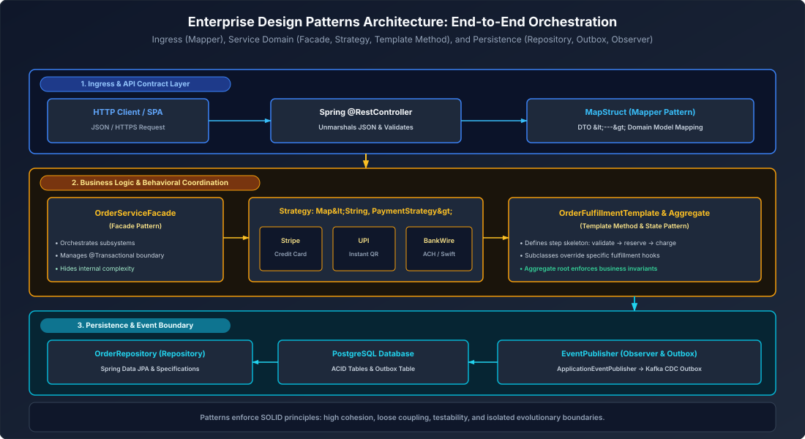

*D2 Source: [`01_enterprise_design_patterns_architecture.d2`](assets/09_microservices_and_system_design/01_enterprise_design_patterns_architecture.d2)*

---

## Table of Contents
1. [SOLID Principles Deep-Dive](#1-solid-principles-deep-dive)
   - [1.1 Single Responsibility Principle (SRP)](#11-single-responsibility-principle-srp)
   - [1.2 Open/Closed Principle (OCP)](#12-openclosed-principle-ocp)
   - [1.3 Liskov Substitution Principle (LSP)](#13-liskov-substitution-principle-lsp)
   - [1.4 Interface Segregation Principle (ISP)](#14-interface-segregation-principle-isp)
   - [1.5 Dependency Inversion Principle (DIP)](#15-dependency-inversion-principle-dip)
2. [Core Software Engineering & Architectural Guidelines](#2-core-software-engineering--architectural-guidelines)
   - [2.1 DRY, KISS & YAGNI](#21-dry-kiss--yagni)
   - [2.2 Favor Composition Over Inheritance](#22-favor-composition-over-inheritance)
   - [2.3 Law of Demeter (Principle of Least Knowledge)](#23-law-of-demeter-principle-of-least-knowledge)
   - [2.4 Separation of Concerns (SoC) & Clean Layered Architecture](#24-separation-of-concerns-soc--clean-layered-architecture)
3. [GoF Creational Design Patterns](#3-gof-creational-design-patterns)
   - [3.1 Builder Pattern](#31-builder-pattern)
   - [3.2 Factory Method & Abstract Factory Pattern](#32-factory-method--abstract-factory-pattern)
   - [3.3 Singleton Pattern](#33-singleton-pattern)
   - [3.4 Prototype Pattern](#34-prototype-pattern)
4. [GoF Structural Design Patterns](#4-gof-structural-design-patterns)
   - [4.1 Adapter Pattern](#41-adapter-pattern)
   - [4.2 Decorator Pattern](#42-decorator-pattern)
   - [4.3 Proxy Pattern (JDK Dynamic vs CGLIB)](#43-proxy-pattern-jdk-dynamic-vs-cglib)
   - [4.4 Facade Pattern](#44-facade-pattern)
   - [4.5 Composite Pattern](#45-composite-pattern)
5. [GoF Behavioral Design Patterns](#5-gof-behavioral-design-patterns)
   - [5.1 Strategy Pattern](#51-strategy-pattern)
   - [5.2 Template Method Pattern](#52-template-method-pattern)
   - [5.3 Chain of Responsibility Pattern](#53-chain-of-responsibility-pattern)
   - [5.4 Observer Pattern](#54-observer-pattern)
   - [5.5 State Pattern](#55-state-pattern)
   - [5.6 Command Pattern](#56-command-pattern)
6. [Enterprise Backend & Domain-Driven Patterns](#6-enterprise-backend--domain-driven-patterns)
   - [6.1 Data Transfer Object (DTO) & MapStruct Mapper Pattern](#61-data-transfer-object-dto--mapstruct-mapper-pattern)
   - [6.2 Value Object Pattern](#62-value-object-pattern)
   - [6.3 Repository & Specification Pattern](#63-repository--specification-pattern)
7. [Clean Architecture & Hexagonal Architecture (Ports & Adapters)](#7-clean-architecture--hexagonal-architecture-ports--adapters)
8. [Architectural Fitness Functions & ArchUnit Testing](#8-architectural-fitness-functions--archunit-testing)
9. [Microservice Architecture & Core Components](#9-microservice-architecture--core-components)
   - [9.1 Monolith vs Microservices Architecture Deep-Dive](#91-monolith-vs-microservices-architecture-deep-dive)
   - [9.2 Domain-Driven Design (DDD) & Service Decomposition](#92-domain-driven-design-ddd--service-decomposition)
   - [9.3 Database-per-Service Pattern & Schema Isolation](#93-database-per-service-pattern--schema-isolation)
   - [9.4 API Gateway: Routing, Security Offloading & L4 vs L7 Load Balancing](#94-api-gateway-routing-security-offloading--l4-vs-l7-load-balancing)
   - [9.5 Service Discovery: Client-Side vs Server-Side](#95-service-discovery-client-side-vs-server-side)
   - [9.6 Service Mesh (Istio / Envoy): Sidecar Proxies & Mutual TLS (mTLS)](#96-service-mesh-istio--envoy-sidecar-proxies--mutual-tls-mtls)
   - [9.7 Distributed Tracing: W3C TraceContext, OpenTelemetry, Trace ID & Span ID Propagation](#97-distributed-tracing-w3c-tracecontext-opentelemetry-trace-id--span-id-propagation)
   - [9.8 The Backend for Frontend (BFF) Pattern & Edge Routing](#98-the-backend-for-frontend-bff-pattern--edge-routing)
10. [Resilience & Fault Tolerance Patterns](#10-resilience--fault-tolerance-patterns)
   - [10.1 Circuit Breaker Pattern & State Machine (Closed, Open, Half-Open)](#101-circuit-breaker-pattern--state-machine-closed-open-half-open)
   - [10.2 Retry with Exponential Backoff and Full Jitter](#102-retry-with-exponential-backoff-and-full-jitter)
   - [10.3 Bulkhead Isolation (Thread Pool vs Semaphore) & Timeouts](#103-bulkhead-isolation-thread-pool-vs-semaphore--timeouts)
   - [10.4 API Rate Limiting Algorithms (Token Bucket, Leaky Bucket, Sliding Window Counter)](#104-api-rate-limiting-algorithms-token-bucket-leaky-bucket-sliding-window-counter)
   - [10.5 API Idempotency & Distributed Deduplication (Redisson Distributed Lock)](#105-api-idempotency--distributed-deduplication-redisson-distributed-lock)
11. [Distributed Transactions & Event-Driven Patterns](#11-distributed-transactions--event-driven-patterns)
   - [11.1 Two-Phase Commit (2PC) vs Saga Pattern](#111-two-phase-commit-2pc-vs-saga-pattern)
   - [11.2 Saga Choreography vs Saga Orchestration](#112-saga-choreography-vs-saga-orchestration)
   - [11.3 Production Saga Orchestrator Implementation with Persistent State Machine](#113-production-saga-orchestrator-implementation-with-persistent-state-machine)
   - [11.4 The Transactional Outbox Pattern & CDC with Debezium](#114-the-transactional-outbox-pattern--cdc-with-debezium)
   - [11.5 CQRS (Command Query Responsibility Segregation) Architecture](#115-cqrs-command-query-responsibility-segregation-architecture)
   - [11.6 Event Sourcing Fundamentals & Aggregate Snapshots](#116-event-sourcing-fundamentals--aggregate-snapshots)
   - [11.7 The Strangler Fig Application Migration Pattern](#117-the-strangler-fig-application-migration-pattern)
12. [Distributed Systems Fundamentals](#12-distributed-systems-fundamentals)
   - [12.1 The CAP Theorem & PACELC Theorem Deep-Dive](#121-the-cap-theorem--pacelc-theorem-deep-dive)
   - [12.2 Consistency Models (Linearizable, Causal, Eventual)](#122-consistency-models-linearizable-causal-eventual)
   - [12.3 Distributed Consensus: Raft vs Paxos (Leader Election & Log Replication)](#123-distributed-consensus-raft-vs-paxos-leader-election--log-replication)
   - [12.4 Distributed Unique ID Generation: Twitter Snowflake Algorithm](#124-distributed-unique-id-generation-twitter-snowflake-algorithm)
   - [12.5 Distributed Locking: Redlock Algorithm vs Database Advisory Locks](#125-distributed-locking-redlock-algorithm-vs-database-advisory-locks)
   - [12.6 Consistent Hashing Algorithm with Virtual Nodes](#126-consistent-hashing-algorithm-with-virtual-nodes)
   - [12.7 Database Replication Topologies & Quorum Consistency ($R + W > N$)](#127-database-replication-topologies--quorum-consistency-r--w--n)
13. [Real-World Backend System Designs](#13-real-world-backend-system-designs)
   - [13.1 Global URL Shortener (TinyURL) Design](#131-global-url-shortener-tinyurl-design)
   - [13.2 High-Throughput Distributed Rate Limiter Design](#132-high-throughput-distributed-rate-limiter-design)
   - [13.3 Enterprise Multi-Channel Notification System Design](#133-enterprise-multi-channel-notification-system-design)
   - [13.4 Resilient Financial Payment Gateway Design](#134-resilient-financial-payment-gateway-design)
   - [13.5 High-Throughput Trailing Stop-Loss Order Execution Engine Design](#135-high-throughput-trailing-stop-loss-order-execution-engine-design)
14. [Operational Commands & Diagnostic Tools Cheatsheet](#14-operational-commands--diagnostic-tools-cheatsheet)
15. [Summary Comparison & Production Engineering Reference Matrix](#15-summary-comparison--production-engineering-reference-matrix)
16. [References & Further Reading](#16-references--further-reading)
---

# 1. SOLID Principles Deep-Dive

---

### 1.1 Single Responsibility Principle (SRP)
> **Definition**: A class should have one, and only one, reason to change. It must encapsulate a single, well-defined business responsibility.

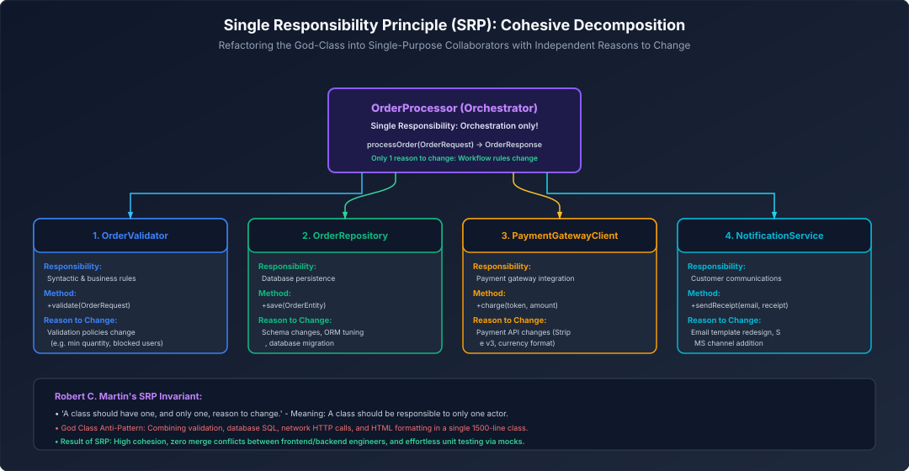

*D2 Source: [`02_single_responsibility_principle_srp.d2`](assets/09_microservices_and_system_design/02_single_responsibility_principle_srp.d2)*

#### Anti-Pattern: The "God Class"
In monolithic Spring controllers or services, developers frequently bundle HTTP serialization, business validation, SQL database persistence, and email notification into a single class:

```java
// ❌ VIOLATION: Has 4 distinct reasons to change (Web, Validation, DB, Notification)
@Service
public class OrderService {
    public void processOrder(OrderRequest request) {
        // 1. Validation logic
        if (request.amount() <= 0) throw new IllegalArgumentException("Invalid amount");
        
        // 2. Database persistence logic
        String sql = "INSERT INTO orders (id, amount) VALUES (?, ?)";
        jdbcTemplate.update(sql, request.id(), request.amount());
        
        // 3. Payment gateway API integration
        httpClient.post("https://payment.stripe.com/v1/charge", request);
        
        // 4. Email notification logic
        JavaMailSender.send("Receipt for " + request.id());
    }
}
```

#### Refactored Production Solution: Cohesive Collaborators
Decompose the operations into focused, single-purpose components injected via constructor:

```java
// ✅ PRODUCTION SOLUTION: Clear separation of concerns
@Service
@RequiredArgsConstructor
public class OrderProcessor {
    private final OrderValidator validator;
    private final OrderRepository orderRepository;
    private final PaymentGatewayClient paymentGatewayClient;
    private final NotificationService notificationService;

    @Transactional
    public OrderResponse processOrder(OrderRequest request) {
        validator.validate(request);
        OrderEntity entity = orderRepository.save(OrderEntity.fromRequest(request));
        PaymentReceipt receipt = paymentGatewayClient.charge(request.paymentToken(), entity.getTotalAmount());
        notificationService.sendReceipt(request.customerEmail(), receipt);
        return OrderResponse.fromEntity(entity);
    }
}
```

---

### 1.2 Open/Closed Principle (OCP)
> **Definition**: Software artifacts should be **open for extension**, but **closed for modification**. You should be able to introduce new functionality without altering existing, tested code.

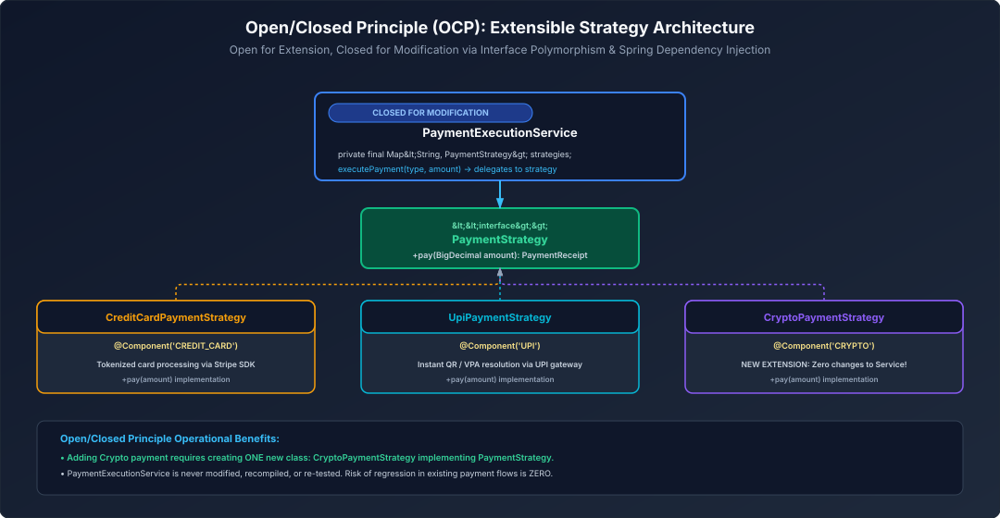

*D2 Source: [`03_open_closed_principle_ocp.d2`](assets/09_microservices_and_system_design/03_open_closed_principle_ocp.d2)*

#### Anti-Pattern: Fragile `switch` Statements
```java
// ❌ VIOLATION: Every new payment type requires modifying this core method
public class PaymentService {
    public void executePayment(String paymentType, BigDecimal amount) {
        if ("CREDIT_CARD".equalsIgnoreCase(paymentType)) {
            processCreditCard(amount);
        } else if ("PAYPAL".equalsIgnoreCase(paymentType)) {
            processPayPal(amount);
        } else if ("CRYPTO".equalsIgnoreCase(paymentType)) {
            processCrypto(amount);
        } else {
            throw new UnsupportedOperationException("Unknown payment type: " + paymentType);
        }
    }
}
```

#### Refactored Production Solution: Polymorphic Strategy Pattern
```java
// 1. Define the behavioral contract
public interface PaymentStrategy {
    String getChannel();
    PaymentReceipt pay(BigDecimal amount);
}

// 2. Implementations can be added indefinitely without altering existing classes
@Component
public class CreditCardPaymentStrategy implements PaymentStrategy {
    @Override public String getChannel() { return "CREDIT_CARD"; }
    @Override public PaymentReceipt pay(BigDecimal amount) { return new PaymentReceipt("CC-SUCCESS"); }
}

@Component
public class UpiPaymentStrategy implements PaymentStrategy {
    @Override public String getChannel() { return "UPI"; }
    @Override public PaymentReceipt pay(BigDecimal amount) { return new PaymentReceipt("UPI-SUCCESS"); }
}

// 3. Open for extension, closed for modification via Spring bean map injection
@Service
public class PaymentExecutionService {
    private final Map<String, PaymentStrategy> paymentStrategies;

    public PaymentExecutionService(List<PaymentStrategy> strategies) {
        this.paymentStrategies = strategies.stream()
            .collect(Collectors.toMap(PaymentStrategy::getChannel, Function.identity()));
    }

    public PaymentReceipt execute(String channel, BigDecimal amount) {
        PaymentStrategy strategy = paymentStrategies.get(channel);
        if (strategy == null) {
            throw new IllegalArgumentException("Unsupported payment channel: " + channel);
        }
        return strategy.pay(amount);
    }
}
```

---

### 1.3 Liskov Substitution Principle (LSP)
> **Definition**: Subtypes must be substitutable for their base types without altering the correctness or invariant behavior of the program. If class $S$ is a subtype of class $T$, then objects of type $T$ may be replaced with objects of type $S$ without altering desirable program properties.

#### Enterprise Backend Violation: Throwing `UnsupportedOperationException`
```java
// ❌ VIOLATION: ReadOnlyRepository cannot fulfill the contract of CrudRepository
public interface CrudRepository<T> {
    T findById(Long id);
    void save(T entity);
    void delete(Long id);
}

public class ReadOnlyAuditLogRepository implements CrudRepository<AuditLog> {
    @Override public AuditLog findById(Long id) { return fetchFromDb(id); }
    @Override public void save(AuditLog entity) { 
        throw new UnsupportedOperationException("Audit logs are append-only!"); 
    }
    @Override public void delete(Long id) { 
        throw new UnsupportedOperationException("Cannot delete audit logs!"); 
    }
}
```

#### Production Solution: Segregated Interface Contracts
```java
public interface ReadOnlyRepository<T> {
    Optional<T> findById(Long id);
    List<T> findAll();
}

public interface WriteRepository<T> {
    T save(T entity);
    void deleteById(Long id);
}

// AuditLogRepository only implements what it safely supports without breaking caller invariants
@Repository
public class AuditLogRepository implements ReadOnlyRepository<AuditLog> {
    @Override public Optional<AuditLog> findById(Long id) { return Optional.empty(); }
    @Override public List<AuditLog> findAll() { return List.of(); }
}
```

---

### 1.4 Interface Segregation Principle (ISP)
> **Definition**: Clients should not be forced to depend upon interfaces that they do not use. Prefer small, highly cohesive interfaces over large "fat" interfaces.

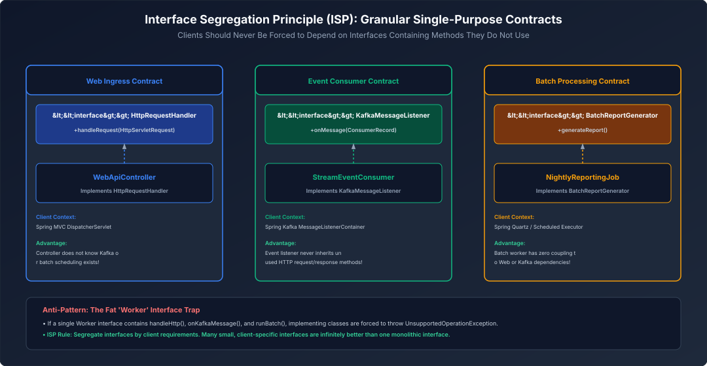

*D2 Source: [`04_interface_segregation_principle_isp.d2`](assets/09_microservices_and_system_design/04_interface_segregation_principle_isp.d2)*

#### Production Solution: Cohesive Role Interfaces
```java
public interface HttpRequestHandler {
    void handleRequest(HttpServletRequest req);
}

public interface KafkaMessageListener {
    void onMessage(ConsumerRecord<String, byte[]> record);
}

public interface BatchReportGenerator {
    void generateReport();
}
```

---

### 1.5 Dependency Inversion Principle (DIP)
> **Definition**: High-level modules should not depend on low-level modules. Both should depend on abstractions. Abstractions should not depend on details; details should depend on abstractions.

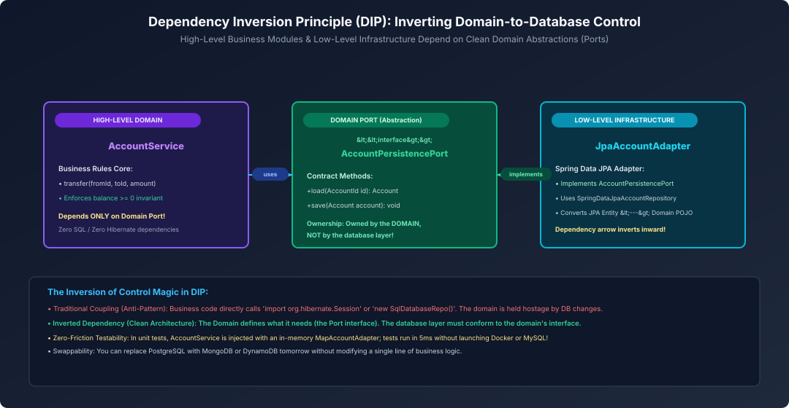

*D2 Source: [`05_dependency_inversion_principle_dip.d2`](assets/09_microservices_and_system_design/05_dependency_inversion_principle_dip.d2)*

#### Production Implementation in Spring Boot:
```java
// High-level domain service depends purely on abstraction (Domain Port)
@Service
@RequiredArgsConstructor
public class AccountService {
    private final AccountPersistencePort persistencePort; // Abstraction

    public void transfer(AccountId from, AccountId to, Money amount) {
        Account sender = persistencePort.load(from);
        Account receiver = persistencePort.load(to);
        sender.debit(amount);
        receiver.credit(amount);
        persistencePort.save(sender);
        persistencePort.save(receiver);
    }
}

// Low-level adapter fulfills the port
@Component
@RequiredArgsConstructor
public class JpaAccountAdapter implements AccountPersistencePort {
    private final SpringDataJpaAccountRepository springDataRepo;
    
    @Override public Account load(AccountId id) { return springDataRepo.findById(id.value()).map(AccountMapper::toDomain).orElseThrow(); }
    @Override public void save(Account account) { springDataRepo.save(AccountMapper.toEntity(account)); }
}
```

---

# 2. Core Software Engineering & Architectural Guidelines

---

### 2.1 DRY, KISS & YAGNI

#### Core Engineering Directives for Sustainable Microservice Architectures
Software engineering principles serve as critical design heuristics that balance system maintainability, cognitive load, and evolutionary agility. In distributed microservice architectures, misapplying these principles frequently results in either tightly coupled monolithic dependencies or fragile, overly speculative abstractions:

1. **DRY (Don't Repeat Yourself — Andy Hunt & Dave Thomas):**
   - **Theoretical Meaning:** Every piece of domain knowledge or business invariant must have a single, unambiguous representation within a system.
   - **Nuance in Microservices:** DRY does **not** mean eliminating all duplicate code across service boundaries. Forcing two independent microservices to share common DTO classes via a shared internal JAR library creates tight binary coupling—a change in Service A's schema forces a recompile and redeployment of Service B. In distributed architectures, **loose temporal and schema coupling takes precedence over internal DRY duplication**.

2. **KISS (Keep It Simple, Stupid):**
   - **Theoretical Meaning:** Systems perform best when their designs remain straightforward and transparent. Unnecessary algorithmic cleverness, complex metaprogramming, and dynamic reflection increase cognitive load and make debugging catastrophic production outages vastly more difficult.
   - **Application:** Strive for linear, readable code flow. Favor explicit standard language constructs over bespoke framework abstractions.

3. **YAGNI (You Aren't Gonna Need It — Extreme Programming):**
   - **Theoretical Meaning:** Always implement features and architectural abstractions only when they are actually needed by current verified requirements, never in anticipation of speculative future needs.
   - **Application:** Avoid designing generic multi-tenant distributed consensus engines or pluggable database adapters when building an internal enterprise reporting service with a single PostgreSQL database.

| Principle | Full Name | Core Engineering Directive | Production Anti-Pattern |
| :--- | :--- | :--- | :--- |
| **DRY** | Don't Repeat Yourself | Every piece of domain knowledge or business logic must have a single, unambiguous representation within the system. | Copy-pasting tax calculation or currency rounding logic across 5 controllers. |
| **KISS** | Keep It Simple, Stupid | Solutions should be as straightforward as possible. Avoid unnecessary algorithmic cleverness or over-abstraction. | Writing custom bytecode manipulation or reflection trees where a simple `switch` or `Map` lookup suffices. |
| **YAGNI** | You Aren't Gonna Need It | Do not build speculative features, premature abstractions, or flexible plugins until actual production requirements demand them. | Designing a dynamic multi-cloud distributed consensus engine for an internal corporate CRUD tool with 10 users. |

---

### 2.2 Favor Composition Over Inheritance

> **The Fragile Base Class Problem**: Deep inheritance hierarchies couple subclasses intimately to the private implementation details of parent classes. When a parent class changes, subclasses break unexpectedly.

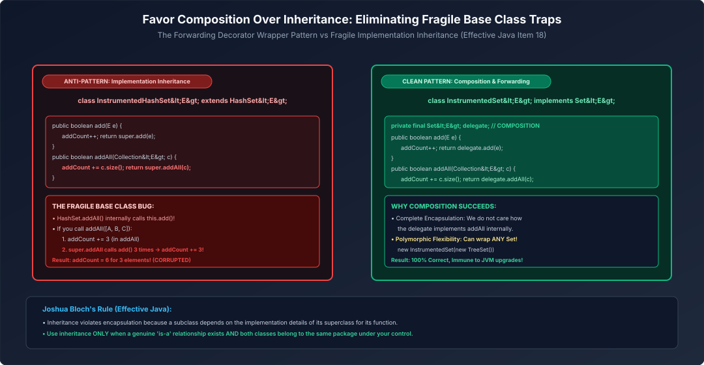

*D2 Source: [`06_composition_over_inheritance.d2`](assets/09_microservices_and_system_design/06_composition_over_inheritance.d2)*

#### Production Code: The Forwarding / Decorator Idiom
```java
// ✅ ROBUST: Composes an internal Set and forwards calls
public class InstrumentedSet<E> implements Set<E> {
    private final Set<E> delegate;
    private int addCount = 0;

    public InstrumentedSet(Set<E> delegate) {
        this.delegate = delegate;
    }

    @Override
    public boolean add(E e) {
        addCount++;
        return delegate.add(e);
    }

    @Override
    public boolean addAll(Collection<? extends E> c) {
        addCount += c.size();
        return delegate.addAll(c);
    }

    public int getAddCount() { return addCount; }

    // Forwarding boilerplate delegates safely to internal instance
    @Override public int size() { return delegate.size(); }
    @Override public boolean isEmpty() { return delegate.isEmpty(); }
    @Override public boolean contains(Object o) { return delegate.contains(o); }
    @Override public Iterator<E> iterator() { return delegate.iterator(); }
    @Override public Object[] toArray() { return delegate.toArray(); }
    @Override public <T> T[] toArray(T[] a) { return delegate.toArray(a); }
    @Override public boolean remove(Object o) { return delegate.remove(o); }
    @Override public boolean containsAll(Collection<?> c) { return delegate.containsAll(c); }
    @Override public boolean retainAll(Collection<?> c) { return delegate.retainAll(c); }
    @Override public boolean removeAll(Collection<?> c) { return delegate.removeAll(c); }
    @Override public void clear() { delegate.clear(); }
}
```

---

### 2.3 Law of Demeter (Principle of Least Knowledge)
> **Definition**: A module should not know the internal details of the objects it manipulates. "Talk only to your immediate friends, never to strangers."

#### Anti-Pattern: The "Train Wreck"
```java
// ❌ VIOLATION: Excessive dot-chaining navigates deep object graphs
String zipcode = order.getCustomer().getAddress().getGeoLocation().getZipcode();
```

#### Refactored Production Solution: Delegated Query
```java
// ✅ PRODUCTION: Order delegates to Customer, which queries Address
String zipcode = order.getDeliveryZipcode();
```

---

### 2.4 Separation of Concerns (SoC) & Clean Layered Architecture

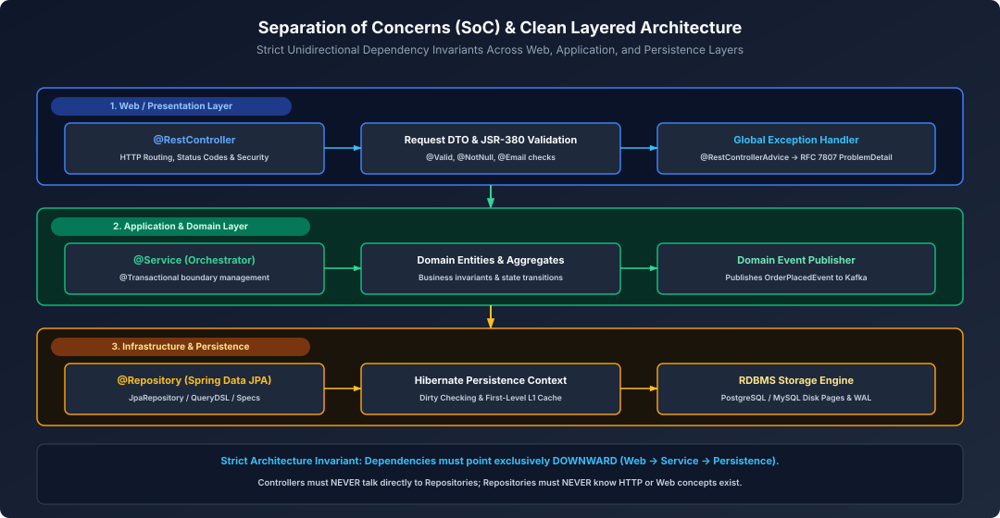

*D2 Source: [`07_separation_of_concerns_layered_architecture.d2`](assets/09_microservices_and_system_design/07_separation_of_concerns_layered_architecture.d2)*

---

# 3. GoF Creational Design Patterns

---

### 3.1 Builder Pattern
* **Purpose**: Constructs complex objects step-by-step, separating construction from representation. Crucial for creating **immutable** objects with multiple optional parameters.
* **Spring / Java Idioms**: Lombok `@Builder`, `ProcessBuilder`, `UriComponentsBuilder`, `HttpRequest.newBuilder()`.

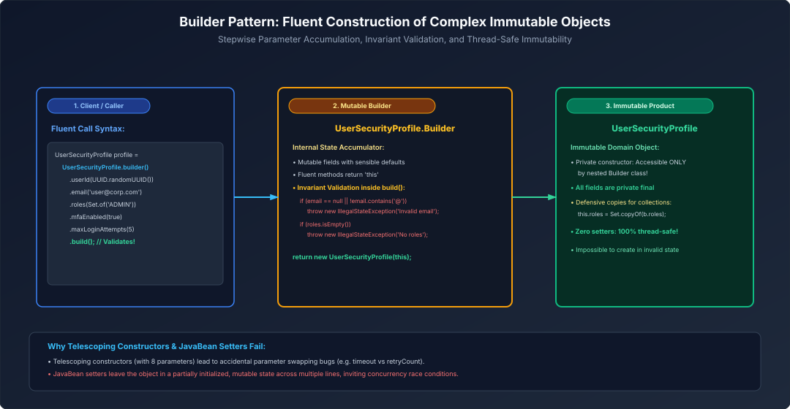

*D2 Source: [`08_builder_pattern.d2`](assets/09_microservices_and_system_design/08_builder_pattern.d2)*

```java
public final class UserSecurityProfile {
    private final String userId;
    private final String username;
    private final String email;
    private final Set<String> roles;
    private final boolean mfaEnabled;

    private UserSecurityProfile(Builder builder) {
        this.userId = Objects.requireNonNull(builder.userId, "userId must not be null");
        this.username = Objects.requireNonNull(builder.username, "username must not be null");
        this.email = Objects.requireNonNull(builder.email, "email must not be null");
        this.roles = Set.copyOf(builder.roles); // Immutable defensive copy
        this.mfaEnabled = builder.mfaEnabled;
    }

    public static class Builder {
        private String userId;
        private String username;
        private String email;
        private Set<String> roles = new HashSet<>();
        private boolean mfaEnabled = false;

        public Builder userId(String userId) { this.userId = userId; return this; }
        public Builder username(String username) { this.username = username; return this; }
        public Builder email(String email) { this.email = email; return this; }
        public Builder addRole(String role) { this.roles.add(role); return this; }
        public Builder mfaEnabled(boolean mfaEnabled) { this.mfaEnabled = mfaEnabled; return this; }

        public UserSecurityProfile build() {
            return new UserSecurityProfile(this);
        }
    }
}
```

---

### 3.2 Factory Method & Abstract Factory Pattern
* **Purpose**: 
  * **Factory Method**: Defines an interface for creating an object, but allows subclasses to decide which class to instantiate.
  * **Abstract Factory**: Provides an interface for creating families of related or dependent objects without specifying their concrete classes.
* **Spring Usage**: `BeanFactory`, `FactoryBean<T>`, `ConnectionFactory`.

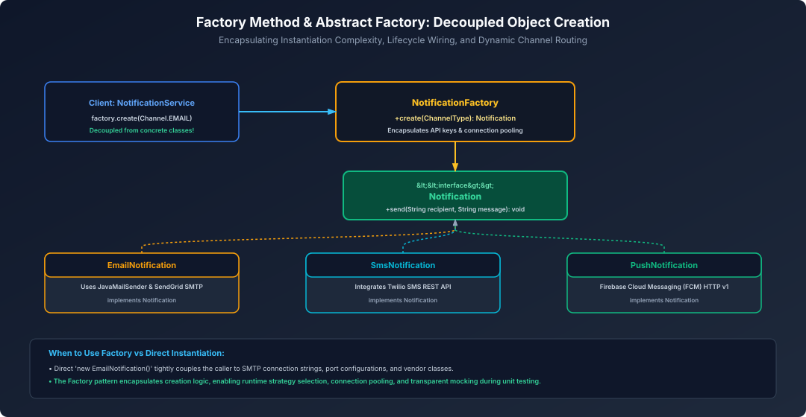

*D2 Source: [`09_factory_pattern.d2`](assets/09_microservices_and_system_design/09_factory_pattern.d2)*

```java
// Notification Factory Method
public interface Notification {
    void send(String recipient, String message);
}

@Component("emailNotification")
public class EmailNotification implements Notification {
    @Override public void send(String r, String m) { /* Send via SMTP */ }
}

@Component("smsNotification")
public class SmsNotification implements Notification {
    @Override public void send(String r, String m) { /* Send via Twilio */ }
}

@Service
@RequiredArgsConstructor
public class NotificationFactory {
    private final Map<String, Notification> notificationMap;

    public Notification getNotificationService(String channel) {
        Notification notification = notificationMap.get(channel.toLowerCase() + "Notification");
        if (notification == null) {
            throw new IllegalArgumentException("Unknown channel: " + channel);
        }
        return notification;
    }
}
```

---

### 3.3 Singleton Pattern
* **Purpose**: Ensures that a class has only one instance and provides a global point of access to it.
* **Production Best Practice**: In Spring applications, singletons are managed by the container (`@Component`, `@Service`). In pure Java, Double-Checked Locking with `volatile` or Enum Singletons are standard.

#### Thread-Safe Double-Checked Locking (DCL)
```java
public class CacheRegistry {
    // volatile ensures memory visibility and prevents CPU instruction reordering
    private static volatile CacheRegistry INSTANCE;

    private CacheRegistry() {
        // Guard against reflection instantiation attacks
        if (INSTANCE != null) {
            throw new IllegalStateException("Singleton instance already exists!");
        }
    }

    public static CacheRegistry getInstance() {
        if (INSTANCE == null) { // 1st Check (No lock overhead)
            synchronized (CacheRegistry.class) {
                if (INSTANCE == null) { // 2nd Check (Inside lock)
                    INSTANCE = new CacheRegistry();
                }
            }
        }
        return INSTANCE;
    }
}
```

#### The Enum Singleton Implementation
```java
public enum ConnectionPoolManager {
    INSTANCE;

    private final List<String> connections = new CopyOnWriteArrayList<>();

    public void registerConnection(String id) {
        connections.add(id);
    }
}
```

---

### 3.4 Prototype Pattern
* **Purpose**: Creates new objects by copying an existing instance (prototyping) rather than constructing new ones from scratch. Highly effective when object instantiation is computationally heavy (e.g. database parsing, complex graph loading).
* **Spring Usage**: Spring Bean Prototype Scope (`@Scope("prototype")`).

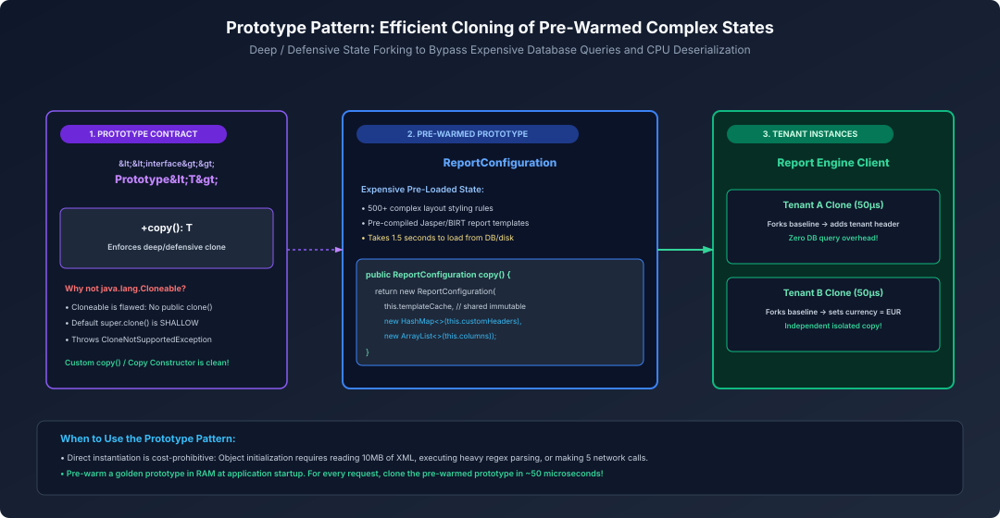

*D2 Source: [`10_prototype_pattern.d2`](assets/09_microservices_and_system_design/10_prototype_pattern.d2)*

```java
public interface Prototype<T> {
    T copy();
}

public class ReportConfiguration implements Prototype<ReportConfiguration> {
    private final String tenantId;
    private final List<String> metrics;
    private final Map<String, String> displayFilters;

    public ReportConfiguration(String tenantId, List<String> metrics, Map<String, String> displayFilters) {
        this.tenantId = tenantId;
        this.metrics = new ArrayList<>(metrics);
        this.displayFilters = new HashMap<>(displayFilters);
    }

    // Deep copy implementation guaranteeing immutability across clones
    @Override
    public ReportConfiguration copy() {
        return new ReportConfiguration(
            this.tenantId,
            new ArrayList<>(this.metrics),
            new HashMap<>(this.displayFilters)
        );
    }

    public void addMetric(String metric) {
        this.metrics.add(metric);
    }
}
```

---

# 4. GoF Structural Design Patterns

---

### 4.1 Adapter Pattern
* **Purpose**: Converts the interface of a class into another interface that clients expect. Allows incompatible classes to work together.
* **Spring Usage**: `HandlerAdapter` in Spring MVC, `JpaVendorAdapter`.

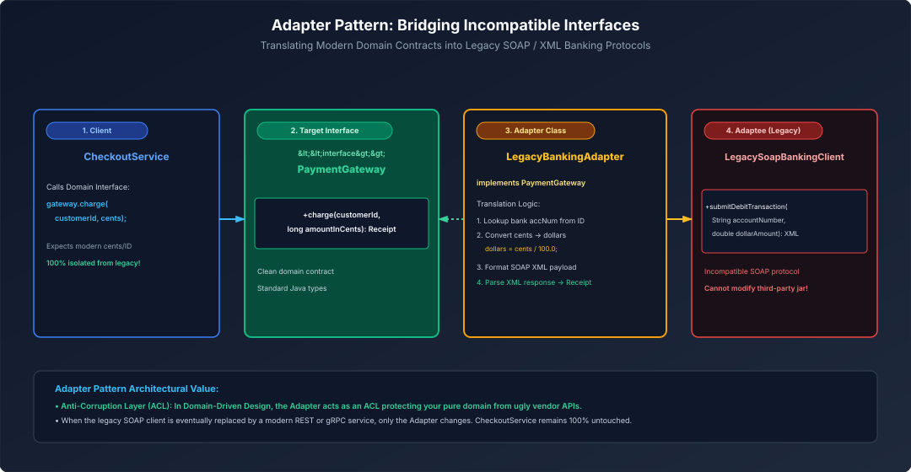

*D2 Source: [`11_adapter_pattern.d2`](assets/09_microservices_and_system_design/11_adapter_pattern.d2)*

```java
// Target interface expected by modern backend
public interface PaymentGateway {
    PaymentResult charge(String customerId, BigDecimal amountInCents);
}

// Incompatible legacy 3rd-party SDK
public class LegacySoapBankingClient {
    public SoapResponse submitDebitTransaction(long accountNum, double dollarAmount) {
        return new SoapResponse("SUCCESS_CODE_200");
    }
}

// Adapter bridges the two systems
@Component
@RequiredArgsConstructor
public class LegacyBankingAdapter implements PaymentGateway {
    private final LegacySoapBankingClient legacyClient;

    @Override
    public PaymentResult charge(String customerId, BigDecimal amountInCents) {
        long accountNum = Long.parseLong(customerId);
        double dollarAmount = amountInCents.divide(BigDecimal.valueOf(100)).doubleValue();
        SoapResponse response = legacyClient.submitDebitTransaction(accountNum, dollarAmount);
        return new PaymentResult("SUCCESS_CODE_200".equals(response.statusCode()));
    }
}
```

---

### 4.2 Decorator Pattern
* **Purpose**: Attaches additional responsibilities to an object dynamically without subclassing.
* **JDK / Spring Usage**: `BufferedReader(new InputStreamReader(System.in))`, Spring `HttpServletRequestWrapper`.

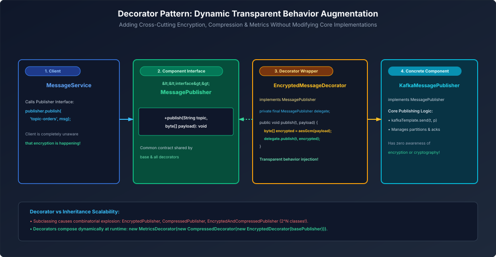

*D2 Source: [`12_decorator_pattern.d2`](assets/09_microservices_and_system_design/12_decorator_pattern.d2)*

```java
public interface MessagePublisher {
    void publish(String topic, String payload);
}

@Service
public class KafkaMessagePublisher implements MessagePublisher {
    @Override public void publish(String topic, String payload) { /* send raw payload to kafka */ }
}

// Decorator adding encryption transparently without modifying KafkaMessagePublisher
@Service
@Primary
public class EncryptedMessagePublisherDecorator implements MessagePublisher {
    private final MessagePublisher delegate;
    private final AesEncryptionService encryptionService;

    public EncryptedMessagePublisherDecorator(MessagePublisher delegate, AesEncryptionService enc) {
        this.delegate = delegate;
        this.encryptionService = enc;
    }

    @Override
    public void publish(String topic, String payload) {
        String cipherText = encryptionService.encrypt(payload);
        delegate.publish(topic, cipherText);
    }
}
```

---

### 4.3 Proxy Pattern (JDK Dynamic vs CGLIB)
* **Purpose**: Provides a surrogate or placeholder for another object to control access, perform lazy loading, add transaction boundaries, or log execution metrics.
* **Spring Usage**: Spring AOP dynamically wraps beans in proxies for `@Transactional`, `@Async`, and `@Cacheable`.

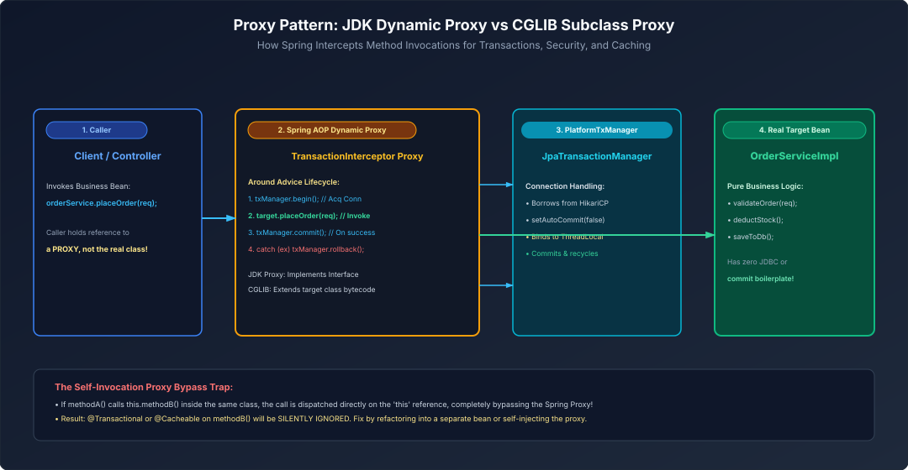

*D2 Source: [`13_proxy_pattern_jdk_vs_cglib.d2`](assets/09_microservices_and_system_design/13_proxy_pattern_jdk_vs_cglib.d2)*

* **JDK Dynamic Proxy**: Requires target class to implement an interface. Employs `java.lang.reflect.Proxy` and `InvocationHandler`.
* **CGLIB Proxy**: Generates bytecode subclasses of target classes at runtime. Used when classes do not implement interfaces or when `proxyTargetClass = true`.

---

### 4.4 Facade Pattern
* **Purpose**: Provides a simplified, higher-level interface to a complex library, subsystem, or cluster of classes.
* **Spring Usage**: `JdbcTemplate`, `KafkaTemplate`, `RestTemplate`.

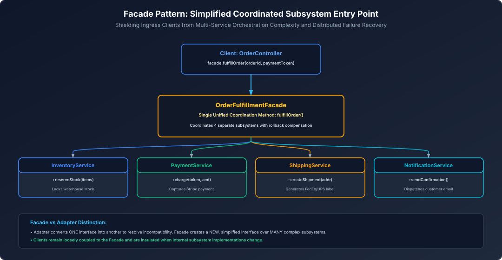

*D2 Source: [`14_facade_pattern.d2`](assets/09_microservices_and_system_design/14_facade_pattern.d2)*

```java
@Component
@RequiredArgsConstructor
public class OrderFulfillmentFacade {
    private final InventoryClient inventoryClient;
    private final PaymentProcessor paymentProcessor;
    private final ShippingGateway shippingGateway;
    private final NotificationService notificationService;

    public FulfillmentReceipt fulfillOrder(Order order) {
        inventoryClient.reserveStock(order.getItems());
        paymentProcessor.charge(order.getCustomerId(), order.getTotal());
        TrackingNumber tracking = shippingGateway.createShipment(order.getAddress());
        notificationService.sendConfirmation(order.getCustomerId(), tracking);
        return new FulfillmentReceipt(order.getId(), tracking);
    }
}
```

---

### 4.5 Composite Pattern
* **Purpose**: Composes objects into tree structures to represent part-whole hierarchies. Enables clients to treat individual leaf objects and compositions of objects uniformly.
* **Enterprise Usage**: Hierarchical permission trees (Roles containing Sub-roles and Privileges), product catalog categories, and nested organization units.

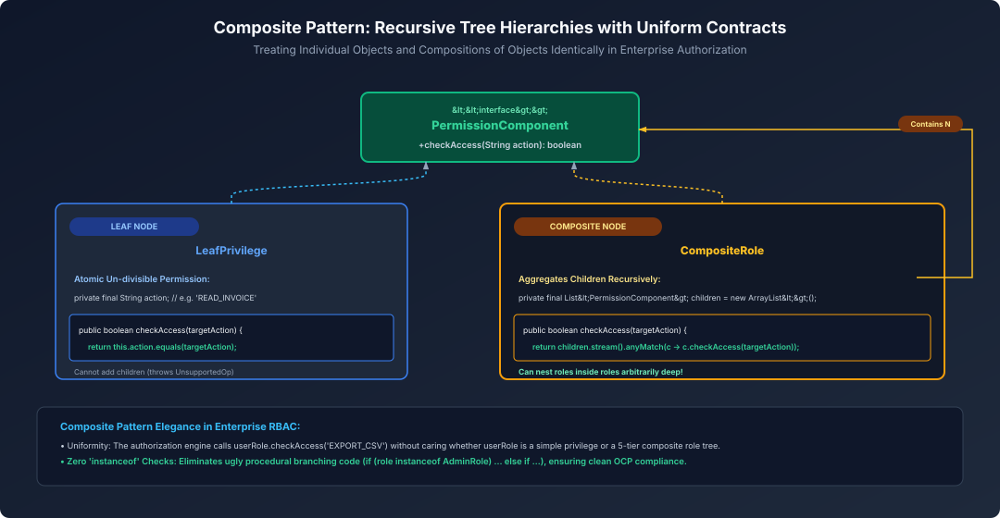

*D2 Source: [`15_composite_pattern.d2`](assets/09_microservices_and_system_design/15_composite_pattern.d2)*

```java
public interface PermissionComponent {
    boolean checkAccess(String action);
    String getName();
}

// Leaf: Individual atomic permission
public class LeafPrivilege implements PermissionComponent {
    private final String name;
    private final String requiredAction;

    public LeafPrivilege(String name, String requiredAction) {
        this.name = name;
        this.requiredAction = requiredAction;
    }

    @Override public String getName() { return name; }
    @Override public boolean checkAccess(String action) { return requiredAction.equalsIgnoreCase(action); }
}

// Composite: Role containing child roles and permissions
public class CompositeRole implements PermissionComponent {
    private final String roleName;
    private final List<PermissionComponent> children = new ArrayList<>();

    public CompositeRole(String roleName) { this.roleName = roleName; }

    public void add(PermissionComponent component) { children.add(component); }

    @Override public String getName() { return roleName; }

    @Override
    public boolean checkAccess(String action) {
        // Recursive evaluation treats leaf privileges and nested sub-roles identically
        return children.stream().anyMatch(child -> child.checkAccess(action));
    }
}
```

---

# 5. GoF Behavioral Design Patterns

---

### 5.1 Strategy Pattern
* **Purpose**: Defines a family of algorithms, encapsulates each one, and makes them interchangeable at runtime.
* **Spring Idiom**: Injecting `Map<String, StrategyInterface>` directly into services for dynamic algorithmic dispatch.

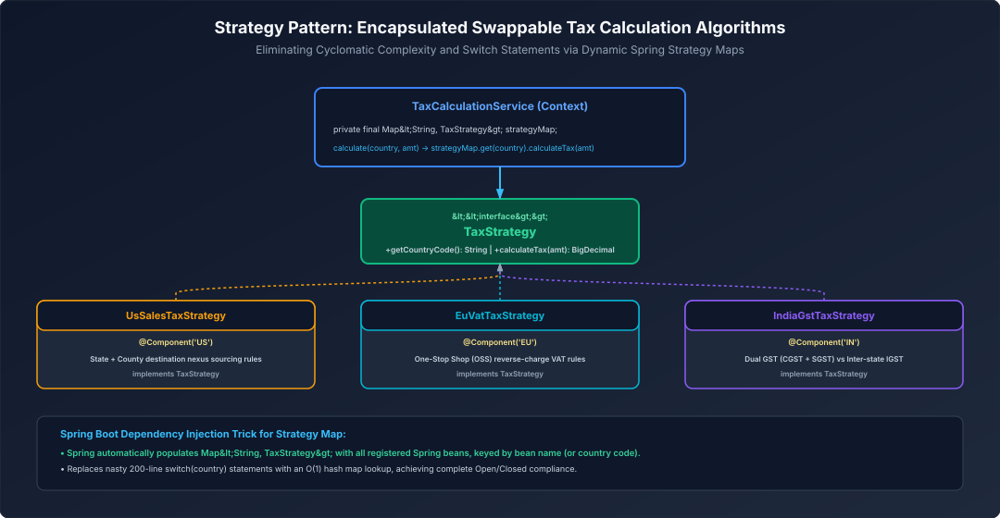

*D2 Source: [`16_strategy_pattern.d2`](assets/09_microservices_and_system_design/16_strategy_pattern.d2)*

```java
public interface TaxStrategy {
    String getCountryCode();
    BigDecimal calculateTax(BigDecimal subtotal);
}

@Component
public class UsSalesTaxStrategy implements TaxStrategy {
    @Override public String getCountryCode() { return "US"; }
    @Override public BigDecimal calculateTax(BigDecimal subtotal) { return subtotal.multiply(new BigDecimal("0.07")); }
}

@Component
public class EuVatTaxStrategy implements TaxStrategy {
    @Override public String getCountryCode() { return "EU"; }
    @Override public BigDecimal calculateTax(BigDecimal subtotal) { return subtotal.multiply(new BigDecimal("0.20")); }
}

@Service
public class TaxCalculationEngine {
    private final Map<String, TaxStrategy> taxStrategies;

    public TaxCalculationEngine(List<TaxStrategy> strategies) {
        this.taxStrategies = strategies.stream()
            .collect(Collectors.toMap(TaxStrategy::getCountryCode, Function.identity()));
    }

    public BigDecimal compute(String country, BigDecimal subtotal) {
        TaxStrategy strategy = taxStrategies.getOrDefault(country, subtotalVal -> BigDecimal.ZERO);
        return strategy.calculateTax(subtotal);
    }
}
```

---

### 5.2 Template Method Pattern
* **Purpose**: Defines the skeleton of an algorithm in an abstract base class, deferring specific steps to subclasses without altering algorithm structure.
* **Spring Usage**: `AbstractPlatformTransactionManager`, `JdbcTemplate.execute()`.

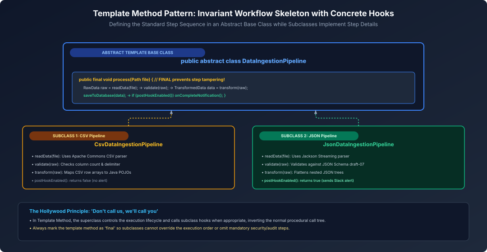

*D2 Source: [`17_template_method_pattern.d2`](assets/09_microservices_and_system_design/17_template_method_pattern.d2)*

```java
public abstract class DataIngestionPipeline {
    // Template method declared final to lock down algorithm execution sequence
    public final void executePipeline(URI sourceUri) {
        byte[] rawData = readData(sourceUri);
        byte[] validatedData = validateData(rawData);
        Object domainModel = transform(validatedData);
        persist(domainModel);
        afterIngestionHook(domainModel); // Optional hook
    }

    protected abstract byte[] readData(URI sourceUri);
    protected abstract byte[] validateData(byte[] rawData);
    protected abstract Object transform(byte[] validatedData);
    protected abstract void persist(Object model);

    // Hook method with default no-op implementation
    protected void afterIngestionHook(Object model) {
        // Subclasses may optionally override for audit metrics
    }
}
```

---

### 5.3 Chain of Responsibility Pattern
* **Purpose**: Passes requests along a chain of handlers. Upon receiving a request, each handler either processes it or passes it to the next handler in the chain.
* **Spring Usage**: `SecurityFilterChain`, `javax.servlet.Filter`.

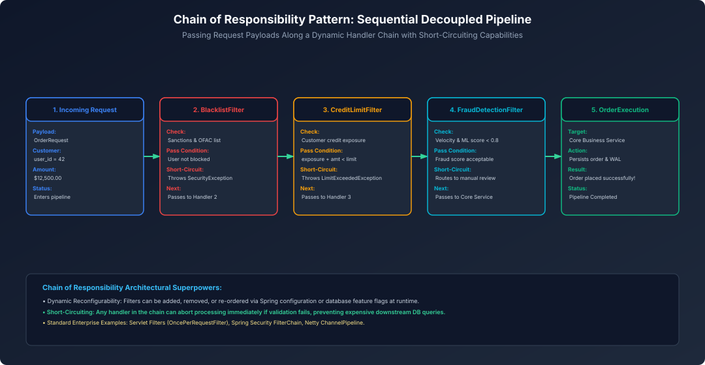

*D2 Source: [`18_chain_of_responsibility_pattern.d2`](assets/09_microservices_and_system_design/18_chain_of_responsibility_pattern.d2)*

```java
public interface OrderValidationFilter {
    void doFilter(OrderContext context, ValidationFilterChain chain);
}

public interface ValidationFilterChain {
    void proceed(OrderContext context);
}

@Component
@Order(1)
public class BlacklistCheckFilter implements OrderValidationFilter {
    @Override
    public void doFilter(OrderContext context, ValidationFilterChain chain) {
        if (isBlacklisted(context.getCustomerId())) {
            throw new SecurityException("Customer is blacklisted!");
        }
        chain.proceed(context);
    }
}

@Component
@Order(2)
public class CreditLimitCheckFilter implements OrderValidationFilter {
    @Override
    public void doFilter(OrderContext context, ValidationFilterChain chain) {
        if (exceedsCreditLimit(context)) {
            throw new InsufficientCreditException("Limit exceeded!");
        }
        chain.proceed(context);
    }
}
```

---

### 5.4 Observer Pattern
* **Purpose**: Defines a one-to-many dependency between objects so that when one object changes state, all its dependents are notified automatically.
* **Spring Usage**: `ApplicationEventPublisher`, `@EventListener`, Spring Application Events.

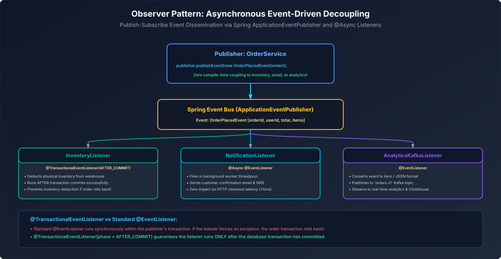

*D2 Source: [`19_observer_pattern.d2`](assets/09_microservices_and_system_design/19_observer_pattern.d2)*

```java
// 1. Immutable Domain Event
public record OrderPlacedEvent(String orderId, BigDecimal amount, Instant timestamp) {}

// 2. Event Publisher
@Service
@RequiredArgsConstructor
public class OrderService {
    private final ApplicationEventPublisher eventPublisher;

    public void placeOrder(String orderId, BigDecimal amount) {
        // Business execution...
        eventPublisher.publishEvent(new OrderPlacedEvent(orderId, amount, Instant.now()));
    }
}

// 3. Asynchronous Observer / Listener
@Component
public class InventoryOrderListener {
    @Async
    @EventListener
    public void handleOrderPlaced(OrderPlacedEvent event) {
        // Updates inventory asynchronously without blocking order response
    }
}
```

---

### 5.5 State Pattern
* **Purpose**: Allows an object to alter its behavior when its internal state changes. Replaces giant, brittle `switch` and `if-else` state transition trees with dedicated state objects.

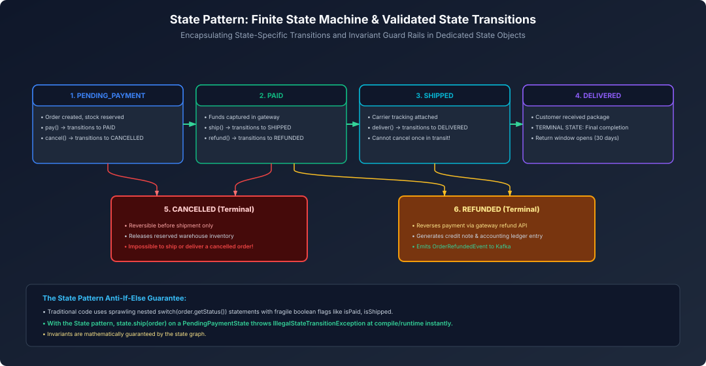

*D2 Source: [`20_state_pattern.d2`](assets/09_microservices_and_system_design/20_state_pattern.d2)*

```java
public interface OrderState {
    void pay(OrderContext context);
    void ship(OrderContext context);
    void cancel(OrderContext context);
}

public class OrderContext {
    private OrderState state = new PendingPaymentState();

    public void setState(OrderState state) { this.state = state; }
    public void pay() { state.pay(this); }
    public void ship() { state.ship(this); }
    public void cancel() { state.cancel(this); }
}

public class PendingPaymentState implements OrderState {
    @Override
    public void pay(OrderContext context) {
        System.out.println("Payment processed successfully.");
        context.setState(new PaidState());
    }

    @Override
    public void ship(OrderContext context) {
        throw new IllegalStateException("Cannot ship order before payment!");
    }

    @Override
    public void cancel(OrderContext context) {
        System.out.println("Order cancelled.");
        context.setState(new CancelledState());
    }
}

public class PaidState implements OrderState {
    @Override
    public void pay(OrderContext context) { throw new IllegalStateException("Order already paid!"); }
    @Override
    public void ship(OrderContext context) { context.setState(new ShippedState()); }
    @Override
    public void cancel(OrderContext context) { context.setState(new RefundedState()); }
}
```

---

### 5.6 Command Pattern
* **Purpose**: Encapsulates a request as an object, thereby letting you parameterize clients with different requests, queue or log requests, and support undoable operations.
* **Enterprise Usage**: Transactional outbox pattern, batch execution engines, undo/redo state management in event sourcing.

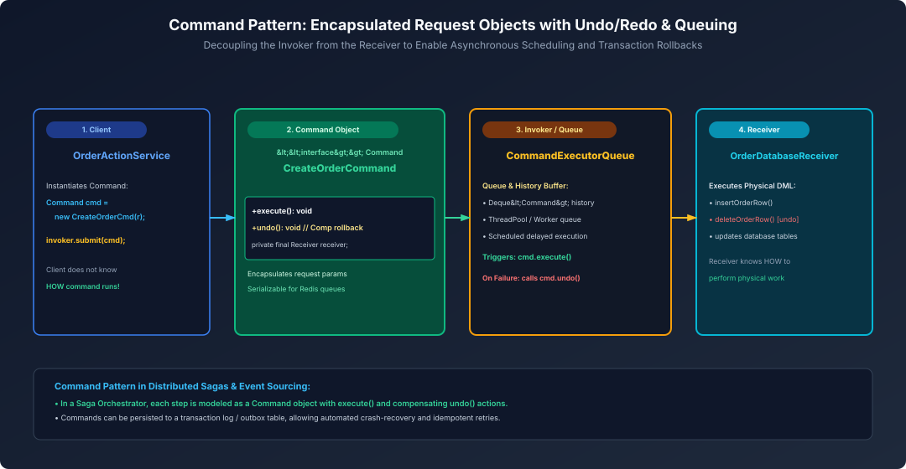

*D2 Source: [`21_command_pattern.d2`](assets/09_microservices_and_system_design/21_command_pattern.d2)*

```java
public interface Command {
    void execute();
    void undo();
}

public class AdjustInventoryCommand implements Command {
    private final InventoryRepository repository;
    private final String sku;
    private final int quantity;

    public AdjustInventoryCommand(InventoryRepository repository, String sku, int quantity) {
        this.repository = repository;
        this.sku = sku;
        this.quantity = quantity;
    }

    @Override
    public void execute() {
        repository.decreaseStock(sku, quantity);
    }

    @Override
    public void undo() {
        repository.increaseStock(sku, quantity);
    }
}

// Invoker managing command history and execution
public class TransactionCommandManager {
    private final Deque<Command> history = new ArrayDeque<>();

    public void executeCommand(Command command) {
        command.execute();
        history.push(command);
    }

    public void rollbackLast() {
        if (!history.isEmpty()) {
            Command command = history.pop();
            command.undo();
        }
    }
}
```

---

# 6. Enterprise Backend & Domain-Driven Patterns

---

### 6.1 Data Transfer Object (DTO) & MapStruct Mapper Pattern
* **Purpose**: Separates internal database entities (JPA models) from external API contracts (JSON payloads) to prevent leaking database schemas, circular serialization, and unintended field overwrites.

```java
// 1. API Contract Record
public record UserResponseDto(UUID id, String email, String fullName) {}

// 2. MapStruct Compile-Time Mapper (Zero reflection overhead)
@Mapper(componentModel = "spring")
public interface UserMapper {
    @Mapping(target = "fullName", expression = "java(entity.getFirstName() + ' ' + entity.getLastName())")
    UserResponseDto toDto(UserEntity entity);
}
```

---

### 6.2 Value Object Pattern
* **Purpose**: Encapsulates primitive types into immutable, self-validating objects with value equality.
* **Domain Examples**: `Money(BigDecimal amount, Currency currency)`, `EmailAddress(String email)`, `PostalCode(String code)`.

```java
public record Money(BigDecimal amount, Currency currency) {
    public Money {
        Objects.requireNonNull(amount, "Amount must not be null");
        Objects.requireNonNull(currency, "Currency must not be null");
        if (amount.compareTo(BigDecimal.ZERO) < 0) {
            throw new IllegalArgumentException("Money amount cannot be negative");
        }
        amount = amount.setScale(2, RoundingMode.HALF_UP);
    }

    public Money add(Money other) {
        if (!this.currency.equals(other.currency)) {
            throw new IllegalArgumentException("Cannot add different currencies: " + currency + " vs " + other.currency);
        }
        return new Money(this.amount.add(other.amount), this.currency);
    }
}
```

---

### 6.3 Repository & Specification Pattern
* **Purpose**: Decouples domain logic from persistence mechanisms. The Specification Pattern enables dynamic, composable query predicates using the JPA Criteria API.

```java
public class OrderSpecifications {
    public static Specification<OrderEntity> hasStatus(OrderStatus status) {
        return (root, query, cb) -> cb.equal(root.get("status"), status);
    }

    public static Specification<OrderEntity> minAmount(BigDecimal min) {
        return (root, query, cb) -> cb.greaterThanOrEqualTo(root.get("totalAmount"), min);
    }
}

// In Service: Composable querying without dynamic SQL strings
List<OrderEntity> results = orderRepository.findAll(
    Specification.where(OrderSpecifications.hasStatus(OrderStatus.PAID))
                 .and(OrderSpecifications.minAmount(new BigDecimal("100.00")))
);
```

> [!TIP]
> **Deep-Dive Interview Scenario:**
> - [Q1. Microservices Advantages & Challenges & DDD Bounded Contexts](frequently_asked_questions/09_microservices_and_system_design_faq.md#q1-medium-microservices-advantages--challenges--ddd-bounded-contexts)

---

# 7. Clean Architecture & Hexagonal Architecture (Ports & Adapters)

Hexagonal Architecture (Alistair Cockburn) and Clean Architecture (Robert C. Martin) place pure domain business logic at the core, decoupling it completely from frameworks, databases, message brokers, and user interfaces.

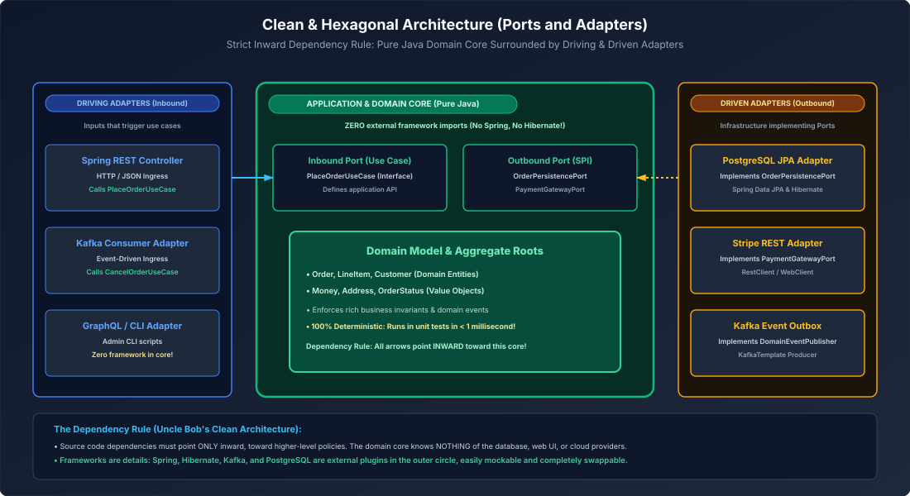

*D2 Source: [`22_clean_and_hexagonal_architecture.d2`](assets/09_microservices_and_system_design/22_clean_and_hexagonal_architecture.d2)*

#### Production Code: Clean Architecture Dependency Inversion
```java
// 1. INBOUND PORT: Expresses what the application can do
public interface PlaceOrderUseCase {
    OrderId execute(PlaceOrderCommand command);
}

// 2. OUTBOUND PORT: Expresses external dependencies required by domain
public interface OrderRepositoryPort {
    void save(Order order);
    Optional<Order> findById(OrderId id);
}

// 3. APPLICATION SERVICE: Orchestrates domain objects without framework dependencies
public class OrderApplicationService implements PlaceOrderUseCase {
    private final OrderRepositoryPort orderRepository;

    public OrderApplicationService(OrderRepositoryPort orderRepository) {
        this.orderRepository = orderRepository;
    }

    @Override
    public OrderId execute(PlaceOrderCommand command) {
        Order order = Order.create(command.customerId(), command.items());
        orderRepository.save(order);
        return order.getId();
    }
}
```

---

# 8. Architectural Fitness Functions & ArchUnit Testing

Architectural degradation happens gradually when developers inadvertently introduce circular dependencies or import persistence models into web controllers. **ArchUnit** provides executable, automated unit tests that enforce architectural boundaries in CI/CD pipelines.

```java
import com.tngtech.archunit.core.importer.ImportOption;
import com.tngtech.archunit.junit.AnalyzeClasses;
import com.tngtech.archunit.junit.ArchTest;
import com.tngtech.archunit.lang.ArchRule;

import static com.tngtech.archunit.lang.syntax.ArchRuleDefinition.classes;
import static com.tngtech.archunit.lang.syntax.ArchRuleDefinition.noClasses;
import static com.tngtech.archunit.library.Architectures.layeredArchitecture;

@AnalyzeClasses(packages = "com.enterprise.app", importOptions = ImportOption.DoNotIncludeTests.class)
public class ArchitectureInvariantsTest {

    // 1. Enforce Clean Layered Architecture
    @ArchTest
    static final ArchRule layered_architecture_must_be_respected =
        layeredArchitecture()
            .consideringAllDependencies()
            .layer("Controllers").definedBy("..adapter.in.web..")
            .layer("Services").definedBy("..application.service..")
            .layer("Domain").definedBy("..domain..")
            .layer("Infrastructure").definedBy("..adapter.out.persistence..")
            .whereLayer("Controllers").mayNotBeAccessedByAnyLayer()
            .whereLayer("Services").mayOnlyBeAccessedByLayers("Controllers")
            .whereLayer("Domain").mayOnlyBeAccessedByLayers("Services", "Infrastructure");

    // 2. Domain Model must be pure Java: Zero Spring or JPA dependencies!
    @ArchTest
    static final ArchRule domain_must_be_free_of_framework_dependencies =
        noClasses().that().resideInAPackage("..domain..")
            .should().dependOnClassesThat().resideInAnyPackage(
                "org.springframework..",
                "jakarta.persistence..",
                "org.hibernate.."
            );
}
```

---

# 9. Microservice Architecture & Core Components

---

### 9.1 Monolith vs Microservices Architecture Deep-Dive

A Monolithic architecture unifies the entire application codebase, data models, and business logic into a single deployable artifact (JAR/WAR). A Microservices architecture decomposes the enterprise domain into a distributed collection of independently deployable, loosely coupled, polyglot services organized around business capabilities.

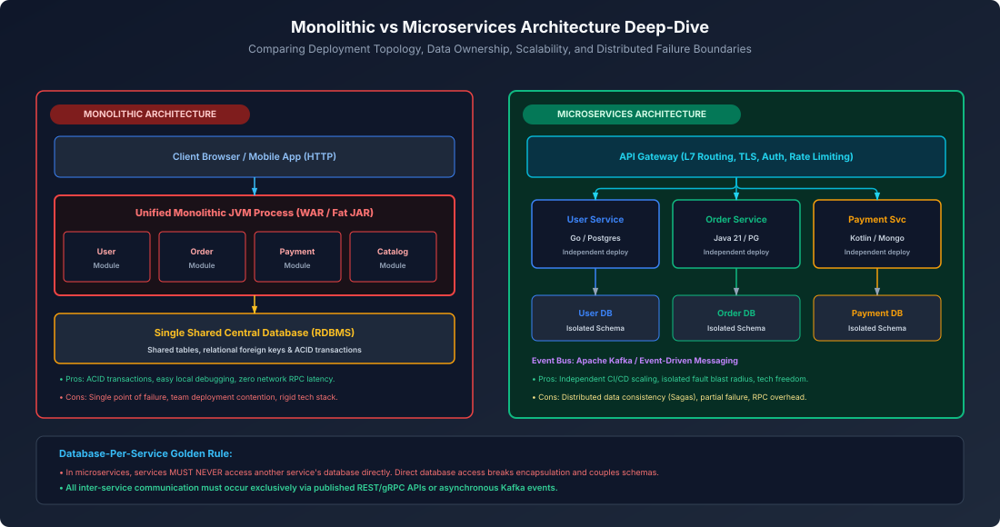

*D2 Source: [`23_monolith_vs_microservices_architecture.d2`](assets/09_microservices_and_system_design/23_monolith_vs_microservices_architecture.d2)*

#### Multi-Dimensional Architectural Comparison

| Architectural Dimension | Monolithic Architecture | Microservices Architecture |
| :--- | :--- | :--- |
| **Deployment Independence** | Single artifact deployed as one unit; change in one module requires redeploying everything | Independent deployment lifecycles per microservice via autonomous CI/CD pipelines |
| **Scalability & Cost** | Coarse-grained: Entire monolith must be scaled horizontally, even if only one module is loaded | Fine-grained: Scale only compute-intensive or bottleneck services (e.g. scale Payment, leave Catalog) |
| **Fault Isolation** | Poor: Memory leak, unhandled exception, or deadlocked thread in one module can crash entire process | High: Failure in one service is contained via Circuit Breakers without cascading to other services |
| **Technology Stack** | Rigid: Entire team is locked into a single language version and framework (e.g. Java 17 + Spring) | Polyglot: Teams select the best tool for the job (Java/Spring for Core, Python for AI, Go for Networking) |
| **Database Coupling** | High: Shared tables, cross-domain foreign keys, and complex direct SQL joins | Zero: Database-per-service pattern; all data sharing occurs via public APIs or event streams |
| **Operational Complexity** | Low: Easy local debugging, single build artifact, simple deployment | High: Requires container orchestration (Kubernetes), distributed tracing, and service mesh |

---

### 9.2 Domain-Driven Design (DDD) & Service Decomposition

Decomposing a system improperly results in a **Distributed Monolith** (all the network latency and deployment complexity of microservices with none of the autonomy).

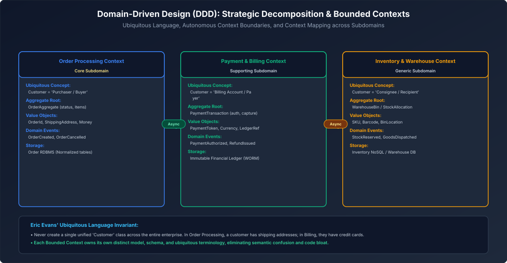

*D2 Source: [`24_ddd_bounded_contexts_subdomains.d2`](assets/09_microservices_and_system_design/24_ddd_bounded_contexts_subdomains.d2)*

1. **Strategic DDD & Bounded Contexts**:
   - A **Bounded Context** defines the explicit boundary within which a domain model applies.
   - The concept of a `Customer` in the Order context focuses on delivery addresses and order history, whereas in the Payment context it focuses on credit cards and billing identity. Attempting to unify these into a single global `User` object causes catastrophic coupling.
2. **Decomposition Strategies**:
   - **Decomposition by Business Capability**: Align services with enterprise business functions (e.g. Invoicing, Fulfillment, Catalog).
   - **Decomposition by Subdomain**:
     - *Core Domain*: The primary business differentiator (e.g., proprietary recommendation engine).
     - *Supporting Domain*: Complementary domain logic (e.g., inventory management).
     - *Generic Domain*: Standard off-the-shelf business needs (e.g., identity & authentication).

---

### 9.3 Database-per-Service Pattern & Schema Isolation

In an enterprise microservices architecture, **no service is permitted to query another service's private database directly**.
- **Schema Isolation**: Each service owns its tables, indexes, and migrations (Flyway/Liquibase). Teams modify internal database schemas without breaking downstream callers.
- **Polyglot Persistence**: The Order service uses a relational database (PostgreSQL) for ACID compliance; the Catalog service uses MongoDB for document flexibility; the Recommendation engine uses Neo4j for graph relationships; the Search service uses Elasticsearch.
- **Data Sharing Rule**: Services exchange data strictly via **Public REST/gRPC APIs** or **Asynchronous Domain Events (Kafka)**.

---

### 9.4 API Gateway: Routing, Security Offloading & L4 vs L7 Load Balancing

The API Gateway is the single public entry point for all external clients (mobile, browser, third-party partners):

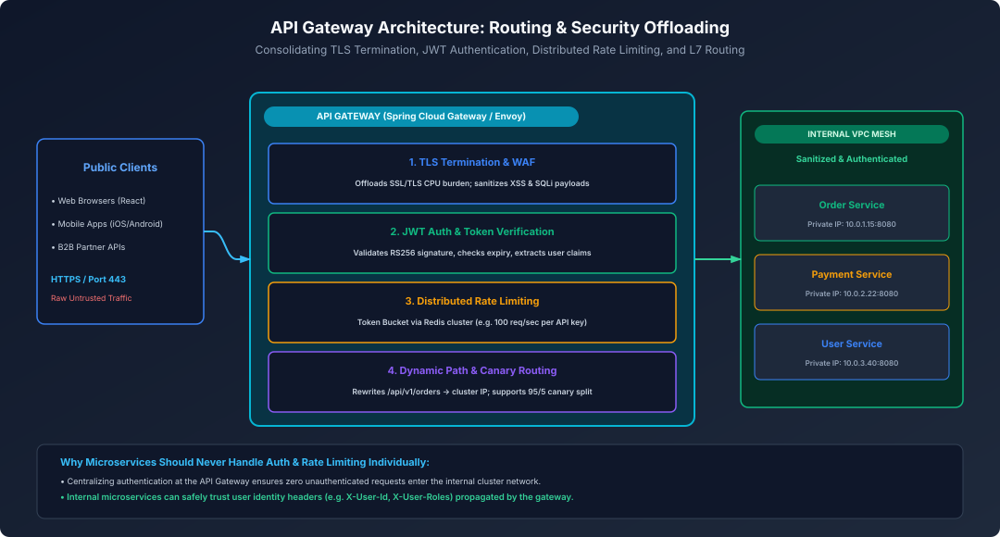

*D2 Source: [`25_api_gateway_routing_security_offloading.d2`](assets/09_microservices_and_system_design/25_api_gateway_routing_security_offloading.d2)*

#### Layer 4 (L4) vs Layer 7 (L7) Load Balancing

| Dimension | Layer 4 Load Balancing (Transport) | Layer 7 Load Balancing (Application) |
| :--- | :--- | :--- |
| **OSI Layer** | Layer 4 (TCP / UDP) | Layer 7 (HTTP / HTTPS / gRPC / WebSockets) |
| **Inspection Capability** | IP address and TCP/UDP port only; cannot inspect payload | Full HTTP headers, cookies, URL paths, query parameters, JSON payload |
| **Routing Capability** | Simple round-robin or least-connections per connection | Content-based routing (e.g. route `/api/v1/orders` to Cluster A, `/api/v1/users` to Cluster B) |
| **Performance & Latency** | Ultra-high throughput, sub-millisecond latency (Packet-level NAT) | Slightly higher compute cost due to parsing HTTP/TLS sessions |
| **Security Features** | SYN flood protection, IP whitelisting | WAF, OAuth2 token inspection, header injection, CORS enforcement |
| **Industry Examples** | AWS NLB (Network Load Balancer), Azure Load Balancer, HAProxy TCP | AWS ALB, Azure Application Gateway, NGINX, Spring Cloud Gateway, Envoy |

#### Core Load Balancing Algorithms
1. **Round Robin**: Requests distributed sequentially across backend nodes. Optimal when all worker nodes have identical hardware specs and request costs are uniform.
2. **Weighted Round Robin**: Assigns higher request quotas to nodes with larger CPU/RAM capacity (e.g. Node A gets 3x traffic of Node B).
3. **Least Connections**: Dynamically routes traffic to the server instance with the fewest active TCP/HTTP concurrent connections. Optimal for long-lived WebSocket or database sessions.
4. **IP Hash**: Computes hash of client source IP (`hash(client_ip) % N`) to map a user deterministically to the same backend server (session affinity / sticky sessions).
5. **Consistent Hashing**: Minimizes key and connection migration when backend servers scale up or down (see [Section 4.6](#126-consistent-hashing-algorithm-with-virtual-nodes)).

---

### 9.5 Service Discovery: Client-Side vs Server-Side

In containerized clouds (Kubernetes), microservice instances have dynamic, ephemeral IP addresses.

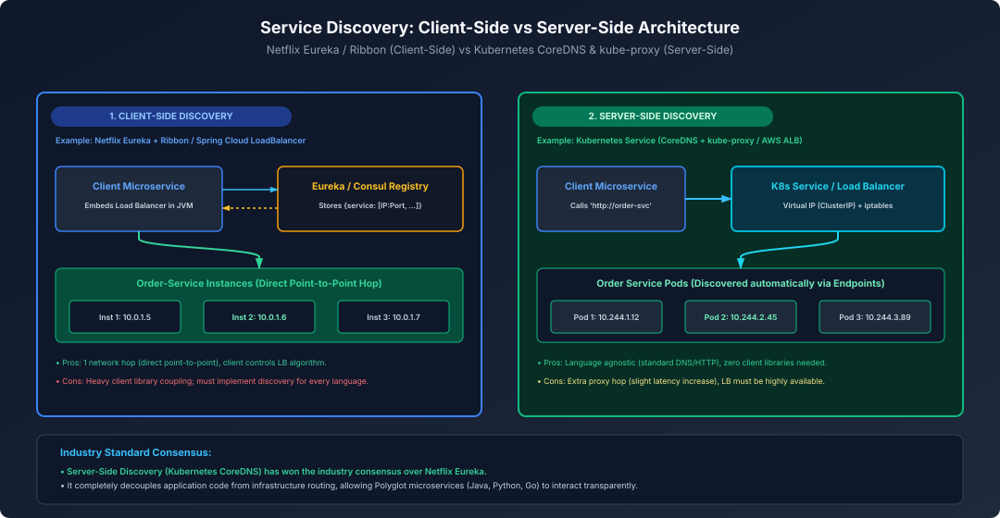

*D2 Source: [`26_service_discovery_client_vs_server_side.d2`](assets/09_microservices_and_system_design/26_service_discovery_client_vs_server_side.d2)*

- **Client-Side Discovery**: The client microservice queries the registry directly, caches healthy instance IPs locally, and uses client-side load balancing algorithms (Round Robin, Weighted Response Time) to pick a target node. *Downside*: Tight coupling to registry client library in every programming language.
- **Server-Side Discovery (Cloud-Native Standard)**: The client makes a call to a stable DNS name (`http://order-service`). An intermediate router (Kubernetes `kube-proxy` or Cloud Load Balancer) resolves the name and proxies the request to healthy instances. *Benefit*: Complete language independence.

---

### 9.6 Service Mesh (Istio / Envoy): Sidecar Proxies & Mutual TLS (mTLS)

A Service Mesh is a dedicated infrastructure layer that handles service-to-service communication transparently:

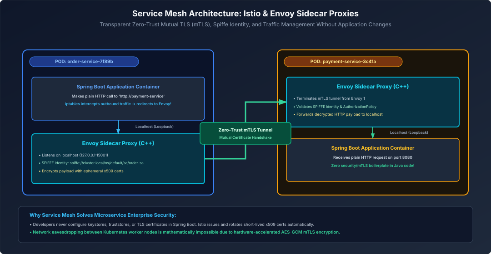

*D2 Source: [`27_service_mesh_istio_sidecar_mtls.d2`](assets/09_microservices_and_system_design/27_service_mesh_istio_sidecar_mtls.d2)*

1. **Sidecar Pattern**: An **Envoy proxy** runs alongside each application container inside the same Kubernetes Pod, intercepting all ingress and egress network traffic.
2. **Zero-Trust Security via mTLS**: Envoy automatically encrypts all service-to-service communication with mutual TLS and validates cryptographic identities (SPIFFE/SPIRE certificates) without modifying application code.
3. **Advanced Traffic Management**: Supports canary traffic splitting (e.g., 90% to v1, 10% to v2), fault injection testing, and circuit breaking directly at the infrastructure layer.

---

### 9.7 Distributed Tracing: W3C TraceContext, OpenTelemetry, Trace ID & Span ID Propagation

In a distributed microservices call chain, a single incoming user transaction touches dozens of services. Without distributed tracing, isolating the root cause of high latency or failures is impossible.

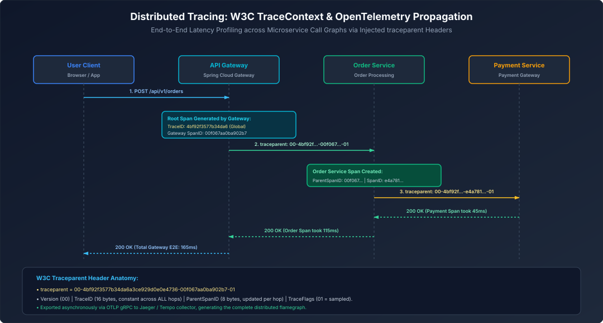

*D2 Source: [`28_distributed_tracing_w3c_traceparent_opentelemetry.d2`](assets/09_microservices_and_system_design/28_distributed_tracing_w3c_traceparent_opentelemetry.d2)*

#### W3C `traceparent` Header Format Explained
The industry standard W3C `traceparent` header follows the syntax:
`version - trace_id - parent_id / span_id - trace_flags`
- `00`: W3C Specification version.
- `4bf92f3577b34da6a3ce929d0e0e4736`: **Trace ID** (16-byte hex). Globally unique identifier for the entire end-to-end distributed request chain. Remains identical across every microservice hop.
- `00f067aa0ba902b7`: **Parent Span ID** (8-byte hex). Identifies the specific hop or sub-operation that triggered the current call.
- `01`: **Trace Flags** (8-bit field). `01` signals that the trace was sampled and recorded by the OpenTelemetry collector.

---

### 9.8 The Backend for Frontend (BFF) Pattern & Edge Routing

In modern multi-platform architectures, mobile apps, desktop browsers, and public third-party partners have vastly divergent requirements:
- **Mobile Clients (iOS/Android)**: Constrained cellular bandwidth, small screens, high battery consumption; require **aggregated, stripped-down payloads** to avoid over-fetching.
- **Desktop Web Clients**: High-bandwidth fiber connections, wide multi-pane dashboards; require **deep, rich, uncompressed data structures**.
- **Third-Party Partner APIs**: Strict backward-compatible semantic versioning and rate quotas.

Having a single monolithic API Gateway cater to all clients forces complex conditionals into the gateway, causing organizational friction. The **Backend for Frontend (BFF)** pattern introduces dedicated gateway tiers for each client category:

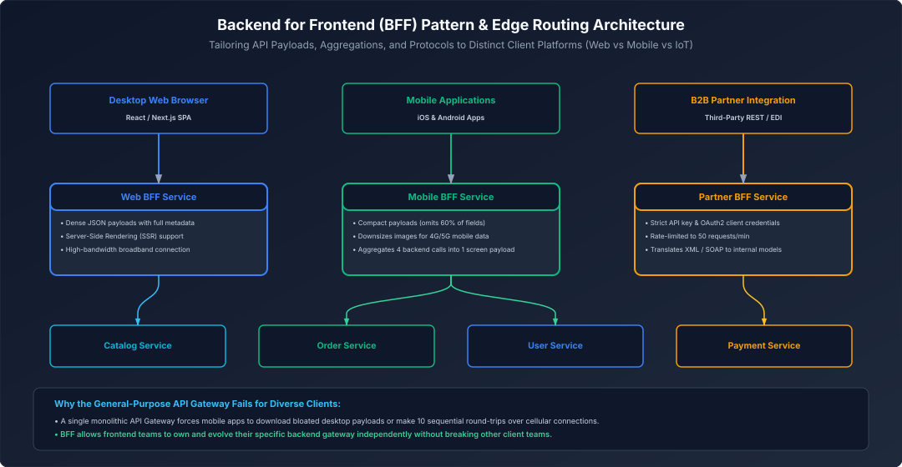

*D2 Source: [`29_backend_for_frontend_bff_edge_routing.d2`](assets/09_microservices_and_system_design/29_backend_for_frontend_bff_edge_routing.d2)*

> [!TIP]
> **Inter-Service Protocol Harmony**: While public clients talk **REST / JSON** or GraphQL to their respective BFFs over the internet, the BFFs communicate with internal downstream microservices over **multiplexed, low-latency gRPC** (see [05. Spring Framework, Spring Boot & REST APIs - Section 16: REST vs gRPC](05_spring_boot_and_rest_apis.md#16-api-communication-paradigms-rest-vs-rpc-vs-grpc--protocol-buffers)).

> [!TIP]
> **Deep-Dive Interview Scenarios:**
> - [Q2. Service Discovery, Load Balancing (Eureka vs Consul) & The API Gateway Pattern](frequently_asked_questions/09_microservices_and_system_design_faq.md#q2-expert-service-discovery-load-balancing-eureka-vs-consul--the-api-gateway-pattern)
> - [Q4. Securing Microservices Communication (mTLS & JWT)](frequently_asked_questions/09_microservices_and_system_design_faq.md#q4-medium-securing-microservices-communication-mtls--jwt)

---

# 10. Resilience & Fault Tolerance Patterns

---

### 10.1 Circuit Breaker Pattern & State Machine (Closed, Open, Half-Open)

The Circuit Breaker pattern prevents an application from repeatedly executing an operation that is failing, preventing cascading thread pool exhaustion across microservices:

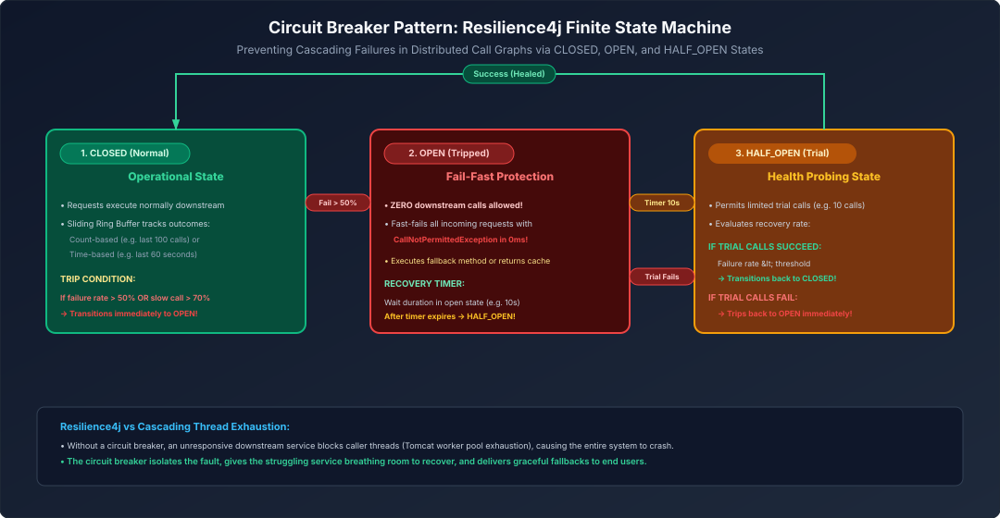

*D2 Source: [`30_circuit_breaker_resilience4j_state_machine.d2`](assets/09_microservices_and_system_design/30_circuit_breaker_resilience4j_state_machine.d2)*

1. **`CLOSED`**: Requests flow normally. The circuit tracks call outcomes in a sliding window (e.g., last 100 calls). If the failure rate exceeds the configured threshold (e.g., 50%), the circuit transitions to `OPEN`.
2. **`OPEN`**: Requests are blocked immediately without invoking the remote service. Calls fail fast, returning an instant fallback response to preserve caller thread pools.
3. **`HALF_OPEN`**: After a cooldown period (e.g., 15 seconds), the circuit permits a small number of trial requests. If all trial calls succeed, the circuit resets to `CLOSED`; if any trial call fails, the circuit returns to `OPEN`.

#### Production Resilience4j Configuration (`application.yml`)

```yaml
resilience4j:
  circuitbreaker:
    instances:
      paymentService:
        slidingWindowType: COUNT_BASED
        slidingWindowSize: 100
        minimumNumberOfCalls: 20
        failureRateThreshold: 50.0
        slowCallRateThreshold: 70.0
        slowCallDurationThreshold: 2000ms
        waitDurationInOpenState: 15000ms
        permittedNumberOfCallsInHalfOpenState: 10
        automaticTransitionFromOpenToHalfOpenEnabled: true
  retry:
    instances:
      paymentService:
        maxAttempts: 3
        waitDuration: 500ms
        enableExponentialBackoff: true
        exponentialBackoffMultiplier: 2
```

---

### 10.2 Retry with Exponential Backoff and Full Jitter

Blindly retrying failed network calls causes the **Thundering Herd Problem**: thousands of retrying clients strike an already overwhelmed downstream database at the exact same synchronized millisecond, preventing recovery.

$$\text{Sleep} = \text{random}\left(0, \, \min\left(\text{MaxWait}, \, \text{Base} \times 2^{\text{attempt}}\right)\right)$$

```java
public class ExponentialBackoffJitter {
    private static final long BASE_WAIT_MS = 200;
    private static final long MAX_WAIT_MS = 5000;
    private static final java.util.Random RANDOM = new java.util.Random();

    public static long calculateSleep(int attempt) {
        long exponentialWait = Math.min(MAX_WAIT_MS, BASE_WAIT_MS * (1L << attempt));
        // Full Jitter: Uniform random distribution between 0 and exponentialWait
        return (long) (RANDOM.nextDouble() * exponentialWait);
    }
}
```

---

### 10.3 Bulkhead Isolation (Thread Pool vs Semaphore) & Timeouts

The Bulkhead pattern isolates computing resources into independent compartments so that a failure in one module cannot deplete resources across the entire system:
- **Thread Pool Bulkhead**: Allocates a separate, bounded queue and thread pool for calls to a specific downstream service. If the "Recommendation Service" hangs, only its 10 dedicated threads get blocked; the remaining application threads serving "Order Checkout" continue uninterrupted.
- **Semaphore Bulkhead**: Bounded counter enforcing concurrency limits on the calling thread without context-switching overhead.

---

### 10.4 API Rate Limiting Algorithms (Token Bucket, Leaky Bucket, Sliding Window Counter)

| Algorithm | Mechanism | Handles Bursts? | Memory Footprint | Best Production Use Case |
| :--- | :--- | :--- | :--- | :--- |
| **Token Bucket** | Tokens added to bucket at steady rate; request consumes token. Rejects if empty. | Yes (up to bucket capacity) | Minimal (2 variables: token count, last timestamp) | API Gateways, REST API user tiers |
| **Leaky Bucket** | Requests enter FIFO queue; processed at fixed, steady leak rate. Drops if queue full. | Smooths bursts into flat rate | Moderate (FIFO queue capacity) | Ingestion systems, egress webhooks |
| **Fixed Window Counter** | Counts requests in fixed time interval (e.g. 00:00 - 00:01). Resets at window boundary. | No (suffers 2x burst at boundary) | Ultra-low (single integer counter) | Simple internal threshold checks |
| **Sliding Window Counter** | Blends previous window count with current window weight: $\text{Count} = C_{\text{prev}} \times (1 - \text{weight}) + C_{\text{curr}}$. | Yes (eliminates boundary burst) | Low (2 counters per client) | Enterprise distributed rate limiting |

---

### 10.5 API Idempotency & Distributed Deduplication (Redisson Distributed Lock)

In distributed networks, timeouts can leave callers uncertain whether a request succeeded. An **Idempotency Key** ensures that repeating an API call produces the exact same result without executing the business logic twice:

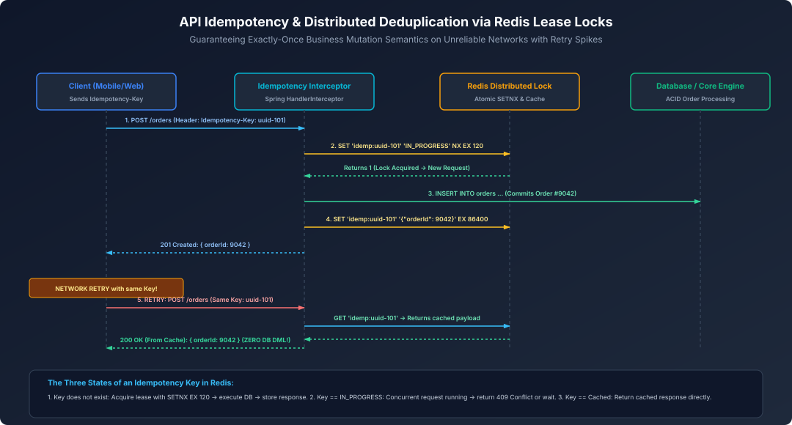

*D2 Source: [`31_api_idempotency_redis_deduplication.d2`](assets/09_microservices_and_system_design/31_api_idempotency_redis_deduplication.d2)*

> [!NOTE]
> For the complete Spring Boot HTTP Servlet Filter implementation with request payload SHA-256 collision detection (`409 Conflict`), and RFC standard header specifications, see [05. Spring Framework, Spring Boot & REST APIs - Section 11: Production API Idempotency Architecture](05_spring_boot_and_rest_apis.md#11-production-api-idempotency-architecture).

> [!TIP]
> **Deep-Dive Interview Scenario:**
> - [Q5. Circuit Breakers (Resilience4j), Cascading Failures & Production Recovery Mechanisms](frequently_asked_questions/09_microservices_and_system_design_faq.md#q5-expert-circuit-breakers-resilience4j-cascading-failures--production-recovery-mechanisms)

---

# 11. Distributed Transactions & Event-Driven Patterns

---

### 11.1 Two-Phase Commit (2PC) vs Saga Pattern

#### Distributed Transactions & Consistency Boundaries
In a monolithic application, maintaining data consistency across multiple database tables is trivial: the relational database provides local ACID transactions managed by Write-Ahead Logs (WAL) and MVCC locks. In a microservices architecture where each service owns a private database (the **Database-per-Service pattern**), a single business process (e.g., e-commerce checkout) spans multiple independent network nodes.

To coordinate state mutations across distinct data stores, architectures choose between two primary paradigms:

1. **Two-Phase Commit (2PC — Distributed Consensus Protocol):**
   - **Operational Protocol:** Coordinated by an external Transaction Coordinator (e.g., XA transaction manager):
     - **Phase 1 (Prepare):** The coordinator asks all participating databases if they are ready to commit. Each node acquires physical locks on affected records, writes changes to its local redo log, and votes `YES` or `NO`.
     - **Phase 2 (Commit/Abort):** If all nodes voted `YES`, the coordinator issues a global `COMMIT`. If any node voted `NO` or timed out, the coordinator issues a global `ROLLBACK`.
   - **Severe Production Failure Modes:** 2PC is a **blocking protocol**. Participating nodes hold exclusive database locks across the entire network handshake duration. If the coordinator crashes or a network partition occurs between Phase 1 and Phase 2, nodes remain locked indefinitely, exhausting database connection pools and causing cascading outages.

2. **The Saga Pattern (Asynchronous Event-Driven Compensations):**
   - **Operational Philosophy:** Formulated by Garcia-Molina and Salem (1987). A Saga decomposes a distributed transaction into a linear sequence of **local ACID transactions** executed across microservices.
   - **Compensating Transactions:** Each service updates its own database locally and emits an event. Crucially, **no distributed locks are held**. If step 3 fails (e.g., Payment Declined), the Saga executes explicit **Compensating Transactions** ($C_2, C_1$) in reverse order to semantically undo earlier committed steps (e.g., releasing reserved inventory).
   - **Consistency Model:** Sacrifices immediate ACID isolation for **Eventual Consistency (BASE)**, delivering massive horizontal scalability and partition tolerance.

| Architectural Dimension | Two-Phase Commit (2PC) | Saga Pattern |
| :--- | :--- | :--- |
| **Coordination Type** | Synchronous blocking protocol across distributed database nodes | Asynchronous sequence of local transactions coordinated via events |
| **Isolation Level** | Full ACID (Holds distributed locks on records across all nodes) | Eventual Consistency (ACID local, BASE global; no distributed locks) |
| **Throughput & Scalability** | Low: Bottlenecked by slowest node; network partitions stall entire cluster | High: Local transactions commit instantly; highly scalable |
| **Availability (CAP)** | Strongly favors Consistency ($CP$); vulnerable to coordinator failure | Strongly favors Availability ($AP$); guarantees eventual convergence |
| **Error Recovery** | Global abort and automatic rollback | Executes explicit compensating transactions to undo committed local work |

---

### 11.2 Saga Choreography vs Saga Orchestration

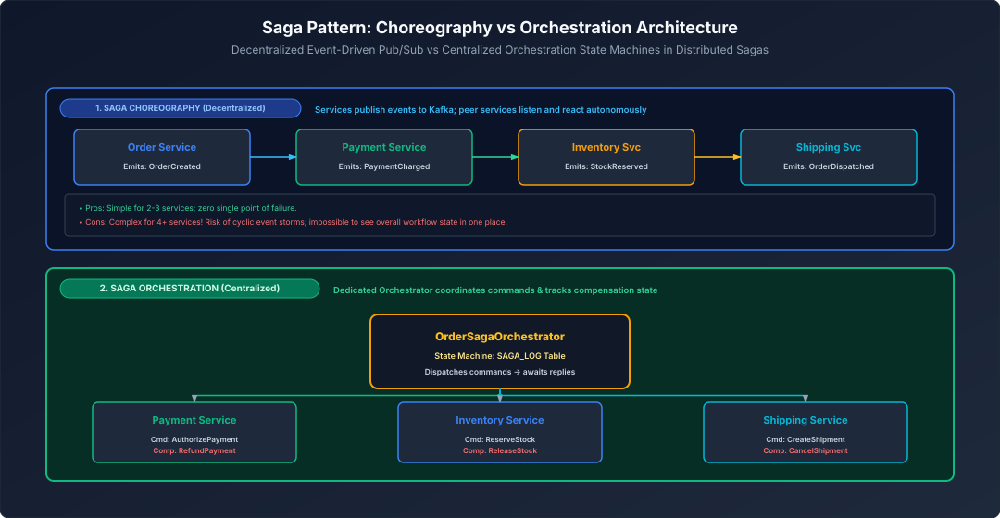

*D2 Source: [`32_saga_choreography_vs_orchestration.d2`](assets/09_microservices_and_system_design/32_saga_choreography_vs_orchestration.d2)*

---

### 11.3 Production Saga Orchestrator Implementation with Persistent State Machine

A production-grade Saga Orchestrator cannot simply rely on in-memory procedural calls; if the orchestrator pod crashes midway through a transaction, uncompensated distributed state will be orphaned indefinitely. A resilient orchestrator must persist its execution state machine to durable storage at each step boundary.

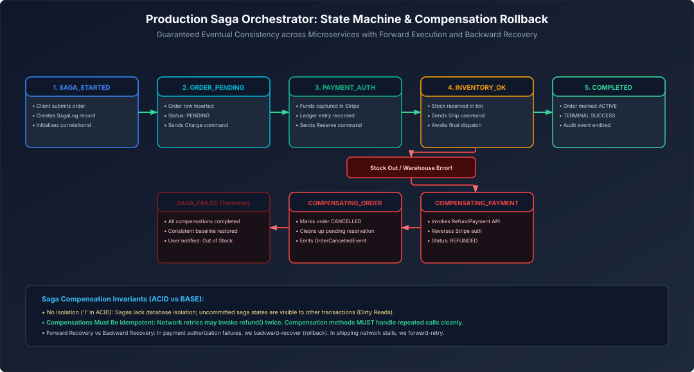

*D2 Source: [`33_production_saga_orchestrator_state_machine.d2`](assets/09_microservices_and_system_design/33_production_saga_orchestrator_state_machine.d2)*

#### Production Saga Schema DDL (PostgreSQL)

```sql
CREATE TABLE saga_instance (
    saga_id UUID PRIMARY KEY,
    saga_type VARCHAR(64) NOT NULL,
    current_state VARCHAR(64) NOT NULL,
    payload JSONB NOT NULL,
    created_at TIMESTAMP WITH TIME ZONE DEFAULT CURRENT_TIMESTAMP,
    updated_at TIMESTAMP WITH TIME ZONE DEFAULT CURRENT_TIMESTAMP
);

CREATE TABLE saga_step_log (
    step_id UUID PRIMARY KEY DEFAULT gen_random_uuid(),
    saga_id UUID NOT NULL REFERENCES saga_instance(saga_id) ON DELETE CASCADE,
    step_name VARCHAR(64) NOT NULL,
    step_status VARCHAR(32) NOT NULL, -- PENDING, COMPLETED, COMPENSATED, FAILED
    error_message TEXT,
    executed_at TIMESTAMP WITH TIME ZONE DEFAULT CURRENT_TIMESTAMP
);

CREATE INDEX idx_saga_lookup ON saga_instance (saga_type, current_state);
```

#### Production Saga Orchestrator Java Implementation

```java
package com.company.saga.orchestrator;

import com.fasterxml.jackson.databind.ObjectMapper;
import org.slf4j.Logger;
import org.slf4j.LoggerFactory;
import org.springframework.jdbc.core.JdbcTemplate;
import org.springframework.stereotype.Service;
import org.springframework.transaction.annotation.Transactional;

import java.time.Instant;
import java.util.UUID;

public record OrderSagaPayload(UUID orderId, UUID customerId, double amount, String itemId, int quantity) {}

public enum SagaState {
    STARTED,
    ORDER_PENDING,
    PAYMENT_AUTHORIZED,
    INVENTORY_RESERVED,
    COMPENSATING_PAYMENT,
    COMPENSATING_ORDER,
    COMPLETED,
    FAILED
}

@Service
public class ResilientOrderSagaOrchestrator {

    private static final Logger log = LoggerFactory.getLogger(ResilientOrderSagaOrchestrator.class);

    private final JdbcTemplate jdbcTemplate;
    private final ObjectMapper objectMapper;
    private final OrderServiceClient orderService;
    private final PaymentServiceClient paymentService;
    private final InventoryServiceClient inventoryService;

    public ResilientOrderSagaOrchestrator(JdbcTemplate jdbcTemplate,
                                          ObjectMapper objectMapper,
                                          OrderServiceClient orderService,
                                          PaymentServiceClient paymentService,
                                          InventoryServiceClient inventoryService) {
        this.jdbcTemplate = jdbcTemplate;
        this.objectMapper = objectMapper;
        this.orderService = orderService;
        this.paymentService = paymentService;
        this.inventoryService = inventoryService;
    }

    public UUID startSaga(OrderSagaPayload payload) {
        UUID sagaId = UUID.randomUUID();
        try {
            String jsonPayload = objectMapper.writeValueAsString(payload);
            jdbcTemplate.update(
                "INSERT INTO saga_instance (saga_id, saga_type, current_state, payload, updated_at) VALUES (?, ?, ?, ?::jsonb, ?)",
                sagaId, "ORDER_FULFILLMENT", SagaState.STARTED.name(), jsonPayload, Instant.now()
            );
        } catch (Exception e) {
            throw new RuntimeException("Failed to persist initial Saga state", e);
        }

        // Execute Saga state machine transitions asynchronously or synchronously
        executeNextTransition(sagaId, payload);
        return sagaId;
    }

    public void executeNextTransition(UUID sagaId, OrderSagaPayload payload) {
        try {
            // Step 1: Create Order in Pending State
            transitionState(sagaId, SagaState.ORDER_PENDING);
            recordStep(sagaId, "CREATE_PENDING_ORDER", "PENDING");
            orderService.createPendingOrder(payload.orderId(), payload.customerId(), payload.amount());
            recordStep(sagaId, "CREATE_PENDING_ORDER", "COMPLETED");

            // Step 2: Authorize Payment
            recordStep(sagaId, "AUTHORIZE_PAYMENT", "PENDING");
            boolean paymentSuccess = paymentService.charge(payload.orderId(), payload.amount());
            if (!paymentSuccess) {
                recordStep(sagaId, "AUTHORIZE_PAYMENT", "FAILED", "Insufficient funds or gateway decline");
                triggerCompensations(sagaId, payload, SagaState.COMPENSATING_ORDER);
                return;
            }
            transitionState(sagaId, SagaState.PAYMENT_AUTHORIZED);
            recordStep(sagaId, "AUTHORIZE_PAYMENT", "COMPLETED");

            // Step 3: Reserve Inventory
            recordStep(sagaId, "RESERVE_INVENTORY", "PENDING");
            boolean stockReserved = inventoryService.reserveStock(payload.orderId(), payload.itemId(), payload.quantity());
            if (!stockReserved) {
                recordStep(sagaId, "RESERVE_INVENTORY", "FAILED", "Stock unavailable");
                // Inventory failed: Compensate Payment first, then Cancel Order
                triggerCompensations(sagaId, payload, SagaState.COMPENSATING_PAYMENT);
                return;
            }
            transitionState(sagaId, SagaState.INVENTORY_RESERVED);
            recordStep(sagaId, "RESERVE_INVENTORY", "COMPLETED");

            // Step 4: Finalize Order Fulfillment
            orderService.markOrderConfirmed(payload.orderId());
            transitionState(sagaId, SagaState.COMPLETED);
            log.info("Saga {} successfully completed for order {}", sagaId, payload.orderId());

        } catch (Exception ex) {
            log.error("Unhandled exception during saga {} execution. Triggering fallback compensation", sagaId, ex);
            triggerCompensations(sagaId, payload, SagaState.COMPENSATING_PAYMENT);
        }
    }

    private void triggerCompensations(UUID sagaId, OrderSagaPayload payload, SagaState fromState) {
        log.warn("Initiating compensating transactions for Saga {} starting from {}", sagaId, fromState);

        if (fromState == SagaState.COMPENSATING_PAYMENT) {
            transitionState(sagaId, SagaState.COMPENSATING_PAYMENT);
            try {
                paymentService.refund(payload.orderId(), payload.amount());
                recordStep(sagaId, "REFUND_PAYMENT", "COMPENSATED");
            } catch (Exception e) {
                log.error("CRITICAL: Failed to compensate payment for order {}. Flagged for manual SRE intervention.", payload.orderId(), e);
                recordStep(sagaId, "REFUND_PAYMENT", "FAILED", e.getMessage());
            }
        }

        // Always compensate order back to CANCELLED
        transitionState(sagaId, SagaState.COMPENSATING_ORDER);
        try {
            orderService.cancelOrder(payload.orderId(), "Saga aborted due to downstream dependency failure");
            recordStep(sagaId, "CANCEL_ORDER", "COMPENSATED");
        } catch (Exception e) {
            log.error("CRITICAL: Failed to cancel order {}. SRE alerted.", payload.orderId(), e);
            recordStep(sagaId, "CANCEL_ORDER", "FAILED", e.getMessage());
        }

        transitionState(sagaId, SagaState.FAILED);
    }

    private void transitionState(UUID sagaId, SagaState state) {
        jdbcTemplate.update(
            "UPDATE saga_instance SET current_state = ?, updated_at = ? WHERE saga_id = ?",
            state.name(), Instant.now(), sagaId
        );
    }

    private void recordStep(UUID sagaId, String stepName, String status) {
        recordStep(sagaId, stepName, status, null);
    }

    private void recordStep(UUID sagaId, String stepName, String status, String errorMessage) {
        jdbcTemplate.update(
            "INSERT INTO saga_step_log (saga_id, step_name, step_status, error_message, executed_at) VALUES (?, ?, ?, ?, ?)",
            sagaId, stepName, status, errorMessage, Instant.now()
        );
    }
}
```

---

### 11.4 The Transactional Outbox Pattern & CDC with Debezium

The **Dual-Write Problem** is one of the most dangerous anti-patterns in distributed systems. It occurs when an application writes to a database and publishes to a message broker (e.g. Kafka) in two separate operations:

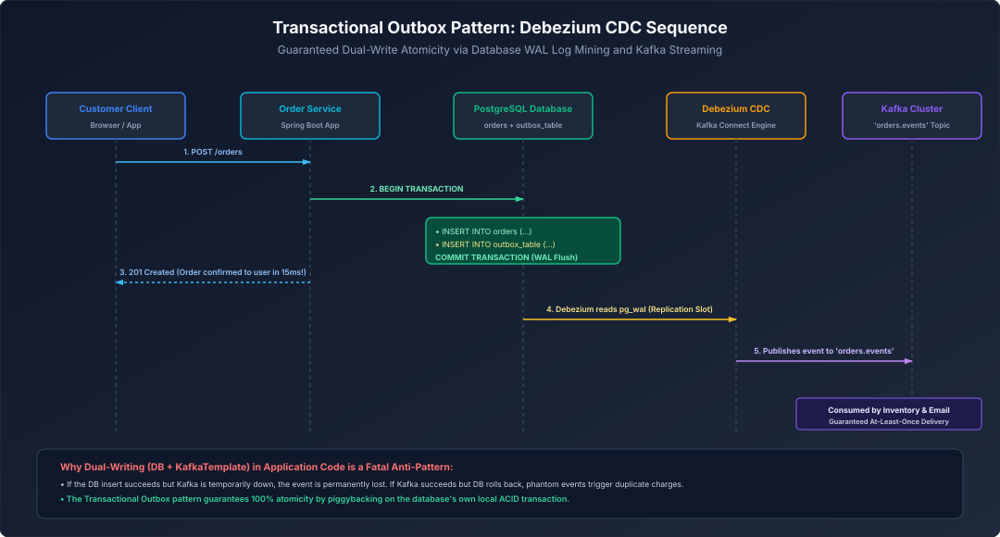

*D2 Source: [`34_transactional_outbox_debezium_cdc_sequence.d2`](assets/09_microservices_and_system_design/34_transactional_outbox_debezium_cdc_sequence.d2)*

If we flip the order and publish to Kafka first, a database constraint violation will leave downstream services processing a phantom order that doesn't exist.

#### The Transactional Outbox Solution

Instead of publishing directly to Kafka, the application writes both the business entity (`orders`) and an outbox event record (`outbox_events`) into the **same database within a single local ACID transaction**. A dedicated Change Data Capture (CDC) agent (Debezium) monitors the database's Write-Ahead Log (WAL) and streams events to Kafka with at-least-once delivery guarantees.

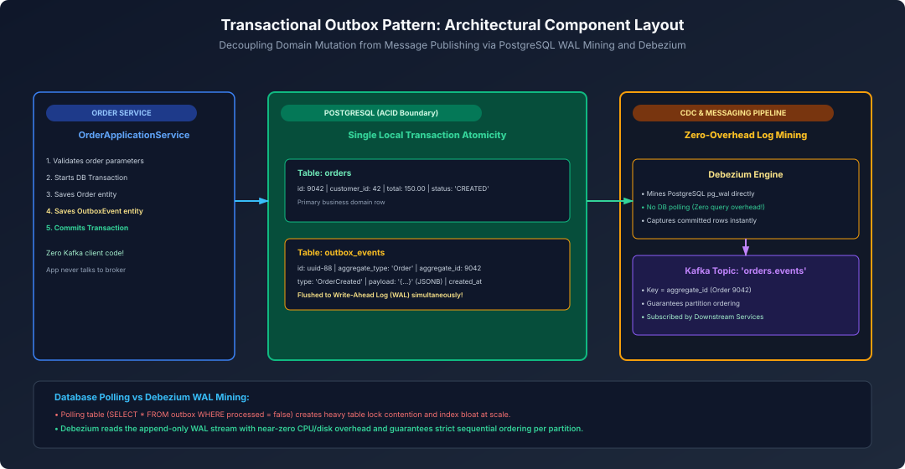

*D2 Source: [`35_transactional_outbox_pattern_architecture.d2`](assets/09_microservices_and_system_design/35_transactional_outbox_pattern_architecture.d2)*

#### Production PostgreSQL Outbox DDL & Sharding-Friendly Design

```sql
-- Outbox Table: Optimized for WAL Streaming and Fast Cleanup
CREATE TABLE outbox_events (
    id UUID PRIMARY KEY DEFAULT gen_random_uuid(),
    aggregate_type VARCHAR(64) NOT NULL,
    aggregate_id VARCHAR(64) NOT NULL,
    event_type VARCHAR(64) NOT NULL,
    payload JSONB NOT NULL,
    trace_id VARCHAR(128),
    created_at TIMESTAMP WITH TIME ZONE DEFAULT CURRENT_TIMESTAMP
);

-- Index for optional fallback polling worker (if CDC is down)
CREATE INDEX idx_outbox_created_at ON outbox_events (created_at);
```

#### Atomic Outbox Publisher in Spring Boot

```java
package com.company.outbox;

import com.fasterxml.jackson.databind.ObjectMapper;
import org.springframework.jdbc.core.JdbcTemplate;
import org.springframework.stereotype.Service;
import org.springframework.transaction.annotation.Transactional;

import java.time.Instant;
import java.util.UUID;

@Service
public class OrderServiceWithOutbox {

    private final JdbcTemplate jdbcTemplate;
    private final ObjectMapper objectMapper;

    public OrderServiceWithOutbox(JdbcTemplate jdbcTemplate, ObjectMapper objectMapper) {
        this.jdbcTemplate = jdbcTemplate;
        this.objectMapper = objectMapper;
    }

    @Transactional
    public UUID createOrder(UUID customerId, double totalAmount, String itemId) {
        UUID orderId = UUID.randomUUID();

        // 1. Insert domain entity into orders table
        jdbcTemplate.update(
            "INSERT INTO orders (id, customer_id, total_amount, status, created_at) VALUES (?, ?, ?, ?, ?)",
            orderId, customerId, totalAmount, "CREATED", Instant.now()
        );

        // 2. Insert event into outbox_events table within THE SAME DATABASE TRANSACTION
        try {
            var eventPayload = new OrderCreatedEvent(orderId, customerId, totalAmount, itemId, Instant.now());
            String jsonPayload = objectMapper.writeValueAsString(eventPayload);

            jdbcTemplate.update(
                "INSERT INTO outbox_events (id, aggregate_type, aggregate_id, event_type, payload, created_at) " +
                "VALUES (?, ?, ?, ?, ?::jsonb, ?)",
                UUID.randomUUID(), "Order", orderId.toString(), "OrderCreated", jsonPayload, Instant.now()
            );
        } catch (Exception e) {
            throw new RuntimeException("Failed to serialize Outbox event", e);
        }

        // Commit guarantees both Order and OutboxEvent are durably stored together!
        return orderId;
    }

    public record OrderCreatedEvent(UUID orderId, UUID customerId, double totalAmount, String itemId, Instant timestamp) {}
}
```

#### Production Debezium PostgreSQL Connector Configuration

```json
{
  "name": "order-outbox-connector",
  "config": {
    "connector.class": "io.debezium.connector.postgresql.PostgresConnector",
    "tasks.max": "1",
    "plugin.name": "pgoutput",
    "database.hostname": "postgres-order-db.internal",
    "database.port": "5432",
    "database.user": "debezium_cdc",
    "database.password": "${file:/secrets/db-credentials.properties:cdc_password}",
    "database.dbname": "order_db",
    "database.server.name": "order_service",
    "table.include.list": "public.outbox_events",
    "tombstones.on.delete": "false",
    "transforms": "outbox",
    "transforms.outbox.type": "io.debezium.transforms.outbox.EventRouter",
    "transforms.outbox.route.topic.replacement": "${routedByValue}.events",
    "transforms.outbox.table.fields.additional.placement": "trace_id:header:traceparent"
  }
}
```

#### Idempotent Consumer Implementation in Downstream Services

Because Debezium and Kafka guarantee **at-least-once delivery**, consumers will occasionally receive duplicate messages during network retries or consumer group rebalances. Consumers must implement an idempotent deduplication filter:

```java
package com.company.consumer;

import org.slf4j.Logger;
import org.slf4j.LoggerFactory;
import org.springframework.dao.DuplicateKeyException;
import org.springframework.jdbc.core.JdbcTemplate;
import org.springframework.kafka.annotation.KafkaListener;
import org.springframework.stereotype.Component;
import org.springframework.transaction.annotation.Transactional;

import java.time.Instant;
import java.util.UUID;

@Component
public class IdempotentPaymentConsumer {

    private static final Logger log = LoggerFactory.getLogger(IdempotentPaymentConsumer.class);
    private final JdbcTemplate jdbcTemplate;

    public IdempotentPaymentConsumer(JdbcTemplate jdbcTemplate) {
        this.jdbcTemplate = jdbcTemplate;
    }

    @KafkaListener(topics = "Order.events", groupId = "payment-service-group")
    @Transactional
    public void consumeOrderEvent(String eventJson) {
        // Extract eventId from message header or payload
        UUID eventId = extractEventId(eventJson);

        // Insert into processed_events table using primary key constraint for deduplication
        try {
            jdbcTemplate.update(
                "INSERT INTO processed_events (event_id, consumer_group, processed_at) VALUES (?, ?, ?)",
                eventId, "payment-service-group", Instant.now()
            );
        } catch (DuplicateKeyException ex) {
            log.warn("Duplicate event detected with ID: {}. Skipping execution safely.", eventId);
            return; // Idempotently ignore already processed message!
        }

        // Execute core business mutation
        processPaymentBusinessLogic(eventJson);
    }

    private UUID extractEventId(String json) {
        // Parse ID from payload
        return UUID.randomUUID(); 
    }

    private void processPaymentBusinessLogic(String json) {
        log.info("Processing payment for verified new event payload");
    }
}
```

---

### 11.5 CQRS (Command Query Responsibility Segregation) Architecture

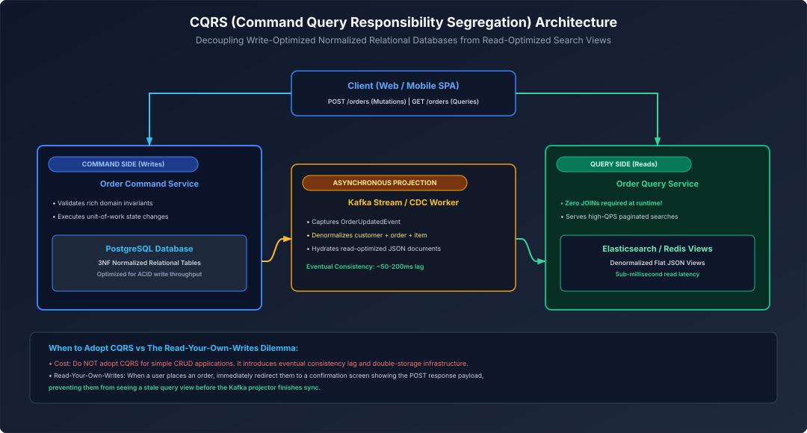

*D2 Source: [`36_cqrs_command_query_responsibility_segregation.d2`](assets/09_microservices_and_system_design/36_cqrs_command_query_responsibility_segregation.d2)*

---

### 11.6 Event Sourcing Fundamentals & Aggregate Snapshots

Instead of overwriting rows in a table (`UPDATE accounts SET balance = 150`), Event Sourcing records an append-only log of immutable domain events:
- `AccountCreated(id=1, initial=100)`
- `MoneyWithdrawn(id=1, amount=40)`
- `MoneyDeposited(id=1, amount=90)`
Current state is derived by replaying all historical events. To prevent performance degradation when an entity accumulates thousands of events, periodic **Snapshots** capture aggregate state at interval $N$ (e.g. every 100 events).

---

### 11.7 The Strangler Fig Application Migration Pattern

The Strangler Fig pattern migrates legacy monoliths safely without risky "big bang" rewrites:
1. Deploy an **API Gateway / Reverse Proxy** in front of the legacy monolith.
2. Build new business features exclusively as independent microservices.
3. Identify a cohesive domain in the monolith (e.g. `Notification`), implement it as a microservice, and redirect Gateway traffic from the monolith to the new microservice.
4. Repeat until the monolith handles zero traffic, then safely decommission it.

> [!TIP]
> **Deep-Dive Interview Scenarios:**
> - [Q3. Synchronous vs Asynchronous Communication & Event-Driven Architecture](frequently_asked_questions/09_microservices_and_system_design_faq.md#q3-medium-synchronous-vs-asynchronous-communication--event-driven-architecture)
> - [Q6. Distributed Transactions (Saga & Outbox Patterns) & Eventual Consistency](frequently_asked_questions/09_microservices_and_system_design_faq.md#q6-expert-distributed-transactions-saga--outbox-patterns--eventual-consistency)
> - [Q7. Designing End-to-End Idempotency in Payment Processing](frequently_asked_questions/09_microservices_and_system_design_faq.md#q7-hard-designing-end-to-end-idempotency-in-payment-processing)
> - [Q8. Command Query Responsibility Segregation (CQRS) Pattern](frequently_asked_questions/09_microservices_and_system_design_faq.md#q8-medium-command-query-responsibility-segregation-cqrs-pattern)
> - [Q9. Distributed Tracing, Centralized Logging & Semantic Monitoring](frequently_asked_questions/09_microservices_and_system_design_faq.md#q9-medium-distributed-tracing-centralized-logging--semantic-monitoring)
> - [Q10. Consumer-Driven Contracts (CDC) & API Backward Compatibility](frequently_asked_questions/09_microservices_and_system_design_faq.md#q10-medium-consumer-driven-contracts-cdc--api-backward-compatibility)
> - [Q12. YAML Configuration & Declarative Infrastructure](frequently_asked_questions/09_microservices_and_system_design_faq.md#q12-easy-yaml-configuration--declarative-infrastructure)

---

# 12. Distributed Systems Fundamentals

---

### 12.1 The CAP Theorem & PACELC Theorem Deep-Dive

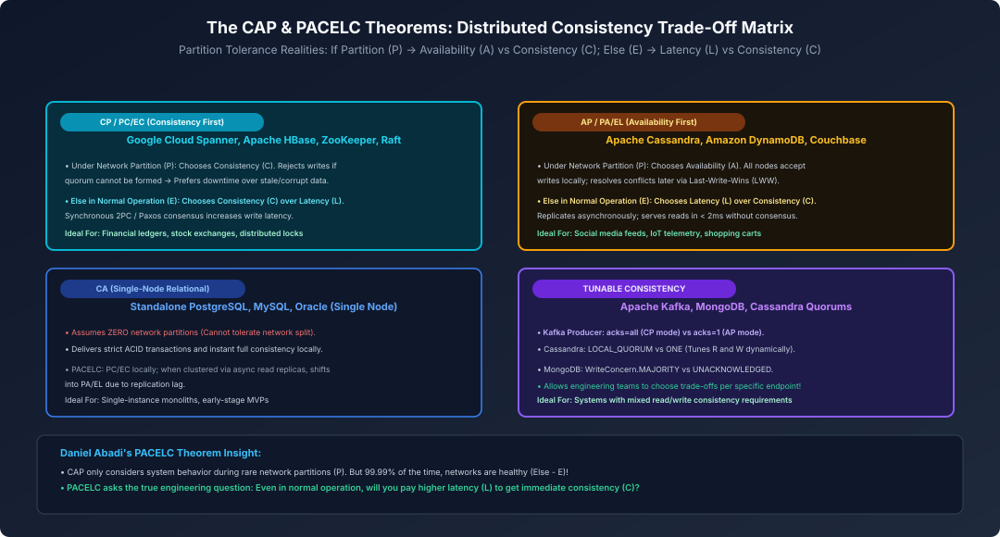

*D2 Source: [`37_cap_vs_pacelc_theorem_quadrant.d2`](assets/09_microservices_and_system_design/37_cap_vs_pacelc_theorem_quadrant.d2)*

#### PACELC Real-World Database Classification Matrix

$$\text{If Partition (P)} \rightarrow \text{Choose (A) or (C)}; \quad \text{Else (E)} \rightarrow \text{Choose (L) or (C)}$$

| System | PACELC Classification | Partition Behavior | Normal Execution Behavior |
| :--- | :--- | :--- | :--- |
| **Apache Cassandra** | **PA / EL** | Chooses Availability (accepts local writes) | Chooses Latency (returns reads quickly without quorum wait) |
| **Google Cloud Spanner** | **PC / EC** | Chooses Consistency (fails uncommitted quorum) | Chooses Consistency (linearizable reads via TrueTime sync) |
| **MongoDB** | **PA / EC** (Default) | Chooses Availability on secondaries | Chooses Consistency on primary node |
| **PostgreSQL (Semi-sync)**| **PC / EC** | Blocks commits if replica unreachable | Commits synchronously for strict data durability |

---

### 12.2 Consistency Models (Linearizable, Causal, Eventual)

1. **Linearizable (Strong) Consistency**: An operation appears to take effect instantaneously across the entire cluster between its invocation and completion. Every read returns the absolute latest write globally.
2. **Sequential Consistency**: Operations appear in the same sequential order to all observers, though they may lag real-time clock time.
3. **Causal Consistency**: Causally related operations must be seen by every node in the same relative order. Concurrent, unrelated operations can be seen in different orders.
4. **Eventual Consistency**: If no new updates are made, all replicas eventually converge to identical values. Maximizes availability and write throughput.

---

### 12.3 Distributed Consensus: Raft vs Paxos (Leader Election & Log Replication)

Consensus algorithms guarantee that a cluster of distributed nodes agree on a sequence of state machine actions despite arbitrary network splits and crashes:
- **Paxos**: Formulated by Leslie Lamport. Mathematically elegant, notoriously difficult to understand and implement in real software.
- **Raft**: Designed specifically for understandability. Decomposes consensus into three independent sub-problems:
  1. **Leader Election**: Heartbeat timeouts trigger randomized election timers. A candidate must collect votes from a **Quorum ($N/2 + 1$)** to become Leader.
  2. **Log Replication**: The Leader appends entries locally and issues `AppendEntries` RPCs to followers.
  3. **Safety**: A committed log entry is guaranteed to be present in all future Leaders.

---

### 12.4 Distributed Unique ID Generation: Twitter Snowflake Algorithm

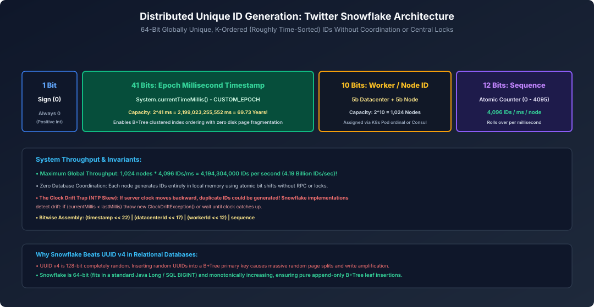

*D2 Source: [`38_distributed_snowflake_id_generation.d2`](assets/09_microservices_and_system_design/38_distributed_snowflake_id_generation.d2)*

#### Production Java Twitter Snowflake ID Implementation

```java
package com.company.distributed;

public class SnowflakeIdGenerator {
    private static final long CUSTOM_EPOCH = 1735689600000L; // 2025-01-01 00:00:00 UTC
    private static final long WORKER_ID_BITS = 10L;
    private static final long SEQUENCE_BITS = 12L;
    private static final long MAX_WORKER_ID = ~(-1L << WORKER_ID_BITS); // 1023
    private static final long MAX_SEQUENCE = ~(-1L << SEQUENCE_BITS);   // 4095

    private final long workerId;
    private long sequence = 0L;
    private long lastTimestamp = -1L;

    public SnowflakeIdGenerator(long workerId) {
        if (workerId < 0 || workerId > MAX_WORKER_ID) {
            throw new IllegalArgumentException("Worker ID must be between 0 and " + MAX_WORKER_ID);
        }
        this.workerId = workerId;
    }

    public synchronized long nextId() {
        long timestamp = System.currentTimeMillis();

        if (timestamp < lastTimestamp) {
            throw new IllegalStateException("Clock moved backwards. Refusing to generate ID");
        }

        if (lastTimestamp == timestamp) {
            sequence = (sequence + 1) & MAX_SEQUENCE;
            if (sequence == 0) {
                // Sequence exhausted in current millisecond; spin-wait for next millisecond
                while (timestamp <= lastTimestamp) {
                    timestamp = System.currentTimeMillis();
                }
            }
        } else {
            sequence = 0L;
        }

        lastTimestamp = timestamp;

        return ((timestamp - CUSTOM_EPOCH) << (WORKER_ID_BITS + SEQUENCE_BITS))
                | (workerId << SEQUENCE_BITS)
                | sequence;
    }
}
```

---

### 12.5 Distributed Locking: Redlock Algorithm vs Database Advisory Locks

- **Single Redis Lock (`SET key value NX PX 10000`)**: Fast, but if the Redis primary crashes before replicating the key to its replica, a failover allows a second client to acquire the same lock.
- **Redlock Algorithm**: Client attempts to acquire the lock sequentially across $N$ independent Redis masters (e.g. 5 nodes). The lock is considered acquired only if a quorum ($N/2 + 1 = 3$) nodes grant the lock within the validity time.
- **PostgreSQL Advisory Locks (`pg_try_advisory_lock(key)`)**: Application-level locks managed directly in PostgreSQL memory, guaranteed consistent by the database engine.

---

### 12.6 Consistent Hashing Algorithm with Virtual Nodes

In distributed caching (Redis Cluster, Memcached) and distributed storage (Cassandra, DynamoDB), keys must be partitioned across $N$ servers.

#### The Modulo Hashing Bottleneck
Under naive modulo hashing ($\text{serverIndex} = \text{hash}(\text{key}) \pmod N$):
- Adding or removing a single node changes $N$ to $N+1$ or $N-1$.
- **Result**: $\approx \frac{N-1}{N}$ of all keys are remapped to new servers (over 90% cache eviction storm, instantly crushing database backends).

#### The Consistent Hash Ring & Virtual Nodes
Consistent Hashing maps both servers and data keys onto a continuous logical ring ($0$ to $2^{32}-1$):
- A key is mapped to the first server encountered moving **clockwise** along the ring.
- Adding a server only redistributes keys between the new node and its counter-clockwise predecessor ($\approx K/N$ keys).
- **Virtual Nodes (Vnodes)**: To avoid data skew caused by non-uniform server placement, each physical node is replicated $V$ times (e.g., 100 virtual positions) around the ring.

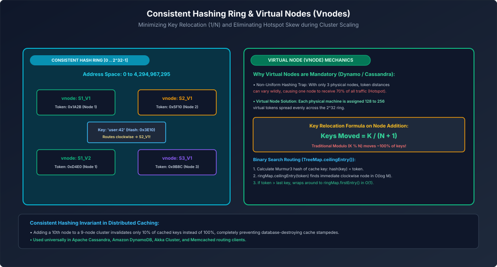

*D2 Source: [`39_consistent_hashing_ring_virtual_nodes.d2`](assets/09_microservices_and_system_design/39_consistent_hashing_ring_virtual_nodes.d2)*

#### Production Java Consistent Hashing Ring Implementation:
```java
package com.company.distributed;

import java.nio.charset.StandardCharsets;
import java.security.MessageDigest;
import java.util.*;

public class ConsistentHashRouter<T> {
    private final int numberOfReplicas; // Virtual nodes per physical node
    private final SortedMap<Long, T> ring = new TreeMap<>();

    public ConsistentHashRouter(int numberOfReplicas, Collection<T> nodes) {
        this.numberOfReplicas = numberOfReplicas;
        for (T node : nodes) {
            addNode(node);
        }
    }

    public synchronized void addNode(T node) {
        for (int i = 0; i < numberOfReplicas; i++) {
            long hash = hash(node.toString() + "-VN-" + i);
            ring.put(hash, node);
        }
    }

    public synchronized void removeNode(T node) {
        for (int i = 0; i < numberOfReplicas; i++) {
            long hash = hash(node.toString() + "-VN-" + i);
            ring.remove(hash);
        }
    }

    public T route(String key) {
        if (ring.isEmpty()) return null;
        long hash = hash(key);
        // Find the first virtual node clockwise of this hash
        SortedMap<Long, T> tailMap = ring.tailMap(hash);
        long targetHash = tailMap.isEmpty() ? ring.firstKey() : tailMap.firstKey();
        return ring.get(targetHash);
    }

    private long hash(String key) {
        try {
            MessageDigest md = MessageDigest.getInstance("MD5");
            byte[] digest = md.digest(key.getBytes(StandardCharsets.UTF_8));
            // Extract 32-bit unsigned integer from first 4 bytes
            return ((long) (digest[3] & 0xFF) << 24) |
                   ((long) (digest[2] & 0xFF) << 16) |
                   ((long) (digest[1] & 0xFF) << 8)  |
                   ((long) (digest[0] & 0xFF));
        } catch (Exception e) {
            throw new RuntimeException(e);
        }
    }
}
```

---

### 12.7 Database Replication Topologies & Quorum Consistency ($R + W > N$)

Distributed data stores replicate data across multiple nodes to ensure high availability and durability.

| Topology | Write Path | Read Path | Conflict Handling | Best Use Case |
| :--- | :--- | :--- | :--- | :--- |
| **Single-Leader (Active-Passive)** | Writes sent exclusively to Primary node | Reads served by Primary or Read Replicas | None (Leader is single source of truth) | ACID RDBMS (PostgreSQL, MySQL) |
| **Multi-Leader (Active-Active)** | Writes accepted by leaders across multiple DCs | Reads served locally per data center | Last-Write-Wins (LWW) or CRDTs | Multi-region collaborative apps |
| **Leaderless (Dynamo-Style)** | Writes broadcast to all $N$ peer nodes | Reads broadcast to all $N$ peer nodes | Version vectors, Quorum read-repair | Cassandra, DynamoDB, Riak |

#### The Quorum Consistency Guarantee
In a leaderless system with Replication Factor $N$:
- **$W$ (Write Quorum)**: Minimum number of nodes that must acknowledge a write for it to be deemed successful.
- **$R$ (Read Quorum)**: Minimum number of nodes that must respond to a read request.

$$\mathbf{R + W > N}$$

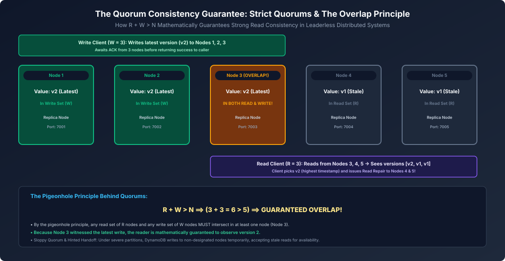

*D2 Source: [`40_quorum_consistency_sloppy_vs_strict.d2`](assets/09_microservices_and_system_design/40_quorum_consistency_sloppy_vs_strict.d2)*

- When $R + W > N$, the read set and write set must overlap in at least **one node**, ensuring the reader always retrieves the latest write timestamp/version vector.
- **Sloppy Quorum & Hinted Handoff**: If network partitions prevent reaching $W$ designated nodes, the cluster accepts writes on temporary fallback nodes ("hinted handoff"), replay-syncing when the partition heals.

> [!TIP]
> **Deep-Dive Interview Scenarios:**
> - [Q11. The CAP Theorem & Database Scaling Strategies](frequently_asked_questions/09_microservices_and_system_design_faq.md#q11-expert-the-cap-theorem--database-scaling-strategies)
> - [Q15. Distributed Algorithm: Finding Top K Elements Across Distributed Servers](frequently_asked_questions/09_microservices_and_system_design_faq.md#q15-hard-distributed-algorithm-finding-top-k-elements-across-distributed-servers)

---

# 13. Real-World Backend System Designs

---

### 13.1 Global URL Shortener (TinyURL) Design

A URL shortener accepts long URLs (e.g. `https://example.com/products/electronics/laptops/123456?ref=summer_promo`) and produces a concise, readable link (e.g. `https://tiny.url/7aBc9Z`). When a client accesses the short link, the service redirects them to the original destination.

#### 13.1.1 Requirements & Scale Estimation

**Functional Requirements:**
1. Given a long URL, generate a unique, short alias (e.g. 7 characters).
2. Given a short alias, redirect the user to the original URL with minimal latency (<10ms p99).
3. Optional custom alias support (e.g. `tiny.url/my-custom-promo`).
4. Links expire after a default TTL (e.g. 2 years) or user-specified duration.
5. Click analytics (access count, country, referrer, user agent).

**Non-Functional Requirements:**
1. **High Availability**: 99.99% uptime; URL redirection must not fail.
2. **Read-Heavy Workload**: Read to write ratio is estimated at 100:1.
3. **Low Latency**: Redirection must be near-instantaneous via CDN and distributed caching.

**Mathematical Capacity Estimation (5-Year Horizon):**
- **Traffic Estimation**:
  - New URLs created: $100 \text{ Million}$ per month.
  - Write QPS: $\frac{100 \times 10^6}{30 \times 24 \times 3600} \approx 40 \text{ writes/sec}$.
  - Read QPS ($100:1$ ratio): $40 \times 100 = 4,000 \text{ reads/sec}$ average ($8,000$ peak).
- **Storage Estimation**:
  - Average record size: Long URL (500 bytes) + Short Code (7 bytes) + Metadata (100 bytes) $\approx 600 \text{ bytes}$.
  - 5-Year URL records: $100 \times 10^6 \times 12 \times 5 = 6 \text{ Billion records}$.
  - Total 5-Year Database Storage: $6 \times 10^9 \times 600 \text{ bytes} \approx 3.6 \text{ TB}$.
- **Memory Estimation for Caching (Pareto 80/20 Rule):**
  - Daily read requests: $4,000 \times 86,400 \approx 345 \text{ Million reads/day}$.
  - Caching top 20% of daily requests: $0.20 \times 345 \times 10^6 \times 600 \text{ bytes} \approx 41.4 \text{ GB RAM}$.
  - A 3-node Redis cluster with 32 GB RAM per node easily accommodates this with room for growth.

#### 13.1.2 End-to-End Architecture

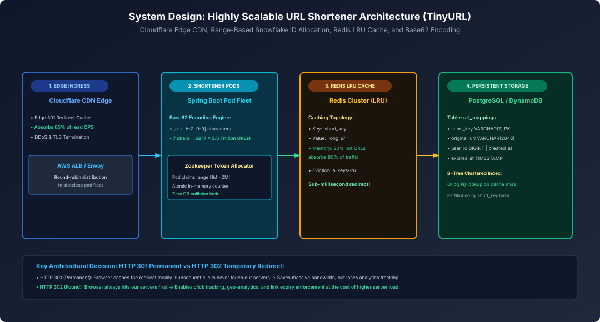

*D2 Source: [`41_system_design_url_shortener_architecture.d2`](assets/09_microservices_and_system_design/41_system_design_url_shortener_architecture.d2)*

#### 13.1.3 Base62 Encoding vs MD5 Hashing

- **Why Not MD5/SHA-256 Hashing?** An MD5 hash produces a 128-bit hex string (32 characters). Taking the first 7 characters causes high collision probabilities (Birthday Paradox). Resolving collisions requires database lookups and appending salt, increasing write latency.
- **The Base62 Bijection Approach**:
  Using characters `[0-9, a-z, A-Z]` gives $10 + 26 + 26 = 62$ distinct symbols.
  A 7-character Base62 string represents:
  $$62^7 = 3,521,614,606,208 \approx 3.52 \text{ Trillion unique URLs}$$
  By generating a unique 64-bit integer ID (via Twitter Snowflake or a centralized range allocator), we convert the ID to a Base62 string with zero possibility of collision!

#### 13.1.4 Production Base62 & Snowflake Generator Implementation

```java
package com.company.tinyurl.util;

public final class Base62Converter {

    private static final String ALPHABET = "0123456789abcdefghijklmnopqrstuvwxyzABCDEFGHIJKLMNOPQRSTUVWXYZ";
    private static final int BASE = ALPHABET.length();

    private Base62Converter() {}

    public static String encode(long id) {
        if (id <= 0) {
            return String.valueOf(ALPHABET.charAt(0));
        }
        StringBuilder sb = new StringBuilder();
        while (id > 0) {
            int remainder = (int) (id % BASE);
            sb.append(ALPHABET.charAt(remainder));
            id /= BASE;
        }
        // Reverse because digits were collected from least to most significant
        return sb.reverse().toString();
    }

    public static long decode(String shortCode) {
        long id = 0;
        for (int i = 0; i < shortCode.length(); i++) {
            char c = shortCode.charAt(i);
            int charIndex = ALPHABET.indexOf(c);
            if (charIndex == -1) {
                throw new IllegalArgumentException("Invalid Base62 character: " + c);
            }
            id = id * BASE + charIndex;
        }
        return id;
    }
}
```

#### 13.1.5 Database Partitioned Schema (PostgreSQL)

```sql
-- Partitioned table by Hash of short_code across 16 physical partitions
CREATE TABLE url_mappings (
    id BIGINT NOT NULL,
    short_code VARCHAR(16) NOT NULL,
    original_url TEXT NOT NULL,
    user_id UUID,
    created_at TIMESTAMP WITH TIME ZONE DEFAULT CURRENT_TIMESTAMP,
    expires_at TIMESTAMP WITH TIME ZONE,
    PRIMARY KEY (short_code, id)
) PARTITION BY HASH (short_code);

-- Create 16 hash partitions
CREATE TABLE url_mappings_p0 PARTITION OF url_mappings FOR VALUES WITH (MODULUS 16, REMAINDER 0);
CREATE TABLE url_mappings_p1 PARTITION OF url_mappings FOR VALUES WITH (MODULUS 16, REMAINDER 1);
-- ... (p2 to p15 created similarly)

CREATE INDEX idx_url_short_code ON url_mappings (short_code);
```

#### 13.1.6 Dual-Layer Caching & Controller Implementation

```java
package com.company.tinyurl.service;

import com.company.tinyurl.util.Base62Converter;
import org.slf4j.Logger;
import org.slf4j.LoggerFactory;
import org.springframework.data.redis.core.StringRedisTemplate;
import org.springframework.http.HttpHeaders;
import org.springframework.http.HttpStatus;
import org.springframework.http.ResponseEntity;
import org.springframework.jdbc.core.JdbcTemplate;
import org.springframework.web.bind.annotation.*;

import java.net.URI;
import java.time.Duration;
import java.time.Instant;
import java.util.Optional;

@RestController
@RequestMapping
public class UrlShortenerController {

    private static final Logger log = LoggerFactory.getLogger(UrlShortenerController.class);
    private static final String CACHE_PREFIX = "tinyurl:";
    private static final String BLOOM_FILTER_KEY = "url_bloom_filter";

    private final StringRedisTemplate redisTemplate;
    private final JdbcTemplate jdbcTemplate;

    public UrlShortenerController(StringRedisTemplate redisTemplate, JdbcTemplate jdbcTemplate) {
        this.redisTemplate = redisTemplate;
        this.jdbcTemplate = jdbcTemplate;
    }

    @GetMapping("/{shortCode:[a-zA-Z0-9]{6,8}}")
    public ResponseEntity<Void> redirect(@PathVariable String shortCode) {
        // Step 1: L1/L2 Redis Cache Lookup
        String cacheKey = CACHE_PREFIX + shortCode;
        String cachedOriginalUrl = redisTemplate.opsForValue().get(cacheKey);

        if (cachedOriginalUrl != null) {
            // Check for sentinel value preventing cache penetration
            if ("NOT_FOUND".equals(cachedOriginalUrl)) {
                return ResponseEntity.status(HttpStatus.NOT_FOUND).build();
            }
            return buildRedirectResponse(cachedOriginalUrl);
        }

        // Step 2: Database Fallback Lookup
        var sql = "SELECT original_url FROM url_mappings WHERE short_code = ? AND (expires_at IS NULL OR expires_at > ?)";
        var results = jdbcTemplate.query(sql, (rs, rowNum) -> rs.getString("original_url"), shortCode, Instant.now());

        if (results.isEmpty()) {
            // Prevent Cache Penetration: Cache negative lookup with short TTL (2 minutes)
            redisTemplate.opsForValue().set(cacheKey, "NOT_FOUND", Duration.ofMinutes(2));
            return ResponseEntity.status(HttpStatus.NOT_FOUND).build();
        }

        String originalUrl = results.get(0);

        // Step 3: Populate Redis Cache with 24h TTL
        redisTemplate.opsForValue().set(cacheKey, originalUrl, Duration.ofHours(24));

        return buildRedirectResponse(originalUrl);
    }

    private ResponseEntity<Void> buildRedirectResponse(String destinationUrl) {
        // HTTP 302 Found (Temporary Redirect): Ensures all future clicks hit our servers for click analytics!
        // HTTP 301 Moved Permanently: Cached by browser; bypasses our servers (loses analytics).
        return ResponseEntity.status(HttpStatus.FOUND)
            .location(URI.create(destinationUrl))
            .header(HttpHeaders.CACHE_CONTROL, "no-cache, no-store, max-age=0, must-revalidate")
            .build();
    }
}
```

---

### 13.2 High-Throughput Distributed Rate Limiter Design

Rate limiting protects downstream APIs against abuse, brute-force attacks, resource exhaustion, and noisy-neighbor denial of service.

#### 13.2.1 Comparison of Core Algorithms

| Algorithm | Mechanism | Burst Handling | Memory Overhead | Complexity | Best Use Case |
| :--- | :--- | :--- | :--- | :--- | :--- |
| **Token Bucket** | Central bucket refilled at rate $r$. Each request consumes 1 token. Rejects if empty. | Allows bursts up to bucket capacity $B$. | Minimal (2 numbers: timestamp + token count). | Low | General API Gateway rate limiting (AWS API Gateway, Stripe). |
| **Leaky Bucket** | Requests placed in FIFO queue; drained at constant steady rate. Drops if queue overflows. | Smooths bursts into uniform outbound stream. | Moderate (memory for queued requests). | Medium | Ingestion pipelines, payment processors with strict concurrency. |
| **Fixed Window Counter** | Counts requests in fixed time interval (e.g. 10:00 to 10:01). Resets counter at interval edge. | Suffers 2x boundary burst (e.g. 100 requests at 10:00:59, 100 at 10:01:00). | Ultra-low (single integer per client). | Very Low | Coarse-grained rate limiting where bursts are tolerable. |
| **Sliding Window Log** | Stores exact epoch timestamp for every request in a Redis Sorted Set (ZSET). Evicts old timestamps. | Extremely precise; prevents boundary bursts entirely. | High memory ($O(N)$ entries per client where $N$ is request volume). | Medium | Low-volume, high-security endpoints (Login, Password Reset). |
| **Sliding Window Counter** | Blends count of previous window with current window: $\text{Count} = C_{\text{prev}} \times (1 - \text{weight}) + C_{\text{curr}}$. | Effectively smooths boundary bursts with zero timestamp tracking. | Minimal (2 counters per client). | Low | High-throughput distributed microservices rate limiting. |

#### 13.2.2 Atomic Sliding Window Counter via Redis Lua Script

Because multiple concurrent API Gateway instances process incoming requests in parallel, reading and writing counters in Redis without concurrency control causes race conditions. A Redis Lua script executes atomically on the Redis single-threaded engine:

```lua
-- KEYS[1]: Rate limit key (e.g., "ratelimit:user_8123:minute")
-- ARGV[1]: Current UNIX epoch timestamp in milliseconds
-- ARGV[2]: Window size in milliseconds (e.g., 60000 for 1 minute)
-- ARGV[3]: Max allowed requests per window (e.g., 100)

local key = KEYS[1]
local current_time = tonumber(ARGV[1])
local window_size = tonumber(ARGV[2])
local max_requests = tonumber(ARGV[3])
local clear_before = current_time - window_size

-- 1. Remove all request log entries older than the active window
redis.call('ZREMRANGEBYSCORE', key, '-inf', clear_before)

-- 2. Count current entries in window
local current_count = redis.call('ZCARD', key)

if current_count < max_requests then
    -- 3. Add current request timestamp (using timestamp as both member and score)
    redis.call('ZADD', key, current_time, current_time)
    -- Set TTL on key equal to window size to auto-evict idle keys
    redis.call('PEXPIRE', key, window_size)
    -- Return allowed (1), remaining requests, and reset time
    return {1, max_requests - (current_count + 1), math.ceil(window_size / 1000)}
else
    -- Request rate limit exceeded
    local oldest_time = redis.call('ZRANGE', key, 0, 0, 'WITHSCORES')
    local retry_after = 1
    if #oldest_time > 0 then
        retry_after = math.ceil((tonumber(oldest_time[2]) + window_size - current_time) / 1000)
    end
    return {0, 0, math.max(1, retry_after)}
end
```

#### 13.2.3 Spring Boot Rate Limiting Interceptor Implementation

```java
package com.company.ratelimiter;

import jakarta.servlet.http.HttpServletRequest;
import jakarta.servlet.http.HttpServletResponse;
import org.springframework.core.io.ClassPathResource;
import org.springframework.data.redis.core.StringRedisTemplate;
import org.springframework.data.redis.core.script.DefaultRedisScript;
import org.springframework.http.HttpStatus;
import org.springframework.stereotype.Component;
import org.springframework.web.servlet.HandlerInterceptor;

import java.time.Instant;
import java.util.Collections;
import java.util.List;

@Component
public class DistributedRateLimitingInterceptor implements HandlerInterceptor {

    private final StringRedisTemplate redisTemplate;
    private final DefaultRedisScript<List> rateLimitScript;

    public DistributedRateLimitingInterceptor(StringRedisTemplate redisTemplate) {
        this.redisTemplate = redisTemplate;
        this.rateLimitScript = new DefaultRedisScript<>();
        this.rateLimitScript.setLocation(new ClassPathResource("scripts/sliding_window_rate_limiter.lua"));
        this.rateLimitScript.setResultType(List.class);
    }

    @Override
    public boolean preHandle(HttpServletRequest request, HttpServletResponse response, Object handler) throws Exception {
        String clientIdentifier = resolveClientKey(request);
        String redisKey = "ratelimit:" + clientIdentifier;

        long nowMs = Instant.now().toEpochMilli();
        long windowSizeMs = 60_000L; // 1 minute
        long maxRequests = 100L;     // 100 requests per minute

        List<Long> result = redisTemplate.execute(
            rateLimitScript,
            Collections.singletonList(redisKey),
            String.valueOf(nowMs),
            String.valueOf(windowSizeMs),
            String.valueOf(maxRequests)
        );

        if (result == null || result.isEmpty()) {
            // Fail-open strategy: If Redis fails, allow request to avoid outage
            return true;
        }

        boolean allowed = result.get(0) == 1L;
        long remaining = result.get(1);
        long retryAfterSec = result.get(2);

        // Standard RFC Rate Limit Headers
        response.setHeader("X-RateLimit-Limit", String.valueOf(maxRequests));
        response.setHeader("X-RateLimit-Remaining", String.valueOf(Math.max(0, remaining)));

        if (!allowed) {
            response.setStatus(HttpStatus.TOO_MANY_REQUESTS.value()); // HTTP 429
            response.setHeader("Retry-After", String.valueOf(retryAfterSec));
            response.setContentType("application/json");
            response.getWriter().write(String.format("{\"error\": \"Rate limit exceeded. Retry in %d seconds.\"}", retryAfterSec));
            return false;
        }

        return true;
    }

    private String resolveClientKey(HttpServletRequest request) {
        // Prefer authenticated User ID or API Key; fallback to client IP
        String apiKey = request.getHeader("X-API-KEY");
        if (apiKey != null && !apiKey.isBlank()) {
            return "apikey:" + apiKey;
        }
        String forwardedFor = request.getHeader("X-Forwarded-For");
        if (forwardedFor != null && !forwardedFor.isBlank()) {
            return "ip:" + forwardedFor.split(",")[0].trim();
        }
        return "ip:" + request.getRemoteAddr();
    }
}
```

---

### 13.3 Enterprise Multi-Channel Notification System Design

An enterprise notification engine delivers SMS, Email, and Mobile Push Notifications with guaranteed delivery, vendor fallbacks, priority-based throttling, and deduplication.

#### 13.3.1 System Requirements & Architecture

**Requirements:**
1. **Multi-Channel**: SMS (Twilio, AWS SNS), Email (SendGrid, AWS SES), Push (Apple APNs, Google FCM).
2. **Priority Tiers**: High-priority alerts (OTP, payment confirmation) must deliver within $<3$ seconds; bulk marketing campaigns must not delay high-priority alerts.
3. **Vendor Redundancy & Automatic Failover**: If Twilio returns 5xx errors or throttles, transparently fail over to AWS SNS.
4. **Deduplication**: Prevent sending duplicate messages within a 5-minute sliding window (e.g. client double-clicks checkout).

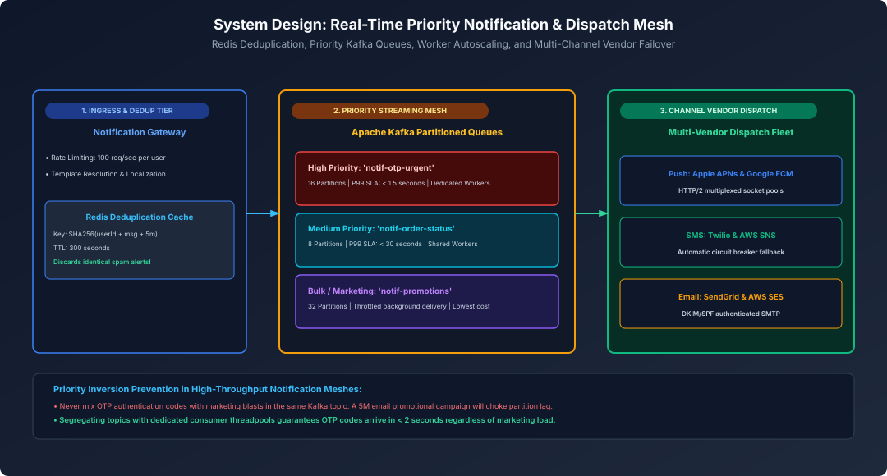

*D2 Source: [`42_system_design_uber_geohash_dispatch_architecture.d2`](assets/09_microservices_and_system_design/42_system_design_uber_geohash_dispatch_architecture.d2)*

#### 13.3.2 Resilient Multi-Provider Dispatcher with Circuit Breaker

```java
package com.company.notification.dispatcher;

import io.github.resilience4j.circuitbreaker.annotation.CircuitBreaker;
import org.slf4j.Logger;
import org.slf4j.LoggerFactory;
import org.springframework.stereotype.Service;

public record SmsPayload(String phoneNumber, String message, String idempotencyKey) {}

@Service
public class ResilientSmsDispatcher {

    private static final Logger log = LoggerFactory.getLogger(ResilientSmsDispatcher.class);

    private final TwilioSmsClient twilioClient;
    private final AwsSnsClient awsSnsClient;

    public ResilientSmsDispatcher(TwilioSmsClient twilioClient, AwsSnsClient awsSnsClient) {
        this.twilioClient = twilioClient;
        this.awsSnsClient = awsSnsClient;
    }

    @CircuitBreaker(name = "smsProviderCircuitBreaker", fallbackMethod = "sendViaAwsSnsFallback")
    public boolean sendSms(SmsPayload payload) {
        log.info("Attempting primary dispatch via Twilio for recipient {}", payload.phoneNumber());
        return twilioClient.dispatch(payload.phoneNumber(), payload.message());
    }

    /**
     * Fallback triggered automatically if Twilio fails or Circuit Breaker opens.
     */
    public boolean sendViaAwsSnsFallback(SmsPayload payload, Throwable ex) {
        log.warn("Twilio dispatch failed or circuit open. Failing over to AWS SNS for recipient: {}. Cause: {}",
            payload.phoneNumber(), ex.getMessage());
        return awsSnsClient.dispatch(payload.phoneNumber(), payload.message());
    }
}
```

---

### 13.4 Resilient Financial Payment Gateway Design

Financial systems require zero tolerance for lost money, balance drift, or phantom transactions. Every transaction must adhere strictly to double-entry bookkeeping, absolute idempotency, and automated discrepancy reconciliation.

#### 13.4.1 Fundamental Double-Entry Bookkeeping Equation

In an immutable double-entry ledger, money is never created or destroyed; it moves between accounts via balanced journal entries. Every entry consists of at least one Debit and at least one Credit such that:

$$\sum \text{Debits} \equiv \sum \text{Credits}$$

- **Asset & Expense Accounts**: Debits increase balance ($+$), Credits decrease balance ($-$).
- **Liability & Equity Accounts**: Credits increase balance ($+$), Debits decrease balance ($-$).

#### 13.4.2 Production Immutable Ledger Schema (PostgreSQL)

```sql
-- Accounts Table: Master chart of accounts
CREATE TABLE accounts (
    id UUID PRIMARY KEY DEFAULT gen_random_uuid(),
    account_number VARCHAR(64) UNIQUE NOT NULL,
    account_type VARCHAR(32) NOT NULL, -- ASSET, LIABILITY, EQUITY, REVENUE, EXPENSE
    currency VARCHAR(3) NOT NULL,
    created_at TIMESTAMP WITH TIME ZONE DEFAULT CURRENT_TIMESTAMP
);

-- Journal Entries: Logical business transactions (e.g. Order #1001 Payment)
CREATE TABLE journal_entries (
    id UUID PRIMARY KEY DEFAULT gen_random_uuid(),
    idempotency_key VARCHAR(128) UNIQUE NOT NULL,
    reference_id VARCHAR(64) NOT NULL,
    description TEXT NOT NULL,
    posted_at TIMESTAMP WITH TIME ZONE DEFAULT CURRENT_TIMESTAMP
);

-- Ledger Lines: Immutable atomic debits and credits
CREATE TABLE ledger_lines (
    id UUID PRIMARY KEY DEFAULT gen_random_uuid(),
    journal_entry_id UUID NOT NULL REFERENCES journal_entries(id) ON DELETE RESTRICT,
    account_id UUID NOT NULL REFERENCES accounts(id) ON DELETE RESTRICT,
    amount NUMERIC(18, 4) NOT NULL CHECK (amount > 0),
    direction VARCHAR(6) NOT NULL CHECK (direction IN ('DEBIT', 'CREDIT')),
    created_at TIMESTAMP WITH TIME ZONE DEFAULT CURRENT_TIMESTAMP
);

CREATE INDEX idx_ledger_account_time ON ledger_lines (account_id, created_at);
```

#### 13.4.3 Payment State Machine & Asynchronous Webhook Architecture

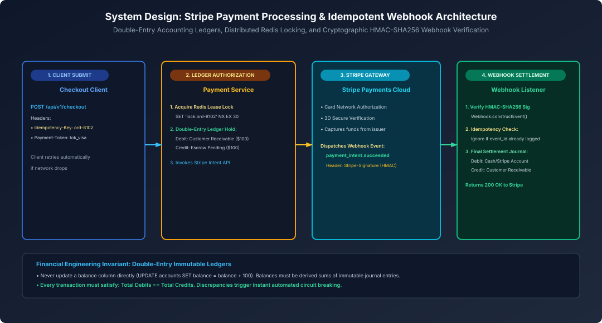

*D2 Source: [`43_system_design_stripe_payment_webhook_architecture.d2`](assets/09_microservices_and_system_design/43_system_design_stripe_payment_webhook_architecture.d2)*

#### 13.4.4 Automated Reconciliation Engine

Even with webhook retries, network glitches or unexpected database restarts can cause dropped webhooks. A payment gateway must run an **Asynchronous Nightly Reconciliation Job**:
1. Download official settlement CSV reports from payment processors (Stripe/Adyen/PayPal) at 02:00 UTC.
2. Stream-parse settlement records and compare them against internal `journal_entries` within the corresponding settlement window:
   $$\Delta = \text{Internal Ledger} - \text{External PSP Report}$$
3. For any unmatched transaction:
   - **Type 1: Captured in PSP, missing in local ledger**: Automatically inject a backdated adjustment journal entry and notify accounting.
   - **Type 2: Captured in local ledger, missing in PSP**: Flag transaction as critical; trigger dispute investigation workflow.

---

### 13.5 High-Throughput Trailing Stop-Loss Order Execution Engine Design

A **Trailing Stop-Loss** is a dynamic risk-management order type where the stop price adjusts automatically as the underlying market price moves favorably, but remains fixed when the market moves unfavorably. If the market reverses by a predefined trailing offset, the order triggers and dispatches an execution order to the exchange.

In high-frequency trading platforms (e.g., Zerodha, Interactive Brokers, Binance), hundreds of thousands of active trailing stops exist across volatile equities and crypto pairs. Processing market data ticks arriving at 5,000–10,000 events/second while evaluating 200,000+ active stops with sub-millisecond execution latency requires specialized in-memory architectures, lock-free ring buffers, and resilient state recovery.

#### 13.5.1 Mathematical Dynamics & Execution Semantics

Let $P_0$ represent the initial order placement price, $\alpha \in (0, 1)$ represent the trailing stop percentage (e.g., $\alpha = 0.05$ for a 5% trailing stop), and $P_{\text{tick}}(t)$ represent the latest market tick price at timestamp $t$.

For a long position (Sell Trailing Stop):
1. **Dynamic Peak Tracking:** The high watermark peak price $P_{\text{peak}}(t)$ updates strictly monotonically upwards:
   $$P_{\text{peak}}(t) = \max \left( P_{\text{peak}}(t-1), P_{\text{tick}}(t) \right)$$
2. **Dynamic Stop Price Adjustment:** The active trigger threshold moves upward in tandem with the peak:
   $$P_{\text{trigger}}(t) = P_{\text{peak}}(t) \times (1 - \alpha)$$
3. **Execution Condition:** The order triggers when the market price drops to or below the trigger price:
   $$\text{Trigger Condition: } P_{\text{tick}}(t) \le P_{\text{trigger}}(t)$$

**Concrete Numeric Walkthrough:**
- A user places a 5% trailing stop at an entry price of Rs 1,000 ($P_{\text{peak}} = 1,000$, $P_{\text{trigger}} = 950$).
- The stock surges to Rs 1,200 ($P_{\text{peak}} \leftarrow 1,200$, $P_{\text{trigger}} \leftarrow 1,200 \times 0.95 = \text{Rs } 1,140$).
- The stock subsequently falls to Rs 1,140. Because $P_{\text{tick}} = 1,140 \le P_{\text{trigger}} = 1,140$, the stop triggers immediately and a market sell order is submitted.

#### 13.5.2 Architectural Overview: In-Memory Order Book & Tick Ingestion

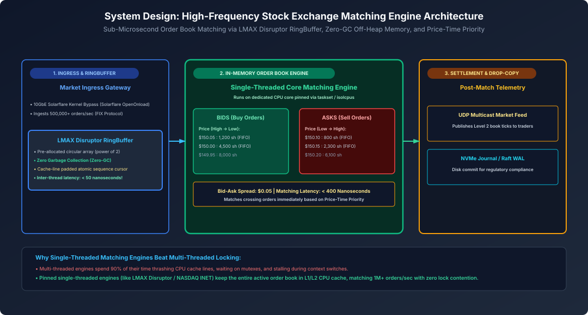

*D2 Source: [`44_system_design_stock_exchange_matching_engine_architecture.d2`](assets/09_microservices_and_system_design/44_system_design_stock_exchange_matching_engine_architecture.d2)*

#### 13.5.3 Engineering Trade-Offs & Subsystem Mechanics

1. **Sub-Millisecond Search for 200,000+ Orders per Stock:**
   - **The Naive Linear Scan Failure:** If 200,000 trailing stops sit on a single stock and ticks arrive 5,000 times/second, an $O(N)$ linear iteration across all orders consumes $5,000 \times 200,000 = 10^9$ operations/second. This completely saturates CPU cores and introduces multi-second execution delays, leading to catastrophic financial slippage.
   - **The Indexed Range Solution:** Index all active sell trailing stops in a `ConcurrentSkipListMap<Double, Set<TrailingStopOrder>>` sorted ascending by `triggerPrice`. When a tick $P_{\text{tick}}$ arrives, invoking `headMap(P_{\text{tick}}, true)` immediately retrieves only the orders whose trigger prices are $\ge P_{\text{tick}}$ in $O(\log N + K)$ time (where $K$ is the number of triggered orders).
2. **Persistence vs. Database Write Saturation:**
   - Ticks arrive multiple times per second. **Never write every price tick or peak update to a relational database.** Doing so causes database connection pool starvation and disk I/O saturation.
   - **Write-Behind Architecture:** Keep current peaks in high-speed off-heap memory. Stream critical state changes (order placed, triggered, canceled) to an append-only Kafka commit log. Peak values are flushed asynchronously in batches or on process checkpointing.
3. **Mid-Session Process Restarts & State Reconstitution:**
   - If the trailing stop engine process crashes mid-session, all active orders, peaks, and trigger thresholds must be restored before accepting new market ticks.
   - The engine restores state by hydrating the latest checkpoint snapshot from local RocksDB or Redis, then replaying uncompacted state transition events from Kafka up to the latest log offset.
4. **Exchange Order Rejection & Market Gap Slippage:**
   - **Exchange Order Rejection:** If the exchange rejects a triggered sell order (e.g., rate limits, invalid lot size, exchange gateway disconnect), the order transitions to a `RETRYING` state with immediate bounded retry. If persistent failure occurs, it routes to a dead-letter trading desk queue with emergency market sweep fallbacks.
   - **Market Gap Slippage:** If a stock closes at Rs 1,000 and gaps down 10% overnight to open at Rs 900 (skipping past the 5% stop at Rs 950), the stop order triggers at market open. The user receives the prevailing market opening execution price ($\approx \text{Rs } 900$), **not** the Rs 950 trigger price. A trailing stop is an *execution trigger*, not a *guaranteed execution price*.

#### 13.5.4 Production Java Implementation: Trailing Stop Engine

```java
package com.trading.engine.stoploss;

import java.math.BigDecimal;
import java.math.RoundingMode;
import java.util.*;
import java.util.concurrent.*;
import java.util.concurrent.atomic.AtomicReference;
import org.slf4j.Logger;
import org.slf4j.LoggerFactory;

/**
 * Production-grade Low-Latency Trailing Stop-Loss Order Execution Engine.
 * Utilizes ConcurrentSkipListMap for O(log N + K) trigger lookups across 200,000+ orders.
 */
public class TrailingStopEngine {
    private static final Logger log = LoggerFactory.getLogger(TrailingStopEngine.class);

    // Indexed by trigger price: Key = triggerPrice, Value = Set of Order IDs
    private final ConcurrentSkipListMap<Double, Set<UUID>> triggerIndex = new ConcurrentSkipListMap<>();
    
    // Order repository indexed by Order ID for O(1) state lookups
    private final ConcurrentHashMap<UUID, TrailingStopOrder> activeOrders = new ConcurrentHashMap<>();

    // Mock exchange gateway executor
    private final ExecutorService exchangeDispatcher = Executors.newFixedThreadPool(8);

    public record TrailingStopOrder(
        UUID orderId,
        String symbol,
        String userId,
        double quantity,
        double trailingPercent, // e.g., 0.05 for 5%
        AtomicReference<Double> peakPrice,
        AtomicReference<Double> triggerPrice
    ) {}

    /**
     * Registers a new trailing stop order into the memory engine.
     */
    public void registerOrder(UUID orderId, String symbol, String userId, double quantity, double entryPrice, double trailingPercent) {
        double initialTrigger = entryPrice * (1.0 - trailingPercent);
        TrailingStopOrder order = new TrailingStopOrder(
            orderId, symbol, userId, quantity, trailingPercent,
            new AtomicReference<>(entryPrice),
            new AtomicReference<>(initialTrigger)
        );

        activeOrders.put(orderId, order);
        triggerIndex.computeIfAbsent(initialTrigger, k -> ConcurrentHashMap.newKeySet()).add(orderId);
        log.info("Registered Trailing Stop: orderId={}, symbol={}, peak={}, trigger={}", orderId, symbol, entryPrice, initialTrigger);
    }

    /**
     * Evaluates incoming market data tick for price peaks and trigger execution.
     * Time Complexity: O(log N + K) where K is the number of triggered orders.
     */
    public void onMarketTick(String symbol, double currentPrice) {
        // 1. O(log N + K) Retrieval: Find all orders whose triggerPrice >= currentPrice
        // In a sell stop, if currentPrice <= triggerPrice, the stop is hit!
        NavigableMap<Double, Set<UUID>> triggeredSubMap = triggerIndex.tailMap(currentPrice, true);

        if (!triggeredSubMap.isEmpty()) {
            List<UUID> toTrigger = new ArrayList<>();
            for (Map.Entry<Double, Set<UUID>> entry : triggeredSubMap.entrySet()) {
                toTrigger.addAll(entry.getValue());
            }

            for (UUID orderId : toTrigger) {
                TrailingStopOrder order = activeOrders.remove(orderId);
                if (order != null) {
                    // Remove from trigger index
                    triggerIndex.computeIfPresent(order.triggerPrice().get(), (k, set) -> {
                        set.remove(orderId);
                        return set.isEmpty() ? null : set;
                    });
                    // Asynchronously dispatch market order to exchange
                    exchangeDispatcher.submit(() -> executeExchangeOrder(order, currentPrice));
                }
            }
        }

        // 2. Trailing Peak Upward Adjustment: For orders where currentPrice > peakPrice
        // In high-frequency production, peak adjustments are processed in partitioned workers
        for (TrailingStopOrder order : activeOrders.values()) {
            if (order.symbol().equals(symbol)) {
                double currentPeak = order.peakPrice().get();
                if (currentPrice > currentPeak) {
                    if (order.peakPrice().compareAndSet(currentPeak, currentPrice)) {
                        double oldTrigger = order.triggerPrice().get();
                        double newTrigger = currentPrice * (1.0 - order.trailingPercent());
                        order.triggerPrice().set(newTrigger);

                        // Re-index order in SkipListMap
                        triggerIndex.computeIfPresent(oldTrigger, (k, set) -> {
                            set.remove(order.orderId());
                            return set.isEmpty() ? null : set;
                        });
                        triggerIndex.computeIfAbsent(newTrigger, k -> ConcurrentHashMap.newKeySet()).add(order.orderId());
                    }
                }
            }
        }
    }

    private void executeExchangeOrder(TrailingStopOrder order, double triggeredPrice) {
        try {
            log.warn("TRIGGERED STOP-LOSS: orderId={}, user={}, symbol={}, execPrice={}", 
                     order.orderId(), order.userId(), order.symbol(), triggeredPrice);
            // Simulate exchange submission with timeout & retry guards
        } catch (Exception ex) {
            log.error("Exchange execution failed for orderId={}. Routing to Dead-Letter queue.", order.orderId(), ex);
        }
    }
}
```
- **Time Complexity:** $O(\log N + K)$ per tick where $N$ is total active orders and $K$ is triggered orders; avoids $O(N)$ linear scans.
- **Space Complexity:** $O(N)$ memory footprint stored in `ConcurrentSkipListMap` and `ConcurrentHashMap`.

> [!TIP]
> **Deep-Dive Interview Scenarios:**
> - [Q13. System Design: Scalable URL Shortener (bit.ly)](frequently_asked_questions/09_microservices_and_system_design_faq.md#q13-hard-system-design-scalable-url-shortener-bitly)
> - [Q14. System Design: High-Throughput Real-Time Chat (Millions of Msgs/sec)](frequently_asked_questions/09_microservices_and_system_design_faq.md#q14-expert-system-design-high-throughput-real-time-chat-millions-of-msgssec)
> - [Q16. Streaming Algorithm: Real-Time Anomaly Detection Over Rolling Windows](frequently_asked_questions/09_microservices_and_system_design_faq.md#q16-hard-streaming-algorithm-real-time-anomaly-detection-over-rolling-windows)
> - [Q17. Designing a Distributed Rate Limiter in Java with Redis Fallback Degradation](frequently_asked_questions/09_microservices_and_system_design_faq.md#q17-hard-designing-a-distributed-rate-limiter-in-java-with-redis-fallback-degradation)
> - [Q18. Custom Generic Circuit Breaker Implementation in Plain Java](frequently_asked_questions/09_microservices_and_system_design_faq.md#q18-hard-custom-generic-circuit-breaker-implementation-in-plain-java)
> - [Q19. High-Throughput Backend Architecture for Handling Thousands of Concurrent Requests](frequently_asked_questions/09_microservices_and_system_design_faq.md#q19-expert-high-throughput-backend-architecture-for-handling-thousands-of-concurrent-requests)
> - [Q20. High-Availability Payment Processing Platform with Zero Double-Charges (50,000 TPS)](frequently_asked_questions/09_microservices_and_system_design_faq.md#q20-expert-high-availability-payment-processing-platform-with-zero-double-charges-50000-tps)
> - [Q21. Saga Pattern: Choreography vs Orchestration Decision Framework](frequently_asked_questions/09_microservices_and_system_design_faq.md#q21-medium-saga-pattern-choreography-vs-orchestration-decision-framework)
> - [Q22. Design a High-Throughput Trailing Stop-Loss Order Execution Engine](frequently_asked_questions/09_microservices_and_system_design_faq.md#q22-expert-design-a-high-throughput-trailing-stop-loss-order-execution-engine)
> - [Q23. Isolating Slow Downstream Microservices: Cascading Failure Prevention via Circuit Breakers, Timeouts & Bulkheads](frequently_asked_questions/09_microservices_and_system_design_faq.md#q23-hard-isolating-slow-downstream-microservices-cascading-failure-prevention-via-circuit-breakers-timeouts--bulkheads)
> - [Q24. Retry Storm Prevention & Exponential Backoff with Jitter](frequently_asked_questions/09_microservices_and_system_design_faq.md#q24-medium-retry-storm-prevention--exponential-backoff-with-jitter)
> - [Q25. Detecting & Decoupling a Distributed Monolith](frequently_asked_questions/09_microservices_and_system_design_faq.md#q25-hard-detecting--decoupling-a-distributed-monolith)
> - [Q26. Anatomy and Redesign of Cascading Retry Storms in Multi-Tier Microservice Architectures (A to B to C)](frequently_asked_questions/09_microservices_and_system_design_faq.md#q26-hard-anatomy-and-redesign-of-cascading-retry-storms-in-multi-tier-microservice-architectures-a-to-b-to-c)

---

# 14. Operational Commands & Diagnostic Tools Cheatsheet

| Command & Syntax | Key Flags Explained | What Does What | Practical Operational Scenario |
| :--- | :--- | :--- | :--- |
| `istioctl analyze -n <ns>` | `-n <ns>`: Target namespace | Analyzes Service Mesh configuration for broken routing rules or syntax errors | Verifying Istio `VirtualService` or `DestinationRule` health before rollout |
| `istioctl proxy-config endpoints <pod>` | `--cluster <name>`: Filter by upstream cluster | Inspects live Envoy routing tables and active backend IP endpoints inside sidecar | Debugging why traffic is not reaching a specific Pod replica |
| `grpcurl -plaintext <host>:<port> list` | `-plaintext`: Disable TLS encryption | Queries gRPC server reflection to enumerate exposed services and methods | Testing and discovering internal gRPC APIs without client SDK |
| `hey -n 10000 -c 100 -m POST -H "..." <url>` | `-n`: Total requests<br>`-c`: Concurrent workers<br>`-m`: HTTP method | High-speed HTTP load generator outputting latency percentiles (p50, p95, p99) | Benchmarking API Gateway rate limiters and autoscaling response |
| `curl -w "@curl-format.txt" -o /dev/null -s <url>` | `-w`: Format timing output (DNS, TCP, TLS, TTFB) | Measures exact millisecond breakdown of network connection and server response | Diagnosing whether latency is caused by DNS resolution, TLS, or server processing |

---

# 15. Summary Comparison & Production Engineering Reference Matrix

| GoF / Enterprise Pattern | Category | Intent | Spring Boot / JDK Production Reference | Architectural Rule |
| :--- | :--- | :--- | :--- | :--- |
| **Builder** | Creational | Construct complex immutable objects step-by-step | Lombok `@Builder`, `UriComponentsBuilder` | Mandate defensive copying for collection fields. |
| **Factory Method** | Creational | Delegate object instantiation to factory classes | `BeanFactory`, `FactoryBean`, `LoggerFactory.getLogger()` | Decouples caller from concrete constructor invocation. |
| **Singleton** | Creational | Single shared instance with controlled global access | Default Spring Bean Scope (`@Scope("singleton")`) | Keep beans stateless; stateful singletons cause concurrency race hazards. |
| **Prototype** | Creational | Clone instances from a template | `@Scope("prototype")`, `Object.clone()` | Use when instantiation involves heavy parsing or configuration trees. |
| **Adapter** | Structural | Bridge incompatible interfaces | Spring MVC `HandlerAdapter`, `JpaVendorAdapter` | Convert third-party data structures to internal domain types. |
| **Decorator** | Structural | Add runtime dynamic responsibilities transparently | Java I/O (`BufferedReader`), `HttpServletRequestWrapper` | Prefer over deep inheritance hierarchies. |
| **Proxy** | Structural | Control access, add cross-cutting behavior (AOP) | Spring AOP (`@Transactional`, `@Async`), CGLIB | Avoid internal self-invocation (`this.method()`) which bypasses proxies. |
| **Facade** | Structural | Simplified high-level interface to complex subsystems | `JdbcTemplate`, `KafkaTemplate`, `MongoTemplate` | Masks subsystem complexity; keeps client APIs focused and clean. |
| **Composite** | Structural | Part-whole tree hierarchies | Spring `CompositeUriComponents`, UI component trees | Treats individual leaves and composite groups uniformly. |
| **Strategy** | Behavioral | Interchangeable algorithmic implementations | Map injection `Map<String, Strategy>`, `TaskExecutor` | Eliminates long `switch-case` blocks; facilitates Open/Closed principle. |
| **Template Method** | Behavioral | Invariant algorithm skeleton with subclass hooks | `AbstractPlatformTransactionManager`, `JdbcTemplate.execute()` | Favor Strategy if algorithms vary dynamically at runtime. |
| **Chain of Responsibility** | Behavioral | Sequential request processing pipeline | `SecurityFilterChain`, `javax.servlet.FilterChain` | Order filters carefully; verify authentication before authorization. |
| **Observer** | Behavioral | Decoupled event notification | `ApplicationEventPublisher`, `@EventListener` | Prefer asynchronous listeners (`@Async`) for non-transactional side-effects. |
| **State** | Behavioral | State-dependent polymorphic behavior | Spring State Machine, Order workflow state objects | Eliminates error-prone status flag branches across controllers. |
| **Command** | Behavioral | Encapsulate request/operation as an object | Spring Batch `JobStep`, `Runnable`, `Callable` | Enables request queuing, retry logging, and undo/redo semantics. |

---

| Distributed Communication & Coordination Dimension | Synchronous REST (HTTP/1.1 JSON) | High-Performance gRPC (HTTP/2 Protobuf) | Asynchronous Messaging (AMQP / RabbitMQ) | Distributed Event Log (Kafka Event Streams) |
| :--- | :--- | :--- | :--- | :--- |
| **Transport & Framing** | HTTP/1.1 TCP, text headers | HTTP/2 multiplexed binary streams | AMQP 0-9-1 TCP binary framing | Custom TCP protocol over sequential disk logs |
| **Payload Format** | Verbose human-readable JSON string | Strongly typed binary Protocol Buffers | Arbitrary byte stream (JSON / Avro / Protobuf) | Schema-governed Avro / Protobuf / JSON |
| **Coupling Level** | Tight temporal and spatial coupling | Tight temporal coupling, loose interface contract | Loose temporal and spatial coupling (queues) | Loose temporal and spatial coupling (topics) |
| **Latency Profile** | High ($15 - 50$ ms average) | Minimal ($1 - 5$ ms p99) | Low ($5 - 15$ ms) | Near-zero write latency ($2 - 10$ ms) |
| **Resilience & Fault Isolation** | Requires explicit Circuit Breakers & Retries | Requires Client Retries & Deadline propagation | Inherent temporal decoupling via broker queue buffer | Inherent decoupling; consumers process at own pace |
| **Service Mesh Integration** | Standard Ingress / L7 Gateway | Envoy / Istio HTTP/2 multiplexing & gRPC status | TCP Layer 4 pass-through or proxy | TCP Layer 4 pass-through or specialized Kafka mesh |
| **Primary Production Pattern** | Public-facing client APIs & B2B integrations | High-throughput internal inter-service RPC | Async command processing, transactional tasks | Core enterprise event backbone, CDC, event sourcing |

---

# 16. References & Further Reading

---

- [GeeksforGeeks - Java Design Patterns](https://www.geeksforgeeks.org/java-design-patterns/)
- [GeeksforGeeks - SOLID Principles in Java](https://www.geeksforgeeks.org/solid-principles-in-java/)
- [Refactoring.Guru - Design Patterns in Java](https://refactoring.guru/design-patterns/java)
- [Baeldung - Gang of Four (GoF) Design Patterns Series](https://www.baeldung.com/category/design-patterns/)
- [Robert C. Martin: Clean Architecture](https://www.oreilly.com/library/view/clean-architecture-a/9780134494272/) — The definitive guide to software structure, boundaries, and dependencies.
- [ArchUnit Official Documentation](https://www.archunit.org/) — Unit testing Java architecture and package boundaries.
- [Martin Fowler - Inversion of Control Containers and Dependency Injection](https://martinfowler.com/articles/injection.html)
- [Spring Framework Official Documentation - Core IoC and AOP Architecture](https://docs.spring.io/spring-framework/reference/core.html)

- [GeeksforGeeks - System Design Tutorial & High-Level Architecture](https://www.geeksforgeeks.org/system-design-tutorial/)
- [GeeksforGeeks - Microservices Architecture](https://www.geeksforgeeks.org/microservices/)
- [Baeldung - Spring Cloud and Microservices Architecture Series](https://www.baeldung.com/spring-cloud-series)
- [Martin Fowler - Microservices Guide & Distributed Design Patterns](https://martinfowler.com/articles/microservices.html)
- [Martin Fowler - Patterns of Distributed Systems](https://martinfowler.com/articles/patterns-of-distributed-systems/)
- [Resilience4j Official Documentation & Circuit Breaker Guides](https://resilience4j.readme.io/)
- [The Raft Consensus Algorithm (Interactive Stanford Visualization)](https://raft.github.io/)
