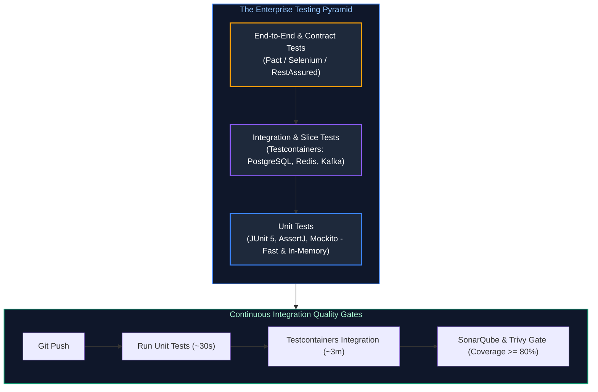
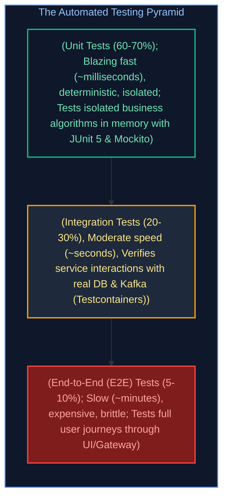
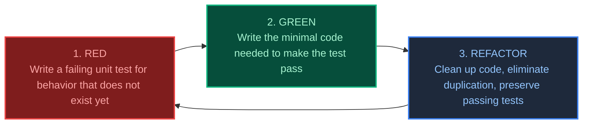

# 10. Testing & Quality Engineering: Unit, Integration & Contract Testing

A comprehensive, production-grade guide to enterprise testing strategies, the Testing Pyramid, JUnit 5 mechanics, Mockito verification, Spring Boot test slicing, Testcontainers, and consumer-driven contract testing tailored for Staff/Principal Java Engineers.

---

## Architectural Overview: Enterprise Test Automation Architecture



---


## Table of Contents

1. [The Testing Pyramid & Unit Testing Foundations](#1-the-testing-pyramid--unit-testing-foundations)
   - [1.1 The Testing Pyramid: Balancing Speed, Determinism & Fidelity](#11-the-testing-pyramid-balancing-speed-determinism--fidelity)
   - [1.2 Test-Driven Development (TDD): The Red-Green-Refactor Cycle](#12-test-driven-development-tdd-the-red-green-refactor-cycle)
   - [1.3 JUnit 5 Architecture & Test Lifecycle (`@BeforeEach`, `@Nested`)](#13-junit-5-architecture--test-lifecycle-beforeeach-nested)
   - [1.4 Custom JUnit 5 Extensions (Timing & Benchmark Extensions)](#14-custom-junit-5-extensions-timing--benchmark-extensions)
   - [1.5 Parameterized Testing Mastery (`@CsvSource`, `@MethodSource`)](#15-parameterized-testing-mastery-csvsource-methodsource)
   - [1.6 Test Doubles: Dummy vs Stub vs Mock vs Spy](#16-test-doubles-dummy-vs-stub-vs-mock-vs-spy)
   - [1.7 Mockito Deep-Dive: `@Mock`, `@InjectMocks`, `ArgumentCaptor` & Static Mocking](#17-mockito-deep-dive-mock-injectmocks-argumentcaptor--static-mocking)
   - [1.8 Fluent Assertions with AssertJ & Deep Object Graph Comparison](#18-fluent-assertions-with-assertj--deep-object-graph-comparison)
2. [Spring Boot Test Slicing & Real Integration Testing](#2-spring-boot-test-slicing--real-integration-testing)
   - [2.1 Why `@SpringBootTest` is an Anti-Pattern for Simple Tests](#21-why-springboottest-is-an-anti-pattern-for-simple-tests)
   - [2.2 Controller Slice Testing with `@WebMvcTest` & `MockMvc`](#22-controller-slice-testing-with-webmvctest--mockmvc)
   - [2.3 Data Persistence Slicing with `@DataJpaTest`](#23-data-persistence-slicing-with-datajpatest)
   - [2.4 Why H2 In-Memory DB Fails in Production Integration Tests](#24-why-h2-in-memory-db-fails-in-production-integration-tests)
   - [2.5 Real Integration Testing with Testcontainers & Spring Boot 3.1+ `@ServiceConnection`](#25-real-integration-testing-with-testcontainers--spring-boot-31-serviceconnection)
3. [Contract Testing, Mocking & Code Quality Gates](#3-contract-testing-mocking--code-quality-gates)
   - [3.1 External HTTP API Mocking with WireMock (Fault Injection, Delays & Stateful Scenarios)](#31-external-http-api-mocking-with-wiremock-fault-injection-delays--stateful-scenarios)
   - [3.2 Consumer-Driven Contract Testing with Pact](#32-consumer-driven-contract-testing-with-pact)
   - [3.3 Code Coverage (JaCoCo) vs Mutation Testing (PITest)](#33-code-coverage-jacoco-vs-mutation-testing-pitest)
4. [Spring TestContext Framework Caching & Performance Optimization](#4-spring-testcontext-framework-caching--performance-optimization)
5. [Testing Asynchronous, Event-Driven & Concurrent Systems](#5-testing-asynchronous-event-driven--concurrent-systems)
6. [Architecture as Code & Fitness Functions with ArchUnit](#6-architecture-as-code--fitness-functions-with-archunit)
7. [Production Failure Modes, Anti-Patterns & Diagnostic Playbook](#7-production-failure-modes-anti-patterns--diagnostic-playbook)
8. [References & Further Reading](#8-references--further-reading)

---

# 1. The Testing Pyramid & Unit Testing Foundations

---

### 1.1 The Testing Pyramid: Balancing Speed, Determinism & Fidelity

Originally formulated by Mike Cohn and popularized by Martin Fowler, the **Testing Pyramid** provides the foundational architectural strategy for automated testing in high-velocity software engineering:



#### The Ice Cream Cone Anti-Pattern:
In dysfunctional engineering organizations, teams write very few unit tests and rely predominantly on hundreds of end-to-end UI tests.
* **Result**: CI builds take 2 hours to complete; tests frequently fail due to network timeouts or database state pollution (**Flaky Tests**); developers stop trusting the test suite.

---

### 1.2 Test-Driven Development (TDD): The Red-Green-Refactor Cycle

Test-Driven Development inverts traditional development: you write the automated specification **before** writing implementation code:



* **Why TDD Matters for Staff Engineers**: TDD forces modular, loosely-coupled object design. If a class is difficult to test in a unit test, its architectural design is flawed (e.g. violating SRP, using static global state, or missing dependency injection).

---

### 1.3 JUnit 5 Architecture & Test Lifecycle (`@BeforeEach`, `@Nested`)

JUnit 5 is decoupled into three independent modules:
* **JUnit Platform**: The underlying test engine foundation running on the JVM.
* **JUnit Jupiter**: The modern programming and extension model (`@Test`, `@ParameterizedTest`).
* **JUnit Vintage**: Backwards-compatibility engine running legacy JUnit 3 and 4 tests.

#### Hierarchical BDD Lifecycle with `@Nested`:
```java
package com.enterprise.banking.service;

import org.junit.jupiter.api.*;
import java.math.BigDecimal;
import static org.assertj.core.api.Assertions.*;

@DisplayName("BankAccount Domain Operations")
class BankAccountTest {

    private BankAccount account;

    @BeforeEach
    void setUp() {
        // Runs before every individual @Test method
        account = new BankAccount("ACC-101", new BigDecimal("100.00"));
    }

    @Nested
    @DisplayName("Deposit Operations")
    class DepositTests {

        @Test
        @DisplayName("Should increment balance when deposit is strictly positive")
        void depositValidAmount() {
            account.deposit(new BigDecimal("50.00"));
            assertThat(account.getCurrentBalance()).isEqualByComparingTo("150.00");
        }

        @Test
        @DisplayName("Should throw IllegalArgumentException when deposit is zero or negative")
        void depositInvalidAmount() {
            assertThatThrownBy(() -> account.deposit(new BigDecimal("-10.00")))
                .isInstanceOf(IllegalArgumentException.class)
                .hasMessageContaining("strictly positive");
        }
    }

    @Nested
    @DisplayName("Withdrawal Operations")
    class WithdrawalTests {

        @Test
        @DisplayName("Should decrement balance when funds are sufficient")
        void withdrawSufficientFunds() {
            account.withdraw(new BigDecimal("40.00"));
            assertThat(account.getCurrentBalance()).isEqualByComparingTo("60.00");
        }

        @Test
        @DisplayName("Should throw InsufficientFundsException when balance is exceeded")
        void withdrawInsufficientFunds() {
            assertThatThrownBy(() -> account.withdraw(new BigDecimal("200.00")))
                .isInstanceOf(InsufficientFundsException.class);
        }
    }
}
```

---

### 1.4 Custom JUnit 5 Extensions (Timing & Benchmark Extensions)

Custom JUnit 5 extensions let you intercept test lifecycle events without modifying test code:

```java
public class ExecutionTimeExtension implements BeforeTestExecutionCallback, AfterTestExecutionCallback {

    private static final Logger log = LoggerFactory.getLogger(ExecutionTimeExtension.class);
    private static final String START_TIME = "start_time";

    @Override
    public void beforeTestExecution(ExtensionContext context) {
        context.getStore(ExtensionContext.Namespace.GLOBAL).put(START_TIME, System.currentTimeMillis());
    }

    @Override
    public void afterTestExecution(ExtensionContext context) {
        long start = context.getStore(ExtensionContext.Namespace.GLOBAL).remove(START_TIME, long.class);
        long duration = System.currentTimeMillis() - start;
        if (duration > 500) {
            log.warn("SLOW TEST ALERT: Test [{}] took {} ms to execute!", context.getDisplayName(), duration);
        }
    }
}
```

#### Production Database Truncation Extension (`DatabaseCleanupExtension`)

In integration test suites, tests that write to a database can cause test order pollution (e.g. Test A creates a user with email `test@corp.com`, causing Test B to fail with a unique constraint violation). Wrapping tests in `@Transactional` causes rollback, but breaks tests that test asynchronous listeners or committed states.

A custom JUnit 5 extension cleanly truncates all database tables between test executions:

```java
package com.enterprise.integration.extension;

import org.junit.jupiter.api.extension.AfterEachCallback;
import org.junit.jupiter.api.extension.ExtensionContext;
import org.springframework.context.ApplicationContext;
import org.springframework.jdbc.core.JdbcTemplate;
import org.springframework.test.context.junit.jupiter.SpringExtension;

import java.util.List;

public class DatabaseCleanupExtension implements AfterEachCallback {

    @Override
    public void afterEach(ExtensionContext context) {
        ApplicationContext appCtx = SpringExtension.getApplicationContext(context);
        JdbcTemplate jdbcTemplate = appCtx.getBean(JdbcTemplate.class);

        // Fetch all user tables in PostgreSQL public schema (ignoring Flyway/Liquibase history)
        List<String> tableNames = jdbcTemplate.queryForList(
            "SELECT table_name FROM information_schema.tables " +
            "WHERE table_schema = 'public' AND table_type = 'BASE TABLE' " +
            "AND table_name NOT IN ('flyway_schema_history', 'databasechangelog', 'databasechangeloglock')",
            String.class
        );

        if (!tableNames.isEmpty()) {
            // Disable referential integrity and truncate all tables concurrently with CASCADE
            String truncateSql = "TRUNCATE TABLE " + String.join(", ", tableNames) + " RESTART IDENTITY CASCADE";
            jdbcTemplate.execute(truncateSql);
        }
    }
}
```

Apply at test class or base class level: `@ExtendWith(DatabaseCleanupExtension.class)`!

---

### 1.5 Parameterized Testing Mastery (`@CsvSource`, `@MethodSource`)

Parameterized tests execute the exact same test logic across multiple input-output data sets without code duplication:

```java
public class PasswordValidator {
    public boolean isValid(String password) {
        if (password == null || password.length() < 8) return false;
        return password.matches(".*[A-Z].*") && password.matches(".*[0-9].*");
    }
}

class PasswordValidatorTest {

    private final PasswordValidator validator = new PasswordValidator();

    @ParameterizedTest(name = "Password ''{0}'' validity should be {1}")
    @CsvSource({
        "Secret123, true",
        "weak, false",
        "NoNumberPass, false",
        "12345678, false",
        ", false"
    })
    void validatePasswords(String candidatePassword, boolean expectedResult) {
        assertThat(validator.isValid(candidatePassword)).isEqualTo(expectedResult);
    }
}
```

---

### 1.6 Test Doubles: Dummy vs Stub vs Mock vs Spy

In automated testing, replacing a real dependency with a surrogate is called using a **Test Double** (Gerard Meszaros taxonomy):

| Test Double | Purpose | Typical Implementation |
| :--- | :--- | :--- |
| **Dummy** | Passed around to satisfy parameter lists; never actually invoked or inspected. | `new User("dummy", null)` |
| **Stub** | Provides canned, hardcoded responses to method calls during the test. | `when(repo.findById(1L)).thenReturn(Optional.of(user))` |
| **Mock** | Pre-programmed with expectations; verifies **behavior** (which methods were called with what arguments). | `verify(emailService, times(1)).sendWelcomeEmail("user@corp.com")` |
| **Spy** | A wrapper around a **real object** that records interactions while executing real code. | `@Spy private AuditLogger logger = new AuditLogger();` |

---

### 1.7 Mockito Deep-Dive: `@Mock`, `@InjectMocks`, `ArgumentCaptor` & Static Mocking

```java
@ExtendWith(MockitoExtension.class)
class OrderServiceTest {

    @Mock
    private OrderRepository orderRepository;

    @Mock
    private PaymentGateway paymentGateway;

    @InjectMocks
    private OrderService orderService; // Injects mocked repository and payment gateway into OrderService

    @Captor
    private ArgumentCaptor<OrderEntity> orderCaptor;

    @Test
    void shouldCreateOrderAndProcessPaymentSuccessfully() {
        // 1. Arrange (Stub dependencies)
        CreateOrderRequest request = new CreateOrderRequest("CUST-101", new BigDecimal("99.00"));
        when(paymentGateway.charge(eq("CUST-101"), any(BigDecimal.class)))
            .thenReturn(new PaymentResult("TX-999", true));

        // 2. Act
        OrderResponse response = orderService.createOrder(request);

        // 3. Assert & Verify
        assertThat(response.status()).isEqualTo("CONFIRMED");

        // Verify paymentGateway was called exactly once
        verify(paymentGateway, times(1)).charge("CUST-101", new BigDecimal("99.00"));

        // Capture the internal entity passed to repository.save() to assert fields
        verify(orderRepository).save(orderCaptor.capture());
        OrderEntity savedEntity = orderCaptor.getValue();
        assertThat(savedEntity.getCustomerId()).isEqualTo("CUST-101");
        assertThat(savedEntity.getTotalAmount()).isEqualByComparingTo("99.00");
    }

    @Test
    void shouldMockStaticUtilityMethod() {
        // Mockito 3.4+ supports mocking static methods using try-with-resources!
        try (MockedStatic<UUIDGenerator> mocked = mockStatic(UUIDGenerator.class)) {
            mocked.when(UUIDGenerator::generate).thenReturn("STATIC-UUID-123");

            String token = orderService.generateToken();
            assertThat(token).isEqualTo("STATIC-UUID-123");
        }
    }

    @Test
    void shouldVerifyMethodExecutionOrderAndHandleVoidMethods() {
        // 1. Mocking void methods with doThrow and doAnswer
        doNothing().when(orderRepository).deleteById(99L);
        doThrow(new DataIntegrityViolationException("Foreign key violation"))
            .when(orderRepository).deleteById(100L);

        // 2. InOrder Verification: Proves method A was strictly executed before method B
        InOrder inOrder = inOrder(paymentGateway, orderRepository);

        orderService.processAndAuditOrder("CUST-1", new BigDecimal("50.00"));

        inOrder.verify(paymentGateway).charge(eq("CUST-1"), any(BigDecimal.class));
        inOrder.verify(orderRepository).save(any(OrderEntity.class));
    }
}
```

---

### 1.8 Fluent Assertions with AssertJ & Deep Object Graph Comparison

AssertJ provides readable, fluent assertions that produce diagnostic failure messages. For enterprise integration tests comparing domain objects with database entities, **Recursive Comparison** eliminates dozens of boilerplate getters:

```java
// AssertJ Fluent API: Collections & Strings
assertThat(orderList)
    .hasSize(3)
    .extracting(Order::getStatus)
    .containsExactly(OrderStatus.PENDING, OrderStatus.CONFIRMED, OrderStatus.SHIPPED);

assertThat(customer.getEmail())
    .isNotBlank()
    .contains("@")
    .endsWith(".com");

// Deep Object Graph Comparison (Ignores auto-generated IDs and Timestamps)
OrderEntity actualEntity = orderRepository.findById(1L).orElseThrow();
OrderExpectedDto expectedDto = new OrderExpectedDto("CUST-101", new BigDecimal("99.00"), OrderStatus.CONFIRMED);

assertThat(actualEntity)
    .usingRecursiveComparison()
    .ignoringFields("id", "createdAt", "updatedAt", "version")
    .ignoringCollectionOrder()
    .withStrictTypeChecking()
    .isEqualTo(expectedDto);
```

---

# 2. Spring Boot Test Slicing & Real Integration Testing

---

### 2.1 Why `@SpringBootTest` is an Anti-Pattern for Simple Tests

* **What `@SpringBootTest` Does**: Scans the entire classpath, boots the full `ApplicationContext`, instantiates every `@Component`, `@Service`, and `@Repository`, and optionally starts an embedded Tomcat server.
* **The Cost**: Startup time takes **5 to 15 seconds per test class**! A suite of 200 `@SpringBootTest` classes takes 30 minutes to execute.
* **The Solution**: **Test Slicing** (`@WebMvcTest`, `@DataJpaTest`). Test slices boot only the minimal subset of Spring beans required for that specific architectural tier, cutting startup time to $< 1\text{ second}$!

---

### 2.2 Controller Slice Testing with `@WebMvcTest` & `MockMvc`

`@WebMvcTest` configures only the presentation layer (Spring MVC, filters, converters, `@ControllerAdvice`):

```java
@WebMvcTest(OrderController.class)
class OrderControllerTest {

    @Autowired
    private MockMvc mockMvc;

    @MockBean // Replaces service bean in WebMvc context with a Mockito mock
    private OrderService orderService;

    @Autowired
    private ObjectMapper objectMapper;

    @Test
    void shouldReturn201WhenOrderIsValid() throws Exception {
        CreateOrderRequest request = new CreateOrderRequest("CUST-101", new BigDecimal("50.00"));
        OrderResponse response = new OrderResponse("ORD-1", "CONFIRMED");

        when(orderService.createOrder(any())).thenReturn(response);

        mockMvc.perform(post("/api/v1/orders")
                .contentType(MediaType.APPLICATION_JSON)
                .content(objectMapper.writeValueAsString(request)))
            .andExpect(status().isCreated())
            .andExpect(jsonPath("$.orderId").value("ORD-1"))
            .andExpect(jsonPath("$.status").value("CONFIRMED"));
    }

    @Test
    void shouldReturn400BadRequestWhenValidationFails() throws Exception {
        CreateOrderRequest invalidRequest = new CreateOrderRequest("", new BigDecimal("-5.00"));

        mockMvc.perform(post("/api/v1/orders")
                .contentType(MediaType.APPLICATION_JSON)
                .content(objectMapper.writeValueAsString(invalidRequest)))
            .andExpect(status().isBadRequest())
            .andExpect(jsonPath("$.title").value("Bad Request"));
    }
}
```

---

### 2.3 Data Persistence Slicing with `@DataJpaTest`

`@DataJpaTest` scans only `@Entity` classes and Spring Data JPA repositories. It automatically wraps each test in a database transaction and **rolls it back at the end of the test**, leaving the database spotless!

---

### 2.4 Why H2 In-Memory DB Fails in Production Integration Tests

For years, developers configured H2 in-memory databases for JPA testing. In modern cloud architectures, this is a dangerous practice:
1. **Dialect Divergence**: H2 does not support PostgreSQL-specific types (`JSONB`, `UUID`, spatial geometries, array columns, CTEs).
2. **Locking Differences**: H2's concurrency and table-locking mechanics are completely different from PostgreSQL's Multi-Version Concurrency Control (MVCC).
3. **False Confidence**: Tests pass on H2 in CI, then immediately crash with SQL syntax errors upon deployment to PostgreSQL production!

---

### 2.5 Real Integration Testing with Testcontainers & Spring Boot 3.1+ `@ServiceConnection`

**Testcontainers** launches real, ephemeral Docker containers (PostgreSQL, Kafka, Redis) for the duration of the test suite.

Spring Boot 3.1 introduces **`@ServiceConnection`**, which automatically discovers container ports and binds `spring.datasource.url`, username, and password automatically without manual `@DynamicPropertySource` methods!

```java
package com.enterprise.integration;

import org.junit.jupiter.api.Test;
import org.springframework.beans.factory.annotation.Autowired;
import org.springframework.boot.test.context.SpringBootTest;
import org.springframework.boot.testcontainers.service.connection.ServiceConnection;
import org.testcontainers.containers.PostgreSQLContainer;
import org.testcontainers.junit.jupiter.Container;
import org.testcontainers.junit.jupiter.Testcontainers;

import java.math.BigDecimal;
import static org.assertj.core.api.Assertions.assertThat;

@SpringBootTest(webEnvironment = SpringBootTest.WebEnvironment.RANDOM_PORT)
@Testcontainers
class OrderServiceIntegrationTest {

    // 1. Spawns real PostgreSQL Docker container
    @Container
    @ServiceConnection // Automatically sets spring.datasource.* properties!
    static PostgreSQLContainer<?> postgres = new PostgreSQLContainer<>("postgres:16-alpine");

    @Autowired
    private OrderRepository orderRepository;

    @Autowired
    private OrderService orderService;

    @Test
    void shouldPersistOrderInRealPostgresDatabase() {
        CreateOrderRequest request = new CreateOrderRequest("CUST-999", new BigDecimal("120.00"));
        OrderResponse response = orderService.createOrder(request);

        assertThat(response.orderId()).isNotNull();

        // Verify row was physically written to PostgreSQL Docker container!
        assertThat(orderRepository.findById(response.orderId())).isPresent();
    }
}
```

#### Production Singleton Container Pattern (High-Speed CI Execution)

When a project contains 40 integration test classes, annotating each class with `@Container` causes Docker to spin up and tear down 40 separate PostgreSQL containers—adding 5 to 10 minutes of pure container overhead!

The **Singleton Container Pattern** starts the containers **once** for the entire test JVM execution, sharing the same database and Kafka cluster across all test classes:

```java
package com.enterprise.integration.base;

import org.springframework.boot.test.context.SpringBootTest;
import org.springframework.boot.testcontainers.service.connection.ServiceConnection;
import org.testcontainers.containers.KafkaContainer;
import org.testcontainers.containers.PostgreSQLContainer;
import org.testcontainers.utility.DockerImageName;

@SpringBootTest(webEnvironment = SpringBootTest.WebEnvironment.RANDOM_PORT)
public abstract class AbstractSharedIntegrationTest {

    // Started statically before any Spring ApplicationContext boots
    @ServiceConnection
    protected static final PostgreSQLContainer<?> POSTGRES = 
        new PostgreSQLContainer<>("postgres:16-alpine")
            .withDatabaseName("test_db")
            .withReuse(true); // Enables Testcontainers local container reuse

    @ServiceConnection
    protected static final KafkaContainer KAFKA = 
        new KafkaContainer(DockerImageName.parse("confluentinc/cp-kafka:7.6.0"));

    static {
        // Start containers concurrently
        POSTGRES.start();
        KAFKA.start();
    }
}
```
Any test class simply extends `AbstractSharedIntegrationTest` and immediately inherits the running PostgreSQL and Kafka instances with zero repeated startup latency!

> [!TIP]
> **Deep-Dive Interview Scenarios:**
> - [Q6. [Hard] Testcontainers Architecture: Ryuk Lifecycle, Container Reuse, DynamicPropertyRegistry & Local Port Mapping](frequently_asked_questions/10_testing_and_quality_engineering_faq.md#q6-hard-testcontainers-architecture-ryuk-lifecycle-container-reuse-dynamicpropertyregistry--local-port-mapping)
> - [Q9. [Medium] Database Integration Testing with Testcontainers PostgreSQL, Flyway Migrations & Rollbacks](frequently_asked_questions/10_testing_and_quality_engineering_faq.md#q9-medium-database-integration-testing-with-testcontainers-postgresql-flyway-migrations--rollbacks)

---

# 3. Contract Testing, Mocking & Code Quality Gates

---

### 3.1 External HTTP API Mocking with WireMock (Fault Injection, Delays & Stateful Scenarios)

When your microservice depends on an external third-party payment API (e.g. Stripe), running automated tests against real sandbox endpoints introduces network flakiness.

**WireMock** runs an in-memory HTTP server that stubs external endpoints, simulates production failures, and verifies stateful retry loops:

```java
package com.enterprise.integration;

import com.github.tomakehurst.wiremock.stubbing.Scenario;
import org.junit.jupiter.api.Test;
import org.springframework.beans.factory.annotation.Autowired;
import org.springframework.boot.test.context.SpringBootTest;
import org.springframework.cloud.contract.wiremock.AutoConfigureWireMock;

import java.math.BigDecimal;

import static com.github.tomakehurst.wiremock.client.WireMock.*;
import static org.assertj.core.api.Assertions.assertThat;
import static org.assertj.core.api.Assertions.assertThatThrownBy;

@SpringBootTest
@AutoConfigureWireMock(port = 8089)
class StripePaymentClientTest {

    @Autowired
    private StripePaymentClient paymentClient;

    @Test
    void shouldHandleDownstreamTimeoutGracefully() {
        // Stub external Stripe API to delay response by 5 seconds (simulating network outage)
        stubFor(post(urlEqualTo("/v1/charges"))
            .willReturn(aResponse()
                .withFixedDelay(5000)
                .withStatus(200)));

        assertThatThrownBy(() -> paymentClient.charge("CUST-1", new BigDecimal("100.00")))
            .isInstanceOf(PaymentTimeoutException.class);
    }

    @Test
    void shouldVerifyStatefulRetryLoopUsingWireMockScenarios() {
        // Stateful Scenario: 1st call returns HTTP 503 Service Unavailable, 2nd call returns HTTP 200 OK
        stubFor(post(urlEqualTo("/v1/charges"))
            .inScenario("Retry Scenario")
            .whenScenarioStateIs(Scenario.STARTED)
            .willReturn(aResponse().withStatus(503))
            .willSetStateTo("FIRST_CALL_FAILED"));

        stubFor(post(urlEqualTo("/v1/charges"))
            .inScenario("Retry Scenario")
            .whenScenarioStateIs("FIRST_CALL_FAILED")
            .willReturn(aResponse()
                .withStatus(200)
                .withHeader("Content-Type", "application/json")
                .withBody("{\"transactionId\": \"TX-RETRY-SUCCESS\"}")));

        // Calling service with Resilience4j @Retry enabled
        PaymentResult result = paymentClient.chargeWithRetry("CUST-1", new BigDecimal("50.00"));

        assertThat(result.transactionId()).isEqualTo("TX-RETRY-SUCCESS");
        // Verify wiremock received exactly 2 requests (1 failure + 1 retry)
        verify(2, postRequestedFor(urlEqualTo("/v1/charges")));
    }
}
```

---

### 3.2 Consumer-Driven Contract Testing with Pact

In microservice architectures, service A calls service B's REST API. If Team B changes an endpoint field name, Service A breaks in production.
* **Consumer-Driven Contract Testing (Pact)**:
  1. The consumer (Service A) writes a contract defining exactly what requests it sends and what response structure it expects.
  2. The contract is published to a central **Pact Broker**.
  3. The provider (Service B) runs automated tests in its CI pipeline verifying that its live endpoints satisfy the contract before merging code!

---

### 3.3 Code Coverage (JaCoCo) vs Mutation Testing (PITest)

* **Code Coverage (JaCoCo)**: Measures what percentage of lines/branches were executed during tests.
  * *Fatal Flaw*: A test can achieve 100% line coverage **without asserting anything**!
* **Mutation Testing (PITest)**: Inserts deliberate bugs ("mutants") into your compiled bytecode (e.g., changing `if (a > b)` to `if (a >= b)` or replacing `return true;` with `return false;`).
  * If your test suite fails, the mutant is **killed** (good!).
  * If your test suite passes despite the injected bug, the mutant **survives**, proving your assertions are deficient!

#### Production JaCoCo Enforcement Maven Configuration

```xml
<plugin>
    <groupId>org.jacoco</groupId>
    <artifactId>jacoco-maven-plugin</artifactId>
    <version>0.8.12</version>
    <executions>
        <execution>
            <goals>
                <goal>prepare-agent</goal>
            </goals>
        </execution>
        <execution>
            <id>report</id>
            <phase>verify</phase>
            <goals>
                <goal>report</goal>
            </goals>
        </execution>
        <execution>
            <id>check-coverage-gate</id>
            <goals>
                <goal>check</goal>
            </goals>
            <configuration>
                <rules>
                    <rule>
                        <element>BUNDLE</element>
                        <limits>
                            <!-- Require at least 80% instruction coverage across the project -->
                            <limit>
                                <counter>INSTRUCTION</counter>
                                <value>COVEREDRATIO</value>
                                <minimum>0.80</minimum>
                            </limit>
                            <!-- Require at least 75% branch coverage across the project -->
                            <limit>
                                <counter>BRANCH</counter>
                                <value>COVEREDRATIO</value>
                                <minimum>0.75</minimum>
                            </limit>
                        </limits>
                    </rule>
                </rules>
                <!-- Exclude generated classes, DTOs, and configuration beans from coverage gate -->
                <excludes>
                    <exclude>**/dto/**</exclude>
                    <exclude>**/model/**</exclude>
                    <exclude>**/config/**</exclude>
                    <exclude>**/*Application.*</exclude>
                </excludes>
            </configuration>
        </execution>
    </executions>
</plugin>
```

#### Production PITest Mutation Testing Configuration

```xml
<plugin>
    <groupId>org.pitest</groupId>
    <artifactId>pitest-maven</artifactId>
    <version>1.16.1</version>
    <dependencies>
        <dependency>
            <groupId>org.pitest</groupId>
            <artifactId>pitest-junit5-plugin</artifactId>
            <version>1.2.1</version>
        </dependency>
    </dependencies>
    <configuration>
        <targetClasses>
            <param>com.enterprise.service.*</param>
            <param>com.enterprise.domain.*</param>
        </targetClasses>
        <targetTests>
            <param>com.enterprise.*Test</param>
        </targetTests>
        <mutators>
            <mutator>DEFAULTS</mutator>
            <mutator>STRONGER</mutator>
            <mutator>CONDITIONALS_BOUNDARY</mutator>
            <mutator>INVERT_NEGS</mutator>
            <mutator>MATH</mutator>
        </mutators>
        <mutationThreshold>75</mutationThreshold> <!-- Fail build if <75% of mutants killed! -->
    </configuration>
</plugin>
```

> [!TIP]
> **Deep-Dive Interview Scenarios:**
> - [Q8. [Medium] Consumer-Driven Contract Testing with Pact: Provider Verification & Breaking API Prevention](frequently_asked_questions/10_testing_and_quality_engineering_faq.md#q8-medium-consumer-driven-contract-testing-with-pact-provider-verification--breaking-api-prevention)
> - [Q13. [Hard] Mutation Testing with PIT (Pitest): Evaluating Test Suite Quality Beyond Line Coverage](frequently_asked_questions/10_testing_and_quality_engineering_faq.md#q13-hard-mutation-testing-with-pit-pitest-evaluating-test-suite-quality-beyond-line-coverage)
> - [Q15. [Medium] Managing Test Flakiness: Network Jitter, Clock Drift & Time-Freezing with `java.time.Clock`](frequently_asked_questions/10_testing_and_quality_engineering_faq.md#q15-medium-managing-test-flakiness-network-jitter-clock-drift--time-freezing-with-javatimeclock)

---

# 4. Spring TestContext Framework Caching & Performance Optimization

## 4.1 The TestContextManager & ContextCache Internals
When executing tests with `@SpringBootTest`, Spring utilizes `TestContextManager` to bootstrap and cache application contexts:
- **The Context Hashing Algorithm:** Spring hashes the test class configuration into a `MergedContextConfiguration` cache key composed of:
  1. Context loader classes.
  2. Active Spring profiles (`@ActiveProfiles("test")`).
  3. Context initializer classes.
  4. Test property sources (`@TestPropertySource`).
  5. Component classes and configuration classes (`@ContextConfiguration`).
- **The Cache Hit:** If 50 test classes share the identical `MergedContextConfiguration` hash, Spring instantiates the `ApplicationContext` **only once** and injects beans from the cached context across all 50 test executions, executing the entire suite in seconds.

## 4.2 The `@DirtiesContext` Performance Catastrophe
When a test method or class is marked with `@DirtiesContext`:
```java
@DirtiesContext(classMode = DirtiesContext.ClassMode.AFTER_EACH_TEST_METHOD)
```
- Spring marks the cached `ApplicationContext` as contaminated and permanently evicts it from the `ContextCache` upon test completion.
- The next test class must recreate the entire Spring bean factory, re-run Flyway database migrations, and re-establish HikariCP database connection pools.
- In enterprise test suites, overuse of `@DirtiesContext` degrades CI execution from 90 seconds to 30+ minutes!
- **Zero-Downtime Cleanliness Rule:** Instead of dirtying the context, clean state via transactional rollbacks (`@Transactional` on test classes) or execute an `@AfterEach` database purge using `JdbcTemplate`:
  ```java
  @AfterEach
  void cleanDatabase(@Autowired JdbcTemplate jdbcTemplate) {
      jdbcTemplate.execute("TRUNCATE TABLE orders, order_items, payments CASCADE;");
  }
  ```

> [!TIP]
> **Deep-Dive Interview Scenarios & Production Runbooks:**
> - [Q4. [Hard] Spring TestContextManager Caching Architecture, @DirtiesContext Performance Penalty & Optimization](frequently_asked_questions/10_testing_and_quality_engineering_faq.md#q4-hard-spring-testcontextmanager-caching-architecture-dirtiescontext-performance-penalty--optimization)
> - [Q5. [Medium] WebMvcTest vs WebTestClient vs MockMvc: Slice Testing Trade-Offs & Mocking Web Layers](frequently_asked_questions/10_testing_and_quality_engineering_faq.md#q5-medium-webmvctest-vs-webtestclient-vs-mockmvc-slice-testing-trade-offs--mocking-web-layers)

---

# 5. Testing Asynchronous, Event-Driven & Concurrent Systems

## 5.1 The `Thread.sleep()` Flakiness Anti-Pattern
Relying on hard-coded thread sleeps to verify asynchronous tasks (`CompletableFuture`, Spring `@Async`, Kafka event consumer lag) is the number one cause of flaky CI builds:
- If a background job takes 100ms locally, sleeping for 200ms passes.
- On a resource-constrained CI runner under CPU throttling, the background job takes 250ms, causing random test failures.
- If the developer increases sleep to 2,000ms to stabilize the test, the entire test suite becomes intolerably slow.

## 5.2 Deterministic Polling with Awaitility
Awaitility eliminates flakiness by polling assertions with an exponential or fixed interval up to a strict timeout:
```java
import static org.awaitility.Awaitility.await;
import static java.util.concurrent.TimeUnit.SECONDS;
import static java.util.concurrent.TimeUnit.MILLISECONDS;

@Test
void testAsynchronousOrderProcessing() {
    orderService.processOrderAsync(new OrderRequest("ORD-101", 500.00));

    await().atMost(5, SECONDS)
           .pollInterval(50, MILLISECONDS)
           .untilAsserted(() -> {
               Order order = orderRepository.findById("ORD-101").orElseThrow();
               assertThat(order.getStatus()).isEqualTo(OrderStatus.COMPLETED);
           });
}
```

## 5.3 Low-Level Concurrency Testing with JCStress
To catch race conditions, lost updates, and Java Memory Model (JMM) happens-before violations that only occur once in 100,000 executions, OpenJDK provides **JCStress (Java Concurrency Stress)**:
- Employs de-synchronized hardware schedulers across multiple physical CPU cores.
- Forces cache line invalidations and memory barrier stress testing to verify atomic operations and lock-free data structures.

> [!TIP]
> **Deep-Dive Interview Scenarios & Production Runbooks:**
> - [Q7. [Hard] Testing Concurrent Code & Race Conditions in Java with Awaitility & JCStress](frequently_asked_questions/10_testing_and_quality_engineering_faq.md#q7-hard-testing-concurrent-code--race-conditions-in-java-with-awaitility--jcstress)
> - [Q10. [Hard] Kafka Integration Testing with EmbeddedKafka vs Testcontainers Kafka & Consumer Lag Assertion](frequently_asked_questions/10_testing_and_quality_engineering_faq.md#q10-hard-kafka-integration-testing-with-embeddedkafka-vs-testcontainers-kafka--consumer-lag-assertion)
> - [Q14. [Medium] Mocking Asynchronous Methods (CompletableFuture, @Async) & Virtual Threads in Unit Tests](frequently_asked_questions/10_testing_and_quality_engineering_faq.md#q14-medium-mocking-asynchronous-methods-completablefuture-async--virtual-threads-in-unit-tests)

---

# 6. Architecture as Code & Fitness Functions with ArchUnit

## 6.1 Enforcing Architectural Boundaries via Unit Tests
In large engineering teams, architectural drift occurs when developers take shortcuts (e.g. Domain entity classes importing Spring Web MVC annotations, or Controller classes directly accessing JDBC repositories).
**ArchUnit** is a Java test library that compiles bytecode into an abstract syntax graph, allowing architects to define architectural invariants as plain JUnit 5 tests.

```java
import com.tngtech.archunit.junit.AnalyzeClasses;
import com.tngtech.archunit.junit.ArchTest;
import com.tngtech.archunit.lang.ArchRule;
import static com.tngtech.archunit.lang.syntax.ArchRuleDefinition.classes;
import static com.tngtech.archunit.lang.syntax.ArchRuleDefinition.noClasses;

@AnalyzeClasses(packages = "com.enterprise.backend")
public class ArchitectureGovernanceTest {

    // Invariant 1: Domain layer must be pure and free of external framework dependencies
    @ArchTest
    static final ArchRule domain_must_not_depend_on_spring = noClasses()
        .that().resideInAPackage("..domain..")
        .should().dependOnClassesThat().resideInAnyPackage("org.springframework..");

    // Invariant 2: Repositories must only be accessed by Services
    @ArchTest
    static final ArchRule repositories_only_accessed_by_services = classes()
        .that().resideInAPackage("..repository..")
        .should().onlyBeAccessed().byAnyPackage("..service..", "..repository..");

    // Invariant 3: Zero cyclic dependencies across packages
    @ArchTest
    static final ArchRule free_of_cycles = com.tngtech.archunit.library.dependencies.SlicesRuleDefinition.slices()
        .matching("com.enterprise.backend.(*)..")
        .should().beFreeOfCycles();
}
```

> [!TIP]
> **Deep-Dive Interview Scenarios & Production Runbooks:**
> - [Q11. [Easy] Enterprise Java Pull Request Code Review Checklist & Anti-Pattern Detection](frequently_asked_questions/10_testing_and_quality_engineering_faq.md#q11-easy-enterprise-java-pull-request-code-review-checklist--anti-pattern-detection)
> - [Q12. [Medium] Architectural Fitness Functions with ArchUnit: Cyclic Dependencies, Layer Invariants & Naming Rules](frequently_asked_questions/10_testing_and_quality_engineering_faq.md#q12-medium-architectural-fitness-functions-with-archunit-cyclic-dependencies-layer-invariants--naming-rules)
> - [Q13. [Hard] Mutation Testing with PIT (Pitest): Evaluating Test Suite Quality Beyond Line Coverage](frequently_asked_questions/10_testing_and_quality_engineering_faq.md#q13-hard-mutation-testing-with-pit-pitest-evaluating-test-suite-quality-beyond-line-coverage)

---

# 7. Production Failure Modes, Anti-Patterns & Diagnostic Playbook

| Testing Pathology | Root Cause & Failure Mechanism | Diagnostic Indicator | Canonical Production Resolution |
| :--- | :--- | :--- | :--- |
| **Test Suite Performance Drag** | Overuse of `@DirtiesContext` evicting `ApplicationContext` on every method | CI test phase takes 20+ minutes; repeated Spring banner logs | Replace `@DirtiesContext` with transactional rollbacks or explicit SQL table truncation |
| **In-Memory H2 Divergence** | H2 does not support PostgreSQL JSONB, array types, or CTE syntax | Tests pass locally on H2, but fail immediately on real PostgreSQL in staging | Replace H2 with Testcontainers PostgreSQL matching production major version |
| **Flaky Timing Assertions** | Using `Thread.sleep()` to wait for asynchronous jobs or Kafka events | Random test failures in CI under heavy CPU load | Replace sleeps with Awaitility explicit condition polling (`await().untilAsserted(...)`) |
| **Timezone & Midnight Failures** | Hard-coding `LocalDate.now()` in business logic assertions | Tests pass during the day, but fail when run at 11:59 PM or across UTC offsets | Inject `java.time.Clock` into services; use `Clock.fixed()` in unit tests |
| **Docker Zombie Containers** | CI process killed abruptly before Testcontainers cleanup | Local or CI Docker host runs out of disk space from orphaned containers | Verify `testcontainers/ryuk` is running and has access to Docker socket |
| **False Sense of Coverage** | 95% line coverage with zero assertions verifying boundary conditions | Critical production defects slip through untested conditional branches | Enforce Mutation Testing via Pitest to verify assertions kill injected mutants |

---

# 8. References & Further Reading


- [JUnit 5 User Guide](https://junit.org/junit5/docs/current/user-guide/)
- [Mockito Framework Documentation](https://javadoc.io/doc/org.mockito/mockito-core/latest/org/mockito/Mockito.html)
- [AssertJ Fluent Assertions](https://assertj.github.io/doc/)
- [Spring Boot Testing Guide](https://docs.spring.io/spring-boot/reference/testing/index.html)
- [Testcontainers Java Guide](https://java.testcontainers.org/)
- [WireMock Documentation](https://wiremock.org/docs/)
- [Pact Foundation Documentation](https://docs.pact.io/)
- [PITest Mutation Testing](https://pitest.org/)
