# 11. Cloud Native, Containers, Kubernetes & DevOps

A comprehensive, production-grade guide to containerization, Kubernetes orchestration, zero-downtime CI/CD deployment pipelines, GitOps continuous delivery with ArgoCD, and enterprise Microsoft Azure cloud infrastructure tailored for Staff/Principal Java Engineers.

---

## Architectural Overview: Cloud Native Enterprise Delivery

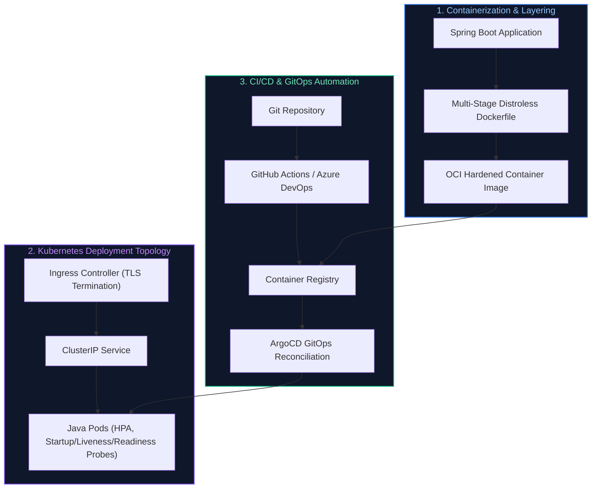

---


## Table of Contents

1. [Docker & Containerization Deep-Dive](#1-docker--containerization-deep-dive)
   - [1.1 Containers vs Virtual Machines](#11-containers-vs-virtual-machines)
   - [1.2 Linux Kernel Isolation Internals (Namespaces, Cgroups, OverlayFS)](#12-linux-kernel-isolation-internals-namespaces-cgroups-overlayfs)
   - [1.3 Container Lifecycle State Machine](#13-container-lifecycle-state-machine)
   - [1.4 Dockerfile Directives & Spring Boot Multi-Stage Layered Builds](#14-dockerfile-directives--spring-boot-multi-stage-layered-builds)
   - [1.5 Base Image Optimization: Distroless vs Alpine vs Chainguard](#15-base-image-optimization-distroless-vs-alpine-vs-chainguard)
   - [1.6 Docker Storage (Volumes vs Bind Mounts vs tmpfs) & Networking Modes](#16-docker-storage-volumes-vs-bind-mounts-vs-tmpfs--networking-modes)
   - [1.7 Docker Compose Production Stack for Java Microservices](#17-docker-compose-production-stack-for-java-microservices)
   - [1.8 Docker CLI Commands Cheatsheet & Operational Reference](#18-docker-cli-commands-cheatsheet--operational-reference)
2. [Kubernetes (K8s) Architecture & Core Primitives](#2-kubernetes-k8s-architecture--core-primitives)
   - [2.1 Master Control Plane & Worker Node Internal Architecture](#21-master-control-plane--worker-node-internal-architecture)
   - [2.2 Pod Lifecycle State Machine & Deep Troubleshooting](#22-pod-lifecycle-state-machine--deep-troubleshooting)
   - [2.3 Workload Primitives: Pod vs Deployment vs StatefulSet vs DaemonSet vs Job](#23-workload-primitives-pod-vs-deployment-vs-statefulset-vs-daemonset-vs-job)
   - [2.4 Kubernetes Networking & Service Routing (ClusterIP, NodePort, LoadBalancer, Ingress)](#24-kubernetes-networking--service-routing-clusterip-nodeport-loadbalancer-ingress)
   - [2.5 Production Kubernetes Manifests: Deployment, Service, Ingress, HPA, PDB, NetworkPolicy](#25-production-kubernetes-manifests-deployment-service-ingress-hpa-pdb-networkpolicy)
   - [2.6 Configuration & Secrets Management: `ConfigMap`, `Secret`, Azure Key Vault CSI Driver](#26-configuration--secrets-management-configmap-secret-azure-key-vault-csi-driver)
   - [2.7 Persistent Storage: StorageClass, PV, PVC, and Dynamic Volume Provisioning](#27-persistent-storage-storageclass-pv-pvc-and-dynamic-volume-provisioning)
   - [2.8 Pod Health Probes (Startup, Liveness, Readiness) & JVM Graceful Shutdown](#28-pod-health-probes-startup-liveness-readiness--jvm-graceful-shutdown)
   - [2.9 Resource Management (Requests vs Limits, CFS Throttling, OOMKilled Exit Code 137)](#29-resource-management-requests-vs-limits-cfs-throttling-oomkilled-exit-code-137)
   - [2.10 `kubectl` CLI Commands Cheatsheet & Troubleshooting Diagnostics](#210-kubectl-cli-commands-cheatsheet--troubleshooting-diagnostics)
   - [2.11 Automated Cloud Certificate Management: Kubernetes cert-manager, ACME Protocol & Azure Key Vault Secrets Store CSI Driver](#211-automated-cloud-certificate-management-kubernetes-cert-manager-acme-protocol--azure-key-vault-secrets-store-csi-driver)
3. [CI/CD & Advanced Zero-Downtime Deployment Strategies](#3-cicd--advanced-zero-downtime-deployment-strategies)
   - [3.1 CI vs CD (Continuous Integration, Delivery, and Deployment)](#31-ci-vs-cd-continuous-integration-delivery-and-deployment)
   - [3.2 The Enterprise CI/CD Pipeline Lifecycle](#32-the-enterprise-cicd-pipeline-lifecycle)
   - [3.3 Zero-Downtime Deployment Strategies: Rolling vs Blue-Green vs Canary vs Shadow](#33-zero-downtime-deployment-strategies-rolling-vs-blue-green-vs-canary-vs-shadow)
   - [3.4 Enterprise Multi-Stage Azure DevOps Pipeline (`azure-pipelines.yml`)](#34-enterprise-multi-stage-azure-devops-pipeline-azure-pipelinesyml)
   - [3.5 Enterprise GitHub Actions CI/CD Workflow (`.github/workflows/deploy.yml`)](#35-enterprise-github-actions-cicd-workflow-githubworkflowsdeployyml)
4. [GitOps Continuous Delivery with ArgoCD](#4-gitops-continuous-delivery-with-argocd)
   - [4.1 GitOps Core Principles & Architectural Paradigm](#41-gitops-core-principles--architectural-paradigm)
   - [4.2 ArgoCD Automated Reconciliation Loop & Drift Detection](#42-argocd-automated-reconciliation-loop--drift-detection)
   - [4.3 Production ArgoCD Application CRD & ApplicationSet for Multi-Environment Promotion](#43-production-argocd-application-crd--applicationset-for-multi-environment-promotion)
   - [4.4 Argo Rollouts: Automated Canary Rollouts with Prometheus Metric Analysis](#44-argo-rollouts-automated-canary-rollouts-with-prometheus-metric-analysis)
   - [4.5 ArgoCD CLI Cheatsheet & Operational Commands](#45-argocd-cli-cheatsheet--operational-commands)
5. [Microsoft Azure Cloud Architecture for Java Enterprise Backends](#5-microsoft-azure-cloud-architecture-for-java-enterprise-backends)
   - [5.1 End-to-End Azure Enterprise Reference Architecture](#51-end-to-end-azure-enterprise-reference-architecture)
   - [5.2 Cloud Computing Service Models: IaaS vs PaaS vs CaaS vs FaaS](#52-cloud-computing-service-models-iaas-vs-paas-vs-caas-vs-faas)
   - [5.3 High Availability (HA), Availability Zones (AZ), Disaster Recovery (DR, RPO, RTO)](#53-high-availability-ha-availability-zones-az-disaster-recovery-dr-rpo-rto)
   - [5.4 Azure Core Services Breakdown for Java Backends](#54-azure-core-services-breakdown-for-java-backends)
   - [5.5 Azure Service Bus vs Azure Event Hubs: Deep Architectural Comparison](#55-azure-service-bus-vs-azure-event-hubs-deep-architectural-comparison)
   - [5.6 Identity & Zero-Trust Security: Microsoft Entra ID & Workload Identity on AKS](#56-identity--zero-trust-security-microsoft-entra-id--workload-identity-on-aks)
   - [5.7 Virtual Networks (VNets), Hub-and-Spoke Peering & Azure Private Link Endpoints](#57-virtual-networks-vnets-hub-and-spoke-peering--azure-private-link-endpoints)
   - [5.8 Complete Infrastructure as Code (Terraform) for Azure Java Platform](#58-complete-infrastructure-as-code-terraform-for-azure-java-platform)
   - [5.9 Azure CLI (`az`) Commands Cheatsheet & Administration Reference](#59-azure-cli-az-commands-cheatsheet--administration-reference)
6. [References & Further Reading](#6-references--further-reading)

---

# 1. Docker & Containerization Deep-Dive

> [!NOTE]
> **Domain Framing: Application Containerization vs. Cloud Platform Infrastructure:**
> This module details the application engineering lifecycle for Java developers: containerizing Spring Boot apps, tuning JVM memory within cgroups, configuring Kubernetes Deployment/Service manifests, and implementing CI/CD pipelines.
>
> For deep cloud infrastructure engineering, etcd control plane mechanics, CNI network virtualization, multi-region hub-and-spoke landing zones, and enterprise GitOps (ArgoCD/Flux), see:
> - [2. Kubernetes (K8s) Architecture & Core Primitives](#2-kubernetes-k8s-architecture--core-primitives)
> - [3. CI/CD & Advanced Zero-Downtime Deployment Strategies](#3-cicd--advanced-zero-downtime-deployment-strategies)

---

### 1.1 Containers vs Virtual Machines

Virtual Machines (VMs) virtualize physical hardware through a **Hypervisor** (Type 1 bare-metal such as VMware ESXi / KVM, or Type 2 hosted such as VirtualBox). Each VM bundles a full, independent Guest Operating System (including kernel, device drivers, and system services), incurring substantial memory overhead (gigabytes) and multi-minute boot latencies.

Containers virtualize the operating system. All containers running on a host share the **single underlying Linux Host Kernel**. Isolation is achieved through native Linux kernel primitives (`namespaces` and `control groups`). Containers bundle only the application bytecode, runtime binaries, and dependencies, yielding megabyte footprints and sub-second startup times.

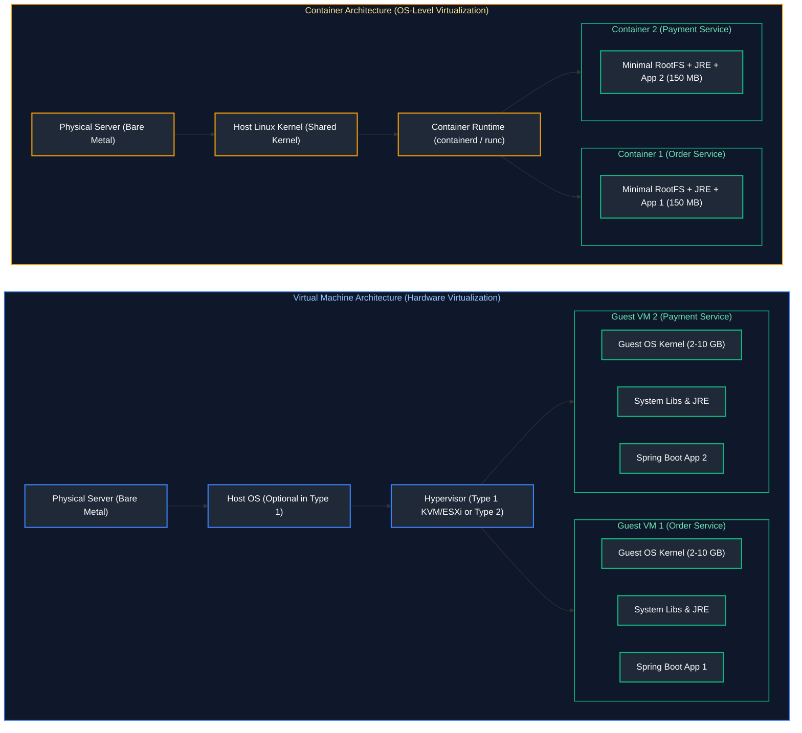

#### Detailed Architectural Comparison

| Architectural Dimension | Virtual Machines (VMs) | Docker Containers |
| :--- | :--- | :--- |
| **Virtualization Level** | Hardware abstraction via Hypervisor | OS kernel abstraction via namespaces & cgroups |
| **Operating System** | Independent Guest OS per VM (Windows/Linux) | Shared Host Linux Kernel |
| **Storage Footprint** | 10 GB – 100 GB per VM | 50 MB – 300 MB per container image |
| **Startup Latency** | 1 – 5 minutes (full kernel boot & systemd) | 100 milliseconds – 3 seconds (process execution) |
| **Resource Efficiency** | Heavy memory/CPU tax allocated to guest OS | Near-zero virtualization overhead (bare-metal speed) |
| **Security Isolation** | Hypervisor ring-0 hardware boundary (Very high) | Shared kernel boundary; hardened via seccomp & AppArmor |
| **Portability** | Heavy OVF/VMDK images, hypervisor dependent | Lightweight OCI standard images runnable on any engine |

---

### 1.2 Linux Kernel Isolation Internals (Namespaces, Cgroups, OverlayFS)

A Docker container is not a magical virtual computer; it is simply a standard Linux process constrained by three foundational kernel subsystems:

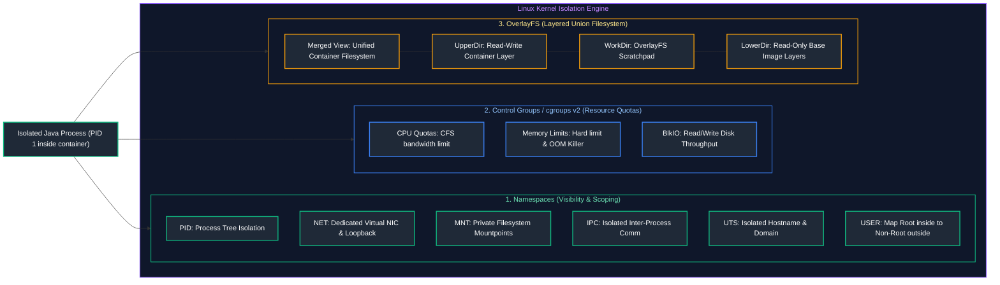

1. **Linux Namespaces (What the Process Can See)**:
   - **`pid`**: Isolates process IDs. The Java process sees itself as `PID 1` inside the container, while the host kernel tracks it as an arbitrary PID (e.g. `PID 48291`).
   - **`net`**: Provides an independent virtual network stack: private network interfaces (`eth0`), loopback (`lo`), routing tables, and firewall rules.
   - **`mnt`**: Isolates filesystem mount points. The process only sees its mounted container root filesystem (`rootfs`), completely blinded to the host disk.
   - **`ipc`**: Isolates System V IPC and POSIX message queues, preventing shared memory leakage across containers.
   - **`uts`**: Allows the container to have its own unique hostname (e.g., `container-order-service-7b9`).
   - **`user`**: Maps user and group IDs. An application running as `root` (UID 0) inside the container namespace can be mapped to an unprivileged user (UID 10001) on the host host system.

2. **Control Groups / `cgroups v2` (How Much the Process Can Use)**:
   - Enforces hard ceilings and accounting on CPU, memory, memory swap, and I/O.
   - When a Java container exceeds its defined memory limit, the Linux kernel **OOM Killer** (Out Of Memory Killer) triggers an immediate `SIGKILL` (`Exit Code 137`).
   - Modern Java versions (JDK 17, 21+) natively query `cgroups v2` to size JVM heap dynamically (`-XX:+UseContainerSupport`).

3. **OverlayFS (How Storage Layers Stack)**:
   - Docker images are composed of immutable, content-addressable read-only layers (**`LowerDir`**).
   - When a container boots, Docker mounts a thin, ephemeral read-write layer (**`UpperDir`**) on top.
   - **Copy-on-Write (CoW)**: When an application modifies an existing file from a lower layer, OverlayFS copies the file up to `UpperDir` before writing, preserving the immutable base image.

---

### 1.3 Container Lifecycle State Machine

Understanding container states is essential for diagnosing operational production failures:

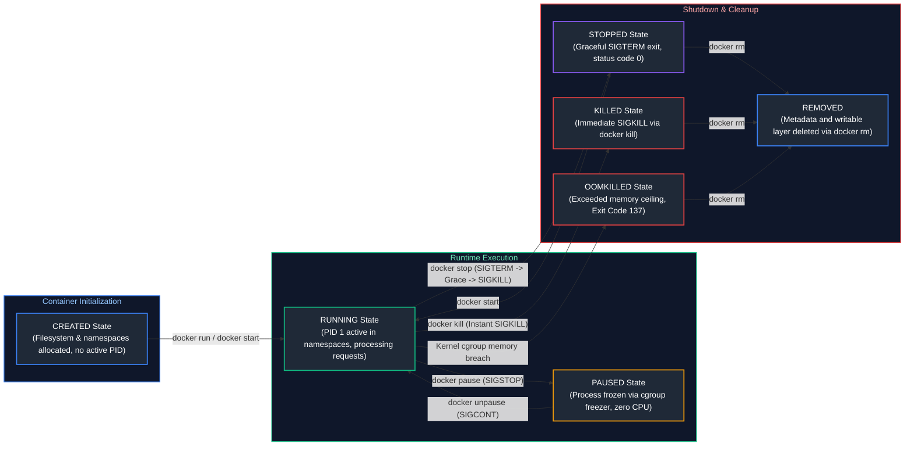

- **`Created`**: Container filesystem and metadata prepared; no active running processes.
- **`Running`**: Main process (`PID 1`) executing actively within isolated namespaces.
- **`Paused`**: All processes frozen in-memory via the Linux freezer cgroup (`SIGSTOP`).
- **`Stopped`**: Process received `SIGTERM`, was given a grace period (default 10s) to flush state, and terminated cleanly (`Exit Code 0`) or via `SIGKILL`.
- **`OOMKilled`**: Linux kernel terminated the process due to exceeding cgroup memory ceiling (`Exit Code 137 = 128 + 9 [SIGKILL]`).

---

### 1.4 Dockerfile Directives & Spring Boot Multi-Stage Layered Builds

Traditional monolithic Docker builds copy a single fat JAR into an image. When a developer changes one line of code, Docker must invalidate the entire JAR layer cache (50–100 MB) and push the entire artifact across the network.

**Spring Boot Layered JARs (`layertools`)** decompose the fat JAR into four discrete architectural layers ordered by update frequency:
1. `dependencies`: Third-party release dependencies (changes rarely).
2. `spring-boot-loader`: Internal Spring classloader utilities (changes rarely).
3. `snapshot-dependencies`: Internal snapshot builds (changes occasionally).
4. `application`: Enterprise business source classes and configurations (changes every commit).

#### Production Multi-Stage Layered Dockerfile for Spring Boot 3 (Java 21)

```dockerfile
# Stage 1: Dependency Cache & Compilation Stage
FROM maven:3.9.6-eclipse-temurin-21-alpine AS builder
WORKDIR /workspace

# Step 1: Copy only build descriptor to leverage Docker layer caching
COPY pom.xml .
RUN mvn dependency:go-offline -B

# Step 2: Copy source code and build production fat jar
COPY src ./src
RUN mvn clean package -DskipTests -B

# Stage 2: Extract Spring Boot Layered JAR Components
FROM eclipse-temurin:21-jre-alpine AS extractor
WORKDIR /workspace
COPY --from=builder /workspace/target/*.jar app.jar
# Extract layered JAR into distinct component directories
RUN java -Djarmode=layertools -jar app.jar extract

# Stage 3: Minimal, Hardened Production Runtime Image
FROM eclipse-temurin:21-jre-alpine AS runner
WORKDIR /application

# Security: Create non-root system group and user
RUN addgroup -S appgroup && adduser -S appuser -G appgroup

# Install curl for container healthcheck execution
RUN apk add --no-cache curl

# Copy extracted layers in order from lowest frequency to highest frequency
COPY --from=extractor /workspace/dependencies/ ./
COPY --from=extractor /workspace/spring-boot-loader/ ./
COPY --from=extractor /workspace/snapshot-dependencies/ ./
COPY --from=extractor /workspace/application/ ./

# Switch to non-root user
USER appuser:appgroup

# Container Healthcheck configuration
HEALTHCHECK --interval=15s --timeout=3s --start-period=30s --retries=3 \
  CMD curl -f http://localhost:8080/actuator/health/liveness || exit 1

# Expose standard Spring Boot HTTP port
EXPOSE 8080

# Production JVM container flags:
# -XX:+UseContainerSupport: Detect cgroup limits automatically
# -XX:MaxRAMPercentage=75.0: Allocate 75% of container memory limit to JVM Heap
# -XX:+ExitOnOutOfMemoryError: Immediately terminate container on OOM to trigger K8s restart
ENTRYPOINT ["java", \
  "-XX:+UseContainerSupport", \
  "-XX:MaxRAMPercentage=75.0", \
  "-XX:+ExitOnOutOfMemoryError", \
  "org.springframework.boot.loader.launch.JarLauncher"]
```

---

### 1.5 Base Image Optimization: Distroless vs Alpine vs Chainguard

#### Container Security Hardening & Runtime Attack Surface Reduction
Containerizing Spring Boot applications requires balancing image pull speeds, security vulnerabilities (CVEs), and POSIX/C standard library (`libc`) compatibility. A common anti-pattern is using generic developer OS images (Ubuntu, Debian) that bundle package managers (`apt`), compilers, network tools (`curl`, `netcat`), and interactive shells (`/bin/bash`). If an attacker exploits an application vulnerability (such as a Remote Code Execution bug like Log4Shell), bundled system binaries provide an immediate platform for lateral network discovery and malware execution.

Production container architectures standardize on minimal, hardened base images:

1. **Standard Full OS Images (Ubuntu, Debian):**
   - **Characteristics:** High storage footprint ($200 - 400\text{ MB}$), containing hundreds of unneeded OS packages and utilities.
   - **Risk Profile:** High Common Vulnerabilities and Exposures (CVE) count, requiring continuous security patching.
2. **Alpine Linux (`musl libc`):**
   - **Characteristics:** Microscopic footprint ($5 - 20\text{ MB}$), built around `musl libc` and BusyBox.
   - **Production Hazard:** Alpine uses `musl libc` rather than standard GNU C library (`glibc`). High-performance Java native extensions (Netty epoll transport, RocksDB JNI, jemalloc) and profiling agents may encounter subtle memory allocator incompatibilities or reduced thread throughput under `musl`.
3. **Google Distroless (`gcr.io/distroless/java`):**
   - **Zero-Shell Hardening:** Contains strictly the application and its minimal runtime dependencies (glibc, OpenJDK JRE, and timezone data). It contains **no package manager (`apt`, `apk`), no interactive shell (`sh`, `bash`), and no coreutils**.
   - **Security Impact:** Eliminates arbitrary shell execution attacks. Even if an attacker gains code execution in the container, they cannot execute scripts or download external binaries.
4. **Chainguard Hardened Images:**
   - **Zero-CVE Guarantee:** Enterprise-focused minimalist container images built with `glibc`, updated daily to ensure a verified zero-known-CVE security posture.

| Image Base | Typical Size | Package Manager | Shell Included | Vulnerability (CVE) Surface | Production Recommendation |
| :--- | :--- | :--- | :--- | :--- | :--- |
| **Ubuntu / Debian** | 150 MB – 300 MB | `apt` | `/bin/bash` | High (hundreds of packages) | Development / Debugging only |
| **Alpine Linux** | 5 MB – 20 MB | `apk` (musl libc) | `/bin/sh` | Low (requires testing with `musl` vs `glibc`) | Standard Enterprise Containers |
| **Google Distroless** | 20 MB – 50 MB | None | None | Extremely Low (zero package managers or shells) | High-Security Production Systems |
| **Chainguard Images** | 15 MB – 40 MB | `apk` (glibc) | None (minimal) | Near-Zero CVE guarantee | Enterprise Regulated Environments |

---

### 1.6 Docker Storage (Volumes vs Bind Mounts vs tmpfs) & Networking Modes

#### Storage Options Compared
- **Named Volumes (`docker volume create my-vol`)**: Managed entirely by Docker inside host path `/var/lib/docker/volumes/`. High performance, isolated from host OS changes, ideal for database persistence (PostgreSQL data directory).
- **Bind Mounts (`-v /local/path:/container/path`)**: Mounts an explicit directory from the developer's workstation directly into the container. Ideal for live hot-reloading during local development.
- **tmpfs Mounts (`--tmpfs /app/cache`)**: Stored purely in host volatile system RAM. Data is never persisted to disk; destroyed immediately on container stop. Ideal for sensitive ephemeral secrets or ultra-fast scratchpads.

#### Docker Networking Drivers
- **`bridge` (Default)**: Creates a software bridge (`docker0`). Each container obtains an isolated private IP address (`172.17.0.x`). Port forwarding (`-p 8080:8080`) maps host ports to container ports using host `iptables` NAT rules.
- **`host`**: Bypasses network isolation completely. The container binds directly to the host's physical network interface. Removes NAT performance overhead; eliminates port mapping.
- **`none`**: Fully disconnects the container from any network stack; only internal loopback interface (`lo`) exists.
- **`overlay`**: Multi-host distributed network driver used in Docker Swarm and container meshes to enable cross-node container communication.

---

### 1.7 Docker Compose Production Stack for Java Microservices

The following production-ready `docker-compose.yml` orchestrates a resilient local microservice topology featuring Spring Boot, PostgreSQL, Redis cache, and Kafka with KRaft (ZooKeeper-less):

```yaml
version: '3.8'

services:
  # PostgreSQL Database Service

postgres-db:
    image: postgres:16-alpine
    container_name: postgres-db
    restart: unless-stopped
    environment:
      POSTGRES_DB: enterprise_db
      POSTGRES_USER: postgres_admin
      POSTGRES_PASSWORD: supersecretpassword
    ports:
      - "5432:5432"
    volumes:
      - pgdata:/var/lib/postgresql/data
    healthcheck:
      test: ["CMD-SHELL", "pg_isready -U postgres_admin -d enterprise_db"]
      interval: 5s
      timeout: 5s
      retries: 5
    networks:
      - backend-net

# 3. Redis Distributed Cache Service

redis-cache:
    image: redis:7.2-alpine
    container_name: redis-cache
    restart: unless-stopped
    command: ["redis-server", "--appendonly", "yes", "--requirepass", "redissecret"]
    ports:
      - "6379:6379"
    volumes:
      - redisdata:/data
    healthcheck:
      test: ["CMD", "redis-cli", "-a", "redissecret", "ping"]
      interval: 5s
      timeout: 3s
      retries: 5
    networks:
      - backend-net

# 4. Apache Kafka (KRaft Mode - No ZooKeeper)

kafka-broker:
    image: confluentinc/cp-kafka:7.6.0
    container_name: kafka-broker
    restart: unless-stopped
    ports:
      - "9092:9092"
    environment:
      KAFKA_NODE_ID: 1
      KAFKA_LISTENER_SECURITY_PROTOCOL_MAP: 'CONTROLLER:PLAINTEXT,PLAINTEXT:PLAINTEXT,PLAINTEXT_HOST:PLAINTEXT'
      KAFKA_ADVERTISED_LISTENERS: 'PLAINTEXT://kafka-broker:29092,PLAINTEXT_HOST://localhost:9092'
      KAFKA_OFFSETS_TOPIC_REPLICATION_FACTOR: 1
      KAFKA_PROCESS_ROLES: 'broker,controller'
      KAFKA_CONTROLLER_QUORUM_VOTERS: '1@kafka-broker:29093'
      KAFKA_LISTENERS: 'PLAINTEXT://0.0.0.0:29092,CONTROLLER://0.0.0.0:29093,PLAINTEXT_HOST://0.0.0.0:9092'
      KAFKA_INTER_BROKER_LISTENER_NAME: 'PLAINTEXT'
      KAFKA_CONTROLLER_LISTENER_NAMES: 'CONTROLLER'
      CLUSTER_ID: '4L622nShTWWkrFuMm5IGqA'
    volumes:
      - kafkadata:/var/lib/kafka/data
    networks:
      - backend-net

# 5. Spring Boot Backend Microservice

order-service:
    build:
      context: .
      dockerfile: Dockerfile
    container_name: order-service
    restart: unless-stopped
    ports:
      - "8080:8080"
    environment:
      SPRING_PROFILES_ACTIVE: docker
      SPRING_DATASOURCE_URL: jdbc:postgresql://postgres-db:5432/enterprise_db
      SPRING_DATASOURCE_USERNAME: postgres_admin
      SPRING_DATASOURCE_PASSWORD: supersecretpassword
      SPRING_DATA_REDIS_HOST: redis-cache
      SPRING_DATA_REDIS_PORT: 6379
      SPRING_DATA_REDIS_PASSWORD: redissecret
      SPRING_KAFKA_BOOTSTRAP_SERVERS: kafka-broker:29092
    depends_on:
      postgres-db:
        condition: service_healthy
      redis-cache:
        condition: service_healthy
    networks:
      - backend-net

volumes:
  pgdata:
  redisdata:
  kafkadata:

networks:
  backend-net:
    driver: bridge
```

---

### 1.8 Docker CLI Commands Cheatsheet & Operational Reference

| Command & Syntax | Key Flags Explained | What Does What | Practical Production Scenario |
| :--- | :--- | :--- | :--- |
| `docker build -t myapp:1.0 .` | `-t`: Tag image name & version<br>`-f`: Specify custom Dockerfile path<br>`--no-cache`: Force rebuild of all layers | Compiles application code and packages immutable OCI image into local storage | Building a new release artifact in local dev or CI pipeline |
| `docker run -d -p 8080:8080 --name myapp myapp:1.0` | `-d`: Run in background (detached mode)<br>`-p <host>:<container>`: Publish port mapping<br>`--name`: Assign human-readable container name | Creates container namespaces, attaches storage, and executes `ENTRYPOINT` process | Launching application in local workstation |
| `docker run --memory="1g" --cpus="1.5" ...` | `--memory`: Hard cgroup RAM ceiling<br>`--cpus`: CFS CPU quota fraction<br>`--restart=always`: Auto-restart policy | Enforces strict host resource boundaries to prevent noisy neighbor starvation | Running production containers directly on bare metal/VM |
| `docker exec -it myapp /bin/sh` | `-i`: Keep STDIN open<br>`-t`: Allocate pseudo-TTY terminal<br>`-u`: Run as specific user (e.g. root) | Injects a new interactive shell process into an already running container's namespaces | Live operational debugging and checking file paths inside container |
| `docker logs -f --tail=100 myapp` | `-f`: Follow / stream live logs<br>`--tail 100`: Show only last 100 lines<br>`-t`: Prepend timestamps | Streams `STDOUT` and `STDERR` log output of the container process | Diagnosing runtime exceptions or startup failures |
| `docker ps -a --filter "status=exited"` | `-a`: List all containers (running and stopped)<br>`--filter`: Query containers by status or label<br>`-q`: Output only container IDs | Lists container inventory with status, exit code, and port mappings | Finding containers that crashed with non-zero exit codes |
| `docker inspect myapp` | `--format '{{.NetworkSettings.IPAddress}}'`: Extract specific JSON attribute | Emits full low-level JSON configuration, network IP, mount points, and state | Inspecting exact IP address assigned to container bridge interface |
| `docker stop -t 30 myapp` | `-t 30`: Wait 30 seconds before sending SIGKILL | Sends `SIGTERM` to allow graceful shutdown, then sends `SIGKILL` if still running | Gracefully terminating Spring Boot app to drain in-flight web requests |
| `docker kill myapp` | `-s SIGKILL`: Send raw Linux signal | Immediately sends kernel signal to kill process instantly without cleanup | Terminating hung or deadlocked application instantly |
| `docker system prune -a --volumes` | `-a`: Delete unused images, not just dangling ones<br>`--volumes`: Purge unattached named volumes | Cleans up stopped containers, unused networks, dangling images, and build caches | Freeing tens of gigabytes of disk space on build servers |
| `docker stats` | `--no-stream`: Pull single snapshot | Real-time live stream of CPU%, Memory usage, I/O, and Network bandwidth | Checking which local container is consuming host CPU or memory |

---

# 2. Kubernetes (K8s) Architecture & Core Primitives

---

### 2.1 Master Control Plane & Worker Node Internal Architecture

Kubernetes is an open-source distributed system for orchestrating containerized workloads. It maintains the desired state of a cluster declaratively:

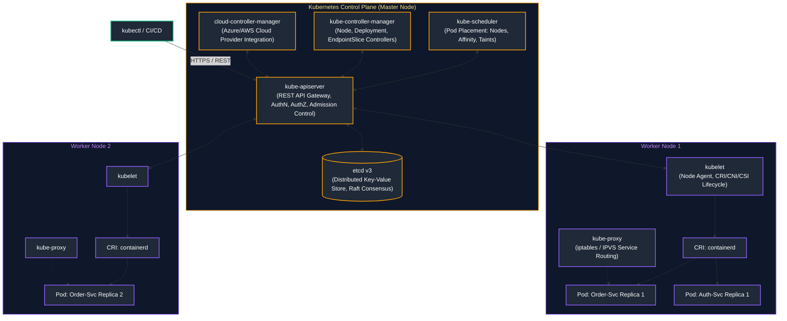

#### Control Plane Components Breakdown
1. **`kube-apiserver`**: The front door of the cluster. All internal components and external `kubectl` clients communicate exclusively through this RESTful API. Validates requests, authenticates, authorizes (RBAC), and writes state mutations directly to `etcd`.
2. **`etcd`**: High-availability, strongly consistent key-value store using the **Raft consensus algorithm**. Stores the entire cluster state, configuration, and secret data. **Zero worker components ever communicate directly with etcd.**
3. **`kube-scheduler`**: Watches for newly created Pods with no assigned node. Evaluates node filtering (Resource Requests, NodeSelector, Taints/Tolerations) and scoring (NodeAffinity, PodAntiAffinity) to bind the Pod to the optimal worker node.
4. **`kube-controller-manager` (KCM)**: Runs continuous reconciliation control loops (`desired state == current state`). Bundles Deployment Controller, ReplicaSet Controller, Node Controller, and Namespace Controller.
5. **`cloud-controller-manager` (CCM)**: Interacts with the underlying cloud vendor (Azure, AWS, GCP) to provision cloud load balancers, manage routes, and attach cloud storage volumes.

#### Worker Node Components Breakdown
1. **`kubelet`**: Primary node agent. Registers the node with the API server, watches for assigned PodSpecs, and delegates container management to the Container Runtime Interface (CRI). Enforces health probes and executes volume mounts via CSI.
2. **`kube-proxy`**: Network proxy running on each node. Reflects Kubernetes `Service` definitions by managing Linux `iptables` or `IPVS` rules, distributing incoming traffic across healthy Pod IP endpoints.
3. **Container Runtime (`containerd` / `CRI-O`)**: Pulls images, configures Linux namespaces and cgroups, and starts/stops containers via `runc`.

---

### 2.2 Pod Lifecycle State Machine & Deep Troubleshooting

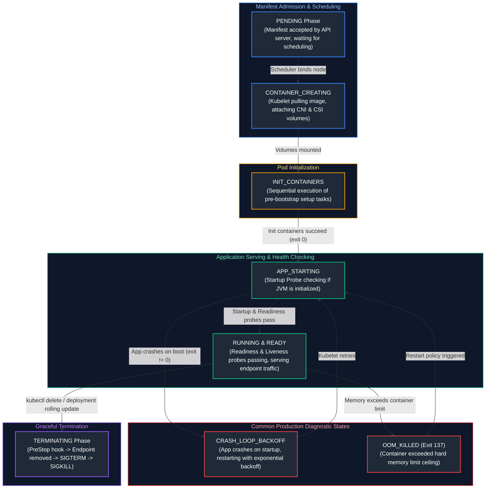

#### Diagnostic State Troubleshooting Guide
- **`Pending`**: Pod cannot be scheduled. Run `kubectl describe pod <name>` to view `Events`. Common causes: insufficient node CPU/memory requests, node selector mismatches, or unbound PersistentVolumeClaims (PVCs).
- **`ImagePullBackOff` / `ErrImagePull`**: Kubelet failed to pull image. Common causes: image tag typo, non-existent registry URL, or missing `imagePullSecrets` (ACR authentication failure).
- **`CrashLoopBackOff`**: Container starts, exits with a non-zero exit code, and Kubelet restarts it with exponential backoff delay. Run `kubectl logs <name> --previous` to inspect the crash log (e.g., missing database connection string, Spring Boot context failure).
- **`OOMKilled` (`Exit Code 137`)**: The container exceeded its hard `limits.memory` ceiling, and the Linux kernel terminated it. Solution: Increase memory limits or tune `-XX:MaxRAMPercentage` down to leave headroom for non-heap native memory.

---

### 2.3 Workload Primitives: Pod vs Deployment vs StatefulSet vs DaemonSet vs Job

#### Kubernetes Controller Architecture & Pod Lifecycle Declarations
In Kubernetes, applications are orchestrated through declarative state machines. The user declares the desired target state in YAML manifests, and dedicated controller reconciliation loops inside the `kube-controller-manager` continuously observe cluster state and drive reality toward the desired target:

1. **Pod (Atomic Scheduling Unit):**
   - **Characteristics:** The smallest deployable computing unit. Encapsulates one or more tightly-coupled containers sharing the same Linux network namespace (same IP address and localhost loopback) and storage volumes.
   - **Production Rule:** Never deploy standalone bare Pods directly in production. Bare Pods lack self-healing capabilities—if the host worker node crashes, the Pod is lost forever.
2. **Deployment (Stateless Microservices):**
   - **Controller Mechanics:** Manages an underlying **ReplicaSet** that ensures $N$ identical Pod replicas are always running. Orchestrates zero-downtime rolling updates (`RollingUpdate`) and canary deployments, replacing old Pods with new versions while observing readiness probes.
   - **Identity:** Pods are ephemeral, interchangeable, and assigned random hash suffixes (e.g., `order-service-7df8-4a1`).
3. **StatefulSet (Stateful Distributed Datastores):**
   - **Controller Mechanics:** Manages stateful distributed workloads (Kafka brokers, PostgreSQL, ZooKeeper). Enforces **deterministic, stable network identities** (`kafka-0`, `kafka-1`, `kafka-2`) and ordered sequential startup/shutdown.
   - **Storage Binding:** Uses `volumeClaimTemplates` to allocate a dedicated, persistent cloud disk (`PersistentVolume`) to each specific ordinal index that persists even across Pod restarts.
4. **DaemonSet (Node-Local Agents):**
   - **Controller Mechanics:** Ensures that all (or selected) worker nodes run exactly one copy of a Pod. As new physical nodes join the cluster, the DaemonSet automatically schedules the Pod onto the new node.
   - **Use Case:** Infrastructure log collectors (FluentBit, Vector), metrics exporters (Prometheus Node Exporter), and network proxies (kube-proxy, Cilium).
5. **Job & CronJob (Run-to-Completion Batch Processing):**
   - **Controller Mechanics:** Manages pods that execute until a successful exit code (`0`) and terminate, rather than restarting continuously.
   - **Use Case:** Database schema migration scripts (Flyway/Liquibase) executed before a Deployment starts, or nightly batch report generation.

| Workload Primitive | State Managed | Scaling & Naming Strategy | Storage Association | Best Production Use Case |
| :--- | :--- | :--- | :--- | :--- |
| **Pod** | Atomic unit | Single ephemeral instance; random hash | Shared ephemeral volume | Testing or debug containers only |
| **Deployment** | Stateless | Replicas scaled dynamically; random hash (e.g. `web-7df8-4a1`) | Shared read-only or stateless ephemeral | Spring Boot REST APIs, Web apps |
| **StatefulSet** | Stateful | Ordered, deterministic naming (`kafka-0`, `kafka-1`, `kafka-2`) | Dedicated PersistentVolume per Pod (`volumeClaimTemplates`) | Kafka brokers, PostgreSQL clusters, ZooKeeper |
| **DaemonSet** | Node-bound | Exactly one copy per worker node automatically | Host root filesystem mounts | Log collectors (FluentBit), node metrics (Prometheus Node Exporter) |
| **Job / CronJob** | Batch / Scheduled | Run-to-completion (`completions`, `parallelism`) | Ephemeral or external S3/ADLS storage | DB schema migrations (Flyway), nightly report generation |

---

### 2.4 Kubernetes Networking & Service Routing (ClusterIP, NodePort, LoadBalancer, Ingress)

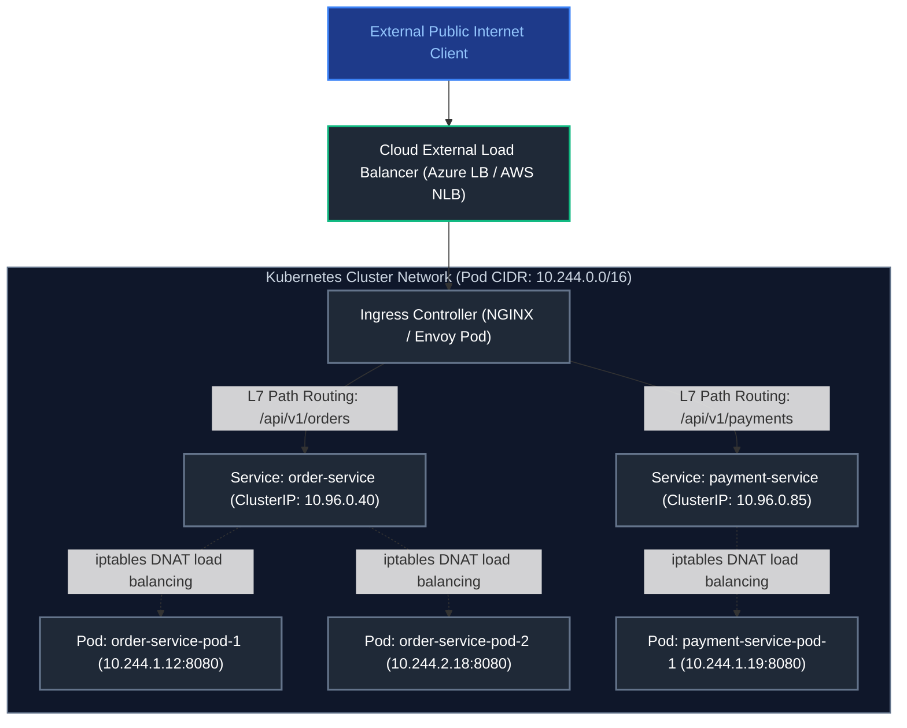

#### Service Types Explained
1. **`ClusterIP` (Default)**: Assigns a stable internal virtual IP address visible only within the cluster. Internal microservices reach each other via CoreDNS (`http://order-service.production.svc.cluster.local:80`).
2. **`NodePort`**: Allocates a static port (default range 30000–32767) across **every worker node's physical IP**. Accessing `<Any-Node-IP>:<NodePort>` routes traffic to the backend Pods.
3. **`LoadBalancer`**: Integrates with the cloud provider (Azure, AWS) to provision an external Layer 4 load balancer that routes public traffic directly to the service's `NodePort`.
4. **`Ingress`**: An application-level (Layer 7) reverse proxy controller (NGINX, Traefik, Contour) that consolidates routing, SSL/TLS termination, and virtual hosting for hundreds of backend `ClusterIP` services under a single public IP.

---

### 2.5 Production Kubernetes Manifests: Deployment, Service, Ingress, HPA, PDB, NetworkPolicy

> [!TIP]
> **Deep-Dive Interview Scenarios:**
> - [Q2. Liveness vs Readiness Probes in Kubernetes](frequently_asked_questions/11_cloud_native_containers_and_devops_faq.md#q2-medium-liveness-vs-readiness-probes-in-kubernetes)
> - [Q3. Kubernetes Autoscaling (HPA, VPA, Cluster Autoscaler) & Service Discovery](frequently_asked_questions/11_cloud_native_containers_and_devops_faq.md#q3-medium-kubernetes-autoscaling-hpa-vpa-cluster-autoscaler--service-discovery)

```yaml
# ConfigMap: Application Environment Properties

apiVersion: v1
kind: ConfigMap
metadata:
  name: order-service-config
  namespace: production
data:
  SPRING_PROFILES_ACTIVE: "prod"
  LOG_LEVEL: "INFO"
  SERVER_PORT: "8080"

# 8. Deployment: Zero-Downtime Rolling Update & Hardened Pod Spec

apiVersion: apps/v1
kind: Deployment
metadata:
  name: order-service
  namespace: production
  labels:
    app.kubernetes.io/name: order-service
    app.kubernetes.io/part-of: e-commerce
spec:
  replicas: 3
  revisionHistoryLimit: 10
  strategy:
    type: RollingUpdate
    rollingUpdate:
      maxSurge: 25%        # Provision up to 25% additional pods during rollout
      maxUnavailable: 0     # Guarantee zero down replicas during deployment
  selector:
    matchLabels:
      app.kubernetes.io/name: order-service
  template:
    metadata:
      labels:
        app.kubernetes.io/name: order-service
    spec:
      # Pod Anti-Affinity: Prevent scheduling replicas on the same worker node
      affinity:
        podAntiAffinity:
          preferredDuringSchedulingIgnoredDuringExecution:
          - weight: 100
            podAffinityTerm:
              labelSelector:
                matchExpressions:
                - key: app.kubernetes.io/name
                  operator: In
                  values: ["order-service"]
              topologyKey: "kubernetes.io/hostname"
      # Security Context: Hardened container security
      securityContext:
        runAsNonRoot: true
        runAsUser: 10001
        runAsGroup: 10001
        fsGroup: 10001
      containers:
      - name: order-service
        image: myacr.azurecr.io/order-service:v2.1.0
        imagePullPolicy: IfNotPresent
        securityContext:
          allowPrivilegeEscalation: false
          readOnlyRootFilesystem: false
          capabilities:
            drop: ["ALL"]
        ports:
        - name: http
          containerPort: 8080
        envFrom:
        - configMapRef:
            name: order-service-config
        resources:
          requests:
            cpu: "250m"
            memory: "512Mi"
          limits:
            cpu: "1000m"
            memory: "1024Mi"

# 9. Startup Probe: Disables liveness checks during JVM startup

startupProbe:
          httpGet:
            path: /actuator/health/liveness
            port: http
          failureThreshold: 30
          periodSeconds: 2

# 10. Liveness Probe: Restarts container if JVM deadlocks

livenessProbe:
          httpGet:
            path: /actuator/health/liveness
            port: http
          periodSeconds: 10
          timeoutSeconds: 3
          failureThreshold: 3

# 11. Readiness Probe: Removes pod from Service routing if overloaded

readinessProbe:
          httpGet:
            path: /actuator/health/readiness
            port: http
          periodSeconds: 5
          timeoutSeconds: 2
          failureThreshold: 2

# 12. Service: Internal ClusterIP Routing

apiVersion: v1
kind: Service
metadata:
  name: order-service
  namespace: production
spec:
  type: ClusterIP
  selector:
    app.kubernetes.io/name: order-service
  ports:
  - name: http
    port: 80
    targetPort: http

# 13. Ingress: Layer 7 Routing & SSL Termination

apiVersion: networking.k8s.io/v1
kind: Ingress
metadata:
  name: order-service-ingress
  namespace: production
  annotations:
    kubernetes.io/ingress.class: "nginx"
    cert-manager.io/cluster-issuer: "letsencrypt-production"
    nginx.ingress.kubernetes.io/ssl-redirect: "true"
    nginx.ingress.kubernetes.io/proxy-body-size: "10m"
spec:
  tls:
  - hosts:
    - api.company.com
    secretName: api-company-tls
  rules:
  - host: api.company.com
    http:
      paths:
      - path: /api/v1/orders
        pathType: Prefix
        backend:
          service:
            name: order-service
            port:
              name: http

# 14. Horizontal Pod Autoscaler (HPA): Dynamic Autoscaling

apiVersion: autoscaling/v2
kind: HorizontalPodAutoscaler
metadata:
  name: order-service-hpa
  namespace: production
spec:
  scaleTargetRef:
    apiVersion: apps/v1
    kind: Deployment
    name: order-service
  minReplicas: 3
  maxReplicas: 15
  metrics:
  - type: Resource
    resource:
      name: cpu
      target:
        type: Utilization
        averageUtilization: 75
  - type: Resource
    resource:
      name: memory
      target:
        type: Utilization
        averageUtilization: 80

# 15. Pod Disruption Budget (PDB): Protect Availability during Node Drains

apiVersion: policy/v1
kind: PodDisruptionBudget
metadata:
  name: order-service-pdb
  namespace: production
spec:
  minAvailable: 2
  selector:
    matchLabels:
      app.kubernetes.io/name: order-service

# 16. NetworkPolicy: Zero-Trust Microsegmentation

apiVersion: networking.k8s.io/v1
kind: NetworkPolicy
metadata:
  name: order-service-netpol
  namespace: production
spec:
  podSelector:
    matchLabels:
      app.kubernetes.io/name: order-service
  policyTypes:
  - Ingress
  - Egress
  ingress:
  # Allow incoming traffic only from NGINX Ingress and Payment Service
  - from:
    - namespaceSelector:
        matchLabels:
          kubernetes.io/metadata.name: ingress-nginx
    - podSelector:
        matchLabels:
          app.kubernetes.io/name: payment-service
    ports:
    - protocol: TCP
      port: 8080
  egress:
  # Allow outgoing connections to CoreDNS and Database Subnet
  - to:
    - namespaceSelector: {}
      podSelector:
        matchLabels:
          k8s-app: kube-dns
    ports:
    - protocol: UDP
      port: 53
  - to:
    - ipBlock:
        cidr: 10.240.4.0/24 # Azure Private DB Subnet
```

---

### 2.6 Configuration & Secrets Management: `ConfigMap`, `Secret`, Azure Key Vault CSI Driver

- **`ConfigMap`**: Injects non-sensitive environment variables and files (`application.yml`) into Pod containers without rebuilding images.
- **`Secret`**: Stores sensitive data (passwords, tokens, TLS certs) Base64-encoded. Mounted as environment variables or volume files.
- **Azure Key Vault Provider for Secrets Store CSI Driver**: Production best practice on Azure Kubernetes Service (AKS). Mounts secrets, keys, and certificates stored in **Azure Key Vault** directly as in-memory volumes into Pods using Azure Managed Identities, avoiding storing secrets in the cluster `etcd` store altogether.

---

### 2.7 Persistent Storage: StorageClass, PV, PVC, and Dynamic Volume Provisioning

Kubernetes decouples storage administration from developer consumption:
1. **StorageClass (SC)**: Admin defines the storage profile (e.g. `managed-csi` on Azure using Azure Premium SSD v2, volume expansion enabled, reclaim policy `Delete` or `Retain`).
2. **PersistentVolumeClaim (PVC)**: Developers declare a storage request (e.g. `100Gi`, `ReadWriteOnce`).
3. **PersistentVolume (PV)**: The cloud CSI driver dynamically allocates physical cloud disk and registers the PV bound to the PVC.

---

### 2.8 Pod Health Probes (Startup, Liveness, Readiness) & JVM Graceful Shutdown

1. **Startup Probe**: Prevents aggressive liveness probes from killing slow-starting enterprise Java applications (e.g. Spring Boot cold start under class loading). Kubelet pauses liveness checks until startup probe passes.
2. **Liveness Probe**: Verifies internal application health. If this probe fails repeatedly, Kubelet terminates the container and schedules a replacement.
3. **Readiness Probe**: Verifies whether the container is ready to accept incoming client traffic. If it fails (e.g. database pool temporarily saturated), Kubelet removes the Pod IP from the Service load balancer endpoints without killing the container.
4. **Graceful Shutdown**: Configure `server.shutdown: graceful` in Spring Boot with `terminationGracePeriodSeconds: 45` in the K8s PodSpec. Kubelet sends `SIGTERM`, Spring Boot stops accepting new requests, drains in-flight requests, and terminates cleanly.

> [!TIP]
> For Spring Boot's programmatic control of Kubernetes readiness and liveness probes via `AvailabilityChangeEvent` (graceful connection draining without restarting pods), see [06. Spring Framework & Spring Boot - Section 7.2](05_spring_boot_and_rest_apis.md#72-kubernetes-liveness--readiness-probes-availabilitychangeevent).

---

### 2.9 Resource Management (Requests vs Limits, CFS Throttling, OOMKilled Exit Code 137)

- **`requests`**: Guaranteed minimum compute allocated to the container. The `kube-scheduler` calculates node capacity strictly using `requests`.
- **`limits`**: Maximum hard ceiling:
  - **CPU Limit**: Enforced by the Linux kernel Completely Fair Scheduler (CFS) bandwidth control (`cfs_quota_us` / `cfs_period_us`). If a container exceeds its limit, the CPU is **throttled** (response latency spikes; process does not crash).
  - **Memory Limit**: Enforced by kernel memory cgroup. If memory usage exceeds the limit, the Linux kernel triggers the **OOM Killer** (`Exit Code 137`), terminating the container immediately.

---

### 2.10 `kubectl` CLI Commands Cheatsheet & Troubleshooting Diagnostics

| Command & Syntax | Key Flags Explained | What Does What | Practical Troubleshooting Scenario |
| :--- | :--- | :--- | :--- |
| `kubectl get pods -A -o wide` | `-A`: All namespaces<br>`-o wide`: Include Node name, Pod IP, and restart count | Displays global container inventory across all cluster namespaces | Quickly checking which worker node hosts a failing Pod |
| `kubectl describe pod <name> -n <ns>` | `-n <ns>`: Target namespace | Dumps complete Pod spec, recent system events, and probe status | Investigating `Pending`, `CrashLoopBackOff`, or scheduling failures |
| `kubectl logs <name> -n <ns> -f --previous` | `-f`: Stream logs live<br>`--previous`: Read logs of previously crashed container instance | Fetches STDOUT/STDERR logs from the container | Diagnosing why a Java container crashed with Exit Code 137 or JVM error |
| `kubectl exec -it <name> -n <ns> -- /bin/sh` | `-i`: STDIN<br>`-t`: TTY<br>`-c <container>`: Target container in multi-container pod | Injects interactive terminal into running Pod container | Checking database connectivity (`nc -zv db-host 5432`) from inside Pod |
| `kubectl port-forward svc/<svc> 8080:80 -n <ns>` | `<local-port>:<svc-port>` | Tunnels local developer port directly to internal K8s Service | Testing internal REST API without exposing Ingress or LoadBalancer |
| `kubectl rollout status deployment/<name> -n <ns>` | `--timeout=60s`: Maximum wait time | Blocks until rolling update deployment completes or times out | Using in CI/CD pipeline to verify zero-downtime deployment success |
| `kubectl rollout undo deployment/<name> -n <ns>` | `--to-revision=2`: Rollback to explicit past revision number | Instantly reverts Deployment to previous healthy ReplicaSet | Emergency rollback after a bad release introduces production errors |
| `kubectl top nodes / pods -n <ns>` | `--containers`: Show CPU/RAM breakdown per container | Displays real-time CPU and memory usage from Metrics Server | Identifying memory leaks or CPU throttling bottlenecks |
| `kubectl cordon <node>` | `<node>`: Worker node name | Marks worker node as unschedulable (no new Pods scheduled) | Preparing a Kubernetes node for OS patching or maintenance |
| `kubectl drain <node> --ignore-daemonsets --delete-emptydir-data` | `--ignore-daemonsets`: Skip node logging pods<br>`--delete-emptydir-data`: Allow discarding local scratchpads | Safely evicts all active Pods from node to other cluster nodes | Upgrading Kubernetes worker node version with zero user downtime |
| `kubectl apply -f manifest.yaml --dry-run=client -o yaml` | `--dry-run=client`: Validate locally without sending to API server | Validates YAML syntax and schema without applying changes to cluster | Pre-commit validation and CI pipeline sanity checks |

---

### 2.11 Automated Cloud Certificate Management: Kubernetes cert-manager, ACME Protocol & Azure Key Vault Secrets Store CSI Driver

In modern production Kubernetes clusters, manual SSL certificate renewal is a critical operational anti-pattern. Two primary patterns dominate enterprise certificate automation:

> [!NOTE]
> For foundational PKI concepts, X.509 chains, TLS 1.3 handshakes, Java KeyStore vs TrustStore architecture, and `keytool`/`openssl` commands, see [10. Security, Identity & Cryptographic Certificate Management - Section 3: Certificate Management, SSL/TLS, Keystores & mTLS](06_security_and_cryptography.md#5-public-key-infrastructure-pki-tls-13--certificate-management).

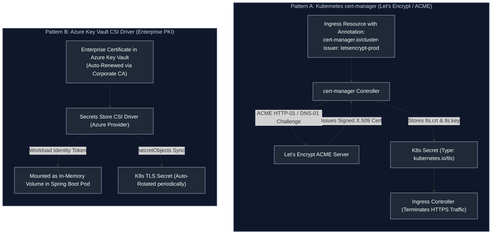

#### 1. Production `ClusterIssuer` Manifest (Let's Encrypt Production)

```yaml
apiVersion: cert-manager.io/v1
kind: ClusterIssuer
metadata:
  name: letsencrypt-production
spec:
  acme:
    server: https://acme-v02.api.letsencrypt.org/directory
    email: devops-admin@company.com
    privateKeySecretRef:
      name: letsencrypt-production-account-key
    solvers:

# 17. HTTP-01 Solver: Solves challenge by answering HTTP requests routed via Ingress

- http01:
        ingress:
          class: nginx
```

#### 2. Declarative `Certificate` CRD & Ingress Integration

```yaml
apiVersion: cert-manager.io/v1
kind: Certificate
metadata:
  name: api-company-cert
  namespace: production
spec:
  secretName: api-company-tls # Name of target K8s Secret generated automatically
  issuerRef:
    name: letsencrypt-production
    kind: ClusterIssuer
  dnsNames:
  - api.company.com
  - orders.company.com
  duration: 2160h # 90 days validity
  renewBefore: 360h # Automatically renew 15 days before expiration!
```

#### 3. Kubernetes `kubernetes.io/tls` Secret Anatomy
The generated Kubernetes Secret holds two Base64-encoded keys required by standard ingress controllers and web servers:
- **`tls.crt`**: The leaf certificate followed by intermediate CA certificates forming the complete validation chain.
- **`tls.key`**: The unencrypted private key matching the public key in the leaf certificate.

---

# 3. CI/CD & Advanced Zero-Downtime Deployment Strategies

---

### 3.1 CI vs CD (Continuous Integration, Delivery, and Deployment)

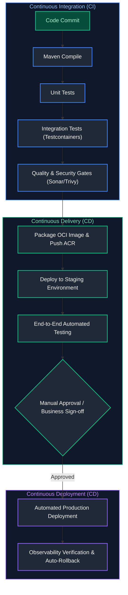

- **Continuous Integration (CI)**: Developers commit code to the trunk frequently. Every commit automatically triggers a pipeline that compiles code, executes unit tests, runs integration tests against real databases (via Testcontainers), and enforces static security analysis.
- **Continuous Delivery (CD)**: Extends CI by automatically packaging deployable release artifacts (Docker images, Helm charts) and deploying them to staging/UAT environments. Deployment to production requires human approval.
- **Continuous Deployment (CD)**: Eliminates manual gates entirely. Every commit that passes automated testing and quality gates automatically rolls out to production systems.

---

### 3.2 The Enterprise CI/CD Pipeline Lifecycle

1. **Commit & Static Linting**: Pre-commit hooks verify code formatting (Spotless), check licenses, and execute secret scanning (GitGuardian).
2. **Build & Unit Test**: Fast execution of JUnit 5 and Mockito tests with JaCoCo code coverage verification (enforcing >80% line coverage).
3. **Integration Testing with Testcontainers**: Boots real ephemeral Docker containers (PostgreSQL, Kafka, Redis) directly within the build agent to validate real repository queries and event producers.
4. **Security & Vulnerability Analysis**:
   - SAST (Static Application Security Testing): SonarQube scans code quality and security vulnerabilities.
   - SCA (Software Composition Analysis): OWASP Dependency-Check scans CVEs in third-party libraries.
   - Container Scanning: **Trivy** scans the final Docker image layers for OS and runtime vulnerabilities.
5. **Artifact Publishing**: The signed Docker image is pushed to **Azure Container Registry (ACR)** with an immutable build tag (`sha-xxxxxx` or semantic version).
6. **GitOps Trigger**: Pipeline updates the target image tag in the GitOps deployment repository, triggering automated ArgoCD reconciliation.

---

### 3.3 Zero-Downtime Deployment Strategies: Rolling vs Blue-Green vs Canary vs Shadow

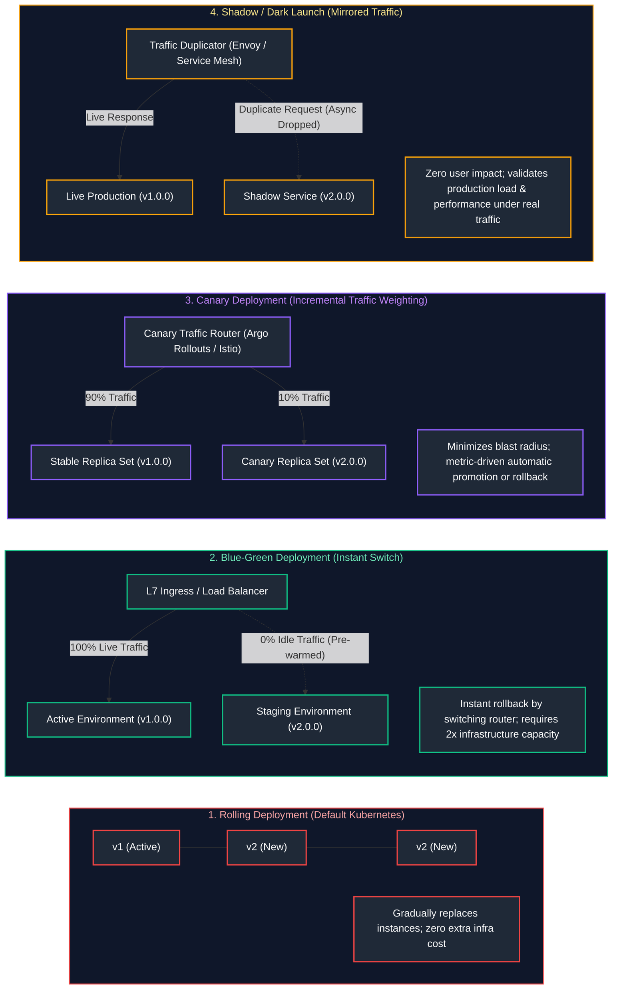

#### In-Depth Architectural Comparison

| Dimension | Rolling Deployment | Blue-Green Deployment | Canary Deployment | Shadow (Dark Launch) |
| :--- | :--- | :--- | :--- | :--- |
| **Rollout Speed** | Moderate (pod by pod) | Instant (router cutover) | Progressive (e.g. 5% $\rightarrow$ 25% $\rightarrow$ 100%) | Instant mirror |
| **Rollback Speed** | Slow (requires reverse rolling update) | Instant (switch router pointer back to Green) | Fast (drop canary weight to 0%) | Not applicable (zero user traffic impacted) |
| **Infrastructure Overhead** | Low (only `maxSurge` overhead, e.g. +25%) | High (requires 2x full cluster capacity) | Very Low (single canary replica, +10%) | High (2x compute to process mirrored requests) |
| **Blast Radius** | Medium (all users hit new version eventually) | High (cutover impacts 100% of user traffic) | Minimal (only 5% of users exposed initially) | Zero (shadow responses discarded asynchronously) |
| **Database Migration Complexity** | Complex (DB must support v1 and v2 simultaneously) | Complex (DB must support both environments) | Complex (DB must support both versions) | Complex (must avoid duplicate writes to production DB) |

---

### 3.4 Enterprise Multi-Stage Azure DevOps Pipeline (`azure-pipelines.yml`)

```yaml
trigger:
  branches:
    include:
      - main
      - release/*

variables:
  vmImageName: 'ubuntu-latest'
  imageRepository: 'order-service'
  containerRegistry: 'myenterpriseacr.azurecr.io'
  dockerfilePath: '$(Build.SourcesDirectory)/Dockerfile'
  tag: '$(Build.BuildId)'

stages:
# Stage 1: Continuous Integration (Build, Test, Quality Gates)
- stage: CI_BuildAndTest
  displayName: '1. Build, Test & Security Gates'
  jobs:
  - job: MavenBuildAndScan
    pool:
      vmImage: $(vmImageName)
    steps:
    - task: JavaToolInstaller@0
      inputs:
        versionSpec: '21'
        jdkArchitectureOption: 'x64'
        jdkSourceOption: 'PreInstalled'

    # Cache Maven dependencies to accelerate build times
    - task: Cache@2
      inputs:
        key: 'maven | "$(Agent.OS)" | **/pom.xml'
        restoreKeys: |
          maven | "$(Agent.OS)"
        path: $(HOME)/.m2/repository
      displayName: 'Cache Maven packages'

    - script: mvn clean verify -B
      displayName: 'Execute Maven Clean, Test, and Verify'

    - task: PublishTestResults@2
      inputs:
        testResultsFormat: 'JUnit'
        testResultsFiles: '**/surefire-reports/TEST-*.xml'
        mergeTestResults: true
      displayName: 'Publish JUnit Test Results'

    - task: PublishCodeCoverageResults@2
      inputs:
        summaryFileLocation: '$(System.DefaultWorkingDirectory)/**/site/jacoco/jacoco.xml'
      displayName: 'Publish JaCoCo Code Coverage'

# Stage 2: Containerization & Security Scanning
- stage: CI_Containerize
  displayName: '2. Docker Multi-Stage Build & Trivy Scan'
  dependsOn: CI_BuildAndTest
  condition: succeeded()
  jobs:
  - job: DockerBuildAndScan
    pool:
      vmImage: $(vmImageName)
    steps:
    - task: Docker@2
      displayName: 'Build Docker OCI Image'
      inputs:
        command: build
        repository: $(imageRepository)
        dockerfile: $(dockerfilePath)
        tags: |
          $(tag)
          latest

    # Install and execute Trivy Container Vulnerability Scanner
    - script: |
        curl -sfL https://raw.githubusercontent.com/aquasecurity/trivy/main/contrib/install.sh | sh -s -- -b /usr/local/bin
        trivy image --exit-code 1 --severity CRITICAL $(imageRepository):$(tag)
      displayName: 'Trivy Scan: Fail build on CRITICAL CVEs'

    - task: Docker@2
      displayName: 'Push Image to Azure Container Registry'
      inputs:
        containerRegistry: 'AzureContainerRegistryServiceConnection'
        repository: $(imageRepository)
        command: push
        tags: |
          $(tag)
          latest

# Stage 3: GitOps Config Update (Trigger ArgoCD)
- stage: CD_PromoteToStaging
  displayName: '3. Update GitOps Repository'
  dependsOn: CI_Containerize
  condition: succeeded()
  jobs:
  - job: UpdateGitOpsManifests
    steps:
    - script: |
        git config --global user.email "devops-bot@company.com"
        git config --global user.name "DevOps Pipeline Bot"
        git clone https://$(SYSTEM_ACCESSTOKEN)@dev.azure.com/myorg/myproject/_git/gitops-manifests
        cd gitops-manifests/environments/staging/order-service
        sed -i 's|image: .*|image: $(containerRegistry)/$(imageRepository):$(tag)|g' deployment.yaml
        git add deployment.yaml
        git commit -m "Auto-promote order-service to image tag $(tag)"
        git push origin main
      displayName: 'Update K8s Deployment Manifest with new Image Tag'
```

---

### 3.5 Enterprise GitHub Actions CI/CD Workflow (`.github/workflows/deploy.yml`)

```yaml
name: Enterprise CI/CD Pipeline

on:
  push:
    branches: [ "main" ]
  pull_request:
    branches: [ "main" ]

permissions:
  contents: write
  packages: write
  security-events: write

jobs:
  build-and-test:
    runs-on: ubuntu-latest
    steps:
      - uses: actions/checkout@v4

      - name: Set up JDK 21
        uses: actions/setup-java@v4
        with:
          java-version: '21'
          distribution: 'temurin'
          cache: maven

      - name: Build with Maven & Run Unit and Testcontainers Tests
        run: mvn clean verify -B

      - name: Upload JaCoCo Coverage Report
        uses: actions/upload-artifact@v4
        with:
          name: code-coverage-report
          path: target/site/jacoco/

  docker-build-and-push:
    needs: build-and-test
    if: github.ref == 'refs/heads/main'
    runs-on: ubuntu-latest
    steps:
      - uses: actions/checkout@v4

      - name: Set up Docker Buildx
        uses: actions/setup-buildx-action@v3

      - name: Log in to Azure Container Registry
        uses: docker/login-action@v3
        with:
          registry: ${{ secrets.ACR_LOGIN_SERVER }}
          username: ${{ secrets.ACR_USERNAME }}
          password: ${{ secrets.ACR_PASSWORD }}

      - name: Build and Push Docker Image
        uses: docker/build-push-action@v5
        with:
          context: .
          push: true
          tags: |
            ${{ secrets.ACR_LOGIN_SERVER }}/order-service:${{ github.sha }}
            ${{ secrets.ACR_LOGIN_SERVER }}/order-service:latest
          cache-from: type=gha
          cache-to: type=gha,mode=max

      - name: Scan Image with Trivy
        uses: aquasecurity/trivy-action@master
        with:
          image-ref: ${{ secrets.ACR_LOGIN_SERVER }}/order-service:${{ github.sha }}
          format: 'sarif'
          output: 'trivy-results.sarif'
          severity: 'CRITICAL,HIGH'
```

> [!TIP]
> **Deep-Dive Interview Scenarios:**
> - [Q4. Structuring a Robust CI/CD Pipeline (GitHub Actions / Jenkins)](frequently_asked_questions/11_cloud_native_containers_and_devops_faq.md#q4-medium-structuring-a-robust-cicd-pipeline-github-actions--jenkins)
> - [Q5. Deployment Strategies: Blue-Green vs Canary vs Rolling](frequently_asked_questions/11_cloud_native_containers_and_devops_faq.md#q5-easy-deployment-strategies-blue-green-vs-canary-vs-rolling)
> - [Q1. Enterprise Production Monitoring & Observability Stack](frequently_asked_questions/13_linux_networking_and_distributed_reliability_faq.md#q1-medium-enterprise-production-monitoring--observability-stack)
> - [Q14. End-to-End AWS Deployment Flow: CI Build to ECR and EKS Container Rollout](frequently_asked_questions/11_cloud_native_containers_and_devops_faq.md#q14-medium-end-to-end-aws-deployment-flow-ci-build-to-ecr-and-eks-container-rollout)

---

# 4. GitOps Continuous Delivery with ArgoCD

---

### 4.1 GitOps Core Principles & Architectural Paradigm

GitOps is an operational framework that takes DevOps best practices used for application development (version control, collaboration, compliance, and CI/CD) and applies them to infrastructure and deployment automation.

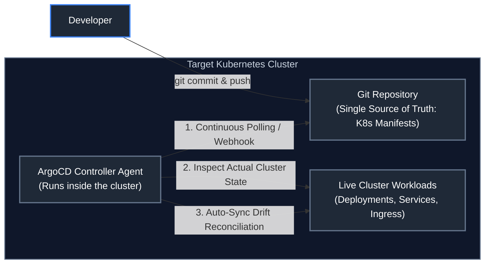

1. **Declarative State**: The entire desired system state (applications, networking, ingress, resource quotas) is declared declaratively via Kubernetes manifests, Kustomize, or Helm charts.
2. **Version-Controlled Single Source of Truth**: The Git repository is the sole authority for what is allowed to run in the cluster.
3. **Automated Pull-Based Delivery**: An agent running **inside** the target Kubernetes cluster pulls updates from Git, eliminating the security vulnerability of exposing cluster API credentials to external CI runners.
4. **Continuous Drift Detection & Self-Healing**: If an operator manually edits a deployment via `kubectl edit`, the ArgoCD reconciliation loop immediately detects configuration drift and reverts the live cluster back to the Git source state.

---

### 4.2 ArgoCD Automated Reconciliation Loop & Drift Detection

The ArgoCD controller compares the **Target State** (defined in Git) with the **Live State** (running in the Kubernetes cluster) every 3 minutes (or triggered immediately via Git Webhook):
- **`Synced`**: Live state matches the desired Git commit hash.
- **`OutOfSync`**: Differences detected between Git and Live cluster.
- **`Healthy`**: All Pod health probes are passing and workloads are running.
- **`Degraded`**: Containers crashing, probes failing, or HPA unable to scale.

---

### 4.3 Production ArgoCD Application CRD & ApplicationSet for Multi-Environment Promotion

```yaml
apiVersion: argoproj.io/v1alpha1
kind: Application
metadata:
  name: order-service-prod
  namespace: argocd
  finalizers:
    # Ensures K8s resources are deleted if Application is deleted from Git
    - resources-finalizer.argocd.argoproj.io
spec:
  project: default
  source:
    repoURL: 'https://github.com/my-enterprise/gitops-deployments.git'
    targetRevision: main
    path: environments/production/order-service
  destination:
    server: 'https://kubernetes.default.svc'
    namespace: production
  syncPolicy:
    automated:
      prune: true     # Automatically deletes resources removed from Git
      selfHeal: true  # Automatically reverts manual kubectl edits on cluster
    syncOptions:
      - CreateNamespace=true
      - ApplyOutOfSyncOnly=true
    retry:
      limit: 5
      backoff:
        duration: 5s
        factor: 2
        maxDuration: 3m
```

---

### 4.4 Argo Rollouts: Automated Canary Rollouts with Prometheus Metric Analysis

Argo Rollouts replaces the standard Kubernetes `Deployment` with an advanced `Rollout` CRD, enabling automated canary deployments driven by real-time Prometheus metrics:

```yaml
apiVersion: argoproj.io/v1alpha1
kind: Rollout
metadata:
  name: order-service-rollout
  namespace: production
spec:
  replicas: 10
  strategy:
    canary:
      # Automatically step through traffic weights
      steps:
      - setWeight: 10
      - pause: { duration: 5m }  # Evaluate metrics at 10% traffic for 5 minutes
      - setWeight: 25
      - pause: { duration: 10m }
      - setWeight: 50
      - pause: { duration: 10m }
      # Automated Prometheus Metric Analysis
      analysis:
        templates:
        - templateName: http-success-rate-analysis
---
apiVersion: argoproj.io/v1alpha1
kind: AnalysisTemplate
metadata:
  name: http-success-rate-analysis
  namespace: production
spec:
  metrics:
  - name: success-rate
    interval: 30s
    successCondition: result[0] >= 0.99
    failureLimit: 3
    provider:
      prometheus:
        address: http://prometheus-k8s.monitoring.svc:9090
        query: |
          sum(rate(http_server_requests_seconds_count{status!~"5.*",app="order-service"}[1m]))
          /
          sum(rate(http_server_requests_seconds_count{app="order-service"}[1m]))
```

---

### 4.5 ArgoCD CLI Cheatsheet & Operational Commands

| Command & Syntax | Key Flags Explained | What Does What | Practical Operational Scenario |
| :--- | :--- | :--- | :--- |
| `argocd app list` | `-o wide`: Output extended cluster info | Lists all managed applications, sync status, and health status | Checking health of all services across environments |
| `argocd app get <app-name>` | `--refresh`: Force immediate live Git pull | Dumps detailed tree of all K8s resources managed by application | Diagnosing why an app is in `Degraded` or `OutOfSync` state |
| `argocd app sync <app-name>` | `--prune`: Remove deleted resources<br>`--force`: Force recreate pods | Triggers manual synchronization from Git repository immediately | Deploying an emergency patch without waiting for polling interval |
| `argocd app diff <app-name>` | `--local`: Compare against local files | Displays unified diff between live cluster state and Git commit | Reviewing exact changes before approving synchronization |
| `argocd app rollback <app-name> <id>` | `<id>`: Target historical revision ID | Reverts cluster application state to specified prior sync run | Emergency rollback when a new Git sync causes production faults |
| `argocd app set <app-name> --self-heal` | `--self-heal=false`: Disable self-heal | Configures automated self-healing drift reconciliation | Temporarily allowing manual debugging in non-production cluster |

---

# 5. Microsoft Azure Cloud Architecture for Java Enterprise Backends

---

### 5.1 End-to-End Azure Enterprise Reference Architecture

In an enterprise Microsoft Azure deployment, zero-trust network isolation, managed identity security, and multi-region resilience form the foundation of a modern Java backend:

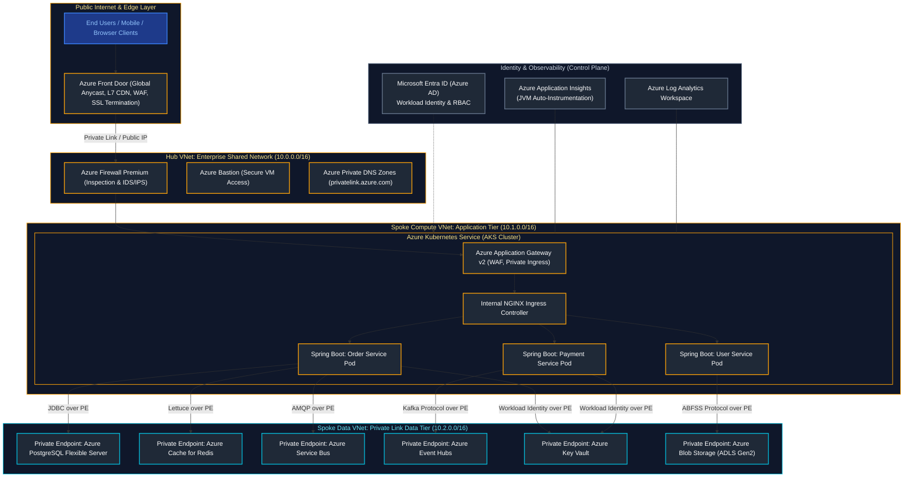

---

### 5.2 Cloud Computing Service Models: IaaS vs PaaS vs CaaS vs FaaS

| Cloud Service Model | Vendor-Managed Infrastructure Layer | Customer-Managed Application Layer | Representative Azure Service | Primary Enterprise Benefit |
| :--- | :--- | :--- | :--- | :--- |
| **IaaS (Infrastructure as a Service)** | Physical Datacenter, Power, Hardware, Hypervisor | Virtual Machine OS, OS Patching, Network Routing, Java Runtime, Spring Boot App, Data | Azure Virtual Machines (VMs), Azure Virtual Network (VNet) | Maximum control over low-level kernel, OS libraries, and legacy software configurations. |
| **CaaS (Containers as a Service)** | Hardware, Hypervisor, K8s Control Plane (API Server, etcd), Worker Node VM OS | Docker / OCI Container Images, Helm Charts, K8s Deployments, Service Mesh, Spring Boot Pods | Azure Kubernetes Service (AKS), Azure Container Apps (ACA) | Portable microservice orchestration, dynamic horizontal pod autoscaling (HPA), and declarative GitOps. |
| **PaaS (Platform as a Service)** | Hardware, OS, Kernel Patching, Java JDK Runtime, Web Server Container | Spring Boot Executable JAR / WAR, Application Code, Database Schemas | Azure App Service (Linux Java 21), Azure Spring Apps Enterprise | Zero VM or OS maintenance overhead; built-in automated TLS certificates and blue-green deployment slots. |
| **FaaS (Function as a Service / Serverless)** | Everything: Hardware, OS, Runtime, Scaling to Zero, Event Trigger Plumbing | Isolated Individual Java Function Methods (`apply()`, `accept()`) | Azure Functions (Java Worker), AWS Lambda | True pay-per-execution billing; automated event-driven scale-to-zero for unpredictable bursts. |

---

### 5.3 High Availability (HA), Availability Zones (AZ), Disaster Recovery (DR, RPO, RTO)

- **Availability Zones (AZ)**: Physically separate data centers within an Azure region equipped with independent power, cooling, and networking. AKS node pools and Azure SQL instances deploy across 3 AZs to survive complete data center outages.
- **RPO (Recovery Point Objective)**: Maximum acceptable duration of data loss measured in time (e.g., RPO = 0 with synchronous database replication; RPO = 5 minutes with asynchronous cross-region storage replication).
- **RTO (Recovery Time Objective)**: Maximum acceptable duration of system downtime before service is restored (e.g., RTO = 15 minutes with automated DNS failover via Azure Front Door).

---

### 5.4 Azure Core Services Breakdown for Java Backends

| Azure Service | Category | Protocol / Engine | Primary Role in Java Backend Architecture |
| :--- | :--- | :--- | :--- |
| **Azure Kubernetes Service (AKS)** | Compute (CaaS) | OCI / containerd | Orchestrating microservice container pods with autoscaling and VNet integration |
| **Azure Container Registry (ACR)** | Registry | OCI / Docker v2 | Secure, geo-replicated private container image storage with automated vulnerability scanning |
| **Azure Database for PostgreSQL** | Database (PaaS) | PostgreSQL 16 | ACID transactional relational database with high availability and automated backups |
| **Azure Cosmos DB** | Database (NoSQL) | SQL / Mongo / Cassandra | Globally distributed, multi-model NoSQL database providing single-digit millisecond latency |
| **Azure Cache for Redis** | Caching | Redis 7.2 | High-throughput in-memory cache for distributed session stores and database offloading |
| **Azure Service Bus** | Messaging | AMQP 1.0 / JMS 2.0 | Enterprise transactional message broker with FIFO queues, topics, sessions, and dead-lettering |
| **Azure Event Hubs** | Event Streaming | Apache Kafka Protocol | High-throughput distributed event ingestion platform handling millions of events/sec |
| **Azure Key Vault** | Security | REST / HTTPS | HSM-backed vault for cryptographic keys, TLS certificates, and database secrets |
| **Azure Application Insights** | Observability (APM) | OpenTelemetry / Java Agent | Distributed tracing, live metrics, JVM memory profiling, and exception tracking |

---

### 5.5 Azure Service Bus vs Azure Event Hubs: Deep Architectural Comparison

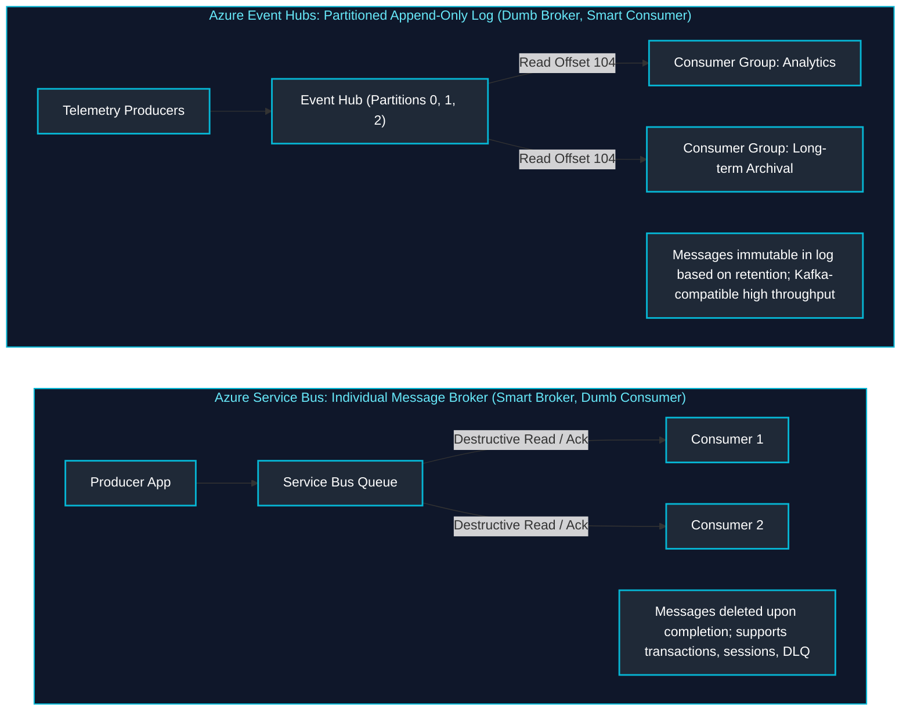

| Architectural Dimension | Azure Service Bus | Azure Event Hubs |
| :--- | :--- | :--- |
| **Messaging Paradigm** | Enterprise Message Broker (Queues & Topics) | Partitioned Event Streaming Log (Kafka-compatible) |
| **Consumption Model** | Competing consumers pull individual messages; broker deletes on ACK | Partition consumers track read offsets; messages persist in log |
| **Ordering Guarantee** | Guaranteed per Message Session across consumers | Guaranteed per Partition strictly |
| **Throughput Capacity** | Thousands of messages per second | Millions of events per second (Gigabytes/sec) |
| **Message Size Limit** | Up to 100 MB (Premium tier) | Up to 1 MB per event |
| **Dead-Letter Queue (DLQ)** | Built-in native automatic Dead-Letter Queue support | No native DLQ; consumer must handle unparseable payloads |
| **Best Java Use Case** | Financial orders, payment workflows, transactional job processing | Clickstream telemetry, IoT event streams, CDC change streams |

---

### 5.6 Identity & Zero-Trust Security: Microsoft Entra ID & Workload Identity on AKS

Hardcoding database passwords or API keys in configuration files is a critical vulnerability. Azure **Workload Identity** federates Kubernetes ServiceAccounts with **Microsoft Entra ID (Azure AD)** using OpenID Connect (OIDC):

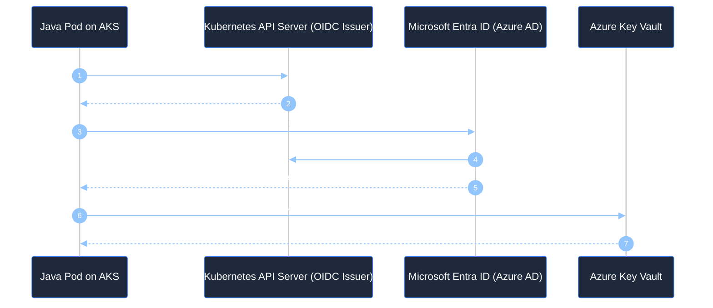

#### Production Java Code: Zero-Credential Key Vault Access via `DefaultAzureCredential`

```java
package com.company.security;

import com.azure.identity.DefaultAzureCredentialBuilder;
import com.azure.security.keyvault.secrets.SecretClient;
import com.azure.security.keyvault.secrets.SecretClientBuilder;
import com.azure.security.keyvault.secrets.models.KeyVaultSecret;
import org.springframework.beans.factory.annotation.Value;
import org.springframework.context.annotation.Bean;
import org.springframework.context.annotation.Configuration;

@Configuration
public class AzureSecurityConfig {

    @Value("${azure.keyvault.uri:https://kv-enterprise-prod.vault.azure.net/}")
    private String keyVaultUri;

    @Bean
    public SecretClient secretClient() {
        // DefaultAzureCredential seamlessly probes:
        // 1. Environment variables (AZURE_CLIENT_ID, AZURE_TENANT_ID)
        // 2. Workload Identity on AKS
        // 3. Managed Identity on Azure VMs / App Service
        // 4. Azure CLI credentials during local development
        return new SecretClientBuilder()
            .vaultUrl(keyVaultUri)
            .credential(new DefaultAzureCredentialBuilder().build())
            .buildClient();
    }

    public String fetchSecret(SecretClient client, String secretName) {
        KeyVaultSecret secret = client.getSecret(secretName);
        return secret.getValue();
    }
}
```

---

### 5.7 Virtual Networks (VNets), Hub-and-Spoke Peering & Azure Private Link Endpoints

In an enterprise topology:
1. **Hub-and-Spoke Peering**: The Hub VNet contains shared services (Azure Firewall, Bastion, ExpressRoute to on-premises). Spoke VNets peer with the Hub, routing all egress traffic through the firewall.
2. **Azure Private Link**: Replaces public internet routing with **Private Endpoints (PE)**. Each PaaS resource (Azure SQL, Cosmos DB, Key Vault, ACR) receives a private IP address within the Spoke VNet subnet. Public internet access is completely disabled.

---

### 5.8 Complete Infrastructure as Code (Terraform) for Azure Java Platform

```hcl
# main.tf - Production Microsoft Azure Java Platform Infrastructure
terraform {
  required_version = ">= 1.6.0"
  required_providers {
    azurerm = {
      source  = "hashicorp/azurerm"
      version = "~> 3.90.0"
    }
  }
}

provider "azurerm" {
  features {}
}

# Resource Group
resource "azurerm_resource_group" "rg" {
  name     = "rg-enterprise-prod-eastus"
  location = "East US"
  tags = {
    Environment = "Production"
    ManagedBy   = "Terraform"
  }
}

# Virtual Network & Subnets
resource "azurerm_virtual_network" "vnet" {
  name                = "vnet-enterprise-prod"
  resource_group_name = azurerm_resource_group.rg.name
  location            = azurerm_resource_group.rg.location
  address_space       = ["10.100.0.0/16"]
}

resource "azurerm_subnet" "aks_subnet" {
  name                 = "snet-aks-nodes"
  resource_group_name  = azurerm_resource_group.rg.name
  virtual_network_name = azurerm_virtual_network.vnet.name
  address_prefixes     = ["10.100.1.0/24"]
}

resource "azurerm_subnet" "pe_subnet" {
  name                 = "snet-private-endpoints"
  resource_group_name  = azurerm_resource_group.rg.name
  virtual_network_name = azurerm_virtual_network.vnet.name
  address_prefixes     = ["10.100.2.0/24"]
}

# Azure Container Registry (ACR)
resource "azurerm_container_registry" "acr" {
  name                = "acrenterpriseprod001"
  resource_group_name = azurerm_resource_group.rg.name
  location            = azurerm_resource_group.rg.location
  sku                 = "Premium"
  admin_enabled       = false
}

# Azure Kubernetes Service (AKS) with Azure CNI & OIDC Workload Identity
resource "azurerm_kubernetes_cluster" "aks" {
  name                = "aks-enterprise-prod"
  resource_group_name = azurerm_resource_group.rg.name
  location            = azurerm_resource_group.rg.location
  dns_prefix          = "aks-enterprise-prod"
  kubernetes_version  = "1.28.5"

  oidc_issuer_enabled       = true
  workload_identity_enabled = true

  default_node_pool {
    name                = "systempool"
    node_count          = 3
    vm_size             = "Standard_D4s_v5"
    vnet_subnet_id      = azurerm_subnet.aks_subnet.id
    zones               = ["1", "2", "3"]
    enable_auto_scaling = true
    min_count           = 3
    max_count           = 6
  }

  identity {
    type = "SystemAssigned"
  }

  network_profile {
    network_plugin    = "azure"
    load_balancer_sku = "standard"
  }
}

# Role Assignment: Allow AKS to pull images from ACR
resource "azurerm_role_assignment" "aks_acr_pull" {
  scope                = azurerm_container_registry.acr.id
  role_definition_name = "AcrPull"
  principal_id         = azurerm_kubernetes_cluster.aks.kubelet_identity[0].object_id
}

# Azure Key Vault with RBAC
resource "azurerm_key_vault" "kv" {
  name                      = "kv-enterprise-prod-001"
  resource_group_name       = azurerm_resource_group.rg.name
  location                  = azurerm_resource_group.rg.location
  sku_name                  = "premium"
  tenant_id                 = data.azurerm_client_config.current.tenant_id
  enable_rbac_authorization = true
  purge_protection_enabled  = true
}

data "azurerm_client_config" "current" {}
```

---

### 5.9 Azure CLI (`az`) Commands Cheatsheet & Administration Reference

| Command & Syntax | Key Flags Explained | What Does What | Practical Operational Scenario |
| :--- | :--- | :--- | :--- |
| `az login` | `--use-device-code`: Use browser authentication on headless server | Authenticates developer or admin session with Microsoft Entra ID | Initial login before executing Azure CLI operations |
| `az aks get-credentials --resource-group <rg> --name <aks>` | `--admin`: Fetch cluster admin credentials<br>`--overwrite-existing`: Update local kubeconfig | Merges AKS cluster endpoint and authentication tokens into local `~/.kube/config` | Connecting local `kubectl` client to target AKS cluster |
| `az acr build --registry <acr> --image myapp:1.0 .` | `--registry`: Target ACR registry name<br>`-f`: Path to Dockerfile | Uploads build context and builds Docker image remotely inside Azure cloud | Building container images without running local Docker daemon |
| `az keyvault secret set --vault-name <kv> --name db-pass --value secret` | `--vault-name`: Key Vault resource name | Securely creates or updates a secret value in Azure Key Vault | Storing sensitive database credentials or API keys |
| `az keyvault secret show --vault-name <kv> --name db-pass --query value -o tsv` | `--query`: JMESPath query filter<br>`-o tsv`: Plaintext tab-separated output | Retrieves and prints plaintext secret value from Azure Key Vault | Verifying that secret exists or extracting it for local script |
| `az monitor app-insights query --app <app-id> --analytics-query "..."` | `--analytics-query`: Kusto Query Language (KQL) | Executes live KQL query against Application Insights telemetry | Querying slow HTTP transactions or 5xx error spikes |
| `az network private-endpoint create ...` | `--connection-name`: Private Link connection identifier | Provisions a Private Endpoint attaching PaaS resource to internal VNet | Isolating database or Key Vault from the public internet |
| `az group list --query "[].{Name:name, Region:location}" -o table` | `-o table`: Format output in human-readable ASCII table | Displays summary inventory of all Azure Resource Groups | Auditing cloud resource allocation across subscriptions |

> [!TIP]
> **Deep-Dive Interview Scenarios:**
> - [Q6. Azure Resource Hierarchy & Resource Groups](frequently_asked_questions/11_cloud_native_containers_and_devops_faq.md#q6-easy-azure-resource-hierarchy--resource-groups)
> - [Q7. Azure Identity: IAM Roles, Managed Identities & Service Principals](frequently_asked_questions/11_cloud_native_containers_and_devops_faq.md#q7-medium-azure-identity-iam-roles-managed-identities--service-principals)
> - [Q8. Azure Storage (Blob vs Files) & Queues (Service Bus vs Storage Queue)](frequently_asked_questions/11_cloud_native_containers_and_devops_faq.md#q8-medium-azure-storage-blob-vs-files--queues-service-bus-vs-storage-queue)
> - [Q9. Azure Load Balancer Architecture & Types](frequently_asked_questions/11_cloud_native_containers_and_devops_faq.md#q9-medium-azure-load-balancer-architecture--types)
> - [Q10. Horizontal vs Vertical Scaling in Azure](frequently_asked_questions/11_cloud_native_containers_and_devops_faq.md#q10-easy-horizontal-vs-vertical-scaling-in-azure)
> - [Q11. Azure Compute Models (VM vs App Service vs Functions vs AKS) & Zero-Downtime Deployments](frequently_asked_questions/11_cloud_native_containers_and_devops_faq.md#q11-medium-azure-compute-models-vm-vs-app-service-vs-functions-vs-aks--zero-downtime-deployments)
> - [Q12. Azure Compliance, Governance & Secret Management](frequently_asked_questions/11_cloud_native_containers_and_devops_faq.md#q12-medium-azure-compliance-governance--secret-management)
> - [Q13. AWS Virtual Private Cloud (VPC) & Network Resource Isolation](frequently_asked_questions/11_cloud_native_containers_and_devops_faq.md#q13-medium-aws-virtual-private-cloud-vpc--network-resource-isolation)
> - [Q15. Core AWS Services Integration in Enterprise Java Backend Engineering](frequently_asked_questions/11_cloud_native_containers_and_devops_faq.md#q15-medium-core-aws-services-integration-in-enterprise-java-backend-engineering)
> - [Q16. Production Kubernetes Architecture for Java Microservices: Memory Limits & cgroups v2](frequently_asked_questions/11_cloud_native_containers_and_devops_faq.md#q16-hard-production-kubernetes-architecture-for-java-microservices-memory-limits--cgroups-v2)
> - [Q1. Local and Remote Debugging via JDWP & Port Distinctions](frequently_asked_questions/12_jvm_internals_performance_and_troubleshooting_faq.md#q1-medium-local-and-remote-debugging-via-jdwp--port-distinctions)
> - [Q17. Compute Strategy Selection in AWS: EC2 vs ECS (Fargate) vs AWS Lambda for Java Microservices & CloudWatch/X-Ray Observability](frequently_asked_questions/11_cloud_native_containers_and_devops_faq.md#q17-medium-compute-strategy-selection-in-aws-ec2-vs-ecs-fargate-vs-aws-lambda-for-java-microservices--cloudwatchx-ray-observability)

---

# 6. References & Further Reading

- [Kubernetes Documentation & Reference Architecture](https://kubernetes.io/docs/home/)
- [Docker Engine & Multi-Stage Build Documentation](https://docs.docker.com/build/building/multi-stage/)
- [ArgoCD & Argo Rollouts Official Documentation](https://argo-cd.readthedocs.io/)
- [Microsoft Azure Architecture Center: Java on Azure](https://learn.microsoft.com/en-us/azure/architecture/reference-architectures/)
- [Cloud Native Computing Foundation (CNCF) Landscape](https://landscape.cncf.io/)
