# 12. JVM Internals, Memory Management & Production Troubleshooting

A comprehensive, production-grade guide to JVM runtime data areas, ClassLoaders, JIT compilation, Garbage Collection algorithms (G1, ZGC, Shenandoah), Java NIO, Reflection, Project Panama, and production failure diagnosis tailored for Staff/Principal Java Engineers.

---

## Architectural Overview: JVM Runtime Architecture

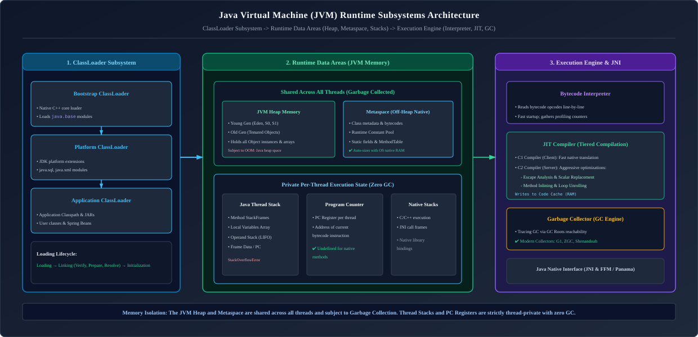

*D2 Source:* [assets/12_jvm_internals_performance_and_troubleshooting/01_jvm_runtime_architecture_overview.d2](assets/12_jvm_internals_performance_and_troubleshooting/01_jvm_runtime_architecture_overview.d2)

---


## Table of Contents

1. [From Source Code to Native Execution: The Life of a Java Class](#1-from-source-code-to-native-execution-the-life-of-a-java-class)
   - [1.1 The JVM Execution Mental Model](#11-the-jvm-execution-mental-model)
   - [1.2 Bytecode Disassembly & Instruction Set Architecture (`javap`)](#12-bytecode-disassembly--instruction-set-architecture-javap)
   - [1.3 The ClassLoader Subsystem & Parent Delegation Model](#13-the-classloader-subsystem--parent-delegation-model)
   - [1.4 Custom ClassLoaders & ClassLoader Memory Leaks](#14-custom-classloaders--classloader-memory-leaks)
2. [JVM Memory Layout & Runtime Data Areas](#2-jvm-memory-layout--runtime-data-areas)
   - [2.1 Heap Memory Architecture (Generational Model & TLABs)](#21-heap-memory-architecture-generational-model--tlabs)
   - [2.2 JVM Thread Stacks: Stack Frames, Operand Stack & Local Variables](#22-jvm-thread-stacks-stack-frames-operand-stack--local-variables)
   - [2.3 Metaspace: Off-Heap Class Metadata (Replacing PermGen)](#23-metaspace-off-heap-class-metadata-replacing-permgen)
   - [2.4 Code Cache & JIT Compilation Tiers (Interpreter -> C1 -> C2)](#24-code-cache-jit-compilation-tiers-interpreter-to-c1-to-c2)
   - [2.5 Direct Memory & Native Off-Heap Storage](#25-direct-memory--native-off-heap-storage)
3. [Garbage Collection (GC) Internals & Algorithms](#3-garbage-collection-gc-internals--algorithms)
   - [3.1 The Weak Generational Hypothesis](#31-the-weak-generational-hypothesis)
   - [3.2 Tracing GC: GC Roots Reachability vs Reference Counting](#32-tracing-gc-gc-roots-reachability-vs-reference-counting)
   - [3.3 Core GC Algorithms: Mark-Copy, Mark-Sweep, and Mark-Compact](#33-core-gc-algorithms-mark-copy-mark-sweep-and-mark-compact)
   - [3.4 Stop-The-World (STW) Pauses, Safepoints & Time-To-Safepoint (TTSP)](#34-stop-the-world-stw-pauses-safepoints--time-to-safepoint-ttsp)
   - [3.5 Deep-Dive into Modern Collectors: G1, ZGC, Shenandoah, and Parallel](#35-deep-dive-into-modern-collectors-g1-zgc-shenandoah-and-parallel)
   - [3.6 Production GC Selection Decision Framework](#36-production-gc-selection-decision-framework)
4. [Production JVM Diagnostics, Profiling & Troubleshooting](#4-production-jvm-diagnostics-profiling--troubleshooting)
   - [4.1 The 5 Flavors of `OutOfMemoryError` & Reproduction Playbook](#41-the-5-flavors-of-outofmemoryerror--reproduction-playbook)
   - [4.2 Detecting & Diagnosing Memory Leaks (ThreadLocal, Static Pools, Leaky Proxies)](#42-detecting--diagnosing-memory-leaks-threadlocal-static-pools-leaky-proxies)
   - [4.3 CPU Spikes & Deadlock Diagnosis via Thread Dumps (`jstack`)](#43-cpu-spikes--deadlock-diagnosis-via-thread-dumps-jstack)
   - [4.4 Heap Dump Analysis with Eclipse Memory Analyzer Tool (MAT)](#44-heap-dump-analysis-with-eclipse-memory-analyzer-tool-mat)
   - [4.5 Continuous Low-Overhead Profiling: Java Flight Recorder (JFR), JMC & Custom Flight Events](#45-continuous-low-overhead-profiling-java-flight-recorder-jfr-jmc--custom-flight-events)
   - [4.6 Battle-Tested Production JVM Flags](#46-battle-tested-production-jvm-flags)
5. [Java I/O vs Java NIO: High-Performance Networking & File Systems](#5-java-io-vs-java-nio-high-performance-networking--file-systems)
   - [5.1 Classic Java I/O: Blocking Streams & The C10K Concurrency Barrier](#51-classic-java-io-blocking-streams--the-c10k-concurrency-barrier)
   - [5.2 Java NIO: Buffers, Channels, and Multiplexed Selectors](#52-java-nio-buffers-channels-and-multiplexed-selectors)
   - [5.3 Direct Buffers, OS Page Cache & Zero-Copy I/O (`FileChannel.transferTo`)](#53-direct-buffers-os-page-cache--zero-copy-io-filechanneltransferto)
   - [5.4 Complete Production Implementation: High-Throughput NIO Server](#54-complete-production-implementation-high-throughput-nio-server)
   - [5.5 Modern File Systems API (`java.nio.file.Path` & `Files`), Memory-Mapped Files (mmap) & Asynchronous I/O](#55-modern-file-systems-api-javaniofilepath--files-memory-mapped-files-mmap--asynchronous-io)
6. [Object Serialization: Mechanics, Risks & Modern Alternatives](#6-object-serialization-mechanics-risks--modern-alternatives)
   - [6.1 Native Java Serialization Mechanics (`Serializable`, `transient`, `serialVersionUID`)](#61-native-java-serialization-mechanics-serializable-transient-serialversionuid)
   - [6.2 The Deserialization Vulnerability (Remote Code Execution & Gadget Chains)](#62-the-deserialization-vulnerability-remote-code-execution--gadget-chains)
   - [6.3 Modern Production Serialization: JSON, Jackson & Protocol Buffers (Protobuf)](#63-modern-production-serialization-json-jackson--protocol-buffers-protobuf)
7. [Reflection, Dynamic Proxies & Bytecode Instrumentation](#7-reflection-dynamic-proxies--bytecode-instrumentation)
   - [7.1 The Reflection API: Introspection & Performance Penalties](#71-the-reflection-api-introspection--performance-penalties)
   - [7.2 Java 9 Strong Encapsulation & The `--add-opens` Flag](#72-java-9-strong-encapsulation--the---add-opens-flag)
   - [7.3 Dynamic Proxies: JDK `java.lang.reflect.Proxy` vs CGLIB / ByteBuddy](#73-dynamic-proxies-jdk-javalangreflectproxy-vs-cglib--bytebuddy)
   - [7.4 Production Implementation: Custom Method Interception Dynamic Proxy](#74-production-implementation-custom-method-interception-dynamic-proxy)
8. [Project Panama: Foreign Function & Memory API (Java 21+)](#8-project-panama-foreign-function--memory-api-java-21)
   - [8.1 Modern Off-Heap Management: `Arena`, `MemorySegment` & Structured `MemoryLayout`](#81-modern-off-heap-management-arena-memorysegment--structured-memorylayout)
   - [8.2 Calling Native C Libraries (Replacing Legacy JNI)](#82-calling-native-c-libraries-replacing-legacy-jni)
9. [References & Further Reading](#9-references--further-reading)

---

# 1. From Source Code to Native Execution: The Life of a Java Class

---

### 1.1 The JVM Execution Mental Model

To understand how Java achieves platform independence while matching native C++ execution speeds, an engineer must visualize the complete transformation pipeline:

1. **Compilation Phase (`javac`)**: The Java compiler reads `.java` source code, performs syntax verification, type-checking, and translates human-readable statements into architecture-neutral **bytecode** stored in `.class` files.
2. **Loading & Linking Phase**: The JVM ClassLoader subsystem reads bytecode into native process memory, validates its safety constraints, and initializes class definitions.
3. **Execution Phase**:
   * **Interpreter**: Begins executing bytecode immediately, instruction by instruction, ensuring zero startup lag.
   * **JIT Profiler**: Monitors method invocations and loop iterations. Code that executes thousands of times ("hot code") is flagged for compilation.
   * **Just-In-Time (JIT) Compiler**: Translates hot bytecode into raw, highly optimized host machine assembly instructions, writing them directly into the **Code Cache**. Future calls execute at bare-metal native CPU speed!

---

### 1.2 Bytecode Disassembly & Instruction Set Architecture (`javap`)

The JVM is an **abstract stack-based computer**. Unlike x86 or ARM CPUs that operate directly on physical hardware registers, JVM instructions push operands onto and pop operands off an internal **Operand Stack**.

#### Anatomy of a `.class` Binary File:
Every compiled Java class conforms to a strict binary layout specified in the JVM Specification (§4):

| Field Type | Field Name | Width / Size | JVM Specification (§4) Purpose & Format |
| :--- | :--- | :---: | :--- |
| `u4` | `magic` | 4 Bytes | `0xCAFEBABE` (Mandatory binary file format identifier). |
| `u2` | `minor_version` | 2 Bytes | Minor class format version (e.g. `0`). |
| `u2` | `major_version` | 2 Bytes | Major bytecode version: `52` (Java 8), `61` (Java 17), `65` (Java 21). |
| `u2` | `constant_pool_count` | 2 Bytes | Length of the constant pool symbol array $+ 1$. |
| `cp_info[]` | `constant_pool` | Variable | Symbol table storing string literals, class symbols, method refs, and descriptors. |
| `u2` | `access_flags` | 2 Bytes | Modifier bitmasks: `ACC_PUBLIC`, `ACC_FINAL`, `ACC_SUPER`, `ACC_INTERFACE`. |
| `u2` | `this_class` | 2 Bytes | Constant pool index pointing to `CONSTANT_Class_info` of this class. |
| `u2` | `super_class` | 2 Bytes | Constant pool index pointing to `CONSTANT_Class_info` of direct superclass. |
| `u2` | `interfaces_count` | 2 Bytes | Number of direct superinterfaces implemented by this class. |
| `u2[]` | `interfaces` | Variable | Array of constant pool indices representing implemented interfaces. |
| `u2` | `fields_count` | 2 Bytes | Count of fields declared directly within this class. |
| `field_info[]` | `fields` | Variable | Field metadata: names, type descriptors, access flags, and attributes. |
| `u2` | `methods_count` | 2 Bytes | Count of methods declared directly within this class. |
| `method_info[]`| `methods` | Variable | Method metadata, parameters, descriptors, and bytecode `Code` attribute. |
| `u2` | `attributes_count` | 2 Bytes | Count of class-level attributes. |
| `attribute_info[]` | `attributes` | Variable | Class metadata: `SourceFile`, `InnerClasses`, `BootstrapMethods`, `NestMembers`. |

#### Inspecting Bytecode with `javap -c -v`
Consider this simple calculation:
```java
public class Calculator {
    public int addAndMultiply(int a, int b) {
        int sum = a + b;
        return sum * 2;
    }
}
```

Running `javap -c -v Calculator.class` reveals the underlying JVM assembly opcodes:

```text
public int addAndMultiply(int, int);
  Code:
   stack=2, locals=4, args_size=3
      0: iload_1          // Push parameter 'a' (local variable slot 1) onto Operand Stack
      1: iload_2          // Push parameter 'b' (local variable slot 2) onto Operand Stack
      2: iadd             // Pop two ints, add them, and push the result onto Operand Stack
      3: istore_3         // Pop sum result and store it into local variable slot 3 ('sum')
      4: iload_3          // Push 'sum' back onto Operand Stack
      5: iconst_2         // Push constant int 2 onto Operand Stack
      6: imul             // Pop two ints, multiply them, push result onto Operand Stack
      7: ireturn          // Return the top int from the Operand Stack to the caller
```

#### The 5 Primary JVM Method Invocation Opcodes:
* **`invokestatic`**: Dispatches a `static` method. Resolved statically at compile time; requires no object instance.
* **`invokespecial`**: Dispatches private methods, instance constructors (`<init>`), and `super` calls. Bound non-polymorphically.
* **`invokevirtual`**: Standard dynamic method dispatch for public/protected instance methods. Traverses the object's `vtable` at runtime based on the actual heap object type.
* **`invokeinterface`**: Dispatches methods declared in interfaces. Uses an `itable` lookup (slightly more dynamic than `vtable`).
* **`invokedynamic` (Indy - JSR 292)**: Introduced in Java 7, foundational to Java 8+ lambdas and string concatenation. Defers method linkage to a user-defined Bootstrap Method (BSM) executed dynamically at runtime.

#### The `StackMapTable` Attribute & Linear-Time Verification:
Prior to Java 6, JVM bytecode verification relied on expensive dataflow type inference algorithms that computed stack states iteratively, incurring significant startup lag.
* In modern JVMs, `javac` generates a **`StackMapTable`** attribute embedded directly in the `Code` attribute of each method.
* The table contains type frames explicitly declaring the exact types present in every local variable slot and operand stack entry at every jump or branch target.
* The JVM verifier checks bytecode safety in **$O(N)$ linear time** simply by validating that instructions transition from one precomputed frame to the next without violating constraints.

#### Programmatic Runtime Bytecode Generation with ByteBuddy:
Modern enterprise frameworks (Spring Boot, Hibernate, Mockito) generate raw JVM bytecode directly in memory without disk compilation:

```java
package com.enterprise.jvm.bytecode;

import net.bytebuddy.ByteBuddy;
import net.bytebuddy.implementation.bytecode.ByteCodeAppender;
import net.bytebuddy.implementation.Implementation;
import net.bytebuddy.jar.asm.Opcodes;
import net.bytebuddy.matcher.ElementMatchers;

public class DynamicCalculatorGenerator {

    public interface FastMath {
        int multiplyByTen(int value);
    }

    public static FastMath generateFastMathInstance() throws Exception {
        // Dynamically synthesize a new Class at runtime implementing FastMath
        Class<? extends FastMath> dynamicType = new ByteBuddy()
                .subclass(FastMath.class)
                .name("com.enterprise.jvm.generated.FastMathImpl")
                .method(ElementMatchers.named("multiplyByTen"))
                .intercept(new Implementation.Simple(new ByteCodeAppender() {
                    @Override
                    public Size apply(net.bytebuddy.jar.asm.MethodVisitor mv,
                                      Implementation.Context context,
                                      net.bytebuddy.description.method.MethodDescription method) {
                        // Emit raw JVM bytecode instructions directly:
                        mv.visitVarInsn(Opcodes.ILOAD, 1);  // Load parameter 'value'
                        mv.visitIntInsn(Opcodes.BIPUSH, 10); // Push constant 10
                        mv.visitInsn(Opcodes.IMUL);          // Multiply
                        mv.visitInsn(Opcodes.IRETURN);       // Return integer
                        return new Size(2, 2);               // Max stack=2, locals=2
                    }
                }))
                .make()
                .load(FastMath.class.getClassLoader())
                .getLoaded();

        return dynamicType.getDeclaredConstructor().newInstance();
    }
}
```

---

### 1.3 The ClassLoader Subsystem & Parent Delegation Model

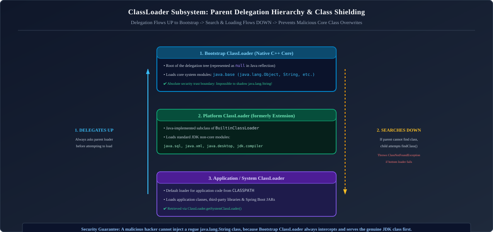

*D2 Source:* [assets/12_jvm_internals_performance_and_troubleshooting/02_classloader_parent_delegation_model.d2](assets/12_jvm_internals_performance_and_troubleshooting/02_classloader_parent_delegation_model.d2)

#### The 3 Stages of Class Loading:
1. **Loading**:
   * Reads raw `.class` binary bytes from a filesystem, JAR archive, or network stream.
   * Parses the binary stream into JVM internal metadata structures in **Metaspace**.
   * Creates a `java.lang.Class` object in the Heap to represent the type in user code.
2. **Linking**:
   * **Verification**: Rigorously analyzes bytecode to guarantee it does not violate JVM security constraints, overflow stack frames, or attempt illegal type conversions.
   * **Preparation**: Allocates memory for `static` fields and assigns them **default machine zero values** (`0`, `0.0`, `false`, `null`). *Note: Explicit code assignments do not happen here!*
   * **Resolution**: Replaces symbolic constant pool references (e.g. string names of classes and methods) with direct, physical memory pointers.
3. **Initialization (`<clinit>`)**:
   * Executes static field initializers and `static { ... }` blocks in textual order.
   * Guaranteed to be thread-safe by the JVM: the JVM acquires an internal initialization lock on the `Class` object during `<clinit>`, ensuring static initialization blocks execute strictly once.

#### Why Parent Delegation Protects Security:
Without the parent delegation model, an attacker could package a rogue class named `java.lang.String` or `java.lang.SecurityManager` inside a dependency JAR. Because child ClassLoaders always delegate upwards first, the Bootstrap ClassLoader intercepts the request, loads the authentic JDK `String`, and completely ignores the malicious counterpart!

---

### 1.4 Custom ClassLoaders & ClassLoader Memory Leaks

By subclassing `java.lang.ClassLoader`, developers can customize bytecode loading (e.g., loading encrypted JARs, hot-reloading code in development, or plugin architectures):

```java
package com.enterprise.classloader;

import java.io.IOException;
import java.nio.file.Files;
import java.nio.file.Path;

public class EncryptedDiskClassLoader extends ClassLoader {

    private final Path classDirectory;

    public EncryptedDiskClassLoader(Path classDirectory, ClassLoader parent) {
        super(parent); // Maintains parent delegation!
        this.classDirectory = classDirectory;
    }

    @Override
    protected Class<?> findClass(String name) throws ClassNotFoundException {
        try {
            String fileName = name.replace('.', '/') + ".class";
            Path filePath = classDirectory.resolve(fileName);

            if (!Files.exists(filePath)) {
                throw new ClassNotFoundException("Class not found: " + name);
            }

            byte[] encryptedBytes = Files.readAllBytes(filePath);
            byte[] decryptedBytes = decrypt(encryptedBytes); // Custom decryption algorithm

            // defineClass converts raw bytes into a live Class metadata instance in Metaspace!
            return defineClass(name, decryptedBytes, 0, decryptedBytes.length);
        } catch (IOException e) {
            throw new ClassNotFoundException("Failed to read class bytes", e);
        }
    }

    private byte[] decrypt(byte[] bytes) {
        // Simple XOR decryption demonstration
        byte[] result = new byte[bytes.length];
        for (int i = 0; i < bytes.length; i++) {
            result[i] = (byte) (bytes[i] ^ 0x5A);
        }
        return result;
    }
}
```

#### The ClassLoader Memory Leak Hazard:
In application servers (Tomcat, WebLogic), deploying and undeploying web applications requires creating and discarding ClassLoaders.
* A class loaded by a custom ClassLoader holds an implicit reference back to its `ClassLoader`.
* The `ClassLoader` holds a reference to every single `Class` it loaded.
* Every `Class` holds references to all its `static` variables.
* If a static variable holds a thread, or if a thread pool retains an instance of a class loaded by that ClassLoader (e.g. via a lingering `ThreadLocal`), **the entire ClassLoader and all its loaded classes cannot be garbage collected**!
* Repeated application redeployments cause rapid exhaustion of native memory $\to$ **`java.lang.OutOfMemoryError: Metaspace`**.

---

# 2. JVM Memory Layout & Runtime Data Areas

---

### 2.1 Heap Memory Architecture (Generational Model & TLABs)

The JVM Heap is the shared memory pool holding all active object instances and arrays:

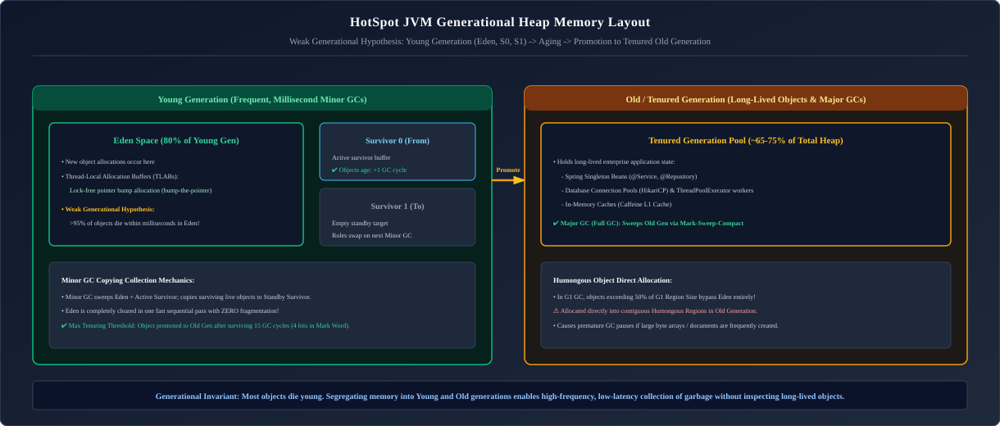

*D2 Source:* [assets/12_jvm_internals_performance_and_troubleshooting/03_jvm_heap_generations_memory_layout.d2](assets/12_jvm_internals_performance_and_troubleshooting/03_jvm_heap_generations_memory_layout.d2)

#### Thread-Local Allocation Buffers (TLAB):
In high-throughput enterprise systems with hundreds of concurrent threads, multiple threads allocating objects simultaneously on the shared heap would create massive lock contention.
* **The Solution**: HotSpot assigns each thread a dedicated chunk of Eden space called a **TLAB**.
* Inside its TLAB, a thread allocates memory via a simple, lock-free **bump-the-pointer** operation ($O(1)$) by incrementing a local memory pointer.
* Only when a thread's TLAB fills up does it acquire a synchronized lock to request a new buffer from Eden.

#### Object Layout in Heap Memory (JOL - Java Object Layout):
Every object instance stored on the JVM heap consists of three distinct segments:

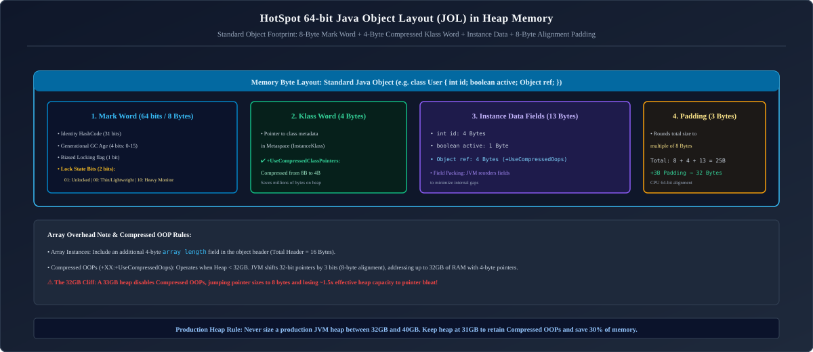

*D2 Source:* [assets/12_jvm_internals_performance_and_troubleshooting/04_hotspot_object_header_jol.d2](assets/12_jvm_internals_performance_and_troubleshooting/04_hotspot_object_header_jol.d2)

| Object Layout Segment | Bit / Byte Width | Lock State / Encoding Rules |
| :--- | :---: | :--- |
| **Mark Word: Unlocked** | 64 bits (8 Bytes) | 31-bit Identity HashCode · 4-bit GC Age ($0\text{--}15$) · 1-bit Biased Flag (`0`) · 2-bit State (`01`). |
| **Mark Word: Lightweight Lock** | 64 bits (8 Bytes) | 62-bit Pointer to Lock Record in thread execution stack · 2-bit State (`00`). |
| **Mark Word: Heavyweight Lock** | 64 bits (8 Bytes) | 62-bit Pointer to native C++ `ObjectMonitor` synchronization mutex · 2-bit State (`10`). |
| **Mark Word: Marked for GC** | 64 bits (8 Bytes) | Used internally during GC evacuation and compaction · 2-bit State (`11`). |
| **Klass Word** | 32 bits (4 Bytes) | Compressed pointer (`-XX:+UseCompressedClassPointers`) referencing Metaspace class metadata. |
| **Array Length** | 32 bits (4 Bytes) | Present strictly on array objects (`int[]`, `Object[]`), encoding element count. |
| **Instance Data** | Variable | Primitive fields (packed by size) followed by compressed 32-bit reference pointers. |
| **Alignment Padding** | $0\text{--}7$ Bytes | Round-up padding ensuring 8-byte memory boundary alignment. |

#### Compressed OOPs (Ordinary Object Pointers):
* On 64-bit architectures, raw memory pointers consume 8 bytes. For a heap with millions of small objects, pointer overhead consumes up to 40% of total heap RAM!
* **Compressed OOPs (`-XX:+UseCompressedOops`)**: HotSpot takes advantage of the fact that all objects are aligned to 8-byte boundaries (the lowest 3 bits of every memory address are always `000`).
* Instead of storing the full 64-bit byte address, the JVM shifts the 32-bit integer pointer left by 3 bits (`address << 3`).
* This enables 32-bit pointers to address up to:
  $$2^{32} \times 8\text{ bytes} = 32\text{ Gigabytes of Heap Memory!}$$
* *Production Rule*: As soon as `-Xmx` exceeds $\approx 31.5\text{ GB}$, the JVM automatically disables Compressed OOPs, causing memory efficiency to plunge! Running a 31 GB heap often yields more usable memory than running a 33 GB heap!

#### CPU Cache Lines, False Sharing & `@Contended`:
Modern CPUs transfer memory between RAM and L1/L2 caches in **64-byte Cache Lines**.
* **False Sharing**: If Thread A frequently mutates field `x` and Thread B frequently mutates field `y`, and both fields happen to reside on the same 64-byte cache line:
  * Whenever Thread A writes to `x`, the CPU hardware cache-coherence protocol (MESI) invalidates Thread B's entire L1 cache line!
  * Thread B stalls waiting for the cache line to reload from L3/RAM, causing severe throughput collapse despite zero logical lock contention.
* **Defense**: Add 128 bytes of padding or annotate critical fields with `@jdk.internal.vm.annotation.Contended` (requires `-XX:-RestrictContended`), forcing HotSpot to isolate the field onto its own private cache line.

---

### 2.2 JVM Thread Stacks: Stack Frames, Operand Stack & Local Variables

Each active Java thread possesses its own private execution stack. Every method invocation pushes a new **Stack Frame**, which is popped when the method returns or throws an unhandled exception:

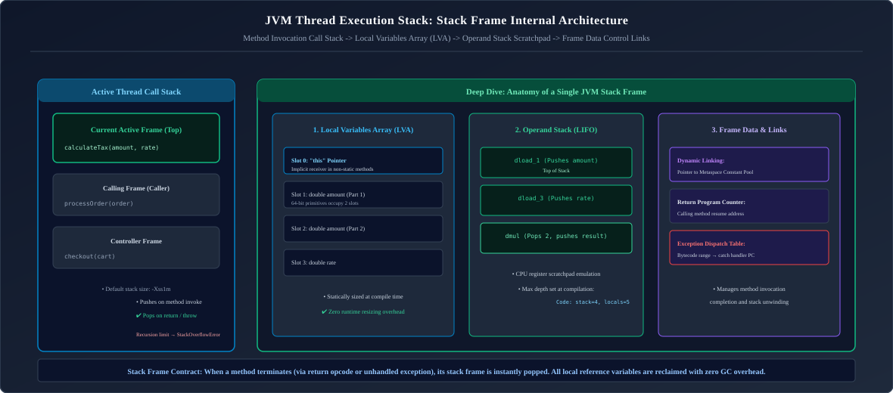

*D2 Source:* [assets/12_jvm_internals_performance_and_troubleshooting/05_jvm_stack_frame_internals.d2](assets/12_jvm_internals_performance_and_troubleshooting/05_jvm_stack_frame_internals.d2)

| Frame Subsystem | Data Structure / Sizing | Low-Level JVM Mechanics & Execution Invariants |
| :--- | :---: | :--- |
| **Local Variables Array (LVA)** | Array of 32-bit Slots | Pre-allocated at compile time (`max_locals`). Slot 0 holds `this` for instance methods. 64-bit primitives (`long`, `double`) span two consecutive slots. |
| **Operand Stack** | LIFO Word Stack | Working memory evaluated by execution engine (`max_stack`). Bytecode instructions push values, execute ALU arithmetic, and push return values. |
| **Dynamic Linking** | Constant Pool Symbolic Reference | Translates symbolic method calls (e.g. `#14 <Method java/lang/String.length()I>`) into concrete Metaspace function addresses upon first resolution. |
| **Normal / Exceptional Return** | Return Address & Exception Table | Restores caller's PC register on `ireturn`/`areturn`; scans method exception table for matching catch ranges upon unhandled throw. |

---

### 2.3 Metaspace: Off-Heap Class Metadata (Replacing PermGen)

Prior to Java 8, class metadata was stored in **PermGen (Permanent Generation)** inside the contiguous JVM heap. PermGen had a fixed maximum size (`-XX:MaxPermSize`), making enterprise applications notoriously prone to `OutOfMemoryError: PermGen space`.

Java 8 completely removed PermGen, replacing it with **Metaspace**:
* **Off-Heap Native Memory**: Metaspace resides in native operating system RAM, completely outside the JVM heap.
* **Auto-Scaling**: By default, Metaspace dynamically expands as needed up to physical host RAM limits.
* **Guardrails in Containers**: In Docker/Kubernetes environments, an unbounded Metaspace will trigger Linux kernel Out-Of-Memory (OOM) killer terminating the container. Always configure a ceiling in production:
  ```bash
  -XX:MetaspaceSize=128m -XX:MaxMetaspaceSize=512m
  ```

---

### 2.4 Code Cache & JIT Compilation Tiers (Interpreter $\to$ C1 $\to$ C2)

HotSpot utilizes **Tiered Compilation** (`-XX:+TieredCompilation`, enabled by default):

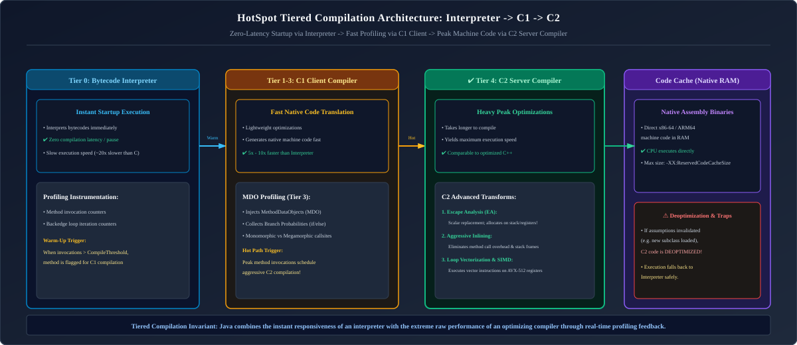

*D2 Source:* [assets/12_jvm_internals_performance_and_troubleshooting/06_tiered_compilation_interpreter_c1_c2.d2](assets/12_jvm_internals_performance_and_troubleshooting/06_tiered_compilation_interpreter_c1_c2.d2)

* **Method Inlining**: C2 replaces method calls with the actual method bytecode, eliminating call stack overhead.
* **Dead Code Elimination & Loop Unrolling**: Removes unreachable conditional branches and unrolls loops for SIMD vectorization.
* **Deoptimization**: If runtime assumptions change (e.g. a second concrete class violates monomorphic inlining assumptions), C2 invalidates the compiled assembly and deoptimizes execution back to interpreted code!

---

### 2.5 Direct Memory & Native Off-Heap Storage

* **Direct Memory (`ByteBuffer.allocateDirect(size)`)**: Allocates native memory buffers outside the JVM heap using native OS `malloc()`.
* **Why Use Off-Heap Memory?**: Bypasses Garbage Collector overhead completely. High-performance messaging engines (Apache Kafka, Netty) store gigabytes of network buffers off-heap, avoiding GC pauses during high-throughput I/O.
* **Configuration**: Governed by `-XX:MaxDirectMemorySize=2g`.

---

# 3. Garbage Collection (GC) Internals & Algorithms

---

### 3.1 The Weak Generational Hypothesis

The architecture of modern Java Garbage Collectors is derived from an empirical rule observed across decades of enterprise computing:
1. **The vast majority of objects die shortly after allocation** (e.g., local strings, request DTOs, stream iterators).
2. **Objects that survive multiple GC cycles tend to live for a very long time** (e.g., Spring singletons, connection pools, long-lived caches).

Therefore, segregating memory into **Young Generation** (collected frequently with fast algorithms) and **Old Generation** (collected infrequently) optimizes overall CPU efficiency.

---

### 3.2 Tracing GC: GC Roots Reachability vs Reference Counting

Java uses **Tracing Garbage Collection** based on **GC Roots Reachability**:

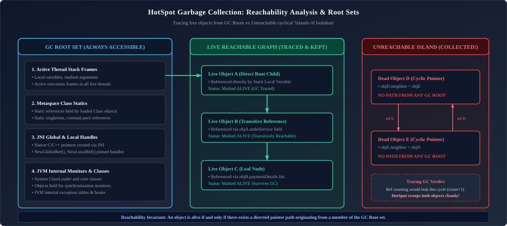

*D2 Source:* [assets/12_jvm_internals_performance_and_troubleshooting/07_gc_roots_reachability_graph.d2](assets/12_jvm_internals_performance_and_troubleshooting/07_gc_roots_reachability_graph.d2)

* An object is alive if and only if there is an unbroken chain of references from at least one **GC Root**.
* Notice that Objects D and E point to each other in a circular reference. Under primitive **Reference Counting**, their reference count is 1, so they would never be collected (a severe memory leak). Under HotSpot's **Reachability Analysis**, because no GC Root reaches them, they are reclaimed cleanly!

---

### 3.3 Core GC Algorithms: Mark-Copy, Mark-Sweep, and Mark-Compact

1. **Mark-Copy (Used in Young Generation)**:
   * Traces live objects from Eden and the active Survivor space (`From`).
   * Copies surviving objects into the alternate Survivor space (`To`), packing them contiguously.
   * Clears Eden and `From` in a single bulk operation. Extremely fast; zero memory fragmentation.
2. **Mark-Sweep**:
   * Identifies and marks live objects; sweeps dead objects leaving their memory slots available in a free-list.
   * *Drawback*: Causes severe **memory fragmentation**. Large contiguous arrays cannot be allocated even if total free memory is sufficient.
3. **Mark-Compact (Used in Old Generation)**:
   * Marks live objects, sweeps dead ones, and slides all surviving objects to the beginning of the memory space, creating a single contiguous block of free memory. Eliminates fragmentation.

---

### 3.4 Stop-The-World (STW) Pauses, Safepoints & Time-To-Safepoint (TTSP)

* **Stop-The-World (STW)**: A pause phase during which all application threads are suspended so the collector can safely mutate object references and compact memory without race conditions.
* **Safepoints**: Application threads check a dedicated safepoint polling memory page at loop branches and method exits. When a GC pause is requested, the JVM protects the polling page, triggering a thread signal that halts threads safely.
* **TTSP (Time-To-Safepoint) Spikes**: If a thread is executing an intensive uncounted counted loop, older JIT compilers may not inject a safepoint poll inside the loop. All other threads pause immediately, but the GC cannot begin until the rogue thread finishes its loop, causing latency spikes! (Resolved in modern JVMs with loop strip-mining).

---

### 3.5 Deep-Dive into Modern Collectors: G1, ZGC, Shenandoah, and Parallel

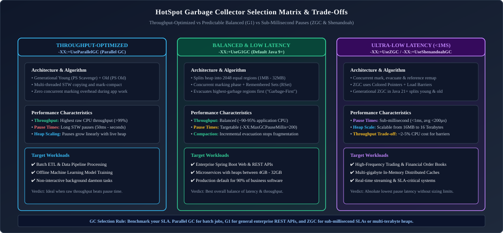

*D2 Source:* [assets/12_jvm_internals_performance_and_troubleshooting/08_garbage_collectors_comparison.d2](assets/12_jvm_internals_performance_and_troubleshooting/08_garbage_collectors_comparison.d2)

#### 1. Garbage-First (G1) GC Internals
G1 splits the Heap into ~2048 dynamically assigned regions (ranging from 1 MB to 32 MB each, power of 2):
* **Dynamic Region Roles**: Regions are assigned roles dynamically: Eden (`E`), Survivor (`S`), Old (`O`), and Humongous (`H` - for objects exceeding 50% of a region size).
* **Remembered Sets (RSets) & Card Table**:
  * An RSet is associated with every region, recording which Old regions contain reference pointers pointing into this region.
  * When executing a Minor GC on Young regions, G1 scans only the RSets rather than the entire multi-gigabyte Old generation, dramatically reducing pause times!
  * Mutated references in the card table (512-byte blocks) are logged via post-write barriers into dirty card queues processed concurrently by refinement threads.
* **Snapshot-At-The-Beginning (SATB) Concurrent Marking**:
  * G1 takes a logical snapshot of the object graph at the beginning of marking.
  * If an application mutates a reference during concurrent marking, a pre-write barrier catches the old reference and pushes it to an SATB buffer so dead object reachability is evaluated consistently.
* **Mixed Collections**:
  * Triggered when the Old generation occupancy crosses `-XX:InitiatingHeapOccupancyPercent=45` (IHOP).
  * G1 collects all Young regions plus an incremental subset of the most garbage-dense Old regions to meet `-XX:MaxGCPauseMillis=200`.

#### 2. Generational Z Garbage Collector (ZGC) Internals
Finalized in Java 21 (JEP 439), Generational ZGC achieves **sub-millisecond maximum pause times** across heaps ranging from a few gigabytes to **16 Terabytes**:
* **Colored Pointers (Reference Metadata Embedding)**:
  ZGC uses reference pointers where the lower 44 bits hold the object's virtual memory address (supporting 16 TB address space), and the upper bits encode GC state flags:

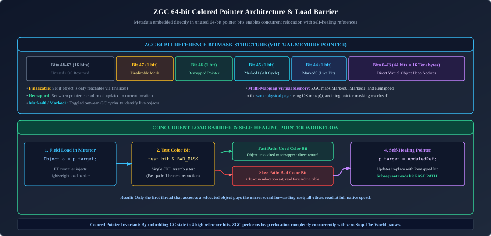

*D2 Source:* [assets/12_jvm_internals_performance_and_troubleshooting/09_zgc_colored_pointers_bitmask.d2](assets/12_jvm_internals_performance_and_troubleshooting/09_zgc_colored_pointers_bitmask.d2)

| Bit Position | Bit Flag / Field Name | Width | Architectural Function in ZGC Relocation & Marking |
| :---: | :--- | :---: | :--- |
| **Bits 0–43** | **Object Memory Address** | 44 bits | Directly addresses physical memory space up to $2^{44}\text{ bytes} = 16\text{ Terabytes}$. |
| **Bit 44** | `Marked0` | 1 bit | Live object reachability flag for even-numbered GC marking cycles. |
| **Bit 45** | `Marked1` | 1 bit | Live object reachability flag for odd-numbered GC marking cycles. |
| **Bit 46** | `Remapped` | 1 bit | Reference has been updated to point to the relocated object copy (self-healed). |
| **Bit 47** | `Finalizable` | 1 bit | Object is reachable solely through finalizer/cleaner references. |
| **Bits 48–63**| **Reserved Bits** | 16 bits | Reserved for hardware page tagging and future 64-bit OS pointer scaling. |
* **Load Barriers & Self-Healing Pointers**:
  * Whenever application code reads an object reference (`Account acc = customer.getAccount()`), HotSpot injects a tiny JIT assembly **Load Barrier** ($\sim 2-3$ instructions).
  * The barrier tests the reference's color bits against the current GC phase mask.
  * If the reference is not yet remapped, the thread consults the forwarding table, locates the relocated copy, updates the reference in memory (**self-healing**), and returns the new pointer with zero STW pause!
* **Generational Separation in Java 21**:
  * Maintains separate Young and Old generation memory regions.
  * Young generation collections run at high frequency without interrupting Old generation concurrent cycles.

#### 3. Shenandoah GC Internals
Developed by Red Hat (`-XX:+UseShenandoahGC`), Shenandoah performs concurrent marking, evacuation, and update-references in parallel with active application threads:
* **Load-Reference Barrier (LRB)**:
  * Replaced the older Brooks pointer model.
  * When a thread reads a reference to an object currently inside an evacuation collection set, the LRB ensures the thread receives the copy in the `to-space` buffer.
* **Paced Allocation**:
  * If application threads allocate objects faster than the concurrent GC can reclaim memory, Shenandoah dynamically paces (delays) allocations to prevent the dreaded fallback to a Full STW GC.

---

### 3.6 Production GC Selection Decision Framework

| Workload Characteristic | Recommended GC | Startup Flags | Key Rationale |
| :--- | :--- | :--- | :--- |
| **High-Throughput Batch Processing** (Offline data pipelines, ML training) | **Parallel GC** | `-XX:+UseParallelGC` | Highest CPU compute utilization; zero barrier overhead. |
| **Standard Enterprise Web Services** (Spring Boot REST APIs, Heaps 2GB–32GB) | **G1 GC** (Default) | `-XX:+UseG1GC -XX:MaxGCPauseMillis=150` | Balanced throughput and predictable pause times. |
| **Ultra-Low Latency FinTech / Gaming** (Heaps 4GB–16TB, SLA: $p99 < 5\text{ ms}$) | **Generational ZGC** | `-XX:+UseZGC -XX:+ZGenerational` | Sub-millisecond pause times; concurrent compaction. |
| **Memory-Constrained Microcontainers** (Heaps $< 256\text{ MB}$) | **Serial GC** | `-XX:+UseSerialGC` | Minimal footprint; no multi-threaded background GC thread overhead. |

> [!TIP]
> **Deep-Dive Interview Scenarios:**
> - [Q5. Memory Usage Keeps Increasing with No Obvious Heap Leaks](frequently_asked_questions/12_jvm_internals_performance_and_troubleshooting_faq.md#q5-hard-memory-usage-keeps-increasing-with-no-obvious-heap-leaks)
> - [Q2. HashMap Bucket Collision, Treeification & Load Factor Dynamics](frequently_asked_questions/02_java_collections_and_generics_faq.md#q2-easy-arraylist-vs-linkedlist)
> - [Q6. GC Pauses Increase Significantly After a Small Release](frequently_asked_questions/12_jvm_internals_performance_and_troubleshooting_faq.md#q6-hard-gc-pauses-increase-significantly-after-a-small-release)
> - [Q7. JVM Tuning: Throughput vs Latency Trade-Off](frequently_asked_questions/12_jvm_internals_performance_and_troubleshooting_faq.md#q7-medium-jvm-tuning-throughput-vs-latency-trade-off)

---

# 4. Production JVM Diagnostics, Profiling & Troubleshooting

---

### 4.1 The 5 Flavors of `OutOfMemoryError` & Reproduction Playbook

| OOM Variant | Root Cause | Code Scenario | Diagnostic Triage |
| :--- | :--- | :--- | :--- |
| **`Java heap space`** | Heap is full; GC cannot reclaim memory to allocate object. | Static map retaining unbounded objects; unbounded cache. | Inspect Heap Dump (`.hprof`) via Eclipse MAT to find leak suspect. |
| **`Metaspace`** | Native memory holding class definitions is exhausted. | Generating dynamic CGLIB proxies repeatedly without recycling ClassLoaders. | Run `jcmd <pid> VM.classloader_stats` to locate leaky ClassLoader. |
| **`Unable to create new native thread`** | OS thread limit reached or system out of memory for thread stacks. | Spawning unbounded platform threads (`new Thread().start()`). | Check OS `ulimit -u`; switch to virtual threads or configure bounded thread pools. |
| **`GC overhead limit exceeded`** | $>98\%$ of CPU time spent in GC reclaiming $<2\%$ of heap. | Application is thrashing at near-100% heap capacity. | Increase `-Xmx` or tune object allocation rates. |
| **`Direct buffer memory`** | Off-heap direct memory exhausted (`ByteBuffer.allocateDirect`). | Netty or Kafka network buffer pool leak without calling cleaner. | Check `-XX:MaxDirectMemorySize`; inspect off-heap buffers via JMX. |

---

### 4.2 Detecting & Diagnosing Memory Leaks (ThreadLocal, Static Pools, Leaky Proxies)

#### Reproducing a ThreadLocal Memory Leak in Pooled Environments:
```java
public class ThreadLocalLeakDemo {

    // ThreadLocal retains large byte array on the active thread
    private static final ThreadLocal<byte[]> memoryPayload = new ThreadLocal<>();

    public static void executeRequest(ExecutorService threadPool) {
        threadPool.submit(() -> {
            // Allocates 10 MB and attaches to pooled worker thread
            memoryPayload.set(new byte[10 * 1024 * 1024]);

            try {
                // Business logic...
            } finally {
                // ❌ OMITTING THIS CALL CAUSES PERMANENT MEMORY LEAK!
                // memoryPayload.remove();
            }
        });
    }
}
```

---

### 4.3 CPU Spikes & Deadlock Diagnosis via Thread Dumps (`jstack`)

When an incident occurs in production (CPU hits 100% or API hangs):

```bash
# Step 1: Capture 3 consecutive thread dumps spaced 5 seconds apart
jstack -l <PID> > thread_dump_1.tdump
sleep 5
jstack -l <PID> > thread_dump_2.tdump
sleep 5
jstack -l <PID> > thread_dump_3.tdump

# Step 2: Identify the OS thread ID consuming high CPU via top
top -H -p <PID>
# Note the high CPU Thread ID (e.g., PID 4012), and convert to hexadecimal:
printf "%x\n" 4012 # Outputs: 0x0FAC

# Step 3: Search thread dump for the nid (native thread ID)
grep -A 20 "nid=0x0fac" thread_dump_1.tdump
```

#### Deadlock Detection:
`jstack` automatically executes cycle-finding analysis on thread locks. If a deadlock exists, the bottom of the dump outputs:
```text
Found one Java-level deadlock:
=============================
"pool-1-thread-1":
  waiting to lock monitor 0x00007f (object 0x000001, a Account),
  which is held by "pool-1-thread-2"
"pool-1-thread-2":
  waiting to lock monitor 0x000080 (object 0x000002, a Account),
  which is held by "pool-1-thread-1"
```

---

### 4.4 Heap Dump Analysis with Eclipse Memory Analyzer Tool (MAT)

To capture a heap dump automatically when an OOM occurs:
```bash
-XX:+HeapDumpOnOutOfMemoryError -XX:HeapDumpPath=/var/log/jvm/heap_dump.hprof
```

#### Triage Workflow in Eclipse MAT:
1. **Open Heap Dump**: Load `heap_dump.hprof` into MAT.
2. **Run Leak Suspects Report**: MAT analyzes the object graph and flags components holding $>20\%$ of heap memory.
3. **Inspect the Dominator Tree**: Lists objects with the highest **Retained Heap** (the total memory freed if that object were garbage collected).
4. **Path to GC Roots**: Right-click the suspicious object $\to$ *Path to GC Roots* $\to$ *Exclude Soft/Weak References*. This reveals the exact static field, collection, or thread keeping the memory alive!

---

### 4.5 Continuous Low-Overhead Profiling: Java Flight Recorder (JFR), JMC & Custom Flight Events

**Java Flight Recorder (JFR)** is built directly into the HotSpot JVM kernel. It incurs $< 1\%$ performance overhead, making it safe for live 24/7 production profiling.

```bash
# Start an on-demand 60-second production recording
jcmd <PID> JFR.start name=incident_profile duration=60s filename=/tmp/incident.jfr settings=profile

# Dump the recording when complete and inspect in JDK Mission Control (JMC) GUI
```
* **JFR Capabilities**: Analyzes thread allocations, lock contention duration, file/socket I/O latencies, and exact safepoint pause times.

#### Emitting Custom Domain JFR Events in Production:
Engineers can define custom high-performance telemetry events integrated directly into the JVM event pipeline:

```java
package com.enterprise.telemetry;

import jdk.jfr.*;

@Name("com.enterprise.PaymentProcessing")
@Label("Payment Processing Event")
@Category({"Enterprise", "Payments"})
@Description("Measures latency and external gateway status for payment transactions")
public class PaymentProcessingEvent extends Event {

    @Label("Transaction ID")
    private String transactionId;

    @Label("Payment Gateway")
    private String gateway;

    @Label("Amount in Cents")
    private long amountCents;

    @Label("Success")
    private boolean successful;

    public void setTransactionId(String transactionId) { this.transactionId = transactionId; }
    public void setGateway(String gateway) { this.gateway = gateway; }
    public void setAmountCents(long amountCents) { this.amountCents = amountCents; }
    public void setSuccessful(boolean successful) { this.successful = successful; }
}

// In business service:
PaymentProcessingEvent event = new PaymentProcessingEvent();
event.begin(); // Records event start timestamp
try {
    processPayment(tx);
    event.setSuccessful(true);
} finally {
    event.setTransactionId(tx.getId());
    event.setGateway("Stripe");
    event.setAmountCents(tx.getAmount());
    event.commit(); // Records duration and pushes to JFR native buffer in < 20 nanoseconds!
}
```

#### Real-Time JFR Event Streaming (`RecordingStream`):
Since Java 14, applications can stream JFR events asynchronously in-process to detect memory spikes or lock contention in real-time:

```java
import jdk.jfr.consumer.RecordingStream;
import java.time.Duration;

public class JfrRealtimeMonitor {

    public static void startAnomalyDetector() {
        Thread monitorThread = new Thread(() -> {
            try (RecordingStream stream = new RecordingStream()) {
                // Alert if any thread experiences a monitor wait longer than 100ms
                stream.enable("jdk.JavaMonitorWait").withThreshold(Duration.ofMillis(100));

                stream.onEvent("jdk.JavaMonitorWait", event -> {
                    System.err.printf("ALERT: Severe lock contention! Thread [%s] waited %d ms for monitor: %s%n",
                            event.getThread("eventThread").getJavaName(),
                            event.getDuration().toMillis(),
                            event.getString("monitorClass"));
                });

                stream.start(); // Runs continuous low-overhead in-memory listener
            }
        });
        monitorThread.setDaemon(true);
        monitorThread.start();
    }
}
```

---

### 4.6 Battle-Tested Production JVM Flags

```bash
java \
  -Xms8g -Xmx8g \
  -XX:+UseG1GC \
  -XX:MaxGCPauseMillis=150 \
  -XX:InitiatingHeapOccupancyPercent=45 \
  -XX:G1ReservePercent=15 \
  -XX:+ParallelRefProcEnabled \
  -XX:MetaspaceSize=256m -XX:MaxMetaspaceSize=512m \
  -XX:+HeapDumpOnOutOfMemoryError \
  -XX:HeapDumpPath=/var/log/jvm/heap_dump.hprof \
  -XX:+ExitOnOutOfMemoryError \
  -Xlog:gc*,gc+phases=debug:file=/var/log/jvm/gc.log:time,uptime,pid:filecount=5,filesize=100M \
  -Djava.security.egd=file:/dev/./urandom \
  -jar enterprise-service.jar
```

> [!TIP]
> **Deep-Dive Interview Scenarios:**
> - [Q2. Service Slow but CPU Usage is Low: What to Check First](frequently_asked_questions/13_linux_networking_and_distributed_reliability_faq.md#q2-hard-service-slow-but-cpu-usage-is-low-what-to-check-first)
> - [Q2. Application Runs Fine for Hours, Then Suddenly Slows Down](frequently_asked_questions/12_jvm_internals_performance_and_troubleshooting_faq.md#q2-hard-application-runs-fine-for-hours-then-suddenly-slows-down)
> - [Q3. High CPU Usage with Very Low Traffic: Investigation Steps](frequently_asked_questions/12_jvm_internals_performance_and_troubleshooting_faq.md#q3-hard-high-cpu-usage-with-very-low-traffic-investigation-steps)
> - [Q4. Debugging Rare Production Deadlocks that Cannot be Reproduced Locally](frequently_asked_questions/12_jvm_internals_performance_and_troubleshooting_faq.md#q4-hard-debugging-rare-production-deadlocks-that-cannot-be-reproduced-locally)
> - [Q8. Troubleshooting and Resolving 504 Gateway Timeout and 503 Service Unavailable](frequently_asked_questions/13_linux_networking_and_distributed_reliability_faq.md#q8-medium-troubleshooting-and-resolving-504-gateway-timeout-and-503-service-unavailable)
> - [Q8. 200 Threads Running with Low Throughput: Thread Starvation, Pool Sizing & Lock Contention](frequently_asked_questions/12_jvm_internals_performance_and_troubleshooting_faq.md#q8-hard-200-threads-running-with-low-throughput-thread-starvation-pool-sizing--lock-contention)
> - [Q9. Spring Boot OutOfMemoryError Diagnostic Playbook: Heap Dumps, Metaspace & Leak Triage](frequently_asked_questions/12_jvm_internals_performance_and_troubleshooting_faq.md#q9-hard-spring-boot-outofmemoryerror-diagnostic-playbook-heap-dumps-metaspace--leak-triage)
> - [Q10. High GC Activity with Low Production Traffic: Allocation Churn & Object Lifecycle Triage](frequently_asked_questions/12_jvm_internals_performance_and_troubleshooting_faq.md#q10-hard-high-gc-activity-with-low-production-traffic-allocation-churn--object-lifecycle-triage)

---

# 5. Java I/O vs Java NIO: High-Performance Networking & File Systems

---

### 5.1 Classic Java I/O: Blocking Streams & The C10K Concurrency Barrier

Classic Java I/O (`java.io`) is **stream-oriented and synchronous/blocking**:
* When a thread invokes `inputStream.read()` or `serverSocket.accept()`, the operating system puts the thread to sleep until hardware data arrives.
* To handle 10,000 concurrent socket connections, an application must spawn 10,000 OS platform threads.
* At 1 MB stack memory per thread (`-Xss1m`), this requires **10 GB of RAM purely for thread stacks**, plus massive CPU context-switching overhead. Spawning thousands of threads crashes traditional servers (**The C10K Problem**).

---

### 5.2 Java NIO: Buffers, Channels, and Multiplexed Selectors

Java NIO (`java.nio`) introduces **buffer-oriented, non-blocking I/O multiplexing**:

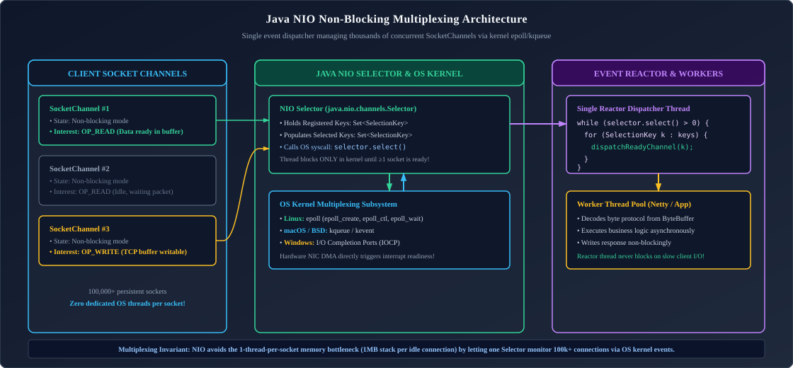

*D2 Source:* [assets/12_jvm_internals_performance_and_troubleshooting/10_java_nio_multiplexing_selector.d2](assets/12_jvm_internals_performance_and_troubleshooting/10_java_nio_multiplexing_selector.d2)

1. **Channels**: Open connections to hardware devices, files, or network sockets (`SocketChannel`, `ServerSocketChannel`). Channels are bidirectional (can both read and write).
2. **Buffers**: Data containers (`ByteBuffer`). Operations revolve around 3 pointers:
   * **`capacity`**: Maximum number of bytes the buffer can hold.
   * **`position`**: The next byte index to read or write.
   * **`limit`**: The boundary beyond which bytes cannot be read or written.
   * **`flip()`**: Sets `limit = position; position = 0;` (Switches buffer from writing mode to reading mode).
   * **`clear()`**: Sets `position = 0; limit = capacity;` (Resets buffer to accept new data).
3. **Selectors**: Software wrappers around high-performance OS kernel event notification facilities (**`epoll` on Linux**, **`kqueue` on BSD/macOS**). A single dispatcher thread can monitor tens of thousands of channels concurrently!

---

### 5.3 Direct Buffers, OS Page Cache & Zero-Copy I/O (`FileChannel.transferTo`)

* **Heap Buffer (`ByteBuffer.allocate(size)`)**: Allocated on the JVM heap. During network transmission, the OS kernel cannot write directly into Java heap memory because GC compaction moves memory addresses. The JVM must copy bytes into a temporary native OS buffer, causing double-copy overhead.
* **Direct Buffer (`ByteBuffer.allocateDirect(size)`)**: Allocated in native OS memory. The OS network card writes directly via Direct Memory Access (DMA).
* **Zero-Copy Transfer (`FileChannel.transferTo`)**:
  Leverages the Linux kernel `sendfile()` system call. Bytes transfer directly from disk cache to the network socket buffer **inside kernel space**, bypassing user-space RAM entirely!

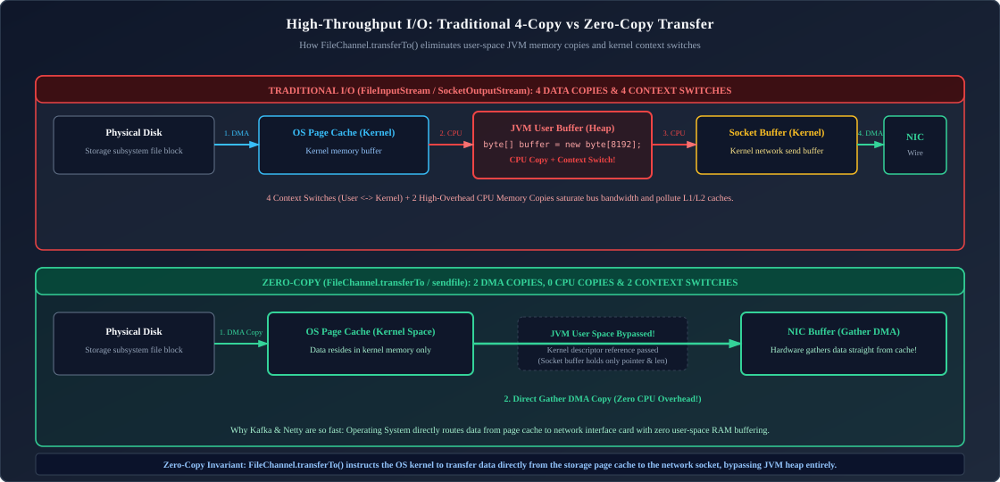

*D2 Source:* [assets/12_jvm_internals_performance_and_troubleshooting/11_zero_copy_sendfile_kernel_bypass.d2](assets/12_jvm_internals_performance_and_troubleshooting/11_zero_copy_sendfile_kernel_bypass.d2)

---

### 5.4 Complete Production Implementation: High-Throughput NIO Server

```java
package com.enterprise.nio;

import java.io.IOException;
import java.net.InetSocketAddress;
import java.nio.ByteBuffer;
import java.nio.channels.*;
import java.util.Iterator;

public class HighPerformanceEchoServer {

    private final int port;

    public HighPerformanceEchoServer(int port) {
        this.port = port;
    }

    public void start() throws IOException {
        ServerSocketChannel serverChannel = ServerSocketChannel.open();
        serverChannel.bind(new InetSocketAddress(port));
        serverChannel.configureBlocking(false); // Non-blocking mode!

        Selector selector = Selector.open();
        serverChannel.register(selector, SelectionKey.OP_ACCEPT);

        System.out.println("NIO Non-blocking server active on port " + port);

        ByteBuffer readBuffer = ByteBuffer.allocateDirect(4096); // Native Direct Buffer

        while (true) {
            selector.select(); // Blocks until at least one registered channel has an OS event
            Iterator<SelectionKey> keyIterator = selector.selectedKeys().iterator();

            while (keyIterator.hasNext()) {
                SelectionKey key = keyIterator.next();
                keyIterator.remove(); // Mandatory: remove processed key to avoid duplicate events!

                if (key.isAcceptable()) {
                    ServerSocketChannel server = (ServerSocketChannel) key.channel();
                    SocketChannel clientChannel = server.accept();
                    clientChannel.configureBlocking(false);
                    clientChannel.register(selector, SelectionKey.OP_READ);
                    System.out.println("Accepted connection from: " + clientChannel.getRemoteAddress());
                } else if (key.isReadable()) {
                    SocketChannel clientChannel = (SocketChannel) key.channel();
                    readBuffer.clear();
                    int bytesRead = clientChannel.read(readBuffer);

                    if (bytesRead == -1) {
                        System.out.println("Client disconnected: " + clientChannel.getRemoteAddress());
                        clientChannel.close();
                    } else if (bytesRead > 0) {
                        readBuffer.flip(); // Prepare buffer for reading
                        clientChannel.write(readBuffer); // Echo data back to client
                    }
                }
            }
        }
    }
}
```

---

### 5.5 Modern File Systems API (`java.nio.file.Path` & `Files`), Memory-Mapped Files (mmap) & Asynchronous I/O

#### 1. Memory-Mapped Files (`MappedByteBuffer`):
For multi-gigabyte files (e.g. database commit logs like Kafka or Lucene search indexes), memory-mapping (`mmap`) leverages virtual memory paging to map disk blocks directly into the application's process address space:
* Reading and writing to the buffer becomes simple memory array access ($O(1)$) with zero `read()` / `write()` syscall overhead!
* The operating system kernel automatically manages dirty page flushing to physical storage asynchronously.

```java
package com.enterprise.nio.file;

import java.io.RandomAccessFile;
import java.nio.MappedByteBuffer;
import java.nio.channels.FileChannel;
import java.nio.file.Path;

public class MemoryMappedLogAppender {

    private static final long SEGMENT_SIZE = 64 * 1024 * 1024; // 64 MB chunk

    public static void appendFastAuditLog(Path logPath, byte[] record) throws Exception {
        try (RandomAccessFile file = new RandomAccessFile(logPath.toFile(), "rw");
             FileChannel channel = file.getChannel()) {

            // Maps 64 MB of disk file directly into virtual memory!
            MappedByteBuffer mappedBuffer = channel.map(FileChannel.MapMode.READ_WRITE, 0, SEGMENT_SIZE);

            // Write bytes directly to memory address; OS pages flush to disk in background
            mappedBuffer.put(record);

            // Force dirty pages to disk hardware (fsync equivalent)
            mappedBuffer.force();
        }
    }
}
```

#### 2. Asynchronous File I/O with `AsynchronousFileChannel`:
Java NIO.2 provides true asynchronous non-blocking file processing using OS I/O completion ports (IOCP on Windows, Linux `io_uring` / epoll thread pools):

```java
package com.enterprise.nio.file;

import java.io.IOException;
import java.nio.ByteBuffer;
import java.nio.channels.AsynchronousFileChannel;
import java.nio.channels.CompletionHandler;
import java.nio.file.Path;
import java.nio.file.StandardOpenOption;
import java.util.concurrent.CountDownLatch;

public class AsyncFileReader {

    public static void readAsync(Path filePath) throws IOException, InterruptedException {
        AsynchronousFileChannel asyncChannel = AsynchronousFileChannel.open(filePath, StandardOpenOption.READ);
        ByteBuffer buffer = ByteBuffer.allocateDirect(1024);
        CountDownLatch latch = new CountDownLatch(1);

        asyncChannel.read(buffer, 0, buffer, new CompletionHandler<Integer, ByteBuffer>() {
            @Override
            public void completed(Integer bytesRead, ByteBuffer attachment) {
                System.out.printf("Asynchronously read %d bytes!%n", bytesRead);
                attachment.flip();
                byte[] data = new byte[bytesRead];
                attachment.get(data);
                System.out.println("Data: " + new String(data));
                latch.countDown();
            }

            @Override
            public void failed(Throwable exc, ByteBuffer attachment) {
                System.err.println("Asynchronous read failed: " + exc.getMessage());
                latch.countDown();
            }
        });

        latch.await();
        asyncChannel.close();
    }
}
```

#### 3. Efficient Path and Files Utilities:
```java
public class ModernFileUtilities {

    // Efficient lazy streaming of large multi-gigabyte log files without heap exhaustion
    public static long countErrorLogs(Path logFilePath) throws IOException {
        try (Stream<String> lineStream = Files.lines(logFilePath, StandardCharsets.UTF_8)) {
            return lineStream
                    .filter(line -> line.contains("ERROR"))
                    .count();
        }
    }

    // Atomic file save: Prevents corrupt zero-byte files if system crashes mid-write
    public static void atomicSave(Path destination, byte[] content) throws IOException {
        Path tempFile = Files.createTempFile(destination.getParent(), "atomic_", ".tmp");
        Files.write(tempFile, content, StandardOpenOption.CREATE, StandardOpenOption.WRITE);
        Files.move(tempFile, destination, StandardCopyOption.ATOMIC_MOVE, StandardCopyOption.REPLACE_EXISTING);
    }
}
```

> [!TIP]
> **Deep-Dive Interview Scenarios:**
> - [Q6. Why Scaling Instances Worsens Overall System Performance](frequently_asked_questions/13_linux_networking_and_distributed_reliability_faq.md#q6-hard-why-scaling-instances-worsens-overall-system-performance)
> - [Q10. ConcurrentHashMap CAS, Node Locking & Non-Blocking Iterators](frequently_asked_questions/04_java_concurrency_and_multithreading_faq.md#q10-hard-why-parallel-streams-degrade-production-latency)
> - [Q11. Concurrency Scalability Collapse: Investigating 10 vs 1,000 Concurrent Requests](frequently_asked_questions/12_jvm_internals_performance_and_troubleshooting_faq.md#q11-hard-concurrency-scalability-collapse-investigating-10-vs-1000-concurrent-requests)

---

# 6. Object Serialization: Mechanics, Risks & Modern Alternatives

---

### 6.1 Native Java Serialization Mechanics (`Serializable`, `transient`, `serialVersionUID`)

* **`Serializable` Marker Interface**: Instructs the JVM that an object's instance graph can be serialized into a binary byte stream.
* **`serialVersionUID`**: A version identifier. If omitted, the compiler computes one by hashing method signatures. Adding a single private method alters the computed hash, causing `InvalidClassException` upon deserializing past payloads! Always declare:
  ```java
  private static final long serialVersionUID = 1L;
  ```
* **`transient` Keyword**: Prevents sensitive fields (passwords, encryption keys) from being serialized.

---

### 6.2 The Deserialization Vulnerability (Remote Code Execution & Gadget Chains)

> [!CAUTION]
> **Production Alert**: Native Java deserialization (`ObjectInputStream.readObject()`) is one of the most dangerous vulnerabilities in computing history.

#### The Exploit Mechanism:
1. `readObject()` instantiates objects directly without invoking their constructors.
2. Attackers craft malicious serialized payloads containing **Gadget Chains** (chains of classes present on the classpath, such as Apache Commons Collections).
3. When the server invokes `readObject()`, method invocations cascade through the gadget chain, culminating in `Runtime.getRuntime().exec()`, executing arbitrary shell commands with server privileges!

**Senior Architectural Standard**:
* **Completely ban Java Native Serialization** across network APIs.
* If legacy streams must be consumed, apply strict object input filters via JEP 290 (`jdk.serialFilter`).

---

### 6.3 Modern Production Serialization: JSON, Jackson & Protocol Buffers (Protobuf)

* **JSON (Jackson / Gson)**: Human-readable, text-based, ubiquitous across REST APIs.
* **Protocol Buffers (Google Protobuf)**: Binary serialization format based on strongly-typed `.proto` schemas. Extremely compact, fast parsing, with backwards and forwards compatibility. Ideal for internal microservice gRPC communication.

---

# 7. Reflection, Dynamic Proxies & Bytecode Instrumentation

---

### 7.1 The Reflection API: Introspection & Performance Penalties

Reflection allows runtime introspection and modification of classes, methods, and private fields:

```java
Class<?> accountClass = Class.forName("com.enterprise.banking.Account");
Constructor<?> constructor = accountClass.getDeclaredConstructor(String.class);
Object instance = constructor.newInstance("ACC-101");

Field balanceField = accountClass.getDeclaredField("balance");
balanceField.setAccessible(true); // ⚠️ Bypasses private encapsulation!
balanceField.set(instance, new BigDecimal("1000000.00"));
```

#### Why Reflection Degrades Performance:
* **Prevents JIT Inlining**: The C2 compiler cannot inline reflective method calls.
* **Boxing Overhead**: All arguments and return values are wrapped in object wrappers.
* **Continuous Class Verification**: Every invocation performs runtime access and parameter verification checks.

---

### 7.2 Java 9 Strong Encapsulation & The `--add-opens` Flag

The Java 9 Module System (JPMS) enforces strong encapsulation. Calling `field.setAccessible(true)` on internal JDK classes throws `InaccessibleObjectException`.
* To permit reflection across modules in production, you must explicitly configure startup JVM arguments:
  ```bash
  --add-opens java.base/java.lang=ALL-UNNAMED
  ```

---

### 7.3 Dynamic Proxies: JDK `java.lang.reflect.Proxy` vs CGLIB / ByteBuddy

Dynamic proxies allow intercepting method invocations at runtime (powering Spring `@Transactional`, `@Async`, and `@Cacheable`):

| Proxy Mechanism | Underlying Technology | Requirements | Limitations |
| :--- | :--- | :--- | :--- |
| **JDK Dynamic Proxy** | `java.lang.reflect.Proxy` | Target class **must implement an interface** | Cannot proxy classes without interfaces. |
| **CGLIB / ByteBuddy** | Bytecode manipulation generates subclass | Generates a subclass of target at runtime | **Cannot proxy `final` classes or `final` methods**! |

---

### 7.4 Production Implementation: Custom Method Interception Dynamic Proxy

```java
package com.enterprise.proxy;

import java.lang.reflect.InvocationHandler;
import java.lang.reflect.Method;
import java.lang.reflect.Proxy;

public class PerformanceMetricProxy implements InvocationHandler {

    private final Object target;

    public PerformanceMetricProxy(Object target) {
        this.target = target;
    }

    @Override
    public Object invoke(Object proxy, Method method, Object[] args) throws Throwable {
        long start = System.nanoTime();
        try {
            return method.invoke(target, args); // Delegates to real target instance
        } finally {
            long durationNs = System.nanoTime() - start;
            System.out.printf("AUDIT: Method [%s] executed in %.2f ms%n",
                    method.getName(), durationNs / 1_000_000.0);
        }
    }

    @SuppressWarnings("unchecked")
    public static <T> T wrap(T target, Class<T> interfaceType) {
        return (T) Proxy.newProxyInstance(
                interfaceType.getClassLoader(),
                new Class<?>[]{interfaceType},
                new PerformanceMetricProxy(target)
        );
    }
}
```

#### Production ByteBuddy Subclass Method Interception (No Interfaces Required!):
Unlike JDK Dynamic Proxies which strictly require interfaces, ByteBuddy dynamically subclasses concrete classes at runtime (identical to Spring CGLIB proxies):

```java
package com.enterprise.proxy;

import net.bytebuddy.ByteBuddy;
import net.bytebuddy.implementation.MethodDelegation;
import net.bytebuddy.implementation.bind.annotation.*;
import net.bytebuddy.matcher.ElementMatchers;

import java.lang.reflect.Method;
import java.util.concurrent.Callable;

public class ByteBuddyPerformanceInterceptor {

    // Target interceptor invoked for all non-final methods
    @RuntimeType
    public static Object intercept(@Origin Method method,
                                   @AllArguments Object[] args,
                                   @SuperCall Callable<?> callable) throws Exception {
        long start = System.nanoTime();
        try {
            return callable.call(); // Invokes the real superclass method
        } finally {
            long elapsed = System.nanoTime() - start;
            System.out.printf("[BYTEBUDDY PROXY] %s executed in %.2f µs%n",
                    method.getName(), elapsed / 1_000.0);
        }
    }

    public static <T> T createProxy(Class<T> clazz) throws Exception {
        return new ByteBuddy()
                .subclass(clazz)
                .method(ElementMatchers.any())
                .intercept(MethodDelegation.to(ByteBuddyPerformanceInterceptor.class))
                .make()
                .load(clazz.getClassLoader())
                .getLoaded()
                .getDeclaredConstructor()
                .newInstance();
    }
}
```

---

# 8. Project Panama: Foreign Function & Memory API (Java 21+)

Historically, accessing off-heap native memory required `sun.misc.Unsafe` (dangerous, risks fatal JVM segfaults) or Java Native Interface (JNI - complex C glue-code).

Java 21 introduces the finalized **Foreign Function & Memory API (FFM - JEP 442)**:

---

### 8.1 Modern Off-Heap Management: `Arena`, `MemorySegment` & Structured `MemoryLayout`

#### 1. Confined Arena Memory Allocation:
```java
import java.lang.foreign.*;

public class ForeignMemoryDemo {

    public static void allocateNativeMemory() {
        // Confined Arena: Memory is guaranteed freed immediately when the try-with-resources block exits!
        try (Arena arena = Arena.ofConfined()) {
            // Allocate 1024 bytes of native off-heap memory
            MemorySegment nativeSegment = arena.allocate(1024);

            // Write integers directly into physical RAM
            nativeSegment.set(ValueLayout.JAVA_INT, 0, 1001);
            nativeSegment.set(ValueLayout.JAVA_INT, 4, 2002);

            int val1 = nativeSegment.get(ValueLayout.JAVA_INT, 0);
            int val2 = nativeSegment.get(ValueLayout.JAVA_INT, 4);

            System.out.println("Read from off-heap: " + val1 + ", " + val2);
        } // Native memory freed cleanly at OS level here; ZERO Garbage Collection involvement!
    }
}
```

#### 2. Off-Heap C Struct Array Processing with `MemoryLayout` and `VarHandle`:
High-frequency trading engines and spatial databases process millions of records completely off-heap using Panama structured memory layouts:

```java
package com.enterprise.panama;

import java.lang.foreign.*;
import java.lang.invoke.VarHandle;

public class OffHeapPointGrid {

    // Define equivalent of C struct: struct Point { long id; double x; double y; };
    private static final StructLayout POINT_LAYOUT = MemoryLayout.structLayout(
            ValueLayout.JAVA_LONG.withName("id"),
            ValueLayout.JAVA_DOUBLE.withName("x"),
            ValueLayout.JAVA_DOUBLE.withName("y")
    );

    // Sequence layout representing an off-heap array of 1,000,000 Point structs
    private static final SequenceLayout GRID_LAYOUT = MemoryLayout.sequenceLayout(1_000_000, POINT_LAYOUT);

    // VarHandles for ultra-fast direct field manipulation
    private static final VarHandle ID_HANDLE = GRID_LAYOUT.varHandle(
            MemoryLayout.PathElement.sequenceElement(),
            MemoryLayout.PathElement.groupElement("id")
    );
    private static final VarHandle X_HANDLE = GRID_LAYOUT.varHandle(
            MemoryLayout.PathElement.sequenceElement(),
            MemoryLayout.PathElement.groupElement("x")
    );

    public static void processOffHeapGrid() {
        try (Arena arena = Arena.ofShared()) {
            // Allocate 24 MB off-heap buffer holding 1,000,000 points
            MemorySegment gridSegment = arena.allocate(GRID_LAYOUT);

            // Populate index 42 directly in native memory
            ID_HANDLE.set(gridSegment, 0L, 42L, 99999L);
            X_HANDLE.set(gridSegment, 0L, 42L, 123.456);

            long id = (long) ID_HANDLE.get(gridSegment, 0L, 42L);
            double x = (double) X_HANDLE.get(gridSegment, 0L, 42L);

            System.out.printf("Retrieved off-heap struct: ID=%d, X=%.3f%n", id, x);
        }
    }
}
```

---

### 8.2 Calling Native C Libraries (Replacing Legacy JNI)

Using Project Panama, Java can invoke native C standard library functions directly without writing a single line of C wrapper code:

```java
import java.lang.foreign.*;
import java.lang.invoke.MethodHandle;

public class NativeCLibraryInvoker {

    public static void callClibStrlen() throws Throwable {
        Linker linker = Linker.nativeLinker();
        SymbolLookup stdLib = linker.defaultLookup();

        // Locate native C 'strlen' function symbol: size_t strlen(const char *s);
        MemorySegment strlenAddress = stdLib.find("strlen").orElseThrow();

        // Define C function descriptor (returns long, accepts memory pointer)
        FunctionDescriptor descriptor = FunctionDescriptor.of(ValueLayout.JAVA_LONG, ValueLayout.ADDRESS);
        MethodHandle strlenHandle = linker.downcallHandle(strlenAddress, descriptor);

        try (Arena arena = Arena.ofConfined()) {
            // Allocate native C string in native memory
            MemorySegment cString = arena.allocateFrom("Hello from Java Panama!");

            // Invoke native C strlen directly!
            long length = (long) strlenHandle.invokeExact(cString);
            System.out.println("Native strlen returned: " + length);
        }
    }
}
```

---

# 9. References & Further Reading

- [Java Virtual Machine Specification (Java SE 21 Edition)](https://docs.oracle.com/javase/specs/jvms/se21/html/index.html)
- [HotSpot Virtual Machine Garbage Collection Tuning Guide](https://docs.oracle.com/en/java/javase/21/gctuning/)
- [OpenJDK Project Panama: Interconnecting the JVM and Native Code](https://openjdk.org/projects/panama/)
- [Java Flight Recorder and Mission Control Documentation](https://docs.oracle.com/en/java/java-components/jdk-mission-control/)
- [Eclipse Memory Analyzer (MAT) Documentation](https://www.eclipse.org/mat/documentation/)
