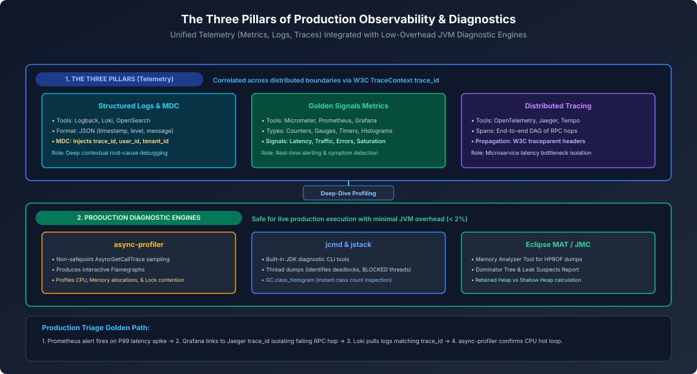
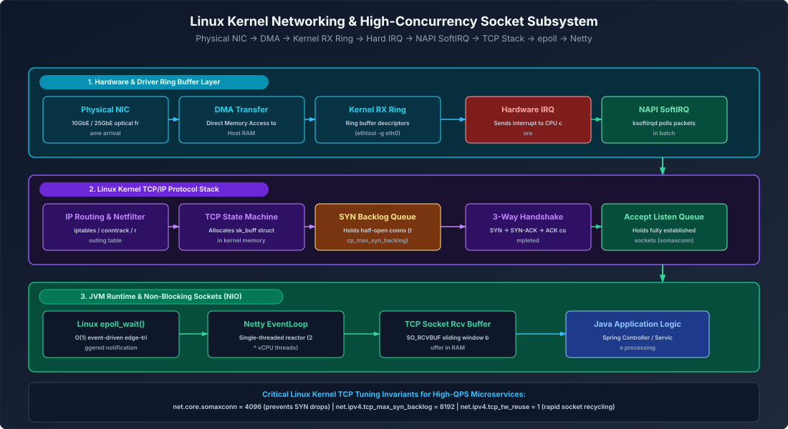
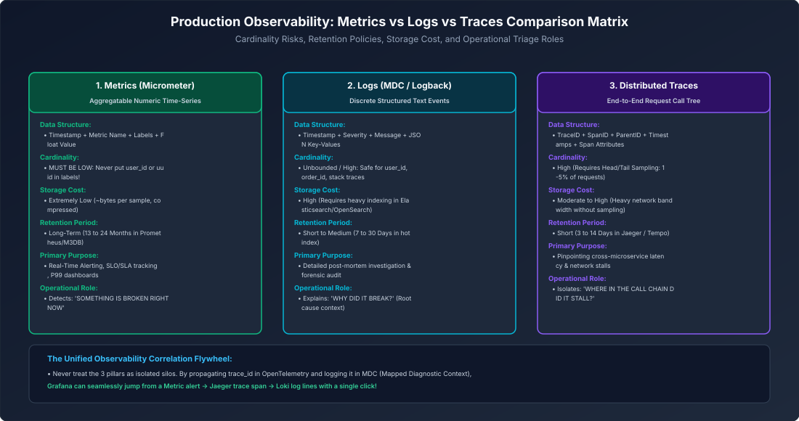
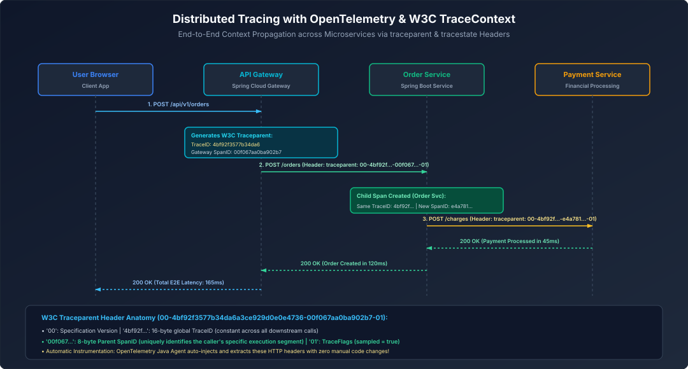

# 13. Linux Networking, Observability & Distributed Reliability

A comprehensive, production-grade guide to enterprise structured logging, MDC contextual tracing, Prometheus metrics, OpenTelemetry distributed tracing, performance profiling with async-profiler, and live production failure playbooks tailored for Staff/Principal Java Engineers.

---

## Architectural Overview: Three Pillars of Production Observability



<details>
<summary>View D2 Source</summary>

```d2
direction: down
title: "The Three Pillars of Production Observability & Diagnostics"

pillars: "The Three Pillars of Observability" {
  style.fill: "#0f172a"
  style.stroke: "#3b82f6"

  logs: "Structured Logs & MDC
Logback / OpenSearch / Loki
Contextual debugging" {
    style.fill: "#083344"
    style.stroke: "#06b6d4"
  }
  metrics: "Golden Signals Metrics
Micrometer / Prometheus / Grafana
Alerting & detection" {
    style.fill: "#064e3b"
    style.stroke: "#10b981"
  }
  traces: "Distributed Tracing
OpenTelemetry / Jaeger
Latency bottleneck isolation" {
    style.fill: "#1e1b4b"
    style.stroke: "#8b5cf6"
  }
}

diagnostics: "Production Diagnostic Engines" {
  style.fill: "#0f172a"
  style.stroke: "#10b981"

  profiler: "async-profiler
Non-safepoint CPU & Alloc Flamegraphs" {
    style.fill: "#1e293b"
    style.stroke: "#f59e0b"
  }
  jcmd: "jcmd & jstack
Thread Dumps & Class Histograms" {
    style.fill: "#1e293b"
    style.stroke: "#3b82f6"
  }
  mat: "Eclipse MAT / JMC
Heap Dump Leak Suspects Triage" {
    style.fill: "#1e293b"
    style.stroke: "#10b981"
  }
}

pillars -> diagnostics: "Correlate symptoms to deep profiling"
```
</details>

---


## Table of Contents
1. [Linux Kernel Networking & High-Concurrency Socket Subsystems](#1-linux-kernel-networking--high-concurrency-socket-subsystems)
   - 1.1 [The Linux Packet Reception Journey: NIC to Application Socket](#11-the-linux-packet-reception-journey-nic-to-application-socket)
   - 1.2 [TCP Handshake Queues: SYN Backlog & Accept Queue](#12-tcp-handshake-queues-syn-backlog--accept-queue)
   - 1.3 [High-Performance Socket Tuning Blueprint (`sysctl.conf`)](#13-high-performance-socket-tuning-blueprint-sysctlconf)
   - 1.4 [Non-Blocking I/O Event Loops: `epoll` Mechanics & Netty EventLoop Starvation](#14-non-blocking-io-event-loops-epoll-mechanics--netty-eventloop-starvation)
   - 1.5 [TCP Connection State Machine Triage: `TIME_WAIT` vs `CLOSE_WAIT`](#15-tcp-connection-state-machine-triage-time_wait-vs-close_wait)
2. [Enterprise Logging, MDC & Structured Diagnostics](#2-enterprise-logging-mdc--structured-diagnostics)
3. [The Three Pillars of Observability & APM](#3-the-three-pillars-of-observability--apm)
4. [Production Performance Profiling & Diagnostic Troubleshooting](#4-production-performance-profiling--diagnostic-troubleshooting)
5. [Production Troubleshooting Playbook](#5-production-troubleshooting-playbook)
6. [Summary Comparison & Production Engineering Reference Matrix](#6-summary-comparison--production-engineering-reference-matrix)
7. [References & Further Reading](#7-references--further-reading)
---

# 1. Linux Kernel Networking & High-Concurrency Socket Subsystems

For a high-throughput Java enterprise backend handling tens of thousands of requests per second, performance bottlenecks rarely originate in Java bytecode alone. They originate in the interaction between the Java Virtual Machine and the underlying Linux kernel networking subsystem.



<details>
<summary>View D2 Source</summary>

```d2
direction: down
title: "Linux Kernel Networking & High-Concurrency Socket Subsystem"

nic: "1. Hardware & Driver
NIC -> DMA -> RX Ring -> Hard IRQ -> NAPI SoftIRQ" {
  style.fill: "#062e3d"
  style.stroke: "#06b6d4"
}

tcp: "2. Kernel TCP/IP Stack
IP Route -> Netfilter -> TCP Engine -> SYN Backlog -> Accept Queue" {
  style.fill: "#1a102f"
  style.stroke: "#8b5cf6"
}

jvm: "3. JVM Runtime & NIO Sockets
epoll_wait() -> Netty EventLoop -> SO_RCVBUF -> Java App Logic" {
  style.fill: "#064e3b"
  style.stroke: "#10b981"
}

nic -> tcp: "SoftIRQ packet delivery"
tcp -> jvm: "Socket ready for read"
```
</details>

### 1.1 The Linux Packet Reception Journey: NIC to Application Socket
When a TCP packet arrives at the server:
1. **Direct Memory Access (DMA):** The physical Network Interface Card (NIC) writes packet frames directly into host RAM in a circular buffer known as the **RX Ring Buffer**.
2. **Hardware Interrupt & NAPI:** The NIC raises a hardware interrupt (HardIRQ) to a CPU core. To prevent CPU interrupt storms under heavy traffic, Linux switches to **NAPI (New API)** polling via software interrupts (`ksoftirqd`).
3. **Socket Receive Buffer:** The kernel TCP stack parses IP headers, computes checksums, verifies TCP sequence numbers, and enqueues bytes into the destination socket`s receive buffer (`sk_buff`).
4. **Application Notification (`epoll`):** The kernel notifies the waiting Java NIO thread via `epoll_wait()`, allowing the Netty or Tomcat thread to read bytes into user memory.

### 1.2 TCP Handshake Queues: SYN Backlog & Accept Queue
Under high connection rates (e.g. flash sales, service restarts), connection establishment is governed by two separate kernel queues:
- **SYN Backlog (`net.ipv4.tcp_max_syn_backlog`):**
  - Stores half-open connections (received `SYN`, sent `SYN-ACK`, awaiting client `ACK`).
  - *Failure Mode:* If a burst of new connections arrives faster than the handshake completes, the SYN queue fills up. The kernel silently drops subsequent SYNs, forcing clients to wait for a 3-second or 9-second TCP retransmit timeout!
- **Accept Queue (`net.core.somaxconn`):**
  - Stores fully established connections (`ESTABLISHED`) that have completed the 3-way handshake but have not yet been consumed by the Java application`s `serverSocket.accept()` call.
  - *Failure Mode:* If Java worker threads are saturated or blocked by database locks, the Accept queue overflows. By default, Linux drops incoming ACKs (`tcp_abort_on_overflow=0`), causing clients to believe the connection is open while the server ignores it.

### 1.3 High-Performance Socket Tuning Blueprint (`sysctl.conf`)
Default Linux kernel configurations are tuned for general-purpose desktop/workstation workloads. Production high-concurrency servers must apply tuned parameters in `/etc/sysctl.conf`:

```ini
# Maximum number of established connections queued in the socket accept backlog
net.core.somaxconn = 65535

# Maximum number of half-open connection requests in the SYN backlog
net.ipv4.tcp_max_syn_backlog = 65535

# Enable TCP SYN Cookies to protect against SYN Flood attacks under backlog exhaustion
net.ipv4.tcp_syncookies = 1

# Allow reuse of TIME_WAIT sockets for new outgoing connections (critical for microservice gateways)
net.ipv4.tcp_tw_reuse = 1

# Reduce the time sockets remain in TIME_WAIT from 60s to 30s
net.ipv4.tcp_fin_timeout = 30

# Ephemeral port range: expand from default 32768-60999 to 1024-65535 (64k outgoing client sockets)
net.ipv4.ip_local_port_range = 1024 65535

# TCP Memory Auto-Tuning: min, default, max buffer sizes in bytes (up to 16MB for 10GbE networks)
net.ipv4.tcp_rmem = 4096 87380 16777216
net.ipv4.tcp_wmem = 4096 65536 16777216

# Maximum number of open file descriptors across the entire OS
fs.file-max = 2097152
```

### 1.4 Non-Blocking I/O Event Loops: `epoll` Mechanics & Netty EventLoop Starvation
- **The Classical Blocking I/O Barrier ($O(N)$):** Traditional Java BIO allocated one OS thread per connection (`Thread-Per-Connection`). With 10,000 idle connections, 10,000 OS threads consumed 10GB of stack memory, collapsing system performance under context-switching thrashing.
- **The Linux `epoll` Solution ($O(1)$):** Linux `epoll` registers thousands of socket file descriptors with the kernel once (`epoll_ctl`). The kernel maintains an interest list and returns only the active ready descriptors (`epoll_wait`). A single thread can manage 100,000 idle sockets.
- **The EventLoop Starvation Trap:** Because a single Netty EventLoop thread processes events for thousands of sockets, executing a blocking call (JDBC query, long encryption, or synchronous HTTP request) inside an EventLoop thread halts I/O processing across every socket assigned to that thread.

### 1.5 TCP Connection State Machine Triage: `TIME_WAIT` vs `CLOSE_WAIT`
- **`TIME_WAIT` Accumulation:** Occurs on the side that **initiates the active close** (typically the API gateway closing backend connections). The socket remains in `TIME_WAIT` for $2 \times \text{MSL}$ (60 seconds) to ensure delayed packets in the network do not corrupt subsequent connections on the same port tuple. Resolved via `net.ipv4.tcp_tw_reuse=1` and HTTP Keep-Alive connection pooling.
- **`CLOSE_WAIT` Socket Leaks:** Occurs when the remote client closes the connection, but the Java application **fails to call `socket.close()`**. Sockets remain in `CLOSE_WAIT` indefinitely until the process exhausts file descriptors (`java.io.IOException: Too many open files`).

> [!TIP]
> **Deep-Dive Interview Scenarios & Production Runbooks:**
> - [Q11. [Hard] High-Concurrency Linux Kernel Socket Tuning: somaxconn, tcp_max_syn_backlog & TIME_WAIT Ergonomics](frequently_asked_questions/13_linux_networking_and_distributed_reliability_faq.md#q11-hard-high-concurrency-linux-kernel-socket-tuning-somaxconn-tcp_max_syn_backlog--time_wait-ergonomics)
> - [Q12. [Hard] Linux Epoll Starvation & Worker Thread Starvation in Non-Blocking Netty Event Loops](frequently_asked_questions/13_linux_networking_and_distributed_reliability_faq.md#q12-hard-linux-epoll-starvation--worker-thread-starvation-in-non-blocking-netty-event-loops)

---

# 2. Enterprise Logging, MDC & Structured Diagnostics

---

### 4.1 The Logging Facade Pattern: SLF4J over Logback

* **SLF4J (Simple Logging Facade for Java)**: An abstraction layer decoupling application code from concrete logging implementations.
* **Logback**: The high-performance native implementation underlying Spring Boot.
* **Parameterized Logging**: Always use curly-brace placeholders (`{}`) instead of string concatenation to avoid string allocation overhead when debug logging is disabled:
  ```java
  // ❌ SLOW: String concatenation allocates heap memory even if log level is INFO!
  log.debug("Processing user " + user.getId() + " with payload " + user.getPayload());

  // ✅ FAST: Arguments are evaluated only if DEBUG level is actively enabled
  log.debug("Processing user {} with payload {}", user.getId(), user.getPayload());
  ```

---

### 4.2 Mapped Diagnostic Context (MDC): Correlation IDs & Distributed Request Tracing

In concurrent web applications, hundreds of threads interleave log statements in the console. Without a **Correlation ID**, reconstructing the sequential log trace of a specific user request is impossible!

**MDC (Mapped Diagnostic Context)** stores contextual key-value pairs in a `ThreadLocal` map, automatically prepending them to every log statement emitted by that thread:

```java
package com.enterprise.logging;

import jakarta.servlet.*;
import jakarta.servlet.http.HttpServletRequest;
import org.slf4j.MDC;
import org.springframework.stereotype.Component;
import java.io.IOException;
import java.util.UUID;

@Component
public class CorrelationIdFilter implements Filter {

    public static final String CORRELATION_ID_HEADER = "X-Correlation-ID";
    public static final String MDC_KEY = "traceId";

    @Override
    public void doFilter(ServletRequest request, ServletResponse response, FilterChain chain)
            throws IOException, ServletException {
        HttpServletRequest httpReq = (HttpServletRequest) request;
        String correlationId = httpReq.getHeader(CORRELATION_ID_HEADER);

        if (correlationId == null || correlationId.isBlank()) {
            correlationId = UUID.randomUUID().toString();
        }

        MDC.put(MDC_KEY, correlationId); // Bound to current thread!

        try {
            chain.doFilter(request, response);
        } finally {
            // Mandatory: Clear MDC on thread completion to prevent thread pool pollution!
            MDC.remove(MDC_KEY);
        }
    }
}
```

---

### 4.3 Structured JSON Logging for ELK & Grafana Loki

In cloud production, logs should never be written as raw unstructured text. They must be formatted as **Structured JSON** for ingestion into Elasticsearch or Grafana Loki:

```xml
<!-- logback-spring.xml -->
<configuration>
    <appender name="JSON_CONSOLE" class="ch.qos.logback.core.ConsoleAppender">
        <encoder class="net.logstash.logback.encoder.LogstashEncoder">
            <includeMdcKeyName>traceId</includeMdcKeyName>
            <customFields>{"service":"order-service","environment":"production"}</customFields>
        </encoder>
    </appender>
    <root level="INFO">
        <appender-ref ref="JSON_CONSOLE"/>
    </root>
</configuration>
```

---

### 3.4 Production Logback PII Masking Converter (GDPR & PCI-DSS Compliance)

Writing unmasked credit card numbers, passwords, or emails to production logs violates PCI-DSS and GDPR regulations. A custom Logback `CompositeConverter` intercepts all log statements and scrubs sensitive patterns with asterisks:

```java
package com.enterprise.logging;

import ch.qos.logback.classic.pattern.CompositeConverter;
import ch.qos.logback.classic.spi.ILoggingEvent;

import java.util.regex.Matcher;
import java.util.regex.Pattern;

public class PiiMaskingLogConverter extends CompositeConverter<ILoggingEvent> {

    // Regex for credit card numbers (13-16 digits with optional hyphens/spaces)
    private static final Pattern CREDIT_CARD_PATTERN = 
        Pattern.compile("\\b(?:\\d[ -]*?){13,16}\\b");

    // Regex for email addresses
    private static final Pattern EMAIL_PATTERN = 
        Pattern.compile("([a-zA-Z0-9._%+-]+)@([a-zA-Z0-9.-]+\\.[a-zA-Z]{2,6})");

    // Regex for sensitive JSON keys (password, secret, token, apiKey)
    private static final Pattern JSON_SECRET_PATTERN = 
        Pattern.compile("\"(password|secret|token|apiKey|ssn)\"\\s*:\\s*\"([^\"]+)\"", Pattern.CASE_INSENSITIVE);

    @Override
    protected String transform(ILoggingEvent event, String in) {
        if (in == null || in.isEmpty()) {
            return in;
        }

        // 1. Mask JSON secrets
        String masked = JSON_SECRET_PATTERN.matcher(in).replaceAll("\"$1\":\"***MASKED***\"");

        // 2. Mask Credit Card numbers (keep last 4 digits)
        Matcher ccMatcher = CREDIT_CARD_PATTERN.matcher(masked);
        StringBuffer ccBuffer = new StringBuffer();
        while (ccMatcher.find()) {
            String card = ccMatcher.group().replaceAll("[ -]", "");
            String maskedCard = "****-****-****-" + card.substring(card.length() - 4);
            ccMatcher.appendReplacement(ccBuffer, Matcher.quoteReplacement(maskedCard));
        }
        ccMatcher.appendTail(ccBuffer);

        return ccBuffer.toString();
    }
}
```

```xml
<!-- Register custom conversion rule in logback-spring.xml -->
<conversionRule conversionWord="maskedMsg" converterClass="com.enterprise.logging.PiiMaskingLogConverter" />
<appender name="CONSOLE" class="ch.qos.logback.core.ConsoleAppender">
    <encoder>
        <pattern>%d{yyyy-MM-dd HH:mm:ss.SSS} [%thread] %-5level %logger{36} [traceId=%X{traceId}] - %maskedMsg%n</pattern>
    </encoder>
</appender>
```

> [!TIP]
> **Deep-Dive Interview Scenarios:**
> - [Q5. [Medium] Why Increasing Log Verbosity Degrades Performance](frequently_asked_questions/13_linux_networking_and_distributed_reliability_faq.md#q5-medium-why-increasing-log-verbosity-degrades-performance)
> - [Q7. [Hard] Retry Storms: How Poorly Configured Retries Cause Cascading Outages](frequently_asked_questions/13_linux_networking_and_distributed_reliability_faq.md#q7-hard-retry-storms-how-poorly-configured-retries-cause-cascading-outages)

---

# 3. The Three Pillars of Observability & APM

---

### 4.1 The Three Pillars Multi-Dimensional Comparison (Metrics vs Logs vs Traces)



<details>
<summary>View D2 Source</summary>

```d2
direction: right
title: "Production Observability: Metrics vs Logs vs Traces Comparison Matrix"

obs: "The Three Pillars" {
  style.fill: "#0f172a"
  style.stroke: "#3b82f6"
}

metrics: "1. Metrics (Micrometer)
Low Cardinality | Low Cost | 1-2 Yr Retention
Detects: 'Something is broken!'" {
  style.fill: "#064e3b"
  style.stroke: "#10b981"
}

logs: "2. Logs (MDC / Logback)
Unbounded Cardinality | High Cost | 30 Day
Explains: 'Why did it break?'" {
  style.fill: "#083344"
  style.stroke: "#06b6d4"
}

traces: "3. Distributed Tracing
Sampled Spans | Cross-Service Call Tree
Isolates: 'Where did it stall?'" {
  style.fill: "#2e1065"
  style.stroke: "#8b5cf6"
}

obs -> metrics
obs -> logs
obs -> traces
```
</details>

---

### 4.2 Micrometer Metrics: Counters, Timers, Gauges & DistributionSummaries

Micrometer is the vendor-neutral metrics facade for JVM applications (the "SLF4J for metrics"):

1. **`Counter`**: Monotonically increasing metric tracking event counts (e.g. total HTTP requests, error occurrences).
2. **`Gauge`**: Measures an instantaneous value that can fluctuate up or down (e.g. active worker threads, HikariCP pool connection count).
3. **`Timer`**: Measures both event duration and rate (e.g. latency of database queries).
4. **`DistributionSummary`**: Tracks distribution of values that are not time-based (e.g. HTTP payload byte sizes).

```java
@Service
public class MetricInstrumentedOrderService {

    private final Counter orderCounter;
    private final Timer orderProcessingTimer;

    public MetricInstrumentedOrderService(MeterRegistry registry) {
        this.orderCounter = Counter.builder("app.orders.created.total")
                .description("Total successfully placed orders")
                .tag("region", "us-east")
                .register(registry);

        this.orderProcessingTimer = Timer.builder("app.orders.processing.time")
                .description("Time taken to process and commit an order")
                .publishPercentiles(0.5, 0.95, 0.99) // p50, p95, p99 latencies
                .register(registry);
    }

    public OrderResponse placeOrder(CreateOrderRequest req) {
        return orderProcessingTimer.record(() -> {
            // Execute business logic...
            orderCounter.increment();
            return new OrderResponse("ORD-1", "CONFIRMED");
        });
    }
}
```

---

### 4.3 Prometheus Pull Model & Grafana Dashboarding

Prometheus uses a **Pull Model (Scraping)**:
* Every 15 seconds, the Prometheus server fires an HTTP GET request to each microservice pod at `http://pod-ip:8080/actuator/prometheus`.
* Spring Boot exposes all Micrometer metrics formatted in the standard Prometheus text format.
* Grafana connects to Prometheus as a data source to render real-time dashboards.

---

### 3.4 The 4 Golden Signals (Latency, Traffic, Errors, Saturation)

Defined in the *Google Site Reliability Engineering (SRE) Handbook*, every production dashboard must monitor:
1. **Latency**: The time taken to service a request (distinguishing between success latency and error latency).
2. **Traffic**: Demand placed on the system (HTTP requests per second).
3. **Errors**: Rate of requests that fail (HTTP 5xx responses).
4. **Saturation**: How full the service's resources are (CPU utilization, HikariCP connection pool usage, memory pressure).

---

### 3.5 Distributed Tracing with OpenTelemetry & W3C TraceContext

When a request traverses 10 independent microservices, identifying which service caused a 3-second delay requires **Distributed Tracing**:



<details>
<summary>View D2 Source</summary>

```d2
direction: right
title: "Distributed Tracing with OpenTelemetry & W3C TraceContext"

user: "User Browser" {
  style.fill: "#1e293b"
  style.stroke: "#3b82f6"
}

gw: "API Gateway
TraceID: 4bf92f
Span: 00f067" {
  style.fill: "#083344"
  style.stroke: "#06b6d4"
}

order: "Order Service
TraceID: 4bf92f
Span: e4a781" {
  style.fill: "#064e3b"
  style.stroke: "#10b981"
}

pay: "Payment Service
TraceID: 4bf92f
Span: 7c92b1" {
  style.fill: "#1e293b"
  style.stroke: "#f59e0b"
}

user -> gw: "1. POST /orders"
gw -> order: "2. traceparent: 00-4bf92f-00f067-01"
order -> pay: "3. traceparent: 00-4bf92f-e4a781-01"
pay -> order: "4. 200 OK (45ms)"
order -> gw: "5. 200 OK (120ms)"
gw -> user: "6. 200 OK (165ms)"
```
</details>

* **W3C TraceContext Specification**: Standardized HTTP header:
  `traceparent: 00-4bf92f3577b34da6a3ce929d0e0e4736-00f067aa0ba902b7-01`
  * `4bf92f...`: **Trace ID** (Identifies the entire end-to-end transaction journey).
  * `00f067...`: **Span ID** (Identifies this specific service segment).

#### Manual OpenTelemetry Java SDK Instrumentation

While the OpenTelemetry Java Agent auto-instruments HTTP controllers and JDBC queries, critical business methods require custom spans, domain attributes, and exception recordings:

```java
package com.enterprise.telemetry;

import io.opentelemetry.api.GlobalOpenTelemetry;
import io.opentelemetry.api.trace.Span;
import io.opentelemetry.api.trace.StatusCode;
import io.opentelemetry.api.trace.Tracer;
import io.opentelemetry.context.Scope;
import org.springframework.stereotype.Service;

import java.math.BigDecimal;

@Service
public class OrderFulfillmentService {

    private final Tracer tracer = GlobalOpenTelemetry.getTracer("com.enterprise.order-service", "1.0.0");

    public void processFulfillment(String orderId, String customerId, BigDecimal amount) {
        // 1. Start a new child span
        Span span = tracer.spanBuilder("processFulfillment")
            .setAttribute("order.id", orderId)
            .setAttribute("customer.id", customerId)
            .setAttribute("order.amount", amount.doubleValue())
            .startSpan();

        // 2. Put span into active Scope for thread context propagation
        try (Scope scope = span.makeCurrent()) {
            span.addEvent("validating_fraud_score");
            executeFraudCheck(customerId);

            span.addEvent("allocating_warehouse_inventory");
            allocateStock(orderId);

            span.setStatus(StatusCode.OK);
        } catch (Exception ex) {
            // Record exception details directly into span telemetry
            span.recordException(ex);
            span.setStatus(StatusCode.ERROR, "Fulfillment failed: " + ex.getMessage());
            throw ex;
        } finally {
            // Mandatory: Always close span to compute duration
            span.end();
        }
    }

    private void executeFraudCheck(String customerId) { /* ... */ }
    private void allocateStock(String orderId) { /* ... */ }
}
```

---

### 3.6 Production Prometheus Alerting Rules for SLO Monitoring

Production alerting should trigger on **User-Facing Symptoms** (SLO breaches on latency and error rate) rather than noisy server-level metrics like raw CPU:

```yaml
# prometheus-rules.yaml
groups:
  - name: enterprise_slo_alerts
    rules:

# 34. Alert when 5xx error rate exceeds 1% of total requests over 5 minutes

- alert: HighHttpErrorRate
        expr: >
          sum(rate(http_server_requests_seconds_count{status=~"5.."}[5m]))
          /
          sum(rate(http_server_requests_seconds_count[5m])) > 0.01
        for: 2m
        labels:
          severity: critical
          pagerduty: sre-team
        annotations:
          summary: "HTTP 5xx error rate elevated on service {{ $labels.app }}"
          description: "Service {{ $labels.app }} error rate is {{ $value | humanizePercentage }} (threshold > 1%)."

# 35. Alert when p99 latency breaches 500ms

- alert: HighLatencyP99Breach
        expr: >
          histogram_quantile(0.99, sum(rate(http_server_requests_seconds_bucket[5m])) by (le, app)) > 0.500
        for: 3m
        labels:
          severity: warning
        annotations:
          summary: "p99 latency breach on service {{ $labels.app }}"
          description: "99th percentile latency is {{ $value }}s for over 3 minutes."

      # Alert when HikariCP connection pool is nearing exhaustion

- alert: HikariCpPoolExhaustion
        expr: >
          hikaricp_connections_active / hikaricp_connections_max > 0.85
        for: 1m
        labels:
          severity: critical
        annotations:
          summary: "HikariCP database pool saturation on {{ $labels.instance }}"
          description: "Pool is 85% saturated; pending threads risk ConnectionTimeoutException."
```

---

# 4. Production Performance Profiling & Diagnostic Troubleshooting

---

### 4.1 Low-Overhead CPU & Memory Profiling with async-profiler (Flame Graphs)

Traditional Java profilers suffer from **Safepoint Bias**: they sample thread stacks only when threads reach safepoints, skewing performance data.

**async-profiler** bypasses safepoints using the HotSpot `AsyncGetCallTrace` API and Linux `perf_events`, generating ultra-accurate **Flame Graphs**:

```bash

# 38. Profile CPU consumption for 60 seconds and generate an interactive SVG Flame Graph

./asprof -d 60 -e cpu -f /tmp/cpu_flamegraph.html <PID>

# 39. Profile memory allocation pressure (identifies lines allocating millions of objects)

./asprof -d 60 -e alloc -f /tmp/alloc_flamegraph.html <PID>
```

#### How to Read a Flame Graph:
* **Horizontal Axis**: Shows the population proportion of samples (wider bars = more CPU time or memory allocated).
* **Vertical Axis**: Represents the call stack depth (bottom = entry method; top = leaf function executing instructions).
* Look for **wide plateaus at the top**: these are the exact method hotspots consuming your CPU!

---

### 4.2 Heap Dump Analysis with Eclipse Memory Analyzer Tool (MAT)

```bash
# Trigger an on-demand live heap dump
jcmd <PID> GC.heap_dump /tmp/live_dump.hprof
```

#### Triage Steps in Eclipse MAT:
1. **Shallow vs Retained Size**:
   * **Shallow Heap**: Memory consumed by the object itself (header + reference pointers).
   * **Retained Heap**: Total memory that would be freed if this object was garbage collected (the object plus all exclusively reachable child objects).
2. **Dominator Tree**: Lists objects sorted by retained size. If a single `ConcurrentHashMap` holds 70% of the heap, expand its node to find the offending cached entities!

---

### 4.3 Load Testing with k6: Simulating High-Concurrency Traffic

Before launching any microservice to production, execute high-concurrency stress testing using **k6**:

```javascript
// load_test.js
import http from 'k6/http';
import { check, sleep } from 'k6';

export const options = {
  stages: [
    { duration: '30s', target: 50 },  // Ramp up to 50 concurrent users
    { duration: '1m', target: 200 },  // Surge to 200 concurrent users
    { duration: '30s', target: 0 },    // Ramp down
  ],
  thresholds: {
    http_req_duration: ['p(95)<200'],  // 95% of requests must complete under 200ms!
    http_req_failed: ['rate<0.01'],    // Error rate must be under 1%
  },
};

export default function () {
  const payload = JSON.stringify({
    customerId: 'CUST-101',
    amount: 75.50,
  });

  const params = {
    headers: { 'Content-Type': 'application/json' },
  };

  const res = http.post('http://localhost:8080/api/v1/orders', payload, params);

  check(res, {
    'status is 201': (r) => r.status === 201,
  });

  sleep(0.1);
}
```

```bash
# Execute load test against target service
k6 run load_test.js
```

---

# 5. Production Troubleshooting Playbook

### Incident 1: 100% CPU Spike on Production JVM Pod
* **Symptom**: Pod CPU utilization spikes to 100%, health checks time out, and Kubernetes restarts the pod repeatedly.
* **Triage Steps**:
  1. Capture a thread dump before the container dies:
     ```bash
     jcmd <PID> Thread.print > /tmp/threaddump.txt
     ```
  2. Identify the OS thread ID consuming the CPU:
     ```bash
     top -H -p <PID> # Press Shift+P to sort by CPU. Note the top thread PID (e.g. 14205)
     printf '%x\n' 14205 # Convert to hex: 377d
     ```
  3. Search `/tmp/threaddump.txt` for `nid=0x377d` to locate the exact Java stack trace spinning on a tight loop or infinite regex!

### Incident 2: `java.lang.OutOfMemoryError: Java heap space`
* **Symptom**: Pod crashes with OOM error.
* **Triage Steps**:
  1. Ensure JVM flags are configured to capture dumps automatically on OOM:
     `-XX:+HeapDumpOnOutOfMemoryError -XX:HeapDumpPath=/dumps/oom.hprof`
  2. Open the `.hprof` file in **Eclipse MAT**.
  3. Run the **Leak Suspects Report**.
  4. Inspect the **Dominator Tree** to identify large collections that were not cleaned up.

### Incident 3: Lost Correlation ID Across Async Worker Threads
* **Symptom**: Logs from asynchronous `@Async` tasks or Kafka consumers are missing `traceId`, making end-to-end debugging impossible.
* **Root Cause**: Standard `ThreadLocal` MDC context does not transfer to child threads in a thread pool.
* **Remedy**:
  Configure a `TaskDecorator` in Spring's `ThreadPoolTaskExecutor`:
  ```java
  @Bean
  public ThreadPoolTaskExecutor taskExecutor() {
      ThreadPoolTaskExecutor executor = new ThreadPoolTaskExecutor();
      executor.setTaskDecorator(runnable -> {
          Map<String, String> contextMap = MDC.getCopyOfContextMap();
          return () -> {
              try {
                  if (contextMap != null) MDC.setContextMap(contextMap);
                  runnable.run();
              } finally {
                  MDC.clear();
              }
          };
      });
      return executor;
  }
  ```

### Incident 4: Database Connection Pool Exhaustion (`ConnectionTimeoutException`)
* **Symptom**: Incoming HTTP requests hang and fail after 30 seconds with:
  `java.sql.SQLTransientConnectionException: HikariPool-1 - Connection is not available, request timed out after 30000ms`.
* **Root Cause**:
  1. Leaked connections (transactions left uncommitted or unclosed).
  2. Long-running external REST calls or slow queries held inside `@Transactional` methods, hogging connections.
  3. `maximumPoolSize` undersized for current request concurrency.
* **Triage & Remediation**:
  1. Enable HikariCP leak detection in `application.properties`:
     `spring.datasource.hikari.leak-detection-threshold=5000` (logs warning if connection checked out $>5\text{s}$).
  2. Inspect active vs idle pool metrics in Prometheus: `hikaricp_connections_pending` vs `hikaricp_connections_active`.
  3. Remove external HTTP calls from `@Transactional` boundaries using the Saga pattern or asynchronous workers.

### Incident 5: Virtual Thread Carrier Pinning (`ForkJoinPool` Starvation)
* **Symptom**: Migrating to Java 21 Virtual Threads (`spring.threads.virtual.enabled=true`) degrades throughput rather than improving it, with thread dumps showing `ForkJoinPool` carrier threads pinned at 100%.
* **Root Cause**: Virtual threads executing inside a `synchronized (obj) { ... }` block or invoking native methods (`JNI`) cannot unmount from their underlying OS carrier thread during blocking I/O (Pinning).
* **Triage & Remediation**:
  1. Launch JVM with the pinning detector flag:
     `-Djdk.tracePinnedThreads=full`
  2. Inspect logs for stack traces showing blocking I/O inside `monitorenter`:
     ```
     Pinned thread:
     java.base/java.lang.VirtualThread.park(VirtualThread.java:582)
     org.postgresql.core.v3.QueryExecutorImpl.execute(QueryExecutorImpl.java:345) <== PINNED on synchronized!
     ```
  3. Replace legacy `synchronized` blocks with `java.util.concurrent.locks.ReentrantLock`, which permits virtual threads to unmount cleanly during I/O blocking.

---

### Incident 6: Thread Pool Deadlock from Nested Subtask Submission
* **Symptom**: Under burst traffic, a critical batch or calculation pipeline freezes completely; active thread count equals `maxPoolSize`, CPU drops to 0%, and thread dumps show all worker threads in `WAITING` on `java.util.concurrent.FutureTask.get()`.
* **Root Cause**:
  Parent tasks running on worker threads inside a fixed-size `ThreadPoolExecutor` submit child tasks to the **same** thread pool and synchronously block awaiting their results:
  ```java
  // LETHAL THREAD POOL DEADLOCK:
  // If pool size = 4, and 4 parent tasks submit subtasks simultaneously,
  // all 4 parent threads wait for child subtasks that sit queued behind them!
  Future<String> childFuture = sameExecutor.submit(() -> computeSubtask());
  String result = childFuture.get(); // BLOCKS INDEFINITELY!
  ```
* **Remedy & Architectural Isolation**:
  1. **Strictly Segregate Thread Pools**: Parent coordination tasks and child execution subtasks must run on separate, independent `ThreadPoolExecutor` instances.
  2. **Migrate Subtasks to Java 21 Virtual Threads**: Virtual threads eliminate thread pool starvation because spawning a subtask does not consume a scarce OS platform thread:
     ```java
     try (var scope = new StructuredTaskScope.ShutdownOnFailure()) {
         Supplier<SubtaskResult> subtask = scope.fork(() -> computeSubtask());
         scope.join().throwIfFailed();
         return subtask.get();
     }
     ```

---

### Incident 7: OpenTelemetry Span Queue Saturation & High GC Pressure
* **Symptom**: Production JVM logs display `BatchSpanProcessor: maxQueueSize reached, dropping spans`; young generation garbage collection pauses increase from 10ms to 400ms.
* **Root Cause**: High-throughput microservices ($>10,000\text{ RPS}$) auto-instrument every internal method and JDBC query. OpenTelemetry's default in-memory ring buffer (`maxQueueSize=2048`) overflows before the background gRPC exporter can transmit spans to the OTel Collector. Millions of short-lived `ImmutableSpanData` objects flood Young Gen Eden space.
* **Remedy & Collector Sizing**:
  1. **Configure Head-Based Probabilistic Sampling**: Sample 10% of standard traffic while retaining 100% of errors:
     ```properties
     otel.traces.sampler=parentbased_traceidratio
     otel.traces.sampler.arg=0.1
     ```
  2. **Tune BatchSpanProcessor Buffer Sizing & Compression**:
     ```properties
     otel.bsp.max.queue.size=8192
     otel.bsp.max.export.batch.size=1024
     otel.bsp.schedule.delay=500ms
     otel.exporter.otlp.compression=gzip
     ```

---

### Incident 8: Logback Synchronous Appender Disk I/O Bottleneck
* **Symptom**: Application throughput caps at $\approx 2,500\text{ TPS}$ despite $75\%$ available CPU and ample database connection capacity. Thread dumps reveal 80% of application worker threads in `BLOCKED` state waiting on monitor `0x00000007...` inside `ch.qos.logback.core.OutputStreamAppender.subAppend()`.
* **Root Cause**: Standard console and file appenders acquire an intrinsic synchronization lock per logged line and execute blocking synchronous OS write calls (`write()` and `fsync()`) on the active HTTP worker thread. When the underlying EBS or NVMe disk encounters write queue spikes, every logging thread stalls.
* **Remedy & Asynchronous Logback Configuration**:
  Wrap all file and console appenders in Logback's non-blocking `AsyncAppender`:
  ```xml
  <configuration>
      <!-- Base Console Appender -->
      <appender name="CONSOLE_SYNC" class="ch.qos.logback.core.ConsoleAppender">
          <encoder class="net.logstash.logback.encoder.LogstashEncoder" />
      </appender>

      <!-- Non-blocking Asynchronous Wrapper Appender -->
      <appender name="ASYNC_CONSOLE" class="ch.qos.logback.classic.AsyncAppender">
          <appender-ref ref="CONSOLE_SYNC" />
          <queueSize>10000</queueSize>
          <!-- discardingThreshold=0 ensures INFO and WARN logs are never dropped under load -->
          <discardingThreshold>0</discardingThreshold>
          <!-- neverBlock=false applies backpressure instead of crashing when queue is 100% full -->
          <neverBlock>false</neverBlock>
          <includeCallerData>false</includeCallerData>
      </appender>

      <root level="INFO">
          <appender-ref ref="ASYNC_CONSOLE" />
      </root>
  </configuration>
  ```

> [!TIP]
> **Deep-Dive Interview Scenario:**
> - [Q10. [Hard] Spring Boot API 5–6s Latency Breakdown: Java Code vs Database vs Network vs External Calls](frequently_asked_questions/13_linux_networking_and_distributed_reliability_faq.md#q10-hard-spring-boot-api-56s-latency-breakdown-java-code-vs-database-vs-network-vs-external-calls)

---

# 6. Summary Comparison & Production Engineering Reference Matrix

| Cloud & Container Infrastructure Dimension | Bare Metal / VM Infrastructure | Containerization (Docker Compose) | Container Orchestration (Kubernetes / AKS) | Serverless Containers (Azure Container Apps) |
| :--- | :--- | :--- | :--- | :--- |
| **Isolation Boundary** | Hardware hypervisor (Type-1/2) | Linux Kernel cgroups & namespaces | Pod sandboxes via containerd / CRI | Hypervisor microVM isolation (Kata/Firecracker) |
| **Startup Latency** | $30 - 120$ seconds (OS boot) | $1 - 5$ seconds | $2 - 10$ seconds (Image pull + Pod start) | $1 - 3$ seconds (Scale from zero) |
| **Autoscaling Mechanism** | VM Scale Sets (slow horizontal spin-up) | Manual replica scaling via CLI | Dynamic HPA (CPU, memory, custom KEDA events) | Native HTTP concurrency & KEDA event triggers |
| **Zero-Downtime Deployment** | Load balancer drain & in-place update | Brief downtime or manual port swaps | Native RollingUpdate, Blue-Green, Argo Canary | Native traffic splitting and revisions |
| **Configuration & Secrets** | Ansible, Puppet, local config files | `.env` files, Docker secrets | `ConfigMap`, `Secret`, Azure Key Vault CSI | Azure Key Vault secrets integration |
| **Operational Complexity** | High OS patch overhead; low orchestrator complexity | Low operational complexity; single-node failure risk | High platform engineering overhead | Zero node management; abstract platform control |
| **Target Java Workload** | Monolithic legacy stateful applications | Local developer testing & integration test suites | Mission-critical distributed enterprise microservices | Event-driven microservices & scheduled jobs |

---

| Subsystem / Topic | Low-Level JVM Mechanism | Senior Production Standard |
| :--- | :--- | :--- |
| **Class Loading** | Parent delegation tree (Bootstrap $\to$ Platform $\to$ App) | Prevent ClassLoader leaks by clearing `ThreadLocal` variables in pooled workers. |
| **Heap Memory** | Generational partitioning (Eden, Survivor, Tenured) | Keep heap sized equally (`-Xms` = `-Xmx`) to prevent runtime resizing pauses. |
| **Metaspace** | Native off-heap process memory for class metadata | Always configure `-XX:MaxMetaspaceSize` to guard container against kernel OOM kills. |
| **Garbage Collection** | Tracing GC via GC Roots reachability analysis | Standardize on G1 for general workloads; choose Generational ZGC for sub-millisecond SLAs. |
| **Safepoints** | JIT poll checks at loop branches and method returns | Beware TTSP latency spikes caused by uncounted long loops. |
| **Java NIO** | OS event multiplexing (`epoll` / `kqueue`) via Selectors | Use Netty or Spring WebFlux for services handling $> 10,000$ concurrent connections. |
| **Zero-Copy I/O** | `FileChannel.transferTo` via kernel `sendfile` | Eliminates user-space copying for streaming large static assets directly to sockets. |
| **Serialization** | Native `readObject()` allows RCE gadget execution | Ban Java native serialization; standardize on JSON / Protobuf. |
| **Dynamic Proxies** | JDK interface proxies vs ByteBuddy class subclasses | Core engine powering Spring AOP and Hibernate lazy loading; avoid `final` on proxied beans. |
| **Foreign Memory** | Project Panama `Arena` and `MemorySegment` | Replace legacy `sun.misc.Unsafe` with Panama for safe, high-speed off-heap computing. |

---

| Engineering Discipline | Technical Tool / Pattern | Production Senior Standard |
| :--- | :--- | :--- |
| **Unit Testing** | JUnit 5 + Mockito + AssertJ | Test domain logic in pure memory; never boot Spring context for simple units. |
| **Slice Testing** | `@WebMvcTest` & `@DataJpaTest` | Slice tests boot in $<1\text{s}$; eliminates slow monolithic `@SpringBootTest`. |
| **Integration Testing**| Testcontainers with `@ServiceConnection` | Ban H2 in-memory databases; test against real Docker PostgreSQL and Kafka. |
| **API Mocking** | WireMock | Test network timeouts, socket delays, and 500 errors deterministically. |
| **MDC Logging** | SLF4J MDC filter | Mandatory correlation ID injection into every thread to link distributed logs. |
| **Metrics** | Micrometer + Prometheus | Monitor the 4 Golden Signals; alert on p99 latency breaches, not CPU averages. |
| **Tracing** | OpenTelemetry W3C Context | Propagate `traceparent` headers across all HTTP and Kafka boundaries. |
| **CPU Profiling** | async-profiler Flame Graphs | Use async-profiler to diagnose CPU spikes without safepoint bias. |
| **Memory Analysis** | Eclipse Memory Analyzer (MAT) | Inspect Retained Heap in Dominator Tree to locate leak suspects. |

---

# 7. References & Further Reading

---

- [Kubernetes Official Documentation](https://kubernetes.io/docs/)
- [Docker Engine & Dockerfile Best Practices Reference](https://docs.docker.com/develop/develop-images/dockerfile_best-practices/)
- [Microsoft Azure Architecture Center - Enterprise Reference Architectures](https://learn.microsoft.com/en-us/azure/architecture/)
- [Spring Boot 3 Container Images & Layered JAR Documentation](https://docs.spring.io/spring-boot/docs/current/reference/html/container-images.html)
- [ArgoCD Official GitOps Documentation & Architecture Guides](https://argo-cd.readthedocs.io/en/stable/)
- [Argo Rollouts: Progressive Delivery for Kubernetes](https://argoproj.github.io/argo-rollouts/)

---

- [Oracle HotSpot Virtual Machine Garbage Collection Tuning Guide](https://docs.oracle.com/en/java/javase/21/gctuning/)
- [Java Virtual Machine Specification (Java SE 21 Edition)](https://docs.oracle.com/javase/specs/jvms/se21/html/)
- [OpenJDK Project Loom - Virtual Threads and Continuation Frames](https://openjdk.org/projects/loom/)
- [OpenJDK Project Panama - Foreign Function & Memory API](https://openjdk.org/projects/panama/)
- [Baeldung - Java Memory Management & Garbage Collection Deep-Dive](https://www.baeldung.com/jvm-garbage-collectors)
- [Mechanical Sympathy (Martin Thompson) - False Sharing & Memory Layout](https://mechanical-sympathy.blogspot.com/)

- [Martin Fowler - The Practical Test Pyramid](https://martinfowler.com/articles/practical-test-pyramid.html)
- [JUnit 5 User Guide](https://junit.org/junit5/docs/current/user-guide/)
- [Testcontainers Official Documentation](https://testcontainers.com/)
- [Google Site Reliability Engineering (SRE) Handbook - Monitoring Distributed Systems](https://sre.google/sre-book/monitoring-distributed-systems/)
- [OpenTelemetry Specification & Java Auto-Instrumentation](https://opentelemetry.io/docs/languages/java/)
- [async-profiler GitHub Repository & Flame Graph Manual](https://github.com/async-profiler/async-profiler)
