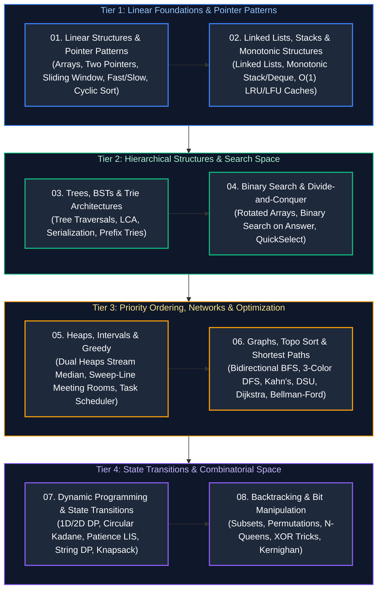

# Data Structures & Algorithms: Study Guide & Master Index

A comprehensive, production-grade guide covering all core Data Structures & Algorithms (DSA), algorithmic patterns, hardware memory mechanics, asymptotic complexity proofs, and practice problems organized across 8 progressive, stacking modules.

---

## Recommended Chronological Study Order

---

## Curriculum Coverage & Module Index

The curriculum index below outlines the 8 core modules of the Data Structures & Algorithms track, detailing the structural mechanics, algorithmic patterns, and canonical interview problems covered in each guide:

| Module Order | Guide File | Core Patterns & Concepts Covered | Canonical Problems Included |
| :---: | :--- | :--- | :--- |
| **01** | [`01_linear_structures_and_pointer_patterns.md`](01_linear_structures_and_pointer_patterns.md) | Arrays, CPU Cache Lines, Convergent Two Pointers, Fast & Slow Pointers, Sliding Window, Monotonic Deque, Cyclic Sort, Prefix Sums, External Sorting | Two Sum II, 3-Sum, Trapping Rain Water, Longest Substring Without Repeating, Longest Substring K-Distinct, First Missing Positive, External Deduplication |
| **02** | [`02_linked_lists_stacks_and_monotonic_structures.md`](02_linked_lists_stacks_and_monotonic_structures.md) | Singly/Doubly Linked Lists, Sentinels, Min-Stack, Monotonic Stack, Monotonic Deque, $O(1)$ LRU & LFU Cache Design | Reverse in k-Groups, Daily Temperatures, Largest Rectangle in Histogram, Sliding Window Maximum, LRU & LFU Caches |
| **03** | [`03_trees_binary_search_trees_and_tries.md`](03_trees_binary_search_trees_and_tries.md) | Binary Trees, BST Invariants, DFS (Inorder/Pre/Post), BFS Level-Order, Zigzag, LCA, Serialization, Prefix Tries | Validate BST, Lowest Common Ancestor, Zigzag Level-Order, Tree Serialization/Deserialization, Word Search II |
| **04** | [`04_binary_search_and_divide_and_conquer.md`](04_binary_search_and_divide_and_conquer.md) | Midpoint Overflow, Boundary Binary Search, Search in Rotated Array, Binary Search on Answer, Merge Sort, QuickSelect | Rotated Sorted Array, Capacity to Ship Packages, Koko Eating Bananas, Median of Two Sorted Arrays, QuickSelect |
| **05** | [`05_heaps_intervals_and_greedy_algorithms.md`](05_heaps_intervals_and_greedy_algorithms.md) | Binary Heaps, $O(N)$ Heapify, Two Heaps, Top-K Frequent (Bucket Sort), Interval Sweep-Line, Greedy Invariants | Continuous Stream Median, Loose Median $O(1)$, Top K Frequent, Merge Intervals, Meeting Rooms II, Jump Game I & II |
| **06** | [`06_graphs_topological_sort_and_shortest_paths.md`](06_graphs_topological_sort_and_shortest_paths.md) | Adjacency List/Matrix, Bidirectional BFS, 3-Color DFS Cycle Detection, Kahn's Topo Sort, DSU with Rank, Dijkstra, Bellman-Ford | Word Ladder, Number of Islands, Course Schedule II, Alien Dictionary, Redundant Connection, Flights Within K Stops |
| **07** | [`07_dynamic_programming_and_state_transitions.md`](07_dynamic_programming_and_state_transitions.md) | Memoization vs Tabulation, State Space Compression, Kadane & Circular Kadane, Patience LIS, String DP, 0/1 & Unbounded Knapsack | Maximum Circular Subarray, Longest Increasing Subsequence, LCS, Edit Distance, Word Break, Coin Change I & II |
| **08** | [`08_backtracking_and_bit_manipulation.md`](08_backtracking_and_bit_manipulation.md) | Backtracking Pruning, Combinatorial Search (Subsets, Permutations), N-Queens, XOR Cancellation, Kernighan Bit Trick | Subsets II, Permutations II, Combination Sum, N-Queens, Single Number I/II/III, Counting Bits, Bitmask Subsets |

---

## Pattern-to-Problem Master Cross-Reference Matrix

The matrix below cross-references canonical algorithmic patterns and hardware memory techniques to their specific implementations across the DSA modules:

| Problem / Production Scenario | Primary Algorithmic Pattern | Module Reference |
| :--- | :--- | :--- |
| **$O(1)$ Memory Cache Eviction** | Doubly-Linked List + HashMap Pointer Index | [`02_linked_lists_stacks_and_monotonic_structures.md`](02_linked_lists_stacks_and_monotonic_structures.md#51-least-recently-used-lru-cache-implementation) |
| **Continuous Unbounded Stream Median** | Dual Heaps (Max-Heap Lower + Min-Heap Upper) | [`05_heaps_intervals_and_greedy_algorithms.md`](05_heaps_intervals_and_greedy_algorithms.md#21-find-median-from-data-stream-leetcode-295) |
| **Loose Median in $O(1)$ Space** | Stochastic Reservoir Approximator | [`05_heaps_intervals_and_greedy_algorithms.md`](05_heaps_intervals_and_greedy_algorithms.md#22-loose-median-in-constant-o1-time--space) |
| **Exponential Graph Search Space** | Bidirectional BFS Expanding Alternating Frontiers | [`06_graphs_topological_sort_and_shortest_paths.md`](06_graphs_topological_sort_and_shortest_paths.md#22-bidirectional-bfs-word-ladder-leetcode-127) |
| **Cycle Detection in Directed Graphs** | 3-Color DFS (White, Gray, Black) | [`06_graphs_topological_sort_and_shortest_paths.md`](06_graphs_topological_sort_and_shortest_paths.md#31-3-color-dfs-cycle-detection-directed-graphs) |
| **Dynamic Lexicographical Ordering** | Topological Sort (Kahn's BFS In-Degree) | [`06_graphs_topological_sort_and_shortest_paths.md`](06_graphs_topological_sort_and_shortest_paths.md#42-alien-dictionary-leetcode-269) |
| **Bounded Capacity Resource Sizing** | Binary Search on Answer / Monotonic Feasibility | [`04_binary_search_and_divide_and_conquer.md`](04_binary_search_and_divide_and_conquer.md#22-capacity-to-ship-packages-within-d-days-leetcode-1011) |
| **Unbounded Window Boundary Extrema** | Monotonic Deque Sliding Window | [`01_linear_structures_and_pointer_patterns.md`](01_linear_structures_and_pointer_patterns.md#43-monotonic-deque-window-longest-subarray-with-max-min-limit) |
| **Circular Maximum Subarray Sum** | Dual Kadane: $\max(\text{maxKadane}, \text{total} - \text{minKadane})$ | [`07_dynamic_programming_and_state_transitions.md`](07_dynamic_programming_and_state_transitions.md#22-maximum-sum-circular-subarray-leetcode-918) |
| **Fast Subsequence Search ($O(N \log N)$)**| Patience Sorting with Binary Search | [`07_dynamic_programming_and_state_transitions.md`](07_dynamic_programming_and_state_transitions.md#31-longest-increasing-subsequence-on2-to-on-log-n) |
| **Prefix Matching & Autocomplete** | Multi-Way Prefix Trie | [`03_trees_binary_search_trees_and_tries.md`](03_trees_binary_search_trees_and_tries.md#41-core-trie-implementation-leetcode-208) |
| **$O(1)$ Single Bit Counter Operations** | Brian Kernighan's Algorithm (`n & (n - 1)`) | [`08_backtracking_and_bit_manipulation.md`](08_backtracking_and_bit_manipulation.md#43-brian-kernighans-algorithm-n--n---1) |

---

## References & Further Reading
- Thomas H. Cormen, Charles E. Leiserson, Ronald L. Rivest, Clifford Stein, *Introduction to Algorithms (CLRS)*, 4th Edition (MIT Press).
- Robert Sedgewick & Kevin Wayne, *Algorithms*, 4th Edition (Addison-Wesley).
- Jon Bentley, *Programming Pearls*, 2nd Edition (Addison-Wesley).

