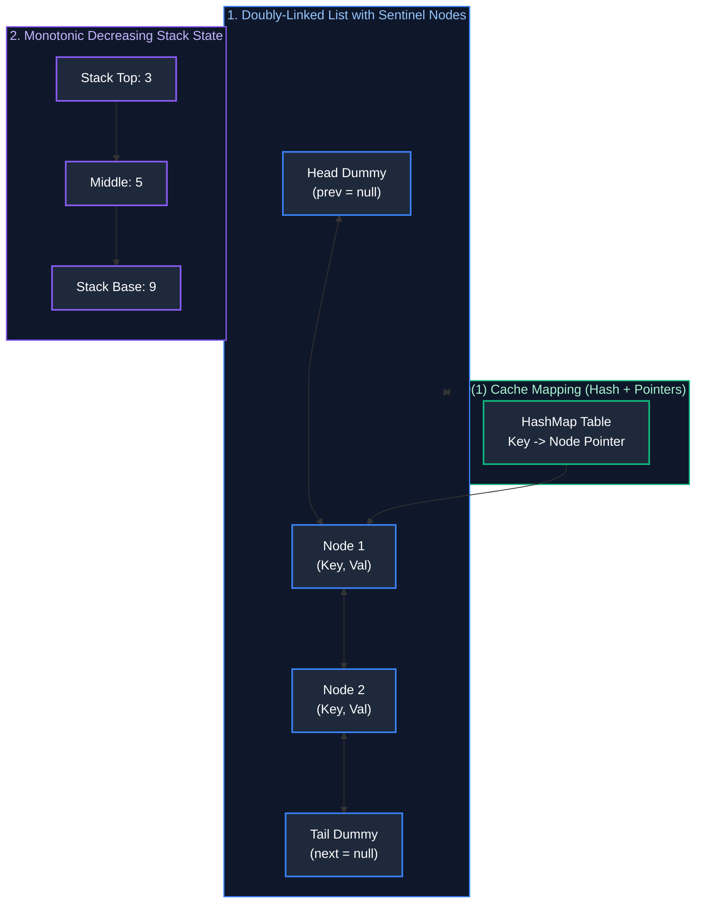

# 02. Linked Lists, Stacks & Monotonic Structures

A comprehensive, production-grade guide to Singly and Doubly Linked Lists, Stacks, Queues, Monotonic Stacks, Monotonic Deques, and $O(1)$ Invariant Cache Architectures (LRU & LFU).

---

## Architectural Overview: Pointer Manipulation & LIFO/FIFO Mechanics



---

## Table of Contents
1. [Linked List Fundamentals & Pointer Manipulation](#1-linked-list-fundamentals--pointer-manipulation)
   - 1.1 [In-Place Reversal of Singly Linked List](#11-in-place-reversal-of-singly-linked-list)
   - 1.2 [Reverse Nodes in k-Group (LeetCode 25)](#12-reverse-nodes-in-k-group-leetcode-25)
   - 1.3 [Merge K Sorted Lists (LeetCode 23)](#13-merge-k-sorted-lists-leetcode-23)
2. [Stack & Queue Primitives](#2-stack--queue-primitives)
   - 2.1 [Min-Stack (O(1) Extra State Space)](#21-min-stack-o1-extra-state-space)
3. [The Monotonic Stack Pattern](#3-the-monotonic-stack-pattern)
   - 3.1 [Next Greater Element](#31-next-greater-element)
   - 3.2 [Largest Rectangle in Histogram (LeetCode 84)](#32-largest-rectangle-in-histogram-leetcode-84)
4. [The Monotonic Deque Pattern](#4-the-monotonic-deque-pattern)
   - 4.1 [Sliding Window Maximum (LeetCode 239)](#41-sliding-window-maximum-leetcode-239)
5. [Production Cache Systems Design (O(1) Invariant)](#5-production-cache-systems-design-o1-invariant)
   - 5.1 [Least Recently Used (LRU) Cache Implementation](#51-least-recently-used-lru-cache-implementation)
   - 5.2 [Least Frequently Used (LFU) Cache Implementation](#52-least-frequently-used-lfu-cache-implementation)
6. [Practice Problems by Difficulty Tier](#6-practice-problems-by-difficulty-tier)
7. [Summary & Engineering Reference Matrix](#7-summary--engineering-reference-matrix)
8. [References & Further Reading](#8-references--further-reading)

---

# 1. Linked List Fundamentals & Pointer Manipulation

Linked lists represent non-contiguous linear structures where each node encapsulates a data payload and one or more references (`next`, `prev`) pointing to neighboring nodes in memory. Unlike contiguous arrays, linked lists allow $O(1)$ insertions and deletions at known pointer locations without memory shifting, but sacrifice direct indexing ($O(N)$ random access) and trigger CPU cache misses due to pointer dereferencing across heap memory.

### 1.1 In-Place Reversal of Singly Linked List

#### Pointer Invariants & State Transitions
Iteratively reversing a singly linked list requires orchestrating three pointers:
- `prev`: Tracks the head of the already-reversed sublist (initialized to `null`).
- `curr`: The active node undergoing redirection (initialized to `head`).
- `nextTemp`: Temporarily holds the reference to `curr.next` to prevent severing the unvisited remainder of the list.

At each step, we save `curr.next`, redirect `curr.next = prev`, shift `prev = curr`, and advance `curr = nextTemp`. Upon termination (`curr == null`), `prev` points to the new head of the reversed list.

```java
public class LinkedListAlgorithms {

    public static class ListNode {
        public int val;
        public ListNode next;
        public ListNode(int val) { this.val = val; }
        public ListNode(int val, ListNode next) { this.val = val; this.next = next; }
    }

    // LeetCode 206: Reverse Linked List - Time: O(N), Space: O(1)
    public ListNode reverseList(ListNode head) {
        ListNode prev = null;
        ListNode curr = head;

        while (curr != null) {
            ListNode nextTemp = curr.next; // Stash reference to next node
            curr.next = prev;             // Reverse pointer direction
            prev = curr;                  // Advance prev to current
            curr = nextTemp;              // Advance curr to next
        }
        return prev; // prev is now the new head of the reversed list
    }
}
```

---

### 1.2 Reverse Nodes in k-Group (LeetCode 25)

#### Algorithmic Invariants
When reversing in groups of size $k$:
1. Check whether at least $k$ nodes exist ahead of the current group head. If fewer than $k$ nodes remain, the group must remain unchanged.
2. If $k$ nodes are present, recursively process the remainder of the list to obtain the head of the reversed downstream sublist (`reversedHead`).
3. Reverse the current $k$ nodes, linking each node to the emerging `reversedHead`.

```java
// LeetCode 25: Reverse Nodes in k-Group - Time: O(N), Space: O(N/k) recursion stack
public ListNode reverseKGroup(ListNode head, int k) {
    ListNode curr = head;
    int count = 0;

    // Verify whether k nodes exist in this segment
    while (curr != null && count < k) {
        curr = curr.next;
        count++;
    }

    // If k nodes exist, reverse this segment and stitch to downstream recursive result
    if (count == k) {
        ListNode reversedHead = reverseKGroup(curr, k);
        while (count-- > 0) {
            ListNode nextTemp = head.next;
            head.next = reversedHead;
            reversedHead = head;
            head = nextTemp;
        }
        head = reversedHead;
    }
    return head;
}
```

---

### 1.3 Merge K Sorted Lists (LeetCode 23)

#### Min-Heap Priority Queue Architecture
Merging $K$ sorted linked lists containing a total of $N$ nodes naively requires $O(K \cdot N)$ comparisons. By maintaining a **Min-Heap (Priority Queue)** containing at most $K$ elements (one per active list head):
1. Insert the head node of each non-empty list into the min-heap.
2. Continuously poll the smallest element from the heap, append it to the merged output list, and insert its `next` node (if non-null) into the heap.
3. Every heap operation takes $O(\log K)$, producing an optimal total time complexity of **$O(N \log K)$** and **$O(K)$ space**.

```java
import java.util.PriorityQueue;

// LeetCode 23: Merge k Sorted Lists - Time: O(N log K), Space: O(K)
public ListNode mergeKLists(ListNode[] lists) {
    if (lists == null || lists.length == 0) return null;

    // Min-Heap ordered by node value
    PriorityQueue<ListNode> minHeap = new PriorityQueue<>(
        lists.length, 
        (a, b) -> Integer.compare(a.val, b.val)
    );

    for (ListNode listHead : lists) {
        if (listHead != null) {
            minHeap.offer(listHead);
        }
    }

    ListNode dummy = new ListNode(0);
    ListNode tail = dummy;

    while (!minHeap.isEmpty()) {
        ListNode smallestNode = minHeap.poll();
        tail.next = smallestNode;
        tail = tail.next;

        if (smallestNode.next != null) {
            minHeap.offer(smallestNode.next);
        }
    }

    return dummy.next;
}
```

---

# 2. Stack & Queue Primitives

Stacks enforce Last-In, First-Out (LIFO) semantics, while Queues enforce First-In, First-Out (FIFO) semantics. In systems programming, stacks govern call stacks, expression evaluation, syntax parsing, and depth-first searches, while queues govern task scheduling, rate limiting, and breadth-first search pipelines.

### 2.1 Min-Stack (O(1) Extra State Space)

#### The Difference Encoding Technique
A standard `MinStack` uses two parallel stacks: one for values and one for running minimums ($O(N)$ auxiliary space). By storing the **difference** between the pushed value and the running minimum ($\text{diff} = \text{val} - \text{minVal}$):
- If $\text{val} < \text{minVal}$, the pushed difference is negative ($\text{diff} < 0$). This negative marker flags that the minimum was updated at this step.
- When popping, if the popped difference is negative, the previous minimum is restored via: $\text{minVal}_{\text{prev}} = \text{minVal} - \text{diff}$.
- To eliminate integer overflow when subtracting extreme 32-bit values, all differences are stored as 64-bit `long` integers.

```java
import java.util.ArrayDeque;
import java.util.Deque;

public class MinStack {
    private final Deque<Long> stack = new ArrayDeque<>();
    private long minVal;

    public void push(int val) {
        if (stack.isEmpty()) {
            stack.push(0L);
            minVal = val;
        } else {
            stack.push((long) val - minVal);
            if (val < minVal) {
                minVal = val; // New minimum established
            }
        }
    }

    public void pop() {
        if (stack.isEmpty()) return;
        long diff = stack.pop();
        if (diff < 0) {
            minVal = minVal - diff; // Restore previous minimum on underflow marker
        }
    }

    public int top() {
        long diff = stack.peek();
        return diff < 0 ? (int) minVal : (int) (minVal + diff);
    }

    public int getMin() {
        return (int) minVal;
    }
}
```

---

# 3. The Monotonic Stack Pattern

The Monotonic Stack pattern solves problems requiring the identification of the **Next Greater Element**, **Previous Greater Element**, or **Boundary Extrema** in linear time. By maintaining elements in strictly increasing or decreasing order inside the stack, we prune dominated candidates and avoid $O(N^2)$ nested loops.

### 3.1 Next Greater Element

#### Monotonic Decreasing Stack Mechanics
To find the next greater element for each index in an array:
- Maintain a stack storing indices in **monotonically decreasing** value order.
- When an incoming element `nums[i]` is strictly greater than the element at `nums[stack.peek()]`, `nums[i]` is conclusively the next greater element for `stack.peek()`.
- We pop the index, record `result[popped] = nums[i]`, and repeat until the monotonic invariant is restored.
- **Complexity:** Every index is pushed exactly once and popped at most once, guaranteeing **$O(N)$ amortized time**.

```java
import java.util.ArrayDeque;
import java.util.Arrays;
import java.util.Deque;

public int[] nextGreaterElement(int[] nums) {
    if (nums == null) return new int[0];
    int[] result = new int[nums.length];
    Arrays.fill(result, -1);
    Deque<Integer> stack = new ArrayDeque<>(); // Stores indices

    for (int i = 0; i < nums.length; i++) {
        while (!stack.isEmpty() && nums[i] > nums[stack.peek()]) {
            int prevIdx = stack.pop();
            result[prevIdx] = nums[i]; // nums[i] is the first element greater to the right
        }
        stack.push(i);
    }
    return result;
}
```

---

### 3.2 Largest Rectangle in Histogram (LeetCode 84)

#### Monotonic Increasing Stack & Width Derivation
In a histogram where each bar has width 1 and height `heights[i]`, any bar $i$ can extend horizontally as a rectangle as long as adjacent bars have height $\ge \text{heights}[i]$.

By maintaining a **monotonic increasing stack** of indices:
1. When an incoming bar `heights[i]` is strictly shorter than `heights[stack.peek()]`, the bar at `stack.peek()` can no longer expand rightward.
2. We pop the height $h = \text{heights}[\text{stack.pop()}]$.
3. The right boundary is the current index $i$, and the left boundary is the new stack top (`stack.peek()`).
4. The maximal width for height $h$ is:
   $$\text{Width} = \text{stack.isEmpty}() \ ? \ i : (i - \text{stack.peek}() - 1)$$
5. The candidate rectangular area is $\text{Area} = h \times \text{Width}$.

```java
import java.util.ArrayDeque;
import java.util.Deque;

// LeetCode 84: Largest Rectangle in Histogram - Time: O(N), Space: O(N)
public int largestRectangleArea(int[] heights) {
    if (heights == null || heights.length == 0) return 0;
    Deque<Integer> stack = new ArrayDeque<>();
    int maxArea = 0;
    int n = heights.length;

    for (int i = 0; i <= n; i++) {
        // Use a dummy sentinel height of 0 at index n to flush all remaining bars
        int currentHeight = (i == n) ? 0 : heights[i];

        while (!stack.isEmpty() && currentHeight < heights[stack.peek()]) {
            int h = heights[stack.pop()];
            int w = stack.isEmpty() ? i : (i - stack.peek() - 1);
            maxArea = Math.max(maxArea, h * w);
        }
        stack.push(i);
    }
    return maxArea;
}
```

---

# 4. The Monotonic Deque Pattern

When tracking extrema across a sliding window of length $K$, heaps require $O(\log K)$ per update and cannot efficiently evict expired elements outside the window. A **Monotonic Deque (Double-Ended Queue)** provides an amortized $O(1)$ solution by maintaining strictly ordered candidates.

### 4.1 Sliding Window Maximum (LeetCode 239)

#### Invariants & Operations
To find the maximum in each sliding window of size $K$:
1. Maintain a deque of indices such that `nums[deque.peekFirst()]` is always the window maximum.
2. **Evict Expired Elements:** If the front index is outside the active window (`deque.peekFirst() <= i - k`), remove it from the head (`pollFirst()`).
3. **Preserve Monotonic Decreasing Order:** While the deque is not empty and the incoming element `nums[i]` is strictly greater than `nums[deque.peekLast()]`, pop from the tail (`pollLast()`). Elements smaller than the incoming element can never be the maximum in any current or future window where `nums[i]` is present.
4. **Append & Record:** Add `i` to the tail. When $i \ge K - 1$, record `nums[deque.peekFirst()]`.

```java
import java.util.ArrayDeque;
import java.util.Deque;

// LeetCode 239: Sliding Window Maximum - Time: O(N), Space: O(K)
public int[] maxSlidingWindow(int[] nums, int k) {
    if (nums == null || nums.length == 0 || k <= 0) return new int[0];
    int n = nums.length;
    int[] result = new int[n - k + 1];
    Deque<Integer> deque = new ArrayDeque<>(); // Stores indices in decreasing order of value

    for (int i = 0; i < n; i++) {
        // 1. Evict elements outside active sliding window [i - k + 1, i]
        if (!deque.isEmpty() && deque.peekFirst() < i - k + 1) {
            deque.pollFirst();
        }

        // 2. Remove elements from tail that are strictly smaller than nums[i]
        while (!deque.isEmpty() && nums[deque.peekLast()] < nums[i]) {
            deque.pollLast();
        }

        // 3. Add current index to tail
        deque.offerLast(i);

        // 4. Record current window maximum once window reaches size k
        if (i >= k - 1) {
            result[i - k + 1] = nums[deque.peekFirst()];
        }
    }
    return result;
}
```

---

# 5. Production Cache Systems Design (O(1) Invariant)

In memory-constrained distributed caching systems, cache eviction algorithms decide which entries to purge when capacity limits are breached. The two most critical policies are **LRU (Least Recently Used)** and **LFU (Least Frequently Used)**.

### 5.1 Least Recently Used (LRU) Cache Implementation

#### Core Architectural Invariants
1. **Doubly-Linked List with Sentinels:** Pseudo-nodes `head` and `tail` eliminate null-pointer boundary checks during node splicing. The most recently accessed node resides at `head.next`, while the least recently accessed node resides at `tail.prev`.
2. **Hash Table Lookup:** Maps each key to its corresponding doubly-linked list node pointer, enabling $O(1)$ node location.
3. **Eviction:** When capacity is exceeded, `tail.prev` is unlinked from the list and excised from the hash map in $O(1)$ time.

```java
import java.util.HashMap;
import java.util.Map;

// LeetCode 146: LRU Cache - Time: O(1) all operations, Space: O(Capacity)
public class LRUCache {
    private static class Node {
        int key;
        int value;
        Node prev;
        Node next;
        Node(int key, int value) { this.key = key; this.value = value; }
    }

    private final int capacity;
    private final Map<Integer, Node> map;
    private final Node head;
    private final Node tail;

    public LRUCache(int capacity) {
        this.capacity = capacity;
        this.map = new HashMap<>(capacity);
        this.head = new Node(0, 0); // Sentinel head
        this.tail = new Node(0, 0); // Sentinel tail
        head.next = tail;
        tail.prev = head;
    }

    public synchronized int get(int key) {
        Node node = map.get(key);
        if (node == null) return -1;
        moveToHead(node);
        return node.value;
    }

    public synchronized void put(int key, int value) {
        Node node = map.get(key);
        if (node != null) {
            node.value = value;
            moveToHead(node);
        } else {
            if (map.size() >= capacity) {
                Node lru = tail.prev;
                removeNode(lru);
                map.remove(lru.key);
            }
            Node newNode = new Node(key, value);
            map.put(key, newNode);
            addNode(newNode);
        }
    }

    private void addNode(Node node) {
        node.next = head.next;
        node.prev = head;
        head.next.prev = node;
        head.next = node;
    }

    private void removeNode(Node node) {
        node.prev.next = node.next;
        node.next.prev = node.prev;
    }

    private void moveToHead(Node node) {
        removeNode(node);
        addNode(node);
    }
}
```

---

### 5.2 Least Frequently Used (LFU) Cache Implementation

#### Core Architectural Invariants
LFU evicts the entry with the lowest access count. If multiple entries share the lowest access count, LRU tie-breaking purges the oldest among them.
1. `keyToVal`: Maps key to value.
2. `keyToFreq`: Maps key to its access count.
3. `freqToKeys`: Maps access count to a `LinkedHashSet` maintaining insertion/access order of keys with that frequency.
4. `minFreq`: Running integer tracking the lowest active frequency bucket, allowing $O(1)$ eviction lookup.

```java
import java.util.*;

// LeetCode 460: LFU Cache - Time: O(1) all operations, Space: O(Capacity)
public class LFUCache {
    private final int capacity;
    private int minFreq = 0;
    private final Map<Integer, Integer> keyToVal = new HashMap<>();
    private final Map<Integer, Integer> keyToFreq = new HashMap<>();
    private final Map<Integer, LinkedHashSet<Integer>> freqToKeys = new HashMap<>();

    public LFUCache(int capacity) {
        this.capacity = capacity;
    }

    public synchronized int get(int key) {
        if (!keyToVal.containsKey(key)) return -1;
        incrementFreq(key);
        return keyToVal.get(key);
    }

    public synchronized void put(int key, int value) {
        if (capacity <= 0) return;

        if (keyToVal.containsKey(key)) {
            keyToVal.put(key, value);
            incrementFreq(key);
            return;
        }

        if (keyToVal.size() >= capacity) {
            // Evict oldest key from minFreq bucket
            int evictKey = freqToKeys.get(minFreq).iterator().next();
            freqToKeys.get(minFreq).remove(evictKey);
            keyToVal.remove(evictKey);
            keyToFreq.remove(evictKey);
        }

        keyToVal.put(key, value);
        keyToFreq.put(key, 1);
        freqToKeys.computeIfAbsent(1, k -> new LinkedHashSet<>()).add(key);
        minFreq = 1; // Newly inserted item starts with frequency 1
    }

    private void incrementFreq(int key) {
        int freq = keyToFreq.get(key);
        keyToFreq.put(key, freq + 1);
        freqToKeys.get(freq).remove(key);

        if (freqToKeys.get(freq).isEmpty()) {
            freqToKeys.remove(freq);
            if (minFreq == freq) minFreq++;
        }
        freqToKeys.computeIfAbsent(freq + 1, k -> new LinkedHashSet<>()).add(key);
    }
}
```

---

# 6. Practice Problems by Difficulty Tier

The table below catalogs essential interview problems spanning linked lists, stacks, queues, and monotonic structures. When analyzing problems in an interview setting:
1. **Pointer Rewiring & Cycle Detection:** Use sentinel dummy heads (`dummy.next = head`) to avoid branching logic on empty lists or head updates.
2. **Finding Next / Previous Greater Elements:** Use a Monotonic Stack to avoid quadratic scans ($O(N)$ vs $O(N^2)$).
3. **Sliding Window Extrema:** Deploy a Monotonic Deque to achieve $O(1)$ lookups instead of $O(\log K)$ heap operations.
4. **Cache Eviction Mechanics:** Pair Doubly-Linked Lists with HashMaps to ensure all retrieval, modification, and eviction steps execute in strict $O(1)$ time.

| Difficulty | Problem Name | Core Pattern | LeetCode Link | Complexity |
| :---: | :--- | :--- | :---: | :---: |
| **Easy** | Reverse Linked List | Iterative 3-Pointer Reversal | LC 206 | $O(N) \text{ time}, O(1) \text{ space}$ |
| **Easy** | Valid Parentheses | LIFO Stack Bracket Matching | LC 20 | $O(N) \text{ time}, O(N) \text{ space}$ |
| **Medium** | Reverse Nodes in k-Group | Recursive Sublist Reversal | LC 25 | $O(N) \text{ time}, O(1) \text{ space}$ |
| **Medium** | Daily Temperatures | Monotonic Decreasing Stack | LC 739 | $O(N) \text{ time}, O(N) \text{ space}$ |
| **Medium** | LRU Cache | Doubly-Linked List + HashMap | LC 146 | $O(1) \text{ all operations}$ |
| **Hard** | Sliding Window Maximum | Monotonic Deque | LC 239 | $O(N) \text{ time}, O(K) \text{ space}$ |
| **Hard** | Largest Rectangle in Histogram | Monotonic Stack Area Calculation | LC 84 | $O(N) \text{ time}, O(N) \text{ space}$ |
| **Hard** | LFU Cache | Frequency Buckets + LinkedHashSet | LC 460 | $O(1) \text{ all operations}$ |

---

# 7. Summary & Engineering Reference Matrix

Linked lists and monotonic structures provide specialized memory and traversal guarantees that complement contiguous arrays. While linked lists trade hardware cache locality for $O(1)$ in-place splicing without memory copies, monotonic stacks and deques prune dominated solution paths to guarantee linear-time performance for boundary search and running extrema.

The reference matrix below summarizes the operational mechanisms, complexity guarantees, and key engineering trade-offs across these structures:

| Data Structure / Pattern | Key Mechanics | Invariant Maintained | Amortized Time | Space Complexity |
| :--- | :--- | :--- | :--- | :--- |
| **Singly-Linked List** | Unidirectional pointers | `head` to `tail` traversal | $O(1)$ push/pop head; $O(N)$ random access | $O(N)$ |
| **Doubly-Linked List** | Sentinel `head`/`tail` nodes | $O(1)$ node splicing given pointer | $O(1)$ insert/delete node | $O(N)$ |
| **Monotonic Stack** | Pop smaller/larger on insert | Strictly monotonic values in stack | $O(N)$ total (each item pushed/popped once) | $O(N)$ |
| **Monotonic Deque** | Double-ended monotonic queue | First element is always window optimum | $O(N)$ total | $O(K)$ |
| **LRU Cache** | Doubly-linked list + HashMap | Recency of access ordered head-to-tail | $O(1)$ get & put | $O(\text{Capacity})$ |
| **LFU Cache** | Frequency buckets + LRU sublists | Evict min frequency, tie-break by recency | $O(1)$ get & put | $O(\text{Capacity})$ |

---

# 8. References & Further Reading
- Cormen, Leiserson, Rivest, Stein, *Introduction to Algorithms (CLRS)* (MIT Press).
- Robert Sedgewick & Kevin Wayne, *Algorithms* (Addison-Wesley).
- Brian Goetz, *Java Concurrency in Practice* (Cache Synchronization).
