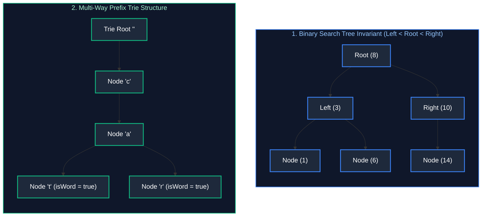

# 03. Trees, Binary Search Trees & Trie Architectures

A comprehensive, production-grade guide to Binary Trees, Binary Search Trees (BST), Lowest Common Ancestor (LCA), Tree Serialization/Deserialization, and Trie (Prefix Tree) Architectures.

---

## Architectural Overview: Hierarchical Pointers & Trie Prefixes



---

## Table of Contents
1. [Binary Tree Traversals (Recursive vs. Iterative)](#1-binary-tree-traversals-recursive-vs-iterative)
   - 1.1 [DFS Traversals (Inorder, Preorder, Postorder)](#11-dfs-traversals-inorder-preorder-postorder)
   - 1.2 [BFS & Zigzag Level-Order Traversal (LeetCode 103)](#12-bfs--zigzag-level-order-traversal-leetcode-103)
2. [Binary Search Tree (BST) Mechanics & Invariants](#2-binary-search-tree-bst-mechanics--invariants)
   - 2.1 [Validate Binary Search Tree (LeetCode 98)](#21-validate-binary-search-tree-leetcode-98)
   - 2.2 [Lowest Common Ancestor (LCA)](#22-lowest-common-ancestor-lca)
3. [Tree Serialization & Deserialization (LeetCode 297)](#3-tree-serialization--deserialization-leetcode-297)
4. [Trie (Prefix Tree) Architectures](#4-trie-prefix-tree-architectures)
   - 4.1 [Core Trie Implementation (LeetCode 208)](#41-core-trie-implementation-leetcode-208)
   - 4.2 [Word Search II (Trie + 2D Backtracking) (LeetCode 212)](#42-word-search-ii-trie--2d-backtracking-leetcode-212)
5. [Practice Problems by Difficulty Tier](#5-practice-problems-by-difficulty-tier)
6. [Summary & Engineering Reference Matrix](#6-summary--engineering-reference-matrix)
7. [References & Further Reading](#7-references--further-reading)

---

# 1. Binary Tree Traversals (Recursive vs. Iterative)

Trees are non-linear, hierarchical data structures composed of nodes linked by directed edges, with a single designated root and no cycles. Traversing a tree requires visiting every node systematically. Traversal orders are classified into Depth-First Search (DFS) and Breadth-First Search (BFS).

### 1.1 DFS Traversals (Inorder, Preorder, Postorder)

#### Traversal Order Definitions & Applications
1. **Preorder (Root $\to$ Left $\to$ Right):** Processes parent nodes before children. Used for cloning trees, generating serialization strings, and directory structure listings.
2. **Inorder (Left $\to$ Root $\to$ Right):** For Binary Search Trees, inorder traversal produces values in strictly sorted ascending order.
3. **Postorder (Left $\to$ Right $\to$ Root):** Processes children before the parent. Used for bottom-up property aggregation (e.g., calculating tree height, maximum path sum, deleting nodes, and directory disk usage calculation).

#### Complexity & Call Stack Mechanics
Every recursive DFS traversal executes in $O(N)$ time, visiting each node once. However, recursion implicitly consumes memory on the execution call stack proportional to tree height $H$:
- **Balanced Tree:** $H = O(\log N)$ stack frames.
- **Degenerate (Skewed) Tree:** $H = O(N)$ stack frames. In production systems with millions of nodes, deep skewed trees trigger fatal JVM `StackOverflowError` exceptions.

#### Iterative Inorder Traversal (Explicit Stack)
To eliminate recursion risk, we maintain an explicit heap-allocated stack `Deque<TreeNode>`:
1. Traverse leftwards from `curr`, pushing all ancestor nodes onto the stack until reaching `null`.
2. Pop the stack top, process its value, and transition to `curr = popped.right`.
3. Repeat while `curr != null` or the stack is non-empty.

```java
import java.util.*;

public class TreeTraversals {
    public static class TreeNode {
        public int val;
        public TreeNode left;
        public TreeNode right;
        public TreeNode(int val) { this.val = val; }
        public TreeNode(int val, TreeNode left, TreeNode right) {
            this.val = val;
            this.left = left;
            this.right = right;
        }
    }

    // Iterative Inorder Traversal - Time: O(N), Space: O(H)
    public List<Integer> inorderTraversalIterative(TreeNode root) {
        List<Integer> result = new ArrayList<>();
        Deque<TreeNode> stack = new ArrayDeque<>();
        TreeNode curr = root;

        while (curr != null || !stack.isEmpty()) {
            while (curr != null) {
                stack.push(curr); // Push left ancestry chain
                curr = curr.left;
            }
            curr = stack.pop();    // Pop deepest unvisited node
            result.add(curr.val);  // Process root
            curr = curr.right;     // Shift exploration to right subtree
        }
        return result;
    }

    // Iterative Preorder Traversal - Time: O(N), Space: O(H)
    public List<Integer> preorderTraversalIterative(TreeNode root) {
        List<Integer> result = new ArrayList<>();
        if (root == null) return result;

        Deque<TreeNode> stack = new ArrayDeque<>();
        stack.push(root);

        while (!stack.isEmpty()) {
            TreeNode node = stack.pop();
            result.add(node.val);

            // Push right child first so left child is popped and processed first (LIFO)
            if (node.right != null) stack.push(node.right);
            if (node.left != null) stack.push(node.left);
        }
        return result;
    }
}
```

---

### 1.2 BFS & Zigzag Level-Order Traversal (LeetCode 103)

#### Level-By-Level Queue Invariant
Breadth-First Search traverses a tree level by level using a FIFO queue. At the beginning of each level iteration, snapshot the queue size: `int levelSize = queue.size()`. This boundary snapshot ensures that the inner loop dequeues strictly the nodes belonging to the current horizontal level, while enqueuing their children for the next level.

#### Zigzag Traversal Mechanics
In Zigzag Level-Order Traversal (LeetCode 103), the direction of node values alternates between left-to-right and right-to-left. By toggling a boolean flag `leftToRight` per level and using a `LinkedList<Integer>` as a double-ended deque, values are appended to the tail (`addLast`) or prepended to the head (`addFirst`) in $O(1)$ time.

```java
// LeetCode 103: Binary Tree Zigzag Level Order Traversal - Time: O(N), Space: O(W) where W <= N/2
public List<List<Integer>> zigzagLevelOrder(TreeNode root) {
    List<List<Integer>> result = new ArrayList<>();
    if (root == null) return result;

    Queue<TreeNode> queue = new ArrayDeque<>();
    queue.offer(root);
    boolean leftToRight = true;

    while (!queue.isEmpty()) {
        int levelSize = queue.size();
        LinkedList<Integer> currentLevel = new LinkedList<>();

        for (int i = 0; i < levelSize; i++) {
            TreeNode node = queue.poll();
            if (leftToRight) {
                currentLevel.addLast(node.val);
            } else {
                currentLevel.addFirst(node.val);
            }

            if (node.left != null) queue.offer(node.left);
            if (node.right != null) queue.offer(node.right);
        }
        result.add(currentLevel);
        leftToRight = !leftToRight; // Invert direction for downstream level
    }
    return result;
}
```

---

# 2. Binary Search Tree (BST) Mechanics & Invariants

A Binary Search Tree enforces a fundamental ordering property across every node in the hierarchy:
$$\forall x \in \text{LeftSubtree}(N), \quad x.\text{val} < N.\text{val}$$
$$\forall y \in \text{RightSubtree}(N), \quad y.\text{val} > N.\text{val}$$

When balanced (e.g., Red-Black Tree, AVL Tree), search, insertion, and deletion operate in $O(\log N)$ time.

### 2.1 Validate Binary Search Tree (LeetCode 98)

#### The Local Trap vs. Global Bound Propagation
A common pitfall is checking only local conditions (`node.left.val < node.val < node.right.val`). This passes trees where a deep node violates an ancestor's invariant (e.g., a node in the right subtree having a value smaller than the root).

To rigorously validate a BST, we propagate allowable interval bounds `(lower, upper)` down the recursive call stack:
- When recursing into the left child: $\text{upper} = \text{node.val}$, while `lower` remains unchanged.
- When recursing into the right child: $\text{lower} = \text{node.val}$, while `upper` remains unchanged.
- To prevent integer overflow bugs when node values match `Integer.MIN_VALUE` or `Integer.MAX_VALUE`, boundaries must use nullable `Long` or `Integer` objects rather than primitive limits.

```java
// LeetCode 98: Validate Binary Search Tree - Time: O(N), Space: O(H)
public boolean isValidBST(TreeNode root) {
    return validate(root, null, null);
}

private boolean validate(TreeNode node, Integer lower, Integer upper) {
    if (node == null) return true;

    // Check bounds violation
    if (lower != null && node.val <= lower) return false;
    if (upper != null && node.val >= upper) return false;

    // Propagate updated bounds to subtrees
    return validate(node.left, lower, node.val) && 
           validate(node.right, node.val, upper);
}
```

---

### 2.2 Lowest Common Ancestor (LCA)

The Lowest Common Ancestor of two nodes $p$ and $q$ is the deepest node in $T$ that has both $p$ and $q$ as descendants (where a node can be a descendant of itself).

#### 1. In a Binary Search Tree (LeetCode 235)
Exploiting the BST ordering invariant allows locating the LCA iteratively in $O(H)$ time and $O(1)$ auxiliary space:
- If both $p$ and $q$ have values smaller than `root.val`, the LCA must reside in the left subtree.
- If both $p$ and $q$ have values greater than `root.val`, the LCA must reside in the right subtree.
- If $p$ and $q$ diverge (one is on the left and one on the right, or one matches `root`), then `root` is the split point and therefore the unique LCA.

```java
// LeetCode 235: Lowest Common Ancestor in a BST - Time: O(H), Space: O(1)
public TreeNode lowestCommonAncestorBST(TreeNode root, TreeNode p, TreeNode q) {
    TreeNode curr = root;
    while (curr != null) {
        if (p.val < curr.val && q.val < curr.val) {
            curr = curr.left;
        } else if (p.val > curr.val && q.val > curr.val) {
            curr = curr.right;
        } else {
            return curr; // Split point identified
        }
    }
    return null;
}
```

#### 2. In an Arbitrary Binary Tree (LeetCode 236)
Without ordering guarantees, we execute a postorder bottom-up search:
- If `root` matches `null`, `p`, or `q`, return `root`.
- Recurse on `root.left` and `root.right`.
- If both recursive calls return non-null, `p` and `q` were found in separate subtrees; `root` is their LCA.
- If only one call returns non-null, pass that non-null node upwards.

```java
// LeetCode 236: Lowest Common Ancestor in Binary Tree - Time: O(N), Space: O(H)
public TreeNode lowestCommonAncestor(TreeNode root, TreeNode p, TreeNode q) {
    if (root == null || root == p || root == q) return root;

    TreeNode left = lowestCommonAncestor(root.left, p, q);
    TreeNode right = lowestCommonAncestor(root.right, p, q);

    if (left != null && right != null) return root; // p and q found in opposite subtrees
    return left != null ? left : right;            // Bubble up whichever node was found
}
```

---

# 3. Tree Serialization & Deserialization (LeetCode 297)

Serialization converts in-memory hierarchical pointer structures into a compact linear sequence suitable for disk persistence or network transmission. Deserialization reconstructs the identical tree architecture.

### DFS Preorder Serialization with Null Sentinels
In general, reconstructing a binary tree requires two distinct traversals (e.g., Preorder + Inorder). However, if null pointers are explicitly serialized with a sentinel token (e.g., `#`), **a single Preorder traversal uniquely and unambiguously reconstructs the tree**.

```java
import java.util.*;

// LeetCode 297: Serialize and Deserialize Binary Tree - Time: O(N), Space: O(N)
public class Codec {
    private static final String NULL_SENTINEL = "#";
    private static final String DELIMITER = ",";

    // Encodes a tree to a single string using preorder traversal
    public String serialize(TreeNode root) {
        StringBuilder sb = new StringBuilder();
        buildString(root, sb);
        return sb.toString();
    }

    private void buildString(TreeNode node, StringBuilder sb) {
        if (node == null) {
            sb.append(NULL_SENTINEL).append(DELIMITER);
        } else {
            sb.append(node.val).append(DELIMITER);
            buildString(node.left, sb);
            buildString(node.right, sb);
        }
    }

    // Decodes encoded string back to tree
    public TreeNode deserialize(String data) {
        if (data == null || data.isEmpty()) return null;
        Queue<String> nodes = new ArrayDeque<>(Arrays.asList(data.split(DELIMITER)));
        return buildTree(nodes);
    }

    private TreeNode buildTree(Queue<String> nodes) {
        String val = nodes.poll();
        if (val == null || val.equals(NULL_SENTINEL)) return null;

        TreeNode node = new TreeNode(Integer.parseInt(val));
        node.left = buildTree(nodes);
        node.right = buildTree(nodes);
        return node;
    }
}
```

---

# 4. Trie (Prefix Tree) Architectures

A Trie (derived from "retrieval") is an $M$-ary tree structure designed for high-efficiency prefix matching and string lookups. Every node represents a character transition, and string words are formed by tracing paths from the root to nodes flagged with `isEndOfWord = true`.

### 4.1 Core Trie Implementation (LeetCode 208)

#### Node Memory Model & Complexity
Each Trie node stores an array of child pointers `TrieNode[26]` (for lowercase English letters) and a boolean `isEndOfWord`. 
- **Time Complexity:** Both insertion and search run in **$O(L)$ time**, where $L$ is string length—completely independent of the number of words $N$ stored in the Trie.
- **Space Complexity:** $O(26 \times \text{TotalNodes})$ pointers.

```java
// LeetCode 208: Implement Trie (Prefix Tree) - Time: O(L) per operation, Space: O(26 * TotalNodes)
public class Trie {
    private static class TrieNode {
        final TrieNode[] children = new TrieNode[26];
        boolean isEndOfWord = false;
    }

    private final TrieNode root = new TrieNode();

    public void insert(String word) {
        TrieNode curr = root;
        for (int i = 0; i < word.length(); i++) {
            int idx = word.charAt(i) - 'a';
            if (curr.children[idx] == null) {
                curr.children[idx] = new TrieNode();
            }
            curr = curr.children[idx];
        }
        curr.isEndOfWord = true;
    }

    public boolean search(String word) {
        TrieNode node = findPrefixNode(word);
        return node != null && node.isEndOfWord;
    }

    public boolean startsWith(String prefix) {
        return findPrefixNode(prefix) != null;
    }

    private TrieNode findPrefixNode(String prefix) {
        TrieNode curr = root;
        for (int i = 0; i < prefix.length(); i++) {
            int idx = prefix.charAt(i) - 'a';
            if (curr.children[idx] == null) return null;
            curr = curr.children[idx];
        }
        return curr;
    }
}
```

---

### 4.2 Word Search II (Trie + 2D Backtracking) (LeetCode 212)

#### Prefix Tree Pruning Invariant
Given an $M \times N$ character board and a dictionary of words, a naive DFS backtracking search across the grid for each word individually takes $O(W \cdot M \cdot N \cdot 4^L)$ time.

By inserting all dictionary words into a Trie first:
1. We traverse the grid once. As DFS explores adjacent cells, it advances along corresponding branches in the Trie.
2. If the current board path does not match any prefix in the Trie (`node.children[c - 'a'] == null`), the entire search branch is **pruned immediately**.
3. Storing `String word` directly at matching leaf nodes eliminates string reconstruction overhead during backtracking.
4. Setting `matchedNode.word = null` prevents adding the same word multiple times from different paths.

```java
import java.util.*;

// LeetCode 212: Word Search II - Time: O(M * N * 4^L) pruned, Space: O(Total Trie Chars)
public class WordSearchII {
    private static class TrieNode {
        TrieNode[] children = new TrieNode[26];
        String word = null; // Holds the complete word at leaf nodes
    }

    public List<String> findWords(char[][] board, String[] words) {
        List<String> result = new ArrayList<>();
        if (board == null || board.length == 0 || words == null || words.length == 0) return result;

        // 1. Build Trie from word dictionary
        TrieNode root = new TrieNode();
        for (String w : words) {
            TrieNode curr = root;
            for (char c : w.toCharArray()) {
                int idx = c - 'a';
                if (curr.children[idx] == null) {
                    curr.children[idx] = new TrieNode();
                }
                curr = curr.children[idx];
            }
            curr.word = w; // Store complete word at leaf
        }

        // 2. Perform 2D DFS backtracking from each grid cell
        int m = board.length, n = board[0].length;
        for (int r = 0; r < m; r++) {
            for (int c = 0; c < n; c++) {
                dfs(board, r, c, root, result);
            }
        }
        return result;
    }

    private void dfs(char[][] board, int r, int c, TrieNode node, List<String> result) {
        if (r < 0 || r >= board.length || c < 0 || c >= board[0].length) return;
        char ch = board[r][c];
        if (ch == '#' || node.children[ch - 'a'] == null) return; // Cell visited or no trie prefix

        TrieNode nextNode = node.children[ch - 'a'];
        if (nextNode.word != null) {
            result.add(nextNode.word);
            nextNode.word = null; // Deduplicate: prevent collecting identical word again
        }

        board[r][c] = '#'; // Mark cell as visited in-place (O(1) memory)

        // Explore 4 cardinal directions
        dfs(board, r + 1, c, nextNode, result);
        dfs(board, r - 1, c, nextNode, result);
        dfs(board, r, c + 1, nextNode, result);
        dfs(board, r, c - 1, nextNode, result);

        board[r][c] = ch; // Backtrack: restore original character
    }
}
```

---

# 5. Practice Problems by Difficulty Tier

The table below catalogs canonical interview problems for trees, binary search trees, and tries, ordered by difficulty tier. When approaching tree problems in interviews:
1. **Top-Down Parameter Passing vs. Bottom-Up Synthesis:** Use top-down parameters for path-finding and boundary propagation; use bottom-up returns for subtree aggregation (height, diameter, max path sum).
2. **BST Ordering Properties:** Exploit the $O(H)$ search space pruning offered by BST invariants before falling back to full $O(N)$ tree scans.
3. **Prefix Searching & Dictionary Pruning:** Deploy Tries whenever substring or prefix lookups dominate algorithmic bottlenecks.

| Difficulty | Problem Name | Core Pattern | LeetCode Link | Complexity |
| :---: | :--- | :--- | :---: | :---: |
| **Easy** | Maximum Depth of Binary Tree | Recursive DFS | LC 104 | $O(N) \text{ time}, O(H) \text{ space}$ |
| **Easy** | Invert Binary Tree | Recursive DFS / BFS | LC 226 | $O(N) \text{ time}, O(H) \text{ space}$ |
| **Medium** | Validate Binary Search Tree | Bound Propagation | LC 98 | $O(N) \text{ time}, O(H) \text{ space}$ |
| **Medium** | Lowest Common Ancestor (Binary Tree) | Bottom-Up Subtree Postorder | LC 236 | $O(N) \text{ time}, O(H) \text{ space}$ |
| **Medium** | Binary Tree Zigzag Level Order | BFS + Deque | LC 103 | $O(N) \text{ time}, O(N) \text{ space}$ |
| **Medium** | Implement Trie (Prefix Tree) | 26-Way Node Pointers | LC 208 | $O(L) \text{ time per query}$ |
| **Hard** | Serialize and Deserialize Binary Tree | Preorder Sentinel Encoding | LC 297 | $O(N) \text{ time}, O(N) \text{ space}$ |
| **Hard** | Word Search II | Trie + 2D Grid Backtracking | LC 212 | $O(M \cdot N \cdot 4^L) \text{ pruned}$ |

---

# 6. Summary & Engineering Reference Matrix

Hierarchical structures model tree and prefix relationships with logarithmic lookups when balanced, but introduce pointer dereferencing costs and potential stack overflow vulnerabilities in production. In high-scale engines, self-balancing BSTs (such as Red-Black trees in `java.util.TreeMap`) prevent degenerate $O(N)$ skewing, while prefix tries are often compressed into Radix trees (Crit-bit trees or Patricia tries) to eliminate sparse pointer overhead.

The reference matrix below synthesizes time and space complexity characteristics alongside key production operational considerations:

| Data Structure | Lookup Time | Insertion Time | Space Overhead | Key Production Nuance |
| :--- | :--- | :--- | :--- | :--- |
| **Balanced BST** | $O(\log N)$ | $O(\log N)$ | $O(N)$ (Left/Right pointers) | Rebalancing (AVL / Red-Black) required on continuous monotonic inserts |
| **Skewed Tree** | $O(N)$ | $O(N)$ | $O(N)$ | Causes JVM `StackOverflowError` on deep recursive DFS |
| **Level-Order BFS** | $O(N)$ | — | $O(W)$ ($W \approx N/2$ max leaves) | High queue memory usage on wide trees |
| **Prefix Trie** | $O(L)$ | $O(L)$ | $O(26 \times \text{TotalNodes})$ | Sparse arrays waste memory; use `HashMap` or Radix Tree in production |

---

# 7. References & Further Reading
- Robert Sedgewick & Kevin Wayne, *Algorithms: Chapter 3 (Searching & BSTs)*.
- Donald Knuth, *The Art of Computer Programming, Volume 3: Sorting and Searching*.
- LeetCode Curated 75: Tree & Trie Exploration Track.
