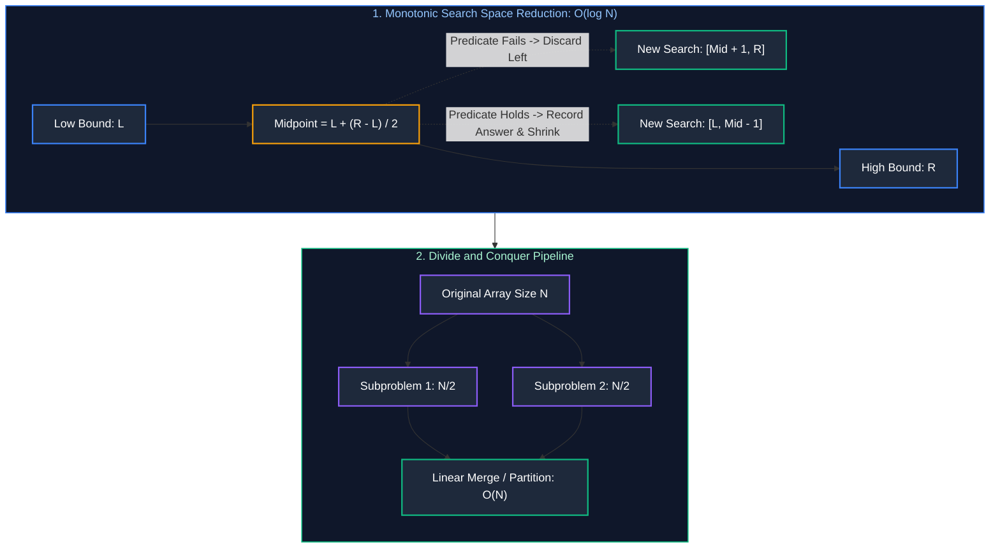

# 04. Binary Search & Divide-and-Conquer

A comprehensive, production-grade guide to Binary Search, Boundary Searches, Search in Rotated Arrays, Binary Search on Answer (Feasibility Search), and Divide-and-Conquer Algorithms (Merge Sort & QuickSelect).

---

## Architectural Overview: Logarithmic Search Space & Feasibility Predicates



---

## Table of Contents
1. [Binary Search Foundations & Invariant Proofs](#1-binary-search-foundations--invariant-proofs)
   - 1.1 [Midpoint Overflow Prevention & Boundary Traps](#11-midpoint-overflow-prevention--boundary-traps)
   - 1.2 [Lower Bound vs. Upper Bound (First & Last Occurrence)](#12-lower-bound-vs-upper-bound-first--last-occurrence)
   - 1.3 [Search in Rotated Sorted Array (LeetCode 33)](#13-search-in-rotated-sorted-array-leetcode-33)
2. [Binary Search on Answer (Feasibility Search)](#2-binary-search-on-answer-feasibility-search)
   - 2.1 [The Monotonic Predicate Framework](#21-the-monotonic-predicate-framework)
   - 2.2 [Capacity to Ship Packages Within D Days (LeetCode 1011)](#22-capacity-to-ship-packages-within-d-days-leetcode-1011)
   - 2.3 [Median of Two Sorted Arrays (LeetCode 4)](#23-median-of-two-sorted-arrays-leetcode-4)
3. [Divide-and-Conquer Algorithms](#3-divide-and-conquer-algorithms)
   - 3.1 [Merge Sort Internals](#31-merge-sort-internals)
   - 3.2 [QuickSelect (Kth Largest Element in O(N) Average Time)](#32-quickselect-kth-largest-element-in-on-average-time)
4. [Practice Problems by Difficulty Tier](#4-practice-problems-by-difficulty-tier)
5. [Summary & Engineering Reference Matrix](#5-summary--engineering-reference-matrix)
6. [References & Further Reading](#6-references--further-reading)

---

# 1. Binary Search Foundations & Invariant Proofs

Binary search is an optimal divide-and-conquer search strategy that operates over sorted or monotonically ordered search spaces. By evaluating the element at the midpoint, it eliminates half of the remaining candidate space in each iteration, reducing time complexity from $O(N)$ linear scan to $O(\log N)$ logarithmic time.

### 1.1 Midpoint Overflow Prevention & Boundary Traps

#### Integer Overflow Hazard
A classic trap in binary search implementations is computing the midpoint as:
$$\text{mid} = \frac{\text{low} + \text{high}}{2}$$

In languages with fixed-size signed integers (Java, C, C++), if $\text{low} + \text{high} > 2^{31} - 1$ ($2{,}147{,}483{,}647$), the addition overflows to a negative integer, causing an `ArrayIndexOutOfBoundsException` or memory segmentation fault.

To guarantee overflow safety, always compute the midpoint using subtractive offsetting or bitwise shifting:
$$\text{mid} = \text{low} + \frac{\text{high} - \text{low}}{2} = \text{low} + ((\text{high} - \text{low}) \gg 1)$$

#### Loop Invariant Selection
1. **Inclusive Range `while (low <= high)`:**
   - Terminating condition: `low > high` (search space completely exhausted).
   - Updates: `low = mid + 1` and `high = mid - 1`. Used when searching for an exact target or recording answers in a variable.
2. **Half-Open Range `while (low < high)`:**
   - Terminating condition: `low == high` (converges to a single element).
   - Updates: `low = mid + 1` and `high = mid`. Used for boundary searches where `mid` itself may be the optimal answer.

---

### 1.2 Lower Bound vs. Upper Bound (First & Last Occurrence)

When an array contains duplicate target elements:
- **Lower Bound (First Occurrence / Ceil):** Locates the first index $i$ such that $A[i] \ge \text{target}$. When $A[\text{mid}] == \text{target}$, we record `mid` as a candidate answer and shrink the search window leftward (`high = mid - 1`).
- **Upper Bound (Last Occurrence / Floor):** Locates the last index $i$ such that $A[i] \le \text{target}$. When $A[\text{mid}] == \text{target}$, we record `mid` and expand the search window rightward (`low = mid + 1`).

```java
public class BinarySearchBounds {

    // First occurrence of target in sorted array - Time: O(log N), Space: O(1)
    public int findFirstOccurrence(int[] nums, int target) {
        if (nums == null || nums.length == 0) return -1;
        int low = 0, high = nums.length - 1;
        int result = -1;

        while (low <= high) {
            int mid = low + ((high - low) >> 1);
            if (nums[mid] == target) {
                result = mid;     // Record candidate
                high = mid - 1;   // Continue searching leftward for earlier occurrence
            } else if (nums[mid] < target) {
                low = mid + 1;
            } else {
                high = mid - 1;
            }
        }
        return result;
    }

    // Last occurrence of target in sorted array - Time: O(log N), Space: O(1)
    public int findLastOccurrence(int[] nums, int target) {
        if (nums == null || nums.length == 0) return -1;
        int low = 0, high = nums.length - 1;
        int result = -1;

        while (low <= high) {
            int mid = low + ((high - low) >> 1);
            if (nums[mid] == target) {
                result = mid;     // Record candidate
                low = mid + 1;    // Continue searching rightward for later occurrence
            } else if (nums[mid] < target) {
                low = mid + 1;
            } else {
                high = mid - 1;
            }
        }
        return result;
    }
}
```

---

### 1.3 Search in Rotated Sorted Array (LeetCode 33)

#### The One-Half Sorted Invariant
When a sorted array is rotated at an unknown pivot (e.g., `[4, 5, 6, 7, 0, 1, 2]`), splitting the array at any midpoint `mid` guarantees that **at least one of the two halves is strictly sorted**:
1. **Left Half is Sorted (`nums[low] <= nums[mid]`):**
   - Check if `target` falls within the left sorted boundary: `nums[low] <= target && target < nums[mid]`.
   - If yes, search the left half: `high = mid - 1`.
   - If no, search the right half: `low = mid + 1`.
2. **Right Half is Sorted (`nums[mid] < nums[low]`):**
   - Check if `target` falls within the right sorted boundary: `nums[mid] < target && target <= nums[high]`.
   - If yes, search the right half: `low = mid + 1`.
   - If no, search the left half: `high = mid - 1`.

```java
// LeetCode 33: Search in Rotated Sorted Array - Time: O(log N), Space: O(1)
public int searchRotated(int[] nums, int target) {
    if (nums == null || nums.length == 0) return -1;
    int low = 0, high = nums.length - 1;

    while (low <= high) {
        int mid = low + ((high - low) >> 1);
        if (nums[mid] == target) return mid;

        // Determine which half is monotonically sorted
        if (nums[low] <= nums[mid]) {
            // Left half is sorted
            if (nums[low] <= target && target < nums[mid]) {
                high = mid - 1; // Target lies within left half
            } else {
                low = mid + 1;  // Target lies in right half
            }
        } else {
            // Right half is sorted
            if (nums[mid] < target && target <= nums[high]) {
                low = mid + 1;  // Target lies within right half
            } else {
                high = mid - 1; // Target lies in left half
            }
        }
    }
    return -1;
}
```

---

# 2. Binary Search on Answer (Feasibility Search)

Binary search is not limited to searching indices of concrete arrays; it applies equally to searching over an **abstract numerical solution space** when the validity of a candidate answer exhibits monotonicity.

### 2.1 The Monotonic Predicate Framework

Whenever a problem seeks:
- The **minimum capacity / speed / allocation** that makes a condition feasible, or
- The **maximum threshold / distance / size** that satisfies a resource constraint,

we define a verification predicate function:
$$\text{feasible}(X) \longrightarrow \{\text{true}, \text{false}\}$$

If the output of $\text{feasible}(X)$ is monotonic across the numerical range $[X_{\min}, X_{\max}]$:
$$\text{Range: } [\text{false}, \text{false}, \dots, \text{false}, \mathbf{\text{true}}, \text{true}, \dots, \text{true}]$$

The boundary between `false` and `true` can be located using binary search in:
$$\text{Time} = O(\log(X_{\max} - X_{\min}) \times \text{CostOfPredicate})$$

---

### 2.2 Capacity to Ship Packages Within D Days (LeetCode 1011)

#### Search Bounds & Greedy Invariant
In LeetCode 1011, packages must be shipped across $D$ days in contiguous order:
- **Minimum feasible capacity ($X_{\min}$):** Must be at least $\max(\text{weights})$ because the ship must be capable of carrying the single heaviest package.
- **Maximum feasible capacity ($X_{\max}$):** $\sum \text{weights}$ (carrying all packages in 1 day).
- **Greedy Verification Predicate `canShip(capacity)`:** Sequentially packs weights into the current day. If a package exceeds current capacity, increment day count and reset daily load. Runs in $O(N)$ time.

```java
// LeetCode 1011: Capacity To Ship Packages Within D Days - Time: O(N log(Sum - Max)), Space: O(1)
public class CapacityToShip {
    public int shipWithinDays(int[] weights, int days) {
        if (weights == null || weights.length == 0) return 0;
        int low = 0, high = 0;

        for (int w : weights) {
            low = Math.max(low, w); // Must be at least the heaviest item
            high += w;              // Sum of all items
        }

        int answer = high;
        while (low <= high) {
            int mid = low + ((high - low) >> 1);
            if (canShip(weights, days, mid)) {
                answer = mid;   // Capacity is feasible; try a smaller capacity
                high = mid - 1;
            } else {
                low = mid + 1;  // Infeasible; must increase capacity
            }
        }
        return answer;
    }

    private boolean canShip(int[] weights, int maxDays, int capacity) {
        int daysUsed = 1;
        int currentLoad = 0;

        for (int w : weights) {
            if (currentLoad + w > capacity) {
                daysUsed++;
                currentLoad = 0;
            }
            currentLoad += w;
        }
        return daysUsed <= maxDays;
    }
}
```

---

### 2.3 Median of Two Sorted Arrays (LeetCode 4)

#### Dual Array Partition Cut Mechanics
Given two sorted arrays $A$ of size $M$ and $B$ of size $N$ ($M \le N$), we partition both arrays into left and right halves such that:
1. The left partition contains $(M + N + 1) / 2$ elements.
2. Every element in the combined left partition is $\le$ every element in the combined right partition:
   $$\max(A_{\text{left}}, B_{\text{left}}) \le \min(A_{\text{right}}, B_{\text{right}})$$

By binary searching strictly on the smaller array $A$ (indices $0 \dots M$):
- Let partition in $A$ be $i$.
- Partition in $B$ is automatically fixed at $j = (M + N + 1) / 2 - i$.
- If $A[i - 1] > B[j]$, partition $i$ is too far right; decrement $i$.
- If $B[j - 1] > A[i]$, partition $i$ is too far left; increment $i$.
- When balanced, if total length is odd, median is $\max(A[i-1], B[j-1])$. If even, median is average of left max and right min.
- **Time Complexity:** $O(\log(\min(M, N)))$, **Space:** $O(1)$.

```java
// LeetCode 4: Median of Two Sorted Arrays - Time: O(log(min(M, N))), Space: O(1)
public double findMedianSortedArrays(int[] nums1, int[] nums2) {
    // Ensure nums1 is the smaller array to guarantee O(log(min(M, N))) complexity
    if (nums1.length > nums2.length) {
        return findMedianSortedArrays(nums2, nums1);
    }

    int m = nums1.length;
    int n = nums2.length;
    int low = 0, high = m;

    while (low <= high) {
        int partitionA = low + ((high - low) >> 1);
        int partitionB = ((m + n + 1) / 2) - partitionA;

        int maxLeftA = (partitionA == 0) ? Integer.MIN_VALUE : nums1[partitionA - 1];
        int minRightA = (partitionA == m) ? Integer.MAX_VALUE : nums1[partitionA];

        int maxLeftB = (partitionB == 0) ? Integer.MIN_VALUE : nums2[partitionB - 1];
        int minRightB = (partitionB == n) ? Integer.MAX_VALUE : nums2[partitionB];

        if (maxLeftA <= minRightB && maxLeftB <= minRightA) {
            // Correct partition found
            if ((m + n) % 2 == 1) {
                return Math.max(maxLeftA, maxLeftB);
            } else {
                return (Math.max(maxLeftA, maxLeftB) + Math.min(minRightA, minRightB)) / 2.0;
            }
        } else if (maxLeftA > minRightB) {
            high = partitionA - 1; // Partition in A is too far right
        } else {
            low = partitionA + 1;  // Partition in A is too far left
        }
    }
    throw new IllegalArgumentException("Input arrays are not sorted");
}
```

---

# 3. Divide-and-Conquer Algorithms

Divide-and-conquer breaks a complex problem into smaller independent subproblems of the same type, recursively solves them, and combines their solutions.

### 3.1 Merge Sort Internals

#### Recurrence Relation & Memory Overhead
Merge sort divides the array into two halves, recursively sorts each half, and merges the two sorted sequences using an auxiliary buffer:
$$T(N) = 2T(N/2) + O(N) \implies O(N \log N)$$

Unlike QuickSort, Merge Sort is **guaranteed $O(N \log N)$ in all cases** and provides **stable sorting** (preserving relative order of equal keys). Its primary trade-off is requiring $O(N)$ auxiliary heap memory for merging.

```java
public class MergeSort {

    public static void sort(int[] nums) {
        if (nums == null || nums.length <= 1) return;
        int[] aux = new int[nums.length];
        mergeSort(nums, aux, 0, nums.length - 1);
    }

    private static void mergeSort(int[] nums, int[] aux, int low, int high) {
        if (low >= high) return;
        int mid = low + ((high - low) >> 1);

        mergeSort(nums, aux, low, mid);
        mergeSort(nums, aux, mid + 1, high);
        merge(nums, aux, low, mid, high);
    }

    private static void merge(int[] nums, int[] aux, int low, int mid, int high) {
        // Copy segment to auxiliary buffer
        System.arraycopy(nums, low, aux, low, high - low + 1);

        int i = low;       // Pointer for left half
        int j = mid + 1;   // Pointer for right half
        int k = low;       // Write pointer for nums

        while (i <= mid && j <= high) {
            if (aux[i] <= aux[j]) { // '<=' preserves stability
                nums[k++] = aux[i++];
            } else {
                nums[k++] = aux[j++];
            }
        }

        while (i <= mid) {
            nums[k++] = aux[i++];
        }
    }
}
```

---

### 3.2 QuickSelect (Kth Largest Element in O(N) Average Time)

#### Partitioning Invariant & Complexity
QuickSelect finds the $K$-th smallest/largest element without fully sorting the array. It uses QuickSort partitioning (Lomuto or Hoare) around a randomly chosen pivot:
1. Partition the array: all elements $\le \text{pivot}$ are placed left of `pivotIdx`, and all elements $> \text{pivot}$ are placed right of `pivotIdx`.
2. If `pivotIdx == targetIdx`, the target is found.
3. If `targetIdx < pivotIdx`, recurse **strictly into the left partition**.
4. If `targetIdx > pivotIdx`, recurse **strictly into the right partition**.

#### Recurrence Analysis:
Because QuickSelect discards one complete partition at each step, the expected work is:
$$T(N) = N + \frac{N}{2} + \frac{N}{4} + \dots + 1 = 2N = O(N)$$
- **Average Time:** $O(N)$.
- **Worst-Case Time:** $O(N^2)$ (mitigated using randomized pivot selection).
- **Space:** $O(1)$ auxiliary (or $O(\log N)$ call stack).

```java
import java.util.Random;

// LeetCode 215: Kth Largest Element in an Array - Time: O(N) average, Space: O(1)
public class QuickSelect {
    private final Random rand = new Random();

    public int findKthLargest(int[] nums, int k) {
        int targetIdx = nums.length - k; // Convert Kth largest to (N - k)th index
        return quickSelect(nums, 0, nums.length - 1, targetIdx);
    }

    private int quickSelect(int[] nums, int left, int right, int targetIdx) {
        if (left == right) return nums[left];

        // Randomized pivot selection prevents O(N^2) worst-case on already sorted inputs
        int pivotIdx = left + rand.nextInt(right - left + 1);
        pivotIdx = partition(nums, left, right, pivotIdx);

        if (pivotIdx == targetIdx) {
            return nums[pivotIdx];
        } else if (pivotIdx < targetIdx) {
            return quickSelect(nums, pivotIdx + 1, right, targetIdx);
        } else {
            return quickSelect(nums, left, pivotIdx - 1, targetIdx);
        }
    }

    private int partition(int[] nums, int left, int right, int pivotIdx) {
        int pivotVal = nums[pivotIdx];
        swap(nums, pivotIdx, right); // Move pivot to end
        int storeIdx = left;

        for (int i = left; i < right; i++) {
            if (nums[i] < pivotVal) {
                swap(nums, storeIdx, i);
                storeIdx++;
            }
        }
        swap(nums, storeIdx, right); // Restore pivot to its final position
        return storeIdx;
    }

    private void swap(int[] nums, int i, int j) {
        int temp = nums[i];
        nums[i] = nums[j];
        nums[j] = temp;
    }
}
```

---

# 4. Practice Problems by Difficulty Tier

The table below catalogs essential interview problems for binary search and divide-and-conquer algorithms, categorized by difficulty tier. When analyzing problems in an interview:
1. **Sorted or Monotonic Input:** First assess if binary search on indices can achieve $O(\log N)$ before evaluating linear scans.
2. **Min-Max / Max-Min Optimization Problems:** Formulate a boolean `feasible(X)` predicate and binary search directly over the value range $[X_{\min}, X_{\max}]$.
3. **K-th Element Selection:** Choose QuickSelect for $O(N)$ expected time and $O(1)$ memory when full sorting ($O(N \log N)$) or heap priority queues ($O(N \log K)$) are unnecessarily expensive.

| Difficulty | Problem Name | Core Pattern | LeetCode Link | Complexity |
| :---: | :--- | :--- | :---: | :---: |
| **Easy** | Binary Search | Monotonic Exact Match | LC 704 | $O(\log N) \text{ time}, O(1) \text{ space}$ |
| **Easy** | First Bad Version | Binary Search Boundary | LC 278 | $O(\log N) \text{ time}, O(1) \text{ space}$ |
| **Medium** | Search in Rotated Sorted Array | One-Half Sorted Invariant | LC 33 | $O(\log N) \text{ time}, O(1) \text{ space}$ |
| **Medium** | Find Minimum in Rotated Sorted Array | Boundary Transition Search | LC 153 | $O(\log N) \text{ time}, O(1) \text{ space}$ |
| **Medium** | Capacity to Ship Packages Within D Days | Binary Search on Answer | LC 1011 | $O(N \log(\sum W)) \text{ time}, O(1) \text{ space}$ |
| **Medium** | Koko Eating Bananas | Feasibility Search | LC 875 | $O(N \log(\max A)) \text{ time}, O(1) \text{ space}$ |
| **Medium** | Kth Largest Element in an Array | QuickSelect Partitioning | LC 215 | $O(N) \text{ avg time}, O(1) \text{ space}$ |
| **Hard** | Median of Two Sorted Arrays | Dual Array Partition Cut | LC 4 | $O(\log(\min(M, N))) \text{ time}, O(1) \text{ space}$ |
| **Hard** | Split Array Largest Sum | Min-Max Feasibility Search | LC 410 | $O(N \log(\sum A)) \text{ time}, O(1) \text{ space}$ |

---

# 5. Summary & Engineering Reference Matrix

Binary search and divide-and-conquer achieve exponential search space reductions by systematically partitioning candidate spaces. While binary search achieves $O(\log N)$ efficiency by discarding half the search domain per step, it incurs repeated non-sequential memory jumps that can cause CPU cache line misses. In production systems, knowing whether to binary search over memory indices, numerical values, or divide-and-conquer partitions is essential.

The reference matrix below synthesizes the convergence mechanics, search spaces, and complexity profiles of these algorithms:

| Algorithm | Search Space | Stopping Condition | Convergence Guarantee |
| :--- | :--- | :--- | :--- |
| **Exact Binary Search** | Sorted Array | `low <= high`, exit on `nums[mid] == target` | Search space halves each step: $N \to N/2 \to 1$ |
| **Lower Bound** | Sorted Array | `low <= high`, record `mid` on $\ge \text{target}$ | Halves search space while tightening upper bound |
| **Search on Answer** | Numerical Range $[L, R]$ | Monotonic predicate `feasible(mid)` | $O(\log(R - L) \times \text{CostOfPredicate})$ |
| **QuickSelect** | Unsorted Array | Pivot index equals target index | Average $O(N)$; drops half remaining partition each step |
| **Merge Sort** | Unsorted Array | Base case: subarray length $\le 1$ | Deterministic $O(N \log N)$ across all input distributions |

---

# 6. References & Further Reading
- Jon Bentley, *Programming Pearls: Writing Correct Programs (Binary Search Proofs)*.
- Thomas H. Cormen et al., *Introduction to Algorithms (CLRS): Chapter 2 & 9*.
- TopCoder Algorithm Tutorials: *Binary Search & Monotonic Predicates*.
