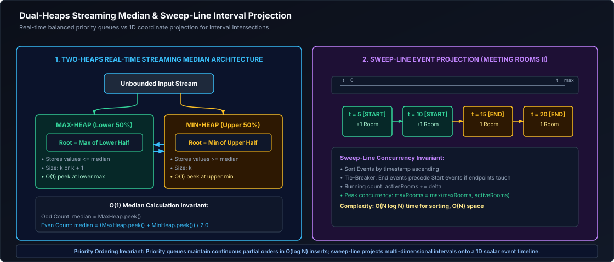

# 05. Heaps, Intervals & Greedy Algorithms

A comprehensive, production-grade guide to Binary Heaps, Priority Queues, Two Heaps Streaming Patterns, Interval Sweep-Line Algorithms, and Greedy Optimization.

---

## Architectural Overview: Heap Memory Invariants & Interval Sweep-Line



*D2 Source:* [assets/05_heaps_intervals_and_greedy_algorithms/01_two_heaps_and_interval_sweep_line.d2](assets/05_heaps_intervals_and_greedy_algorithms/01_two_heaps_and_interval_sweep_line.d2)

---

## Table of Contents
1. [Binary Heap Internals & Mathematical Invariants](#1-binary-heap-internals--mathematical-invariants)
   - 1.1 [Array Memory Representation & Sift-Up/Sift-Down](#11-array-memory-representation--sift-upsift-down)
   - 1.2 [The O(N) Heapify Proof](#12-the-on-heapify-proof)
2. [The Two Heaps Pattern](#2-the-two-heaps-pattern)
   - 2.1 [Find Median from Data Stream (LeetCode 295)](#21-find-median-from-data-stream-leetcode-295)
   - 2.2 [Loose Median in Constant O(1) Time & Space](#22-loose-median-in-constant-o1-time--space)
   - 2.3 [Kth Largest Element in a Stream (LeetCode 703)](#23-kth-largest-element-in-a-stream-leetcode-703)
3. [Top-K Elements & K-Way Merge](#3-top-k-elements--k-way-merge)
   - 3.1 [Top K Frequent Elements (Min-Heap vs. Bucket Sort O(N))](#31-top-k-frequent-elements-min-heap-vs-bucket-sort-on)
   - 3.2 [Merge K Sorted Lists (LeetCode 23)](#32-merge-k-sorted-lists-leetcode-23)
4. [Interval Scheduling & Sweep-Line Algorithms](#4-interval-scheduling--sweep-line-algorithms)
   - 4.1 [Merge Intervals (LeetCode 56)](#41-merge-intervals-leetcode-56)
   - 4.2 [Minimum Meeting Rooms II & Sweep-Line Variants (LeetCode 253)](#42-minimum-meeting-rooms-ii--sweep-line-variants-leetcode-253)
5. [Greedy Decision Making](#5-greedy-decision-making)
   - 5.1 [Jump Game I & II](#51-jump-game-i--ii)
   - 5.2 [Task Scheduler with Cool-Down Invariant (LeetCode 621)](#52-task-scheduler-with-cool-down-invariant-leetcode-621)
6. [Practice Problems by Difficulty Tier](#6-practice-problems-by-difficulty-tier)
7. [Summary & Engineering Reference Matrix](#7-summary--engineering-reference-matrix)
8. [References & Further Reading](#8-references--further-reading)

---

# 1. Binary Heap Internals & Mathematical Invariants

A binary heap is a complete binary tree implemented over a contiguous array that satisfies the **heap property**: every parent node is smaller than or equal to its children (in a Min-Heap) or greater than or equal to its children (in a Max-Heap).

### 1.1 Array Memory Representation & Sift-Up/Sift-Down

Because the tree is structurally complete (all levels are fully populated except possibly the last, which fills from left to right), it requires zero node pointers. Node relationships are derived purely through index arithmetic:
- Root is stored at index `0`.
- For any node at index $i$:
  $$\text{Parent}(i) = \lfloor (i - 1) / 2 \rfloor$$
  $$\text{LeftChild}(i) = 2i + 1, \quad \text{RightChild}(i) = 2i + 2$$

#### Core Heap Operations
1. **`insert(val)`:** Appends `val` to the end of the array, then executes **`siftUp`**: compares the node with its parent, swapping upward until the heap invariant is restored. Takes $O(\log N)$ worst-case time.
2. **`poll()`:** Extracts the root element (index 0). Swaps the last element of the array into index 0, shrinks array size by 1, and executes **`siftDown`**: compares the node with its smallest child, swapping downward until the heap invariant is restored. Takes $O(\log N)$ worst-case time.

```java
import java.util.Arrays;
import java.util.NoSuchElementException;

public class CustomMinHeap {
    private int[] data;
    private int size;

    public CustomMinHeap(int capacity) {
        this.data = new int[capacity];
        this.size = 0;
    }

    public void insert(int val) {
        if (size == data.length) {
            data = Arrays.copyOf(data, data.length * 2); // Dynamic doubling
        }
        data[size] = val;
        siftUp(size);
        size++;
    }

    public int poll() {
        if (size == 0) throw new NoSuchElementException("Heap is empty");
        int root = data[0];
        data[0] = data[size - 1]; // Move last element to root
        size--;
        if (size > 0) {
            siftDown(0);
        }
        return root;
    }

    public int peek() {
        if (size == 0) throw new NoSuchElementException("Heap is empty");
        return data[0];
    }

    private void siftUp(int idx) {
        while (idx > 0) {
            int parentIdx = (idx - 1) / 2;
            if (data[idx] < data[parentIdx]) {
                swap(idx, parentIdx);
                idx = parentIdx;
            } else {
                break;
            }
        }
    }

    private void siftDown(int idx) {
        while (2 * idx + 1 < size) {
            int leftChild = 2 * idx + 1;
            int rightChild = 2 * idx + 2;
            int smallest = leftChild;

            if (rightChild < size && data[rightChild] < data[leftChild]) {
                smallest = rightChild;
            }

            if (data[idx] > data[smallest]) {
                swap(idx, smallest);
                idx = smallest;
            } else {
                break;
            }
        }
    }

    private void swap(int i, int j) {
        int temp = data[i];
        data[i] = data[j];
        data[j] = temp;
    }
}
```

---

### 1.2 The O(N) Heapify Proof

Building a heap by sequentially inserting $N$ items takes $N \times O(\log N) = O(N \log N)$ time. However, building the heap bottom-up by running `siftDown` starting from the lowest internal parent node ($\lfloor N/2 \rfloor - 1$ down to 0) runs in **$O(N)$ linear time**.

#### Mathematical Proof:
In a complete binary tree of $N$ nodes:
- Height of the tree is $H = \lfloor \log_2 N \rfloor$.
- Number of nodes at height $h$ from the bottom is at most $\lceil N / 2^{h+1} \rceil$.
- Sifting down a node at height $h$ requires at most $h$ operations.

The total cost is bounded by the summation:
$$\sum_{h=0}^{\lfloor \log N \rfloor} \frac{N}{2^{h+1}} \times h = \frac{N}{2} \sum_{h=0}^{\infty} \frac{h}{2^h}$$

Using the standard geometric Taylor series identity $\sum_{h=0}^{\infty} h x^h = \frac{x}{(1 - x)^2}$ for $x = 1/2$:
$$\sum_{h=0}^{\infty} \frac{h}{2^h} = \frac{1/2}{(1 - 1/2)^2} = \frac{1/2}{1/4} = 2$$

Substituting back:
$$\text{Total Operations} \le \frac{N}{2} \times 2 = N = O(N)$$
This demonstrates that building a heap in-place is asymptotically linear!

---

# 2. The Two Heaps Pattern

### 2.1 Find Median from Data Stream (LeetCode 295)

#### Invariant Partitioning Framework
The median splits an ordered sequence into two equal halves. To maintain the running median across an unbounded data stream in real time:
1. **`maxHeap` (Lower Half):** Stores the smaller half of numbers ($x \le \text{median}$). Its root provides the maximum of the lower half.
2. **`minHeap` (Upper Half):** Stores the larger half of numbers ($x \ge \text{median}$). Its root provides the minimum of the upper half.
3. **Balancing Invariants:**
   - Every element in `maxHeap` must be $\le$ every element in `minHeap`.
   - The size difference is strictly bounded: $0 \le \text{size}(\text{maxHeap}) - \text{size}(\text{minHeap}) \le 1$.
4. **Complexity:** Insertion takes $O(\log N)$, and median query takes $O(1)$.

```java
import java.util.Collections;
import java.util.PriorityQueue;

// LeetCode 295: Find Median from Data Stream - Time: O(log N) insert, O(1) query
public class MedianFinder {
    private final PriorityQueue<Integer> maxHeap; // Lower half
    private final PriorityQueue<Integer> minHeap; // Upper half

    public MedianFinder() {
        this.maxHeap = new PriorityQueue<>(Collections.reverseOrder());
        this.minHeap = new PriorityQueue<>();
    }

    public void addNum(int num) {
        // Step 1: Add to maxHeap
        maxHeap.offer(num);

        // Step 2: Invariant enforcement - transfer max of lower half to minHeap
        minHeap.offer(maxHeap.poll());

        // Step 3: Size balancing - maxHeap can hold at most 1 more element than minHeap
        if (minHeap.size() > maxHeap.size()) {
            maxHeap.offer(minHeap.poll());
        }
    }

    public double findMedian() {
        if (maxHeap.size() > minHeap.size()) {
            return maxHeap.peek();
        } else {
            return (maxHeap.peek() + minHeap.peek()) / 2.0;
        }
    }
}
```

---

### 2.2 Loose Median in Constant O(1) Time & Space

#### Stochastic Reservoir Approximator
In massive high-frequency financial tickers or gigabit-per-second network telemetry, maintaining exact dual heaps in memory is prohibitive due to heap memory allocation and $O(\log N)$ pointer locks.

To estimate a "loose median" in $O(1)$ space and $O(1)$ time:
- Maintain a single running scalar `medianEstimate` and an adaptive adjustment factor $\alpha$.
- If `incomingValue > medianEstimate`, increment: `medianEstimate += alpha`.
- If `incomingValue < medianEstimate`, decrement: `medianEstimate -= alpha`.
- By definition of the median, exactly 50% of the distribution lies above and 50% below. The scalar automatically converges to and tracks the dynamic median with zero heap allocations.

---

### 2.3 Kth Largest Element in a Stream (LeetCode 703)

#### Min-Heap of Fixed Size K Invariant
To continuously maintain the $K$-th largest element in an unbounded stream, use a **Min-Heap bounded to size $K$**:
- The Min-Heap contains strictly the $K$ largest numbers seen so far.
- Because it is a Min-Heap, its root (`peek()`) is the smallest of these $K$ largest elements—which is precisely the overall $K$-th largest element!
- When adding a new element:
  - If `heap.size() < k`: insert directly.
  - Else if `val > heap.peek()`: poll the old minimum and insert `val`.
- Space complexity is strictly bounded by $O(K)$, and each update takes $O(\log K)$ time.

```java
import java.util.PriorityQueue;

// LeetCode 703: Kth Largest Element in a Stream - Time: O(log K) per add, Space: O(K)
public class KthLargest {
    private final PriorityQueue<Integer> minHeap;
    private final int k;

    public KthLargest(int k, int[] nums) {
        this.k = k;
        this.minHeap = new PriorityQueue<>(k);
        for (int num : nums) {
            add(num);
        }
    }

    public int add(int val) {
        if (minHeap.size() < k) {
            minHeap.offer(val);
        } else if (val > minHeap.peek()) {
            minHeap.poll();
            minHeap.offer(val);
        }
        return minHeap.peek();
    }
}
```

---

# 3. Top-K Elements & K-Way Merge

### 3.1 Top K Frequent Elements (Min-Heap vs. Bucket Sort O(N))

Finding the $K$ most frequent elements across an array of $N$ items can be solved in two ways:
1. **Min-Heap Approach ($O(N \log K)$ Time, $O(N)$ Space):** Count frequencies with a HashMap, then maintain a Min-Heap of size $K$ keyed on frequency.
2. **Bucket Sort Approach ($O(N)$ Optimal Time):** An element cannot appear more than $N$ times. Create an array of lists `List<Integer>[] buckets` of size $N + 1$, where the array index directly represents the frequency count. Iterate backward from index $N$ down to 1, collecting elements until $K$ elements are accumulated.

```java
import java.util.*;

// LeetCode 347: Top K Frequent Elements - Time: O(N) Bucket Sort, Space: O(N)
public class TopKFrequentElements {
    public int[] topKFrequent(int[] nums, int k) {
        if (nums == null || nums.length == 0 || k <= 0) return new int[0];

        // 1. Compute frequency map
        Map<Integer, Integer> freqMap = new HashMap<>();
        for (int n : nums) {
            freqMap.put(n, freqMap.getOrDefault(n, 0) + 1);
        }

        // 2. Populate frequency buckets: index represents frequency
        List<Integer>[] buckets = new List[nums.length + 1];
        for (int key : freqMap.keySet()) {
            int freq = freqMap.get(key);
            if (buckets[freq] == null) {
                buckets[freq] = new ArrayList<>();
            }
            buckets[freq].add(key);
        }

        // 3. Collect top k elements starting from highest frequency bucket
        int[] result = new int[k];
        int count = 0;
        for (int f = buckets.length - 1; f >= 0 && count < k; f--) {
            if (buckets[f] != null) {
                for (int num : buckets[f]) {
                    result[count++] = num;
                    if (count == k) return result;
                }
            }
        }
        return result;
    }
}
```

---

### 3.2 Merge K Sorted Lists (LeetCode 23)

Merging $K$ sorted streams or linked lists is a fundamental operation in distributed data processing (e.g., external merge sort in database engines).
- Initialize a Min-Heap containing the first element from each of the $K$ sorted sources.
- Extract the minimum, append to the output, and insert the next element from the source that produced the minimum.
- Operates in **$O(N \log K)$ total time** and **$O(K)$ space**, where $N$ is total elements across all $K$ streams.

---

# 4. Interval Scheduling & Sweep-Line Algorithms

Interval problems require managing segments bounded by start and end timestamps $[S_i, E_i]$. The two canonical strategies are **Greedy Sorting by Boundary** and **Sweep-Line Coordinate Projection**.

### 4.1 Merge Intervals (LeetCode 56)

#### Sorting Invariant & Asymptotic Proof
To merge overlapping intervals:
1. Sort intervals ascending by start time: $S_0 \le S_1 \le \dots \le S_{N-1}$. If start times are identical, sorting by end time ascending ensures predictable ordering.
2. Maintain an output accumulator. For each candidate interval:
   - If the candidate start time is $\le$ the end time of the last merged interval (`candidate.start <= last.end`), an overlap exists: merge them by expanding the end boundary:
     $$\text{last.end} = \max(\text{last.end}, \text{candidate.end})$$
   - Otherwise, the candidate is disjoint ($S_{\text{next}} > E_{\text{last}}$): append it as a new distinct interval.
3. **Formal Asymptotic Complexity Proof:**
   - **Time Complexity:** $O(N \log N)$ dominated by sorting the $N$ intervals using Java's dual-pivot Quicksort / TimSort. The subsequent linear scan evaluates each interval exactly once in $O(1)$ amortized comparison time ($O(N)$), yielding total runtime of $O(N \log N) + O(N) = O(N \log N)$.
   - **Space Complexity:** $O(N)$ memory required for the `ArrayList<int[]>` output container in the worst case (when zero intervals overlap). In Java, `Arrays.sort()` on object references requires $O(N)$ temporary storage for TimSort run merges.
4. **Critical Edge Cases Handled:**
   - **Empty or Single Interval:** Bypassed immediately via fast path guard.
   - **Adjacent / Touching Boundaries:** e.g., $[1, 4]$ and $[4, 5]$ merge into $[1, 5]$ because $4 \le 4$.
   - **Fully Nested Intervals:** e.g., $[1, 10]$ and $[2, 5]$ merge into $[1, 10]$ via $\max(10, 5) = 10$.
   - **Pre-Sorted & Reverse-Sorted Inputs:** Handled deterministically without worst-case degradation.

```java
import java.util.*;

// LeetCode 56: Merge Intervals - Time: O(N log N), Space: O(N)
public class MergeIntervals {
    public int[][] merge(int[][] intervals) {
        if (intervals == null || intervals.length <= 1) return intervals;

        // Sort ascending by start time; tie-break by end time ascending
        Arrays.sort(intervals, (a, b) -> {
            if (a[0] != b[0]) return Integer.compare(a[0], b[0]);
            return Integer.compare(a[1], b[1]);
        });

        List<int[]> merged = new ArrayList<>();
        int[] currentInterval = intervals[0];
        merged.add(currentInterval);

        for (int i = 1; i < intervals.length; i++) {
            int currentEnd = currentInterval[1];
            int nextStart = intervals[i][0];
            int nextEnd = intervals[i][1];

            if (nextStart <= currentEnd) {
                // Overlapping or touching intervals: expand current end
                currentInterval[1] = Math.max(currentEnd, nextEnd);
            } else {
                // Disjoint interval: start new segment
                currentInterval = intervals[i];
                merged.add(currentInterval);
            }
        }

        return merged.toArray(new int[merged.size()][]);
    }
}
```

---

### 4.2 Minimum Meeting Rooms II & Sweep-Line Variants (LeetCode 253)

#### The Sweep-Line Coordinate Projection Framework
To determine the maximum number of concurrent meetings (and therefore minimum conference rooms required), decompose each interval `[start, end]` into two discrete 1D events:
1. `(start, +1)`: Meeting starts, requiring 1 room.
2. `(end, -1)`: Meeting ends, releasing 1 room.

Sort start times and end times into two separate sorted arrays. Use two pointers (`startPtr` and `endPtr`) to simulate a sweep line moving forward in time:
- If `startTimes[startPtr] < endTimes[endPtr]`: A meeting is starting before the earliest ongoing meeting has concluded. Increment `roomsNeeded++` and advance `startPtr++`.
- Else: A meeting has concluded, freeing up a room. Advance `endPtr++` and `startPtr++` without increasing `roomsNeeded`.

```java
import java.util.Arrays;

// LeetCode 253: Meeting Rooms II - Time: O(N log N), Space: O(N)
public class MeetingRoomsII {
    public int minMeetingRooms(int[][] intervals) {
        if (intervals == null || intervals.length == 0) return 0;

        int n = intervals.length;
        int[] startTimes = new int[n];
        int[] endTimes = new int[n];

        for (int i = 0; i < n; i++) {
            startTimes[i] = intervals[i][0];
            endTimes[i] = intervals[i][1];
        }

        Arrays.sort(startTimes);
        Arrays.sort(endTimes);

        int roomsNeeded = 0;
        int endPtr = 0;

        for (int i = 0; i < n; i++) {
            if (startTimes[i] < endTimes[endPtr]) {
                roomsNeeded++; // Active meeting still ongoing; allocate new room
            } else {
                endPtr++;      // Meeting finished; reuse existing room
            }
        }
        return roomsNeeded;
    }
}
```

---

# 5. Greedy Decision Making

A greedy algorithm makes the locally optimal choice at each step with the intent that these choices lead to a globally optimal solution. The technique requires demonstrating the **Greedy Choice Property** (a global optimum can be reached by a sequence of local choices) and **Optimal Substructure**.

### 5.1 Jump Game I & II

#### Jump Game I (Reachability Verification)
Maintain a running scalar `maxReachable = max(maxReachable, i + nums[i])`. If the active index $i$ exceeds `maxReachable`, further progress is impossible ($i$ is unreachable). Returns `true` if `maxReachable >= n - 1`. Runs in $O(N)$ time and $O(1)$ space.

```java
// LeetCode 55: Jump Game - Time: O(N), Space: O(1)
public boolean canJump(int[] nums) {
    if (nums == null || nums.length == 0) return false;
    int maxReachable = 0;

    for (int i = 0; i < nums.length; i++) {
        if (i > maxReachable) return false; // Trapped by zero jump
        maxReachable = Math.max(maxReachable, i + nums[i]);
        if (maxReachable >= nums.length - 1) return true;
    }
    return true;
}
```

#### Jump Game II (Minimum Jump Count)
Track the current jump frontier using two boundaries: `currentEnd` (furthest reach of current jump) and `furthest` (furthest reach possible in the next jump). When the iterator reaches `currentEnd`, increment jump count and update `currentEnd = furthest`. Runs in $O(N)$ time and $O(1)$ space.

```java
// LeetCode 45: Jump Game II - Time: O(N), Space: O(1)
public int jump(int[] nums) {
    if (nums == null || nums.length <= 1) return 0;
    int jumps = 0;
    int currentEnd = 0;
    int furthest = 0;

    for (int i = 0; i < nums.length - 1; i++) {
        furthest = Math.max(furthest, i + nums[i]);
        if (i == currentEnd) {
            jumps++;
            currentEnd = furthest;
            if (currentEnd >= nums.length - 1) break;
        }
    }
    return jumps;
}
```

---

### 5.2 Task Scheduler with Cool-Down Invariant (LeetCode 621)

#### Idle Slot Formula Derivation
Given CPU tasks with cooldown period $n$:
1. Identify the maximum frequency of any task ($f_{\max}$) and count how many tasks share this maximum frequency ($k$).
2. The most frequent task sets the baseline structure of $(f_{\max} - 1)$ chunks, each having size $(n + 1)$ slots.
3. The final chunk requires exactly $k$ slots for the tasks with frequency $f_{\max}$.
4. The theoretical minimum slots required is:
   $$\text{MinSlots} = (f_{\max} - 1) \times (n + 1) + k$$
5. If the total number of tasks exceeds this formula (no idle slots needed), the total duration is simply `tasks.length`. Thus:
   $$\text{Result} = \max(\text{tasks.length}, (f_{\max} - 1) \times (n + 1) + k)$$

```java
// LeetCode 621: Task Scheduler - Time: O(N), Space: O(1)
public int leastInterval(char[] tasks, int n) {
    if (tasks == null || tasks.length == 0) return 0;
    int[] counts = new int[26];
    int maxFreq = 0;

    for (char task : tasks) {
        counts[task - 'A']++;
        maxFreq = Math.max(maxFreq, counts[task - 'A']);
    }

    int countMaxFreq = 0;
    for (int count : counts) {
        if (count == maxFreq) {
            countMaxFreq++;
        }
    }

    int partCount = maxFreq - 1;
    int partLength = n + 1;
    int emptySlots = partCount * partLength + countMaxFreq;

    return Math.max(tasks.length, emptySlots);
}
```

---

# 6. Practice Problems by Difficulty Tier

The table below catalogs essential interview problems spanning binary heaps, interval scheduling, and greedy strategies. When approaching these problems in technical interviews:
1. **Dynamic Streaming Extrema:** If a problem requires continuous tracking of medians or running percentiles, apply the Two Heaps pattern.
2. **Top-K Selection:** If $K \ll N$, use a Min-Heap of size $K$ ($O(N \log K)$); if inputs are integer frequencies or bounded ranges, use Bucket Sort to achieve optimal $O(N)$ linear time.
3. **Overlapping Intervals & Concurrency:** Sort by boundary timestamps. For peak concurrency, use Sweep-Line coordinate projection; for consolidating overlapping windows, use greedy interval extension.

| Difficulty | Problem Name | Core Pattern | LeetCode Link | Complexity |
| :---: | :--- | :--- | :---: | :---: |
| **Easy** | Kth Largest Element in a Stream | Min-Heap Size K | LC 703 | $O(\log K) \text{ per add}$ |
| **Easy** | Meeting Rooms | Interval Sort & Overlap | LC 252 | $O(N \log N) \text{ time}, O(1) \text{ space}$ |
| **Medium** | Top K Frequent Elements | Bucket Sort / Min-Heap | LC 347 | $O(N) \text{ time}, O(N) \text{ space}$ |
| **Medium** | Merge Intervals | Interval Sort & Extend | LC 56 | $O(N \log N) \text{ time}, O(N) \text{ space}$ |
| **Medium** | Meeting Rooms II | Sweep-Line / Two Pointers | LC 253 | $O(N \log N) \text{ time}, O(N) \text{ space}$ |
| **Medium** | Task Scheduler | Frequency Greedy Formula | LC 621 | $O(N) \text{ time}, O(1) \text{ space}$ |
| **Medium** | Jump Game II | Greedy BFS Level Frontier | LC 45 | $O(N) \text{ time}, O(1) \text{ space}$ |
| **Hard** | Find Median from Data Stream | Dual Heaps (Max/Min) | LC 295 | $O(\log N) \text{ add}, O(1) \text{ median}$ |
| **Hard** | Merge K Sorted Lists | PriorityQueue K-Way Merge | LC 23 | $O(N \log K) \text{ time}, O(K) \text{ space}$ |
| **Hard** | Employee Free Time | Interval Merge & Gap Scan | LC 759 | $O(N \log K) \text{ time}, O(K) \text{ space}$ |

---

# 7. Summary & Engineering Reference Matrix

Heaps, interval scheduling, and greedy algorithms provide guaranteed performance bounds for real-time streaming and optimization challenges. Binary heaps leverage contiguous array indexing to implement complete trees with zero pointer overhead, though heap traversal can trigger non-sequential cache line jumps during sift operations. In interval processing and greedy decision making, sorting serves as the foundational preprocessing step that establishes the invariants required for single-pass linear scans.

The reference matrix below synthesizes the core operational mechanics and complexities across these patterns:

| Algorithmic Pattern | Data Structure | Invariant | Time Complexity | Space Complexity |
| :--- | :--- | :--- | :--- | :--- |
| **Two Heaps (Median)** | Max-Heap + Min-Heap | Lower half $\le$ Upper half; $\Delta \text{size} \le 1$ | $O(\log N)$ insert, $O(1)$ peek | $O(N)$ |
| **Top-K Frequent** | Bucket Sort Array of Lists | Index equals item occurrence frequency | $O(N)$ linear | $O(N)$ |
| **Sweep-Line Intervals**| Sorted Coordinate Arrays | Discrete $+1$ on start, $-1$ on end | $O(N \log N)$ | $O(N)$ |
| **Greedy Intervals** | Sorted Interval Array | Extend current boundary until disjoint | $O(N \log N)$ | $O(1)$ |
| **Greedy Forward Scan**| Single Running Max Scalar | Locally optimal choice guarantees global optimum | $O(N)$ | $O(1)$ |

---

# 8. References & Further Reading
- Cormen, Leiserson, Rivest, Stein, *Introduction to Algorithms (CLRS): Chapter 6 (Heapsort) & Chapter 16 (Greedy Algorithms)*.
- Robert Sedgewick & Kevin Wayne, *Algorithms: Priority Queues & Disjoint Sets*.
- LeetCode Curated 75: Heap & Interval Practice Sets.
