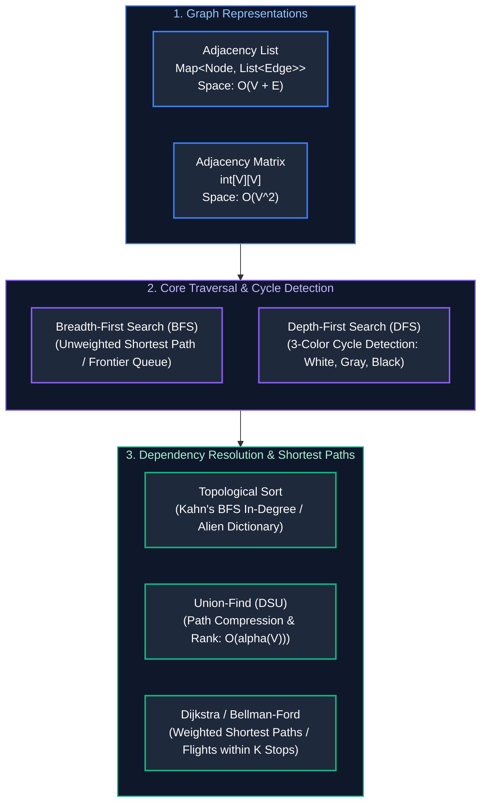

# 06. Graphs, Topological Sort & Shortest Paths

A comprehensive, production-grade guide to Graph Representations, BFS & Bidirectional Search, DFS & Cycle Detection, Topological Sort (Course Schedule & Alien Dictionary), Disjoint Set Union (Union-Find), and Shortest Path Algorithms (Dijkstra, 0-1 BFS, and Bellman-Ford).

---

## Architectural Overview: Graph Topologies & Traversal Mechanics



---

## Table of Contents
1. [Graph Representations & Memory Trade-offs](#1-graph-representations--memory-trade-offs)
2. [Breadth-First Search & Bidirectional Traversal](#2-breadth-first-search--bidirectional-traversal)
   - 2.1 [Unweighted Shortest Path & Number of Islands (LeetCode 200)](#21-unweighted-shortest-path--number-of-islands-leetcode-200)
   - 2.2 [Bidirectional BFS: Word Ladder (LeetCode 127)](#22-bidirectional-bfs-word-ladder-leetcode-127)
3. [Depth-First Search & Cycle Detection](#3-depth-first-search--cycle-detection)
   - 3.1 [3-Color DFS Cycle Detection (Directed Graphs)](#31-3-color-dfs-cycle-detection-directed-graphs)
   - 3.2 [Clone Graph with Random / Arbitrary Pointers (LeetCode 133)](#32-clone-graph-with-random--arbitrary-pointers-leetcode-133)
4. [Topological Sort & Dependency Resolution](#4-topological-sort--dependency-resolution)
   - 4.1 [Kahn's Algorithm (BFS In-Degree Queue)](#41-kahns-algorithm-bfs-in-degree-queue)
   - 4.2 [Alien Dictionary (LeetCode 269)](#42-alien-dictionary-leetcode-269)
5. [Disjoint Set Union (Union-Find)](#5-disjoint-set-union-union-find)
   - 5.1 [Path Compression & Union by Rank Invariants](#51-path-compression--union-by-rank-invariants)
   - 5.2 [Redundant Connection & Dynamic Connectivity (LeetCode 684)](#52-redundant-connection--dynamic-connectivity-leetcode-684)
6. [Shortest Path Algorithms](#6-shortest-path-algorithms)
   - 6.1 [Dijkstra's Algorithm (O((V + E) log V))](#61-dijkstras-algorithm-ov--e-log-v)
   - 6.2 [0-1 BFS with Deque (O(V + E))](#62-0-1-bfs-with-deque-ov--e)
   - 6.3 [Bellman-Ford: Cheapest Flights Within K Stops (LeetCode 787)](#63-bellman-ford-cheapest-flights-within-k-stops-leetcode-787)
7. [Practice Problems by Difficulty Tier](#7-practice-problems-by-difficulty-tier)
8. [Summary & Engineering Reference Matrix](#8-summary--engineering-reference-matrix)
9. [References & Further Reading](#9-references--further-reading)

---

# 1. Graph Representations & Memory Trade-offs

A graph $G = (V, E)$ consists of a set of vertices $V$ and edges $E$. The choice of in-memory representation fundamentally impacts both execution time and memory footprint:

1. **Adjacency List (`List<List<Integer>>` or `Map<Node, List<Node>>`):**
   - **Space Complexity:** $O(V + E)$.
   - **Neighbor Traversal:** $O(\text{deg}(u))$ where $\text{deg}(u)$ is the degree of node $u$.
   - **Edge Existence Check:** $O(\text{deg}(u))$.
   - **Engineering Recommendation:** The default representation in high-scale systems. Highly space-efficient for sparse graphs ($E \ll V^2$).
2. **Adjacency Matrix (`boolean[V][V]` or `int[V][V]`):**
   - **Space Complexity:** $O(V^2)$ regardless of edge count.
   - **Neighbor Traversal:** $O(V)$ scan across the row.
   - **Edge Existence Check:** $O(1)$ constant time lookup.
   - **Engineering Recommendation:** Practical only for dense graphs ($E \approx V^2$) or small static graphs ($V \le 1{,}000$). For $V = 100{,}000$, an adjacency matrix requires $10\text{ GB}$ of RAM even if $E = 100$.

```java
import java.util.*;

public class GraphRepresentations {

    // Adjacency List Construction for Directed Graph
    public static List<List<Integer>> buildAdjList(int numVertices, int[][] edges) {
        List<List<Integer>> adj = new ArrayList<>(numVertices);
        for (int i = 0; i < numVertices; i++) {
            adj.add(new ArrayList<>());
        }
        for (int[] edge : edges) {
            int u = edge[0];
            int v = edge[1];
            adj.get(u).add(v);
        }
        return adj;
    }

    // Adjacency Matrix Construction
    public static boolean[][] buildAdjMatrix(int numVertices, int[][] edges) {
        boolean[][] matrix = new boolean[numVertices][numVertices];
        for (int[] edge : edges) {
            matrix[edge[0]][edge[1]] = true;
        }
        return matrix;
    }
}
```

---

# 2. Breadth-First Search & Bidirectional Traversal

Breadth-First Search (BFS) explores nodes in order of their distance from the source using a FIFO queue.

### 2.1 Unweighted Shortest Path & Number of Islands (LeetCode 200)

#### BFS Shortest Path Guarantee
Because BFS expands node frontiers uniformly one level at a time, the first time a destination node is dequeued, the number of edges traversed from the source is guaranteed to be the minimal possible path in an unweighted graph.

#### Number of Islands (Grid Traversal)
A 2D binary grid can be modeled as an implicit graph where each cell $(r, c)$ with value `'1'` is a vertex connected to its 4 cardinal neighbors. When an unvisited land cell is found, a BFS or DFS floods the connected component, mutating cells in-place to `'0'` to avoid auxiliary visited memory.

```java
// LeetCode 200: Number of Islands - Time: O(M * N), Space: O(M * N) worst-case recursion
public class NumberOfIslands {
    public int numIslands(char[][] grid) {
        if (grid == null || grid.length == 0) return 0;
        int m = grid.length, n = grid[0].length;
        int islandCount = 0;

        for (int r = 0; r < m; r++) {
            for (int c = 0; c < n; c++) {
                if (grid[r][c] == '1') {
                    islandCount++;
                    dfs(grid, r, c); // Flood fill island component
                }
            }
        }
        return islandCount;
    }

    private void dfs(char[][] grid, int r, int c) {
        if (r < 0 || r >= grid.length || c < 0 || c >= grid[0].length || grid[r][c] != '1') {
            return;
        }
        grid[r][c] = '0'; // Sink island in-place to mark visited

        dfs(grid, r + 1, c);
        dfs(grid, r - 1, c);
        dfs(grid, r, c + 1);
        dfs(grid, r, c - 1);
    }
}
```

---

### 2.2 Bidirectional BFS: Word Ladder (LeetCode 127)

#### Exponential Frontier Pruning
In standard unidirectional BFS from `beginWord` to `endWord`, if the branching factor is $b$ and the shortest path depth is $D$, the search explores $O(b^D)$ nodes.

**Bidirectional BFS** initiates two simultaneous searches: one forward from `beginWord` and one backward from `endWord`. By always expanding whichever frontier contains fewer nodes:
$$\text{Total Nodes Explored} \approx 2 \times b^{D/2} \ll b^D$$

For $b = 10$ and $D = 8$, unidirectional BFS visits $10^8 = 100{,}000{,}000$ states, whereas bidirectional BFS visits only $2 \times 10^4 = 20{,}000$ states—a **$5{,}000\times$ acceleration**.

```java
import java.util.*;

// LeetCode 127: Word Ladder - Time: O(M * N * 26), Space: O(M * N)
public class WordLadderBidirectional {
    public int ladderLength(String beginWord, String endWord, List<String> wordList) {
        Set<String> wordSet = new HashSet<>(wordList);
        if (!wordSet.contains(endWord)) return 0;

        Set<String> beginSet = new HashSet<>();
        Set<String> endSet = new HashSet<>();
        Set<String> visited = new HashSet<>();

        beginSet.add(beginWord);
        endSet.add(endWord);
        int steps = 1;

        while (!beginSet.isEmpty() && !endSet.isEmpty()) {
            // Always expand the smaller frontier to minimize branching factor
            if (beginSet.size() > endSet.size()) {
                Set<String> temp = beginSet;
                beginSet = endSet;
                endSet = temp;
            }

            Set<String> nextFrontier = new HashSet<>();
            for (String word : beginSet) {
                char[] chars = word.toCharArray();
                for (int i = 0; i < chars.length; i++) {
                    char originalChar = chars[i];
                    for (char c = 'a'; c <= 'z'; c++) {
                        if (c == originalChar) continue;
                        chars[i] = c;
                        String target = String.valueOf(chars);

                        if (endSet.contains(target)) {
                            return steps + 1; // Opposite frontiers met!
                        }

                        if (wordSet.contains(target) && visited.add(target)) {
                            nextFrontier.add(target);
                        }
                    }
                    chars[i] = originalChar;
                }
            }

            beginSet = nextFrontier;
            steps++;
        }
        return 0;
    }
}
```

---

# 3. Depth-First Search & Cycle Detection

### 3.1 3-Color DFS Cycle Detection (Directed Graphs)

In directed graphs, a simple `boolean[] visited` array fails to distinguish between a **back-edge** (which indicates a true cycle) and a **cross-edge** or **forward-edge** (which merely points to a node previously explored in an independent branch).

To solve this, we maintain a **3-Color State Machine**:
- **WHITE (0):** Unvisited node.
- **GRAY (1):** Currently in the active recursion call stack (under evaluation).
- **BLACK (2):** Fully processed; all downstream descendants validated.

#### Invariant:
A directed graph contains a cycle if and only if DFS encounters an adjacent node that is currently **GRAY** (pointing backward to an active ancestor in the call stack).

```java
import java.util.*;

// LeetCode 207: Course Schedule - Time: O(V + E), Space: O(V + E)
public class CourseScheduleCycle {
    public boolean canFinish(int numCourses, int[][] prerequisites) {
        List<List<Integer>> adj = new ArrayList<>(numCourses);
        for (int i = 0; i < numCourses; i++) adj.add(new ArrayList<>());
        for (int[] p : prerequisites) adj.get(p[1]).add(p[0]);

        int[] colors = new int[numCourses]; // 0: White, 1: Gray, 2: Black

        for (int i = 0; i < numCourses; i++) {
            if (colors[i] == 0) {
                if (hasCycle(i, adj, colors)) return false; // Cycle detected -> cannot finish
            }
        }
        return true;
    }

    private boolean hasCycle(int u, List<List<Integer>> adj, int[] colors) {
        colors[u] = 1; // Mark Gray: Node is on active DFS call stack

        for (int v : adj.get(u)) {
            if (colors[v] == 1) return true; // Back-edge to active ancestor: Cycle!
            if (colors[v] == 0 && hasCycle(v, adj, colors)) return true;
        }

        colors[u] = 2; // Mark Black: Completely processed and cycle-free
        return false;
    }
}
```

---

### 3.2 Clone Graph with Random / Arbitrary Pointers (LeetCode 133)

Cloning a graph requires creating a deep copy where node topologies and neighbor relationships are preserved without creating duplicate instances or infinite loops across cycles.

#### HashMap Pointer Tracking
Maintain a `Map<Node, Node> visited` mapping original node references to their newly cloned replicas:
1. When visiting `node`, if it already exists in the map, return `visited.get(node)`.
2. Otherwise, instantiate `clone = new Node(node.val)`.
3. Record `visited.put(node, clone)`.
4. Iterate through `node.neighbors`, recursively cloning each neighbor and appending it to `clone.neighbors`.

```java
import java.util.*;

// LeetCode 133: Clone Graph - Time: O(V + E), Space: O(V)
public class CloneGraphSolution {
    public static class Node {
        public int val;
        public List<Node> neighbors;
        public Node(int val) { this.val = val; this.neighbors = new ArrayList<>(); }
    }

    private final Map<Node, Node> visited = new HashMap<>();

    public Node cloneGraph(Node node) {
        if (node == null) return null;
        if (visited.containsKey(node)) {
            return visited.get(node);
        }

        Node cloneNode = new Node(node.val);
        visited.put(node, cloneNode);

        for (Node neighbor : node.neighbors) {
            cloneNode.neighbors.add(cloneGraph(neighbor));
        }

        return cloneNode;
    }
}
```

---

# 4. Topological Sort & Dependency Resolution

Topological Sort linearly orders the vertices of a **Directed Acyclic Graph (DAG)** such that for every directed edge $u \to v$, vertex $u$ comes before vertex $v$.

### 4.1 Kahn's Algorithm (BFS In-Degree Queue)

#### Invariant & Process
1. Compute the **in-degree** (count of incoming edges) for every vertex.
2. Initialize a FIFO queue with all vertices having `inDegree == 0` (nodes with zero dependencies).
3. While the queue is non-empty:
   - Poll vertex $u$ and append it to the topological ordering array.
   - For every neighbor $v$ of $u$, decrement `inDegree[v]--`.
   - If `inDegree[v] == 0`, all prerequisites for $v$ are satisfied: enqueue $v$.
4. If the total number of processed vertices $< V$, the graph contains at least one directed cycle!

```java
import java.util.*;

// LeetCode 210: Course Schedule II - Time: O(V + E), Space: O(V + E)
public class CourseScheduleII {
    public int[] findOrder(int numCourses, int[][] prerequisites) {
        List<List<Integer>> adj = new ArrayList<>(numCourses);
        for (int i = 0; i < numCourses; i++) adj.add(new ArrayList<>());
        int[] inDegree = new int[numCourses];

        for (int[] p : prerequisites) {
            int course = p[0];
            int prereq = p[1];
            adj.get(prereq).add(course);
            inDegree[course]++;
        }

        Queue<Integer> queue = new ArrayDeque<>();
        for (int i = 0; i < numCourses; i++) {
            if (inDegree[i] == 0) {
                queue.offer(i);
            }
        }

        int[] order = new int[numCourses];
        int index = 0;

        while (!queue.isEmpty()) {
            int curr = queue.poll();
            order[index++] = curr;

            for (int neighbor : adj.get(curr)) {
                inDegree[neighbor]--;
                if (inDegree[neighbor] == 0) {
                    queue.offer(neighbor);
                }
            }
        }

        return (index == numCourses) ? order : new int[0]; // If index < numCourses, cycle exists!
    }
}
```

---

### 4.2 Alien Dictionary (LeetCode 269)

#### Character Dependency Extraction & Validation
Given a sorted dictionary from an alien language:
1. Compare adjacent words `w1` and `w2` character by character until the first differing index `i`: the character `w1[i]` must precede `w2[i]` lexicographically, defining a directed edge `w1[i] -> w2[i]`.
2. **Prefix Invariant Violation Edge Case:** If `w1.length() > w2.length()` and `w1.startsWith(w2)` (e.g., `["apple", "app"]`), the lexicographical contract is violated; return `""` immediately.
3. Build the graph and run Kahn's algorithm over the unique character set. If the topological result does not contain all unique characters, an alphabetical cycle exists.

```java
import java.util.*;

// LeetCode 269: Alien Dictionary - Time: O(C), Space: O(U + min(U^2, N))
public class AlienDictionary {
    public String alienOrder(String[] words) {
        if (words == null || words.length == 0) return "";

        Map<Character, Set<Character>> adj = new HashMap<>();
        Map<Character, Integer> inDegree = new HashMap<>();

        // Initialize unique characters
        for (String w : words) {
            for (char c : w.toCharArray()) {
                inDegree.putIfAbsent(c, 0);
                adj.putIfAbsent(c, new HashSet<>());
            }
        }

        // Build directed edges by comparing adjacent words
        for (int i = 0; i < words.length - 1; i++) {
            String w1 = words[i];
            String w2 = words[i + 1];

            // Invalid prefix check: "apple" before "app"
            if (w1.length() > w2.length() && w1.startsWith(w2)) {
                return "";
            }

            int minLen = Math.min(w1.length(), w2.length());
            for (int j = 0; j < minLen; j++) {
                char c1 = w1.charAt(j);
                char c2 = w2.charAt(j);
                if (c1 != c2) {
                    if (!adj.get(c1).contains(c2)) {
                        adj.get(c1).add(c2);
                        inDegree.put(c2, inDegree.get(c2) + 1);
                    }
                    break; // Only the first differing character establishes order
                }
            }
        }

        // Kahn's algorithm
        Queue<Character> queue = new ArrayDeque<>();
        for (char c : inDegree.keySet()) {
            if (inDegree.get(c) == 0) queue.offer(c);
        }

        StringBuilder sb = new StringBuilder();
        while (!queue.isEmpty()) {
            char curr = queue.poll();
            sb.append(curr);

            for (char neighbor : adj.get(curr)) {
                inDegree.put(neighbor, inDegree.get(neighbor) - 1);
                if (inDegree.get(neighbor) == 0) {
                    queue.offer(neighbor);
                }
            }
        }

        return (sb.length() == inDegree.size()) ? sb.toString() : "";
    }
}
```

---

# 5. Disjoint Set Union (Union-Find)

Disjoint Set Union (DSU) partitions elements into disjoint sets and efficiently answers dynamic connectivity queries.

### 5.1 Path Compression & Union by Rank Invariants

A naive tree-based Union-Find degenerates to $O(N)$ per operation on skewed linear chains. Two complementary optimizations reduce amortized operations to near-constant time:
1. **Path Compression (`find`):** While traversing from node $x$ to its root, recursively redirect the parent pointers of all visited nodes directly to the root:
   $$\text{parent}[x] = \text{find}(\text{parent}[x])$$
2. **Union by Rank (`union`):** Attach the root of the tree with smaller depth (rank) under the root of the tree with greater depth, preventing tree height expansion.

#### The Inverse Ackermann Function $\alpha(N)$:
With both optimizations, any sequence of $M$ operations on $N$ elements executes in:
$$\text{Time} = O(M \cdot \alpha(N))$$
Because $\alpha(N) \le 4$ for any input $N \le 10^{80}$ (atoms in the observable universe), operations run in **strict $O(1)$ amortized time**.

```java
public class DisjointSetUnion {
    private final int[] parent;
    private final int[] rank;
    private int components;

    public DisjointSetUnion(int n) {
        this.parent = new int[n];
        this.rank = new int[n];
        this.components = n;
        for (int i = 0; i < n; i++) parent[i] = i;
    }

    public int find(int x) {
        if (parent[x] != x) {
            parent[x] = find(parent[x]); // Path Compression
        }
        return parent[x];
    }

    public boolean union(int x, int y) {
        int rootX = find(x);
        int rootY = find(y);
        if (rootX == rootY) return false; // Invariant: Already in same component

        // Union by rank
        if (rank[rootX] < rank[rootY]) {
            parent[rootX] = rootY;
        } else if (rank[rootX] > rank[rootY]) {
            parent[rootY] = rootX;
        } else {
            parent[rootY] = rootX;
            rank[rootX]++;
        }
        components--;
        return true;
    }

    public int getComponentCount() {
        return components;
    }
}
```

---

### 5.2 Redundant Connection & Dynamic Connectivity (LeetCode 684)

In an undirected graph with $N$ vertices that originally formed a tree, a single extra edge is added, creating a cycle. Iterate through the edges: for each edge $(u, v)$, attempt `union(u, v)`. If `union` returns `false`, $u$ and $v$ are already connected through an existing path; this edge is the redundant cycle-inducing connection!

```java
// LeetCode 684: Redundant Connection - Time: O(N * alpha(N)), Space: O(N)
public int[] findRedundantConnection(int[][] edges) {
    int n = edges.length;
    DisjointSetUnion dsu = new DisjointSetUnion(n + 1);

    for (int[] edge : edges) {
        if (!dsu.union(edge[0], edge[1])) {
            return edge; // Edge connects two nodes already in the same component
        }
    }
    return new int[0];
}
```

---

# 6. Shortest Path Algorithms

### 6.1 Dijkstra's Algorithm (O((V + E) log V))

Dijkstra's algorithm solves the single-source shortest path problem on graphs with **strictly non-negative edge weights** using a Min-Heap (Priority Queue).

#### Invariants & Pruning:
- Maintain an array `dist[u]` representing the minimal known distance from source to node $u$.
- When polling `(currentDist, u)` from the heap, if `currentDist > dist[u]`, skip processing immediately. This stale-entry prune prevents redundant edge relaxations.
- For each neighbor $v$ connected via weight $w$: if $\text{dist}[u] + w < \text{dist}[v]$, record $\text{dist}[v] = \text{dist}[u] + w$ and insert $(\text{dist}[v], v)$ into the priority queue.

```java
import java.util.*;

// Dijkstra's Single-Source Shortest Path - Time: O((V + E) log V), Space: O(V + E)
public class DijkstraAlgorithm {
    public static class Edge {
        int to;
        int weight;
        public Edge(int to, int weight) { this.to = to; this.weight = weight; }
    }

    public int[] dijkstra(int n, List<List<Edge>> adj, int src) {
        int[] dist = new int[n];
        Arrays.fill(dist, Integer.MAX_VALUE);
        dist[src] = 0;

        // Min-Heap ordered by distance: int[]{node, distance}
        PriorityQueue<int[]> pq = new PriorityQueue<>(Comparator.comparingInt(a -> a[1]));
        pq.offer(new int[]{src, 0});

        while (!pq.isEmpty()) {
            int[] curr = pq.poll();
            int u = curr[0];
            int d = curr[1];

            if (d > dist[u]) continue; // Stale entry prune

            for (Edge edge : adj.get(u)) {
                int v = edge.to;
                int w = edge.weight;
                if (dist[u] + w < dist[v]) {
                    dist[v] = dist[u] + w;
                    pq.offer(new int[]{v, dist[v]});
                }
            }
        }
        return dist;
    }
}
```

---

### 6.2 0-1 BFS with Deque (O(V + E))

When edge weights in a graph are restricted strictly to **binary values (0 or 1)**:
- Standard BFS fails because edge weights are not uniform.
- Dijkstra's algorithm solves it but incurs an unnecessary $O((V + E) \log V)$ PriorityQueue factor.
- **0-1 BFS** uses a `Deque<Integer>`:
  - If relaxing an edge of **weight 0**: prepend to the **front** of the deque (`addFirst`).
  - If relaxing an edge of **weight 1**: append to the **back** of the deque (`addLast`).
- This deque ordering guarantees that distances extracted from the front remain monotonically non-decreasing, achieving **optimal $O(V + E)$ linear time**.

---

### 6.3 Bellman-Ford: Cheapest Flights Within K Stops (LeetCode 787)

The Bellman-Ford algorithm computes single-source shortest paths in graphs with arbitrary (including negative) edge weights. It iteratively relaxes all edges $V - 1$ times.

In LeetCode 787, we seek the cheapest path from `src` to `dst` with **at most $K$ stops** (meaning at most $K + 1$ edges):
- Run relaxation for exactly $K + 1$ rounds.
- In each round, use a snapshot copy of the previous distance array (`tempDist = Arrays.copyOf(dist)`).
- This prevents a relaxation in the current step from cascading across multiple edge hops within the same iteration.

```java
import java.util.Arrays;

// LeetCode 787: Cheapest Flights Within K Stops - Time: O(K * E), Space: O(V)
public class CheapestFlightsWithinKStops {
    public int findCheapestPrice(int n, int[][] flights, int src, int dst, int k) {
        int[] dist = new int[n];
        Arrays.fill(dist, Integer.MAX_VALUE);
        dist[src] = 0;

        for (int i = 0; i <= k; i++) {
            int[] tempDist = Arrays.copyOf(dist, n);
            for (int[] flight : flights) {
                int u = flight[0], v = flight[1], price = flight[2];
                if (dist[u] != Integer.MAX_VALUE && dist[u] + price < tempDist[v]) {
                    tempDist[v] = dist[u] + price;
                }
            }
            dist = tempDist; // Advance state after evaluating all edges
        }

        return dist[dst] == Integer.MAX_VALUE ? -1 : dist[dst];
    }
}
```

---

# 7. Practice Problems by Difficulty Tier

The table below catalogs canonical interview problems for graphs, topological sorting, DSU, and shortest path algorithms. When solving graph problems in an interview:
1. **Unweighted Shortest Path:** Use standard BFS or Bidirectional BFS for exponential search space reduction.
2. **Directed Cycle Detection & Dependency Resolution:** Deploy 3-color DFS or Kahn's in-degree BFS.
3. **Dynamic Connectivity & Undirected Cycles:** Deploy Disjoint Set Union (DSU) with path compression and rank.
4. **Weighted Shortest Paths:** Use Dijkstra for non-negative weights; use Bellman-Ford when step limits ($K$ stops) or negative edge weights apply.

| Difficulty | Problem Name | Core Pattern | LeetCode Link | Complexity |
| :---: | :--- | :--- | :---: | :---: |
| **Easy** | Find if Path Exists in Graph | BFS / DSU | LC 1971 | $O(V + E) \text{ time}, O(V) \text{ space}$ |
| **Medium** | Number of Islands | Grid BFS / DFS | LC 200 | $O(M \cdot N) \text{ time}, O(M \cdot N) \text{ space}$ |
| **Medium** | Course Schedule II | Kahn's Topo Sort (BFS) | LC 210 | $O(V + E) \text{ time}, O(V + E) \text{ space}$ |
| **Medium** | Redundant Connection | DSU Cycle Detection | LC 684 | $O(N \cdot \alpha(N)) \text{ time}, O(N) \text{ space}$ |
| **Medium** | Network Delay Time | Dijkstra's Algorithm | LC 743 | $O((V + E) \log V) \text{ time}, O(V) \text{ space}$ |
| **Medium** | Cheapest Flights Within K Stops | Bellman-Ford (K Steps) | LC 787 | $O(K \cdot E) \text{ time}, O(V) \text{ space}$ |
| **Hard** | Word Ladder | Bidirectional BFS | LC 127 | $O(M \cdot N \cdot 26) \text{ time}, O(M \cdot N) \text{ space}$ |
| **Hard** | Alien Dictionary | Topo Sort with Prefix Validation | LC 269 | $O(C) \text{ time}, O(U + \min(U^2, N)) \text{ space}$ |

---

# 8. Summary & Engineering Reference Matrix

Graph algorithms govern real-world network routing, dependency resolution pipelines (such as build graph execution in Maven, Gradle, or Bazel), schema evolution, and distributed state management. Choosing between BFS, DFS, Topological Sort, DSU, and Dijkstra depends on edge weight distributions, graph directionality, and latency constraints.

The reference matrix below synthesizes core algorithmic choices, data structures, and complexity bounds:

| Algorithm | Graph Type | Primary Data Structure | Time Complexity | Space Complexity |
| :--- | :--- | :--- | :--- | :--- |
| **BFS** | Unweighted | FIFO Queue | $O(V + E)$ | $O(V)$ |
| **Bidirectional BFS** | Unweighted | Two HashSets (Alternating) | $O(b^{D/2})$ | $O(b^{D/2})$ |
| **3-Color DFS** | Directed | Color Array / Call Stack | $O(V + E)$ | $O(V)$ |
| **Kahn's Algorithm** | Directed Acyclic Graph (DAG) | In-Degree Array + FIFO Queue | $O(V + E)$ | $O(V)$ |
| **Union-Find (DSU)** | Undirected / Dynamic Edges | Parent & Rank Arrays | $O(M \cdot \alpha(N))$ | $O(N)$ |
| **Dijkstra** | Non-Negative Weights | Min-Heap (PriorityQueue) | $O((V + E) \log V)$ | $O(V)$ |
| **Bellman-Ford** | Negative Weights Allowed | 1D Array Relaxation | $O(V \cdot E)$ | $O(V)$ |

---

# 9. References & Further Reading
- Cormen, Leiserson, Rivest, Stein, *Introduction to Algorithms (CLRS): Chapters 22, 23, 24*.
- Robert Tarjan, *Depth-First Search and Linear Graph Algorithms*.
- Edsger W. Dijkstra, *A Note on Two Problems in Connexion with Graphs*.
