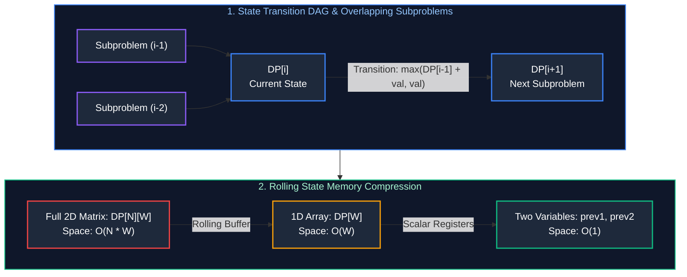

# 07. Dynamic Programming & State Transitions

A comprehensive, production-grade guide to Dynamic Programming (DP), Memoization vs. Tabulation, State-Space Compression, Kadane Variations (Circular Subarrays), Longest Increasing Subsequence (Patience Sorting), String DP (LCS & Edit Distance), Word Break, and Knapsack Patterns.

---

## Architectural Overview: State Transition Graphs & Space Optimization



---

## Table of Contents
1. [Dynamic Programming Foundations](#1-dynamic-programming-foundations)
   - 1.1 [Optimal Substructure & Overlapping Subproblems](#11-optimal-substructure--overlapping-subproblems)
   - 1.2 [Memoization (Top-Down) vs. Tabulation (Bottom-Up)](#12-memoization-top-down-vs-tabulation-bottom-up)
   - 1.3 [State Space Reduction to O(1) Scalars](#13-state-space-reduction-to-o1-scalars)
2. [1D Array & Subarray Patterns](#2-1d-array--subarray-patterns)
   - 2.1 [Kadane's Algorithm for Maximum Subarray Sum (LeetCode 53)](#21-kadanes-algorithm-for-maximum-subarray-sum-leetcode-53)
   - 2.2 [Maximum Sum Circular Subarray (LeetCode 918)](#22-maximum-sum-circular-subarray-leetcode-918)
   - 2.3 [House Robber I & II](#23-house-robber-i--ii)
3. [Subsequence Optimization & Patience Sorting](#3-subsequence-optimization--patience-sorting)
   - 3.1 [Longest Increasing Subsequence (O(N^2) to O(N log N))](#31-longest-increasing-subsequence-on2-to-on-log-n)
4. [String Dynamic Programming](#4-string-dynamic-programming)
   - 4.1 [Longest Common Subsequence (LCS)](#41-longest-common-subsequence-lcs)
   - 4.2 [Edit Distance (Levenshtein Distance)](#42-edit-distance-levenshtein-distance)
   - 4.3 [Word Break Problem (DP with HashSet & Prefix Trie)](#43-word-break-problem-dp-with-hashset--prefix-trie)
5. [The Knapsack Patterns](#5-the-knapsack-patterns)
   - 5.1 [0/1 Knapsack & Target Sum](#51-01-knapsack--target-sum)
   - 5.2 [Unbounded Knapsack: Coin Change I & II](#52-unbounded-knapsack-coin-change-i--ii)
6. [Practice Problems by Difficulty Tier](#6-practice-problems-by-difficulty-tier)
7. [Summary & Engineering Reference Matrix](#7-summary--engineering-reference-matrix)
8. [References & Further Reading](#8-references--further-reading)

---

# 1. Dynamic Programming Foundations

Dynamic Programming (DP) is an algorithmic optimization paradigm that solves complex problems by breaking them down into simpler, overlapping subproblems. Rather than recomputing identical subproblem answers repeatedly, DP caches intermediate results.

### 1.1 Optimal Substructure & Overlapping Subproblems

To determine whether a problem is solvable via Dynamic Programming, two properties must hold:
1. **Optimal Substructure:** An optimal solution to the overall problem incorporates optimal solutions to related subproblems. For instance, the shortest path from $A$ to $C$ passing through $B$ is the concatenation of the shortest path from $A$ to $B$ and the shortest path from $B$ to $C$.
2. **Overlapping Subproblems:** The recursive solution tree repeatedly revisits the same exact states rather than generating unique subproblems (as in divide-and-conquer like MergeSort).

---

### 1.2 Memoization (Top-Down) vs. Tabulation (Bottom-Up)

There are two primary paradigms for implementing DP:
- **Top-Down with Memoization:** Starts at the target state and recursively branches downward, populating a lookup table (cache) on demand. While natural to derive from recursive formulations, it incurs function call overhead and consumes $O(N)$ execution stack frames.
- **Bottom-Up with Tabulation:** Starts at the fundamental base cases and iteratively builds the solution table forward. It eliminates recursion stack overhead, maximizes CPU cache locality, and allows memory compression.

```java
import java.util.Arrays;

public class DPFoundations {

    // Top-Down Memoization: Time: O(N), Space: O(N) recursion stack + O(N) memo
    public int climbStairsMemo(int n) {
        int[] memo = new int[n + 1];
        Arrays.fill(memo, -1);
        return solveMemo(n, memo);
    }

    private int solveMemo(int n, int[] memo) {
        if (n <= 1) return 1;
        if (memo[n] != -1) return memo[n];
        memo[n] = solveMemo(n - 1, memo) + solveMemo(n - 2, memo);
        return memo[n];
    }

    // Bottom-Up Tabulation: Time: O(N), Space: O(N)
    public int climbStairsTabulation(int n) {
        if (n <= 1) return 1;
        int[] dp = new int[n + 1];
        dp[0] = 1;
        dp[1] = 1;

        for (int i = 2; i <= n; i++) {
            dp[i] = dp[i - 1] + dp[i - 2];
        }
        return dp[n];
    }
}
```

---

### 1.3 State Space Reduction to O(1) Scalars

Notice that in `climbStairsTabulation`, computing `dp[i]` depends strictly on the two immediately preceding states: `dp[i - 1]` and `dp[i - 2]`. Consequently, maintaining an entire array of size $N$ is unnecessary.

By maintaining two scalar variables (`prev1` and `prev2`), auxiliary space drops from **$O(N)$ to $O(1)$ constant memory**:

```java
// Space-Optimized State Transition: Time: O(N), Space: O(1)
public int climbStairsOptimized(int n) {
    if (n <= 1) return 1;
    int prev2 = 1; // dp[0]
    int prev1 = 1; // dp[1]

    for (int i = 2; i <= n; i++) {
        int curr = prev1 + prev2;
        prev2 = prev1;
        prev1 = curr;
    }
    return prev1;
}
```

---

# 2. 1D Array & Subarray Patterns

### 2.1 Kadane's Algorithm for Maximum Subarray Sum (LeetCode 53)

#### State Definition & Invariant
Let `dp[i]` denote the maximum sum of any contiguous subarray that ends **strictly at index `i`**:
$$\text{dp}[i] = \max(A[i], \text{dp}[i-1] + A[i])$$

- **Decision Logic:** If the running sum ending at the previous element is negative ($\text{dp}[i-1] < 0$), extending it would decrease $A[i]$'s value. It is strictly better to abandon the previous subarray and start a new subarray beginning at $A[i]$.
- **Space Optimization:** Because `dp[i]` depends only on `dp[i-1]`, we maintain two scalars: `currentMax` and `globalMax`. Runs in $O(N)$ time and $O(1)$ space.

```java
// LeetCode 53: Maximum Subarray - Time: O(N), Space: O(1)
public int maxSubArray(int[] nums) {
    if (nums == null || nums.length == 0) return 0;
    int currentMax = nums[0];
    int globalMax = nums[0];

    for (int i = 1; i < nums.length; i++) {
        currentMax = Math.max(nums[i], currentMax + nums[i]);
        globalMax = Math.max(globalMax, currentMax);
    }
    return globalMax;
}
```

---

### 2.2 Maximum Sum Circular Subarray (LeetCode 918)

In a circular array, a contiguous subarray can wrap around the end of the array to the beginning. The optimal subarray falls into one of two cases:
1. **Standard Non-Wrapping Subarray:** Located entirely in the middle, computed via standard Kadane's algorithm: $\text{maxKadane}$.
2. **Wrapping Subarray:** Spans the boundary, which means the **unselected elements in the middle form a contiguous minimum subarray**! Thus, the wrapped maximum sum is:
   $$\text{WrappedMax} = \text{TotalSum} - \text{minKadane}$$
3. **Corner Case (All Negative Elements):** If every number in `nums` is negative, $\text{TotalSum} == \text{minKadane}$, which yields $\text{WrappedMax} = 0$ (an empty subarray). In this case, return $\text{maxKadane}$ (the largest single negative element).

```java
// LeetCode 918: Maximum Sum Circular Subarray - Time: O(N), Space: O(1)
public class CircularSubarrayMax {
    public int maxSubarraySumCircular(int[] nums) {
        int totalSum = 0;
        int currMax = 0, maxKadane = nums[0];
        int currMin = 0, minKadane = nums[0];

        for (int x : nums) {
            currMax = Math.max(x, currMax + x);
            maxKadane = Math.max(maxKadane, currMax);

            currMin = Math.min(x, currMin + x);
            minKadane = Math.min(minKadane, currMin);

            totalSum += x;
        }

        // If all numbers are negative, maxKadane is the maximum negative element
        if (maxKadane < 0) return maxKadane;

        return Math.max(maxKadane, totalSum - minKadane);
    }
}
```

---

### 2.3 House Robber I & II

#### House Robber I (LeetCode 198)
You cannot rob two adjacent houses. At each house $i$, choose the maximum between:
1. Robbing house $i$: gain `nums[i]` plus maximum haul from house $i - 2$.
2. Skipping house $i$: maintain maximum haul from house $i - 1$.
$$\text{dp}[i] = \max(\text{dp}[i-1], \text{dp}[i-2] + \text{nums}[i])$$

```java
// LeetCode 198: House Robber - Time: O(N), Space: O(1)
public int rob(int[] nums) {
    if (nums == null || nums.length == 0) return 0;
    if (nums.length == 1) return nums[0];

    int prev2 = 0;
    int prev1 = 0;

    for (int num : nums) {
        int curr = Math.max(prev1, prev2 + num);
        prev2 = prev1;
        prev1 = curr;
    }
    return prev1;
}
```

#### House Robber II (Circular Neighborhood) (LeetCode 213)
All houses are arranged in a circle, meaning house 0 and house $N - 1$ are adjacent.
- Robbing house 0 precludes robbing house $N - 1$.
- Robbing house $N - 1$ precludes robbing house 0.
- **Solution:** Decompose into two linear House Robber I subproblems and take their maximum:
  $$\text{Result} = \max(\text{robLinear}(0, N - 2), \text{robLinear}(1, N - 1))$$

```java
// LeetCode 213: House Robber II - Time: O(N), Space: O(1)
public int robCircular(int[] nums) {
    if (nums == null || nums.length == 0) return 0;
    if (nums.length == 1) return nums[0];

    return Math.max(robRange(nums, 0, nums.length - 2), 
                    robRange(nums, 1, nums.length - 1));
}

private int robRange(int[] nums, int start, int end) {
    int prev2 = 0, prev1 = 0;
    for (int i = start; i <= end; i++) {
        int curr = Math.max(prev1, prev2 + nums[i]);
        prev2 = prev1;
        prev1 = curr;
    }
    return prev1;
}
```

---

# 3. Subsequence Optimization & Patience Sorting

### 3.1 Longest Increasing Subsequence (O(N^2) to O(N log N))

#### Quadratic Formulation:
$$\text{dp}[i] = 1 + \max_{j < i, A[j] < A[i]} \text{dp}[j] \implies O(N^2) \text{ time}$$

#### Patience Sorting with Binary Search ($O(N \log N)$):
We maintain an array `tails`, where `tails[len]` stores the **smallest ending element** of all increasing subsequences of length $\text{len} + 1$ found so far.

**Invariant:** The array `tails` is always strictly increasing:
- For each element $x$ in `nums`:
  - Perform binary search to find the index $i$ in `tails` of the first element $\ge x$.
  - If $x$ is greater than all elements in `tails`, append $x$ to the end of `tails` (extends the length of the longest subsequence found).
  - Otherwise, overwrite `tails[i] = x`. Replacing a larger tail with $x$ maintains the subsequence length while lowering the boundary for future candidate elements to extend the sequence.
- Total time is **$O(N \log N)$**, and auxiliary space is **$O(N)$**.

```java
// LeetCode 300: Longest Increasing Subsequence - Time: O(N log N), Space: O(N)
public class LongestIncreasingSubsequence {
    public int lengthOfLIS(int[] nums) {
        if (nums == null || nums.length == 0) return 0;
        int[] tails = new int[nums.length];
        int size = 0;

        for (int x : nums) {
            int i = 0, j = size;
            while (i < j) {
                int mid = i + ((j - i) >> 1);
                if (tails[mid] < x) {
                    i = mid + 1;
                } else {
                    j = mid;
                }
            }
            tails[i] = x;
            if (i == size) size++;
        }
        return size;
    }
}
```

---

# 4. String Dynamic Programming

### 4.1 Longest Common Subsequence (LCS)

#### Recurrence Invariant:
Given strings $S_1$ and $S_2$:
$$\text{dp}[i][j] = \begin{cases} 1 + \text{dp}[i-1][j-1] & \text{if } S_1[i-1] == S_2[j-1] \\ \max(\text{dp}[i-1][j], \text{dp}[i][j-1]) & \text{if } S_1[i-1] \neq S_2[j-1] \end{cases}$$

Because `dp[i][j]` depends only on row `i - 1` and the current row `i`, space can be compressed to a rolling 1D array of size $O(\min(M, N))$.

```java
// LeetCode 1143: Longest Common Subsequence - Time: O(M * N), Space: O(min(M, N))
public int longestCommonSubsequence(String text1, String text2) {
    if (text1.length() < text2.length()) {
        return longestCommonSubsequence(text2, text1); // Ensure text2 is shorter
    }

    int m = text1.length();
    int n = text2.length();
    int[] dp = new int[n + 1];

    for (int i = 1; i <= m; i++) {
        int prevDiagonal = 0;
        for (int j = 1; j <= n; j++) {
            int temp = dp[j];
            if (text1.charAt(i - 1) == text2.charAt(j - 1)) {
                dp[j] = prevDiagonal + 1;
            } else {
                dp[j] = Math.max(dp[j], dp[j - 1]);
            }
            prevDiagonal = temp;
        }
    }
    return dp[n];
}
```

---

### 4.2 Edit Distance (Levenshtein Distance)

Edit distance calculates the minimum number of operations (insert, delete, replace) to transform $S_1$ into $S_2$:
$$\text{dp}[i][j] = \begin{cases} \text{dp}[i-1][j-1] & \text{if } S_1[i-1] == S_2[j-1] \\ 1 + \min\begin{cases} \text{dp}[i][j-1] & \text{(Insert)} \\ \text{dp}[i-1][j] & \text{(Delete)} \\ \text{dp}[i-1][j-1] & \text{(Replace)} \end{cases} & \text{otherwise} \end{cases}$$

```java
// LeetCode 72: Edit Distance - Time: O(M * N), Space: O(M * N)
public int minDistance(String word1, String word2) {
    int m = word1.length(), n = word2.length();
    int[][] dp = new int[m + 1][n + 1];

    for (int i = 0; i <= m; i++) dp[i][0] = i; // Deleting all chars from word1
    for (int j = 0; j <= n; j++) dp[0][j] = j; // Inserting all chars from word2

    for (int i = 1; i <= m; i++) {
        for (int j = 1; j <= n; j++) {
            if (word1.charAt(i - 1) == word2.charAt(j - 1)) {
                dp[i][j] = dp[i - 1][j - 1];
            } else {
                dp[i][j] = 1 + Math.min(dp[i - 1][j - 1], // Replace
                               Math.min(dp[i - 1][j],      // Delete
                                        dp[i][j - 1]));     // Insert
            }
        }
    }
    return dp[m][n];
}
```

---

### 4.3 Word Break Problem (DP with HashSet & Prefix Trie)

Let `dp[i]` be true if the prefix substring $S[0 \dots i-1]$ can be segmented into words from the dictionary.
$$\text{dp}[i] = \bigvee_{j=0}^{i-1} (\text{dp}[j] \wedge (S[j \dots i-1] \in \text{Dict}))$$

By tracking the maximum word length in the dictionary (`maxWordLen`), we prune the inner loop to search backward at most `maxWordLen` characters, reducing time from $O(N^2)$ to $O(N \cdot L_{\max})$.

```java
import java.util.*;

// LeetCode 139: Word Break - Time: O(N * maxWordLen), Space: O(N)
public class WordBreakSolution {
    public boolean wordBreak(String s, List<String> wordDict) {
        Set<String> dict = new HashSet<>(wordDict);
        boolean[] dp = new boolean[s.length() + 1];
        dp[0] = true; // Base case: empty string

        int maxWordLen = 0;
        for (String w : wordDict) {
            maxWordLen = Math.max(maxWordLen, w.length());
        }

        for (int i = 1; i <= s.length(); i++) {
            for (int j = i - 1; j >= Math.max(0, i - maxWordLen); j--) {
                if (dp[j] && dict.contains(s.substring(j, i))) {
                    dp[i] = true;
                    break;
                }
            }
        }
        return dp[s.length()];
    }
}
```

---

# 5. The Knapsack Patterns

### 5.1 0/1 Knapsack & Target Sum

In a 0/1 Knapsack, each item can be selected **at most once**.
- When compressing to a 1D array `dp[w]`, we **must iterate backward** from capacity $W$ down to item weight $w_i$:
  $$\text{dp}[w] = \max(\text{dp}[w], \text{dp}[w - w_i] + v_i)$$
- **Why Backward?** Iterating forward would use the newly updated value `dp[w - w_i]` from the current item in the same iteration, inadvertently allowing the item to be picked multiple times. Iterating backward guarantees that `dp[w - w_i]` reflects state from the previous item only.

```java
// 0/1 Knapsack 1D State Compression - Time: O(N * W), Space: O(W)
public int knapsack01(int[] weights, int[] values, int W) {
    int[] dp = new int[W + 1];

    for (int i = 0; i < weights.length; i++) {
        int w = weights[i];
        int v = values[i];
        // Iterate backward to enforce 0/1 single selection invariant
        for (int j = W; j >= w; j--) {
            dp[j] = Math.max(dp[j], dp[j - w] + v);
        }
    }
    return dp[W];
}
```

---

### 5.2 Unbounded Knapsack: Coin Change I & II

In an Unbounded Knapsack, items can be selected **infinitely many times**. We iterate **forward** from item weight $w_i$ up to $W$.

#### 1. Coin Change I: Minimum Coins (LeetCode 322)
```java
// LeetCode 322: Coin Change - Time: O(Coins * Amount), Space: O(Amount)
public int coinChange(int[] coins, int amount) {
    int[] dp = new int[amount + 1];
    Arrays.fill(dp, amount + 1); // Sentinel for infinity
    dp[0] = 0;

    for (int coin : coins) {
        for (int a = coin; a <= amount; a++) {
            dp[a] = Math.min(dp[a], dp[a - coin] + 1);
        }
    }
    return dp[amount] > amount ? -1 : dp[amount];
}
```

#### 2. Coin Change II: Number of Combinations (LeetCode 518)
To count **combinations** (where $[1, 2]$ and $[2, 1]$ are identical) rather than **permutations**, the **outer loop must iterate over coins** and the inner loop over amounts. If the loops were reversed, different orderings of the same coins would be counted as separate states.

```java
// LeetCode 518: Coin Change II - Time: O(Coins * Amount), Space: O(Amount)
public int change(int amount, int[] coins) {
    int[] dp = new int[amount + 1];
    dp[0] = 1;

    for (int coin : coins) {
        for (int a = coin; a <= amount; a++) {
            dp[a] += dp[a - coin];
        }
    }
    return dp[amount];
}
```

---

# 6. Practice Problems by Difficulty Tier

The table below catalogs essential interview problems spanning 1D array DP, subsequence search, string alignments, and knapsack variations. When formulating DP solutions in an interview:
1. **Identify the State:** Clearly define what `dp[i]` or `dp[i][j]` represents in plain English before writing code.
2. **Derive the Transition Equation:** Formulate how state $i$ is calculated from prior subproblems ($i - 1$, $i - 2$, etc.).
3. **Establish Base Cases:** Explicitly define initial conditions (e.g., `dp[0] = 0` or `dp[0] = 1`).
4. **Optimize Memory:** Compress $N \times M$ matrices to 1D rolling buffers whenever transitions depend strictly on the immediately preceding row.

| Difficulty | Problem Name | Core Pattern | LeetCode Link | Complexity |
| :---: | :--- | :--- | :---: | :---: |
| **Easy** | Climbing Stairs | 1D Fibonacci DP | LC 70 | $O(N) \text{ time}, O(1) \text{ space}$ |
| **Easy** | Maximum Subarray | Kadane's Algorithm | LC 53 | $O(N) \text{ time}, O(1) \text{ space}$ |
| **Medium** | House Robber II | Circular Neighborhood DP | LC 213 | $O(N) \text{ time}, O(1) \text{ space}$ |
| **Medium** | Maximum Sum Circular Subarray | Dual Kadane (Max/Min) | LC 918 | $O(N) \text{ time}, O(1) \text{ space}$ |
| **Medium** | Longest Increasing Subsequence | Patience Sort / Binary Search | LC 300 | $O(N \log N) \text{ time}, O(N) \text{ space}$ |
| **Medium** | Word Break | Prefix DP with HashSet | LC 139 | $O(N \cdot L) \text{ time}, O(N) \text{ space}$ |
| **Medium** | Coin Change | Unbounded Knapsack | LC 322 | $O(N \cdot \text{Amount}) \text{ time}, O(\text{Amount}) \text{ space}$ |
| **Medium** | Longest Common Subsequence | 2D Grid DP | LC 1143 | $O(M \cdot N) \text{ time}, O(\min(M, N)) \text{ space}$ |
| **Hard** | Edit Distance | 2D Levenshtein Transition | LC 72 | $O(M \cdot N) \text{ time}, O(\min(M, N)) \text{ space}$ |
| **Hard** | Trapping Rain Water | DP Left/Right Max Bounds | LC 42 | $O(N) \text{ time}, O(1) \text{ space}$ |

---

# 7. Summary & Engineering Reference Matrix

Dynamic Programming transforms exponential combinatorial brute-force trees into polynomial or linear operations by exploiting overlapping subproblems. In production systems, iterative tabulation combined with state-space memory reduction avoids runtime call-stack overflows and exploits CPU cache locality across contiguous arrays.

The reference matrix below synthesizes core DP classes, state transitions, and space optimization techniques:

| DP Pattern | Loop Direction | State Representation | Space Optimization |
| :--- | :--- | :--- | :--- |
| **Kadane Subarray** | Forward $0 \to N-1$ | `dp[i]`: Max ending at index $i$ | $O(1)$ single scalar `currMax` |
| **Patience LIS** | Forward $0 \to N-1$ | `tails[len]`: Smallest tail element | $O(N \log N)$ via Binary Search |
| **0/1 Knapsack** | Backwards $W \to w_i$ | `dp[w]`: Max value at capacity $w$ | $O(W)$ 1D array |
| **Unbounded Knapsack** | Forwards $w_i \to W$ | `dp[w]`: Min coins at capacity $w$ | $O(W)$ 1D array |
| **2D String DP** | Forward $1 \to M, 1 \to N$ | `dp[i][j]`: Alignment of prefixes | $O(\min(M, N))$ rolling 2 rows |

---

# 8. References & Further Reading
- Richard Bellman, *Dynamic Programming* (Princeton University Press).
- Cormen, Leiserson, Rivest, Stein, *Introduction to Algorithms (CLRS): Chapter 15*.
- Sanjoy Dasgupta, Christos Papadimitriou, Umesh Vazirani, *Algorithms: Chapter 6*.
