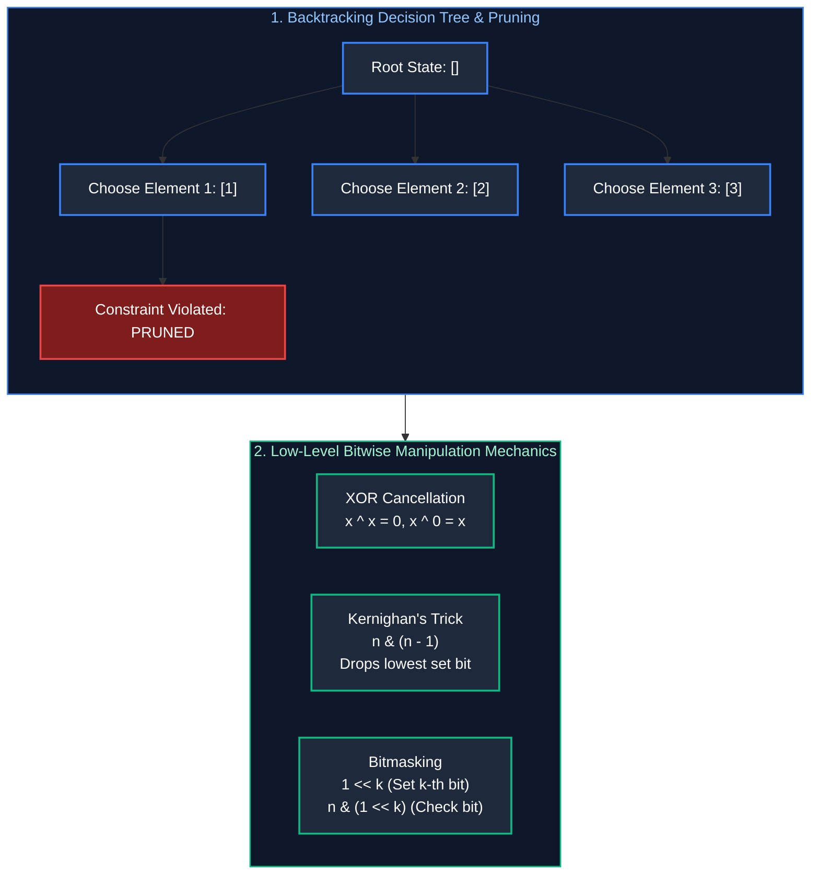

# 08. Backtracking & Bit Manipulation

A comprehensive, production-grade guide to Backtracking, State-Space Tree Pruning, Combinatorial Search (Subsets, Permutations, Combinations), Constraint Satisfaction (N-Queens & Sudoku), and Bit Manipulation Mechanics (XOR properties, Brian Kernighan's Algorithm, and Bitmasking).

---

## Architectural Overview: Combinatorial Search Space & Bitwise Operations



---

## Table of Contents
1. [The Backtracking Framework](#1-the-backtracking-framework)
   - 1.1 [The 3 Pillars: Choice, Constraints & Goal](#11-the-3-pillars-choice-constraints--goal)
   - 1.2 [State Space Tree Pruning](#12-state-space-tree-pruning)
2. [Combinatorial Search Patterns](#2-combinatorial-search-patterns)
   - 2.1 [Subsets I & II (Handling Duplicates)](#21-subsets-i--ii-handling-duplicates)
   - 2.2 [Permutations I & II](#22-permutations-i--ii)
   - 2.3 [Combination Sum I & II](#23-combination-sum-i--ii)
3. [Constraint Satisfaction Problems](#3-constraint-satisfaction-problems)
   - 3.1 [N-Queens (Bitmask Optimized)](#31-n-queens-bitmask-optimized)
   - 3.2 [Sudoku Solver](#32-sudoku-solver)
4. [Bit Manipulation Mechanics](#4-bit-manipulation-mechanics)
   - 4.1 [XOR Algebraic Invariants](#41-xor-algebraic-invariants)
   - 4.2 [Single Number I, II & III](#42-single-number-i-ii--iii)
   - 4.3 [Brian Kernighan's Algorithm (n & (n - 1))](#43-brian-kernighans-algorithm-n--n---1)
   - 4.4 [Bitmask State Representation for Subsets](#44-bitmask-state-representation-for-subsets)
5. [Practice Problems by Difficulty Tier](#5-practice-problems-by-difficulty-tier)
6. [Summary & Engineering Reference Matrix](#6-summary--engineering-reference-matrix)
7. [References & Further Reading](#7-references--further-reading)

---

# 1. The Backtracking Framework

Backtracking is an algorithmic paradigm that systematically explores combinatorial configuration spaces by incrementally building candidate solutions and abandoning ("backtracking" from) candidates as soon as they violate problem constraints.

### 1.1 The 3 Pillars: Choice, Constraints & Goal

Every backtracking algorithm is structured around three foundational components:
1. **Choice:** What action or selection can be made at the current step? (e.g., picking the next integer for a combination, placing a digit in a Sudoku cell, or assigning a queen to a column).
2. **Constraints:** Is the prospective choice legally admissible under the problem's rules given the existing state? If not, the decision branch is pruned immediately, avoiding unproductive recursive descent.
3. **Goal:** Does the current path represent a complete, valid solution? (e.g., path length equals $N$, or remaining target sum equals 0). If reached, snapshot the solution into the results accumulator.
4. **The Backtrack (State Reversion):** After returning from the recursive call exploring downstream possibilities, the state modification must be cleanly reverted (e.g., `path.remove(path.size() - 1)`, unmarking a visited boolean, or clearing bitmasks) so sibling branches can evaluate alternatives without contamination.

---

### 1.2 State Space Tree Pruning

In unpruned combinatorial search, the state space explodes exponentially: $O(2^N)$ for power sets, $O(N!)$ for permutations, and $O(B^N)$ for constraint satisfaction.

**Pruning** cuts off unproductive subtrees early:
- **Sorting as a Pruning Catalyst:** Sorting inputs prior to backtracking enables deterministic branch termination. If candidates are sorted and `currentSum + nums[i] > target`, because all subsequent elements $j > i$ satisfy `nums[j] >= nums[i]`, we can execute a `break` instead of a `continue`, terminating the loop and pruning thousands of recursive function calls.
- **Deduplication:** When multiple identical elements exist, sorting groups identical values adjacently, allowing us to skip duplicate branches at the current recursion level via `if (i > start && nums[i] == nums[i - 1]) continue;`.

---

# 2. Combinatorial Search Patterns

Combinatorial algorithms generate Subsets, Permutations, and Combinations. The operational difference lies in how candidate indices are traversed.

### 2.1 Subsets I & II (Handling Duplicates)

#### Subsets Generation Invariant
- **Subsets I (Unique Elements - LeetCode 78):** At each recursion level, advance the search window using `start = i + 1`. This guarantees each element is used at most once and prevents generating reversed duplicates (e.g., $[1, 2]$ and $[2, 1]$).
- **Subsets II (Duplicate Elements - LeetCode 90):** Sort the array first. At the active loop level, if an element matches its predecessor and is not the first element evaluated at this depth (`i > start && nums[i] == nums[i - 1]`), skip it.

```java
import java.util.*;

// LeetCode 90: Subsets II - Time: O(N * 2^N), Space: O(N) recursion stack
public class SubsetsSolutions {
    public List<List<Integer>> subsetsWithDup(int[] nums) {
        List<List<Integer>> result = new ArrayList<>();
        if (nums == null || nums.length == 0) return result;
        Arrays.sort(nums); // Prerequisite: Sorting clusters duplicates
        backtrack(nums, 0, new ArrayList<>(), result);
        return result;
    }

    private void backtrack(int[] nums, int start, List<Integer> current, List<List<Integer>> result) {
        result.add(new ArrayList<>(current)); // Every prefix in the decision tree is a valid subset

        for (int i = start; i < nums.length; i++) {
            // Prune duplicate sibling branches at the current depth
            if (i > start && nums[i] == nums[i - 1]) continue;

            current.add(nums[i]);
            backtrack(nums, i + 1, current, result); // Advance start index
            current.remove(current.size() - 1);       // Backtrack state
        }
    }
}
```

---

### 2.2 Permutations I & II

In permutations, order matters: $[1, 2]$ and $[2, 1]$ are distinct valid states. Therefore, the loop cannot advance `start = i + 1`; it must re-examine all array elements from index 0 while maintaining a `boolean[] used` array to track active choices.

#### Permutations II (Handling Duplicates - LeetCode 47)
When duplicate numbers exist in `nums`:
- Sort `nums` first.
- If `nums[i] == nums[i - 1]` and `!used[i - 1]`, skip `nums[i]`. The condition `!used[i - 1]` enforces that identical numbers must be selected in strictly left-to-right sequential order across the recursion tree, completely eliminating duplicate permutations.

```java
import java.util.*;

// LeetCode 47: Permutations II - Time: O(N * N!), Space: O(N)
public class PermutationsSolutions {
    public List<List<Integer>> permuteUnique(int[] nums) {
        List<List<Integer>> result = new ArrayList<>();
        if (nums == null || nums.length == 0) return result;
        Arrays.sort(nums);
        boolean[] used = new boolean[nums.length];
        backtrack(nums, used, new ArrayList<>(), result);
        return result;
    }

    private void backtrack(int[] nums, boolean[] used, List<Integer> current, List<List<Integer>> result) {
        if (current.size() == nums.length) {
            result.add(new ArrayList<>(current));
            return;
        }

        for (int i = 0; i < nums.length; i++) {
            if (used[i]) continue;
            // Duplicate pruning: Ensure identical elements are picked strictly sequentially
            if (i > 0 && nums[i] == nums[i - 1] && !used[i - 1]) continue;

            used[i] = true;
            current.add(nums[i]);
            backtrack(nums, used, current, result);
            current.remove(current.size() - 1); // Backtrack
            used[i] = false;
        }
    }
}
```

---

### 2.3 Combination Sum I & II

#### 1. Combination Sum I (Reusable Elements - LeetCode 39)
Elements may be chosen an unlimited number of times. When recursing, pass `i` (not `i + 1`) as the next `start` index to allow reuse of the current candidate.

#### 2. Combination Sum II (Single-Use with Duplicates - LeetCode 40)
Each number can only be used once, and candidates contain duplicate values. Sort `candidates` and prune using both:
- `if (candidates[i] > remainingTarget) break;` (Early break on sorted input).
- `if (i > start && candidates[i] == candidates[i - 1]) continue;` (Duplicate sibling prune).
- Recurse with `i + 1`.

```java
import java.util.*;

// LeetCode 40: Combination Sum II - Time: O(2^N), Space: O(N)
public class CombinationSumSolutions {
    public List<List<Integer>> combinationSum2(int[] candidates, int target) {
        List<List<Integer>> result = new ArrayList<>();
        if (candidates == null || candidates.length == 0) return result;
        Arrays.sort(candidates);
        backtrack(candidates, target, 0, new ArrayList<>(), result);
        return result;
    }

    private void backtrack(int[] candidates, int remain, int start, List<Integer> current, List<List<Integer>> result) {
        if (remain == 0) {
            result.add(new ArrayList<>(current));
            return;
        }

        for (int i = start; i < candidates.length; i++) {
            if (candidates[i] > remain) break; // Pruning: Remaining candidates are even larger
            if (i > start && candidates[i] == candidates[i - 1]) continue; // Duplicate prune

            current.add(candidates[i]);
            backtrack(candidates, remain - candidates[i], i + 1, current, result);
            current.remove(current.size() - 1); // Backtrack
        }
    }
}
```

---

# 3. Constraint Satisfaction Problems

Constraint satisfaction problems assign values to variables subject to predefined constraints.

### 3.1 N-Queens (Bitmask Optimized)

Placing $N$ non-attacking queens on an $N \times N$ chessboard requires that no two queens share a row, column, main diagonal ($\backslash$), or anti-diagonal ($/$).

#### Bitmask Acceleration Mechanics:
Instead of allocating auxiliary 2D arrays or hash sets to verify validity in $O(N)$ time, we encode column and diagonal occupations in three 32-bit integers:
- `cols`: Bit $c$ is 1 if column $c$ is occupied.
- `diag1`: Bit $(r + c)$ is 1 if main diagonal is occupied.
- `diag2`: Bit $(r - c + n)$ is 1 if anti-diagonal is occupied.

Evaluating whether cell $(r, c)$ is safe executes in a single bitwise instruction:
$$\text{isSafe} = ((\text{cols} \mid \text{diag1} \mid \text{diag2}) \ \& \ (1 \ll c)) == 0$$

```java
import java.util.*;

// LeetCode 51: N-Queens - Time: O(N!), Space: O(N)
public class NQueensBitmask {
    public List<List<String>> solveNQueens(int n) {
        List<List<String>> result = new ArrayList<>();
        char[][] board = new char[n][n];
        for (char[] row : board) Arrays.fill(row, '.');

        backtrack(0, n, 0, 0, 0, board, result);
        return result;
    }

    private void backtrack(int row, int n, int cols, int diag1, int diag2, char[][] board, List<List<String>> result) {
        if (row == n) {
            List<String> solution = new ArrayList<>();
            for (char[] r : board) solution.add(new String(r));
            result.add(solution);
            return;
        }

        for (int col = 0; col < n; col++) {
            int d1 = row + col;
            int d2 = row - col + n;

            // Check if column or either diagonal is occupied
            if ((cols & (1 << col)) != 0 || (diag1 & (1 << d1)) != 0 || (diag2 & (1 << d2)) != 0) {
                continue;
            }

            // Place queen and set bits
            board[row][col] = 'Q';
            backtrack(row + 1, n, cols | (1 << col), diag1 | (1 << d1), diag2 | (1 << d2), board, result);
            board[row][col] = '.'; // Backtrack
        }
    }
}
```

---

### 3.2 Sudoku Solver

To solve a 9x9 Sudoku puzzle, iterate cell-by-cell:
1. Scan for the next empty cell (`'.'`).
2. Attempt digits `'1'` through `'9'`.
3. Check validity: verify that the digit does not already exist in the active row, column, or $3 \times 3$ sub-box:
   $$\text{SubBox Row} = 3 \times (r / 3) + i / 3, \quad \text{SubBox Col} = 3 \times (c / 3) + i \% 3$$
4. Recurse. If the downstream path returns `true`, propagate success upward immediately. Otherwise, revert the cell to `'.'` and attempt the next digit.

```java
// LeetCode 37: Sudoku Solver - Time: O(9^(EmptyCells)), Space: O(EmptyCells)
public class SudokuSolver {
    public void solveSudoku(char[][] board) {
        if (board == null || board.length != 9 || board[0].length != 9) return;
        solve(board);
    }

    private boolean solve(char[][] board) {
        for (int r = 0; r < 9; r++) {
            for (int c = 0; c < 9; c++) {
                if (board[r][c] == '.') {
                    for (char ch = '1'; ch <= '9'; ch++) {
                        if (isValid(board, r, c, ch)) {
                            board[r][c] = ch;
                            if (solve(board)) return true; // Solution found!
                            board[r][c] = '.';             // Backtrack
                        }
                    }
                    return false; // No digit 1-9 is valid -> trigger backtrack in caller
                }
            }
        }
        return true; // Entire board filled successfully
    }

    private boolean isValid(char[][] board, int row, int col, char ch) {
        for (int i = 0; i < 9; i++) {
            if (board[row][i] == ch) return false; // Row check
            if (board[i][col] == ch) return false; // Column check
            int boxRow = 3 * (row / 3) + i / 3;
            int boxCol = 3 * (col / 3) + i % 3;
            if (board[boxRow][boxCol] == ch) return false; // 3x3 Sub-box check
        }
        return true;
    }
}
```

---

# 4. Bit Manipulation Mechanics

Bitwise operations manipulate integers directly at the binary register level, running in single CPU cycles ($< 0.5\text{ ns}$).

### 4.1 XOR Algebraic Invariants

The bitwise XOR operator ($\oplus$ or `^`) satisfies four foundational algebraic properties:
1. **Identity:** $A \oplus 0 = A$
2. **Self-Inverse:** $A \oplus A = 0$
3. **Commutativity:** $A \oplus B = B \oplus A$
4. **Associativity:** $A \oplus (B \oplus C) = (A \oplus B) \oplus C$

---

### 4.2 Single Number I, II & III

#### 1. Single Number I (LeetCode 136)
Every element appears twice except one unique element $U$. XORing all elements together cancels identical pairs to 0, leaving strictly $U$:
$$\text{Result} = X_1 \oplus X_1 \oplus X_2 \oplus X_2 \oplus \dots \oplus U = 0 \oplus 0 \oplus \dots \oplus U = U$$

#### 2. Single Number III (Two Unique Elements - LeetCode 260)
All numbers appear twice except two distinct elements $U_1$ and $U_2$:
1. XOR all numbers: $\text{xorSum} = U_1 \oplus U_2$. Because $U_1 \neq U_2$, $\text{xorSum} \neq 0$, meaning at least one bit in $\text{xorSum}$ is 1.
2. Isolate the lowest set 1-bit using **Two's Complement negation**:
   $$\text{diff} = \text{xorSum} \ \& \ (-\text{xorSum})$$
3. This bit must be set in one unique element (e.g., $U_1$) and unset in the other ($U_2$). Partition all array elements into two groups based on whether this bit is set:
   - Group 1: `(num & diff) != 0`
   - Group 2: `(num & diff) == 0`
4. XOR each group independently. Paired duplicates fall into the same group and cancel out, isolating $U_1$ and $U_2$ in $O(N)$ time and $O(1)$ space.

```java
// LeetCode 260: Single Number III - Time: O(N), Space: O(1)
public int[] singleNumber(int[] nums) {
    int xor = 0;
    for (int n : nums) xor ^= n;

    int lowestSetBit = xor & (-xor); // Isolates lowest differing 1-bit

    int[] result = new int[2];
    for (int n : nums) {
        if ((n & lowestSetBit) == 0) {
            result[0] ^= n;
        } else {
            result[1] ^= n;
        }
    }
    return result;
}
```

---

### 4.3 Brian Kernighan's Algorithm (n & (n - 1))

Subtracting 1 from a binary number flips all trailing zeros to 1, and inverts the lowest set bit from 1 to 0:
$$n = 10100_2, \quad n - 1 = 10011_2 \implies n \ \& \ (n - 1) = 10000_2$$

`n & (n - 1)` **clears the lowest set bit in a single operation**:
- **Counting Set Bits (`popcount`):** The loop executes exactly as many times as there are 1-bits in the binary representation ($O(\text{setBits})$ instead of $O(32)$).
- **Power of Two Verification:** A positive number is a power of 2 if and only if it contains exactly one set bit:
  $$\text{isPowerOfTwo}(n) = (n > 0) \ \& \ ((n \ \& \ (n - 1)) == 0)$$

```java
// LeetCode 191: Number of 1 Bits - Time: O(Bits Set), Space: O(1)
public int hammingWeight(int n) {
    int count = 0;
    while (n != 0) {
        n = n & (n - 1); // Clears the lowest set bit
        count++;
    }
    return count;
}
```

---

### 4.4 Bitmask State Representation for Subsets

For an array of length $N$ (where $N \le 30$), every subset can be mapped directly to an integer $mask \in [0, 2^N - 1]$. The $k$-th bit of $mask$ specifies whether element `nums[k]` is included in that subset.

```java
import java.util.*;

// Iterative Subset Generation via Bitmask - Time: O(N * 2^N), Space: O(1) auxiliary
public List<List<Integer>> subsetsBitmask(int[] nums) {
    List<List<Integer>> result = new ArrayList<>();
    int n = nums.length;
    int totalSubsets = 1 << n; // 2^N total subsets

    for (int mask = 0; mask < totalSubsets; mask++) {
        List<Integer> subset = new ArrayList<>();
        for (int k = 0; k < n; k++) {
            if ((mask & (1 << k)) != 0) {
                subset.add(nums[k]); // Bit k is set; include nums[k]
            }
        }
        result.add(subset);
    }
    return result;
}
```

---

# 5. Practice Problems by Difficulty Tier

The table below catalogs essential interview problems spanning backtracking combinatorial search, constraint satisfaction, and bitwise optimization. When approaching these problems in technical interviews:
1. **Subsets vs. Permutations:** If order does not matter, pass `start + 1`; if order matters, iterate from index 0 with a `used[]` boolean array.
2. **Handling Duplicates:** Always sort first and apply sibling pruning (`i > start && nums[i] == nums[i-1]`).
3. **Tracking Grid/Board Constraints:** Replace hash sets or arrays with 32-bit integer bitmasks to reduce memory overhead and achieve $O(1)$ safety checks.
4. **Pair Cancellation & Bit Isolation:** Use XOR for pair cancellation and `x & (-x)` to isolate the lowest set bit.

| Difficulty | Problem Name | Core Pattern | LeetCode Link | Complexity |
| :---: | :--- | :--- | :---: | :---: |
| **Easy** | Single Number | XOR Cancellation | LC 136 | $O(N) \text{ time}, O(1) \text{ space}$ |
| **Easy** | Number of 1 Bits | Brian Kernighan `n & (n - 1)` | LC 191 | $O(\text{setBits}) \text{ time}, O(1) \text{ space}$ |
| **Easy** | Counting Bits | DP on Bit Shifts | LC 338 | $O(N) \text{ time}, O(N) \text{ space}$ |
| **Medium** | Subsets II | Backtracking with Duplicate Pruning | LC 90 | $O(N \cdot 2^N) \text{ time}, O(N) \text{ space}$ |
| **Medium** | Permutations II | Visited Array Duplicate Defense | LC 47 | $O(N \cdot N!) \text{ time}, O(N) \text{ space}$ |
| **Medium** | Combination Sum | Backtracking with Reuse | LC 39 | $O(N^{\text{target}/M}) \text{ time}$ |
| **Medium** | Single Number III | XOR Lowest Set Bit Partition | LC 260 | $O(N) \text{ time}, O(1) \text{ space}$ |
| **Hard** | N-Queens | Bitmask Diagonal Constraints | LC 51 | $O(N!) \text{ time}, O(N) \text{ space}$ |
| **Hard** | Sudoku Solver | 3-Constraint Backtracking | LC 37 | $O(9^{81}) \text{ heavily pruned}$ |

---

# 6. Summary & Engineering Reference Matrix

Backtracking and bit manipulation represent the dual spectrum of algorithmic problem solving: exploring massive combinatorial trees through recursive constraint satisfaction on one end, and exploiting low-level register arithmetic on the other. Bitmasking bridges both domains, allowing exponential search states to be compressed into single CPU words for instantaneous constraint validation.

The reference matrix below synthesizes core mechanics, invariants, and complexity profiles:

| Technique | Invariant | Time Complexity | Memory Footprint |
| :--- | :--- | :--- | :--- |
| **Subsets Backtracking** | Advance `start` index $i+1$ | $O(N \cdot 2^N)$ | $O(N)$ recursion depth |
| **Permutations Backtracking**| Iterate all unvisited via `used[]` | $O(N \cdot N!)$ | $O(N)$ recursion depth |
| **Bitmask Subsets** | Integer loop $0 \to 2^N - 1$ | $O(N \cdot 2^N)$ | $O(1)$ auxiliary memory |
| **XOR Bit Cancellation** | $A \oplus A = 0$ | $O(N)$ single pass | $O(1)$ scalar |
| **Kernighan's Bit Drop** | $N \ \& \ (N - 1)$ clears lowest set bit | $O(\text{Bits Set})$ | $O(1)$ scalar |

---

# 7. References & Further Reading
- Donald Knuth, *The Art of Computer Programming, Volume 4A: Combinatorial Algorithms & Bitwise Tricks*.
- Henry S. Warren Jr., *Hacker's Delight*, 2nd Edition (Addison-Wesley).
- Cormen, Leiserson, Rivest, Stein, *Introduction to Algorithms (CLRS)*.
