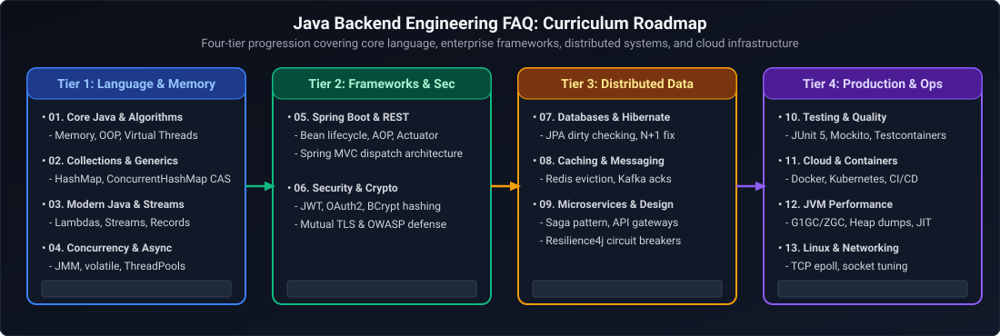

# Java Backend Engineering Interview Questions & Comprehensive Solutions Master Guide

This directory contains the production-grade, deeply analyzed answers to the complete collection of real-world Java Backend Engineering interview scenarios, live coding implementations, and enterprise architecture designs.

All questions have been systematically grouped by conceptual similarity, mapped to enterprise Java backend disciplines, and organized in the **optimal chronological order in which they should be studied**. Each guide provides formal definitions, architectural diagrams, mathematical/memory analysis, production-grade code snippets, edge-case handling, and troubleshooting playbooks matching the rigorous style of the base concepts guides.

---

## Recommended Chronological Study Order

*D2 Source: [`01_java_faq_curriculum_roadmap.d2`](assets/00_java_faq_study_guide_and_index/01_java_faq_curriculum_roadmap.d2)*

---

## Topic Guides & Coverage Overview

| Study Order | Guide File | Questions Covered | Corresponding Base Concepts | Key Topics & Grouped Scenarios |
| :---: | :--- | :---: | :--- | :--- |
| **01** | [`01_core_java_and_oop_faq.md`](01_core_java_and_oop_faq.md) | Core Java & OOP (Q1–Q42) | [`01_core_java_and_oop.md`](../01_core_java_and_oop.md) | • **OOP & Contracts:** String immutability, equals/hashCode contract, shallow vs deep copy. • **Algorithms & Data Handling:** Palindrome validation, anagram detection, stack-based parentheses. • **Production Design:** Thread-safe singleton, deep serialization, defensive immutability, PC registers. |
| **02** | [`02_java_collections_and_generics_faq.md`](02_java_collections_and_generics_faq.md) | Collections Framework (Q1–Q32) | [`02_java_collections_and_generics.md`](../02_java_collections_and_generics.md) | • **Hierarchy & Implementations:** List vs Set, ArrayList vs LinkedList, ArrayDeque vs Stack. • **Hashing Mechanics:** HashMap bucket collision, Red-Black treeification, load factor dynamics. • **Concurrency & Generics:** ConcurrentHashMap segment/CAS locking, CopyOnWriteArrayList, PECS, LRU caches. |
| **03** | [`03_modern_java_streams_and_records_faq.md`](03_modern_java_streams_and_records_faq.md) | Modern Java & Streams (Q1–Q14) | [`03_modern_java_streams_and_records.md`](../03_modern_java_streams_and_records.md) | • **Functional Foundations:** @FunctionalInterface, built-in SAM types, method reference syntax. • **Stream API Pipelines:** Intermediate vs terminal ops, loop fusion, map vs flatMap, short-circuiting, reduce vs collect. • **Language Evolution:** Optional best practices, Java 16 Records, Java 17 Sealed hierarchies. |
| **04** | [`04_java_concurrency_and_multithreading_faq.md`](04_java_concurrency_and_multithreading_faq.md) | Multithreading & JMM (Q1–Q21) | [`04_java_concurrency_and_multithreading.md`](../04_java_concurrency_and_multithreading.md) | • **Concurrency Foundations:** Runnable vs Callable, Thread lifecycle, wait/notify monitor mechanics. • **JMM Internals:** Volatile visibility guarantees, happens-before edges, Atomic CAS operations. • **Executors & Loom:** ThreadPoolExecutor queuing policies, CompletableFuture async, Virtual Threads, LMAX Disruptor. |
| **05** | [`05_spring_boot_and_rest_apis_faq.md`](05_spring_boot_and_rest_apis_faq.md) | Spring Boot & REST APIs (Q1–Q39) | [`05_spring_boot_and_rest_apis.md`](../05_spring_boot_and_rest_apis.md) | • **IoC & Bean Lifecycle:** BeanFactory vs ApplicationContext, Constructor injection, auto-configuration. • **MVC Dispatcher Pipeline:** HandlerMapping, HandlerAdapter, Interceptors, MessageConverters. • **Enterprise API Design:** REST statelessness, PUT vs PATCH, ProblemDetail error format, HikariCP triage, multi-DataSource. |
| **06** | [`06_security_and_cryptography_faq.md`](06_security_and_cryptography_faq.md) | Security, OAuth2 & JWT (Q1–Q17) | [`06_security_and_cryptography.md`](../06_security_and_cryptography.md) | • **Security Architecture:** SecurityFilterChain ordering, AuthenticationManager, custom providers. • **Authentication Tokens:** Stateless JWT RS256 validation, refresh token rotation, HttpOnly cookies. • **OAuth2 & Permissions:** OAuth2 Authorization Code + PKCE, method security SpEL expressions. |
| **07** | [`07_databases_jpa_and_hibernate_faq.md`](07_databases_jpa_and_hibernate_faq.md) | Databases, JPA & Hibernate (Q1–Q27) | [`07_databases_jpa_and_hibernate.md`](../07_databases_jpa_and_hibernate.md) | • **Relational Foundations:** ACID transaction guarantees, ANSI isolation levels, B-Tree index scans. • **ORM Internals:** Entity lifecycle states, First-Level vs Second-Level cache, dirty checking engine, get vs load. • **Performance & Triage:** N+1 query problem resolution (JOIN FETCH, EntityGraph), locking strategies, silent rollback trap. |
| **08** | [`08_caching_redis_and_kafka_faq.md`](08_caching_redis_and_kafka_faq.md) | Messaging: Kafka & RabbitMQ (Q1–Q12) | [`08_caching_redis_and_kafka.md`](../08_caching_redis_and_kafka.md) | • **Broker Architecture:** RabbitMQ AMQP exchanges/bindings vs Kafka partitioned commit log. • **Message Delivery Invariants:** At-least-once, idempotent consumer design, consumer group rebalances, deduplication store. • **Resilience:** Dead Letter Queues, retry backoff with jitter, out-of-order event handling. |
| **09** | [`09_microservices_and_system_design_faq.md`](09_microservices_and_system_design_faq.md) | Microservices & Architecture (Q1–Q26) | [`09_microservices_and_system_design.md`](../09_microservices_and_system_design.md) | • **Distributed Foundations:** Monolith vs Microservices, DDD Bounded Contexts, CAP/PACELC trade-offs. • **Communication & Resilience:** API Gateway routing, Resilience4j Circuit Breakers, Bulkheads, cascading retry storms. • **Distributed Data Patterns:** Saga Orchestration, Transactional Outbox pattern, CQRS architecture. |
| **10** | [`10_testing_and_quality_engineering_faq.md`](10_testing_and_quality_engineering_faq.md) | Testing & Quality Engineering (Q1–Q15) | [`10_testing_and_quality_engineering.md`](../10_testing_and_quality_engineering.md) | • **Testing Pyramid & Slicing:** @WebMvcTest, @DataJpaTest, Mockito ByteBuddy inline mock maker. • **Integration & Concurrency:** Testcontainers (PostgreSQL, Kafka), Awaitility, JCStress race testing. • **Fitness Functions & Quality:** ArchUnit architecture rules, Pitest mutation coverage, Pact contract testing. |
| **11** | [`11_cloud_native_containers_and_devops_faq.md`](11_cloud_native_containers_and_devops_faq.md) | Cloud Native & DevOps (Q1–Q17) | [`11_cloud_native_containers_and_devops.md`](../11_cloud_native_containers_and_devops.md) | • **Containerization & K8s:** Multi-stage Docker builds, distroless images, liveness/readiness probes, HPA, cgroups v2 memory limits. • **Cloud Infrastructure:** Azure Managed Identities, Key Vault CSI, AWS EKS deployment flow, VPC subnets, Compute trade-offs (EC2 vs ECS vs Lambda). • **CI/CD & GitOps:** Automated quality gates, blue-green, canary, zero-downtime rolling deployments. |
| **12** | [`12_jvm_internals_performance_and_troubleshooting_faq.md`](12_jvm_internals_performance_and_troubleshooting_faq.md) | JVM Internals & Troubleshooting (Q1–Q16) | [`12_jvm_internals_performance_and_troubleshooting.md`](../12_jvm_internals_performance_and_troubleshooting.md) | • **Memory & GC Mechanics:** Heap generation sizing, G1GC vs ZGC tuning, STW safepoints, Time-To-Safepoint (TTSP). • **Diagnostic Triage:** Thread dump analysis (jstack), OutOfMemoryError heap dump triage (MAT), Metaspace classloader leaks. • **Advanced Runtime:** JIT compilation tiers (C1/C2), deoptimization traps, DirectBuffer leaks, Project Panama off-heap arena management. |
| **13** | [`13_linux_networking_and_distributed_reliability_faq.md`](13_linux_networking_and_distributed_reliability_faq.md) | Linux Networking & Reliability (Q1–Q14) | [`13_linux_networking_and_distributed_reliability.md`](../13_linux_networking_and_distributed_reliability.md) | • **Linux Kernel Tuning:** somaxconn, tcp_max_syn_backlog, TIME_WAIT socket ergonomics, epoll worker starvation. • **Distributed Observability:** OpenTelemetry trace context propagation across Kafka headers, Prometheus/Grafana alerting. • **Production Triage:** Async-profiler flamegraphs, retry storm mitigation, low CPU with high latency triage, silent failure investigation. |

---

## Master Topic Directory & Difficulty Matrix

| Category | Domain & Focus Area | Questions | Progressive Difficulty Distribution | Companion Deep-Dive Guide |
| :---: | :--- | :---: | :--- | :--- |
| **01** | [Core Java, Object-Oriented Programming & Algorithms](#01--core-java-object-oriented-programming--algorithms) | 42 Questions | Easy: 15 | Medium: 29 | Hard: 5 | Expert: 1 | [`01_core_java_oop_and_` `algorithms_faq.md`](01_core_java_and_oop_faq.md) |
| **02** | [Java Collections Framework, Generics & Data Handling](#02--java-collections-framework-generics--data-handling) | 32 Questions | Easy: 9 | Medium: 28 | Hard: 4 | Expert: 0 | [`02_java_collections_and_generics_faq.md`](02_java_collections_and_generics_faq.md) |
| **03** | [Modern Java Features, Lambdas & Functional Streams](#03--modern-java-features-lambdas--functional-streams) | 14 Questions | Easy: 6 | Medium: 12 | Hard: 1 | Expert: 0 | [`03_modern_java_streams_and_` `lambdas_faq.md`](03_modern_java_streams_and_records_faq.md) |
| **04** | [Multithreading, Concurrency & Asynchronous Programming](#04--multithreading-concurrency--asynchronous-programming) | 21 Questions | Easy: 3 | Medium: 12 | Hard: 9 | Expert: 1 | [`04_java_concurrency_` `and_multithreading_faq.md`](04_java_concurrency_and_multithreading_faq.md) |
| **05** | [Spring Framework, Spring Boot & REST APIs](#05--spring-framework-spring-boot--rest-apis) | 39 Questions | Easy: 15 | Medium: 19 | Hard: 10 | Expert: 3 | [`05_spring_boot_and_` `rest_apis_faq.md`](05_spring_boot_and_rest_apis_faq.md) |
| **06** | [Spring Security, OAuth2, OpenID Connect & JWT Architecture](#06--spring-security-oauth2-openid-connect--jwt-architecture) | 17 Questions | Easy: 5 | Medium: 10 | Hard: 4 | Expert: 3 | [`06_spring_security_and_` `oauth2_jwt_faq.md`](06_security_and_cryptography_faq.md) |
| **07** | [Relational Databases, SQL Optimization, JPA & Hibernate ORM](#07--relational-databases-sql-optimization-jpa--hibernate-orm) | 27 Questions | Easy: 7 | Medium: 18 | Hard: 6 | Expert: 1 | [`07_databases_jpa_and_hibernate_faq.md`](07_databases_jpa_and_hibernate_faq.md) |
| **08** | [Distributed Messaging Systems: Apache Kafka & RabbitMQ](#08--distributed-messaging-systems-apache-kafka--rabbitmq) | 12 Questions | Easy: 2 | Medium: 4 | Hard: 7 | Expert: 1 | [`08_messaging_systems_kafka_` `rabbitmq_faq.md`](08_caching_redis_and_kafka_faq.md) |
| **09** | [Microservices Architecture, Distributed Systems & System Design](#09--microservices-architecture-distributed-systems--system-design) | 26 Questions | Easy: 3 | Medium: 12 | Hard: 10 | Expert: 1 | [`09_microservices_and_` `system_design_faq.md`](09_microservices_and_system_design_faq.md) |
| **10** | [Testing & Quality Engineering](#10--testing--quality-engineering) | 15 Questions | Easy: 2 | Medium: 8 | Hard: 5 | Expert: 0 | [`10_testing_and_` `quality_engineering_faq.md`](10_testing_and_quality_engineering_faq.md) |
| **11** | [Cloud Native Containers & DevOps](#11--cloud-native-containers--devops) | 17 Questions | Easy: 4 | Medium: 12 | Hard: 1 | Expert: 0 | [`11_cloud_native_containers_` `and_devops_faq.md`](11_cloud_native_containers_and_devops_faq.md) |
| **12** | [JVM Internals, Performance & Troubleshooting](#12--jvm-internals-performance--troubleshooting) | 16 Questions | Easy: 0 | Medium: 2 | Hard: 13 | Expert: 1 | [`12_jvm_internals_performance_` `and_troubleshooting_faq.md`](12_jvm_internals_performance_and_troubleshooting_faq.md) |
| **13** | [Linux Networking & Distributed Reliability](#13--linux-networking--distributed-reliability) | 14 Questions | Easy: 0 | Medium: 6 | Hard: 8 | Expert: 0 | [`13_linux_networking_and_` `distributed_reliability_faq.md`](13_linux_networking_and_distributed_reliability_faq.md) |
| **TOTAL** | **Enterprise Java Backend Preparation Bank** | **294 Questions** | **All Modules Fully Covered** | **[13 Companion Guides](#topic-guides--coverage-overview)** |

---

## 01 – Core Java, Object-Oriented Programming & Algorithms
*Companion Deep-Dive Guide: [`01_core_java_and_oop_faq.md`](01_core_java_and_oop_faq.md) (42 Questions & Production Solutions)*

1. **`[Easy]`** What is the difference between the == operator and the equals() method in Java? → [Solution](01_core_java_and_oop_faq.md#q11-medium--vs-equals-and-the-string-pool-mechanism)
2. **`[Easy]`** How does short-circuiting work with logical operators (&&, ||) in Java? → [Solution](01_core_java_and_oop_faq.md#q12-easy-short-circuiting-with-logical-operators--)
3. **`[Easy]`** What is the use of constructor in Java? → [Solution](01_core_java_and_oop_faq.md#q13-easy-constructors-and-invoking-static-methods-inside-constructors)
4. **`[Easy]`** Can you invoke a static method inside a constructor in Java? → [Solution](01_core_java_and_oop_faq.md#q13-easy-constructors-and-invoking-static-methods-inside-constructors)
5. **`[Easy]`** What is the purpose of the finally block in Java exception handling? → [Solution](01_core_java_and_oop_faq.md#q14-easy-final-finally-and-finalize)
6. **`[Easy]`** What are the differences between final, finally, and finalize() in Java? → [Solution](01_core_java_and_oop_faq.md#q14-easy-final-finally-and-finalize)
7. **`[Easy]`** What is the difference between StringBuffer and StringBuilder? → [Solution](01_core_java_and_oop_faq.md#q23-easy-stringbuffer-vs-stringbuilder)
8. **`[Easy]`** Contrast Method Overloading vs Method Overriding, and predict the output of an inheritance snippet involving static methods (Method Hiding vs Dynamic Dispatch). → [Solution](01_core_java_and_oop_faq.md#q34-easy-static-method-hiding-vs-dynamic-method-overriding-in-java-inheritance)
9. **`[Easy]`** What is method hiding in Java and how does it differ from overriding? → [Solution](01_core_java_and_oop_faq.md#q19-easy-overriding-static-methods--method-hiding)
10. **`[Easy]`** Can you override a static method in Java? → [Solution](01_core_java_and_oop_faq.md#q19-easy-overriding-static-methods--method-hiding)
11. **`[Easy]`** What is an anonymous inner class, and how is it used in Java? → [Solution](01_core_java_and_oop_faq.md#q20-easy-anonymous-inner-classes--scoping)
12. **`[Easy]`** What is a marker interface, and what are its practical use cases? → [Solution](01_core_java_and_oop_faq.md#q18-easy-marker-interfaces-and-modern-alternatives)
13. **`[Easy]`** What are text blocks, and where are they useful in modern Java? → [Solution](01_core_java_and_oop_faq.md#q29-easy-text-blocks-and-multiline-strings)
14. **`[Medium]`** How do you reverse a string in Java without using built-in API functions? → [Solution](01_core_java_and_oop_faq.md#q1-medium-reverse-a-string-without-built-ins)
15. **`[Medium]`** How do you convert the first half of a string to lowercase and the second half to uppercase in Java? → [Solution](01_core_java_and_oop_faq.md#q2-medium-convert-first-half-to-lowercase--second-half-to-uppercase)
16. **`[Medium]`** How do you find the first non-repeating character in a string? → [Solution](01_core_java_and_oop_faq.md#q3-medium-first-non-repeating-character-in-a-string)
17. **`[Medium]`** How do you find the length of the longest substring without repeating characters? → [Solution](01_core_java_and_oop_faq.md#q4-medium-longest-substring-without-repeating-characters)
18. **`[Medium]`** How do you find the longest common prefix among an array of strings? → [Solution](01_core_java_and_oop_faq.md#q5-medium-longest-common-prefix-in-an-array-of-strings)
19. **`[Medium]`** How do you remove duplicates from an array in a single iteration? → [Solution](01_core_java_and_oop_faq.md#q6-medium-remove-duplicates-from-an-array-in-a-single-iteration)
20. **`[Medium]`** How do you rearrange an integer array so that all even numbers appear before all odd numbers? → [Solution](01_core_java_and_oop_faq.md#q7-medium-rearrange-integer-array-even-before-odd)
21. **`[Medium]`** How do you print prime numbers between 1 and 200 with minimal time complexity (Sieve of Eratosthenes)? → [Solution](01_core_java_and_oop_faq.md#q8-medium-print-prime-numbers-between-1-and-200-minimal-complexity)
22. **`[Medium]`** How do you reverse a singly linked list iteratively and recursively? → [Solution](01_core_java_and_oop_faq.md#q9-medium-reverse-a-singly-linked-list-iterative--recursive)
23. **`[Medium]`** Detect a cycle in a singly linked list without using extra space (Floyd's Tortoise and Hare Algorithm). → [Solution](01_core_java_and_oop_faq.md#q33-medium-detect-a-cycle-in-a-singly-linked-list-without-using-extra-space)
24. **`[Medium]`** How do you verify if a path from root to leaf in a binary tree sums to a given target value? → [Solution](01_core_java_and_oop_faq.md#q10-medium-path-sum-verification-in-a-binary-tree-root-to-leaf)
25. **`[Medium]`** Given String s1 = '00011111', check whether zeros or ones occur more frequently without using a third variable. → [Solution](01_core_java_and_oop_faq.md#q35-medium-character-parity--zero-vs-one-frequency-comparison-without-using-a-third-variable)
26. **`[Medium]`** Given rows of student name and score, return the highest average score, rounded down. → [Solution](01_core_java_and_oop_faq.md#q36-medium-highest-average-student-score-rounded-down-from-tabular-data)
27. **`[Medium]`** What are checked exceptions vs unchecked exceptions? What are their advantages, disadvantages, and performance impact? → [Solution](01_core_java_and_oop_faq.md#q37-medium-checked-vs-unchecked-exceptions-performance-overhead--controlleradvice-exception-handling)
28. **`[Medium]`** Why is composition preferred over inheritance in object-oriented design? → [Solution](01_core_java_and_oop_faq.md#q16-medium-composition-over-inheritance)
29. **`[Medium]`** When should you use an interface versus an abstract class in Java? → [Solution](01_core_java_and_oop_faq.md#q17-medium-interface-vs-abstract-class--static-vs-default-methods)
30. **`[Medium]`** What is the difference between static and default methods in Java interfaces? → [Solution](01_core_java_and_oop_faq.md#q17-medium-interface-vs-abstract-class--static-vs-default-methods)
31. **`[Medium]`** How do you create a deeply immutable class in Java? → [Solution](01_core_java_and_oop_faq.md#q21-medium-designing-completely-immutable-classes)
32. **`[Medium]`** What is the difference between shallow copy and deep copy in Java? → [Solution](01_core_java_and_oop_faq.md#q22-medium-shallow-copy-vs-deep-copy)
33. **`[Medium]`** How does the String Pool work in Java, and why are string literals pooled? → [Solution](01_core_java_and_oop_faq.md#q11-medium--vs-equals-and-the-string-pool-mechanism)
34. **`[Medium]`** What causes a ClassCastException, and how can it be prevented defensively? → [Solution](01_core_java_and_oop_faq.md#q15-medium-classcastexception-root-causes-and-prevention)
35. **`[Medium]`** What are the different types of class loaders in Java (Bootstrap, Platform/Extension, Application)? → [Solution](01_core_java_and_oop_faq.md#q25-medium-classloader-architecture-and-delegation-model)
36. **`[Medium]`** What is the Java Reflection API, and what are its practical use cases and performance costs? → [Solution](01_core_java_and_oop_faq.md#q26-hard-java-reflection-api--dynamic-proxies)
37. **`[Medium]`** What is the difference between the Path and File classes in Java NIO vs IO? → [Solution](01_core_java_and_oop_faq.md#q27-medium-java-nio-path-vs-classic-io-file)
38. **`[Medium]`** How does pattern matching for switch work in modern Java (Java 17 / 21)? → [Solution](01_core_java_and_oop_faq.md#q30-medium-pattern-matching-for-switch)
39. **`[Medium]`** What are the differences between records, standard classes, and sealed classes in modern Java? → [Solution](01_core_java_and_oop_faq.md#q31-medium-records-standard-classes--sealed-classes-in-production)
40. **`[Medium]`** Can you explain a scenario where sealed classes were beneficial in enforcing stricter type hierarchies in your project? → [Solution](01_core_java_and_oop_faq.md#q31-medium-records-standard-classes--sealed-classes-in-production)
41. **`[Hard]`** Explain memory management in Java (Heap, Stack, Metaspace, GC and Object Headers). → [Solution](01_core_java_and_oop_faq.md#q24-hard-jvm-memory-architecture--handling-outofmemoryerror)
42. **`[Hard]`** What are some common causes of OutOfMemoryError (Heap, Metaspace, DirectBuffer) in Java and how do you handle them? → [Solution](01_core_java_and_oop_faq.md#q24-hard-jvm-memory-architecture--handling-outofmemoryerror)
43. **`[Hard]`** What is a Proxy class in Java and how is it used for dynamic method invocation and AOP interception? → [Solution](01_core_java_and_oop_faq.md#q26-hard-java-reflection-api--dynamic-proxies)
44. **`[Hard]`** How does Java handle tail call optimization (TCO), and why does HotSpot intentionally preserve complete stack frames? → [Solution](01_core_java_and_oop_faq.md#q28-hard-tail-call-optimization-in-java)
45. **`[Expert]`** What are virtual threads in Java 21, and how do they differ from platform threads under carrier thread unmounting? → [Solution](01_core_java_and_oop_faq.md#q32-expert-virtual-threads-project-loom-vs-platform-threads)
46. **`[Medium]`** Given a string of opening and closing parentheses/brackets, write an efficient program to validate if the brackets are balanced. Compare stack vs recursion. → [Solution](01_core_java_and_oop_faq.md#q38-medium-validating-balanced-parentheses--brackets-stack-based-vs-recursive-stackless-approaches)
47. **`[Medium]`** What is the Program Counter (PC) Register in the JVM, and why is it isolated per thread? → [Solution](01_core_java_and_oop_faq.md#q39-medium-pc-register-program-counter-register-mechanics--thread-state-isolation-in-the-jvm)
48. **`[Hard]`** Can a String be modified via Reflection or Unsafe in Java? What happens to the String Pool? → [Solution](01_core_java_and_oop_faq.md#q40-hard-string-mutability-via-reflectionunsafe-vs-jvm-string-pool-security-invariants)
49. **`[Easy]`** What is the difference between `String s = "hello"` and `String s = new String("hello")`? → [Solution](01_core_java_and_oop_faq.md#q41-easy-string-pool-vs-java-heap-new-stringhello-allocation-dynamics--constant-pool-resolution)
50. **`[Easy]`** Can static methods be overloaded and overridden in Java? → [Solution](01_core_java_and_oop_faq.md#q42-easy-static-method-overloading-vs-dynamic-overriding-virtual-method-table-vtable-vs-compile-time-direct-invocations)

---

## 02 – Java Collections Framework, Generics & Data Handling

*Companion Deep-Dive Guide: [`02_java_collections_and_generics_faq.md`](02_java_collections_and_generics_faq.md) (32 Questions & Production Solutions)*

1. **`[Easy]`** What is the main difference between List and Set in Java Collections? → [Solution](02_java_collections_and_generics_faq.md#q1-easy-list-vs-set-interfaces)
2. **`[Easy]`** What are the key differences between ArrayList and LinkedList? → [Solution](02_java_collections_and_generics_faq.md#q2-easy-arraylist-vs-linkedlist)
3. **`[Easy]`** What is the difference between Arrays.asList() and new ArrayList<>()? → [Solution](02_java_collections_and_generics_faq.md#q3-easy-arraysaslist-vs-listof-vs-new-arraylist)
4. **`[Easy]`** What are the differences between List.of() and new ArrayList<>() introduced in Java 9+? → [Solution](02_java_collections_and_generics_faq.md#q3-easy-arraysaslist-vs-listof-vs-new-arraylist)
5. **`[Easy]`** How do HashSet, LinkedHashSet, and TreeSet differ in terms of ordering and performance? → [Solution](02_java_collections_and_generics_faq.md#q4-easy-hashset-vs-linkedhashset-vs-treeset)
6. **`[Easy]`** Can a HashMap store null keys, and at which bucket index are null keys stored? → [Solution](02_java_collections_and_generics_faq.md#q7-medium-hashmap-internals-capacity-load-factor-resizing-null-keys--collisions)
7. **`[Easy]`** What are the differences between poll(), peek(), and remove() methods in a Queue? → [Solution](02_java_collections_and_generics_faq.md#q14-easy-poll-vs-peek-vs-remove)
8. **`[Easy]`** What are the differences between Iterator and ListIterator in Java? → [Solution](02_java_collections_and_generics_faq.md#q15-easy-iterator-vs-listiterator)
9. **`[Easy]`** What is the difference between Comparable and Comparator interfaces? → [Solution](02_java_collections_and_generics_faq.md#q17-easy-comparable-vs-comparator)
10. **`[Medium]`** How does a HashSet work internally, and how does it ensure unique elements? → [Solution](02_java_collections_and_generics_faq.md#q5-medium-hashset-internal-working--uniqueness-guarantee)
11. **`[Medium]`** What is the contract between hashCode() and equals(), and what happens if it is violated? → [Solution](02_java_collections_and_generics_faq.md#q6-medium-the-hashcode-and-equals-contract--custom-keys)
12. **`[Medium]`** Which methods must you override when using a custom object as a Map key? → [Solution](02_java_collections_and_generics_faq.md#q6-medium-the-hashcode-and-equals-contract--custom-keys)
13. **`[Medium]`** What are the default initial capacity, load factor, and threshold of a HashMap? → [Solution](02_java_collections_and_generics_faq.md#q7-medium-hashmap-internals-capacity-load-factor-resizing-null-keys--collisions)
14. **`[Medium]`** What happens when two keys collide in a HashMap (LinkedList chaining vs Red-Black Tree treeification)? → [Solution](02_java_collections_and_generics_faq.md#q7-medium-hashmap-internals-capacity-load-factor-resizing-null-keys--collisions)
15. **`[Medium]`** What are the differences between HashMap, ConcurrentHashMap, and Hashtable? → [Solution](02_java_collections_and_generics_faq.md#q8-hard-hashmap-vs-concurrenthashmap-vs-hashtable--concurrency-mechanics)
16. **`[Medium]`** What is the difference between WeakHashMap and HashMap, and how does it prevent memory leaks? → [Solution](02_java_collections_and_generics_faq.md#q9-medium-weakhashmap-vs-hashmap)
17. **`[Medium]`** How does a TreeMap maintain sorting of its keys (Red-Black tree)? → [Solution](02_java_collections_and_generics_faq.md#q10-medium-treemap-red-black-tree-sorting--null-keys)
18. **`[Medium]`** Can TreeMap have null keys? Why or why not? → [Solution](02_java_collections_and_generics_faq.md#q10-medium-treemap-red-black-tree-sorting--null-keys)
19. **`[Medium]`** How do you use EnumSet and EnumMap in Java, and why are they backed by bit vectors? → [Solution](02_java_collections_and_generics_faq.md#q11-medium-enumset-and-enummap)
20. **`[Medium]`** What is the key functional and structural difference between Queue and Deque? → [Solution](02_java_collections_and_generics_faq.md#q12-medium-queue-vs-deque)
21. **`[Medium]`** How does PriorityQueue work internally in Java (Binary Min-Heap)? → [Solution](02_java_collections_and_generics_faq.md#q13-medium-priorityqueue-internal-working)
22. **`[Medium]`** What is the difference between Fail-Fast and Fail-Safe iterators? → [Solution](02_java_collections_and_generics_faq.md#q16-medium-fail-fast-vs-fail-safe-concurrentmodificationexception--safe-removal)
23. **`[Medium]`** What causes a ConcurrentModificationException, and how can you safely remove elements during iteration? → [Solution](02_java_collections_and_generics_faq.md#q16-medium-fail-fast-vs-fail-safe-concurrentmodificationexception--safe-removal)
24. **`[Medium]`** How do you safely remove elements from a collection while iterating over it? → [Solution](02_java_collections_and_generics_faq.md#q16-medium-fail-fast-vs-fail-safe-concurrentmodificationexception--safe-removal)
25. **`[Medium]`** What are stable sorting algorithms and in-place sorting algorithms (TimSort)? → [Solution](02_java_collections_and_generics_faq.md#q18-medium-stable-vs-in-place-sorting-algorithms)
26. **`[Medium]`** How do you create an immutable collection in Java (Collections.unmodifiableList vs List.copyOf)? → [Solution](02_java_collections_and_generics_faq.md#q19-medium-creating-truly-immutable-collections)
27. **`[Medium]`** How do you filter a list of employees to get those with a salary greater than 10,000? → [Solution](02_java_collections_and_generics_faq.md#q21-medium-filter-employees-by-salary--10000)
28. **`[Medium]`** How do you rearrange a list so the minimum element is at index 0 and maximum is at the last index? → [Solution](02_java_collections_and_generics_faq.md#q22-medium-rearrange-list-min-at-first-index-max-at-last-index)
29. **`[Medium]`** How do you find the most frequently occurring element in a list? → [Solution](02_java_collections_and_generics_faq.md#q23-medium-finding-frequency-of-elements--most-frequent-element)
30. **`[Medium]`** How do you calculate the frequency of each element in a list using Streams? → [Solution](02_java_collections_and_generics_faq.md#q23-medium-finding-frequency-of-elements--most-frequent-element)
31. **`[Medium]`** How do you sort a Map by its values in Java using Streams? → [Solution](02_java_collections_and_generics_faq.md#q25-medium-sorting-a-map-by-values)
32. **`[Medium]`** Minimum meeting rooms problem using a Greedy approach and Min-Heap (Meeting Rooms II). → [Solution](02_java_collections_and_generics_faq.md#q26-medium-meeting-rooms-ii-greedy-interval-scheduling-via-min-heap-priorityqueue)
33. **`[Medium]`** Finding the Nth-largest element using a bounded Min-Heap (PriorityQueue). → [Solution](02_java_collections_and_generics_faq.md#q27-medium-finding-the-nth-largest-element-using-a-min-heap-priorityqueue)
34. **`[Medium]`** Can HashMap keys be mutable? Explain hashcode mutation pitfalls and memory leaks. → [Solution](02_java_collections_and_generics_faq.md#q28-medium-can-hashmap-keys-be-mutable-key-mutation-pitfalls--memory-leaks)
35. **`[Hard]`** How does ConcurrentHashMap work internally in Java 8+ to achieve thread safety without locking the entire map (CAS + Node Synchronized)? → [Solution](02_java_collections_and_generics_faq.md#q8-hard-hashmap-vs-concurrenthashmap-vs-hashtable--concurrency-mechanics)
36. **`[Hard]`** How would you handle large datasets in Java using Collections without exhausting heap memory? → [Solution](02_java_collections_and_generics_faq.md#q20-hard-handling-large-datasets-in-memory-using-collections)
37. **`[Hard]`** How do you implement an LRU Cache in Java with O(1) operations using LinkedHashMap? → [Solution](02_java_collections_and_generics_faq.md#q24-hard-lru-cache-implementation-with-o1-operations)
38. **`[Hard]`** Explain HashMap rehashing internals, threshold doubling triggers, and bitwise power-of-two index distribution. → [Solution](02_java_collections_and_generics_faq.md#q29-hard-hashmap-rehashing-internals-threshold-triggers--bitwise-power-of-two-indexing)
39. **`[Medium]`** What is the PECS rule in Java Generics, and how do you write robust, idiomatic code using Optional without anti-patterns? → [Solution](02_java_collections_and_generics_faq.md#q30-medium-java-generics-pecs-rule--extends-t-vs--super-t--optional-idiomatic-usage)
40. **`[Medium]`** How do you find the second highest number in an array in a single pass $O(N)$? How do you sort an array of 0s, 1s, and 2s (Dutch National Flag)? → [Solution](02_java_collections_and_generics_faq.md#q31-medium-single-pass-on-second-highest-element-discovery--non-comparison-array-sorting-dutch-national-flag)
41. **`[Medium]`** Compare HashMap vs LinkedHashMap vs TreeMap in terms of internal data structures, iteration ordering, and $O(1)$ LRU cache eviction mechanics. → [Solution](02_java_collections_and_generics_faq.md#q32-medium-hashmap-vs-linkedhashmap-vs-treemap-memory-topology-access-order-lru-eviction--red-black-tree-invariants)

---

## 03 – Modern Java Features, Lambdas & Functional Streams

*Companion Deep-Dive Guide: [`03_modern_java_streams_and_records_faq.md`](03_modern_java_streams_and_records_faq.md) (14 Questions & Production Solutions)*

1. **`[Easy]`** What is a functional interface in Java, and what are some commonly used built-in functional interfaces? → [Solution](03_modern_java_streams_and_records_faq.md#q1-easy-functional-interfaces-functionalinterface-built-ins--predicate)
2. **`[Easy]`** What is the significance of the @FunctionalInterface annotation in Java? → [Solution](03_modern_java_streams_and_records_faq.md#q1-easy-functional-interfaces-functionalinterface-built-ins--predicate)
3. **`[Easy]`** What is the role and purpose of the java.util.function package? → [Solution](03_modern_java_streams_and_records_faq.md#q1-easy-functional-interfaces-functionalinterface-built-ins--predicate)
4. **`[Easy]`** What is a Predicate interface, and how is it used in Java? → [Solution](03_modern_java_streams_and_records_faq.md#q1-easy-functional-interfaces-functionalinterface-built-ins--predicate)
5. **`[Easy]`** What are method references in Java and how do they relate to lambdas? → [Solution](03_modern_java_streams_and_records_faq.md#q2-easy-method-references-in-java)
6. **`[Easy]`** What is Optional used for, and how does it help prevent NullPointerExceptions? → [Solution](03_modern_java_streams_and_records_faq.md#q3-easy-optional-architecture-and-best-practices-for-npe-prevention)
7. **`[Medium]`** What is a Stream in Java 8, and how does it differ from a Collection? → [Solution](03_modern_java_streams_and_records_faq.md#q4-medium-streams-vs-collections--internal-pipeline-mechanics)
8. **`[Medium]`** How do Java Streams work internally (Pipeline Fusion, Intermediate vs Terminal Operations)? → [Solution](03_modern_java_streams_and_records_faq.md#q4-medium-streams-vs-collections--internal-pipeline-mechanics)
9. **`[Medium]`** What is the difference between map() and flatMap() in the Java Stream API? → [Solution](03_modern_java_streams_and_records_faq.md#q5-medium-map-vs-flatmap)
10. **`[Medium]`** How do you filter a list of employee names starting with 'SU' using the Stream API? → [Solution](03_modern_java_streams_and_records_faq.md#q7-medium-string-filtering--sorting-with-stream-api)
11. **`[Medium]`** How do you find employee names starting with 'a' or 'A' and sort them using Java Streams? → [Solution](03_modern_java_streams_and_records_faq.md#q7-medium-string-filtering--sorting-with-stream-api)
12. **`[Medium]`** How do you count the number of vowels in a string using Java 8 Streams? → [Solution](03_modern_java_streams_and_records_faq.md#q8-medium-counting-vowels-in-a-string-using-streams)
13. **`[Medium]`** How do you find the second highest integer in an unsorted list using the Stream API? → [Solution](03_modern_java_streams_and_records_faq.md#q9-medium-finding-second-highest-integer-in-an-unsorted-list)
14. **`[Medium]`** Write a Java Stream program to find the maximum salary in each department. → [Solution](03_modern_java_streams_and_records_faq.md#q10-medium-finding-the-highest--maximum-salary-in-each-department-using-java-streams)
15. **`[Medium]`** Group employees into dynamic age ranges like 20-30 and 30-40 generically using Streams. → [Solution](03_modern_java_streams_and_records_faq.md#q11-medium-group-employees-into-dynamic-age-ranges-generically-using-streams)
16. **`[Medium]`** Find the first unique (non-repeating) character in a String using Stream API. → [Solution](03_modern_java_streams_and_records_faq.md#q12-medium-find-the-first-non-repeating-unique-character-in-a-string-using-stream-api)
17. **`[Hard]`** How does the Stream API handle parallelism, and why can parallel streams degrade production latency under I/O workloads? → [Solution](03_modern_java_streams_and_records_faq.md#q6-hard-parallel-streams--forkjoinpool-concurrency)
18. **`[Medium]`** Write a Java Stream program to find character frequencies, extract duplicate characters, and count special characters in a String. → [Solution](03_modern_java_streams_and_records_faq.md#q13-medium-character-frequencies-duplicate-extraction--special-character-counting-via-stream-api)
19. **`[Medium]`** What is the difference between Stream `reduce()` and `collect()`? Explain functional reduction vs mutable container accumulation. → [Solution](03_modern_java_streams_and_records_faq.md#q14-medium-stream-reduction-vs-mutable-container-accumulation-reduce-vs-collect-architectural-dynamics)

---

## 04 – Multithreading, Concurrency & Asynchronous Programming

*Companion Deep-Dive Guide: [`04_java_concurrency_and_multithreading_faq.md`](04_java_concurrency_and_multithreading_faq.md) (21 Questions & Production Solutions)*

1. **`[Easy]`** What is the difference between Runnable and Callable interfaces in Java? → [Solution](04_java_concurrency_and_multithreading_faq.md#q1-easy-runnable-vs-callable--calling-run-vs-start)
2. **`[Easy]`** What happens when you call run() instead of start() on a Thread? → [Solution](04_java_concurrency_and_multithreading_faq.md#q1-easy-runnable-vs-callable--calling-run-vs-start)
3. **`[Easy]`** Different ways to create threads in Java, with modern examples (Thread, Runnable, Callable, Virtual Threads). → [Solution](04_java_concurrency_and_multithreading_faq.md#q13-easy-modern-thread-creation-strategies-platform-threads-executorservice--java-21-virtual-threads)
4. **`[Medium]`** What is the difference between wait() and sleep() methods in Java multithreading? → [Solution](04_java_concurrency_and_multithreading_faq.md#q3-medium-the-synchronized-monitor--sleep-vs-wait)
5. **`[Medium]`** How does the synchronized monitor work in Java (monitorenter and monitorexit bytecode)? → [Solution](04_java_concurrency_and_multithreading_faq.md#q3-medium-the-synchronized-monitor--sleep-vs-wait)
6. **`[Medium]`** What is the volatile keyword, and how does it guarantee visibility without atomicity? → [Solution](04_java_concurrency_and_multithreading_faq.md#q4-medium-volatile-vs-atomicinteger-vs-synchronized)
7. **`[Medium]`** What is the difference between volatile and Atomic classes such as AtomicInteger and AtomicReference (CAS operations)? → [Solution](04_java_concurrency_and_multithreading_faq.md#q4-medium-volatile-vs-atomicinteger-vs-synchronized)
8. **`[Medium]`** What happens when multiple threads modify the same shared mutable object without synchronization? → [Solution](04_java_concurrency_and_multithreading_faq.md#q12-medium-shared-mutable-object-hazards-race-conditions-memory-visibility--jmm)
9. **`[Medium]`** Difference between synchronized and ReentrantLock. What are the feature trade-offs? → [Solution](04_java_concurrency_and_multithreading_faq.md#q14-medium-synchronized-vs-reentrantlock-feature-matrix--trade-offs)
10. **`[Medium]`** Why might the JVM fail to terminate after the main() method completes (Non-daemon threads)? → [Solution](04_java_concurrency_and_multithreading_faq.md#q2-medium-why-the-jvm-fails-to-terminate-after-main-completes)
11. **`[Medium]`** Explain what happens when multiple threads update shared state (e.g. bank balance) and how to fix race conditions. → [Solution](04_java_concurrency_and_multithreading_faq.md#q8-expert-executorservice-architecture-saturated-queues--silent-failures)
12. **`[Medium]`** What is the difference between Future and CompletableFuture in Java? → [Solution](04_java_concurrency_and_multithreading_faq.md#q9-hard-future-vs-completablefuture-thenapply-vs-thencompose--concurrency-optimization)
13. **`[Medium]`** What is the difference between thenApply() and thenCompose() in CompletableFuture pipelines? → [Solution](04_java_concurrency_and_multithreading_faq.md#q9-hard-future-vs-completablefuture-thenapply-vs-thencompose--concurrency-optimization)
14. **`[Hard]`** Show how two threads can deadlock in Java, how you detect it via thread dumps, and how you prevent it. → [Solution](04_java_concurrency_and_multithreading_faq.md#q5-hard-deadlock-conditions-thread-dumps--prevention)
15. **`[Hard]`** How does ThreadPoolExecutor work internally (corePoolSize, maximumPoolSize, workQueue, and RejectionExecutionHandler)? → [Solution](04_java_concurrency_and_multithreading_faq.md#q6-hard-fixing-inconsistent-shared-state-bank-balance-race-condition)
16. **`[Hard]`** Why do tasks submitted to an ExecutorService queue up unexpectedly even though the maximum pool size is large? → [Solution](04_java_concurrency_and_multithreading_faq.md#q6-hard-fixing-inconsistent-shared-state-bank-balance-race-condition)
17. **`[Hard]`** Why might ExecutorService tasks fail silently without logging errors, and how can this be resolved? → [Solution](04_java_concurrency_and_multithreading_faq.md#q6-hard-fixing-inconsistent-shared-state-bank-balance-race-condition)
18. **`[Hard]`** Why does parallel stream execution degrade production latency when mixing CPU and I/O tasks? → [Solution](04_java_concurrency_and_multithreading_faq.md#q10-hard-why-parallel-streams-degrade-production-latency)
19. **`[Hard]`** How would you optimize an asynchronous pipeline using CompletableFuture with custom thread pools? → [Solution](04_java_concurrency_and_multithreading_faq.md#q9-hard-future-vs-completablefuture-thenapply-vs-thencompose--concurrency-optimization)
20. **`[Hard]`** Call API 1 and API 2 asynchronously, call API 3 synchronously, then wait for 1 and 2. Plain Java implementation. → [Solution](04_java_concurrency_and_multithreading_faq.md#q11-hard-orchestrating-asynchronous-and-synchronous-remote-calls-with-completablefuture)
21. **`[Expert]`** Under heavy traffic, your application spawns thousands of platform threads causing OOM and CPU thrashing. How do you re-architect with Virtual Threads and bounded queues? → [Solution](04_java_concurrency_and_multithreading_faq.md#q8-expert-executorservice-architecture-saturated-queues--silent-failures)
22. **`[Medium]`** What is the difference between ReentrantLock and ReentrantReadWriteLock? When would you prefer one over the other, and how does lock downgrading work? → [Solution](04_java_concurrency_and_multithreading_faq.md#q15-medium-reentrantlock-vs-reentrantreadwritelock-readwrite-contention--lock-downgrading)
23. **`[Medium]`** Why is `volatile` insufficient for compound operations like `count++`? How do memory barriers and atomic CAS resolve lost updates? → [Solution](04_java_concurrency_and_multithreading_faq.md#q19-medium-why-volatile-cannot-prevent-lost-updates-memory-barriers-vs-atomic-compound-operations)
24. **`[Hard]`** Why does using `CompletableFuture` with `ForkJoinPool.commonPool()` cause thread starvation in production? How do you isolate thread pools? → [Solution](04_java_concurrency_and_multithreading_faq.md#q20-hard-completablefuture-default-thread-pool-dynamics-forkjoinpoolcommonpool-starvation-vs-custom-thread-pool-isolation)
25. **`[Hard]`** How do you achieve thread-safe, high-volume account balance updates under extreme concurrency? Compare Optimistic vs Pessimistic with global ordering vs LMAX Disruptor. → [Solution](04_java_concurrency_and_multithreading_faq.md#q21-hard-thread-safe-high-volume-payment-account-balance-updates-optimistic-locking-vs-pessimistic-locking-vs-lmax-disruptor-in-memory-isolation)

---

## 05 – Spring Framework, Spring Boot & REST APIs

*Companion Deep-Dive Guide: [`05_spring_boot_and_rest_apis_faq.md`](05_spring_boot_and_rest_apis_faq.md) (39 Questions & Production Solutions)*

1. **`[Easy]`** What is the difference between Spring Framework and Spring Boot? → [Solution](05_spring_boot_and_rest_apis_faq.md#q1-easy-spring-framework-vs-spring-boot)
2. **`[Easy]`** What is the ApplicationContext in Spring and how does it relate to BeanFactory? → [Solution](05_spring_boot_and_rest_apis_faq.md#q2-easy-what-is-applicationcontext-in-spring)
3. **`[Easy]`** Difference between @Component, @Service, @Repository, and @Controller stereotypes. → [Solution](05_spring_boot_and_rest_apis_faq.md#q4-medium-stereotype-annotations-component-service-repository-controller--scanning)
4. **`[Easy]`** What is the difference between @Primary and @Qualifier annotations in Spring? → [Solution](05_spring_boot_and_rest_apis_faq.md#q5-easy-primary-vs-qualifier)
5. **`[Easy]`** What is the difference between @Bean and @Autowired annotations? → [Solution](05_spring_boot_and_rest_apis_faq.md#q6-easy-bean-vs-autowired-in-dependency--database-management)
6. **`[Easy]`** What are the different Spring Bean scopes (Singleton, Prototype, Request, Session)? → [Solution](05_spring_boot_and_rest_apis_faq.md#q8-easy-spring-bean-scopes--switching-via-scope)
7. **`[Easy]`** What is the difference between prototype scope and request scope in Spring web applications? → [Solution](05_spring_boot_and_rest_apis_faq.md#q8-easy-spring-bean-scopes--switching-via-scope)
8. **`[Medium]`** Explain IoC (Inversion of Control) and Dependency Injection internals and constructor injection best practices. → [Solution](05_spring_boot_and_rest_apis_faq.md#q3-medium-dependency-injection-internals--best-practices-in-spring-boot)
9. **`[Medium]`** Why is constructor injection preferred over field injection in production Spring Boot applications? → [Solution](05_spring_boot_and_rest_apis_faq.md#q3-medium-dependency-injection-internals--best-practices-in-spring-boot)
10. **`[Medium]`** How does Spring component scanning work across packages starting from @SpringBootApplication? → [Solution](05_spring_boot_and_rest_apis_faq.md#q4-medium-stereotype-annotations-component-service-repository-controller--scanning)
11. **`[Medium]`** What are circular dependencies in Spring beans, why are they an architectural smell, and how are they resolved? → [Solution](05_spring_boot_and_rest_apis_faq.md#q7-medium-the-complete-spring-bean-lifecycle)
12. **`[Medium]`** What are Spring Profiles and how do you organize environment-specific configurations? → [Solution](05_spring_boot_and_rest_apis_faq.md#q11-medium-multi-environment-spring-profiles)
13. **`[Medium]`** What is ViewResolver in Spring MVC and why is it bypassed in RESTful architectures? → [Solution](05_spring_boot_and_rest_apis_faq.md#q12-medium-viewresolver-in-spring-mvc-architecture)
14. **`[Medium]`** Explain Spring Web exception handling annotations (@ExceptionHandler, @ControllerAdvice, @ResponseStatus). → [Solution](05_spring_boot_and_rest_apis_faq.md#q13-medium-spring-web-exception-handling-annotations)
15. **`[Medium]`** How do you design a clean modular Spring Boot architecture across API, domain, service, and persistence layers? → [Solution](05_spring_boot_and_rest_apis_faq.md#q15-medium-architectural-approach-to-developing-a-new-spring-boot-module)
16. **`[Medium]`** Explain the complete Spring Bean Lifecycle pipeline from instantiation to destruction. → [Solution](05_spring_boot_and_rest_apis_faq.md#q17-medium-complete-spring-bean-lifecycle-pipeline)
17. **`[Medium]`** What is @EnableAutoConfiguration and how does it work internally with conditional annotations? → [Solution](05_spring_boot_and_rest_apis_faq.md#q18-medium-how-enableautoconfiguration-works-internally-with-conditional-annotations)
18. **`[Hard]`** How does Spring Boot auto-configuration work internally using @Conditional annotations and spring.factories? → [Solution](05_spring_boot_and_rest_apis_faq.md#q9-hard-springbootapplication--auto-configuration-internals)
19. **`[Hard]`** How do you create a custom Spring Boot auto-configuration starter module? → [Solution](05_spring_boot_and_rest_apis_faq.md#q9-hard-springbootapplication--auto-configuration-internals)
20. **`[Hard]`** How do you securely configure and harden Spring Boot Actuator endpoints in production? → [Solution](05_spring_boot_and_rest_apis_faq.md#q14-hard-spring-boot-actuator-in-production--endpoint-security)
21. **`[Hard]`** Explain what happens internally when a Spring Boot application starts (SpringApplication.run bootstrapping sequence). → [Solution](05_spring_boot_and_rest_apis_faq.md#q16-hard-what-happens-internally-when-a-spring-boot-application-starts-springapplicationrun)
22. **`[Expert]`** Explain how Spring creates CGLIB and JDK dynamic proxies for @Transactional and @Async beans during post-processing. → [Solution](05_spring_boot_and_rest_apis_faq.md#q10-expert-property-injection-via-value-vs-configurationproperties)
23. **`[Easy]`** Is REST architecture stateless or stateful, and why is statelessness essential for horizontal scalability? → [Solution](05_spring_boot_and_rest_apis_faq.md#q19-easy-is-rest-architecture-stateless-or-stateful-and-why)
24. **`[Easy]`** What is the difference between @Controller and @RestController in Spring Boot? → [Solution](05_spring_boot_and_rest_apis_faq.md#q22-easy-controller-vs-restcontroller--http-request-mapping-annotations)
25. **`[Easy]`** What are the common HTTP request mapping annotations in Spring (@GetMapping, @PostMapping, etc.)? → [Solution](05_spring_boot_and_rest_apis_faq.md#q22-easy-controller-vs-restcontroller--http-request-mapping-annotations)
26. **`[Easy]`** Difference between @RequestParam, @PathVariable, and @RequestBody in Spring MVC. → [Solution](05_spring_boot_and_rest_apis_faq.md#q23-easy-parameter-binding-requestparam-vs-pathvariable-vs-requestbody)
27. **`[Easy]`** What is the difference between PUT and PATCH HTTP methods? → [Solution](05_spring_boot_and_rest_apis_faq.md#q20-medium-put-vs-patch--designing-idempotent-api-operations)
28. **`[Easy]`** Comprehensive HTTP status codes taxonomy: When do you return 200, 201, 202, 204, 400, 401, 403, 404, 409, 422, 500, 503? → [Solution](05_spring_boot_and_rest_apis_faq.md#q21-easy-comprehensive-http-status-codes-taxonomy)
29. **`[Easy]`** What headers do you typically pass in an outbound RestTemplate or WebClient request in enterprise systems? → [Solution](05_spring_boot_and_rest_apis_faq.md#q34-easy-standard-enterprise-headers-in-resttemplate--webclient-outbound-requests)
30. **`[Easy]`** What is the difference between @ControllerAdvice and @RestControllerAdvice? → [Solution](05_spring_boot_and_rest_apis_faq.md#q36-easy-controlleradvice-vs-restcontrolleradvice--rfc-7807-problemdetail)
31. **`[Medium]`** How do you design idempotent operations in RESTful APIs using unique Idempotency Keys? → [Solution](05_spring_boot_and_rest_apis_faq.md#q20-medium-put-vs-patch--designing-idempotent-api-operations)
32. **`[Medium]`** How do you implement global exception handling in Spring Boot REST APIs using @RestControllerAdvice and ProblemDetail? → [Solution](05_spring_boot_and_rest_apis_faq.md#q25-medium-graceful-error-handling--global-exception-management-via-restcontrolleradvice)
33. **`[Medium]`** How do you perform payload validation in Spring Boot using Hibernate Validator (@Valid, @NotNull, @Size)? → [Solution](05_spring_boot_and_rest_apis_faq.md#q24-medium-the-dto-pattern--request-flow-across-controller-service-and-repository)
34. **`[Medium]`** How do you handle file uploads in Spring Boot using MultipartFile securely? → [Solution](05_spring_boot_and_rest_apis_faq.md#q24-medium-the-dto-pattern--request-flow-across-controller-service-and-repository)
35. **`[Medium]`** How do you enable and configure Cross-Origin Resource Sharing (CORS) in Spring Boot? → [Solution](05_spring_boot_and_rest_apis_faq.md#q25-medium-graceful-error-handling--global-exception-management-via-restcontrolleradvice)
36. **`[Medium]`** What are the differences between RestTemplate, WebClient, and declarative OpenFeign in Spring Boot? → [Solution](05_spring_boot_and_rest_apis_faq.md#q27-medium-http-clients-resttemplate-vs-webclient-vs-feignclient)
37. **`[Medium]`** How do you implement client-side load balancing and circuit breaking when using OpenFeign? → [Solution](05_spring_boot_and_rest_apis_faq.md#q28-medium-api-versioning-strategies-in-production)
38. **`[Medium]`** How would you design a REST API endpoint to fetch the last N orders for a customer using Spring Boot and Spring Data JPA? → [Solution](05_spring_boot_and_rest_apis_faq.md#q32-medium-designing-a-rest-endpoint-for-last-n-orders-spring-boot--spring-data-jpa)
39. **`[Medium]`** What are the standard RESTful API versioning strategies in production (URI path vs Query param vs Header vs Media Type)? → [Solution](05_spring_boot_and_rest_apis_faq.md#q35-medium-restful-api-versioning-strategies-in-production)
40. **`[Hard]`** How do you secure REST APIs using Spring Security and JWT tokens? → [Solution](05_spring_boot_and_rest_apis_faq.md#q29-hard-how-spring-boot-handles-high-concurrency-requests)
41. **`[Hard]`** What are the architectural trade-offs between REST, gRPC, and GraphQL for enterprise systems? → [Solution](05_spring_boot_and_rest_apis_faq.md#q33-hard-rest-vs-grpc-vs-graphql-architectural-comparison)
42. **`[Hard]`** How do you design and test idempotent payment webhook ingestion endpoints? → [Solution](05_spring_boot_and_rest_apis_faq.md#q26-hard-handling-inconsistent-external-api-calls-nulls--failures-gracefully)
43. **`[Expert]`** How would you design a high-throughput streaming REST API with Server-Sent Events (SSE) and reactive WebFlux backpressure? → [Solution](05_spring_boot_and_rest_apis_faq.md#q30-expert-rate-limiting--throttling-in-spring-boot-apis)
44. **`[Expert]`** Design an enterprise API Gateway rate limiting architecture using Redis Token Bucket with sub-millisecond overhead. → [Solution](05_spring_boot_and_rest_apis_faq.md#q31-expert-configuring-spring-security-for-jwt-on-a-subset-of-endpoints)
45. **`[Hard]`** How do you design idempotent REST APIs using Idempotency-Keys to prevent duplicate entity creation on network timeouts or retries? → [Solution](05_spring_boot_and_rest_apis_faq.md#q37-hard-idempotent-api-design-with-idempotency-keys-to-prevent-duplicate-postings-on-client-timeouts)
46. **`[Hard]`** An API's response time jumps from 200ms to 3s under moderate traffic, but CPU usage remains low. How do you triage HikariCP pool exhaustion and thread serialization? → [Solution](05_spring_boot_and_rest_apis_faq.md#q38-hard-silent-api-latency-explosion-200ms-to-3s-with-low-cpu-and-healthy-heap-hikaricp-connection-pool-exhaustion--thread-serialization)
47. **`[Hard]`** How do you configure multiple DataSources (Primary vs Secondary) in Spring Boot with segregated `EntityManagerFactory` and `PlatformTransactionManager` beans? → [Solution](05_spring_boot_and_rest_apis_faq.md#q39-hard-configuring-multiple-datasources-primary-vs-secondary-with-segregated-entitymanagerfactories-and-jpatransactionmanagers-in-spring-boot)

---

## 06 – Spring Security, OAuth2, OpenID Connect & JWT Architecture

*Companion Deep-Dive Guide: [`06_security_and_cryptography_faq.md`](06_security_and_cryptography_faq.md) (17 Questions & Production Solutions)*

1. **`[Easy]`** What is the difference between Authentication and Authorization? → [Solution](06_security_and_cryptography_faq.md#q1-easy-authentication-vs-authorization)
2. **`[Easy]`** What is the difference between BCryptPasswordEncoder and plain text password hashing? → [Solution](06_security_and_cryptography_faq.md#q4-easy-bcryptpasswordencoder-vs-plain-text-passwords)
3. **`[Easy]`** What are the differences between @PreAuthorize, @Secured, and @RolesAllowed in method security? → [Solution](06_security_and_cryptography_faq.md#q5-medium-method-level-security-preauthorize-vs-secured-vs-rolesallowed)
4. **`[Easy]`** What is CSRF and why is it disabled for stateless RESTful APIs? → [Solution](06_security_and_cryptography_faq.md#q6-easy-spring-security-csrf-protection-mechanics)
5. **`[Easy]`** What is the difference between OAuth2 and Basic Authentication? → [Solution](06_security_and_cryptography_faq.md#q13-easy-oauth2-vs-basic-authentication)
6. **`[Medium]`** How does Spring Security's SecurityFilterChain execute internally as a chain of servlet filters? → [Solution](06_security_and_cryptography_faq.md#q2-expert-spring-security-internal-architecture-filter-chain--authenticationmanager)
7. **`[Medium]`** What is the role of AuthenticationManager, AuthenticationProvider, and SecurityContextHolder? → [Solution](06_security_and_cryptography_faq.md#q2-expert-spring-security-internal-architecture-filter-chain--authenticationmanager)
8. **`[Medium]`** How do you implement a custom UserDetailsService and AuthenticationProvider in Spring Security? → [Solution](06_security_and_cryptography_faq.md#q3-medium-userdetailsservice--custom-authenticationprovider)
9. **`[Medium]`** What is SpEL (Spring Expression Language) and how is it used in @PreAuthorize("hasRole('ADMIN')")? → [Solution](06_security_and_cryptography_faq.md#q5-medium-method-level-security-preauthorize-vs-secured-vs-rolesallowed)
10. **`[Medium]`** What is CORS and why must it be configured before Spring Security filter evaluation? → [Solution](06_security_and_cryptography_faq.md#q7-medium-remember-me-authentication-architecture)
11. **`[Medium]`** Explain the structure of a JSON Web Token (Header, Payload, Signature) and how RS256 asymmetric signing works. → [Solution](06_security_and_cryptography_faq.md#q8-medium-why-use-jwt-tokens-instead-of-stateful-sessions)
12. **`[Medium]`** How do you securely store JWT tokens on the client to protect against XSS and CSRF (HttpOnly cookie)? → [Solution](06_security_and_cryptography_faq.md#q10-expert-client-side-jwt-storage--early-token-revocation)
13. **`[Medium]`** What happens if a JWT token expires and how do you implement short-lived access tokens with Refresh Tokens? → [Solution](06_security_and_cryptography_faq.md#q11-medium-expired-tokens-refresh-token-rotation--concurrency)
14. **`[Medium]`** What are common JWT security vulnerabilities (alg: none, weak secret keys) and how do you mitigate them? → [Solution](06_security_and_cryptography_faq.md#q12-medium-jwt-security-risks--mitigations)
15. **`[Medium]`** Explain the OAuth2 Client Credentials Grant and when to use it for backend microservice-to-microservice communication. → [Solution](06_security_and_cryptography_faq.md#q15-expert-oauth2-client-credentials-grant-for-microservices)
16. **`[Hard]`** Explain the OAuth2 Authorization Code Flow with PKCE (Proof Key for Code Exchange) for mobile and single-page applications. → [Solution](06_security_and_cryptography_faq.md#q14-hard-oauth2-authorization-code-flow-with-pkce)
17. **`[Hard]`** How do you securely propagate and validate JWT tokens across distributed microservices using Feign and JWKS? → [Solution](06_security_and_cryptography_faq.md#q16-hard-cross-service-jwt-propagation--verification-in-distributed-microservices)
18. **`[Hard]`** How do you implement distributed JWT revocation before expiration using a Redis token blacklist? → [Solution](06_security_and_cryptography_faq.md#q10-expert-client-side-jwt-storage--early-token-revocation)
19. **`[Hard]`** How does refresh token rotation with reuse detection prevent token theft and trigger blast-radius invalidation? → [Solution](06_security_and_cryptography_faq.md#q17-hard-refresh-token-reuse-detection--blast-radius-revocation-workflows)
20. **`[Expert]`** Design an enterprise single-sign-on (SSO) architecture supporting multi-tenant OAuth2 and OpenID Connect with Keycloak and Azure AD. → [Solution](06_security_and_cryptography_faq.md#q2-expert-spring-security-internal-architecture-filter-chain--authenticationmanager)
21. **`[Expert]`** How would you design a zero-trust mutual TLS (mTLS) and token-exchange microservices security fabric? → [Solution](06_security_and_cryptography_faq.md#q15-expert-oauth2-client-credentials-grant-for-microservices)
22. **`[Expert]`** A security penetration test discovers that user permissions updated in the database take 15 minutes to reflect in JWT tokens. How do you resolve this without centralized session lookups? → [Solution](06_security_and_cryptography_faq.md#q10-expert-client-side-jwt-storage--early-token-revocation)
---

## 07 – Relational Databases, SQL Optimization, JPA & Hibernate ORM

*Companion Deep-Dive Guide: [`07_databases_jpa_and_hibernate_faq.md`](07_databases_jpa_and_hibernate_faq.md) (27 Questions & Production Solutions)*

1. **`[Easy]`** What are the ACID properties in relational database management systems? → [Solution](07_databases_jpa_and_hibernate_faq.md#q1-medium-acid-properties--database-transaction-isolation-levels)
2. **`[Easy]`** What is the difference between INNER JOIN, LEFT JOIN, RIGHT JOIN, and FULL OUTER JOIN? → [Solution](07_databases_jpa_and_hibernate_faq.md#q2-easy-sql-joins-inner-left-right-and-full-outer)
3. **`[Easy]`** Write an SQL query to fetch the second-highest salary from an Employee table with strict NULL handling. → [Solution](07_databases_jpa_and_hibernate_faq.md#q3-easy-practical-sql-queries-second-highest-salary--department-wise-averages)
4. **`[Easy]`** Write an SQL query to calculate department-wise average salaries and filter departments with average > 50,000. → [Solution](07_databases_jpa_and_hibernate_faq.md#q3-easy-practical-sql-queries-second-highest-salary--department-wise-averages)
5. **`[Easy]`** What is the difference between Primary Key and Unique Key? → [Solution](07_databases_jpa_and_hibernate_faq.md#q1-medium-acid-properties--database-transaction-isolation-levels)
6. **`[Easy]`** What is the difference between DELETE and TRUNCATE statements in SQL? → [Solution](07_databases_jpa_and_hibernate_faq.md#q1-medium-acid-properties--database-transaction-isolation-levels)
7. **`[Easy]`** What are the differences between JpaRepository, CrudRepository, and PagingAndSortingRepository in Spring Data? → [Solution](07_databases_jpa_and_hibernate_faq.md#q21-easy-jparepository-vs-crudrepository-vs-pagingandsortingrepository)
8. **`[Medium]`** Explain database transaction isolation levels (READ UNCOMMITTED, READ COMMITTED, REPEATABLE READ, SERIALIZABLE) and anomalies. → [Solution](07_databases_jpa_and_hibernate_faq.md#q1-medium-acid-properties--database-transaction-isolation-levels)
9. **`[Medium]`** What is the difference between Clustered Index and Non-Clustered Index in relational databases? → [Solution](07_databases_jpa_and_hibernate_faq.md#q4-medium-clustered-vs-non-clustered-indexes--slow-query-optimization)
10. **`[Medium]`** How do you identify and optimize slow SQL queries using EXPLAIN execution plans and indexes? → [Solution](07_databases_jpa_and_hibernate_faq.md#q4-medium-clustered-vs-non-clustered-indexes--slow-query-optimization)
11. **`[Medium]`** How do you invoke stored procedures and handle result sets in Java using JDBC CallableStatement? → [Solution](07_databases_jpa_and_hibernate_faq.md#q5-medium-invoking-stored-procedures-via-jdbc)
12. **`[Medium]`** How do you configure multiple DataSources (e.g. Primary and Secondary databases) in a Spring Boot application? → [Solution](07_databases_jpa_and_hibernate_faq.md#q6-medium-connecting-multiple-datasources-in-spring-boot)
13. **`[Medium]`** Explain Hibernate Entity Lifecycle states: Transient, Persistent (Managed), Detached, and Removed. → [Solution](07_databases_jpa_and_hibernate_faq.md#q7-medium-jpa-primary-key-annotations-id--generatedvalue)
14. **`[Medium]`** What is the difference between FetchType.LAZY and FetchType.EAGER in JPA entities, and why is EAGER considered an anti-pattern? → [Solution](07_databases_jpa_and_hibernate_faq.md#q8-medium-hibernate-entity-lifecycle-states)
15. **`[Medium]`** What is the difference between First-Level Cache (Session) and Second-Level Cache (SessionFactory/Ehcache/Redis) in Hibernate? → [Solution](07_databases_jpa_and_hibernate_faq.md#q10-hard-lazy-vs-eager-lazyinitializationexception--the-n1-select-problem)
16. **`[Medium]`** How does Spring @Transactional work internally using Spring AOP dynamic proxies, and why does self-invocation fail? → [Solution](07_databases_jpa_and_hibernate_faq.md#q14-medium-spring-transactional-architecture-propagation-levels--the-10-core-production-puzzle-scenarios)
17. **`[Medium]`** What are the common transaction propagation levels in Spring (REQUIRED, REQUIRES_NEW, SUPPORTS, MANDATORY) and the 10 core production traps? → [Solution](07_databases_jpa_and_hibernate_faq.md#q14-medium-spring-transactional-architecture-propagation-levels--the-10-core-production-puzzle-scenarios)
18. **`[Medium]`** What is the difference between Optimistic Locking (@Version) and Pessimistic Locking (PESSIMISTIC_WRITE)? → [Solution](07_databases_jpa_and_hibernate_faq.md#q15-hard-optimistic-vs-pessimistic-locking--the-train-seat-booking-race-condition)
19. **`[Medium]`** How do you implement pagination and sorting efficiently in Spring Data JPA using Pageable and Slice? → [Solution](07_databases_jpa_and_hibernate_faq.md#q16-medium-pagination-and-sorting-in-spring-data-jpa)
20. **`[Medium]`** How is rollback managed for a series of SQL statements across transaction boundaries and savepoints? → [Solution](07_databases_jpa_and_hibernate_faq.md#q20-medium-managing-transaction-rollbacks-across-a-series-of-sql-statements)
21. **`[Medium]`** Write an SQL query to delete duplicate rows from a table while keeping one copy. → [Solution](07_databases_jpa_and_hibernate_faq.md#q22-medium-deleting-duplicate-rows-while-retaining-exactly-one-copy-in-sql)
22. **`[Hard]`** What is the N+1 select problem in ORM frameworks, and what are the 3 production ways to resolve it (JOIN FETCH, EntityGraph, BatchSize)? → [Solution](07_databases_jpa_and_hibernate_faq.md#q9-hard-criteria-api-vs-jpql)
23. **`[Hard]`** How do you resolve the train seat or hotel room booking race condition where two users attempt to reserve the same seat simultaneously? → [Solution](07_databases_jpa_and_hibernate_faq.md#q15-hard-optimistic-vs-pessimistic-locking--the-train-seat-booking-race-condition)
24. **`[Hard]`** How will you make sure multiple instances of a cron job worker don't update the same row (ShedLock vs SELECT FOR UPDATE SKIP LOCKED)? → [Solution](07_databases_jpa_and_hibernate_faq.md#q18-hard-multi-instance-cron-worker-row-concurrency-shedlock-vs-select-for-update-skip-locked)
25. **`[Hard]`** Two concurrent transactions occasionally overwrite each other's updates. How do you diagnose the Lost Update anomaly and choose the right concurrency strategy? → [Solution](07_databases_jpa_and_hibernate_faq.md#q19-hard-lost-update-anomaly-optimistic-vs-pessimistic-locking-strategy-selection)
26. **`[Hard]`** How does Hibernate dirty checking work internally, and why does marking transactions readOnly = true yield major memory and CPU gains? → [Solution](07_databases_jpa_and_hibernate_faq.md#q10-hard-lazy-vs-eager-lazyinitializationexception--the-n1-select-problem)
27. **`[Expert]`** How would you design and implement a Multi-Tenant JPA persistence architecture using Schema-Per-Tenant or Database-Per-Tenant with dynamic routing? → [Solution](07_databases_jpa_and_hibernate_faq.md#q17-expert-multi-tenancy-architecture-in-jpa)
28. **`[Medium]`** How do database indexes work internally (B-Tree vs Hash), what is the composite index leftmost prefix rule, and why do functions in WHERE clauses break indexes? → [Solution](07_databases_jpa_and_hibernate_faq.md#q23-medium-database-indexing-mechanics--composite-index-leftmost-prefix-rule)
29. **`[Medium]`** What are the differences between Stored Procedures and Database Triggers? Compare execution performance, business logic placement, and debugging trade-offs. → [Solution](07_databases_jpa_and_hibernate_faq.md#q24-medium-stored-procedures-vs-database-triggers-performance--architecture-trade-offs)
30. **`[Medium]`** Write an SQL query to find employees whose salary is greater than their manager's salary using a self-join. → [Solution](07_databases_jpa_and_hibernate_faq.md#q25-medium-sql-self-join-finding-employees-earning-more-than-their-managers)
31. **`[Medium]`** What is the difference between Hibernate `session.get()` and `session.load()` (or `em.find()` vs `em.getReference()`)? Explain proxy initialization and lazy traps. → [Solution](07_databases_jpa_and_hibernate_faq.md#q26-medium-hibernate-sessionget-vs-sessionload-and-entitymanagerfind-vs-getreference-proxy-initialization--lazy-traps)
32. **`[Hard]`** A method catches an exception from a helper service inside a `@Transactional` block, yet the caller crashes with `UnexpectedRollbackException`. Why? → [Solution](07_databases_jpa_and_hibernate_faq.md#q27-hard-the-silent-rollback-trap-catching-downstream-exceptions-in-transactional-methods--unexpectedrollbackexception)
---

## 08 – Distributed Messaging Systems: Apache Kafka & RabbitMQ

*Companion Deep-Dive Guide: [`08_caching_redis_and_kafka_faq.md`](08_caching_redis_and_kafka_faq.md) (12 Questions & Production Solutions)*

1. **`[Easy]`** What is a message broker service and why is it used in enterprise Java architectures? → [Solution](08_caching_redis_and_kafka_faq.md#q1-easy-message-broker-services-in-enterprise-java-architecture)
2. **`[Easy]`** What is an Exchange in AMQP / RabbitMQ and what are the different exchange types (Direct, Fanout, Topic, Headers)? → [Solution](08_caching_redis_and_kafka_faq.md#q2-easy-what-is-an-exchange-in-amqp--rabbitmq)
3. **`[Medium]`** What is the difference between Apache Kafka and RabbitMQ? When would you choose each for an enterprise architecture? → [Solution](08_caching_redis_and_kafka_faq.md#q3-medium-kafka-vs-rabbitmq-core-differences--selection-criteria)
4. **`[Medium]`** How do Kafka partitions enable horizontal scalability and what is a consumer group? → [Solution](08_caching_redis_and_kafka_faq.md#q4-expert-kafka-architecture-brokers-partitions-consumer-groups--scalability)
5. **`[Medium]`** How do you integrate Apache Kafka with Spring Boot using KafkaTemplate and @KafkaListener? → [Solution](08_caching_redis_and_kafka_faq.md#q5-medium-integrating-apache-kafka-with-spring-boot)
6. **`[Medium]`** How do consumer groups, partition rebalancing (Cooperative Sticky), and offset commits (auto vs manual) work during consumer failure? → [Solution](08_caching_redis_and_kafka_faq.md#q9-medium-consumer-groups-partition-rebalancing--manual-offset-commit-strategies)
7. **`[Hard]`** How do you implement Dead Letter Queues (DLQ) and retry policies in Spring Kafka using @RetryableTopic? → [Solution](08_caching_redis_and_kafka_faq.md#q6-hard-dead-letter-queues-dlq-retry-policies--mitigating-slow-consumers)
8. **`[Hard]`** What causes slow consumers and heartbeat timeouts in Kafka (max.poll.interval.ms exceeded), and how do you mitigate partition rebalances? → [Solution](08_caching_redis_and_kafka_faq.md#q6-hard-dead-letter-queues-dlq-retry-policies--mitigating-slow-consumers)
9. **`[Hard]`** How does Kafka interact with databases using Change Data Capture (Debezium), Kafka Connect, and the Transactional Outbox pattern? → [Solution](08_caching_redis_and_kafka_faq.md#q7-hard-how-kafka-interacts-with-databases-cdc-debezium-kafka-connect--transactional-outbox)
10. **`[Hard]`** Explain Kafka Schema Registry architecture, Avro binary serialization, and schema evolution compatibility modes (BACKWARD, FORWARD, FULL). → [Solution](08_caching_redis_and_kafka_faq.md#q8-hard-kafka-schema-registry-architecture-avro-serialization--schema-evolution)
11. **`[Expert]`** Design an end-to-end exactly-once event streaming pipeline in Java: idempotent producer, Kafka transactions, and transactional consumer-database writes. → [Solution](08_caching_redis_and_kafka_faq.md#q4-expert-kafka-architecture-brokers-partitions-consumer-groups--scalability)
12. **`[Hard]`** How do you diagnose and resolve Kafka consumer lag in production? Walk through partition rebalancing, consumer scaling, and batch commit bottlenecks. → [Solution](08_caching_redis_and_kafka_faq.md#q10-hard-kafka-consumer-lag-diagnosis--resolution-playbook)
13. **`[Hard]`** How do producer acknowledgements (`acks=0`, `1`, `all`) interact with broker `min.insync.replicas`? Explain the trade-offs between durability and latency. → [Solution](08_caching_redis_and_kafka_faq.md#q11-hard-kafka-producer-acknowledgements-acks-in-sync-replicas-mininsyncreplicas--durability-trade-offs)
14. **`[Hard]`** A Kafka consumer commits to the database, but crashes before committing its offset to Kafka. How do you prevent duplicate business effects? → [Solution](08_caching_redis_and_kafka_faq.md#q12-hard-preventing-duplicate-business-effects-when-a-kafka-consumer-commits-to-database-then-crashes-before-committing-offsets)
---

## 09 – Microservices Architecture, Distributed Systems & System Design

*Companion Deep-Dive Guide: [`09_microservices_and_system_design_faq.md`](09_microservices_and_system_design_faq.md) (26 Questions & Production Solutions)*

1. **`[Easy]`** What are microservices and what are their primary advantages and challenges over a monolith? → [Solution](09_microservices_and_system_design_faq.md#q1-medium-microservices-advantages--challenges--ddd-bounded-contexts)
2. **`[Easy]`** What is the role of an API Gateway in microservices architecture? → [Solution](09_microservices_and_system_design_faq.md#q2-expert-service-discovery-load-balancing-eureka-vs-consul--the-api-gateway-pattern)
3. **`[Easy]`** What is YAML and why is it used for declarative configuration in Spring Boot and Kubernetes? → [Solution](09_microservices_and_system_design_faq.md#q12-easy-yaml-configuration--declarative-infrastructure)
4. **`[Medium]`** How do Domain-Driven Design (DDD) Bounded Contexts define microservice boundaries? → [Solution](09_microservices_and_system_design_faq.md#q1-medium-microservices-advantages--challenges--ddd-bounded-contexts)
5. **`[Medium]`** How does service discovery and client-side load balancing work in microservices (Eureka vs Consul)? → [Solution](09_microservices_and_system_design_faq.md#q2-expert-service-discovery-load-balancing-eureka-vs-consul--the-api-gateway-pattern)
6. **`[Medium]`** How do microservices communicate? Compare synchronous protocols (REST, gRPC) versus asynchronous messaging (Kafka, RabbitMQ) and their respective architectural trade-offs. → [Solution](09_microservices_and_system_design_faq.md#q3-medium-synchronous-vs-asynchronous-communication--event-driven-architecture)
7. **`[Medium]`** How do you secure inter-service communication across microservices (mTLS and JWT propagation)? → [Solution](09_microservices_and_system_design_faq.md#q4-medium-securing-microservices-communication-mtls--jwt)
8. **`[Medium]`** What is the Circuit Breaker pattern (Resilience4j) and how does it prevent cascading microservice failures? → [Solution](09_microservices_and_system_design_faq.md#q5-expert-circuit-breakers-resilience4j-cascading-failures--production-recovery-mechanisms)
9. **`[Medium]`** What is the difference between Saga Choreography and Saga Orchestration, and how do you choose between them? → [Solution](09_microservices_and_system_design_faq.md#q21-medium-saga-pattern-choreography-vs-orchestration-decision-framework)
10. **`[Medium]`** What is Command Query Responsibility Segregation (CQRS) and what problems does it solve? → [Solution](09_microservices_and_system_design_faq.md#q8-medium-command-query-responsibility-segregation-cqrs-pattern)
11. **`[Medium]`** How do you implement distributed tracing and centralized logging in Spring Boot microservices (Micrometer, OpenTelemetry, Zipkin)? → [Solution](09_microservices_and_system_design_faq.md#q9-medium-distributed-tracing-centralized-logging--semantic-monitoring)
12. **`[Medium]`** What are Consumer-Driven Contracts (CDC with Pact) and how do they ensure API backward compatibility? → [Solution](09_microservices_and_system_design_faq.md#q10-medium-consumer-driven-contracts-cdc--api-backward-compatibility)
13. **`[Medium]`** Explain the CAP theorem and its real-world implications when designing distributed data stores. → [Solution](09_microservices_and_system_design_faq.md#q11-expert-the-cap-theorem--database-scaling-strategies)
14. **`[Medium]`** What are database scaling strategies (Read Replicas, Sharding, Partitioning) for high-scale applications? → [Solution](09_microservices_and_system_design_faq.md#q11-expert-the-cap-theorem--database-scaling-strategies)
15. **`[Hard]`** How do you maintain data consistency across distributed microservices without 2-phase commit (Saga pattern and Transactional Outbox pattern)? → [Solution](09_microservices_and_system_design_faq.md#q6-expert-distributed-transactions-saga--outbox-patterns--eventual-consistency)
16. **`[Hard]`** How do you design an idempotent payment processing endpoint that prevents duplicate credit card charges even under client retry storms? → [Solution](09_microservices_and_system_design_faq.md#q7-hard-designing-end-to-end-idempotency-in-payment-processing)
17. **`[Hard]`** Design a distributed rate limiter in Java. What happens when its distributed database (Redis) goes down? → [Solution](09_microservices_and_system_design_faq.md#q17-hard-designing-a-distributed-rate-limiter-in-java-with-redis-fallback-degradation)
18. **`[Hard]`** Write a generic Circuit Breaker implementation from scratch in Java around an external remote service call. → [Solution](09_microservices_and_system_design_faq.md#q18-hard-custom-generic-circuit-breaker-implementation-in-plain-java)
19. **`[Hard]`** Design a scalable URL shortener system (like bit.ly) handling 10,000 writes/sec and 100,000 reads/sec. → [Solution](09_microservices_and_system_design_faq.md#q13-hard-system-design-scalable-url-shortener-bitly)
20. **`[Hard]`** Design an algorithmic stream processor to calculate Top K elements across distributed worker nodes in real-time. → [Solution](09_microservices_and_system_design_faq.md#q15-hard-distributed-algorithm-finding-top-k-elements-across-distributed-servers)
21. **`[Hard]`** Design a real-time anomaly detection stream algorithm to detect fraudulent transactions over a rolling window. → [Solution](09_microservices_and_system_design_faq.md#q16-hard-streaming-algorithm-real-time-anomaly-detection-over-rolling-windows)
22. **`[Expert]`** Design an end-to-end high-throughput real-time chat architecture supporting millions of concurrent WebSocket connections and cross-node routing. → [Solution](09_microservices_and_system_design_faq.md#q14-expert-system-design-high-throughput-real-time-chat-millions-of-msgssec)
23. **`[Expert]`** How would you design a Java backend system to handle tens of thousands of concurrent requests without server thread pool exhaustion? → [Solution](09_microservices_and_system_design_faq.md#q19-expert-high-throughput-backend-architecture-for-handling-thousands-of-concurrent-requests)
24. **`[Expert]`** Design a payment system handling 50,000 TPS that prevents duplicate charges across crashes, timeouts, and Kafka retries. → [Solution](09_microservices_and_system_design_faq.md#q20-expert-high-availability-payment-processing-platform-with-zero-double-charges-50000-tps)
25. **`[Expert]`** A downstream billing service suffers intermittent 30-second timeouts. How do you redesign microservices resilience using timeouts, circuit breakers, retries, and bulkheads? → [Solution](09_microservices_and_system_design_faq.md#q5-expert-circuit-breakers-resilience4j-cascading-failures--production-recovery-mechanisms)
26. **`[Expert]`** A Spring Boot microservices platform experiences cascading timeouts causing all services to crash during a marketing sale. How do you re-architect the system? → [Solution](09_microservices_and_system_design_faq.md#q5-expert-circuit-breakers-resilience4j-cascading-failures--production-recovery-mechanisms)
27. **`[Expert]`** How do you design an event-driven Java system that handles duplicate messages, retries failed events, and maintains reliable processing without losing business transactions? → [Solution](09_microservices_and_system_design_faq.md#q6-expert-distributed-transactions-saga--outbox-patterns--eventual-consistency)
28. **`[Expert]`** How do you build an application so that it continues working seamlessly when one cloud instance crashes (High Availability, stateless design, multi-AZ deployment)? → [Solution](09_microservices_and_system_design_faq.md#q2-expert-service-discovery-load-balancing-eureka-vs-consul--the-api-gateway-pattern)
29. **`[Expert]`** How would you design a distributed cache invalidation architecture using Redis Pub/Sub to maintain cache coherency across 50 application nodes? → [Solution](09_microservices_and_system_design_faq.md#q11-expert-the-cap-theorem--database-scaling-strategies)
30. **`[Expert]`** Design a multi-region active-active distributed architecture for a global banking platform with sub-second latency and zero data loss. → [Solution](09_microservices_and_system_design_faq.md#q11-expert-the-cap-theorem--database-scaling-strategies)
31. **`[Expert]`** An e-commerce flash sale causes connection pool starvation across 20 microservices within 30 seconds of launch. What emergency architectural steps do you take? → [Solution](09_microservices_and_system_design_faq.md#q5-expert-circuit-breakers-resilience4j-cascading-failures--production-recovery-mechanisms)
32. **`[Expert]`** Design a High-Throughput Trailing Stop-Loss Order Execution Engine with sub-millisecond price evaluations and concurrent lock-free order books. → [Solution](09_microservices_and_system_design_faq.md#q22-expert-design-a-high-throughput-trailing-stop-loss-order-execution-engine)
33. **`[Hard]`** How do you isolate slow downstream microservices to prevent cascading thread pool collapse using Circuit Breakers, Timeouts, and Bulkheads? → [Solution](09_microservices_and_system_design_faq.md#q23-hard-isolating-slow-downstream-microservices-cascading-failure-prevention-via-circuit-breakers-timeouts--bulkheads)
34. **`[Medium]`** How do you prevent retry storms during cascading outages using exponential backoff with full jitter and circuit breakers? → [Solution](09_microservices_and_system_design_faq.md#q24-medium-retry-storm-prevention--exponential-backoff-with-jitter)
35. **`[Hard]`** How do you detect and decouple a distributed monolith into independent, loosely coupled microservices? → [Solution](09_microservices_and_system_design_faq.md#q25-hard-detecting--decoupling-a-distributed-monolith)
36. **`[Hard]`** Services A -> B -> C each retry failures three times. C slows down, and traffic explodes. Explain the cascading retry storm and redesign it. → [Solution](09_microservices_and_system_design_faq.md#q26-hard-anatomy-and-redesign-of-cascading-retry-storms-in-multi-tier-microservice-architectures-a-to-b-to-c)
---

## 10 – Testing & Quality Engineering

*Companion Deep-Dive Guide: [`10_testing_and_quality_engineering_faq.md`](10_testing_and_quality_engineering_faq.md) (15 Questions & Production Solutions)*

1. **`[Easy]`** Testing Pyramid & Test Slicing Strategy in Enterprise Spring Boot → [Solution](10_testing_and_quality_engineering_faq.md#q1-easy-testing-pyramid--test-slicing-strategy-in-enterprise-spring-boot)
1. **`[Medium]`** JUnit 5 Lifecycle Extensions, Dynamic Tests & Custom ParameterResolvers → [Solution](10_testing_and_quality_engineering_faq.md#q2-medium-junit-5-lifecycle-extensions-dynamic-tests--custom-parameterresolvers)
1. **`[Medium]`** Mockito Inline MockMaker, ByteBuddy Agents & Mocking Static/Final Methods → [Solution](10_testing_and_quality_engineering_faq.md#q3-medium-mockito-inline-mockmaker-bytebuddy-agents--mocking-staticfinal-methods)
1. **`[Hard]`** Spring `TestContextManager` Caching Architecture, `@DirtiesContext` Performance Penalty & Optimization → [Solution](10_testing_and_quality_engineering_faq.md#q4-hard-spring-testcontextmanager-caching-architecture-dirtiescontext-performance-penalty--optimization)
1. **`[Medium]`** WebMvcTest vs WebTestClient vs MockMvc: Slice Testing Trade-Offs & Mocking Web Layers → [Solution](10_testing_and_quality_engineering_faq.md#q5-medium-webmvctest-vs-webtestclient-vs-mockmvc-slice-testing-trade-offs--mocking-web-layers)
1. **`[Hard]`** Testcontainers Architecture: Ryuk Lifecycle, Container Reuse, DynamicPropertyRegistry & Local Port Mapping → [Solution](10_testing_and_quality_engineering_faq.md#q6-hard-testcontainers-architecture-ryuk-lifecycle-container-reuse-dynamicpropertyregistry--local-port-mapping)
1. **`[Hard]`** Testing Concurrent Code & Race Conditions in Java with Awaitility & JCStress → [Solution](10_testing_and_quality_engineering_faq.md#q7-hard-testing-concurrent-code--race-conditions-in-java-with-awaitility--jcstress)
1. **`[Medium]`** Consumer-Driven Contract Testing with Pact: Provider Verification & Breaking API Prevention → [Solution](10_testing_and_quality_engineering_faq.md#q8-medium-consumer-driven-contract-testing-with-pact-provider-verification--breaking-api-prevention)
1. **`[Medium]`** Database Integration Testing with Testcontainers PostgreSQL, Flyway Migrations & Rollbacks → [Solution](10_testing_and_quality_engineering_faq.md#q9-medium-database-integration-testing-with-testcontainers-postgresql-flyway-migrations--rollbacks)
1. **`[Hard]`** Kafka Integration Testing with EmbeddedKafka vs Testcontainers Kafka & Consumer Lag Assertion → [Solution](10_testing_and_quality_engineering_faq.md#q10-hard-kafka-integration-testing-with-embeddedkafka-vs-testcontainers-kafka--consumer-lag-assertion)
1. **`[Easy]`** Enterprise Java Pull Request Code Review Checklist & Anti-Pattern Detection → [Solution](10_testing_and_quality_engineering_faq.md#q11-easy-enterprise-java-pull-request-code-review-checklist--anti-pattern-detection)
1. **`[Medium]`** Architectural Fitness Functions with ArchUnit: Cyclic Dependencies, Layer Invariants & Naming Rules → [Solution](10_testing_and_quality_engineering_faq.md#q12-medium-architectural-fitness-functions-with-archunit-cyclic-dependencies-layer-invariants--naming-rules)
1. **`[Hard]`** Mutation Testing with PIT (Pitest): Evaluating Test Suite Quality Beyond Line Coverage → [Solution](10_testing_and_quality_engineering_faq.md#q13-hard-mutation-testing-with-pit-pitest-evaluating-test-suite-quality-beyond-line-coverage)
1. **`[Medium]`** Mocking Asynchronous Methods (`CompletableFuture`, `@Async`) & Virtual Threads in Unit Tests → [Solution](10_testing_and_quality_engineering_faq.md#q14-medium-mocking-asynchronous-methods-completablefuture-async--virtual-threads-in-unit-tests)
1. **`[Medium]`** Managing Test Flakiness: Network Jitter, Clock Drift & Time-Freezing with `java.time.Clock` → [Solution](10_testing_and_quality_engineering_faq.md#q15-medium-managing-test-flakiness-network-jitter-clock-drift--time-freezing-with-javatimeclock)

---

## 11 – Cloud Native Containers & DevOps

*Companion Deep-Dive Guide: [`11_cloud_native_containers_and_devops_faq.md`](11_cloud_native_containers_and_devops_faq.md) (17 Questions & Production Solutions)*

1. **`[Easy]`** Docker Image vs Container & Multi-Stage Dockerfile for Spring Boot → [Solution](11_cloud_native_containers_and_devops_faq.md#q1-easy-docker-image-vs-container--multi-stage-dockerfile-for-spring-boot)
1. **`[Medium]`** Liveness vs Readiness Probes in Kubernetes → [Solution](11_cloud_native_containers_and_devops_faq.md#q2-medium-liveness-vs-readiness-probes-in-kubernetes)
1. **`[Medium]`** Kubernetes Autoscaling (HPA, VPA, Cluster Autoscaler) & Service Discovery → [Solution](11_cloud_native_containers_and_devops_faq.md#q3-medium-kubernetes-autoscaling-hpa-vpa-cluster-autoscaler--service-discovery)
1. **`[Medium]`** Structuring a Robust CI/CD Pipeline (GitHub Actions / Jenkins) → [Solution](11_cloud_native_containers_and_devops_faq.md#q4-medium-structuring-a-robust-cicd-pipeline-github-actions--jenkins)
1. **`[Easy]`** Deployment Strategies: Blue-Green vs Canary vs Rolling → [Solution](11_cloud_native_containers_and_devops_faq.md#q5-easy-deployment-strategies-blue-green-vs-canary-vs-rolling)
1. **`[Easy]`** Azure Resource Hierarchy & Resource Groups → [Solution](11_cloud_native_containers_and_devops_faq.md#q6-easy-azure-resource-hierarchy--resource-groups)
1. **`[Medium]`** Azure Identity: IAM Roles, Managed Identities & Service Principals → [Solution](11_cloud_native_containers_and_devops_faq.md#q7-medium-azure-identity-iam-roles-managed-identities--service-principals)
1. **`[Medium]`** Azure Storage (Blob vs Files) & Queues (Service Bus vs Storage Queue) → [Solution](11_cloud_native_containers_and_devops_faq.md#q8-medium-azure-storage-blob-vs-files--queues-service-bus-vs-storage-queue)
1. **`[Medium]`** Azure Load Balancer Architecture & Types → [Solution](11_cloud_native_containers_and_devops_faq.md#q9-medium-azure-load-balancer-architecture--types)
1. **`[Easy]`** Horizontal vs Vertical Scaling in Azure → [Solution](11_cloud_native_containers_and_devops_faq.md#q10-easy-horizontal-vs-vertical-scaling-in-azure)
1. **`[Medium]`** Azure Compute Models (VM vs App Service vs Functions vs AKS) & Zero-Downtime Deployments → [Solution](11_cloud_native_containers_and_devops_faq.md#q11-medium-azure-compute-models-vm-vs-app-service-vs-functions-vs-aks--zero-downtime-deployments)
1. **`[Medium]`** Azure Compliance, Governance & Secret Management → [Solution](11_cloud_native_containers_and_devops_faq.md#q12-medium-azure-compliance-governance--secret-management)
1. **`[Medium]`** AWS Virtual Private Cloud (VPC) & Network Resource Isolation → [Solution](11_cloud_native_containers_and_devops_faq.md#q13-medium-aws-virtual-private-cloud-vpc--network-resource-isolation)
1. **`[Medium]`** End-to-End AWS Deployment Flow: CI Build to ECR and EKS Container Rollout → [Solution](11_cloud_native_containers_and_devops_faq.md#q14-medium-end-to-end-aws-deployment-flow-ci-build-to-ecr-and-eks-container-rollout)
1. **`[Medium]`** Core AWS Services Integration in Enterprise Java Backend Engineering → [Solution](11_cloud_native_containers_and_devops_faq.md#q15-medium-core-aws-services-integration-in-enterprise-java-backend-engineering)
1. **`[Hard]`** Production Kubernetes Architecture for Java Microservices: Memory Limits & cgroups v2 → [Solution](11_cloud_native_containers_and_devops_faq.md#q16-hard-production-kubernetes-architecture-for-java-microservices-memory-limits--cgroups-v2)
1. **`[Medium]`** Compute Strategy Selection in AWS: EC2 vs ECS (Fargate) vs AWS Lambda for Java Microservices & CloudWatch/X-Ray Observability → [Solution](11_cloud_native_containers_and_devops_faq.md#q17-medium-compute-strategy-selection-in-aws-ec2-vs-ecs-fargate-vs-aws-lambda-for-java-microservices--cloudwatchx-ray-observability)

---

## 12 – JVM Internals, Performance & Troubleshooting

*Companion Deep-Dive Guide: [`12_jvm_internals_performance_and_troubleshooting_faq.md`](12_jvm_internals_performance_and_troubleshooting_faq.md) (16 Questions & Production Solutions)*

1. **`[Medium]`** Local and Remote Debugging via JDWP & Port Distinctions → [Solution](12_jvm_internals_performance_and_troubleshooting_faq.md#q1-medium-local-and-remote-debugging-via-jdwp--port-distinctions)
1. **`[Hard]`** Application Runs Fine for Hours, Then Suddenly Slows Down → [Solution](12_jvm_internals_performance_and_troubleshooting_faq.md#q2-hard-application-runs-fine-for-hours-then-suddenly-slows-down)
1. **`[Hard]`** High CPU Usage with Very Low Traffic: Investigation Steps → [Solution](12_jvm_internals_performance_and_troubleshooting_faq.md#q3-hard-high-cpu-usage-with-very-low-traffic-investigation-steps)
1. **`[Hard]`** Debugging Rare Production Deadlocks that Cannot be Reproduced Locally → [Solution](12_jvm_internals_performance_and_troubleshooting_faq.md#q4-hard-debugging-rare-production-deadlocks-that-cannot-be-reproduced-locally)
1. **`[Hard]`** Memory Usage Keeps Increasing with No Obvious Heap Leaks → [Solution](12_jvm_internals_performance_and_troubleshooting_faq.md#q5-hard-memory-usage-keeps-increasing-with-no-obvious-heap-leaks)
1. **`[Hard]`** GC Pauses Increase Significantly After a Small Release → [Solution](12_jvm_internals_performance_and_troubleshooting_faq.md#q6-hard-gc-pauses-increase-significantly-after-a-small-release)
1. **`[Medium]`** JVM Tuning: Throughput vs Latency Trade-Off → [Solution](12_jvm_internals_performance_and_troubleshooting_faq.md#q7-medium-jvm-tuning-throughput-vs-latency-trade-off)
1. **`[Hard]`** 200 Threads Running with Low Throughput: Thread Starvation, Pool Sizing & Lock Contention → [Solution](12_jvm_internals_performance_and_troubleshooting_faq.md#q8-hard-200-threads-running-with-low-throughput-thread-starvation-pool-sizing--lock-contention)
1. **`[Hard]`** Spring Boot OutOfMemoryError Diagnostic Playbook: Heap Dumps, Metaspace & Leak Triage → [Solution](12_jvm_internals_performance_and_troubleshooting_faq.md#q9-hard-spring-boot-outofmemoryerror-diagnostic-playbook-heap-dumps-metaspace--leak-triage)
1. **`[Hard]`** High GC Activity with Low Production Traffic: Allocation Churn & Object Lifecycle Triage → [Solution](12_jvm_internals_performance_and_troubleshooting_faq.md#q10-hard-high-gc-activity-with-low-production-traffic-allocation-churn--object-lifecycle-triage)
1. **`[Hard]`** Concurrency Scalability Collapse: Investigating 10 vs 1,000 Concurrent Requests → [Solution](12_jvm_internals_performance_and_troubleshooting_faq.md#q11-hard-concurrency-scalability-collapse-investigating-10-vs-1000-concurrent-requests)
1. **`[Hard]`** Metaspace Leak Triage: Dynamic Class Generation & ClassLoader Leaks in Spring Boot → [Solution](12_jvm_internals_performance_and_troubleshooting_faq.md#q12-hard-metaspace-leak-triage-dynamic-class-generation--classloader-leaks-in-spring-boot)
1. **`[Hard]`** JIT Compilation Tiers (Interpreter to C1 to C2), Inlining & Deoptimization Traps → [Solution](12_jvm_internals_performance_and_troubleshooting_faq.md#q13-hard-jit-compilation-tiers-interpreter-to-c1-to-c2-inlining--deoptimization-traps)
1. **`[Hard]`** Stop-The-World (STW) GC Safepoint Latency: Time-To-Safepoint (TTSP) & Long Counted Loops → [Solution](12_jvm_internals_performance_and_troubleshooting_faq.md#q14-hard-stop-the-world-stw-gc-safepoint-latency-time-to-safepoint-ttsp--long-counted-loops)
1. **`[Hard]`** Java NIO DirectBuffer Memory Leaks (OutOfMemoryError: Direct buffer memory) → [Solution](12_jvm_internals_performance_and_troubleshooting_faq.md#q15-hard-java-nio-directbuffer-memory-leaks-outofmemoryerror-direct-buffer-memory)
1. **`[Expert]`** Project Panama (Foreign Function & Memory API) vs JNI: Off-Heap Arena Management → [Solution](12_jvm_internals_performance_and_troubleshooting_faq.md#q16-expert-project-panama-foreign-function--memory-api-vs-jni-off-heap-arena-management)

---

## 13 – Linux Networking & Distributed Reliability

*Companion Deep-Dive Guide: [`13_linux_networking_and_distributed_reliability_faq.md`](13_linux_networking_and_distributed_reliability_faq.md) (14 Questions & Production Solutions)*

1. **`[Medium]`** Enterprise Production Monitoring & Observability Stack → [Solution](13_linux_networking_and_distributed_reliability_faq.md#q1-medium-enterprise-production-monitoring--observability-stack)
1. **`[Hard]`** Service Slow but CPU Usage is Low: What to Check First → [Solution](13_linux_networking_and_distributed_reliability_faq.md#q2-hard-service-slow-but-cpu-usage-is-low-what-to-check-first)
1. **`[Medium]`** Inconsistent API Response Time Without Code Changes → [Solution](13_linux_networking_and_distributed_reliability_faq.md#q3-medium-inconsistent-api-response-time-without-code-changes)
1. **`[Medium]`** Isolating Background Jobs from Impacting API Latency → [Solution](13_linux_networking_and_distributed_reliability_faq.md#q4-medium-isolating-background-jobs-from-impacting-api-latency)
1. **`[Medium]`** Why Increasing Log Verbosity Degrades Performance → [Solution](13_linux_networking_and_distributed_reliability_faq.md#q5-medium-why-increasing-log-verbosity-degrades-performance)
1. **`[Hard]`** Why Scaling Instances Worsens Overall System Performance → [Solution](13_linux_networking_and_distributed_reliability_faq.md#q6-hard-why-scaling-instances-worsens-overall-system-performance)
1. **`[Hard]`** Retry Storms: How Poorly Configured Retries Cause Cascading Outages → [Solution](13_linux_networking_and_distributed_reliability_faq.md#q7-hard-retry-storms-how-poorly-configured-retries-cause-cascading-outages)
1. **`[Medium]`** Troubleshooting and Resolving 504 Gateway Timeout and 503 Service Unavailable → [Solution](13_linux_networking_and_distributed_reliability_faq.md#q8-medium-troubleshooting-and-resolving-504-gateway-timeout-and-503-service-unavailable)
1. **`[Hard]`** Production Outage with No Exceptions in Logs: Silent Failure Investigation Runbook → [Solution](13_linux_networking_and_distributed_reliability_faq.md#q9-hard-production-outage-with-no-exceptions-in-logs-silent-failure-investigation-runbook)
1. **`[Hard]`** Spring Boot API 5–6s Latency Breakdown: Java Code vs Database vs Network vs External Calls → [Solution](13_linux_networking_and_distributed_reliability_faq.md#q10-hard-spring-boot-api-56s-latency-breakdown-java-code-vs-database-vs-network-vs-external-calls)
1. **`[Hard]`** High-Concurrency Linux Kernel Socket Tuning: somaxconn, tcp_max_syn_backlog & TIME_WAIT Ergonomics → [Solution](13_linux_networking_and_distributed_reliability_faq.md#q11-hard-high-concurrency-linux-kernel-socket-tuning-somaxconn-tcp_max_syn_backlog--time_wait-ergonomics)
1. **`[Hard]`** Linux Epoll Starvation & Worker Thread Starvation in Non-Blocking Netty Event Loops → [Solution](13_linux_networking_and_distributed_reliability_faq.md#q12-hard-linux-epoll-starvation--worker-thread-starvation-in-non-blocking-netty-event-loops)
1. **`[Medium]`** Distributed Trace Context Propagation Across Apache Kafka Message Headers in OpenTelemetry → [Solution](13_linux_networking_and_distributed_reliability_faq.md#q13-medium-distributed-trace-context-propagation-across-apache-kafka-message-headers-in-opentelemetry)
1. **`[Hard]`** Low-Overhead Production Profiling with Async-Profiler: Non-Safepoint Profiling vs AGCT JVM Bugs → [Solution](13_linux_networking_and_distributed_reliability_faq.md#q14-hard-low-overhead-production-profiling-with-async-profiler-non-safepoint-profiling-vs-agct-jvm-bugs)

---

## Summary & Interview Engineering Takeaways

1. **Memory & Runtime Mechanics:** Interview scenarios heavily probe HotSpot JVM heap allocation, object layout, GC pauses, and memory leak diagnosis using dominator trees.
2. **Concurrency & Thread Safety:** Technical questions evaluate thread visibility, memory barriers, non-blocking atomics, and carrier thread pinning in Virtual Threads.
3. **Enterprise Spring Resilience:** System design and framework scenarios test connection pool sizing, transaction boundary leaks, and microservice resilience patterns.

---

## References & Further Reading

- [Java Concurrency in Practice (Brian Goetz)](https://jcip.net/)
- [Effective Java (Joshua Bloch)](https://www.oreilly.com/library/view/effective-java-3rd/9780134686097/)
- [Spring Boot Architecture & Reference Documentation](https://spring.io/projects/spring-boot)
