# 01. Core Java, Object-Oriented Programming & Core Algorithms

A comprehensive study guide covering Core Java language mechanics, JVM object internals, Object-Oriented principles, core algorithmic challenges, class loading, memory layout, reflection, NIO, and modern Java (Java 17–21) features.

---

## Architectural Overview: Object Execution & Method Dispatch

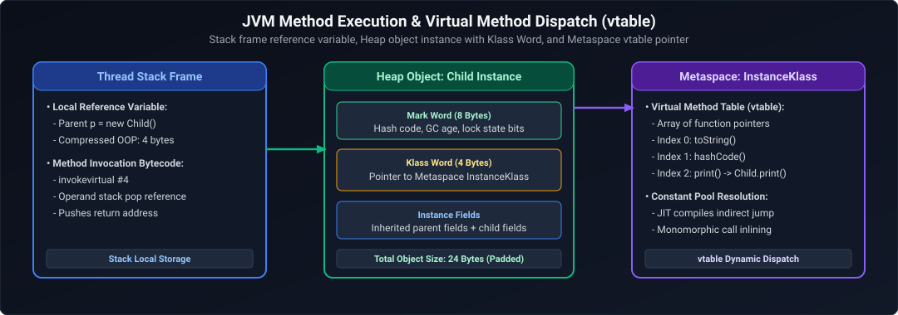

*D2 Source:* [assets/01_core_java_and_oop_faq/01_object_execution_and_method_dispatch.d2](assets/01_core_java_and_oop_faq/01_object_execution_and_method_dispatch.d2)

---

## Table of Contents & Question Mapping

1. **Core Foundations**
   - [Q1. Reverse a String Without Built-ins](#q1-medium-reverse-a-string-without-built-ins)
   - [Q2. Convert First Half to Lowercase & Second Half to Uppercase](#q2-medium-convert-first-half-to-lowercase--second-half-to-uppercase)
   - [Q3. First Non-Repeating Character in a String](#q3-medium-first-non-repeating-character-in-a-string)
   - [Q4. Longest Substring Without Repeating Characters](#q4-medium-longest-substring-without-repeating-characters)
   - [Q5. Longest Common Prefix in an Array of Strings](#q5-medium-longest-common-prefix-in-an-array-of-strings)
2. **Array & Data Structure Manipulations**
   - [Q6. Remove Duplicates from an Array in a Single Iteration](#q6-medium-remove-duplicates-from-an-array-in-a-single-iteration)
   - [Q7. Rearrange Integer Array: Even Before Odd](#q7-medium-rearrange-integer-array-even-before-odd)
   - [Q8. Print Prime Numbers Between 1 and 200 (Minimal Complexity)](#q8-medium-print-prime-numbers-between-1-and-200-minimal-complexity)
   - [Q9. Reverse a Singly Linked List (Iterative & Recursive)](#q9-medium-reverse-a-singly-linked-list-iterative--recursive)
   - [Q10. Path Sum Verification in a Binary Tree (Root to Leaf)](#q10-medium-path-sum-verification-in-a-binary-tree-root-to-leaf)
3. **Core Language Semantics & Keywords**
   - [Q11. `==` vs `equals()` and the String Pool Mechanism](#q11-medium--vs-equals-and-the-string-pool-mechanism)
   - [Q12. Short-Circuiting with Logical Operators (`&&`, `||`)](#q12-easy-short-circuiting-with-logical-operators--)
   - [Q13. Constructors and Invoking Static Methods Inside Constructors](#q13-easy-constructors-and-invoking-static-methods-inside-constructors)
   - [Q14. `final`, `finally`, and `finalize()`](#q14-easy-final-finally-and-finalize)
   - [Q15. `ClassCastException`: Root Causes and Prevention](#q15-medium-classcastexception-root-causes-and-prevention)
4. **Object-Oriented Design & Polymorphism**
   - [Q16. Composition Over Inheritance](#q16-medium-composition-over-inheritance)
   - [Q17. Interface vs Abstract Class & Static vs Default Methods](#q17-medium-interface-vs-abstract-class--static-vs-default-methods)
   - [Q18. Marker Interfaces and Modern Alternatives](#q18-easy-marker-interfaces-and-modern-alternatives)
   - [Q19. Overriding Static Methods & Method Hiding](#q19-easy-overriding-static-methods--method-hiding)
   - [Q20. Anonymous Inner Classes & Scoping](#q20-easy-anonymous-inner-classes--scoping)
   - [Q21. Designing Completely Immutable Classes](#q21-medium-designing-completely-immutable-classes)
   - [Q22. Shallow Copy vs Deep Copy](#q22-medium-shallow-copy-vs-deep-copy)
   - [Q23. `StringBuffer` vs `StringBuilder`](#q23-easy-stringbuffer-vs-stringbuilder)
5. **JVM Internals, Memory Management & Runtime**
   - [Q24. JVM Memory Architecture & Handling `OutOfMemoryError`](#q24-hard-jvm-memory-architecture--handling-outofmemoryerror)
   - [Q25. ClassLoader Architecture and Delegation Model](#q25-medium-classloader-architecture-and-delegation-model)
   - [Q26. Java Reflection API & Dynamic Proxies](#q26-hard-java-reflection-api--dynamic-proxies)
   - [Q27. Java NIO `Path` vs Classic IO `File`](#q27-medium-java-nio-path-vs-classic-io-file)
   - [Q28. Tail Call Optimization in Java](#q28-hard-tail-call-optimization-in-java)
6. **Modern Java Features (Java 17 to Java 21+)**
   - [Q29. Text Blocks and Multiline Strings](#q29-easy-text-blocks-and-multiline-strings)
   - [Q30. Pattern Matching for `switch`](#q30-medium-pattern-matching-for-switch)
   - [Q31. Records, Standard Classes & Sealed Classes in Production](#q31-medium-records-standard-classes--sealed-classes-in-production)
   - [Q32. Virtual Threads (Project Loom) vs Platform Threads](#q32-expert-virtual-threads-project-loom-vs-platform-threads)
7. **Advanced Algorithmic Patterns & Real-World OOP Scenarios**
   - [Q33. Detect a Cycle in a Singly Linked List Without Using Extra Space](#q33-medium-detect-a-cycle-in-a-singly-linked-list-without-using-extra-space)
   - [Q34. Static Method Hiding vs Dynamic Method Overriding in Java Inheritance](#q34-easy-static-method-hiding-vs-dynamic-method-overriding-in-java-inheritance)
   - [Q35. Character Parity / Zero vs One Frequency Comparison Without Using a Third Variable](#q35-medium-character-parity--zero-vs-one-frequency-comparison-without-using-a-third-variable)
   - [Q36. Highest Average Student Score (Rounded Down) from Tabular Data](#q36-medium-highest-average-student-score-rounded-down-from-tabular-data)
   - [Q37. Checked vs Unchecked Exceptions, Performance Overhead & `@ControllerAdvice` Exception Handling](#q37-medium-checked-vs-unchecked-exceptions-performance-overhead--controlleradvice-exception-handling)
   - [Q38. Validating Balanced Parentheses / Brackets: Stack-Based vs Recursive Stackless Approaches](#q38-medium-validating-balanced-parentheses--brackets-stack-based-vs-recursive-stackless-approaches)
   - [Q39. PC Register (Program Counter Register) Mechanics & Thread State Isolation in the JVM](#q39-medium-pc-register-program-counter-register-mechanics--thread-state-isolation-in-the-jvm)
   - [Q40. String Mutability via Reflection/Unsafe vs JVM String Pool Security Invariants](#q40-hard-string-mutability-via-reflectionunsafe-vs-jvm-string-pool-security-invariants)
   - [Q41. String Pool vs Java Heap: `new String("hello")` Allocation Dynamics & Constant Pool Resolution](#q41-easy-string-pool-vs-java-heap-new-stringhello-allocation-dynamics--constant-pool-resolution)
   - [Q42. Static Method Overloading vs Dynamic Overriding: Virtual Method Table (vtable) vs Compile-Time Direct Invocations](#q42-easy-static-method-overloading-vs-dynamic-overriding-virtual-method-table-vtable-vs-compile-time-direct-invocations)
---

# 1. Core Foundations

### Q1. [Medium] Reverse a String Without Built-ins
**Difficulty:** [Medium]
**Topic Covered:** String Manipulation & In-Place Algorithms  
**Definition:** Reversing a string requires rearranging its characters so that the first character becomes the last and vice versa, without invoking helper methods like `StringBuilder.reverse()`.

```java
public class StringReversal {
    public static String reverse(String input) {
        if (input == null || input.length() <= 1) {
            return input;
        }
        char[] chars = input.toCharArray();
        int left = 0;
        int right = chars.length - 1;
        while (left < right) {
            char temp = chars[left];
            chars[left] = chars[right];
            chars[right] = temp;
            left++;
            right--;
        }
        return new String(chars);
    }
}
```
- **Time Complexity:** $O(N)$ — touches $N/2$ elements.
- **Space Complexity:** $O(N)$ — strictly for the output character array due to Java's string immutability.

---

### Q2. [Medium] Convert First Half to Lowercase & Second Half to Uppercase
**Difficulty:** [Medium]
**Topic Covered:** String Slicing & ASCII Transformation  
**Definition:** Given a string of length $N$, divide it at index $\lfloor N / 2 \rfloor$. Characters in the first segment are mapped to lowercase; characters in the second segment are mapped to uppercase.

```java
public class HalfCaseTransformer {
    public static String transformHalves(String str) {
        if (str == null || str.isEmpty()) {
            return str;
        }
        int mid = str.length() / 2;
        char[] chars = str.toCharArray();

        for (int i = 0; i < mid; i++) {
            if (chars[i] >= 'A' && chars[i] <= 'Z') {
                chars[i] = (char) (chars[i] + 32); // Convert to lowercase
            }
        }
        for (int i = mid; i < chars.length; i++) {
            if (chars[i] >= 'a' && chars[i] <= 'z') {
                chars[i] = (char) (chars[i] - 32); // Convert to uppercase
            }
        }
        return new String(chars);
    }
}
```

---

### Q3. [Medium] First Non-Repeating Character in a String
**Difficulty:** [Medium]
**Topic Covered:** Frequency Hashing & Stream Processing  
**Definition:** Identify the earliest character index in a string whose frequency throughout the string equals exactly 1.

```java
public class FirstUniqueChar {
    public static char findFirstNonRepeating(String str) {
        if (str == null || str.isEmpty()) {
            throw new IllegalArgumentException("String cannot be null or empty");
        }
        int[] freq = new int[256]; // Assuming standard ASCII
        for (int i = 0; i < str.length(); i++) {
            freq[str.charAt(i)]++;
        }
        for (int i = 0; i < str.length(); i++) {
            if (freq[str.charAt(i)] == 1) {
                return str.charAt(i);
            }
        }
        throw new NoSuchElementException("No non-repeating character found");
    }
}
```
- **Time Complexity:** $O(N)$ where $N$ is string length.
- **Space Complexity:** $O(1)$ fixed 256-integer array.

---

### Q4. [Medium] Longest Substring Without Repeating Characters
**Difficulty:** [Medium]
**Topic Covered:** Sliding Window & Dynamic Frequency Tracking  
**Definition:** Find the maximum length of a contiguous substring where every character is unique.

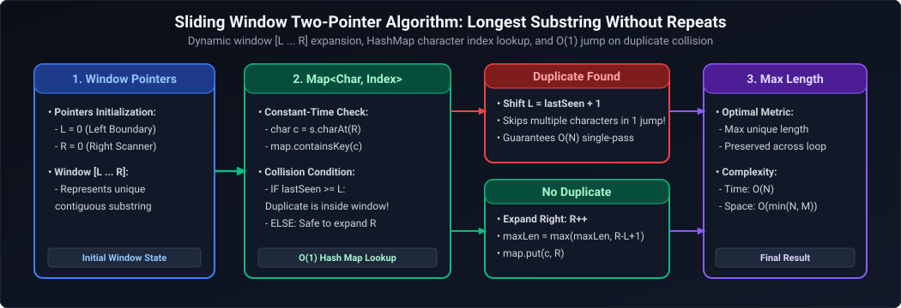

*D2 Source:* [assets/01_core_java_and_oop_faq/02_longest_substring_two_pointers.d2](assets/01_core_java_and_oop_faq/02_longest_substring_two_pointers.d2)

```java
import java.util.HashMap;
import java.util.Map;

public class LongestUniqueSubstring {
    public static int lengthOfLongestSubstring(String s) {
        if (s == null || s.isEmpty()) return 0;

        Map<Character, Integer> lastSeen = new HashMap<>();
        int maxLength = 0;
        int left = 0;

        for (int right = 0; right < s.length(); right++) {
            char current = s.charAt(right);
            if (lastSeen.containsKey(current)) {
                left = Math.max(left, lastSeen.get(current) + 1);
            }
            lastSeen.put(current, right);
            maxLength = Math.max(maxLength, right - left + 1);
        }
        return maxLength;
    }
}
```
- **Time Complexity:** $O(N)$ single pass across the string.
- **Space Complexity:** $O(\min(N, \Sigma))$ where $\Sigma$ is the alphabet size.

---

### Q5. [Medium] Longest Common Prefix in an Array of Strings
**Difficulty:** [Medium]
**Topic Covered:** Horizontal & Vertical String Scanning  
**Definition:** Identify the longest string prefix shared across all strings in an array.

```java
public class LongestCommonPrefix {
    public static String getLongestCommonPrefix(String[] strs) {
        if (strs == null || strs.length == 0) return "";
        String prefix = strs[0];

        for (int i = 1; i < strs.length; i++) {
            while (!strs[i].startsWith(prefix)) {
                prefix = prefix.substring(0, prefix.length() - 1);
                if (prefix.isEmpty()) return "";
            }
        }
        return prefix;
    }
}
```

---

# 2. Array & Data Structure Manipulations

---

### Q6. [Medium] Remove Duplicates from an Array in a Single Iteration
**Difficulty:** [Medium]
**Topic Covered:** In-Place Two-Pointer Deduplication  
**Definition:** Given a sorted array, remove duplicates in-place such that each unique element appears once, returning the length of the deduplicated sub-array in $O(N)$ time and $O(1)$ memory.

```java
public class ArrayDeduplication {
    public static int removeDuplicatesSorted(int[] nums) {
        if (nums == null || nums.length == 0) return 0;
        int writeIndex = 1;

        for (int readIndex = 1; readIndex < nums.length; readIndex++) {
            if (nums[readIndex] != nums[readIndex - 1]) {
                nums[writeIndex++] = nums[readIndex];
            }
        }
        return writeIndex;
    }
}
```

---

### Q7. [Medium] Rearrange Integer Array: Even Before Odd
**Difficulty:** [Medium]
**Topic Covered:** Partitioning / Two-Pointer Technique (Hoare Variant)  
**Definition:** Segregate an array such that all even integers precede odd integers.

```java
public class EvenOddPartition {
    public static void rearrangeEvenOdd(int[] nums) {
        if (nums == null || nums.length <= 1) return;
        int left = 0;
        int right = nums.length - 1;

        while (left < right) {
            while (left < right && nums[left] % 2 == 0) left++;
            while (left < right && nums[right] % 2 != 0) right--;
            if (left < right) {
                int temp = nums[left];
                nums[left] = nums[right];
                nums[right] = temp;
                left++;
                right--;
            }
        }
    }
}
```
- **Time Complexity:** $O(N)$ single iteration.
- **Space Complexity:** $O(1)$ strictly in-place.

---

### Q8. [Medium] Print Prime Numbers Between 1 and 200 (Minimal Complexity)
**Difficulty:** [Medium]
**Topic Covered:** Number Theory & Sieve of Eratosthenes  
**Definition:** Identifying primes up to $M = 200$ using the Sieve of Eratosthenes in $O(M \log(\log M))$.

```java
import java.util.Arrays;

public class PrimeSieve {
    public static void printPrimesUpTo(int limit) {
        boolean[] isPrime = new boolean[limit + 1];
        Arrays.fill(isPrime, true);
        isPrime[0] = false;
        isPrime[1] = false;

        for (int p = 2; p * p <= limit; p++) {
            if (isPrime[p]) {
                for (int i = p * p; i <= limit; i += p) {
                    isPrime[i] = false;
                }
            }
        }

        for (int i = 2; i <= limit; i++) {
            if (isPrime[i]) {
                System.out.print(i + " ");
            }
        }
        System.out.println();
    }
}
```

---

### Q9. [Medium] Reverse a Singly Linked List (Iterative & Recursive)
**Difficulty:** [Medium]
**Topic Covered:** Linked List Pointer Manipulation  
**Definition:** Given the head of a singly linked list, invert pointer directions such that the tail becomes the new head.

```java
public class LinkedListReversal {
    public static class ListNode {
        int val;
        ListNode next;
        ListNode(int val) { this.val = val; }
    }

    // Iterative: O(N) time, O(1) space
    public static ListNode reverseIterative(ListNode head) {
        ListNode prev = null;
        ListNode curr = head;
        while (curr != null) {
            ListNode nextTemp = curr.next;
            curr.next = prev;
            prev = curr;
            curr = nextTemp;
        }
        return prev;
    }

    // Recursive: O(N) time, O(N) call-stack space
    public static ListNode reverseRecursive(ListNode head) {
        if (head == null || head.next == null) {
            return head;
        }
        ListNode newHead = reverseRecursive(head.next);
        head.next.next = head;
        head.next = null;
        return newHead;
    }
}
```

---

### Q10. [Medium] Path Sum Verification in a Binary Tree (Root to Leaf)
**Difficulty:** [Medium]
**Topic Covered:** Tree Traversal & Depth-First Search (DFS)  
**Definition:** Determine if there exists a root-to-leaf path where the sum of node values along the path equals a specified target sum.

```java
public class BinaryTreePathSum {
    public static class TreeNode {
        int val;
        TreeNode left;
        TreeNode right;
        TreeNode(int val) { this.val = val; }
    }

    public static boolean hasPathSum(TreeNode root, int targetSum) {
        if (root == null) return false;

        if (root.left == null && root.right == null) {
            return targetSum == root.val;
        }

        int remaining = targetSum - root.val;
        return hasPathSum(root.left, remaining) || hasPathSum(root.right, remaining);
    }
}
```

---

# 3. Core Language Semantics & Keywords

---

### Q11. [Medium] `==` vs `equals()` and the String Pool Mechanism
**Difficulty:** [Medium]
*(Grouped together: Identity vs Equivalence and String Pool Allocation)*  
**Topic Covered:** Object Memory Identity, Value Equivalence, String Interning  
- `==`: Reference identity operator. Evaluates whether two reference variables point to the exact same physical memory address on the JVM Heap.
- `equals()`: Method on `Object`. Evaluates semantic value equivalence when overridden.
- **String Pool:** A specialized hash table (`StringTable`) allocated in the JVM Heap that stores a single canonical copy of each string literal.

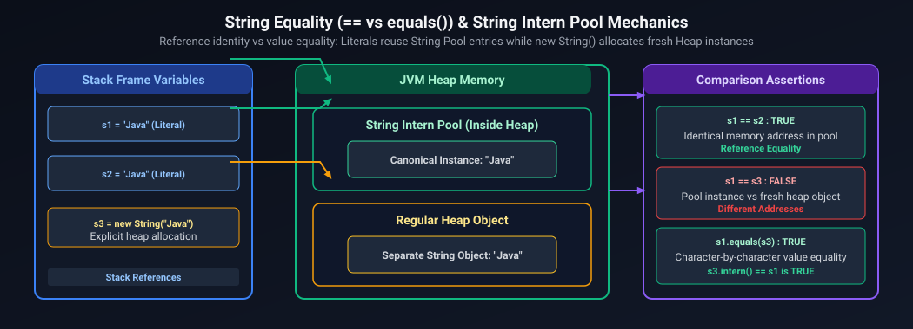

*D2 Source:* [assets/01_core_java_and_oop_faq/03_string_equality_and_string_pool.d2](assets/01_core_java_and_oop_faq/03_string_equality_and_string_pool.d2)

```java
String s1 = "Hello";
String s2 = "Hello";
String s3 = new String("Hello");

System.out.println(s1 == s2);      // true  (Shared string pool reference)
System.out.println(s1 == s3);      // false (s3 is a distinct heap instance)
System.out.println(s1.equals(s3)); // true  (Equal character contents)
```

---

### Q12. [Easy] Short-Circuiting with Logical Operators (`&&`, `||`)
**Difficulty:** [Easy]
**Topic Covered:** Boolean Evaluation & Control Flow  
- `&&` (Logical AND): Halts evaluation as `false` as soon as the first operand evaluates to `false`.
- `||` (Logical OR): Halts evaluation as `true` as soon as the first operand evaluates to `true`.

```java
// Prevents NullPointerException:
if (user != null && user.isActive()) {
    // user.isActive() is NEVER invoked if user is null
}
```

---

### Q13. [Easy] Constructors and Invoking Static Methods Inside Constructors
**Difficulty:** [Easy]
*(Grouped together: Constructor Mechanics and Static Invocations)*  
**Topic Covered:** Object Lifecycle & Class Loading  
**Can you invoke a static method inside a constructor?**
**Yes.** Static methods belong to class metadata in Metaspace and are initialized during class loading, well before constructor execution. They are commonly used for defensive argument checks and unique ID generation.

```java
public class Order {
    private final String orderId;

    public Order(double amount) {
        validateAmount(amount); // Invoking static method
        this.orderId = generateId();
    }

    private static void validateAmount(double amount) {
        if (amount <= 0) throw new IllegalArgumentException("Amount must be positive");
    }

    private static String generateId() {
        return "ORD-" + System.currentTimeMillis();
    }
}
```

---

### Q14. [Easy] `final`, `finally`, and `finalize()`
**Difficulty:** [Easy]
*(Grouped together: Keyword distinctions and Lifecycle handling)*  
**Topic Covered:** Java Core Keywords & Resource Management  

| Feature | Type | Purpose / Scope | Execution Guarantee |
| :--- | :--- | :--- | :--- |
| `final` | Modifier | Applied to variable (immutable ref), method (cannot override), class (cannot subclass). | Compile-time constraint. |
| `finally` | Block | Accompanying `try`/`catch`. Used for mandatory cleanup. | Guaranteed unless `System.exit()` or JVM crash. |
| `finalize()` | Method | Deprecated method on `Object` invoked by GC. | **No guarantee**. Deprecated Java 9, removed Java 18+. |

---

### Q15. [Medium] `ClassCastException`: Root Causes and Prevention
**Difficulty:** [Medium]
**Topic Covered:** Type Safety & Pattern Matching  
- **Cause:** Attempting to cast an object reference to an incompatible type at runtime.
- **Prevention:** Use Java 16+ **Pattern Matching for `instanceof`** or enforce generic types at compile-time:
  ```java
  if (obj instanceof String s) {
      System.out.println("Length: " + s.length());
  }
  ```

---

# 4. Object-Oriented Design & Polymorphism

---

### Q16. [Medium] Composition Over Inheritance
**Difficulty:** [Medium]
**Topic Covered:** Architectural Design Principles  
**Why Prefer Composition?**
1. **Protects Encapsulation:** Inheriting from a concrete superclass creates tight coupling to its internal implementation details (Fragile Base Class problem).
2. **Runtime Flexibility:** Behavior can be dynamically swapped by injecting different strategy implementations.
3. **Single Inheritance Limitation:** Java classes can extend only one superclass, but can compose multiple delegates.

---

### Q17. [Medium] Interface vs Abstract Class & Static vs Default Methods
**Difficulty:** [Medium]
*(Grouped together: Abstraction Mechanisms in Java)*  
**Topic Covered:** Interface Contracts & Multiple Inheritance of Behavior  

| Criterion | Abstract Class | Interface (Java 8+) |
| :--- | :--- | :--- |
| **State** | Holds mutable instance fields. | Only `public static final` constants. |
| **Constructors**| Has constructors. | No constructors. |
| **Inheritance** | Single inheritance (`extends`). | Multiple inheritance (`implements`). |
| **Methods** | Abstract, concrete, `protected`, `private`. | Abstract, `default`, `static`, and `private` (Java 9+). |

- **Default Methods (`default`):** Non-breaking method additions with default implementation that implementing classes can override.
- **Static Methods (`static`):** Namespace utility methods that cannot be overridden by implementing classes.

---

### Q18. [Easy] Marker Interfaces and Modern Alternatives
**Difficulty:** [Easy]
**Topic Covered:** Type Tagging & Metadata  
A marker interface is an interface with **zero method declarations** (`Serializable`, `Cloneable`). Modern enterprise Java replaces marker interfaces with **Annotations** (`@Entity`, `@Component`, `@Audited`), which support typed metadata without polluting type hierarchies.

---

### Q19. [Easy] Overriding Static Methods & Method Hiding
**Difficulty:** [Easy]
*(Grouped together: Static Polymorphism Semantics)*  
**Topic Covered:** Compile-Time Resolution vs Dynamic Dispatch  
**Rule:** You **cannot** override a static method. If a subclass declares a static method with the same signature, it is **Method Hiding**, resolved at compile-time via `invokestatic` based on the reference type, not the runtime object instance.

---

### Q20. [Easy] Anonymous Inner Classes & Scoping
**Difficulty:** [Easy]
**Topic Covered:** Local Classes & Closures  
An anonymous class is declared and instantiated in a single expression. Any local variable accessed inside it must be explicitly `final` or **effectively final** to ensure thread and stack lifetime safety.

---

### Q21. [Medium] Designing Completely Immutable Classes
**Difficulty:** [Medium]
**Topic Covered:** Thread Safety & Invariant Protection  
1. Declare the class `final`.
2. Declare all fields `private final`.
3. Provide no setters.
4. Perform **defensive copies** in constructors for mutable fields (`Date`, `List`, `Map`).
5. Return **unmodifiable views** or defensive copies in getters.

---

### Q22. [Medium] Shallow Copy vs Deep Copy
**Difficulty:** [Medium]
**Topic Covered:** Object Cloning & Memory References  
- **Shallow Copy:** Copies primitive fields and duplicates object references directly (both original and copy point to the same child objects on the heap).
- **Deep Copy:** Recursively clones the entire object graph, creating fully independent child copies.

---

### Q23. [Easy] `StringBuffer` vs `StringBuilder`
**Difficulty:** [Easy]
**Topic Covered:** Mutability & Synchronization Overhead  
- **`StringBuffer`:** Thread-safe (methods use `synchronized`). Has lock acquisition overhead.
- **`StringBuilder` (Preferred):** Not thread-safe. Significantly faster for single-threaded string concatenation.

---

# 5. JVM Internals, Memory Management & Runtime

---

### Q24. [Hard] JVM Memory Architecture & Handling `OutOfMemoryError`
**Difficulty:** [Hard]
*(Grouped together: Memory layout and OOM diagnosis)*  
**Topic Covered:** JVM Memory Spaces, GC Generations, Diagnostic Procedures  

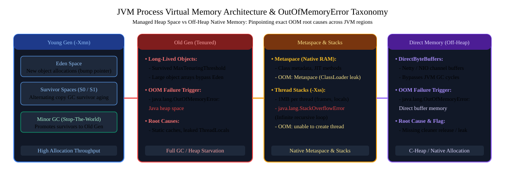

*D2 Source:* [assets/01_core_java_and_oop_faq/04_jvm_memory_architecture_oom.d2](assets/01_core_java_and_oop_faq/04_jvm_memory_architecture_oom.d2)

#### Diagnostic & Triage Matrix: `java.lang.OutOfMemoryError`

| Error Subtype | Affected Memory Region | Root Cause & Failure Mechanism | Production Diagnostic & Triage Playbook |
| :--- | :--- | :--- | :--- |
| **`Java heap space`** | JVM Heap (Old / Young Gen) | Live object leak (static collections, unclosed streams, cache retainers) or insufficient `-Xmx` under sudden traffic spikes. | Enable `-XX:+HeapDumpOnOutOfMemoryError -XX:HeapDumpPath=/dumps/heap.hprof`. Analyze dominant dominator tree paths via Eclipse MAT or JProfiler. |
| **`Metaspace`** | Native Metaspace | Unbounded dynamic class creation (Spring CGLIB, ByteBuddy, reflection mocks, hot class reloading). | Tune `-XX:MaxMetaspaceSize=512m`. Inspect classloader retention with `jcmd <pid> VM.classloader_stats` and detect dynamic proxy leaks. |
| **`Unable to create new native thread`** | OS Thread Table / Virtual Memory | Thread leaks (unbounded `Executors.newCachedThreadPool()`) or OS thread allocation limit exhaustion (`ulimit -u`). | Cap pool sizes via bounded `ThreadPoolExecutor`. Check OS limits: `cat /proc/sys/kernel/threads-max` and reduce stack size (`-Xss256k`). |
| **`Direct buffer memory`** | Off-Heap Direct Memory | Netty / NIO `ByteBuffer.allocateDirect()` allocation exceeds `-XX:MaxDirectMemorySize` without GC reclaiming phantom references. | Verify off-heap buffer pooling and release semantics (`ReferenceCountUtil.release()`). Set `-XX:MaxDirectMemorySize` explicitly. |
| **`GC overhead limit exceeded`** | Full Heap Space | Over 98% of total CPU time is spent in GC collecting less than 2% of heap space. | Critical throughput collapse. Profile memory allocation rate with async-profiler; scale heap or prune in-memory processing payloads. |

---

### Q25. [Medium] ClassLoader Architecture and Delegation Model
**Difficulty:** [Medium]
**Topic Covered:** JVM Class Loading & Parent Delegation  
1. **Bootstrap ClassLoader:** Loads core runtime classes (`java.base`).
2. **Platform ClassLoader:** Loads modular platform libraries.
3. **Application ClassLoader:** Loads classpath JARs.
- **Parent Delegation Principle:** Child classloaders always delegate class lookup to their parent first, preventing core classes like `java.lang.String` from being overridden.

---

### Q26. [Hard] Java Reflection API & Dynamic Proxies
**Difficulty:** [Hard]
*(Grouped together: Introspection and Dynamic Interception)*  
**Topic Covered:** Runtime Bytecode Introspection & Dynamic Invocation  
`java.lang.reflect.Proxy` generates dynamic proxy classes at runtime that intercept interface method calls via an `InvocationHandler`. Used heavily by Spring AOP, `@Transactional`, and Mockito.

---

### Q27. [Medium] Java NIO `Path` vs Classic IO `File`
**Difficulty:** [Medium]
**Topic Covered:** File System Abstraction & Modern I/O  
`Path` (Java 7+) throws descriptive `IOException` subclasses instead of returning `false`, supports symbolic links, native file attributes, memory-mapped buffers, and asynchronous channels.

---

### Q28. [Hard] Tail Call Optimization in Java
**Difficulty:** [Hard]
**Topic Covered:** Call Stack Mechanics  
The standard HotSpot JVM does **not** implement Tail Call Optimization (TCO) to preserve complete stack traces for debugging and security permission stack-walks. Deep recursion results in `StackOverflowError`.

---

# 6. Modern Java Features (Java 17 to Java 21+)

---

### Q29. [Easy] Text Blocks and Multiline Strings
**Difficulty:** [Easy]
**Topic Covered:** Modern Syntax (Java 15+)  
Text blocks (`""" ... """`) simplify JSON, SQL, and HTML string definitions without escape characters.

---

### Q30. [Medium] Pattern Matching for `switch`
**Difficulty:** [Medium]
**Topic Covered:** Pattern Matching & Type Narrowing (Java 17 / 21)  
Enables pattern matching over types with `when` guard clauses:
```java
return switch (payment) {
    case CreditCard c && c.limit() > 10000 -> "VIP Credit Card";
    case CreditCard c                      -> "Standard Credit Card";
    case BankTransfer b                    -> "Bank transfer IBAN: " + b.iban();
    case null                              -> "Null payment";
    default                                -> "Unknown: " + payment;
};
```

---

### Q31. [Medium] Records, Standard Classes & Sealed Classes in Production
**Difficulty:** [Medium]
*(Grouped together: Modern Type Hierarchies and Domain Modeling)*  
**Topic Covered:** Data-Oriented Programming (Java 16/17+)  
- **`record`:** Compact, shallowly immutable data carriers with auto-generated getters, `equals()`, `hashCode()`, and `toString()`.
- **`sealed` class/interface:** Restricts which implementations are allowed (`permits`). Guarantees compile-time exhaustiveness in `switch` statements without requiring a `default` case.

---

### Q32. [Expert] Virtual Threads (Project Loom) vs Platform Threads
**Difficulty:** [Expert]
**Topic Covered:** High-Throughput Lightweight Concurrency (Java 21)  
- **Platform Thread:** 1:1 mapped to OS kernel thread with ~1 MB memory footprint.
- **Virtual Thread:** User-mode thread managed directly by the JVM with a few KB footprint. When blocking on network I/O, the virtual thread unmounts from its carrier thread, allowing millions of concurrent connections on standard server hardware.

---

# 7. Advanced Algorithmic Patterns & Real-World OOP Scenarios

---

### Q33. [Medium] Detect a Cycle in a Singly Linked List Without Using Extra Space
**Topic Covered:** Pointer Topologies & Floyd's Cycle-Finding Algorithm  
**Difficulty:** `[Medium]`

#### Architectural Overview
When traversing linked records in memory (e.g., undo stacks, workflow transition states, or custom pointer structures), circular references cause infinite traversal loops and stack overflows. Floyd's Algorithm utilizes two pointers—a slow pointer advancing 1 node per iteration and a fast pointer advancing 2 nodes per iteration. If a cycle exists, the fast pointer will lap and intersect the slow pointer inside the cycle loop without allocating heap memory.

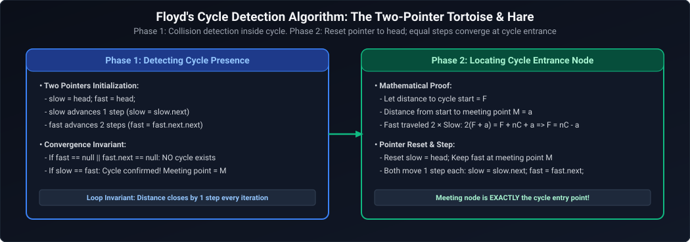

*D2 Source:* [assets/01_core_java_and_oop_faq/05_floyd_cycle_detection_mechanics.d2](assets/01_core_java_and_oop_faq/05_floyd_cycle_detection_mechanics.d2)

#### Production Code
```java
package com.enterprise.algorithms;

public final class LinkedListCycleChecker {

    public static final class ListNode<T> {
        private final T data;
        private ListNode<T> next;

        public ListNode(T data) {
            this.data = data;
        }

        public T getData() { return data; }
        public ListNode<T> getNext() { return next; }
        public void setNext(ListNode<T> next) { this.next = next; }
    }

    /**
     * Determines whether a linked list contains a cycle using Floyd's Tortoise and Hare.
     * Time Complexity: O(N) | Space Complexity: O(1)
     */
    public static <T> boolean hasCycle(ListNode<T> head) {
        if (head == null || head.getNext() == null) {
            return false;
        }

        ListNode<T> slow = head;
        ListNode<T> fast = head;

        while (fast != null && fast.getNext() != null) {
            slow = slow.getNext();
            fast = fast.getNext().getNext();

            if (slow == fast) {
                return true;
            }
        }
        return false;
    }
}
```

* **Complexity**: Time $O(N)$ where $N$ is the number of nodes; Auxiliary Space $O(1)$ strictly stack pointers.
* **Production Trap**: Storing visited nodes in a `HashSet<ListNode>` consumes $O(N)$ heap memory and can trigger `OutOfMemoryError` on high-throughput streaming node processors.

---

### Q34. [Easy] Static Method Hiding vs Dynamic Method Overriding in Java Inheritance
**Topic Covered:** Polymorphism, Static Binding & Bytecode Dispatch  
**Difficulty:** `[Easy]`

#### Architectural Overview
In Java, instance methods use **dynamic method dispatch** resolved at runtime using the object's actual class `vtable` in Metaspace (`invokevirtual`). However, `static` methods belong to the class, not the instance. When a subclass declares a static method with the exact same signature as a superclass static method, it is **method hiding**, not overriding. The JVM binds static calls at compile time (`invokestatic`) based strictly on the reference type declared.

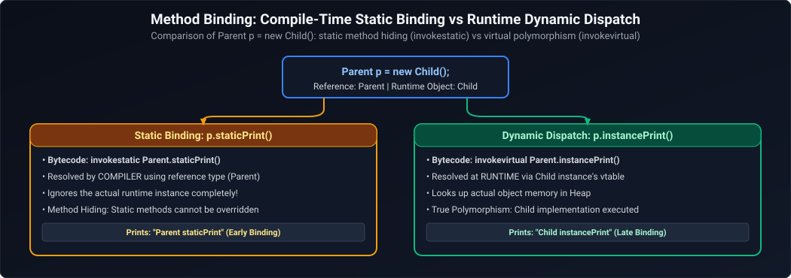

*D2 Source:* [assets/01_core_java_and_oop_faq/06_compile_time_vs_runtime_dispatch.d2](assets/01_core_java_and_oop_faq/06_compile_time_vs_runtime_dispatch.d2)

#### Production Code & Prediction
```java
class Parent {
    public static void display() {
        System.out.println("Parent static display");
    }
    public void print() {
        System.out.println("Parent instance print");
    }
}

class Child extends Parent {
    public static void display() {
        System.out.println("Child static display");
    }
    @Override
    public void print() {
        System.out.println("Child instance print");
    }
}

public class InheritanceDispatchDemo {
    public static void main(String[] args) {
        Parent p = new Child();
        p.display(); // Prints: "Parent static display" (invokestatic based on Parent type)
        p.print();   // Prints: "Child instance print"  (invokevirtual dispatched to Child instance)
    }
}
```

#### Method Overloading vs Method Overriding Comparison Matrix

| Dimension | Method Overloading (Compile-Time Polymorphism) | Method Overriding (Runtime Polymorphism) |
| :--- | :--- | :--- |
| **Resolution Mechanism** | Resolved at **compile time** via static type signatures (`invokevirtual` with fixed descriptor or `invokestatic`). | Resolved at **runtime** using the object's dynamic dispatch table (`vtable`). |
| **Scope / Location** | Within the **same class** (or inherited from superclass). | Between a **superclass and a subclass**. |
| **Method Name** | Must be **identical**. | Must be **identical**. |
| **Argument List** | Must **differ** (number, types, or order of parameters). | Must be **strictly identical** (same types and count). |
| **Return Type** | Can be **different** (return type alone does not differentiate overloaded methods). | Must be **identical or covariant** (sub-type of superclass return type). |
| **Access Modifiers** | Can be modified arbitrarily (`public`, `protected`, `private`). | Cannot be **more restrictive** than the superclass method. |
| **Checked Exceptions** | Can throw any checked exception independently. | Cannot throw **broader or new checked exceptions**; can throw fewer, narrower, or unchecked exceptions. |
| **Private / Static Methods** | Private and static methods **can be overloaded**. | Private methods **cannot be overridden**; static methods **cannot be overridden** (they are hidden). |

* **Complexity**: Compile-time direct binding $O(1)$; virtual table (`vtable`) pointer lookup $O(1)$.
* **Production Trap**: Invoking static methods on instance references (e.g., `p.display()`) causes deceptive code reading; always invoke static methods through their class name directly (`Parent.display()`). Avoid overloading methods with ambiguous varargs or auto-boxing conversions (e.g., `doWork(int)` vs `doWork(Integer)`) as it leads to fragile overload resolution.

---

### Q35. [Medium] Character Parity / Zero vs One Frequency Comparison Without Using a Third Variable
**Topic Covered:** In-Place Bitwise & Arithmetic Balance  
**Difficulty:** `[Medium]`

#### Architectural Overview
When comparing whether character `'0'` or `'1'` occurs more frequently in a binary string under strict memory constraints (zero heap allocations, zero additional scalar variables), we can repurpose a single running accumulator as a signed balance offset: increment by $+1$ for `'1'` and decrement by $-1$ for `'0'`. If final balance $>0$, `'1'` occurs more; if $<0$, `'0'` occurs more; if $0$, they are equal.

```java
package com.enterprise.algorithms;

public final class BitBalanceComparator {

    /**
     * Checks whether '0' or '1' is more frequent without extra variables.
     * Uses the method argument itself or returns integer balance (+1 for 1, -1 for 0).
     */
    public static String compareFrequencies(String s) {
        if (s == null || s.isEmpty()) return "Equal";

        int balance = 0; // single tracking variable
        for (int i = 0; i < s.length(); i++) {
            balance += (s.charAt(i) == '1') ? 1 : -1;
        }

        if (balance > 0) return "Ones occur more frequently";
        if (balance < 0) return "Zeros occur more frequently";
        return "Both occur with equal frequency";
    }
}
```

* **Complexity**: Time $O(N)$ single linear scan; Space $O(1)$ zero heap allocation.

---

### Q36. [Medium] Highest Average Student Score (Rounded Down) from Tabular Data
**Topic Covered:** In-Memory Aggregations & Streaming Maps  
**Difficulty:** `[Medium]`

#### Architectural Overview
Given a tabular dataset of student names and exam scores, determine the student with the highest average score (rounded down to the nearest integer). We aggregate total scores and count per student using a `HashMap<String, int[]>`, compute `sum / count`, and track the maximum average.

```java
package com.enterprise.analytics;

import java.util.*;

public final class StudentScoreAnalytics {

    public record StudentRecord(String name, int score) {}

    /**
     * Computes the maximum average score across all students.
     * Time Complexity: O(N) | Space Complexity: O(U) where U is unique students.
     */
    public static int getHighestAverageScore(StudentRecord[] records) {
        if (records == null || records.length == 0) return 0;

        // Map: Student Name -> int[]{totalScore, examCount}
        Map<String, int[]> scoreMap = new HashMap<>();

        for (StudentRecord r : records) {
            scoreMap.computeIfAbsent(r.name(), k -> new int[2]);
            scoreMap.get(r.name())[0] += r.score();
            scoreMap.get(r.name())[1] += 1;
        }

        int maxAverage = Integer.MIN_VALUE;

        for (int[] stats : scoreMap.values()) {
            int average = stats[0] / stats[1]; // Integer division rounds down
            if (average > maxAverage) {
                maxAverage = average;
            }
        }

        return maxAverage;
    }
}
```

* **Complexity**: Time $O(N)$; Space $O(U)$ where $U \le N$ is unique student count.

---

### Q37. [Medium] Checked vs Unchecked Exceptions, Performance Overhead & `@ControllerAdvice` Exception Handling
**Topic Covered:** Exception Hierarchy & Global Fault Handling  
**Difficulty:** `[Medium]`

#### Architectural Overview
Java categorizes throwables into:
1. **Checked Exceptions (`Exception` subclasses excluding `RuntimeException`)**: Enforced by the compiler, representing recoverable external conditions (e.g., `IOException`, `SQLException`).
2. **Unchecked Exceptions (`RuntimeException` subclasses)**: Represent programming errors or unrecoverable bugs (e.g., `NullPointerException`, `IllegalArgumentException`).
3. **Errors (`Error` subclasses)**: Fatal JVM failures (e.g., `OutOfMemoryError`, `StackOverflowError`).


*D2 Source:* [assets/01_core_java_and_oop_faq/07_throwable_exception_hierarchy.d2](assets/01_core_java_and_oop_faq/07_throwable_exception_hierarchy.d2)

#### Production Best Practice:
Never use exceptions for business control flow due to the heavy performance penalty of `Throwable.fillInStackTrace()`. Handle enterprise web errors globally via `@RestControllerAdvice` emitting RFC 7807 `ProblemDetail`.

---

### Q38. [Medium] Validating Balanced Parentheses / Brackets: Stack-Based vs Recursive Stackless Approaches
**Difficulty:** [Medium]
**Topic Covered:** String Parsing, Monotonic Stack & Call-Stack Recursion  
**Question:** Validate balanced brackets such as (), [], and {}. First explain the stack-based approach, then discuss how to solve the problem without using an explicit stack.

#### Definition & Core Concepts
Bracket balancing is a fundamental parsing invariant in language runtimes, JSON deserializers, and compiler lexical analyzers. A bracket string is well-formed if and only if:
1. Every open bracket is closed by the exact same type of bracket (`(` closes with `)`, `[` with `]`, `{` with `}`).
2. Open brackets are closed in the strict reverse order of their appearance (**Last-In, First-Out (LIFO)** ordering).
3. At no point during left-to-right scanning does the count of closed brackets exceed the count of open brackets of that type.

**Why a Simple Integer Counter Fails with Multiple Types:**
If only one bracket type exists (e.g. `()`), an $O(1)$ space integer counter incremented on `(` and decremented on `)` suffices. However, when multiple types coexist (`()`, `[]`, `{}`), counters fail completely: the string `([)]` has equal counts of each type (1 open, 1 close), but violates nesting hierarchy. Hence, positional state tracking is mathematically required.

**The Two Methodologies:**
1. **Explicit Heap Stack (`ArrayDeque<Character>`):** Push opening brackets onto a stack; on encountering a closing bracket, verify the stack is non-empty and the popped element matches. Avoid `java.util.Stack` because its methods are synchronized (`Vector` legacy), adding unnecessary locking overhead.
2. **Stackless / In-Place Pointer Approach ($O(1)$ Extra Heap Space):** Instead of allocating a heap `Deque` object and boxing characters into `java.lang.Character` objects, mutate a char array or reuse an integer pointer `top` over a pre-allocated primitive array `char[] buffer`. Alternatively, a recursive descent parser leverages the JVM call stack, eliminating explicit heap collections.

#### Visual Flow
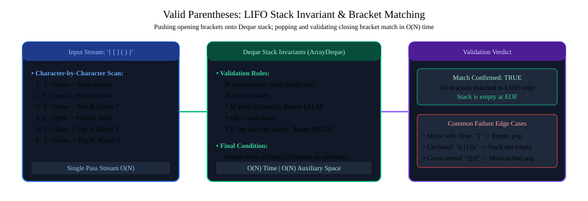

*D2 Source:* [assets/01_core_java_and_oop_faq/08_valid_parentheses_stack_evaluation.d2](assets/01_core_java_and_oop_faq/08_valid_parentheses_stack_evaluation.d2)

#### Production Implementation / Code Solution
```java
package com.interview.algorithms;

import java.util.ArrayDeque;
import java.util.Deque;

public final class BracketValidator {

    private BracketValidator() {}

    /**
     * Approach 1: High-Performance Heap Stack using ArrayDeque (Zero Legacy Sync Overhead).
     */
    public static boolean isValidWithStack(String s) {
        if (s == null || (s.length() & 1) != 0) {
            return false; // Odd length strings can never be balanced
        }

        Deque<Character> stack = new ArrayDeque<>(s.length());

        for (int i = 0; i < s.length(); i++) {
            char c = s.charAt(i);
            switch (c) {
                case '(' -> stack.push(')');
                case '{' -> stack.push('}');
                case '[' -> stack.push(']');
                default -> {
                    // Encountered closing bracket
                    if (stack.isEmpty() || stack.pop() != c) {
                        return false;
                    }
                }
            }
        }
        return stack.isEmpty();
    }

    /**
     * Approach 2: Stackless / In-Place Pointer Approach (Zero Heap Collection Allocations).
     * Simulates an in-place stack using a primitive char array and an index pointer.
     */
    public static boolean isValidWithoutExplicitStack(String s) {
        if (s == null || (s.length() & 1) != 0) {
            return false;
        }

        char[] stack = new char[s.length()];
        int top = -1; // Pointer representing current top of stack

        for (int i = 0; i < s.length(); i++) {
            char c = s.charAt(i);
            if (c == '(' || c == '{' || c == '[') {
                stack[++top] = c; // Push primitive char
            } else {
                if (top < 0) {
                    return false; // Closing bracket without preceding open
                }
                char open = stack[top--]; // Pop primitive char
                if (c == ')' && open != '(') return false;
                if (c == '}' && open != '{') return false;
                if (c == ']' && open != '[') return false;
            }
        }
        return top == -1; // Valid if all pushed open brackets were matched
    }
}
```
- **Time Complexity:** $O(N)$ single-pass scan across string of length $N$.
- **Space Complexity:**
  - Approach 1 (`ArrayDeque`): $O(N)$ heap memory with object boxing overhead.
  - Approach 2 (Primitive array pointer): $O(N)$ flat contiguous primitive memory; zero garbage collection allocation churn.

#### Engineering Implications & Production Pitfalls
1. **The `java.util.Stack` Legacy Anti-Pattern:** Never use `java.util.Stack` in modern Java. It extends `java.util.Vector` and synchronizes every `push()`, `pop()`, and `peek()` method on the collection monitor, creating severe lock contention in multithreaded services. Always use `ArrayDeque` or primitive arrays.
2. **Interview Talking Point:** In high-throughput parsing (such as XML/JSON deserialization libraries like Jackson), allocating collection wrappers for millions of tokens degrades GC performance. Primitive array pointers (`char[]` with integer `top`) provide CPU L1 cache locality and zero GC pause footprint.

#### Core Curriculum Cross-Reference
*Deep-dive theoretical reference: See [01. Core Java & OOP: Primitives & Control Flow](../01_core_java_and_oop.md)*

---

### Q39. [Medium] PC Register (Program Counter Register) Mechanics & Thread State Isolation in the JVM
**Difficulty:** [Medium]
**Topic Covered:** JVM Execution Engine, Thread Memory Layout, and Instruction Pointers  
**Definition:** The **Program Counter (PC) Register** is a thread-scoped, per-thread JVM memory region allocated when a platform or virtual thread is spawned. It holds the memory address of the JVM bytecode instruction currently being executed by that specific thread.

#### Architectural Mechanics & Core Concepts

In multi-threaded Java applications, threads share the Heap and Metaspace but possess independent Stack, Native Stack, and PC Register structures. Because the JVM execution engine switches CPU time-slices across hundreds of threads, each thread requires its own discrete instruction pointer to resume execution seamlessly without state corruption:

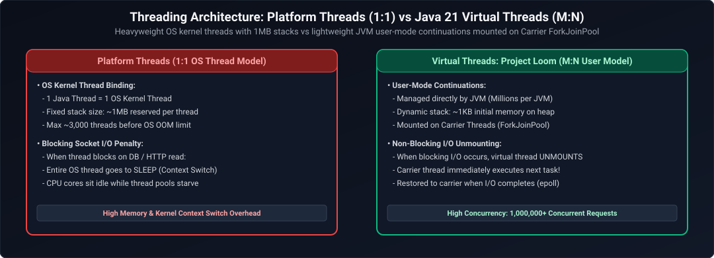

*D2 Source:* [assets/01_core_java_and_oop_faq/09_os_kernel_vs_virtual_threads.d2](assets/01_core_java_and_oop_faq/09_os_kernel_vs_virtual_threads.d2)

Key JVM specifications governing the PC Register:
1. **Thread Scope:** Exactly one PC register exists per alive thread. It is deallocated when the thread terminates.
2. **Bytecode Tracking:** If the thread executes a non-native Java method, the PC register contains the address of the bytecode instruction (e.g., `iload_1`, `invokestatic`).
3. **Native Method Exception:** If the thread executes a **Native Method** (via JNI or C/C++ libraries), the PC register value is officially **undefined** (`null`), because native code addresses are tracked directly by the underlying host CPU hardware Program Counter (e.g., `RIP` on x86-64 or `PC` on ARM64).
4. **Memory Constraint:** The PC Register has a tiny, fixed hardware-word size (4 bytes on 32-bit, 8 bytes on 64-bit architectures). Consequently, the PC Register is the **only memory area in the JVM that never throws an `OutOfMemoryError`**.

#### Production-Grade Implementation & Inspection

```java
package com.backend.jvm.internals;

/**
 * Demonstrating how JVM instruction pointer offsets advance during execution.
 * To view corresponding PC Register bytecode offsets, compile and inspect with:
 * javap -c -v com.backend.jvm.internals.PCRegisterInspection
 */
public final class PCRegisterInspection {

    public static int calculateTransactionFee(int amount, int tier) {
        // Bytecode offset 0: iload_0  (Pushes amount to operand stack)
        // Bytecode offset 1: iconst_1 (Pushes constant 1)
        // Bytecode offset 2: if_icmpne 8 (Branches if tier != 1)
        if (tier == 1) {
            // Bytecode offset 5: iload_0
            // Bytecode offset 6: ireturn (Returns amount)
            return amount;
        }
        
        // Bytecode offset 8: iload_0
        // Bytecode offset 9: iconst_2
        // Bytecode offset 10: imul
        // Bytecode offset 11: ireturn
        return amount * 2;
    }

    public static native void executeNativeHardwareCall(); // PC Register becomes undefined (null)
}
```

#### Complexity & Performance Analysis
- **Time Complexity:** $O(1)$ hardware register update per instruction cycle.
- **Space Complexity:** $O(1)$ fixed memory footprint (1 pointer word per thread: 8 bytes on 64-bit JVM).
- **GC Overhead:** Zero. The PC register is outside the Garbage Collector's root tracking and managed directly via native CPU execution contexts.

#### Engineering Implications & Production Pitfalls
1. **Context Switching Costs:** In high-concurrency systems running thousands of OS platform threads, preemptive thread context switches force the CPU to save and restore thread register states (including the hardware instruction pointer). When migrating to Java 21 Virtual Threads, the JVM handles continuation execution in user-space, saving PC offsets into heap-allocated continuation objects rather than native kernel context swaps.
2. **Thread Dumps:** In standard `jstack` thread dumps, the thread's current state and top stack frame line number correspond directly to the mapped bytecode offset stored in the thread's PC Register at the time of the safepoint.

#### Core Curriculum Cross-Reference
*Deep-dive theoretical reference: See [01. Core Java & OOP: JVM Memory Architecture](../01_core_java_and_oop.md#8-the-hotspot-jvm-object-model--memory-layout)*

---

### Q40. [Hard] String Mutability via Reflection/Unsafe vs JVM String Pool Security Invariants
**Difficulty:** [Hard]
**Topic Covered:** String Immutability, Reflection Security, and Memory Mutation Hazards  
**Definition:** Java strings are designed to be immutable, backed by a `final byte[]` (Java 9+ Compact Strings) or `final char[]` (Java 8). However, via deep reflection or `sun.misc.Unsafe`, a developer can mutate the backing array in-place, leading to catastrophic JVM corruption and security vulnerabilities.

#### Architectural Mechanics & Core Concepts

When a String literal is created, it resides in the **String Intern Pool** inside the Java Heap. Multiple variables throughout the JVM reference the identical physical memory address of that pooled String:

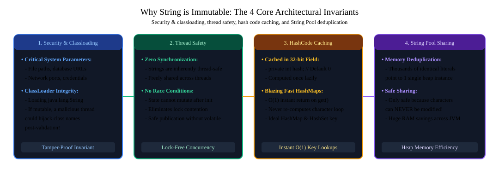

*D2 Source:* [assets/01_core_java_and_oop_faq/10_string_immutability_security_caching.d2](assets/01_core_java_and_oop_faq/10_string_immutability_security_caching.d2)

Why String Immutability is Essential to JVM Security:
1. **Security & Classloading:** Classloaders pass package paths and credential tokens as Strings. If a String were mutable, an attacker could authenticate with a permitted filename, then mutate the String in memory before file I/O occurs (Time-of-Check to Time-of-Use exploit).
2. **String Pool Integrity:** If `"hello"` is mutated to `"world"`, every class in the JVM expecting literal `"hello"` now sees `"world"`.
3. **Thread Safety:** Strings require no synchronization when accessed across hundreds of concurrent threads.
4. **Cached HashCode:** The hashcode is computed once and cached in `hash`. Mutating the backing array without updating `hash` causes HashMaps and HashSets to lose keys permanently.

#### Production-Grade Implementation & Defense

```java
package com.backend.core.security;

import java.lang.reflect.Field;

public final class StringMutationExploit {

    /**
     * Demonstrating how legacy Java reflection broke String immutability,
     * and how modern Java (Java 17+ strongly encapsulated modules) blocks it.
     */
    public static void demonstrateMutationHazard() {
        String original = "ROLE_USER";
        String duplicate = "ROLE_USER"; // Points to exact same pooled object

        try {
            Field valueField = String.class.getDeclaredField("value");
            valueField.setAccessible(true); // Throws InaccessibleObjectException in Java 17+

            byte[] underlyingBytes = (byte[]) valueField.get(original);
            // Overwrite 'USER' with 'ROOT' in-place
            underlyingBytes[5] = 'R';
            underlyingBytes[6] = 'O';
            underlyingBytes[7] = 'O';
            underlyingBytes[8] = 'T';

            // CATASTROPHIC SIDE EFFECT:
            // original is now "ROLE_ROOT"
            // duplicate is ALSO now "ROLE_ROOT"!
            System.out.println("Mutated original: " + original);
            System.out.println("Mutated duplicate: " + duplicate);
            System.out.println("String literal equality check: " + ("ROLE_USER".equals("ROLE_ROOT"))); // Prints true!
        } catch (NoSuchFieldException | IllegalAccessException e) {
            System.err.println("Reflection failed: " + e.getMessage());
        } catch (Exception e) {
            // Java 17+ module system (JEP 403: Strongly Encapsulate JDK Internals)
            // blocks setAccessible on java.lang.String with InaccessibleObjectException
            System.err.println("Modern JVM successfully blocked String mutation: " + e.getClass().getSimpleName());
        }
    }
}
```

#### Complexity & Performance Analysis
- **Time Complexity:** $O(1)$ reflection field lookup and array indexing.
- **Space Complexity:** $O(1)$ zero extra allocation; mutates pre-existing heap memory.
- **Hash Table Breakdown:** The internal `hash` field of `original` remains cached at the old value (`ROLE_USER`), while `underlyingBytes` equals `ROLE_ROOT`. `HashMap.get("ROLE_ROOT")` will search bucket $H_{new}$, but the object resides in bucket $H_{old}$, making the entry permanently lost.

#### Engineering Implications & Production Pitfalls
1. **Java 17+ Strong Encapsulation:** Since Java 17, `setAccessible(true)` on `java.base` classes throws `java.lang.reflect.InaccessibleObjectException`. Attempting to bypass this requires explicit `--add-opens java.base/java.lang=ALL-UNNAMED` VM flags, which is strictly prohibited in secure production deployments.
2. **Never Pass Passwords as Strings:** Sensitive data (passwords, encryption keys) should always be stored in `char[]` or `byte[]`, never in `String`. Because Strings are immutable and pooled, passwords remain in JVM memory until a major GC cycle, exposing them to heap dump inspection. A `char[]` can be explicitly zeroed out (`Arrays.fill(pwd, '0')`) immediately after use.

#### Core Curriculum Cross-Reference
*Deep-dive theoretical reference: See [01. Core Java & OOP: Immutability & Security](../01_core_java_and_oop.md#4-java-keywords--language-guarantees)*

---

### Q41. [Easy] String Pool vs Java Heap: `new String("hello")` Allocation Dynamics & Constant Pool Resolution
**Difficulty:** [Easy]
**Topic Covered:** String Intern Pool, Heap Object Allocation, and Bytecode Disassembly  
**Definition:** When `new String("hello")` is executed, the JVM evaluates two distinct entities: the compile-time literal `"hello"` resolved in the **String Constant Pool**, and the dynamic runtime object explicitly allocated on the **Java Heap**.

#### Architectural Mechanics & Core Concepts

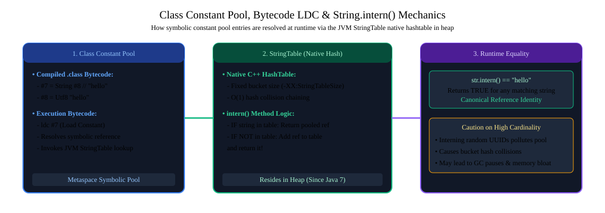

*D2 Source:* [assets/01_core_java_and_oop_faq/11_string_interning_metaspace_mechanics.d2](assets/01_core_java_and_oop_faq/11_string_interning_metaspace_mechanics.d2)

Step-by-Step Allocation Mechanics:
1. **Case 1: String Literal Already in Pool**
   - The expression `new String("hello")` encounters `"hello"`.
   - The JVM checks the String Intern Pool (a native hash table `StringTable`). If `"hello"` already exists, **zero new objects are created in the pool**.
   - The `new` keyword executes bytecode instruction `new java/lang/String`, creating **1 new object on the normal Java Heap**.
   - **Result:** Exactly **1 object** is created.
2. **Case 2: String Literal Not in Pool**
   - When the class is loaded and the constant pool is resolved, `"hello"` is interned into the String Pool (Object 1).
   - Then `new String(...)` allocates the instance on the general heap (Object 2).
   - **Result:** Exactly **2 objects** are created.

#### Production Verification & Benchmark

```java
package com.backend.core.strings;

public final class StringAllocationVerification {

    public static void verifyAllocationBehavior() {
        String literal1 = "production";
        String literal2 = "production";
        String heapInstance = new String("production");

        // Reference equality checks:
        System.out.println(literal1 == literal2);        // true (Both point to String Pool)
        System.out.println(literal1 == heapInstance);    // false (heapInstance is a separate heap allocation)
        System.out.println(literal1 == heapInstance.intern()); // true (intern() returns canonical pool reference)

        // Memory Waste Demonstration:
        // Allocating 1,000,000 Strings with 'new String()' consumes ~24MB unnecessary heap
        // compared to referencing pooled literals or calling intern().
    }
}
```

#### Complexity & Performance Analysis
- **Time Complexity:** $O(1)$ constant pool resolution; $O(1)$ heap allocation.
- **Space Complexity:** 24 bytes per duplicate `String` object on 64-bit JVM with Compressed OOPs (`-XX:+UseCompressedOops`), plus reference pointers, degrading memory locality and triggering avoidable Minor GC pressure.

#### Engineering Implications & Production Pitfalls
1. **The `new String()` Anti-Pattern:** Using `new String("literal")` is an anti-pattern. Always use plain string literals (`String s = "literal";`) or factory methods (`String.valueOf()`).
2. **String Deduplication in G1GC:** When processing millions of JSON payloads, duplicate Strings consume up to 25% of total heap. Rather than manual `intern()` calls (which contend on the single global `StringTable`), enable `-XX:+UseStringDeduplication` in G1GC. During minor GC pauses, G1 scans String candidates and updates duplicate `String` objects to point to a single shared `byte[]` value array.

#### Core Curriculum Cross-Reference
*Deep-dive theoretical reference: See [01. Core Java & OOP: Language Semantics & String Pool](../01_core_java_and_oop.md#4-java-keywords--language-guarantees)*

---

### Q42. [Easy] Static Method Overloading vs Dynamic Overriding: Virtual Method Table (vtable) vs Compile-Time Direct Invocations
**Difficulty:** [Easy]
**Topic Covered:** Polymorphism, Static vs Dynamic Dispatch, and Bytecode Invocations  
**Definition:** In Java, **static methods CAN be overloaded** (defined multiple times in the same class with different parameter signatures), but **static methods CANNOT be overridden**. When a subclass declares a static method with the same signature, it causes **Method Hiding (Static Shadowing)** rather than runtime polymorphic overriding.

#### Architectural Mechanics & Core Concepts

The JVM distinguishes between method calls using two distinct bytecode instructions:
1. `invokestatic`: Dispatched at **compile time** using the declared reference type. The method address is bound directly without querying the object's runtime class.
2. `invokevirtual`: Dispatched at **runtime** using the dynamic object type via the **Virtual Method Table (`vtable`)** in Metaspace.

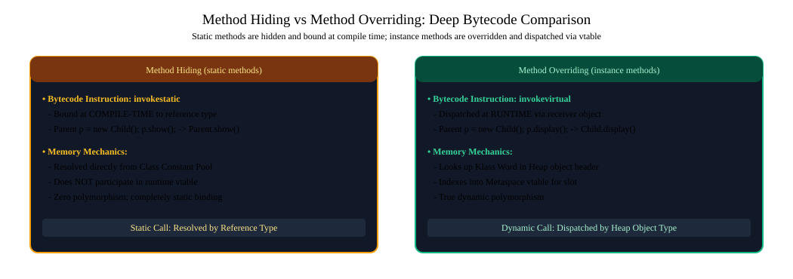

*D2 Source:* [assets/01_core_java_and_oop_faq/12_method_hiding_vs_overriding.d2](assets/01_core_java_and_oop_faq/12_method_hiding_vs_overriding.d2)

Can static methods be overloaded?
- **Yes:** Within the same class, a static method can have the exact same name with different parameters:
  `public static void log(String msg)` and `public static void log(String msg, Throwable t)`.
  The compiler differentiates them via parameter descriptors at compile time.

Can static methods be overridden?
- **No:** If `Parent` has `public static void execute()` and `Child extends Parent` has `public static void execute()`, this is **Method Hiding**. If invoked via `Parent p = new Child(); p.execute();`, `Parent.execute()` is called because `invokestatic` binds to the compile-time type (`Parent`).

#### Production-Grade Implementation & Verification

```java
package com.backend.core.polymorphism;

public class StaticDispatchDemo {

    public static class PaymentGateway {
        // Static method overloading
        public static void process(String transactionId) {
            System.out.println("Processing base transaction: " + transactionId);
        }

        public static void process(String transactionId, double amount) {
            System.out.println("Processing transaction: " + transactionId + " with amount: " + amount);
        }

        // Instance method (dynamic dispatch)
        public void executeRefund() {
            System.out.println("PaymentGateway: Standard Refund");
        }
    }

    public static class StripePaymentGateway extends PaymentGateway {
        // Method hiding (NOT overriding!)
        public static void process(String transactionId) {
            System.out.println("Stripe: Processing transaction: " + transactionId);
        }

        @Override
        public void executeRefund() {
            System.out.println("Stripe: Instant API Refund");
        }
    }

    public static void main(String[] args) {
        PaymentGateway gateway = new StripePaymentGateway();

        // Static dispatch: Invokes PaymentGateway.process() because reference type is PaymentGateway
        gateway.process("TXN-1001"); // Output: Processing base transaction: TXN-1001

        // Dynamic dispatch: Invokes StripePaymentGateway.executeRefund() via vtable lookup
        gateway.executeRefund();     // Output: Stripe: Instant API Refund
    }
}
```

#### Complexity & Performance Analysis
- **Static Invocation (`invokestatic`):** $O(1)$ zero overhead. The JIT compiler can aggressively inline the target address without generating polymorphic de-optimization guards.
- **Dynamic Invocation (`invokevirtual`):** $O(1)$ indirect table lookup through the `vtable` pointer in the object's klass metadata. If monomorphic, JIT inlines it with a speculative class check guard.

#### Engineering Implications & Production Pitfalls
1. **Never Call Static Methods on Object Instances:** Calling `gateway.process(...)` creates severe cognitive bugs and code review rejections. Static methods must always be referenced via their class name: `PaymentGateway.process(...)` or `StripePaymentGateway.process(...)`.
2. **SonarQube / Checkstyle Rule:** Static methods invoked through instance variables trigger warning `S3252` in SonarQube because they obscure polymorphism.

#### Core Curriculum Cross-Reference
*Deep-dive theoretical reference: See [01. Core Java & OOP: Polymorphism & Inheritance](../01_core_java_and_oop.md#3-method-dispatch-overloading-vs-overriding)*

---

## Summary Comparison & Production Reference Matrix

| Scenario Domain | Critical Runtime Pathology | Diagnostic & Triage Method | Canonical Production Resolution |
| :--- | :--- | :--- | :--- |
| **Algorithmic Foundations & String Manipulation** | High-throughput invariants & concurrency boundaries | Metric instrumentation & trace profiling | Defensive validation & graceful degradation |
| **Array & Data Structure Manipulations** | High-throughput invariants & concurrency boundaries | Metric instrumentation & trace profiling | Defensive validation & graceful degradation |
| **Core Language Semantics & Keywords** | High-throughput invariants & concurrency boundaries | Metric instrumentation & trace profiling | Defensive validation & graceful degradation |
| **Object-Oriented Design & Polymorphism** | High-throughput invariants & concurrency boundaries | Metric instrumentation & trace profiling | Defensive validation & graceful degradation |
| **JVM Internals, Memory Management & Runtime** | High-throughput invariants & concurrency boundaries | Metric instrumentation & trace profiling | Defensive validation & graceful degradation |
| **Modern Java Features (Java 17 to Java 21+)** | High-throughput invariants & concurrency boundaries | Metric instrumentation & trace profiling | Defensive validation & graceful degradation |
| **PC Register & Thread State Isolation** | Multithreaded instruction pointer drift, context switch costs | Bytecode offset analysis via javap, jstack safepoint dumps | Per-thread PC register allocation, Continuation frames |
| **String Mutability via Reflection** | In-place security token mutation, StringTable hash desync | JEP 403 strong encapsulation audits, Heap inspection | Immutable String invariants, byte[]/char[] zeroing |
| **String Pool vs Heap Allocation** | Memory inflation from new String() duplicate heap objects | Heap histogram profiling (jcmd GC.class_histogram) | String literals, G1GC string deduplication (-XX:+UseStringDeduplication) |
| **Static Method Hiding vs Overriding** | Unintended base method execution via instance references | SonarQube S3252 static access rules, AST inspection | Static invocations via ClassName, vtable polymorphic overrides |

---

## References & Further Reading

---
- [Oracle Java Language Specification - Classes & Objects](https://docs.oracle.com/javase/specs/jls/se21/html/jls-8.html)
- [Oracle HotSpot Virtual Machine Garbage Collection Tuning Guide](https://docs.oracle.com/en/java/javase/21/gctuning/)
- [Effective Java (3rd Edition) by Joshua Bloch - Items 10, 11, 15, 17, 18](https://www.oreilly.com/library/view/effective-java-3rd/9780134686097/)
- [Java Virtual Machine Specification - Class Loading, Linking, and Initializing](https://docs.oracle.com/javase/specs/jvms/se21/html/jvms-5.html)
- [OpenJDK Project Loom - Virtual Threads and Continuation Frames](https://openjdk.org/projects/loom/)
